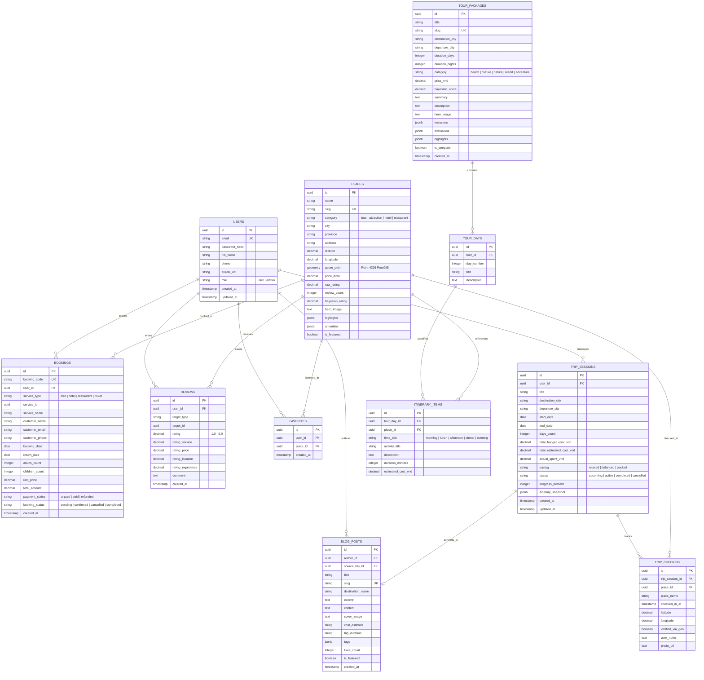

# THIẾT KẾ CƠ SỞ DỮ LIỆU & SƠ ĐỒ THỰC THỂ QUAN HỆ (DATABASE ERD)

**Dự án:** HuGo Travel System
**Hệ quản trị CSDL mục tiêu:** PostgreSQL 15+ kết hợp tiện ích mở rộng PostGIS

---

## 1. SƠ ĐỒ THỰC THỂ QUAN HỆ (MERMAID ERD)



---

## 2. CHỈ MỤC & TỐI ƯU HÓA HIỆU NĂNG (INDEXES)
1. **Chỉ mục không gian PostGIS (Spatial Index - GiST):**
   ```sql
   CREATE INDEX idx_places_spatial_geom ON places USING GIST (geom_point);
   ```
   Giúp tìm kiếm các địa điểm, nhà hàng, khách sạn lân cận trong bán kính $R$ km với tốc độ microsecond bằng toán tử `ST_DWithin`.

2. **Chỉ mục tìm kiếm và lọc:**
   - `idx_places_city_category` trên `(city, category)`.
   - `idx_places_bayesian_rating` trên `(bayesian_rating DESC)`.
   - `idx_tours_destination_price` trên `(destination_city, price_vnd)`.
   - `idx_trips_user_status` trên `(user_id, status)`.
