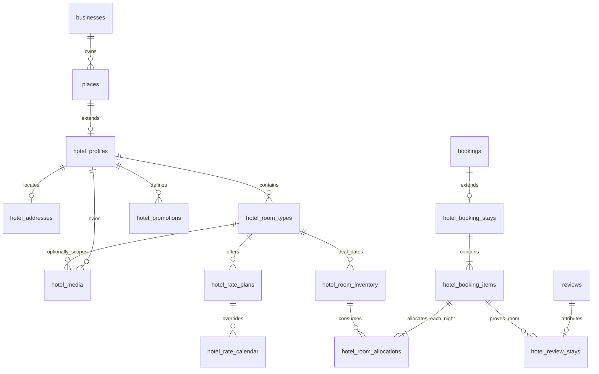

# HuGo Travel — Hotel domain foundation (21.38-A)

Status: **implemented domain code / proposed physical extension / no runtime activation**. This document is the phase-A handoff, not acceptance of the complete hotel platform. Tasks B–E, 21.40 and 21.41 have not started.

## Verified baseline

Workspace is the existing TravelGo repository, HEAD `9af594d58a328557fe53a30e46b31b01f51646be`; pre-existing uncommitted work is retained. The latest Master 21.37 closes model-OFF functional acceptance, explicitly defers worker acceptance and does not verify real Qwen. Its sealed evidence remains unchanged.

Read-only physical audit on staging `127.0.0.1:15452`, `travelgo_staging_catalog_20261112`, role `catalog_runtime`, sentinel `travelgo-public-staging:catalog-20261112`: **40 public tables, 520 columns, 17 checksum-tracked migrations**, PostGIS 3.4.3, 130 Place / 20 Business DEMO. Original PostgreSQL and its 27 Trip were not connected to. `physical-schema-before.json` contains actual columns, constraints, indexes, triggers and fingerprints. No table whose name starts with `hotel_` currently exists.

| Concern | Confirmed source | Existing capability / missing capability |
|---|---|---|
| Customer UI | `frontend/src/router/AppRouter.tsx`, existing detail/search/assistant routes | React 18/Vite; existing 48-route inventory from 21.37. Current hotel/place UI lacks a room/rate/inventory contract. |
| Public identity | `Place.ts`, `placeService.ts`, `placeRepository.ts` | Name, descriptions, gallery, property amenities, moderation, geography metadata and DEMO visibility already exist. No duplicate hotel name/catalog identity required. |
| Business / ownership | `Business.ts`, `BusinessMember.ts`, `businessAccessService.ts` | Business type/status, memberships and scoped permissions. Legal Business type is distinct from accommodation subtype in `catalogPolicy.ts`. |
| Partner/Admin | `partnerRoutes.ts`, `adminRoutes.ts`, `PlaceService.moderate` | Existing authenticated, role-restricted CRUD/moderation/audit. Generic dashboard placeholders are not room-management screens. |
| Booking | `Booking.ts`, `bookingService.ts`, `bookingValidation.ts` | Existing ownership, idempotency key/fingerprint, locks, lifecycle/history and server prices. Legacy hotel resolution uses Place.priceFrom; no room-night stock or nightly hotel calculation. Physical status column is `booking_status`. |
| Recommendation / Planner | `recommendationService.ts`, `tourPlannerService.ts`, `registeredCatalogService.ts` | Existing services retained; estimates do not become confirmed room prices. No change in phase A. |
| Reviews | `Review.ts`, `reviewService.ts`, `reviewInsightService.ts`, `agent/reviewAspects.ts` | Moderation, booking verification, consent, analysis and source revisions exist. ReviewInsight has a Place scope, not a room scope. Missing evidence-safe booked-room attribution. |
| Memory / language | `customerMemoryService.ts`, `languageMemoryService.ts`, `agent/adaptiveLanguage.ts` | Existing consented preferences and personal/shared language remain untouched. |
| Knowledge / worker | `travelKnowledgeService.ts`, `travelWebService.ts`, `travelWebRetrieval.ts`, `travelWebWorker.ts` | Approved historical knowledge v2 retained; worker remains OFF. Historical shuttle cost is not a current hotel rate. |
| Agent / Qwen | `agentCoreService.ts`, `agent/coreProvider.ts`, `agent/ollamaReadiness.ts` | Existing frozen Core and bridge retained; no model API, inference, quota scan or prompt change. |
| Geography | `geography/vietnam.ts`, PostGIS geometry columns | One shared 34-province registry plus separate tourism destination IDs. No new ward registry, geocoder or invented coordinates. |
| Media | Existing Place/Review image URL/JSON fields | No managed multipart image ingestion/storage pipeline found in routes/controllers/dependencies. Rights, MIME verification, storage, deletion and backup must be implemented later. |

## Logical / physical extension

Migration artifact `database/migrations/20261118_18_hotel_domain_foundation.sql` proposes **12 new tables**, no existing column changes, no backfill. Existing Place/Business/Booking/Review identities are retained. If applied to the verified baseline, the expected schema is **52 tables / 18 tracked migrations**. This has **not** been applied or verified natively.

| New table | Identity / purpose |
|---|---|
| `hotel_profiles` | Place PK + matching Business FK; published content/commercial revisions, check-in/out, policies/services and verified-star provenance. Name, subtype, descriptions and property amenities stay in Place. |
| `hotel_addresses` | Place PK; house/street/ward/admin/province/tourism fields, source/update time, paired nullable coordinates, coordinate authority/provenance, generated normalized/search keys and PostGIS point. |
| `hotel_room_types` | UUID + composite `(id,place_id)`; beds, area, capacities, room-only amenities, view and nullable known/unknown booleans. No view inferred from names. |
| `hotel_media` | Hotel or exact room scope; storage key, size/MIME/hash, rights evidence, moderation and order. No external scraping or URL-fetch endpoint. |
| `hotel_rate_plans` | Composite scoped room FK; integer VND / PER_ROOM_NIGHT, date window, occupancy/child charges, cancellation/meals/tax/fees, version and status. |
| `hotel_rate_calendar` | Rate + local stay-date PK; explicit nightly override/closed/version. Missing override uses that eligible rate's declared base, not Place.priceFrom. |
| `hotel_room_inventory` | Room + local stay-date PK; sellable/allocated/closed/version, CHECK 0 ≤ allocated ≤ sellable. Missing date means unknown. |
| `hotel_promotions` | Hotel/optional room/optional rate FK scope; percent basis points or fixed stay discount, booking/stay windows and version. One explicitly selected offer; no stacking. |
| `hotel_booking_stays` | Existing Booking PK; immutable contract, dates, total, version and server quote snapshot. |
| `hotel_booking_items` | Lines of that Booking; exact room/rate, occupancy, quantity and immutable quote snapshot. |
| `hotel_room_allocations` | Unique item/date allocation to inventory; guarded ACTIVE → RELEASED only, cancellation/rejection required, one decrement. |
| `hotel_review_stays` | Existing Review PK → actual booking item. Author/target/Booking COMPLETED/stay-date checks; not a review corpus or analysis engine. |

Money uses safe integer VND and BigInt arithmetic; schema JSON fields are storage, not a substitute for typed backend validation. Shared registry checks, nested JSON policies, ownership and permissions remain mandatory application validation. Price basis is never inferred from a raw amount. This V1 supports VND only; other currencies are explicitly rejected.

## Implemented independent code

`backend/src/hotels/{contracts,validation,inventory,pricing,readModel}.ts` and `services/hotelReadService.ts` implement strict contracts, Vietnamese field normalization, date/occupancy validation, all-night availability, grouped lock planning, deterministic quotes and a shared read-service port. `HOTEL_DOMAIN_ENABLED` defaults OFF; the new service is **not imported into application routes/models**, does not call DB and has no mutation/Booking authority.

`HotelReadStore.snapshot` is dependency injection, tested with in-memory SYNTHETIC snapshots. Its concrete PostgreSQL adapter, controller/routes, Partner writes and Admin publication adapter are **PROPOSED**, not implemented persistence. A future adapter must load one repeatable-read READ ONLY snapshot, take `asOf` from the DB/server, map numeric/date values explicitly and verify Place/Business status on every read.

Quotes check every night (check-in inclusive, checkout exclusive), every room's occupancy and children's ages. Unknown fees/tax/extra-guest charges block a total; no 30% legacy child discount is reused. Discount applies to room base only, one fixed stay discount only once, excluded tax uses basis-point half-up rounding and fees retain their declared room/night/stay/booking basis. An independent test oracle expects 7,391,000 VND for a synthetic 2-room/3-night example; it is not a business price.

Street search requires location scope to distinguish duplicate street names. Address folding handles accent/no-accent; `Đ.`/`D.`/`Đường` share a street key; `P.`/`Phường` and `X.`/`Xã` retain distinct ward types. Tourism IDs remain e.g. `destination:da-lat` with administrative province `68`. A destination is never accepted as an administrative province. Search SQL is parameterized with fixed sort/pagination, excluding DEMO by default. Only identity/address filters are implemented; price/view/availability filters cannot silently succeed through this query.

Coordinates stay null when unknown. Partner input cannot claim VERIFIED; verification requires a distinct authorized action/provenance. No GPS request, geocoding, invented distance or map-provider call is present.

## API contracts — proposed, NOT mounted

Use the existing `/api` router, auth middleware, response/error envelope and `BusinessAccessService.assert(userId,businessId,'MANAGE_BUSINESS')`. Never accept client `businessId` as proof of ownership. Read the Place/room/rate first and derive ownership. All write DTOs reject unknown keys; server controls version, approved revision, rating, allocated stock, verification and rights approval.

| Method / route | Input / authority / result |
|---|---|
| GET `/hotels` | Public eligible identity/address search. `HotelIdentitySearch`: canonical location, street/ward/name, subtype, bounded page/limit and name/recent sort. Date-aware commercial filter adapter is a later gate. |
| GET `/hotels/:placeId` | Eligible property/room details. Optional normalized stay criteria. Shared `HotelReadService` result including `asOf`, `validUntil`, `sourceVersion`, `cacheControl:no-store`, `isDemo`. |
| POST `/hotels/:placeId/quotes` | Read-only calculation: `ratePlanId` plus strict `StayRequest` (checkIn/out, rooms with adults/childAges, optional single promotionId). Server loads exact scoped rows; returns `HotelQuote`, binding=false, never reserves. |
| GET `/partner/places/:placeId/hotel` | Existing PARTNER auth + membership; complete editable aggregate and revision. |
| PUT `/partner/places/:placeId/hotel` | Profile extension only: check-in/out, services and policies; name/descriptions/property amenities through existing Place contract in the same transaction. `If-Match` required. |
| PUT `/partner/places/:placeId/hotel/address` | `AddressInput`; backend derives full/normalized/search fields; source timestamp is server-owned. Geographic registry validation mandatory. |
| POST/PATCH `/partner/places/:placeId/hotel/rooms[/:roomId]` | `RoomType` editable fields excluding id/placeId/version; server assigns identity on create, checks ownership and version on update. Archive instead of deleting booked rooms. |
| POST/PATCH `/partner/places/:placeId/hotel/rooms/:roomId/rates[/:rateId]` | `RatePlan` editable fields excluding scope/version; typed monetary and age-band validation. No coercion of strings into numbers. |
| PUT `/partner/places/:placeId/hotel/rates/:rateId/calendar` | ≤90 distinct local dates with integer amount/closed and expected row versions. Whole batch transactional. |
| PUT `/partner/places/:placeId/hotel/rooms/:roomId/inventory` | ≤90 dates, sellable/closed/expectedVersion only. Partner cannot set allocatedQuantity. Reject sellable below committed allocations. |
| POST/PATCH `/partner/places/:placeId/hotel/promotions[/:promotionId]` | Typed Promotion editable fields + description; server time/scope/date checks. No auto stacking or fabricated comparison price. |
| POST `/partner/places/:placeId/hotel/media` | Future bounded managed upload; membership, file signature/decode, dimensions, MIME/size, object hash, rights declaration. Do not expose until persistent storage lifecycle is accepted. |
| POST `/partner/places/:placeId/submit` | Reuse existing submit/moderation; aggregate revision accompanies the request. |
| POST `/admin/places/:placeId/moderate` | Reuse Admin workflow with expected content revision, reason and existing audit in ONE commit. Publish exactly that revision; do not approve a newer concurrent edit. |
| POST `/bookings` | Future existing BookingService HotelStay V1 adapter; explicit confirmation, idempotency/fingerprint, ownership, price/version/inventory recheck. NOT enabled in phase A. |
| PATCH existing Booking status endpoint | Same existing authorization/lifecycle, plus room allocation release in the SAME transaction. |
| Existing Review create/edit/delete/report/moderate | Reuse ReviewService; optional exact bookingItemId is validated through Booking ownership and completed stay. No Partner edit of customer content/rating. Room projection cannot use unrelated property reviews. |

Write preconditions: 401 authentication, 403 membership/permission, 404 scoped resource, 409 inventory/eligibility/publication conflict, 412 stale If-Match, 400 strict DTO/date/type, 503 feature/schema disabled. Missing inventory or unknown pricing components cannot be replaced by zero/available defaults.

## Publication, freshness and AI retrieval contract

1. Derive authorized ownership; validate strict DTO and shared geography; lock the hotel revision and affected rows, then compare expected versions.
2. Content changes to profile/address/room/media increment content revision; approved revision no longer matches. Existing Place moderation must publish exactly the revision it reviewed. Hotel business prices/calendar/inventory/promotions increment commercial revision. Rollback leaves neither revisions nor publication behind.
3. Commit authoritative PostgreSQL rows together with any approved legacy Place projection and existing audit. No invalidation event may be emitted before successful commit. V1 uses fresh reads/no-store; no broker or cross-request hotel cache is needed.
4. Website and future Agent use **the same authorized HotelReadService / PG adapter**, not another AI price table or prompt constants. Read eligibility is Place APPROVED + Business ACTIVE + approved content revision equals current revision, with DEMO denied in public production.
5. Result contains scope, source version, asOf and validity ≤60 seconds, clipped to promotion boundaries and local midnight. No-date rate reference has availability=null. Dated quote is a nonbinding snapshot, not held inventory. Unknown components are rendered as unavailable/needs-verification, not a final price.
6. At presentation/action boundaries, discard stale snapshots and re-read when versions, suspension, consent, promotion window or inventory changes. A future process-local cache must key by complete stay/occupancy/scope + revisions, expire at the same boundaries and fail closed on unverified freshness.
7. Future Agent may select grounded current facts; it cannot alter commercial rows, quote totals, rooms, Booking or review scores. Historical web costs and review opinions are different authority classes from current hotel rates. Raw untrusted review text is not sent to Qwen; retain current consent/sanitized structured aspect flow.

Room reviews: existing public moderation + AI consent remain filters at retrieval time. Join Review → hotel_review_stays → immutable booked item to determine exact room. Reuse `summarizeReviewEvidence` under ReviewInsightService; do not treat Place-level cached insights as room evidence. Existing `review_insights` table is not changed. Fresh room-scope projection and lifecycle invalidation are later integration work; no room review integration PASS is claimed.

Actual current method is `BOUNDED_VI_ASPECT_RULES_V3`, with keys `cleanliness, price, location, staff, amenities, room, noise, food, space, wait, overall` and `POSITIVE/NEGATIVE/NEUTRAL/MIXED/UNKNOWN`. It is not the roadmap's suggested uppercase aspect enum. Dedicated VIEW/FOOD_ACCESS/BEACH_ACCESS/BED_COMFORT/ACCESSIBILITY and other unimplemented aspects must remain UNKNOWN or unsupported; do not manufacture scores or map general hotel amenities to specific room attributes. A future room projection must contain Place ID, proven room ID (otherwise null), existing method, review revision, computedAt, aspect counts/sentiment and permitted evidence review IDs. Public text, if later added, needs a separately sanitized/consented projection; existing method deliberately omits raw text/identity. Review opinions about cheapness are never current rate authority. Any later extractor extension needs its own negation/mixed-sentiment/edit/delete/moderation/revocation tests; none is claimed implemented in A.

## Compatibility and activation gates

The current protected launcher still enforces **40 tables / 17 migrations**, READ ONLY and Qwen OFF. It is not loosened to admit this proposed schema. No Sequelize `.sync`, new model registration or automatic migration startup is added.

Existing Place latitude/longitude are NOT NULL; existing `serializePlace` converts null-like values to zero. Phase A leaves those existing columns/services untouched. Therefore **new hotels with unknown coordinates must remain unpublished** until a separately reviewed nullable-coordinate compatibility change covers serializers, map consumers, Planner and existing create validation. Never use `(0,0)` as a workaround. A future approved publication adapter must update legacy address/location projections atomically from the canonical structured address; existing Place edit paths must be routed through it or denied for hotel-enabled records. Two competing editable address stores are prohibited.

Before any new hotel aggregate becomes bookable, install the strategy inside existing BookingService and prevent the old hotel endpoint from accepting room-enabled properties at Place.priceFrom. Preserve existing Booking idempotency, fingerprint, history, ownership and cancellation. Lock parent hotel first, then all room/date rows in deterministic order; reload current rates/promotions, recalculate the full quote and insert Booking extensions/allocations in the same transaction. SQL artifacts use conditional stock updates and deferred all-night/item-total checks; **database concurrency, deadlocks, idempotency and cancellation have not yet been natively tested**. Multi-rate/room-line discount allocation needs one Booking-wide promotion policy before enabling multiple lines. No separate Booking engine is introduced.

Media storage is not operational: local/private Docker persistent volume or compatible object-storage port, user-only write access, server-verified object paths, rights evidence, moderation, EXIF/privacy handling, lifecycle orphan cleanup and backup/restore are required. No Windows path appears in product-domain code. No public database/Ollama ports or DEMO production data are authorized.

## Migration / rollback approval boundary

The exact review packet is in the task evidence folder. Baseline migrations 1–17 retain checksums. Migration 18 creates 12 tables, functions, indexes and narrow triggers on existing Place identity / hotel-linked Booking consistency. Existing rows and columns are unchanged; no Owner, memory, language, knowledge, catalog, Trip or Booking DML occurs.

Existing staging and original DB are **not approved migration targets**. For actual testing request one bounded new isolated database/container scope; verify sentinel/role, no network/ports/existing volumes, cached image only, exact fixture IDs and caps, capture migration/transaction/concurrency/rollback receipts and destroy only that owned target after evidence. Do not reuse staging authorization from earlier tasks.

Before a future persistent migration: frozen target identity and physical schema, encrypted `pg_dump --format=custom` plus roles/object grants/volume backup, tested restore to a separate target, protected-file checksum and all-table fingerprints, deploy-compatible adapters/feature OFF, scheduled maintenance and explicit reviewed expected deltas. Never include plaintext credentials in evidence. New table contents must start empty; schema_migrations gains only 18. Of the original 40 tables, the 39 non-tracker fingerprints must match; schema_migrations has exactly the new tracker row. No other row change is permitted unless a distinct approved backfill names exact changes. In the current task, no migration ran and all 40 fingerprints match.

Rollback artifact is manual, transactional and **refuses nonempty hotel tables**. It removes only this extension and its triggers/functions plus exact migration tracker row. For populated hotel data: stop writes, export/backup, restore-compatible application and perform an individually reviewed recovery; never cascade-delete business data. Restoring pre-migration backup after new Bookings exist would lose those transactions and requires a reconciliation plan, not an automatic rollback.

## Partner/Admin and UI handoff — proposed only

| Future component | Shared source / required behavior |
|---|---|
| HotelProfileEditor / StructuredAddressEditor | Existing Place identity + shared geography; null coordinates, scoped street/ward fields, no implicit verification. |
| HotelGalleryManager / RoomGalleryManager | Owned, rights-verified media and actual upload/storage service; separate property/room scope. |
| RoomTypeEditor / AmenitiesScopeEditor | Typed capacities, beds, area, UNKNOWN view and nullable booleans; no inferred private amenity. |
| RatePlanEditor / OccupancyPolicyEditor | Explicit VND per room/night, meal/cancellation/tax/fees/child bands. |
| InventoryCalendar / PromotionEditor | Versioned batch API, all-night stock, sale/stay windows, no fake countdown. |
| HotelReviewQueue / RevisionDiff | Existing Admin RBAC/moderation/audit, exact aggregate revision and rights verification. |
| SharedHotelSearchBar / DestinationAutocomplete | Backend geography/name suggestions; dates, room allocations, child ages and URL-preserved criteria. |
| HotelFilterSidebar / MobileFilterSheet | Server-side supported filters only; never present a filter as functional before its backend exists. |
| HotelResultCard / HotelDetailGallery / RoomRateCard / RoomDetailDialog | Distinct property/room facts, price basis, reference versus dated quote, uncertainty and DEMO labels. |
| BookingSummary / ExplicitConfirmation | Existing Booking lifecycle, current quote, idempotency and transaction-safe server revalidation. |
| ReviewList / RatingDistribution / RoomReviewFilter | Existing eligible customer reviews and genuine booked-room attribution only. |
| HotelAIEntry | Later 21.40 retrieval from shared backend; no model activation in phase A. |

Keep HuGo Travel branding, navy/white/orange and existing suitable font. Reference iVIVU layout was viewed for hierarchy only; Booking.com returned an access/JS challenge and was not bypassed. No new attached reference image file was available alongside the task text. No rate/review/image/count or business data was copied. Homepage/detail redesign, actual Partner screens, Browser E2E, Maps/GPS, real model acceptance and deployment remain **NOT RUN**.
