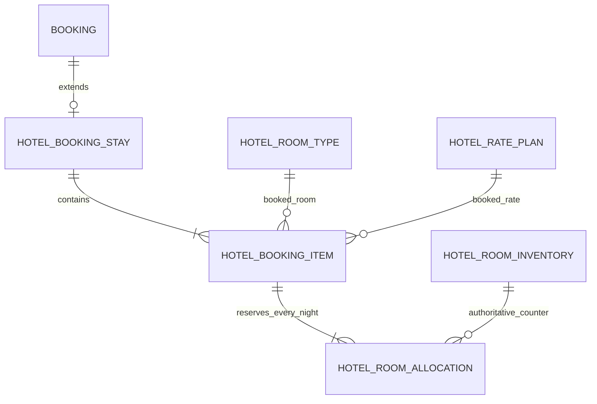

# HotelStay Booking — 21.38-D

Ngày nghiệm thu: 19/11/2026. **HOTEL_STAY_BOOKING_ACCEPTANCE_PASS_ISOLATED_ONLY**. Toàn bộ giao dịch nghiệm thu/preview là SYNTHETIC, unpaid, không cung cấp phòng thật. Payment **NOT IMPLEMENTED**. Đây chưa phải production activation.

## Customer và Partner

Customer: `/places/:id` (compatibility `/hotels/:id`) → chọn ngày/phân bổ khách → chọn đúng room/rate/promotion → checkout → đăng nhập CUSTOMER → nhập thông tin liên hệ riêng của đơn → kiểm tra giá/điều kiện → tích xác nhận → chủ động bấm đặt → xem snapshot/My Bookings → hủy nếu policy snapshot cho phép. Đọc trang, đổi ảnh, đăng nhập và prepare không tạo Booking hoặc giữ phòng. URL chỉ chứa tiêu chí công khai, không chứa contact/token/confirmation.

Detail có gallery khách sạn và gallery từng phòng riêng, keyboard/Escape/focus, mobile carousel, anchor, tiện nghi/address có cấu trúc, policy/giờ có provenance. Multiple rate plans và ưu đãi được kiểm riêng theo rate. Chỉ hỗ trợ nhiều phòng **cùng room type/rate**; không tự đổi phân bổ hoặc phối hợp nhiều hạng. Giá hết hạn hoặc criteria dirty được ẩn trước khi chọn lại.

Partner dùng `/partner/bookings`, Business membership/MANAGE_BOOKINGS tại backend, tìm mã/khách/khách sạn và lọc trạng thái. DTO Hotel loại customerEmail, userId, idempotencyKey; chỉ thông tin vận hành cần thiết. Partner không sửa total hoặc allocated quantity. Customer không tự COMPLETED. Không có check-in status mới trùng nghĩa với enum hiện có.

## API

Các write API HotelStay mặc định OFF; chỉ mở trên NODE_ENV=test, đúng approved database, thời hạn và dữ liệu SYNTHETIC. Authentication/RBAC hiện có vẫn bắt buộc.

| API | Contract |
|---|---|
| `GET /api/hotels/:id?checkIn&checkOut&rooms&offers=true` | Public snapshot/offer choices, sourceVersion/asOf/validUntil; giá do HotelReadService tính. |
| `POST /api/bookings/hotel/:placeId/prepare` | CUSTOMER + Idempotency-Key; body `{ratePlanId,stay:{checkIn,checkOut,rooms:[{adults,childAges}],promotionId?},contact:{name,email,phone,notes?}}`; trả signed confirmation, snapshot, validUntil, `reserved:false`, `requiresExplicitConfirmation:true`. |
| `POST /api/bookings/hotel/confirm` | Cùng CUSTOMER/key; chỉ `{confirmation,accepted:true}`. 201 mới, 200 exact replay, 409 hết hạn/đổi giá/source/tồn/conflict. Reject thêm total/owner/payment/status. |
| `POST /api/bookings/hotel/intent-status` | `{idempotencyKey}`, chỉ tra đơn của authenticated owner. Dùng khi chưa rõ server đã COMMIT. |
| `GET /api/bookings/my`, `GET /api/bookings/:idOrCode` | Existing ownership và immutable HotelStay snapshot. |
| `POST /api/bookings/:id/cancel` | Existing owned cancellation; policy/clock/allocations trong transaction. |
| `GET /api/partner/bookings?businessId&search&status&page&limit` | Existing Business access, server filtering và pagination. |
| `PATCH /api/partner/bookings/:id/status` | Existing `{businessId,status,reason?}`, kiểm permission và lifecycle. |

Các scalar được kiểm typed, không ép chuỗi tiền/tuổi thành số. Contact bị giới hạn độ dài; yêu cầu đặc biệt không đồng nghĩa đã được chấp thuận, không tự sửa profile. Không thu CCCD/hộ chiếu/thẻ/CVV.

Confirmation HMAC-SHA256 dùng existing JWT secret với domain separator riêng; không phải quyền do client tự cấp. Bind owner/key, exact intent hash, stay/occupancy, contact, room/rate/promotion, quote/source revisions, approved content và thời hạn tối đa 60 giây. Không lưu signature hoặc JWT trong evidence. Không lưu contact vào browser intent cache; sessionStorage chỉ có key/bookingId theo owner và lựa chọn.

## Transaction và dữ liệu

Không cần migration19. Giữ nguyên checksum migration18 và reuse Booking, BookingStatusHistory, AuditLog cùng ba bảng HotelStay của migration18.

Confirm READ COMMITTED: kiểm CUSTOMER/user-role hiện hành và khóa SHARE → reuse advisory identity `['booking-v1',userId,key]` → tra exact replay → kiểm actual clock → khóa Hotel parent → SHARE Place/Business → khóa exact inventory theo room/date tăng dần, checkout exclusive → requery/reprice trong cùng transaction và kiểm clock sau chờ khóa → INSERT Booking PENDING/unpaid, stay/item/snapshots và allocation mỗi đêm → history/audit → COMMIT. Hết hạn trong lúc chờ khóa cũng bị chặn.

Native migration18 allocation trigger là **writer duy nhất của allocated_quantity**; adapter không cộng/trừ tồn lần thứ hai. Deferred constraints chặn Booking/items thiếu đêm hoặc không khớp total/identity. Native last-night failure đã rollback toàn bộ dù allocation đêm đầu đã chạy. Hai HTTP requests có hai PostgreSQL PID độc lập cùng chờ khóa; đúng một đơn thắng khi stock=1.

Giá integer/BigInt VND dùng engine hiện có, không dùng Place.priceFrom và không tính tổng ở frontend. Oracle: base 2.200.000 − giảm 220.000 + thuế 198.000 + phí 50.000 = **2.228.000**; thêm trẻ 5 tuổi = **2.338.000**; hai phòng không trẻ = **4.406.000**. Breakdown tách phụ thu người lớn/trẻ em, nightly rates, promotion, taxes/fees và STAY_TOTAL.

Idempotency dùng unique identity hiện có: cùng key/cùng intent trả đơn cũ; khác contact/occupancy/rate/stay conflict. Signed token cũ đã hết hạn chỉ replay được **đơn cùng owner/key/intent đã COMMIT**, không dùng để đặt mới. Double-click khóa đồng bộ tại UI; backend vẫn serialize. Mất response thật sau COMMIT đã được browser kiểm tra: UI giữ key, tra trạng thái và nhận đúng một đơn.

Snapshot giữ hotel/address/room/rate, dates, từng phòng/tuổi, nightly/discount/tax/fees/total, cancellation/time provenance, content/commercial/source revisions và intent attribution. Lịch sử đọc snapshot, không thay giá catalog hiện tại. API restart đã giữ nguyên snapshot/total.

## Lifecycle, hủy và payment

Reuse enum: PENDING → CONFIRMED/REJECTED/CANCELLED; CONFIRMED → COMPLETED/CANCELLED; terminal không tự chuyển tiếp. Status và payment là hai trường riêng. COMPLETED yêu cầu actual server clock đã qua **giờ trả phòng được duyệt** của snapshot; thiếu time provenance thì fail closed.

FREE_UNTIL_CUTOFF tính deadline từ approved check-in time/timezone và cutoffHours. Chỉ PENDING/CONFIRMED trước deadline được hủy miễn phí tự động. NON_REFUNDABLE, CONDITIONAL chưa có structured fee, quá hạn hoặc không đủ evidence bị chặn rõ; không suy tiền phạt/hoàn tiền từ prose. Hủy khóa Hotel → Booking → exact allocations/inventory theo thứ tự; chuyển ACTIVE→RELEASED qua trigger một lần, giữ history/audit. Duplicate/concurrent cancel trả cùng trạng thái và không release hai lần. Partner rejection cũng dùng lifecycle/transaction chung.

Chưa có payment policy/provider hợp lệ cho business thật nên confirm chỉ nhận SYNTHETIC. Không thu tiền, false paid/refunded, transaction ID giả hoặc lưu thông tin thẻ. Snapshot chỉ ghi ranh giới unpaid/no-charge; confirmed/completed không biến thành paid.

## Review/AI handoff

Public real reviews vẫn dùng existing ReviewService/PUBLISHED projection; label VERIFIED/UNVERIFIED đúng enum. D không tạo review để trang trí. Sandbox chứa reviews0 và trình bày rõ empty state; không gọi review catalog thật để giả dữ liệu cho SYNTHETIC. Real populated review rendering và room-review submission/insights không được tính là actual integration PASS trong D.

COMPLETED SYNTHETIC past-stay fixture đã qua Partner API và có exact owner/place/room/item references; không có review/hotel_review_stays write. Đây là attribution readiness cho E, không phải chứng cứ khách đã lưu trú thật. HotelReadService tiếp tục là authoritative shared port cho website/AI; Agent Core, prompt, memory, knowledge và geography không đổi. Browser→Qwen→Tools **NOT RUN**.

## Preview owner

Một target duy nhất: `hugotravel_hotel_stay_test_20261119`, PostgreSQL **15455**, API **5062**, frontend **5180**, 52 bảng/18 migrations, Docker 1 CPU/1024 MiB. Cached PostGIS image; migration/operator/runtime tách biệt. 5060 đã được thay trước Booking vì bị browser/WHATWG fetch chặn như SIP port; FAIL setup được giữ.

- Home: http://127.0.0.1:5180/
- Hotels: http://127.0.0.1:5180/hotels
- [Khách sạn nhiều hạng phòng](http://127.0.0.1:5180/places/2138d000-0000-4000-8000-000000000020?hotel=1&checkIn=2026-11-22&checkOut=2026-11-24&rooms=%5B%7B%22adults%22%3A2%2C%22childAges%22%3A%5B%5D%7D%5D&promotionId=2138d000-0000-4000-8000-000000000085).
- Checkout: chọn “Ăn sáng · hủy trước 48 giờ” → Chọn gói giá. My Bookings: http://127.0.0.1:5180/bookings.
- [START_PREVIEW.cmd](evidence/travelgo-ai-agent-core/hotel-stay-2138d-20261119/START_PREVIEW.cmd), [STOP_PREVIEW.cmd](evidence/travelgo-ai-agent-core/hotel-stay-2138d-20261119/STOP_PREVIEW.cmd).
- [OPEN_CUSTOMER.cmd](evidence/travelgo-ai-agent-core/hotel-stay-2138d-20261119/OPEN_CUSTOMER.cmd), [OPEN_PARTNER.cmd](evidence/travelgo-ai-agent-core/hotel-stay-2138d-20261119/OPEN_PARTNER.cmd) tự đăng nhập qua existing auth vào Edge riêng bằng tài khoản **SYNTHETIC**, không dùng Owner thật. Credentials mã hóa DPAPI CurrentUser/ACL user-only, không hiển thị mật khẩu. Các file local, Edge profile, log và live audit đều nằm trong `.local/hotel-2138d-preview/` đã ignore khỏi Git. DPAPI chỉ là tiện ích preview Windows; không phải dependency của nghiệp vụ Hotel trên Linux.

Preview **BOUNDED_SYNTHETIC_WRITE_ENABLED đến 15:12:54 ICT ngày19/11/2026**, không tự gia hạn khi start lại. Cap toàn task 180 mutation attempts/1000 API reads và tối đa32 Booking; SQL fence + application deadline + least privilege + HTTP allowlist cùng áp dụng. Runtime không có quyền sửa nội dung/rate hoặc mở registration. Sau deadline supervisor chuyển READ ONLY; automatic transition chưa được quan sát khi chốt report, nhưng DB/application deadline độc lập đã chặn write quá hạn theo contract. Start/stop không provision, migrate hoặc seed; thiếu target/source mismatch thì BLOCKED. Stop chỉ target D, giữ volume/media; source lock431 file, không nới seal C.

Đã cleanup 10 HotelStay nghiệm thu và toàn bộ helper cohorts/phòng concurrency/policy/past fixture; bốn Booking legacy đã cleanup trước đó. Giữ một khách sạn, hai room types, ba rates, một promotion, sáu media, một Business, CUSTOMER A và Partner A SYNTHETIC. Bốn media phụ đã xóa đúng từng file. Sau cleanup, preview smoke tạo/hủy thêm đúng **một đơn SYNTHETIC CANCELLED** có chủ đích để kiểm quyền đã siết; đơn này còn trong My Bookings, allocated=0, unpaid. Runtime DB password/JWT chỉ trong RAM; credentials test chỉ ở blob encrypted.

## Evidence và giới hạn

[Validation](evidence/travelgo-ai-agent-core/hotel-stay-2138d-20261119/validation-summary.json): foundation37/37, commercial12/12, confirmation14/14, legacy Booking11/11, frontend state13 assertions; backend/frontend TypeScript và Vite build PASS. Actual native receipts, Edge desktop1440/mobile390, focus/anchors/current-source screenshots và price-change/real-clock expiry nằm cùng thư mục. Không cộng setup/recheck thành journey mới.

[Protected integrity](evidence/travelgo-ai-agent-core/hotel-stay-2138d-20261119/protected-integrity.json): fresh staging40/40/17 migrations,130Place/20Business và retained Owner/knowledge không đổi; Core25 hash và seal V7/A/B/C nguyên vẹn. C container đã dừng bằng owned launcher, volume/media giữ nguyên và sáu hash media khớp. Không query DB gốc; không tuyên bố đã re-fingerprint trực tiếp25 bảng/27Trip trong D. No Qwen/Ollama, worker, payment provider, Maps/GPS, paid API, commit/push/deploy.

NOT RUN: persistent staging/production Hotel migration, encrypted backup/verified restore, Linux/GPU runtime/scale, real business payment/onboarding, real populated review integration, room-review E và AI21.40. Ngày preview có inventory từ19/11 đến23/12/2026; hết phạm vi không tự giả available. Mixed room types chưa hỗ trợ. Không production ready; dừng sau21.38-D.
