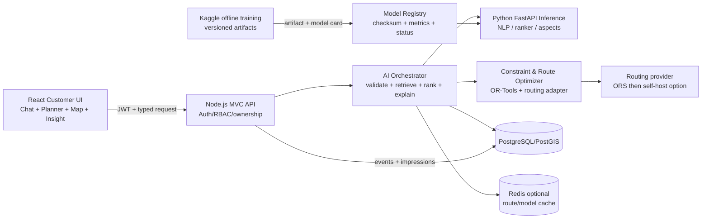

# HuGo Intelligence 2.0 — Master Plan

> Trạng thái tài liệu: **AUDIT & DESIGN COMPLETE**
>
> Ngày kiểm kê: 2026-10-12 (Asia/Ho_Chi_Minh)
>
> Phạm vi: source và database local/test `travelgo_phase35_test`; không truy cập production, không deploy, không huấn luyện model mới trong đợt này.

## 1. Kết luận điều hành

HuGo Travel đã có nền tảng phù hợp để phát triển AI: React/Vite, Node.js MVC, PostgreSQL/PostGIS, RBAC ba vai trò, dữ liệu nghiệp vụ được lưu bền vững, Bayesian Average, bộ xếp hạng heuristic, Tour Planner và Leaflet. Phase 3.5 cũng đã có bằng chứng migration/integration/E2E trên database thật.

Tuy nhiên, **HuGo Intelligence chưa phải AI production**:

- model duy nhất đã đo là baseline sentiment tiếng Anh trên bộ 10.000 Restaurant Reviews; Macro-F1 = `0.7572586`, Neutral còn yếu;
- database local/test có `0` review, `2` event, `0` recommendation impression, `0` model registry record;
- dữ liệu hiện tại chủ yếu là seed/integration-test, không đại diện hành vi người dùng thật;
- recommendation hiện là weighted heuristic; planner dùng Haversine, chi phí mặc định và đường thẳng trên bản đồ;
- chưa có Python inference service, Vietnamese model, Learning-to-Rank, routing engine hay AI chat.

Vì thế hướng đúng cho đồ án là: **đo lường và hoàn thiện baseline có thể giải thích trước; thu thập dữ liệu đúng; bổ sung Vietnamese NLP và routing có kiểm chứng; chỉ bật ML ranking khi đủ exposure/feedback**.

## 2. Nguồn sự thật đã kiểm tra

- `README.md`, toàn bộ báo cáo Phase 1–3.5 và tài liệu kiến trúc/API/thuật toán.
- Backend: migrations, Sequelize models, repositories, services, controllers, routes, seed, verifier, AI export và tests.
- Frontend: router, API services, map/planner/trip, authentication, favorites và Playwright.
- `ai/kaggle/00_quickstart_restaurant_reviews.py`, `01_travelgo_data_quality.py` và kết quả notebook do chủ dự án chạy.
- PostgreSQL/PostGIS local trong container `travelgo_postgres`, database `travelgo_phase35_test` bằng truy vấn chỉ đọc.

Khi tài liệu cũ mâu thuẫn source, source và schema thực tế được ưu tiên. Ví dụ `DATABASE_ERD.md` còn mô tả một số bảng chuẩn hóa không tồn tại; schema hiện lưu itinerary/check-in trong JSONB của `trip_sessions`.

## 3. Ma trận trạng thái thực tế

| Hạng mục | Trạng thái | Bằng chứng / giới hạn |
|---|---|---|
| Auth, refresh token, RBAC | Đã triển khai và từng PASS Phase 3.5 | CUSTOMER/PARTNER/SUPER_ADMIN; lần chạy lại full integration hiện BLOCKED do mật khẩu seed local không khớp hash đã có, không được coi là lỗi logic mới |
| Business isolation, booking transaction/concurrency | Đã triển khai và từng PASS PostgreSQL | Có ownership, row lock, idempotency; dữ liệu hiện là test |
| Place/Tour/Ticket/Blog/Booking/Trip | Đã lưu PostgreSQL | 18 bảng ứng dụng, 28 FK theo verifier Phase 3.5 |
| Review API và Bayesian Average | Đã code; chưa có dữ liệu thật | `POST /api/places/:id/reviews`; DB có 0 review, chưa xác minh booking |
| Recommendation | Heuristic đang chạy trên APPROVED places | Trọng số cố định quality/preference/budget/distance; chưa ML, chưa calibrated |
| Recommendation exposure | Schema có, pipeline chưa nối | `recommendation_impressions` có 0 bản ghi; frontend chưa gửi impression |
| User events | Endpoint có, dữ liệu không đủ | `POST /api/intelligence/events`; DB có 2 event test; frontend chưa tích hợp |
| Favorites | Demo phía client | Chỉ `localStorage`, chưa phải tín hiệu server đáng tin |
| Tour Planner | Heuristic + DB, một phần demo | Có approved-place retrieval; chi phí ăn/hotel mặc định, route Haversine |
| Leaflet/PostGIS | Có thể tái sử dụng | Map dùng OSM tiles; planner vẽ polyline thẳng, chưa road routing |
| Trip save/check-in | Đã lưu DB | JSONB; GPS hiện chỉ có tọa độ là gắn `verifiedViaGeo=true`, chưa kiểm khoảng cách/accuracy |
| English review model | Research baseline PASS | TF-IDF + Logistic Regression; không dùng làm Vietnamese/production model |
| Vietnamese sentiment/aspect | Chưa triển khai | Cần dữ liệu có license và test theo domain |
| Learning-to-Rank/demand forecast | BLOCKED bởi dữ liệu | Không có impression/click/completed-history đủ dùng |
| AI chat/NLU/FastAPI | Chưa triển khai | Mới ở mức thiết kế |
| Model registry | Schema có, lifecycle chưa có | 0 record; chưa có promotion/rollback endpoint |

## 4. Kiến trúc mục tiêu

### Nguyên tắc biên tin cậy

1. Node API tiếp tục là cổng duy nhất kiểm tra JWT, RBAC, ownership và trạng thái APPROVED/ACTIVE.
2. Python service không nhận SQL tự do và không sở hữu quyền nghiệp vụ; chỉ nhận payload đã chuẩn hóa hoặc gọi endpoint nội bộ giới hạn.
3. LLM, nếu dùng, chỉ parse intent/slot và diễn đạt kết quả đã grounding. LLM không tạo rating, giá, số review, booking hay inventory.
4. Mỗi đề xuất lưu `requestId`, candidate set, rank, score breakdown, model version và context tối thiểu.
5. Mọi model có checksum, dataset version, metrics, trạng thái `DRAFT → SHADOW → ACTIVE → RETIRED` và đường rollback.
6. Nếu model/routing lỗi: trả baseline heuristic có nhãn rõ; không bịa số và không bỏ constraint.

## 5. Các mô-đun HuGo Intelligence

### 5.1 Review & Quality Intelligence

Điểm chất lượng không đồng nghĩa điểm phù hợp cá nhân. P0 dùng công thức kiểm chứng được:

- Bayesian rating hiện có;
- số lượng và phân phối sao;
- recency có half-life được khai báo;
- verified-review weight chỉ khi gắn booking COMPLETED và đúng user/resource;
- sentiment/aspect chỉ bật sau khi Vietnamese model qua domain test;
- trả `sampleSize`, `updatedAt`, `confidenceBand/dataConfidence` và lý do đóng góp.

Không ép thành “xác suất hài lòng”. Nếu dữ liệu ít, UI phải hiển thị “chưa đủ đánh giá”.

### 5.2 Hybrid Recommendation

Pipeline chuẩn:

`Intent → Candidate retrieval → Eligibility filter → Feature engineering → Ranking → Diversity re-rank → Explanation`.

P0 giữ weighted ranker để có baseline: Bayesian quality, preference similarity, budget fit, road travel time/distance (khi có), amenities/category và availability. P1 mới thử LambdaMART/LightGBM trong shadow mode khi đủ impressions/labels và đã xử lý position bias.

### 5.3 Smart Itinerary & Budget

- Candidate chỉ từ tài nguyên APPROVED/ACTIVE có giá và tọa độ hợp lệ.
- Tách `actual`, `estimated`, `unknown`; không dùng giá mặc định như giá thật.
- Routing matrix cung cấp thời gian/khoảng cách đường bộ; OR-Tools hoặc solver ràng buộc lập lịch theo time windows, dwell time, ngân sách và buffer.
- Người dùng chọn tiết kiệm/cân bằng/thoải mái, sửa/bỏ/thêm điểm rồi tính lại.
- Booking/payment luôn là bước riêng, cần xác nhận.

### 5.4 Vietnamese NLU và hội thoại

P0 dùng schema-driven intent/slot:

- intents: `recommend`, `plan_trip`, `modify_trip`, `compare`, `explain`, `route`, `budget`;
- slots: destination, dates, travelers, budget, interests, lodging/food/transport, required/excluded stops;
- validator deterministic chuẩn hóa tiền/ngày/địa danh và hỏi lại slot bắt buộc;
- conversation state lưu có thời hạn, cho phép xem/xóa;
- có thể dùng provider LLM phía sau adapter nhưng output phải qua JSON Schema và grounding.

### 5.5 Popularity & Demand

P0 chỉ thống kê riêng views, unique sessions, clicks, favorites, bookings, completions và cancellations. Không gọi view/click là “lượt khách”. Forecasting là P2 và BLOCKED cho đến khi có lịch sử đủ dài, đều và có completed/cancelled labels.

## 6. API đề xuất

Các endpoint dưới đây là **thiết kế, chưa triển khai**:

| Method | Endpoint | Mục đích | Auth |
|---|---|---|---|
| POST | `/api/intelligence/recommendations` | candidate + rank + explain; ghi impressions nguyên tử | optional/customer |
| POST | `/api/intelligence/reviews/analyze` | inference sentiment/aspect cho nội dung được phép | internal/admin |
| GET | `/api/places/:id/intelligence` | quality summary có provenance/confidence | public |
| POST | `/api/intelligence/intents/parse` | câu Việt → intent/slots/clarifications | customer |
| POST | `/api/intelligence/itineraries` | tạo constrained itinerary + route preview | customer |
| POST | `/api/intelligence/itineraries/:id/replan` | thêm/bỏ/đổi constraint và tính lại | owner |
| POST | `/api/intelligence/routes/matrix` | adapter route matrix, cache phía server | internal |
| POST | `/api/intelligence/events` | endpoint đã có; bổ sung wiring/idempotency | optional |

Mọi response recommendation cần `requestId`, `modelVersion`, `dataUpdatedAt`, `items[].scoreComponents`, `items[].why`, `limitations` và không trả feature nội bộ nhạy cảm.

## 7. Database và pipeline dữ liệu đề xuất

Giữ migration bất biến; chỉ thêm migration mới sau khi review:

- hoàn thiện `recommendation_impressions` usage và nối event bằng `request_id`;
- bổ sung idempotency/event client ID để chống gửi trùng;
- favorites server-side hoặc sự kiện SAVE/UNSAVE;
- liên kết review ↔ booking và cờ verified do server xác nhận;
- price observation/source/currency/unit/validity để tách giá thật và ước tính;
- route cache có provider/profile/OSM-data-version/TTL;
- dataset registry + training run metadata nếu `ai_model_registry` chưa đủ;
- không chuẩn hóa mọi JSONB ngay; chỉ tách dữ liệu cần truy vấn, constraint hoặc lineage.

Export cho Kaggle phải chạy transaction read-only, pseudonymize ID bằng salt không upload, loại email/phone/token/free-text nhạy cảm, kèm manifest và license. Không dùng Google Maps content để train: điều khoản Google Maps Platform cấm dùng Google Maps Content để train/test/validate/fine-tune AI/ML models ([Google Maps Platform Terms](https://cloud.google.com/maps-platform/terms)).

## 8. Tích hợp frontend theo lát dọc

Không redesign đồng loạt. Thứ tự Customer-first:

1. Place card/detail: “Vì sao đề xuất”, cỡ mẫu và thời điểm cập nhật.
2. Planner hiện tại: thay đường thẳng bằng route geometry; hiển thị actual/estimate/unknown.
3. Full-screen AI Planner: form + chat có cấu trúc, itinerary và map đồng bộ.
4. Compare panel 2–3 lựa chọn với tiêu chí giống nhau.
5. Preference profile: xem/sửa/opt-out lịch sử dùng cho cá nhân hóa.
6. Mobile: bottom sheet map/list, keyboard-safe chat, route loading/error/partial states.

Các event VIEW/IMPRESSION/CLICK/SAVE/BOOKING_* phải phát ở frontend nhưng giá trị, user và ownership được backend xác thực.

## 9. Bảo mật, riêng tư và an toàn

- Data minimization, consent riêng cho personalization; cho phép opt-out/xóa.
- Không đưa credential, JWT, email, điện thoại, raw GPS trail hoặc ID có thể đảo ngược lên Kaggle.
- Review input cần validation/rate limit/moderation; verified flag không nhận từ client.
- Check-in GPS cần khoảng cách tới place, giới hạn accuracy/time và chống replay; hiện tại chỉ có tọa độ là được gắn verified nên chưa đủ bằng chứng ghé thăm.
- Model artifact chỉ load sau kiểm checksum và allowlist model type/version.
- Route/LLM keys chỉ ở backend secrets; quota, timeout, circuit breaker và budget alert.
- Prompt/tool injection: allowlist tool, JSON schema, no arbitrary SQL, no direct booking/payment.
- Audit log cho activate/rollback model và mọi hành động quản trị.

Dependency audit chạy ngày 2026-10-12 hiện **FAIL theo tiêu chí zero known vulnerability**, dù không còn high/critical:

- backend: 2 moderate (`sequelize@6.37.8 → uuid@8.3.2`); advisory nằm ở UUID v3/v5/v6 với buffer, trong khi source HuGo tạo UUIDv4 không truyền buffer, nhưng dependency vẫn cần theo dõi/nâng tương thích;
- frontend: 2 moderate (`react-router-dom/react-router@6.30.6`); login redirect hiện đã chặn `//` và backslash, ứng dụng là client Vite chứ không dùng SSR hydration, nhưng advisory vẫn chưa được đóng;
- `npm audit fix --force` hiện đề xuất thay đổi major/không phù hợp (downgrade Sequelize hoặc React Router 7), nên không tự áp dụng. Cần test migration tương thích riêng và pin bản vá upstream khi có.

## 10. Chi phí và lựa chọn make-or-buy

- Training baseline: Kaggle CPU/GPU theo quota tài khoản; lưu output/version và không phụ thuộc session tạm.
- Inference P0: TF-IDF chạy CPU rẻ; PhoBERT có thể cần CPU tối ưu/ONNX hoặc GPU tùy tải, phải benchmark trước.
- Routing P0: OpenRouteService hosted phù hợp demo/học thuật nhưng có quota; API phải qua adapter và cache. P1 có thể self-host Valhalla/OSRM cho vùng Việt Nam nếu đo được chi phí vận hành.
- Google Routes cho chất lượng/traffic tốt nhưng cần billing và kiểm soát SKU; giá thay đổi nên phải kiểm tra [pricing chính thức](https://developers.google.com/maps/billing-and-pricing/pricing) trước khi bật.
- LLM là tùy chọn; đặt giới hạn token, cache parse phù hợp và luôn có form/rule fallback.

## 11. Cổng sẵn sàng

HuGo Intelligence chỉ được gọi **P0 demo ready** khi:

- dữ liệu/lineage/license audit PASS;
- Vietnamese sentiment có test set độc lập và đạt gate đã định trước;
- recommendation baseline offline PASS và mọi constraint quan trọng đạt 100% trên bộ test hợp lệ;
- route trên website là geometry từ engine thật, có provider attribution và fallback được gắn nhãn;
- end-to-end: câu Việt → xác nhận slots → recommend → itinerary → route → explain → save trip PASS;
- privacy/security/integration tests PASS;
- model card, checksum, rollback và kết quả thí nghiệm thực đo có thể tái lập.

Hiện trạng: **DESIGN READY; AI P0 NOT IMPLEMENTED; production readiness = BLOCKED bởi dữ liệu, dependency advisories và các module còn thiếu.**

## 12. Tài liệu chi tiết

- [HUGO_AI_DATA_AUDIT.md](./HUGO_AI_DATA_AUDIT.md)
- [HUGO_AI_MODEL_TRAINING_PLAN.md](./HUGO_AI_MODEL_TRAINING_PLAN.md)
- [HUGO_AI_GIS_ROUTE_PLAN.md](./HUGO_AI_GIS_ROUTE_PLAN.md)
- [HUGO_AI_EXPERIMENT_DESIGN.md](./HUGO_AI_EXPERIMENT_DESIGN.md)
- [HUGO_AI_IMPLEMENTATION_ROADMAP.md](./HUGO_AI_IMPLEMENTATION_ROADMAP.md)
