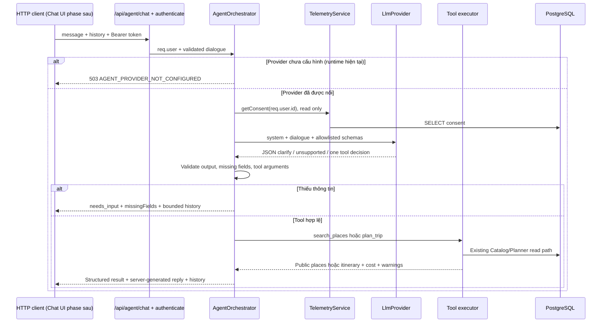

# T-AI-01 — Nền tảng backend AI Agent

Ngày hoàn thành: **08/11/2026, Asia/Saigon**.

**Kết quả: hoàn thành phần nền tảng backend có thể kiểm chứng không cần API key. Backend/frontend build PASS; 22 nhóm test Agent PASS; hai luồng HTTP → Catalog/Planner → PostgreSQL chỉ đọc PASS với provider MOCK_ONLY. Fingerprint 25/25 bảng trùng. Chưa phải Agent sử dụng LLM thật và chưa đạt acceptance hội thoại tự nhiên của toàn bộ Phase 1.**

Runtime mặc định trả **503 / AGENT_PROVIDER_NOT_CONFIGURED** sau xác thực và validation. Không có provider mock trong runtime, không tự gửi hội thoại ra dịch vụ ngoài, không trả lịch trình giả khi thiếu provider.

## 1. Đối chiếu roadmap và phạm vi thực hiện

Đã đọc [Gap Analysis](HUGO_AI_AGENT_GAP_ANALYSIS.md), [MVP Roadmap](HUGO_AI_AGENT_MVP_ROADMAP.md), [T13-B-02-FIX](HUGO_T13_B_02_FIX_REPORT.md) và đối chiếu source hiện tại của Planner, Recommendation, Catalog, Trip, Auth, Consent.

Roadmap chia **T-AI-01 = Phase 1 backend**, **T-AI-02 = Phase 2 Chat UI**, Phase 3 là context Trip/stream nâng cao và giới hạn tần suất. Theo yêu cầu giữ phạm vi giai đoạn đầu nhỏ hơn, task này không tạo `/assistant`, không sửa frontend/navigation. Frontend vẫn được build để kiểm tra baseline.

Những điều chỉnh so với concept cũ:

- Không thêm `save_trip`, `update_trip`, `get_trip`, Booking hoặc công cụ Partner/Admin. Yêu cầu mới chưa cho phép mutation Trip/Booking, và context Trip là phase sau.
- Chưa chọn Gemini/Ollama, chưa cài SDK hay đặt model mặc định theo tên model trong tài liệu cũ. Có interface và adapter JSON để nối transport đã chọn ở task tiếp theo. Không cần `GEMINI_API_KEY` để build/test foundation.
- Dùng history stateless như MVP roadmap; không migration, bảng chat hoặc bộ nhớ hội thoại dùng chung.
- Consent thực tế là `TelemetryService.getConsent(...).personalizationEnabled`, không có trường `userConsent.personalizationAllowed` như concept. `RecommendationExposureService.resolveConsentAwareInputs` vẫn cho phép dùng **sở thích/ngân sách nhập trực tiếp** khi opt-out; consent quyết định phần được lưu. Agent giữ semantics này, không truy xuất hành vi hoặc lưu personalization/telemetry.
- Planner hiện tại dùng `RecommendationRepository.getApprovedPlaces()`, không dùng endpoint hư cấu `PlaceService.getPublicPlaces()`. Tái sử dụng service/repository thực tế.
- Không thực hiện đề xuất mock fallback cho demo trong roadmap. Mock chỉ nằm trong test/harness và được đánh dấu rõ.

| Thành phần mục tiêu | Trạng thái thực tế |
|---|---|
| Conversation UI | **NOT IMPLEMENTED / Phase 2** theo phạm vi nhỏ hơn |
| Backend orchestrator + authenticated route | **IMPLEMENTED**, default provider chưa cấu hình |
| Provider abstraction | **IMPLEMENTED**: `LlmProvider`, `JsonLlmProvider`, `UnconfiguredLlmProvider`; transport LLM cụ thể chưa có |
| Multi-turn | **IMPLEMENTED**: request-local history stateless có validation/giới hạn; MOCK_ONLY đã kiểm luân phiên nhiều lượt |
| Catalog/Planner tools | **IMPLEMENTED**: gọi service hiện có; kiểm cả synthetic unit và DB test chỉ đọc |
| Structured itinerary/cost/warnings | **IMPLEMENTED**: từ service output, không dùng câu trả lời giá/địa điểm do model sinh |
| Thiếu thông tin / tool lỗi / output sai | **IMPLEMENTED** và unit/HTTP test |
| LLM hiểu tiếng Việt, chọn tool từ câu tự nhiên | **NOT RUN**, chưa có transport/provider thật |
| Save Trip / Booking / context Trip / chat DB | **OUT OF SCOPE** |

T13-B giữ nguyên **15 PASS / 0 FAIL / 28 CORE NOT RUN, 8 OPTIONAL NOT RUN** theo báo cáo trước. Không cộng test Agent hoặc unit RBAC thành CORE T13 mới; không chạy T13-B-03.

## 2. Kiến trúc đã triển khai



Không có vòng lặp tool vô hạn: tối đa **một quyết định, một tool/lượt**. Không gửi kết quả tool trở lại LLM để viết lại giá hoặc lịch trình. Reply ngắn và câu hỏi bổ sung dùng template server; điều này kiểm soát nguồn dữ liệu nhưng chưa cung cấp khả năng giải thích tự nhiên bằng LLM.

### Contract HTTP

`POST /api/agent/chat`, tái sử dụng `authenticate` hiện có. Backend yêu cầu token hợp lệ, không thêm policy role mới; công cụ chỉ đọc catalog công khai, không có thao tác đặc quyền theo role.

```json
{
  "message": "Tôi muốn lập lịch trình Đà Nẵng",
  "history": [
    { "role": "user", "content": "Tôi muốn đi du lịch" },
    { "role": "assistant", "content": "Bạn vui lòng cung cấp điểm đến." }
  ]
}
```

Ví dụ trên chỉ minh họa request, **không phải bằng chứng LLM đã hiểu câu tiếng Việt**. Runtime hiện tại trả 503 vì chưa có provider.

Request chỉ nhận `message`, `history`; từ chối `userId`, `currentTripId`, role/system/tool giả, trường thừa. Mỗi tin nhắn 1–2000 ký tự; history tối đa 10 cặp user/assistant; tổng context tối đa 16.000 ký tự. Response trả history đã hoàn tất lượt, cắt cặp cũ nếu cần và có `historyTruncated`; chừa 2.000 ký tự cho tin nhắn kế tiếp. Không lưu history vào DB hay singleton. Client phase sau phải xóa history khi đổi tài khoản; server không tự truy hồi history của bất kỳ tài khoản nào.

Response thành công có `success`, `data.status`, `reply`, `history`, `historyTruncated`, `context`; khi tool chạy được có thêm `result`:

- `completed`: `result.type=places|itinerary`, `source`, public places hoặc `itinerary`, `cost`, `warnings`.
- `needs_input`: `missingFields`; chưa chạy tool.
- `unsupported`: không chạy tool/mutation.
- `tool_unavailable`: catalog không đủ để Planner tạo lịch trình; không có result giả.

Mã lỗi chính: 401 auth, 400 input/context/tool invalid, 502 provider/output/tool failure, 503 provider chưa cấu hình hoặc consent chưa đọc được, 504 timeout. Route không trả raw provider/DB exception hoặc stack; `Cache-Control: no-store`. Không log nội dung chat/token/provider response trong code Agent.

### Công cụ và nguồn dữ liệu

| Tool | Đường gọi thực tế | Validation và dữ liệu trả về |
|---|---|---|
| `search_places` | `RecommendationService.recommendFromDatabase` → `RecommendationRepository.getApprovedPlaces` → `PlaceRepository.list(publicOnly)` | Điểm đến, budget/người/ngày ≥0, preference allowlist, category hiện có; tối đa 10 kết quả theo thứ tự service. Projection chỉ id/name/category/city/province/priceFrom/availability. Null/không có giá khác giá 0. |
| `plan_trip` | `TourPlannerService.generatePersonalizedItinerary` → repository hiện có | Tái sử dụng `validatePlannerInput`, 1–10 ngày, car/motorbike, balanced, budget/count/preferences; kiểm UUID mandatory IDs trước gọi. Yêu cầu đủ origin/destination/dates/adults/budget/transportation thay vì tự dùng default để đoán thông tin người dùng chưa cung cấp. |

Các optional input tiếp tục dùng default service: children 0, preferences rỗng, pacing balanced, mandatory IDs rỗng. Output itinerary vẫn chứa các giá trị đó để client hiển thị. Không đổi Planner algorithm, pricing, ranking hoặc sentiment.

Kết quả Planner giữ `GROUP_VND_V1`, costs, `costAssumptions`, `constraintViolations`, `budgetAdvice` và provenance trong activities. `hotelSuggestion` được chiếu sang trường catalog công khai; không chuyển tiếp contact/moderation/member fields. Các khoản ước tính fallback vốn có trong Planner vẫn là **ước tính có provenance**, không biến thành giá catalog thật.

### Provider và quyền riêng tư

`JsonLlmProvider` nhận transport được inject, truyền `AbortSignal`, parse JSON và chặn envelope >16.000 ký tự. Orchestrator kiểm discriminated decision: `clarify`, `unsupported`, hoặc một tool allowlisted. Từ chối free-text reply/itinerary/tool-result giả từ provider. Không có transport HTTP/SDK cụ thể, không load API key và không có lựa chọn mock qua environment.

Provider chỉ nhận system, messages và schemas; không nhận JWT, id/email/tên/role từ account, consent row, Trip, Booking hay dữ liệu account khác. Nội dung **người dùng tự nhập trong chat** sẽ nằm trong messages nếu task sau nối provider thật; foundation không có bộ lọc PII tổng quát và không tuyên bố anonymize nội dung người dùng. Chính sách gửi chat ra provider ngoài phải được chốt trước tích hợp thật; telemetry consent hiện có không được tự coi là đồng ý gửi dữ liệu cho bên thứ ba.

## 3. File thay đổi

Chỉ một file ứng dụng có sẵn được sửa:

- [backend/src/routes/api.ts](../backend/src/routes/api.ts): import và mount `/agent`.

File ứng dụng mới:

- [agent/conversation.ts](../backend/src/agent/conversation.ts): request/history validation, bounded history.
- [agent/provider.ts](../backend/src/agent/provider.ts): interface, JSON adapter, disabled provider, deadline helper.
- [agent/tools.ts](../backend/src/agent/tools.ts): tool schemas, decision/input validators, existing-service adapters, public projection.
- [services/agentService.ts](../backend/src/services/agentService.ts): orchestration, consent read, safe failure paths, result/history envelope.
- [controllers/agentController.ts](../backend/src/controllers/agentController.ts): request handler.
- [routes/agentRoutes.ts](../backend/src/routes/agentRoutes.ts): auth route và safe error boundary.

Test/harness mới:

- [agentFoundation.test.ts](../backend/src/tests/agentFoundation.test.ts): 22 nhóm kiểm thử, mock chỉ ở test.
- [t-ai-01-readonly.cjs](../backend/scripts/t-ai-01-readonly.cjs): exact test DB, read-only connections, sentinel/checksums/fingerprint, HTTP/service/DB verification.
- [t-ai-01-checks.cjs](../backend/scripts/t-ai-01-checks.cjs): build/unit/regression và log riêng từng run.
- [t-ai-01-integrity.cjs](../backend/scripts/t-ai-01-integrity.cjs): baseline/audit hash file, không sửa dữ liệu ứng dụng.

Không đổi package/lock/dependency, config/env, frontend source, schema/migration hoặc các file FIX Partner trước đó.

## 4. Build, unit và regression

[Kết quả cuối](evidence/t-ai-01/checks-20261108T024110429Z/results.json):

| Kiểm tra | Kết quả | Bằng chứng |
|---|---|---|
| Backend `npm run build` | PASS | [log](evidence/t-ai-01/checks-20261108T024110429Z/backend-build.log) |
| Frontend `npm run build` | PASS | [log](evidence/t-ai-01/checks-20261108T024110429Z/frontend-build.log) |
| Agent unit + HTTP mock integration | **22/22 nhóm PASS**, MOCK_ONLY | [log và tên từng nhóm](evidence/t-ai-01/checks-20261108T024110429Z/agent-unit-http-mock.log) |
| Existing RBAC/auth/ownership unit | PASS, không phải re-run CORE T13 | [log](evidence/t-ai-01/checks-20261108T024110429Z/rbac-unit.log) |
| Existing Planner validation/cost unit | **50/50 PASS** | [log](evidence/t-ai-01/checks-20261108T024110429Z/planner-validation-costs.log) |
| Existing Planner modes unit | **17/17 PASS** | [log](evidence/t-ai-01/checks-20261108T024110429Z/planner-modes.log) |
| Existing Recommendation correctness | **8/8 checks PASS** | [log](evidence/t-ai-01/checks-20261108T024110429Z/recommendation-correctness.log) |
| Browser desktop/mobile Chat UI | **NOT RUN** — UI thuộc Phase 2, chưa tạo |
| LLM thật / tự chọn tool từ tiếng Việt | **NOT RUN** — chưa có provider transport/key/model |

Lần chạy [checks-20261108T024044903Z](evidence/t-ai-01/checks-20261108T024044903Z/results.json) dừng tại frontend build vì esbuild bị sandbox từ chối đọc đường dẫn. Giữ [log thất bại môi trường](evidence/t-ai-01/checks-20261108T024044903Z/frontend-build.log); chạy lại ngoài sandbox được phê duyệt tự động và PASS trên cùng source. Không sửa assertion hoặc source frontend để vượt build.

22 nhóm Agent bao phủ: provider disabled/JSON/malformed/oversized/deadline; sanitized errors; history roles/order/size/rotation; multi-turn và account isolation; auth; consent failure/opt-out; forbidden tools và fake output; thiếu fields không gọi Planner; invalid dates/count/budget/mode/UUID/ownership injection; tool error/timeout; Planner thực với synthetic catalog; public eligibility/projection/0-vs-null; empty catalog; malformed Planner result; actual mounted API 401/503 và HTTP mock route integration.

Unit suite chặn `sequelize.query` để không kết nối DB. Provider, consent và catalog trong suite này là test doubles; Planner/validation/auth/router/controller là code thực. Test không đánh giá NLU hoặc LLM reasoning.

Lệnh tái chạy từ thư mục dự án:

```text
node backend/scripts/t-ai-01-checks.cjs
node backend/scripts/t-ai-01-readonly.cjs
node backend/scripts/t-ai-01-integrity.cjs after
```

Không dùng suite seed-based. Harness checks dừng ở lệnh đầu tiên FAIL; mỗi lần chạy lưu thư mục mới.

## 5. HTTP/API/PostgreSQL thật — phân biệt với LLM thật

Run: [readonly-20261108T023947424Z-667cbf](evidence/t-ai-01/readonly-20261108T023947424Z-667cbf/result.json).

**Hai flow PASS:** `search_places`, `plan_trip` qua HTTP loopback → auth middleware/controller/orchestrator → service thật → PostgreSQL thật. [Request arguments, status và response đầy đủ](evidence/t-ai-01/readonly-20261108T023947424Z-667cbf/http-api-results.json).

- Provider được script quyết định tool: **MOCK_ONLY**, không diễn giải câu tự nhiên.
- Principal được ký token trong bộ nhớ, không tạo account/đăng nhập DB: **không phải login E2E**. Consent SELECT thật cho principal không có row trả default false.
- Catalog sử dụng dữ liệu **có sẵn trong DB test**. Run chọn bản ghi có city `Phase35 City 1792068654001-1018`, landmark ID `a5eb2240-ad66-4972-a82d-8cd542e98a9f`, giá catalog 125.000 VND. Đây là test data đã có, không chứng minh địa điểm/giá ngoài đời. Task không tạo, sửa hoặc xóa bản ghi đó.
- Tool trả 200/completed, source đúng service; IDs tồn tại trong catalog đã đọc. Planner result có itinerary, cost, warnings; cost bằng `itinerary.totalEstimatedCostVND`. Không chèn giá/địa điểm mock vào response API để tuyên bố dữ liệu thật.
- Harness không dùng mock repository hoặc mock Planner trong run PostgreSQL này. Scripted provider và principal vẫn được ghi rõ trong artifact.

Không có screenshot Chat UI vì chưa có UI Agent. Không lấy screenshot trang khác để thay bằng chứng.

## 6. Bảo vệ dữ liệu, cleanup và source integrity

[Preflight](evidence/t-ai-01/readonly-20261108T023947424Z-667cbf/preflight.json): `NODE_ENV=test`, host `127.0.0.1`, exact DB **travelgo_ai_m0_test**, SSL false, sentinel PASS; **12/12 migration SHA-256 khớp**. Không apply migration. Mỗi Sequelize connection đặt `default_transaction_read_only=on` và statement timeout trước query, kiểm read-only thực tế. `ALLOW_TEST_DB_WRITES=false`.

Không có write nên không cần write opt-in, fixture insert hay cleanup DELETE. [Ledger](evidence/t-ai-01/readonly-20261108T023947424Z-667cbf/ledger.json) có các tập fixture rỗng, writes 0, residual fixture 0, cleanup `NOT_REQUIRED_NO_DB_FIXTURES`.

[Fingerprint before](evidence/t-ai-01/readonly-20261108T023947424Z-667cbf/before.json), [after](evidence/t-ai-01/readonly-20261108T023947424Z-667cbf/after.json), [compare](evidence/t-ai-01/readonly-20261108T023947424Z-667cbf/fingerprint-compare-compare.log): **25/25 bảng trùng, changed=[]**. Fingerprint chạy transaction repeatable-read read-only. Không reset/seed/truncate/xóa volume, không đụng fixture của run khác.

[Baseline 3.260 file](evidence/t-ai-01/baseline.json) chụp trước thay đổi ứng dụng; [integrity after + source SHA-256](evidence/t-ai-01/integrity-after.json) xác nhận **3.259 file cũ giữ nguyên**, chỉ `backend/src/routes/api.ts` đổi để mount route. Các file thêm mới được liệt kê trong audit. Baseline loại `node_modules`, `.git`, `dist`, test report sinh tự động, `.env*` và thư mục evidence mới T-AI-01; không loại evidence cũ T13 khỏi audit. Script integrity mới đã có khi chụp baseline.

Giữ nguyên ba source Partner FIX, Planner/Recommendation/Trip/Auth/Consent hiện có, toàn bộ báo cáo và evidence T01–T13. Không đọc/ghi API key trong task; không thêm key vào bundle frontend. Build tạo lại `dist` là output sinh tự động, không được tính là sửa source cũ.

## 7. Giới hạn và lỗi còn mở

1. **LLM transport chưa có.** Interface/adapter tests PASS không chứng minh Gemini/Ollama hiểu tiếng Việt, chọn tool đúng, không bịa arguments hoặc chống prompt injection khi chạy thật. Acceptance roadmap “câu tự nhiên → plan_trip” còn **NOT RUN**.
2. **Chat UI chưa có** theo Phase 2. Chưa kiểm browser/mobile, refresh/logout, render itinerary hoặc cơ chế client quản lý history.
3. Stateless history do client gửi có thể bị sửa. Server coi đây là dialogue không tin cậy, không dùng làm authorization hay bằng chứng tool; không cung cấp session ownership/persistence đã ký.
4. Chưa có rate limit theo user, quota/cost controls, retry hoặc streaming. Provider mặc định disabled. Phải bổ sung giới hạn vận hành trước khi mở dịch vụ LLM thật cho nhiều người dùng.
5. Deadline Agent giới hạn thời gian chờ; tool service hiện tại không nhận AbortSignal nên query có thể hoàn thành sau timeout. Đây đều là đường đọc. Harness DB áp statement timeout; không thay DB/runtime config của ứng dụng để che giới hạn này.
6. Chưa kiểm consent UI/withdrawal toàn bộ C01–C08. Agent dùng contract hiện có, không đánh dấu các CORE Consent PASS.
7. Public output đã chiếu trường; code không tự đưa profile/history riêng vào prompt. Nội dung PII người dùng tự nhập và điều khoản gửi dữ liệu provider ngoài vẫn cần quyết định/tích hợp ở bước sau.
8. **Map `Invalid LatLng object: (NaN, NaN)` P2 OPEN**, không điều tra/sửa. Nhãn “nháp” Ticket ngoài phạm vi tiếp tục giữ nguyên. Không có lỗi Agent assertion còn FAIL trong các kiểm tra đã chạy; lỗi sandbox build ban đầu được giữ bằng chứng.

## 8. NEXT TASK PLAN — chờ duyệt

### Đề xuất: T-AI-01-B — Nối provider thật và nghiệm thu backend Agent

**Dependency:** duyệt báo cáo foundation này; chọn provider (Gemini hoặc Ollama) và model còn được hỗ trợ; có credential backend hoặc local endpoint; thống nhất việc gửi nội dung chat ra provider ngoài. Không cần duyệt lại hoặc chạy lại T13-B-02-FIX nếu không sửa nguồn liên quan.

**Phạm vi:**

1. Kiểm tài liệu chính thức hiện hành của provider; thêm đúng transport/SDK đã chọn vào `LlmProvider`/`JsonLlmProvider`, config server-only, startup/config validation. Không tái sử dụng tên model/SDK cũ trong roadmap mà chưa kiểm tra.
2. Thêm integration tests với transport giả có nhãn MOCK_ONLY cho quota, timeout, malformed/oversized response và cancellation; runtime không fallback mock.
3. Nối provider thật vào singleton theo config rõ ràng. Giữ allowlist hai tools, consent semantics và không có Trip/Booking mutation.
4. Thêm giới hạn tần suất/concurrency/context/token để kiểm soát chi phí và tải; không log raw messages/credentials. Định nghĩa rõ lỗi quota và retry an toàn.
5. Chạy bộ câu tiếng Việt có expected khóa trước: thiếu thông tin → hỏi, trả lời nhiều lượt → tool đúng; từ chối save/booking/foreign-data/prompt injection; catalog rỗng/DB lỗi; kiểm arguments không bịa và result/cost đúng output Planner.
6. Dùng exact test DB, guard/sentinel/checksum/fingerprint. Ưu tiên read-only; nếu cần account fixture đăng nhập thật thì ledger/cleanup FK/ID đầy đủ và chỉ bật write sau preflight.

**Acceptance:** build và existing foundation/regression PASS; bằng chứng request/response redacted với **LLM thật**, real authenticated account và PostgreSQL; không lộ key, không ghi Trip/Booking, không biến lỗi thành kết quả giả, fingerprint không đổi sau cleanup. Tách PASS/FAIL/NOT RUN giữa MOCK_ONLY và LIVE_LLM; không đóng acceptance NLU nếu chưa chạy live.

**Deliverables đề xuất:** `docs/HUGO_T_AI_01_B_LIVE_PROVIDER_REPORT.md`, evidence riêng `docs/evidence/t-ai-01-b/`, provider config/runbook không chứa secret. Nếu chưa có key/endpoint thì hoàn thành transport/tests, ghi live NOT RUN và không tuyên bố Agent hoàn chỉnh.

**Sau khi bước trên được duyệt riêng:** T-AI-02 Chat UI `/assistant`, tái sử dụng structured response, desktop 1440×900/mobile 390×844, kiểm nhiều lượt và tách mock/live E2E. Chưa thêm ConfirmSaveTrip trước khi có contract xác nhận/phân quyền được duyệt.

**Điểm dừng:** báo cáo này kết thúc T-AI-01 foundation. Chưa chạy NEXT TASK, T13-B còn lại, push hoặc deploy.
