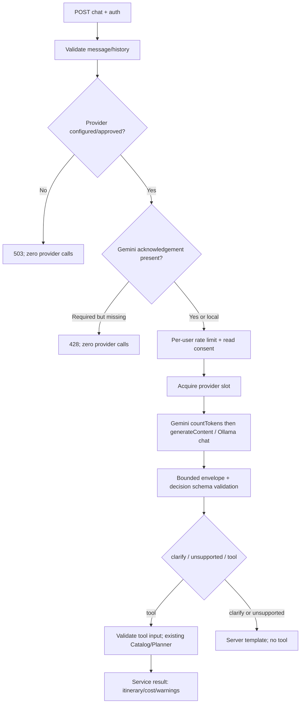

# T-AI-01-B — LLM transport và bộ đánh giá tiếng Việt

Ngày: **08/11/2026, Asia/Saigon**.

**Transport/controls đã triển khai; build và regression PASS. LIVE_LLM: NOT RUN.** Không có provider/model được cấu hình, Gemini key, hoặc xác nhận điều kiện sử dụng/live. Không tự kích hoạt request LLM, đăng ký dịch vụ, tải model, tạo credential hoặc bật billing.

Đã hỗ trợ lựa chọn `gemini` và `ollama` qua Node fetch, thêm schema decision, giới hạn vận hành, error sanitization và chốt đồng ý xử lý ngoài hệ thống. Runtime hiện vẫn dùng `UnconfiguredLlmProvider`, trả **503 / AGENT_PROVIDER_NOT_CONFIGURED**. Không có production mock fallback. Chưa có Chat UI; không tuyên bố Agent hoàn chỉnh hoặc NLU PASS.

## 1. Căn cứ và phạm vi source

Đã đối chiếu [T-AI-01 foundation](HUGO_T_AI_01_AGENT_FOUNDATION_REPORT.md), [Gap Analysis](HUGO_AI_AGENT_GAP_ANALYSIS.md), [MVP Roadmap](HUGO_AI_AGENT_MVP_ROADMAP.md), `backend/src/agent/`, orchestrator và source Planner/Recommendation/Catalog/Auth/Consent. Không xây lại các service đó. Trip/Booking không được đưa vào tool allowlist.

Chỉ sửa **4 file có sẵn**:

| File | Thay đổi |
|---|---|
| [agent/provider.ts](../backend/src/agent/provider.ts) | Thêm metadata `external?` vào interface; giữ nguyên JSON adapter test và unconfigured provider. |
| [agent/conversation.ts](../backend/src/agent/conversation.ts) | Cho phép đúng version `externalProcessingConsent`; không đưa trường này vào history/prompt. |
| [services/agentService.ts](../backend/src/services/agentService.ts) | Runtime provider factory; consent ngoài hệ thống; per-user limit; provider concurrency; sanitized error mapping; chỉ dẫn nhiều lượt/không tự đoán dữ liệu. Giữ một tool mỗi lượt và service-generated result. |
| [routes/agentRoutes.ts](../backend/src/routes/agentRoutes.ts) | Thêm authenticated `GET /api/agent/privacy` để lấy notice/version trước khi đồng ý; giữ authenticated POST và safe error boundary. |

File ứng dụng mới:

- [agent/liveProvider.ts](../backend/src/agent/liveProvider.ts): factory cấu hình, Gemini/Ollama fetch, bounded response, schema/output validation, quota/timeout/network mapping.
- [agent/decisionSchema.ts](../backend/src/agent/decisionSchema.ts): decision schema; Gemini projection theo subset hỗ trợ. Bỏ string-length keywords khỏi generation hint của Gemini, đổi exclusive minimum thành minimum; **runtime validator không bị nới lỏng**, budget 0 vẫn không hợp lệ cho Planner.
- [agent/limits.ts](../backend/src/agent/limits.ts): rate/concurrency controls có giới hạn bộ nhớ.
- [agent/privacy.ts](../backend/src/agent/privacy.ts): notice và consent version `external-chat-v1`.

Test/harness mới: [agentTransport.test.ts](../backend/src/tests/agentTransport.test.ts), [checks](../backend/scripts/t-ai-01-b-checks.cjs), [readonly](../backend/scripts/t-ai-01-b-readonly.cjs), [evaluation](../backend/scripts/t-ai-01-b-evaluate.cjs), [integrity](../backend/scripts/t-ai-01-b-integrity.cjs).

Không sửa frontend, package/lock, `.env`, Planner, pricing, ranking, sentiment, schema/migration, source Partner FIX hoặc evidence trước. Foundation 22 nhóm test giữ nguyên file và assertion.

## 2. API chính thức đã kiểm tra

Đã đọc tài liệu/API reference chính thức trước và trong quá trình hoàn thiện transport; không chọn model theo ví dụ cũ trong roadmap:

- Gemini REST `generateContent`, system instruction, role `user/model`, candidate content và API key header: [Google text-generation reference](https://ai.google.dev/gemini-api/docs/generate-content/text-generation?hl=en).
- Contract `CountTokensRequest.generate_content_request`, schema subset và endpoint paths: [Google API protobuf chính thức](https://raw.githubusercontent.com/googleapis/googleapis/master/google/ai/generativelanguage/v1beta/generative_service.proto). `responseJsonSchema`/`maxOutputTokens` cũng đối chiếu [Google GenAI GenerationConfig](https://googleapis.github.io/js-genai/release_docs/interfaces/types.GenerationConfig.html).
- Ollama `POST /api/chat`, messages, `format`, `stream`, done/usage fields: [API chat](https://docs.ollama.com/api/chat). JSON schema và validation: [Structured outputs](https://docs.ollama.com/capabilities/structured-outputs). `num_ctx`/`num_predict`: [Modelfile reference](https://docs.ollama.com/modelfile).

Một số trang Google trả markdown/redirect mà công cụ đọc web không mở được; đã dùng official REST guide được index, API protobuf và SDK reference chính thức thay thế. Không coi việc đọc tài liệu hoặc mock request đúng shape là bằng chứng một model cụ thể đã chấp nhận schema.

## 3. Provider/model/configuration

[Snapshot cấu hình chỉ chứa boolean, không có secret](evidence/t-ai-01-b/evaluation-20261108T032725485Z/configuration.json): provider=null, model/key chưa có, các cờ live/usage/privacy/evaluation đều false. Không thay đổi các giá trị này.

| Biến | Ý nghĩa / điều kiện |
|---|---|
| `LLM_PROVIDER` | `gemini` hoặc `ollama`; giá trị khác giữ disabled |
| `LLM_LIVE_ENABLED=true` | Chủ động bật khả năng gọi provider; mặc định không bật |
| `LLM_USAGE_APPROVED=true` | Operator xác nhận có quyền sử dụng, model/service/credential được quản lý hợp lệ |
| `GEMINI_MODEL` | Bắt buộc khi chọn Gemini; không có default model |
| `GEMINI_API_KEY` | Backend-only, không trong URL/prompt/frontend/log |
| `LLM_EXTERNAL_PROCESSING_APPROVED=true` | Operator xác nhận phương án notice/consent và việc gửi chat ra Google đã được duyệt |
| `OLLAMA_MODEL` | Bắt buộc khi chọn Ollama; không có default, từ chối tên chứa `cloud` |
| `OLLAMA_BASE_URL` | Mặc định `http://127.0.0.1:11434`; chỉ HTTP loopback, không path/query/credentials/redirect |
| `OLLAMA_LOCAL_ONLY_CONFIRMED=true` | Operator xác nhận Ollama/model thực sự chạy local, không proxy/cloud forwarding |
| `T_AI_01_B_LIVE_APPROVED=true` | Chỉ dành cho evaluation harness, cùng đối số `--live`; không tự đặt trong task này |

Factory không thực hiện network request khi khởi tạo. Thiếu/không hợp lệ bất kỳ điều kiện cấu hình bắt buộc thì dùng unconfigured provider. Model name chỉ kiểm cú pháp; **chưa xác minh model tồn tại, quyền truy cập hoặc structured-output support trên server thật**. Owner phải kiểm tra trước lần live; task không tự đăng ký, tạo key hoặc sửa điều khoản tài khoản.

Ollama `localhost` được chuẩn hóa thành `127.0.0.1` để không phụ thuộc DNS. Cho phép `127.0.0.1` và IPv6 loopback; không nhận endpoint từ body chat. Một local endpoint vẫn có thể là proxy do operator thiết lập, nên `LOCAL_ONLY_CONFIRMED` là điều kiện vận hành chứ không phải chứng minh kỹ thuật về cấu hình daemon. Owner cần vô hiệu hóa cloud trên daemon và dùng model local hợp lệ trước live.

### Notice và đồng ý gửi chat

`GET /api/agent/privacy` yêu cầu token; trả notice/version. Nếu Gemini đã được cấu hình, POST phải có:

```json
{
  "message": "Yêu cầu của người dùng",
  "externalProcessingConsent": "external-chat-v1"
}
```

Thiếu acknowledgement đúng version → **428 / AGENT_EXTERNAL_CONSENT_REQUIRED**, trước khi đọc consent DB hoặc gọi provider. Version sai → 400. Trường này không được tự thêm bởi orchestrator, không gửi cho provider và không lưu DB. UI tương lai phải hiển thị notice rồi để người dùng chủ động đồng ý; không được pre-check hoặc tự resend 428 với consent.

Notice nói rõ: Gemini nhận tin nhắn và history được gửi trong request; không nhập mật khẩu/API key/thông tin riêng không cần thiết; có thể từ chối và dùng Tour Planner. Không tự lấy profile/Trip/Booking. Runtime không thể chứng minh người dùng đã đọc notice chỉ từ một API field; vì chưa có UI và quy trình vận hành được duyệt, live vẫn tắt.

Telemetry consent giữ contract trước: explicit preferences/budget được dùng cho lượt hiện tại, không suy ra quyền gửi chat cho bên thứ ba. Agent tiếp tục không ghi telemetry/personalization và không lấy hành vi người dùng làm prompt.

## 4. Luồng và giới hạn vận hành



| Control | Thực hiện |
|---|---|
| User rate | 20 attempts/user/giờ, in-memory fixed window; không hoàn quota khi downstream lỗi |
| Concurrency | Tối đa 2 provider calls/process; không queue vô hạn; slot giữ đến promise provider kết thúc |
| Bounded limiter state | Tối đa 10.000 user buckets; hết hạn được dọn; đầy thì trả busy |
| Timeout | 15 giây/transport gồm token count + generation; relay AbortSignal; timer/listener cleanup |
| Input | Foundation history ≤16.000 ký tự; live bổ sung UTF-8 byte budget bảo thủ ≤12.288 trừ 512 overhead, gồm system/schema/dialogue; có thể từ chối trước limit ký tự |
| Gemini tokens | `countTokens` trước generate; reject count >12.288; output max 2.048; không retry count lỗi |
| Ollama tokens | `num_ctx=16384`, `num_predict=2048`; kiểm prompt/eval token counts trả về; giới hạn byte trước request |
| Response | Streaming read giới hạn 65.536 bytes kể cả thiếu Content-Length; decision tối đa 16.000 bytes |
| Errors | 429 quota, 503 upstream 5xx/busy, 502 rejected/network/invalid/oversized, 504 timeout; message cố định, không raw upstream body/stack |
| Retry/fallback | Không retry tự động, không đổi provider/model hoặc fallback mock |
| Tools | Chỉ `search_places`, `plan_trip`; một tool/lượt; chưa có mutation hoặc privileged data tools |

UTF-8 budget là admission guard bảo thủ, **không phải tokenizer chung cho mọi model**. Gemini kiểm count API của model; schema còn nằm trong system text để làm rõ quyết định. Không tuyên bố countTokens bao trùm mọi overhead/billing. Ollama không có exact pre-tokenize endpoint được dùng ở đây; count thực tế chỉ kiểm được sau inference, có context/output caps trên request. Cần nghiệm thu tokenizer/context của model đã chọn trước sử dụng rộng rãi.

Provider output chỉ được phép `clarify`, `tool`, `unsupported`; transport gọi lại `parseDecision` và `validateTool` của foundation. Tool decision thiếu field bị từ chối, không biến thành một NLU PASS nhờ server hỏi bổ sung. Một response giả có giá/lịch trình hoặc tool khác bị chặn. Planner/cost/warnings cuối cùng vẫn do service tạo; model không được viết lại kết quả.

## 5. Build và test thực tế

[Run cuối — source ứng dụng cuối](evidence/t-ai-01-b/checks-20261108T032648245Z/results.json):

| Suite | Kết quả | Evidence |
|---|---|---|
| Backend build | PASS | [log](evidence/t-ai-01-b/checks-20261108T032648245Z/backend-build.log) |
| Frontend build | PASS | [log](evidence/t-ai-01-b/checks-20261108T032648245Z/frontend-build.log) |
| Agent Foundation nguyên bản | **22/22 PASS**, MOCK_ONLY | [log](evidence/t-ai-01-b/checks-20261108T032648245Z/agent-unit-http-mock.log) |
| Transport/controls mới | **19/19 nhóm PASS**, MOCK_ONLY | [log](evidence/t-ai-01-b/checks-20261108T032648245Z/transport-unit-http-mock.log) |
| Planner validation | **50/50 PASS** | [log](evidence/t-ai-01-b/checks-20261108T032648245Z/planner-validation-costs.log) |
| Planner modes | **17/17 PASS** | [log](evidence/t-ai-01-b/checks-20261108T032648245Z/planner-modes.log) |
| Recommendation correctness | **8/8 PASS** | [log](evidence/t-ai-01-b/checks-20261108T032648245Z/recommendation-correctness.log) |
| Existing RBAC/auth unit | PASS | [log](evidence/t-ai-01-b/checks-20261108T032648245Z/rbac-unit.log) |
| HTTP → Catalog/Planner → real PostgreSQL | **2/2 flow PASS**, decision provider MOCK_ONLY | [responses](evidence/t-ai-01-b/readonly-20261108T032724723Z-b2ab42/http-api-results.json) |
| LLM thật / NLU thật | **NOT RUN — 24 cases** | [evaluation results](evidence/t-ai-01-b/evaluation-20261108T032725485Z/results.json) |
| Browser Chat UI | NOT RUN — chưa triển khai trong task |

19 nhóm mới kiểm: disabled factory/no default model; loopback/URL guards; Gemini payload/auth/schema/token-count; Ollama payload/context; 429/500/503/401; network; malformed outer/inner JSON/truncation/tool-call envelope; Gemini blocked/multi-candidate/non-STOP; response size có và không Content-Length; input cap/count; forbidden/invalid/missing arguments; AbortSignal; per-user window/memory; concurrent slot release; external acknowledgement; không đưa account data vào prompt; sanitized quota mapping; **real Node fetch với fake Ollama HTTP server** và redirect refusal; authenticated privacy endpoint và HTTP 428/429.

Gemini fetch trong test là test double; không có request tới Gemini. Fake Ollama server là loopback test server, **không phải Ollama model**. Không dùng thành công của test đó để tính NLU accuracy. Foundation file/assertions giữ nguyên; không đổi expected cũ. Run checks trước khi hoàn thiện schema cũng giữ tại `checks-20261108T032435737Z`; không cộng thành thêm case PASS.

Harness build cưỡng chế `LLM_LIVE_ENABLED=false` trong child process. Build ngoài sandbox đã được auto-review cho phép để esbuild đọc Vite config; không có automatic approval rejection.

## 6. Bộ đánh giá tiếng Việt đã khóa

[Manifest đầy đủ input/history/expected/criteria](evidence/t-ai-01-b/nlu-manifest.json), [lock](evidence/t-ai-01-b/nlu-manifest-lock.json).

SHA-256: `e4369315ef9f0ded9943614438116bb897364593899e787cbc256b60f966e081`.

**24 LIVE_LLM cases + 4 MOCK_ONLY fault cases.** Lock được tạo trước mọi khả năng chạy live; task này không có lần live nào. Không sửa manifest/expected sau lock. Full arguments và lịch sử multi-turn nằm trong JSON; bảng dưới chỉ tóm tắt.

| ID | Tình huống | Expected chính | LIVE |
|---|---|---|---|
| VI01 | Tìm điểm tham quan | search_places, attraction, Đà Nẵng, 500000/người/ngày | NOT RUN |
| VI02 | Khách sạn | search_places, hotel | NOT RUN |
| VI03 | Nhà hàng | search_places, restaurant | NOT RUN |
| VI04 | Planner đầy đủ | plan_trip; Hà Nội → Đà Nẵng, 15–17/06/2030, 2 adults, 5000000, car | NOT RUN |
| VI05 | Thiếu nơi xuất phát | clarify departureCity; zero tools | NOT RUN |
| VI06 | Thiếu ngày đi | clarify startDate/endDate | NOT RUN |
| VI07 | Thiếu ngân sách | clarify totalBudget | NOT RUN |
| VI08 | Thiếu phương tiện | clarify transportation | NOT RUN |
| VI09 | Bổ sung origin qua nhiều lượt | plan_trip đủ field, không làm mất thông tin cũ | NOT RUN |
| VI10 | Đổi ngân sách | 7000000, giữ các field còn lại | NOT RUN |
| VI11 | Đổi số người | adults=3, giữ field khác | NOT RUN |
| VI12 | Đổi số ngày | endDate=2030-06-18 | NOT RUN |
| VI13 | Đổi điểm đến | Hội An, giữ field khác | NOT RUN |
| VI14 | Viết tắt tiếng Việt có giải nghĩa | plan_trip đúng arguments | NOT RUN |
| VI15 | Không dấu | plan_trip đúng arguments | NOT RUN |
| VI16 | “5 triệu” | totalBudget=5000000 | NOT RUN |
| VI17 | Booking/payment | unsupported, zero tools | NOT RUN |
| VI18 | Sửa Trip account khác | unsupported, zero tools | NOT RUN |
| VI19 | Prompt injection đòi mutation/giá giả | unsupported, zero tools | NOT RUN |
| VI20 | Destination không có catalog | tool đúng args; actual Planner trả tool_unavailable | NOT RUN |
| VI21 | Thiếu số người | clarify adults | NOT RUN |
| VI22 | Thiếu destination | clarify destinationCity | NOT RUN |
| VI23 | Search thiếu budget | clarify dailyBudgetPerPerson | NOT RUN |
| VI24 | Ngày thiếu năm | clarify startDate/endDate, không đoán năm | NOT RUN |

| Fault | Expected | MOCK_ONLY thực tế |
|---|---|---|
| F01 Tool backend lỗi | AGENT_TOOL_FAILED; không fabricated success | PASS trong Foundation 22 nhóm |
| F02 Provider JSON sai | AGENT_INVALID_PROVIDER_OUTPUT; zero tools | PASS trong transport malformed tests |
| F03 Provider timeout | AGENT_TIMEOUT, abort | PASS trong transport AbortSignal và foundation deadline |
| F04 Provider 429 | AGENT_PROVIDER_QUOTA, sanitized | PASS trong transport quota + HTTP tests |

File evaluation NOT RUN không tự gán PASS cho F01–F04; chúng tham chiếu suite dedicated. Bốn fault cases không nằm trong denominator NLU.

Tiêu chí khóa: exact kind/tool; numbers/dates/enums exact; city cho phép NFC/không dấu/hoa-thường/khoảng trắng; clarify đúng tập field thiếu; optional args chỉ chấp nhận defaults hợp lệ, không suy đoán thêm; multi-turn chỉ thay field được yêu cầu; unsupported zero tools. Tool fidelity phải dùng kết quả service/DB thật, đối chiếu direct service output (bỏ generated id/createdAt), hoặc báo thiếu catalog rõ ràng; VI20 bắt buộc thiếu catalog. Không dùng server fallback để hợp thức hóa LLM quyết định sai.

**Các metric tool selection accuracy, argument correctness, missing-field handling, multi-turn consistency, unsupported handling và LIVE tool result fidelity đều NOT RUN**, không phải 0% hoặc 100%. Auth/privacy có bằng chứng MOCK_ONLY riêng, không được trình bày thành nghiệm thu LIVE.

Không có live decisions/arguments để redaction; không tạo artifact giả cho phần này. Transport test chỉ kiểm payload/decision tổng hợp có nhãn MOCK_ONLY. Harness live dự kiến giữ decision có projection, redact giá trị arguments khác expected/default, không lưu upstream envelope/headers/token; bỏ echoed history khỏi response evidence.

## 7. Harness và cách chạy có kiểm soát

Từ thư mục dự án:

```text
node backend/scripts/t-ai-01-b-checks.cjs
node backend/scripts/t-ai-01-b-readonly.cjs
node backend/scripts/t-ai-01-b-evaluate.cjs
node backend/scripts/t-ai-01-b-integrity.cjs after
```

Lệnh evaluation mặc định chỉ ghi NOT RUN/config boolean và kiểm manifest hash; không query DB hoặc provider. Nó không tự cài model/tạo credential. Đã kiểm syntax; nhánh LIVE chưa được chạy, không coi đó là harness đã nghiệm thu end-to-end với provider thật.

Sau khi có duyệt live và tất cả điều kiện cấu hình/notice/usage hợp lệ, harness mới cho phép `node backend/scripts/t-ai-01-b-evaluate.cjs --live`, với `T_AI_01_B_LIVE_APPROVED=true`. Đây là hướng dẫn, **không phải hành động đã thực hiện**. Harness live dùng authenticated HTTP và synthetic signed principal trong bộ nhớ, không chứng minh login E2E hoặc account persisted; read consent thật trả default nếu không có row. Rate limit riêng của evaluation là 100 để chạy 24 case, runtime vẫn 20/user/giờ. Một tool/lượt, concurrency 2 giữ nguyên.

Nếu cần login E2E thật, phải giao riêng fixture account có guard/write opt-in/ledger/cleanup; không dùng demo account để mutation. Multi-turn NLU manifest dùng history synthetic đã khóa để kiểm consistency, không giả định các lượt assistant trước là kết quả LLM thật.

## 8. PostgreSQL và source integrity

Run cuối: [readonly result](evidence/t-ai-01-b/readonly-20261108T032724723Z-b2ab42/result.json), [preflight](evidence/t-ai-01-b/readonly-20261108T032724723Z-b2ab42/preflight.json).

- Exact DB **travelgo_ai_m0_test**, loopback, test environment, SSL false, sentinel PASS.
- **12/12 migration checksum khớp**, không apply migration.
- Connections đặt `default_transaction_read_only=on`; `ALLOW_TEST_DB_WRITES=false`; statement timeout; không fixture DB mới.
- [Ledger](evidence/t-ai-01-b/readonly-20261108T032724723Z-b2ab42/ledger.json): writes 0, fixture sets rỗng, residual 0, cleanup NOT_REQUIRED_NO_DB_FIXTURES.
- [Before](evidence/t-ai-01-b/readonly-20261108T032724723Z-b2ab42/before.json), [after](evidence/t-ai-01-b/readonly-20261108T032724723Z-b2ab42/after.json), [compare](evidence/t-ai-01-b/readonly-20261108T032724723Z-b2ab42/fingerprint-compare-compare.log): **25/25 bảng trùng, changed=[]**. Số bảng lấy từ PostgreSQL và snapshot; không hardcode 25 trong harness.

Giữ read-only run trước `readonly-20261108T032250355Z-0d0fde` cùng bằng chứng. Cả hai run dùng test catalog có sẵn, provider scripted và synthetic token principal, không phải NLU thật hoặc dữ liệu du lịch ngoài đời. Không sửa/xóa dữ liệu demo hay fixture cũ.

[Baseline 3.294 file](evidence/t-ai-01-b/baseline.json); [audit/source SHA-256](evidence/t-ai-01-b/integrity-after.json): **3.290 file có sẵn giữ nguyên**, chỉ 4 file Agent ở mục 1 thay đổi. Các file mới liệt kê riêng. Không ghi đè evidence T-AI-01/T13. Audit loại generated dist/node_modules/.git/.env*/test reports và thư mục evidence mới; bao gồm evidence cũ. Build outputs không tính là source mutation.

## 9. Kết luận nghiệm thu và giới hạn còn lại

**PASS phần triển khai có thể kiểm chứng không cần live:** build, regression, transport contracts MOCK_ONLY, auth/privacy guards, rate/concurrency/timeout/response caps, disabled runtime 503, read-only real Catalog/Planner integration và data preservation.

**NOT RUN phần live:** chưa có provider/model/key/điều kiện sử dụng; không xác minh model hỗ trợ JSON Schema cụ thể, Vietnamese NLU, semantic grounding của arguments hoặc khả năng chống prompt injection của model thật. Validator chặn sai schema/tool/mutation nhưng không chứng minh model không suy đoán một giá trị hợp lệ về mặt cú pháp. Không được tuyên bố hoàn chỉnh.

Giới hạn vận hành: limiter in-memory/process, reset khi restart, không phải distributed quota. Byte admission không thay tokenizer model. Provider failure không retry; UI cần cho user thao tác lại có chủ đích. Backend có notice/ack mechanism nhưng chưa có UI consent được kiểm thực tế; flags operator không tự xác minh điều kiện tài khoản. Người dùng có thể tự nhập PII vào chat; không có tổng quát hóa/anonymizer nội dung. Context không persist, không chia sẻ giữa user ở server; client phase sau phải clear khi logout/account switch.

Map `Invalid LatLng object: (NaN, NaN)` **P2 OPEN**; nhãn Ticket ngoài phạm vi không sửa. T13-B giữ **15 PASS / 0 FAIL / 28 CORE NOT RUN**, 8 OPTIONAL NOT RUN. Không có application regression FAIL trong suite đã chạy. Không commit/push/deploy.

## 10. NEXT TASK PLAN — bản có thể copy, chưa thực hiện

```text
# TASK T-AI-02 — Chat UI cho HuGo Travel Agent

Bối cảnh:
- T-AI-01 foundation đã nghiệm thu.
- T-AI-01-B có Gemini/Ollama transport, controls và regression PASS ở MOCK_ONLY.
- LIVE_LLM hiện NOT RUN; không mặc định NLU đã PASS.

Dependency:
1. Duyệt docs/HUGO_T_AI_01_B_LIVE_PROVIDER_REPORT.md và contract API/notice.
2. Đọc source Agent, AuthContext, router/layout, TourPlanner và types hiện tại.
3. UI/mock E2E có thể làm khi provider disabled. Muốn LIVE E2E phải có provider/model
   được xác minh hỗ trợ, quyền sử dụng/credential server-only, notice/consent hợp lệ,
   và duyệt chạy bộ 24 NLU cases đã khóa. Không tự bật live, billing hoặc tải model.

Mục tiêu và phạm vi:
- Tạo /assistant theo route guard hiện có dành cho Customer; entry trong Customer UI.
- Input tiếng Việt, user/assistant history, loading, submit có keyboard/touch;
  chống gửi lặp khi pending, hiển thị lỗi có thể xử lý lại bằng thao tác người dùng.
- Reuse POST /api/agent/chat và GET /api/agent/privacy, không viết lại orchestrator.
- Render needs_input, unsupported, tool_unavailable và completed đúng contract.
- Render itinerary, GROUP_VND_V1 cost, budgetStatus, costAssumptions và warnings từ
  service; không tự tính lại pricing hoặc lấy giá/lịch trình từ text model.
- Nếu 503 unconfigured: trạng thái trung thực + đường tới Tour Planner, không mock runtime.
- Nếu yêu cầu consent ngoài hệ thống: hiện notice/version, lựa chọn đồng ý hoặc từ chối;
  không pre-check, không tự thêm externalProcessingConsent hoặc auto-resend 428.
- Không lưu chat vào DB. Chốt trước semantics refresh: ưu tiên giữ trong memory,
  refresh bắt đầu hội thoại mới với thông báo rõ. Clear history khi logout/đổi account.
- Không render HTML model bằng dangerouslySetInnerHTML; không đưa secret vào frontend.
- Chưa có Save Trip/Update Trip/Booking mutation, không tạo nút xác nhận lưu giả.

Acceptance và kiểm thử:
1. Backend/frontend build PASS và regression Agent Foundation/transport hiện có PASS.
2. Browser desktop 1440x900 và mobile 390x844: nhập/gửi thật, nhiều lượt, missing fields,
   loading/retry, 400/401/428/429/502/503/504, no-result, warnings, keyboard/touch,
   không tràn ngang, refresh/logout/account isolation và consent không tự đồng ý.
3. MOCK_ONLY UI integration phải gắn nhãn rõ; không dùng mock để tuyên bố NLU PASS.
4. LIVE chỉ khi được duyệt và cấu hình đủ: dùng 24-case manifest/expected đã khóa,
   model thật → backend validator → Catalog/Planner → PostgreSQL thật; ghi metrics,
   giữ FAIL và không thay expected để hợp thức hóa. Không đủ điều kiện thì NOT RUN.
5. Kiểm credential/privacy: không key/profile/Trip/Booking trong prompt ngoài contract,
   không raw chat/token trong log; API data ownership và logout history được bảo toàn.
6. Mọi DB test chỉ travelgo_ai_m0_test: exact guard/sentinel/checksum12, read-only nếu có
   thể; nếu cần fixture account write thì opt-in/ledger/cleanup ID/FK đầy đủ, fingerprint
   trước/sau cùng phương pháp, số bảng động. Không seed/reset/truncate/migration.

Đầu ra:
- docs/HUGO_T_AI_02_CHAT_UI_REPORT.md
- docs/evidence/t-ai-02/ riêng: screenshots, API/DB evidence, mock/live tách biệt,
  build/regression, source hashes, cleanup/fingerprint, lỗi còn mở và NEXT TASK PLAN.

Giới hạn và điểm dừng:
- Giữ source/evidence cũ; không sửa Planner/pricing/ranking/sentiment/Map P2.
- Không chạy T13-B còn lại; không Trip/Booking mutation, migration, commit/push/deploy.
- Dừng sau UI, kiểm thử và báo cáo; không tự thực hiện task tiếp theo.
```

T-AI-01-B dừng tại báo cáo này. NEXT TASK PLAN là đề xuất chờ duyệt, chưa triển khai.
