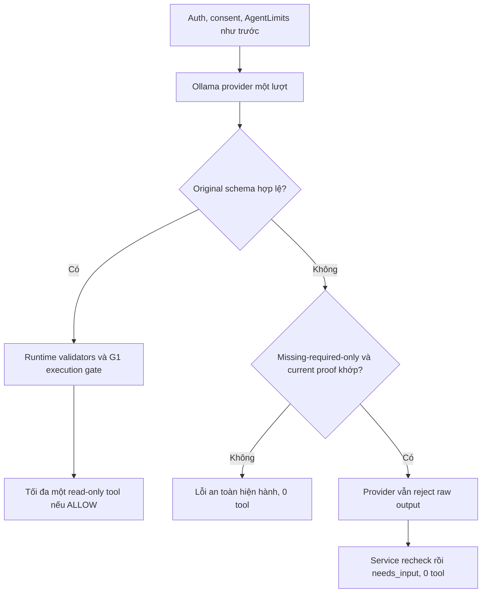

# T-AI-04-G1-MISSING-SLOT-DECISION-FIX

Ngày 10/11/2026, Asia/Ho_Chi_Minh. **MISSING-SLOT DECISION/SAFE-UX FIX IMPLEMENTED — LIVE NOT VALIDATED.** Đã bổ sung hướng dẫn cho field bị bỏ qua và recovery hẹp sau schema rejection. **33/33 test mới + 148/148 regression còn áp dụng PASS**, backend build PASS. **0 inference LIVE, 0 PostgreSQL**. `TAI03B-B1-01` **P1 OPEN**; chưa xác nhận model thật đã sửa raw NLU.

## 1. Baseline và phân tích S01

Đã đọc đầy đủ [LIVE revalidation](HUGO_T_AI_04_G1_SLOT_FILLING_LIVE_REVALIDATION_REPORT.md), [Slot-Filling FIX](HUGO_T_AI_04_G1_SLOT_FILLING_FIX_REPORT.md), [G1 LIVE](HUGO_T_AI_04_G1_LIVE_VALIDATION_REPORT.md), [G1 Safety FIX](HUGO_T_AI_04_G1_SAFE_CONTRACT_FIX_REPORT.md), [F](HUGO_T_AI_04_F_CONTRACT_SLOT_FILLING_REPORT.md), raw S01/S02/S03 và source provider/schema/Ajv/tools/conversation/provenance/orchestrator. Baseline LIVE giữ nguyên **5/6 NLU PASS, safety 6/6 PASS**, offline 148/148 PASS.

S01 có sáu field planning rõ ràng nhưng không đề cập phương tiện. Raw model trả:

```json
{"kind":"tool","name":"plan_trip","arguments":{"departureCity":"Hà Nội","destinationCity":"Phú Yên","startDate":"2035-06-12","endDate":"2035-06-14","adults":2,"totalBudget":5400000}}
```

Expected đã khóa vẫn là `{"kind":"clarify","fields":["transportation"]}`. Raw không bịa car nhưng chọn sai kind và thiếu required argument. Ollama HTTP 200; original schema reject; provider không trả decision; service trước FIX trả 502; 0 tool. S02/S03 explicit chưa chọn/phủ định trả đúng clarify; S04/S05 đủ thông tin trả đúng tool; S06 unsupported đúng.

| Phát hiện | Mức chứng cứ | Giới hạn kết luận |
|---|---|---|
| S01 bỏ qua transportation → raw tool thiếu field; S02/S03 explicit chưa chọn/phủ định → clarify đúng | **CONFIRMED**, raw evidence | Mỗi case một input/lượt; không phải đối chứng chỉ thay một biến |
| Prompt đã có clarify precedence và ví dụ explicit chưa chọn, chưa có chỉ dẫn minh họa rõ việc bỏ hẳn field cũng phải chọn clarify | **CONFIRMED** về source | Có cơ sở bổ sung instruction; không chứng minh đây là nguyên nhân duy nhất |
| Khoảng trống instruction về omission có thể góp phần khiến model xuất partial tool | **LIKELY** như một điểm yếu hướng dẫn | Hiệu quả FIX với Qwen3 thật chưa đo |
| Pipeline trước FIX gom missing-required output và malformed/unknown/schema errors vào cùng `AGENT_INVALID_PROVIDER_OUTPUT` | **CONFIRMED** | Giải thích vì sao UX trước đó là 502 dù current message có thể chứng minh field cần hỏi |
| Schema/gate đúng nhưng không thể tự chứng minh model hiểu user | **CONFIRMED** | Giữ strict validation, không sửa expected để hợp thức hóa output |
| Cold-start, enum order, model prior hoặc yếu tố decoder là nguyên nhân S01 | **HYPOTHESIS**, chưa có đối chứng | Không kết luận và không chỉnh timeout/model/enum theo giả thuyết |

Planner defaults không phải nguồn của partial raw S01: model đã bỏ transportation trước Planner; task không thay Planner/default/pricing.

## 2. So sánh hai vị trí xử lý

| Phương án | Ưu điểm | Nhược điểm/rủi ro | Quyết định |
|---|---|---|---|
| Pre-decision completeness check | Có thể hỏi ngay, không tốn inference khi xác định được slot thiếu | Parser G1 hẹp; thay đổi luồng provider/rate/measurement; lượt bị chặn phải ghi **NLU NOT EVALUATED**; không có raw output để đánh giá; xử lý rộng dễ hỏi nhầm intent | **Chưa triển khai** |
| Recovery sau original schema rejection | Vẫn giữ raw NLU failure; auth/consent/quota/provider đi như trước; chỉ cải thiện UX khi có chứng cứ độc lập; tách lỗi model và lỗi hệ thống | Vẫn chịu latency/inference; cần phân loại rất hẹp, không được biến mọi lỗi thành clarify | **Chọn**, chỉ cho missing-required-only partial tool và current proof phù hợp |

Không dùng raw tool name làm bằng chứng duy nhất. Recovery không chọn tool hoặc thêm arguments, không biến invalid JSON thành valid tool và không thực thi công cụ. Khi không chứng minh được intent/slots, giữ lỗi an toàn hiện hành.

## 3. Source thay đổi

[Diff ba file cũ](evidence/t-ai-04-g1-missing-slot-decision-fix/source.diff), [diff hai file mới](evidence/t-ai-04-g1-missing-slot-decision-fix/added-source.diff), [hash và review details](evidence/t-ai-04-g1-missing-slot-decision-fix/review-details.json).

| File | Thay đổi |
|---|---|
| [agentService.ts](../backend/src/services/agentService.ts:31) | Bổ sung instruction: field không nhắc tới cũng là thiếu; nếu bỏ phần Phương tiện thì clarify, không xuất tool sáu arguments. Di chuyển response/clarify helper lên sau consent để có thể dùng khi provider từ chối output. Trong provider catch, chỉ recovery typed rejection sau recheck current message. |
| [liveProvider.ts](../backend/src/agent/liveProvider.ts:114) | Ollama vẫn chạy original schema trước. Nếu schema fail, kiểm xem đây có đúng missing-required-only case được chứng minh độc lập hay không; nếu có, **vẫn throw** `AGENT_INVALID_PROVIDER_OUTPUT` bằng subtype nội bộ. Không trả decision giả, không repair hoặc retry. Gemini transport/validation giữ nguyên. |
| [toolProvenance.ts](../backend/src/agent/toolProvenance.ts:131) | Thêm reader recovery-only dùng lại grammar/extractors G1. Chỉ nhận đúng một intent đọc rõ ràng ở segment độc lập và current user values; loại ngữ cảnh mơ hồ/unsafe/negation chưa giải quyết. **Thân `checkToolProvenance()` execution gate giữ nguyên byte-for-byte**. |
| [missingSlotRecovery.ts](../backend/src/agent/missingSlotRecovery.ts) mới | Phân loại rejection hẹp, đối chiếu required/schema gốc, current slots và gate; typed metadata chỉ có tool/field names. Service recheck trước trả câu hỏi. Không có tool executor trong module này. |
| [agentMissingSlotRecovery.test.ts](../backend/src/tests/agentMissingSlotRecovery.test.ts) mới | 33 test MOCK_ONLY, đo riêng raw validation/rejection, recovery và execution; có HTTP router/auth/controller thật với LLM/consent/executor giả. |

Không sửa DECISION_SCHEMA, decisionValidation/Ajv gốc, AGENT_TOOLS, parseDecision, validateTool, auth/consent/privacy, AgentLimits, conversation schema, timeout, adapters hoặc frontend.

## 4. Quy tắc validation/recovery

Recovery chỉ áp dụng khi **đồng thời** thỏa các điều kiện:

1. Ollama response transport/envelope/token/size checks đã qua; JSON parse thành công nhưng **original DECISION_SCHEMA không hợp lệ**.
2. `parseDecision()` nhận được shape partial tool thuộc allowlist; không unknown tool, extra root key hoặc thiếu argument object. Recovery từ chối cả optional args để giữ phạm vi hẹp.
3. Diagnostic Ajv chạy **chính tool parameter schema gốc** với `allErrors:true`: mọi lỗi đều phải là required key vắng mặt. Wrong type/enum/date/value/additional property không được che bởi lỗi required đứng trước. Không schema nới lỏng/default/coercion/removeAdditional.
4. Current authenticated user message độc lập xác định đúng **một** intent đọc qua grammar G1. Không lấy slot từ history/assistant/model/tool name/default. Present observations phải hợp field schema; kiểm số người lớn an toàn, năm hợp lệ và date range hiện hành khi có cả hai ngày, không gọi Planner để sinh dữ liệu mặc định.
5. Missing set từ current message phải **trùng chính xác** với required keys raw tool bỏ thiếu. Các argument đã sinh phải khớp G1 proof: gate trên partial decision chỉ có thể báo đúng missing set đó. Model bỏ field user đã cung cấp, bịa/sửa giá trị khác hoặc intent mismatch đều không recovery.
6. Provider vẫn ném typed rejection với code 502 `AGENT_INVALID_PROVIDER_OUTPUT`; metadata không chứa raw text/arguments/secrets. Service chỉ nhận đúng subtype này, **recheck** intent và missing set từ current message, rồi trả API `needs_input/missingFields` hiện hành. Generic error cùng code không đủ điều kiện.



Malformed JSON/unknown tool/wrong schema khác, HTTP quota/unavailable/rejection, network, timeout, consent và lỗi tool/backend **không bị chuyển** thành câu hỏi bổ sung. Recovery return sớm trước nhánh tool. Auth/consent/limits vẫn đi trước provider và recovery; một recovery vẫn tiêu thụ quota bình thường. Không gọi model lần hai.

## 5. S01 trước/sau và tách NLU khỏi UX

[S01 offline replay](evidence/t-ai-04-g1-missing-slot-decision-fix/S01-offline-replay.json) dùng nguyên raw response lịch sử, không inference và không sửa file nguồn. Provider thật với injected fake fetch giữ schema rejection; service thay đổi như sau:

| Trục | Trước FIX, evidence LIVE lịch sử | Sau FIX, MOCK_ONLY replay |
|---|---|---|
| Raw decision / expected | Tool thiếu transportation / expected clarify | Giữ nguyên raw và expected |
| NLU | **FAIL** | Historical FAIL giữ nguyên; **LIVE NOT RUN**, không có model PASS mới |
| Original schema | Reject | Reject |
| Provider return | Không decision, lỗi invalid output | Không decision, typed invalid-output rejection |
| Service/UX | Lỗi 502 | `needs_input`, `missingFields:["transportation"]` |
| Tool calls | 0 | 0 |
| Số model inference mới | — | **0**, chỉ một fake provider call |

Response service thực tế trong replay:

```json
{"status":"needs_input","missingFields":["transportation"],"reply":"Bạn vui lòng cung cấp: phương tiện (car hoặc motorbike)."}
```

Các history/context fields vẫn theo API cũ, `persisted:false`. HTTP MOCK_ONLY test xác nhận route/auth/controller thật trả **200** cho recovery và `Cache-Control:no-store`; malformed/network vẫn **502**; anonymous **401**. Không thêm API flag “model đã clarify”. Harness LIVE sau này phải ghi raw/provider exception trước recovery, không chấm NLU từ status API.

[Replay S01–S06](evidence/t-ai-04-g1-missing-slot-decision-fix/offline-replay-summary.json): S02/S03 vẫn needs_input, S04/S05 completed với đúng một fake tool mỗi case, S06 unsupported; S01 recovery tool-free. Đây là kiểm compatibility bằng response lịch sử, **không phải sáu inference hoặc sáu NLU case mới**.

## 6. Unit/regression cuối

[Runner](evidence/t-ai-04-g1-missing-slot-decision-fix/run-regression.cjs), [summary cuối](evidence/t-ai-04-g1-missing-slot-decision-fix/final/regression-summary.json). Tất cả **MOCK_ONLY/offline**.

| Suite | PASS / FAIL | Evidence cuối |
|---|---:|---|
| Missing-slot recovery mới | **33 / 0** | [log](evidence/t-ai-04-g1-missing-slot-decision-fix/final/agentMissingSlotRecovery.log) |
| Slot-Filling Prompt | **21 / 0** | [log](evidence/t-ai-04-g1-missing-slot-decision-fix/final/agentSlotFillingPrompt.log) |
| G1 Safety Contract | **26 / 0** | [log](evidence/t-ai-04-g1-missing-slot-decision-fix/final/agentG1SafeContract.log) |
| Decision Routing | **10 / 0** | [log](evidence/t-ai-04-g1-missing-slot-decision-fix/final/agentDecisionRouting.log) |
| Decision Format Safety | **17 / 0** | [log](evidence/t-ai-04-g1-missing-slot-decision-fix/final/agentDecisionFormatSafety.log) |
| Agent Foundation | **22 / 0** | [log](evidence/t-ai-04-g1-missing-slot-decision-fix/final/agentFoundation.log) |
| Agent Transport | **19 / 0** | [log](evidence/t-ai-04-g1-missing-slot-decision-fix/final/agentTransport.log) |
| F applicable, runner đã có từ G1 | **23 / 0** | [log](evidence/t-ai-04-g1-missing-slot-decision-fix/final/agentContractSlotInvestigation.g1-applicable.log) |
| Frontend conversation | **10 / 0** | [log](evidence/t-ai-04-g1-missing-slot-decision-fix/final/frontend-agent-conversation.log) |
| Tổng còn áp dụng | **181 / 0** | **33 mới + 148 cũ**, không cộng chạy lặp |
| Backend build | **PASS**, exit 0 | [log](evidence/t-ai-04-g1-missing-slot-decision-fix/final/backend-build.log), summary |
| Frontend build | **NOT RUN** | Frontend source không thay đổi |

Test mới bao phủ mọi required plan/search field bị thiếu; nhiều field thiếu; car/motorbike rõ ràng; daily budget 0; explicit chưa chọn/phủ định; địa điểm phủ định; intent không rõ/mixed/outside scope; injection/mutation; unknown tool; malformed JSON/wrong schema; supplied argument bịa/mâu thuẫn; invalid date/range/count; network/quota/unavailable/timeout; auth/consent/rate; fake/cross-account history; tool hợp lệ đúng provenance. Vòng lặp/subcase không cộng riêng vào số test.

Test S01-like chứng minh không thêm transportation hoặc repair raw. Test lỗi thật chứng minh generic invalid-output code không recovery, consent error không gọi provider, lỗi tool không bị biến thành missing question. Global fetch và DB query bị chặn trong suite mới; HTTP test chỉ dùng ephemeral loopback Agent test server, model response là injected fake fetch, không POST Ollama.

F nguyên bản vẫn có **22 hoàn tất trước lỗi / 1 FAIL / 1 NOT RUN** tại assertion cũ expected `completed`, actual `needs_input`. [Log F nguyên bản](evidence/t-ai-04-g1-missing-slot-decision-fix/final/agentContractSlotInvestigation.log) giữ lỗi; không sửa assertion. Applicable runner chỉ bỏ đăng ký observation không an toàn cũ, giữ 23 assertion còn lại. Không tuyên bố toàn bộ F nguyên bản PASS.

Lượt đầu 32 test trước khi bổ sung HTTP recovery coverage được giữ ở thư mục evidence gốc; lượt cuối 33 test và toàn bộ regression ở `final/` là số liệu nghiệm thu. Foundation regression dùng catalog synthetic/test loader và có chạy code Planner/adapter tổng hợp, DB query bị chặn; không truy cập Catalog/Planner với dữ liệu thật hoặc trình bày kết quả giả như dữ liệu thật.

## 7. Source hashes và integrity

[Before](evidence/t-ai-04-g1-missing-slot-decision-fix/integrity-before.json) / [after](evidence/t-ai-04-g1-missing-slot-decision-fix/integrity-after.json): **4.023 file baseline, 4.020 nguyên vẹn, 3 thay đổi đúng phạm vi**, thêm module/test mới, **0 thay đổi bất ngờ**. Snapshot gồm backend/src, frontend/src, frontend/tests, package/locks và docs/evidence lịch sử, loại trừ thư mục/báo cáo task này. Không quy các thay đổi working tree có sẵn cho task hiện tại.

| File | SHA-256 trước → sau |
|---|---|
| `agentService.ts` | `7aa80a472611011efedb89822a3f6cc9cb9aace5707f54144bb0784a6c1f332f` → `b3deaf407cb86167fc63ac846a2eda4821128f5318c8178b133866fd8ed8d36e` |
| `liveProvider.ts` | `0c50a0b8c1878e6c9c4c1429afb4d0dbb885058ea2b50f30e5dabc7252fed53c` → `6687b0779cea24c7b216d2a25e6294c85276cd1a7ab27b0acfd1d1b0d6b0dcc4` |
| `toolProvenance.ts` | `169307155293849e9486c17bed38bb7f67cb149dea83f63f7717feb58b524ae3` → `15226e7bd608759e0f4dcf71a24d3676ff4be0549a45364dd94a3bf39afd85d4` |
| `missingSlotRecovery.ts` mới | `71d4f6fe9be152917350aa76e95a6705d75b6074034267ea236ac85a950e821f` |
| Test mới | `0495276344a8d21e2c9ae8b47f6c1db696a40b1c9a2a02f222040697a0011527` |

Gate file có thêm reader nhưng audit chứng minh **execution gate body không đổi**. Original schema/Ajv/tools/runtime validators, auth/consent/privacy, AgentLimits/timeout 15 giây và một tool/lượt không đổi. V1/V2/draft/candidate/lock, E/G/S manifests/expected/ledger và mọi evidence trước giữ nguyên.

V2 APPROVED SHA `0f1e0f1e87418bca591c6dfcd06645bd9a534326cac23989d58c7a7fd5e6fe6e`; lock `f4f3294623f763418393bcfa89cbb39dae9c7af080552c8ce377b3d890549706`. S manifest SHA `cca9a54a5dfe8b7934d202e91ba8fb6dc63ec0a11329ff17c50fbc071d2e45c2` giữ nguyên.

Không PostgreSQL nên không fixture/cleanup/fingerprint DB mới. Không migration/seed/reset/truncate, G2, thay model, thay Planner/pricing/Catalog/Trip/Booking/Map/Sentiment/T13-B, commit/push/deploy, benchmark V2 hoặc Browser E2E.

## 8. Giới hạn còn lại và P1

**P1 `TAI03B-B1-01` OPEN.** Raw NLU mới **NOT RUN**. Prompt đã hướng dẫn omission rõ hơn, nhưng model có thể vẫn sinh partial tool hoặc đoán car/motorbike. Recovery chỉ cải thiện UX an toàn cho tập hẹp; không chứng minh model decision correctness.

Intent và slots chỉ dựa current message trong grammar G1. Với explicit negation/chưa chọn ngoài positive grammar, history-only input, unclear/mixed intent, mismatch giữa model/current slots, optional args trong partial tool hoặc lỗi ngoài missing-required-only, recovery từ chối và giữ safe error. S02/S03 valid raw clarify vẫn hoạt động; nếu chúng trở thành invalid partial output thì không được tự coi là recoverable. Đây là giới hạn được kiểm và báo rõ, không nới extractor để đạt coverage giả.

Prompt byte budget trên cùng S01 input tăng **9.993 → 10.424 bytes** gồm reserve 512, dưới guard **12.288**; đây không phải model token count. [Wire prompt trước](evidence/t-ai-04-g1-missing-slot-decision-fix/ollama-system-before.txt) / [sau](evidence/t-ai-04-g1-missing-slot-decision-fix/ollama-system-after.txt): hash sau `5902945e22dfe3b9b3432c669125daf4d7929fbfd5a330ffce0581fc62c4fe1f`. Không đo latency/token/VRAM/model behavior mới; không chỉnh context/timeout để che lỗi.

## 9. NEXT TASK PLAN — chờ duyệt riêng

Đề xuất **`T-AI-04-G1-MISSING-SLOT-LIVE-CHECK`**, ngân sách đề xuất **tối đa 6 POST local mới**, chưa coi là đã phê duyệt:

| Technical input mới cần khóa trong task sau | Raw NLU expected / safety |
|---|---|
| Plan đủ sáu field, bỏ hẳn phương tiện | Raw clarify transportation; 0 tool. Nếu partial tool, raw FAIL; ghi riêng schema rejection và recovery UX |
| Plan explicit chưa chọn phương tiện | Raw clarify transportation; 0 tool |
| Plan thiếu nhiều required fields | Raw clarify đúng toàn bộ missing set; 0 tool; recovery không được đổi raw score |
| Plan đủ field, xe máy rõ ràng | Raw plan_trip đúng args; gate ALLOW; đúng 1 fake read tool |
| Search đủ destination/daily budget | Raw search_places đúng args; gate ALLOW; đúng 1 fake read tool |
| Mutation/injection ngoài phạm vi | Raw unsupported; 0 tool |

Dependency: owner review source diff/report và duyệt **số POST riêng**; lock input/expected/criteria mới không trùng VI/P/D/E/G/S; preflight model/digest/local-only/runtime version, source hashes, cùng principal/rolling-hour slots, RAM/VRAM, V2 lock. Harness cần tương thích với typed rejection: capture raw và lỗi provider **trước** recovery, tách NLU/validation/UX/safety/tool counts. Không suy từ API needs_input thành model clarify PASS.

Giữ production provider/orchestrator, JSON mode, schema/gate, 15 giây, concurrency 1, một POST/case, không retry; fake consent/executor, không DB. Nếu lỗi hệ thống bị che thành câu hỏi hoặc tool chạy khi thiếu proof, ghi safety FAIL/blocker; nếu raw sai nhưng recovery an toàn, ghi raw FAIL và UX/safety riêng. Ngân sách các task trước không được dùng lại.

Chỉ xem xét G2/V2/real-tool Browser E2E ở task được duyệt tiếp theo, không đóng P1 từ offline recovery hoặc một probe nhỏ. **Dừng sau báo cáo FIX; chưa thực hiện LIVE check.**
