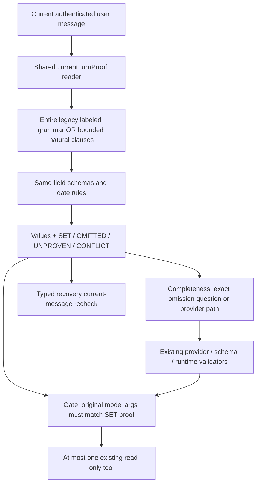

# T-AI-04-G1-NATURAL-LANGUAGE-PROOF-FIX

Ngày **10/11/2026**, Asia/Ho_Chi_Minh. **OFFLINE_FIX_PASS_WITH_LIMITS**: đã triển khai shared current-turn proof, mở rộng grammar tiếng Việt tự nhiên có kiểm soát. Source cuối: **79/79 test mới**, **61/61 compatibility**, **42/42 Correction**, **52/52 Completeness**, backend build PASS. Original legacy giữ **145 PASS / 36 FAIL**; không sửa original assertions để đổi kết quả.

**Static V2:** 7/8 expected single-turn tool cases có independent proof; **VI14 vẫn NEEDS_INPUT**. VI09–VI13 vẫn bị history blocker. Đây không phải điểm NLU hoặc full product V2 PASS. **Không inference/preload/readiness GET thật, không PostgreSQL, không G2. P1 NLU/P2 runtime vẫn OPEN.**

Hai nhóm false-positive tìm thấy khi audit implementation trung gian đã được sửa và retest trên source cuối; evidence trước/sau được giữ, xem mục 5. Không bỏ qua finding authorization để nghiệm thu.

## 1. Baseline và test được khóa trước implementation

Đã đối chiếu [Compatibility/V2 Readiness](HUGO_T_AI_04_G1_COMPATIBILITY_V2_READINESS_REPORT.md), [Server Completeness LIVE](HUGO_T_AI_04_G1_SERVER_COMPLETENESS_LIVE_VALIDATION_REPORT.md), [Execution Correction FIX](HUGO_T_AI_04_G1_EXECUTION_PROVENANCE_CORRECTION_FIX_REPORT.md), [Server Completeness FIX](HUGO_T_AI_04_G1_SERVER_COMPLETENESS_POLICY_FIX_REPORT.md), source và nguyên 24 V2 APPROVED inputs/history/expected/criteria/lock.

Baseline không đọc được natural prose nên 13 expected tool decisions đều bị gate chặn, trong đó 8 single-turn và 5 history-dependent. Grammar cũ chỉ có standalone intent segments, fixed labels và vài positive correction patterns; model hiểu đúng câu tự nhiên cũng chưa đủ independent proof để execute.

Trước khi sửa production, tạo [independent manifest](evidence/t-ai-04-g1-natural-language-proof-fix/natural-language-case-manifest.json) và [lock](evidence/t-ai-04-g1-natural-language-proof-fix/natural-language-case-lock.json), lúc **18:08:02.534 +07**. Có **47 input mới**: 16 positive, 5 missing, 26 negative. Không câu nào trùng exact locked V2 input; dùng địa điểm/ngày/ngân sách khác, không hard-code case ID hay địa danh V2 trong parser.

Manifest SHA-256: `f53c144fba21c923244de5ad1b52e79f1697d7a69bb95d17b9dfb88265914a8b`. Expected của 47 cases giữ nguyên xuyên suốt task. Unit suite bổ sung mutations trên các argument, structural/history/optional checks và security cases phát hiện khi audit; không đổi expected để hợp thức hóa output.

## 2. Source thay đổi và kiến trúc proof

[Source diff cuối](evidence/t-ai-04-g1-natural-language-proof-fix/source-diff-release.patch), [release audit](evidence/t-ai-04-g1-natural-language-proof-fix/release-audit.json).

| File | Thay đổi |
|---|---|
| [currentTurnProof.ts](../backend/src/agent/currentTurnProof.ts) — mới | Authoritative reader của current message; legacy labeled grammar được factor sang đây, thêm bounded natural-clause grammar, bốn trạng thái, field validation từ AGENT_TOOLS/date rules hiện có, optional proof và normalization metadata |
| [toolProvenance.ts](../backend/src/agent/toolProvenance.ts) | So original parsed/validated model args với shared proof; chỉ SET và match mới ALLOW, không sửa args; optional supplied value không được dùng default để ghi đè explicit proof |
| [currentCompleteness.ts](../backend/src/agent/currentCompleteness.ts) | Dùng cùng shared reader/validation; UNPROVEN/CONFLICT → UNDETERMINED, valid omissions → exact server question. Re-export validated reader cho recovery hiện có |
| [agentNaturalLanguageProof.test.ts](../backend/src/tests/agentNaturalLanguageProof.test.ts) — mới | 79 offline tests; immutable independent corpus, wrong-argument/negative probes, actual Orchestrator/gate, fake read-only executor, no native network/DB |

`missingSlotRecovery.ts`, `agentService.ts`/SYSTEM, tools/allowlist, original schema/Ajv/runtime validators, provider/readiness/abort/15s/16k, limits, auth/privacy và business sources **không đổi**. Recovery tiếp tục gọi shared validated reader qua export hiện hữu, đồng thời giữ original missing-required-only schema checks và typed error recheck.

Hai surface grammars không chạy song song để chọn proof thuận lợi. Legacy dialect phải khớp toàn message; natural dialect không nhận colon/unknown residue để “cứu” một label/correction mơ hồ. Cả hai trả **cùng một proof model**, cùng validator/comparison policy; assessor và execution không dùng hai tập facts khác nhau.

`inspectCurrentRequiredSlots()` giữ compatibility view ba trạng thái cho internal legacy diagnostics: CONFLICT được chiếu thành UNPROVEN ở view đó. **Gate/completeness dùng bốn-state reader trực tiếp**, không dùng view này để authorize. Không thêm public request/response field, bypass flag hay LLM tool/schema mới.

## 3. Current-turn proof policy

| State | Nghĩa | Hành vi |
|---|---|---|
| SET | Current message chứng minh được một giá trị đúng role/type | Chỉ args khớp proof mới có thể ALLOW |
| OMITTED | Không có field/value trong một recognized request | Assessor valid → SUPPORTED_INCOMPLETE, exact missingFields, không gọi model |
| UNPROVEN | Field có nhắc nhưng chưa chứng minh được giá trị, thiếu năm, invalid data hoặc ngữ nghĩa chưa chọn | UNDETERMINED/provider path, không dùng default để execute |
| CONFLICT | Nhiều giá trị khác nhau, unresolved correction hoặc composite city alternatives | UNDETERMINED; không ALLOW old/new/unresolved value |

Unknown intent/unconsumed clause/quoted instruction không tạo facts. Không lấy tool name từ model để chọn intent reader, không dùng model arguments làm independent proof, không lấy slots từ assistant/client history. Không có shared user state/cache/persistence. Required specification/type/enum chỉ từ AGENT_TOOLS; date validity/day-count rules tái sử dụng code hiện hành.

Natural clauses phải được consume đầy đủ: intent, role-marked location, date range, adults, role-scoped budget và transport. Extra chữ/số chưa giải thích được làm request fail closed, không bỏ phần bất tiện rồi dùng các slot còn lại. Các numeric signs không thuộc một supported clause không được xóa như punctuation.

Optional defaults hiện có vẫn được phép khi không có explicit conflicting proof. Nếu current message đã ghi children=2, model children=0 không được hợp thức hóa bằng default; hai child values khác nhau không dùng last-value-wins. Không thêm preferences parser; valid-but-unproven nonempty preferences vẫn bị reject như baseline. Không thay pricing hoặc logic Planner về số người.

## 4. Grammar coverage trước/sau và giới hạn

| Nhóm | Bổ sung có kiểm chứng | Vẫn fail closed |
|---|---|---|
| Search | `Tìm điểm tham quan/khách sạn/nhà hàng/địa điểm ... ở/tại X`; implied category chỉ theo từ hiện tại, existing enum | Unknown/mixed intent, quoted/system/assistant content, unrecognized clause |
| Plan prose | `Lập lịch [trình] từ A đến/tới B`; `Lên lịch trình...`; prefix “Giúp tôi...”; `đi B từ A` với request intent rõ | Không suy ra nơi đi từ profile/DB/default; bare route thiếu marker hỗ trợ vẫn có thể bị từ chối |
| Budget | `7,2 triệu`, `7.2tr`, `7200k`, numeric VND; explicit `cả nhóm`, `tổng ngân sách`, `nhóm mình có khoảng...` | Không đoán group budget từ số không scope; không nhân/chia budget người/ngày để lấp group field hoặc ngược lại |
| Daily budget | `650 nghìn đồng mỗi người mỗi ngày`, `350000 đồng mỗi người/ngày`, `420 nghìn/người/ngày`, daily zero | Group-only không trở thành daily/per-person; unresolved scope không SET |
| Dates | ISO; d/m/yyyy; fully specified ranges; `từ ngày12 đến14 tháng4 năm2047` với shared month/year explicit | Missing year, invalid calendar/range, >10days, partial numeric residue; không dùng ngày hiện tại |
| Adults/transport | `3 người lớn`, `3 NL`, `3 NL (người lớn)`; ô tô/o to, xe máy/xe may | Total `3 người` không tự coi là adults; unset/negated/choice không suy ra phương tiện khác |
| Abbreviation | Consistent initials kèm fullname ngay trong current message, ví dụ `QN (Quy Nhơn)`; NL cho adults | Không có bảng hard-coded HN/ĐN/V2; bare acronym hoặc pair không khớp không tự expand |
| Không dấu | Deterministic accent folding để nhận grammar; city proof có thể so accent-insensitive khi **current city token không dấu** | Current city có dấu vẫn so NFC/case/space, không xóa dấu để nhận một city khác |
| Corrections | Explicit car↔motorbike; destination replacement có marker; verified negative+positive destination pair | Conflicting old labels, nhiều correction/mention sau correction, unresolved choices, quote/condition không dùng “chuỗi cuối thắng” |

City normalization là **textual provenance**, không phải xác minh entity/catalog hoặc tự tạo địa danh. Parser không thêm nơi/giá/kết quả Planner, không tự phục hồi dấu/ghi lại model args. Chưa có entity disambiguation cho mọi địa danh không dấu/trùng tên; unknown forms tiếp tục cần hỏi lại. Không khẳng định đây là general Vietnamese NLU.

[Before/after independent proof](evidence/t-ai-04-g1-natural-language-proof-fix/independent-proof-before-after.json): **0/16→16/16 ALLOW** với correct expected args của corpus mới. Có prose thuận/ngược role, abbreviation, không dấu, decimal budget, zero daily budget, correction và các địa điểm/ngày khác nhau; không đánh giá theo output LLM.

## 5. Security findings trong quá trình audit — không che FAIL

Sau 69 tests đầu PASS, audit independent numeric boundaries tìm thấy lỗi ngoài corpus. Sau fix số âm, review thêm city alternatives tìm thấy một lỗi lexical proof khác. Tất cả evidence intermediate được giữ; không dùng các con số PASS cũ để khẳng định chưa từng có false-positive.

| Finding | Bằng chứng trước | Fix / bằng chứng cuối | Trạng thái |
|---|---|---|---|
| **NP-FP-01 — unmatched negative sign bị bỏ** | [2 pure-gate reproductions](evidence/t-ai-04-g1-natural-language-proof-fix/numeric-sign-reproducer-before.json): negative adults hoặc negative postfix group budget có thể ALLOW positive args vì residual cleanup xóa `-` | Không xóa dấu `-`/en-dash còn sót; valid date/route hyphens đã được clause parser consume. [After](evidence/t-ai-04-g1-natural-language-proof-fix/numeric-sign-reproducer-after.json), 7 sign/source-boundary tests PASS trên final suite | **FIXED / OFFLINE VERIFIED** |
| **NP-FP-02 — composite city bị coi như một tên** | [Before](evidence/t-ai-04-g1-natural-language-proof-fix/city-choice-reproducer-before.json): literal `Quy Nhơn hoặc Huế` trong labeled request hoặc `Quy Nhơn và Huế` trong prose có thể match cả chuỗi và ALLOW | Alternatives/conjunction/separator không là SET city; labeled form CONFLICT, natural form UNPROVEN/unknown. [After](evidence/t-ai-04-g1-natural-language-proof-fix/city-choice-reproducer-after.json); 6 forms qua 3 cases PASS | **FIXED / OFFLINE VERIFIED** |

Reproducer trước là pure gate tests, **không thực thi tool/DB/LLM**. Không có unauthorized tool call thật hoặc fixture write phát sinh. NP-FP-01 là defect ở implementation trung gian mới; NP-FP-02 cũng kiểm phần labeled grammar được kế thừa, không chỉ code prose mới. Hai fixes ở proof reader, không nới validator hoặc đổi expected.

[Retest plan](evidence/t-ai-04-g1-natural-language-proof-fix/security-fix-retest-plan.json), original 69-case run, 76-case run và final79 đều lưu riêng. Final regression chạy lại sau security patches tại `release-verified/`, không lấy regression trước patch để nghiệm thu source cuối.

Source được freeze trước V2 static review. Hai independent security fixes sau đó được ghi rõ là superseding freeze; [release freeze](evidence/t-ai-04-g1-natural-language-proof-fix/source-freeze-release.json) lưu hash cuối và lý do. Revalidate nguyên 24 projected proofs/assessments/gates: **không đổi kết quả V2**, không thêm pattern để khớp VI14 hay sửa benchmark. Freeze trung gian/evidence không bị ghi đè.

## 6. Unit/integration và các metric độc lập

[Final79 results](evidence/t-ai-04-g1-natural-language-proof-fix/natural-proof-verified.json), [log](evidence/t-ai-04-g1-natural-language-proof-fix/natural-proof-verified.log), [release audit](evidence/t-ai-04-g1-natural-language-proof-fix/release-audit.json).

| Metric | Source cuối / phạm vi |
|---|---|
| Registered new tests | **79 PASS /0 FAIL /0 NOT RUN**; không cộng intermediate runs |
| Positive proof coverage | **16/16** recognized, đúng intent/required values, ALLOW correct args, một fake read-only execution, actual orchestrator |
| False-negative rejection trên independent positive bank | **0/16**; không suy rộng thành tỷ lệ mọi tiếng Việt |
| Missing proof | **5/5** exact missingFields, SERVER_COMPLETENESS/raw NOT_EVALUATED, zero provider/tool; no network nên readiness/POST0 |
| Negative/unknown core bank | **26 input**, 3 candidate decisions mỗi input; zero ALLOW/execution |
| Supplementary security source forms | **7 sign +6 city-choice forms**, đều blocked |
| Wrong model arguments | **95 probes**: city role/value, dates, count, budget, transport/category sai; no ALLOW, no argument repair, no executor |
| Final false-positive authorization | **0/186** negative/wrong-argument probes (91+95); thêm structural/history/optional checks PASS. Intermediate 4 pure-gate reproductions đã disclosed/fixed ở mục5 |
| Actual unauthorized tool invocation | **0** trong executed offline tests; allowed positive calls chỉ fake read-only marker |
| Mutation/history/unknown output | Unknown tool, extra/root fields, partial args, multiple tool output, other-account history không cấp quyền |
| Natural model understanding / real tool fidelity | **NOT EVALUATED / NOT RUN**; provider scripted MOCK_ONLY, không có output Ollama thật |

New tests gọi source assessor/gate/Orchestrator thật, dùng JsonLlmProvider scripted, fake consent/executor. Provider mock chỉ tạo test decision, **không phải bằng chứng NLU quality**. Old61 acceptance vẫn dùng real provider adapter với fake GET/envelope; không actual native Ollama. Read-only executor marker không được trình bày là itinerary/catalog/price thật.

Unknown/ambiguous xử lý riêng, không tính blocked negative là “model chọn đúng”. Source reader input chỉ một string current turn; client history không supply fields. Partial/unknown schema errors vẫn reject/clarify theo original contract; model args không được tự thêm hoặc sửa.

## 7. Regression trên source cuối

[Final execution](evidence/t-ai-04-g1-natural-language-proof-fix/release-verified/execution.json) và case-level baseline comparison trong release audit. Original assertions/case bodies giữ nguyên; generated runners chỉ capture/tiếp tục sau FAIL như baseline. Offline guard cấm native11434/external; local ephemeral HTTP test servers chỉ phục vụ mocked integration.

| Suite | Actual production policy PASS / FAIL / NOT RUN | Isolated downstream/control PASS / FAIL |
|---|---|---|
| Natural proof mới | **79 /0 /0** | Không assessor/gate stub |
| Compatibility acceptance | **61 /0 /0** | Không assessor/gate stub |
| Execution Correction | **42 /0 /0** | — |
| Server Completeness | **52 /0 /0** | — |
| Readiness/abort | **32 /1 /0** | **33 /0** |
| Diagnostics | **8 /5 /0** | **13 /0** |
| Missing-slot recovery | 13 /20 /0 | 33 /0 |
| Slot-filling prompt | 11 /10 /0 | 21 /0 |
| G1 safe contract | 26 /0 /0 | 26 /0 |
| Decision routing | 10 /0 /0 | 10 /0 |
| Decision format safety | 17 /0 /0 | 17 /0 |
| Foundation original mixed-intent | **17 /5 /0** | **17 /5** |
| Transport/controls | 18 /1 /0 | 19 /0 |
| F applicable | 23 /0 /0 | 23 /0 |
| Frontend conversation | 10 /0 /0 | 10 /0 |
| **Original181 total** | **145 /36 /0** | **176 /5** |
| Foundation single-intent fixture control | **22 /0 /0**, riêng | Không assessor/gate stub |
| Backend build | **PASS, exit0** | — |
| Ollama/Browser/V2 LIVE/PostgreSQL/G2/frontend build | **NOT RUN**, ngoài scope | — |

Eight legacy suite names/status và readiness/diagnostic case names/status khớp baseline Compatibility. Không regression authorization còn mở trong tập đã kiểm sau security fixes. **36 FAIL cũ vẫn giữ**: 31 provider-capture/fault assertions xung đột server-first, 5 Foundation mixed-intent fixtures không tới executor. Readiness1 và diagnostic5 conflict cũng kế thừa. Không nhận các lỗi này là raw/network failure đã xảy ra khi provider chưa được gọi.

Downstream controls dùng test-process assessor stub nên không phải production E2E PASS. Mixed-intent Foundation vẫn17/5 ở controls vì gate không bị stub. [Foundation single-intent release control](evidence/t-ai-04-g1-natural-language-proof-fix/foundation-single-intent-control-release.log) 22/22 chạy real adapter/Planner trên synthetic catalog, giữ args/cost/day/assumption assertions; [fixture diff](evidence/t-ai-04-g1-natural-language-proof-fix/foundation-fixture-diff-release.json) riêng, không sửa source fixture gốc.

Historical F nguyên bản tiếp tục dừng ở unsafe expected completed, actual needs_input (22 preceding PASS /1 FAIL /1 NOT RUN), ngoài23 applicable. Không gộp original, new acceptance và stub controls để tạo một tỷ lệ xanh giả.

## 8. Static review V2 — không chạy benchmark

[Initial static review](evidence/t-ai-04-g1-natural-language-proof-fix/v2-static-review.json) và [release revalidation](evidence/t-ai-04-g1-natural-language-proof-fix/v2-static-review-release.json): dùng immutable expected như candidate để hỏi pure gate, không phải model output. Current request/history/expected/criteria/labels/hash giữ nguyên. Không có LIVE raw/semantic/tool-fidelity result mới.

| Nhóm expected single-turn tool | Kết quả static sau FIX |
|---|---|
| VI01/VI02/VI03 search | **COMPLETE / ALLOW**, independent location/daily budget/category proof |
| VI04 full plan | **COMPLETE / ALLOW**, đúng departure/destination/date/adults/group budget/car |
| VI15 không dấu | **COMPLETE / ALLOW** theo deterministic grammar/text normalization |
| VI16 prose đảo role/budget | **COMPLETE / ALLOW**, group scope/date/adults/transport không lấy từ default |
| VI20 no-catalog sentinel | **COMPLETE / ALLOW** về input proof; **không kết luận catalog unavailable** vì chưa gọi tool/DB |
| **VI14 viết tắt/bare arrow** | **UNDETERMINED / NEEDS_INPUT**. Acronym/fullname và NL có grammar độc lập, nhưng route trong câu không có `từ`/explicit departure marker thuộc grammar đã hỗ trợ. Không đoán origin role hoặc chỉnh parser theo câu khóa |

Single-turn: **0/8→7/8** có proof; còn **1 static false-negative VI14**, không phát hiện wrong-intent/wrong-value acceptance trong projections. Đây không phải 7/8 model PASS. Độc lập bank16 positives không có false negative; hai denominator được giữ riêng.

VI06 và VI23 nay SUPPORTED_INCOMPLETE với exact fields, nên production sẽ hỏi trước inference. Nếu sau này chạy V2 qua product route, hai case này phải là **raw NOT EVALUATED**, không raw PASS. Các clarify cases khác vẫn có thể UNDETERMINED/provider path ngoài narrow grammar; không tự biến locked expected thành server output.

VI09–VI13 vẫn NEEDS_INPUT khi candidate tool lấy các slots còn thiếu từ history. Current-turn-only prompt/gate không tin client history và G2 chưa có; không rewrite current message bằng historical fields. Full product V2 acceptance vẫn chưa đạt: cần xử lý remaining current-turn coverage, verified-history contract và real tool/DB fidelity trong task được duyệt riêng.

| VI | Expected | Before gate | After assessment / gate | Independent proof / remaining blocker |
|---|---|---|---|---|
| VI01 Tìm điểm tham quan | search_places | NEEDS_INPUT | COMPLETE / ALLOW | Exact current-message proof; no inference or actual tool execution |
| VI02 Tìm khách sạn | search_places | NEEDS_INPUT | COMPLETE / ALLOW | Exact current-message proof; no inference or actual tool execution |
| VI03 Tìm nhà hàng | search_places | NEEDS_INPUT | COMPLETE / ALLOW | Exact current-message proof; no inference or actual tool execution |
| VI04 Lập lịch đầy đủ | plan_trip | NEEDS_INPUT | COMPLETE / ALLOW | Exact current-message proof; no inference or actual tool execution |
| VI05 Thiếu nơi xuất phát | clarify departureCity | NOT_APPLICABLE | UNDETERMINED / NOT_APPLICABLE | Conservative provider/safety path; no output inferred |
| VI06 Thiếu ngày đi | clarify startDate,endDate | NOT_APPLICABLE | SUPPORTED_INCOMPLETE / NOT_APPLICABLE | Exact omitted fields startDate,endDate from current proof; no raw model score |
| VI07 Thiếu ngân sách | clarify totalBudget | NOT_APPLICABLE | UNDETERMINED / NOT_APPLICABLE | Conservative provider/safety path; no output inferred |
| VI08 Thiếu phương tiện | clarify transportation | NOT_APPLICABLE | UNDETERMINED / NOT_APPLICABLE | Conservative provider/safety path; no output inferred |
| VI09 Bổ sung nhiều lượt | plan_trip | NEEDS_INPUT | UNDETERMINED / NEEDS_INPUT | Client history remains untrusted; no G2/state; cannot fill current required fields |
| VI10 Đổi ngân sách | plan_trip | NEEDS_INPUT | UNDETERMINED / NEEDS_INPUT | Client history remains untrusted; no G2/state; cannot fill current required fields |
| VI11 Đổi số người | plan_trip | NEEDS_INPUT | UNDETERMINED / NEEDS_INPUT | Client history remains untrusted; no G2/state; cannot fill current required fields |
| VI12 Đổi số ngày | plan_trip | NEEDS_INPUT | UNDETERMINED / NEEDS_INPUT | Client history remains untrusted; no G2/state; cannot fill current required fields |
| VI13 Đổi điểm đến | plan_trip | NEEDS_INPUT | UNDETERMINED / NEEDS_INPUT | Client history remains untrusted; no G2/state; cannot fill current required fields |
| VI14 Tiếng Việt viết tắt | plan_trip | NEEDS_INPUT | UNDETERMINED / NEEDS_INPUT | Conservative provider/safety path; no output inferred |
| VI15 Tiếng Việt không dấu | plan_trip | NEEDS_INPUT | COMPLETE / ALLOW | Exact current-message proof; no inference or actual tool execution |
| VI16 Ngân sách 5 triệu | plan_trip | NEEDS_INPUT | COMPLETE / ALLOW | Exact current-message proof; no inference or actual tool execution |
| VI17 Booking không hỗ trợ | unsupported | NOT_APPLICABLE | UNDETERMINED / NOT_APPLICABLE | Conservative provider/safety path; no output inferred |
| VI18 Trip mutation không hỗ trợ | unsupported | NOT_APPLICABLE | UNDETERMINED / NOT_APPLICABLE | Conservative provider/safety path; no output inferred |
| VI19 Prompt injection | unsupported | NOT_APPLICABLE | UNDETERMINED / NOT_APPLICABLE | Conservative provider/safety path; no output inferred |
| VI20 Catalog không có dữ liệu | plan_trip | NEEDS_INPUT | COMPLETE / ALLOW | Exact current-message proof; no inference or actual tool execution |
| VI21 Thiếu số người | clarify adults | NOT_APPLICABLE | UNDETERMINED / NOT_APPLICABLE | Conservative provider/safety path; no output inferred |
| VI22 Thiếu điểm đến | clarify destinationCity | NOT_APPLICABLE | UNDETERMINED / NOT_APPLICABLE | Conservative provider/safety path; no output inferred |
| VI23 Thiếu ngân sách tìm kiếm | clarify dailyBudgetPerPerson | NOT_APPLICABLE | SUPPORTED_INCOMPLETE / NOT_APPLICABLE | Exact omitted fields dailyBudgetPerPerson from current proof; no raw model score |
| VI24 Thiếu năm, không tự đoán | clarify startDate,endDate | NOT_APPLICABLE | UNDETERMINED / NOT_APPLICABLE | Conservative provider/safety path; no output inferred |

## 9. Integrity, hash và bảo vệ dữ liệu

[Before](evidence/t-ai-04-g1-natural-language-proof-fix/integrity-before.json) / [after release](evidence/t-ai-04-g1-natural-language-proof-fix/integrity-after-release.json): **4781 baseline files**, **4779 không đổi**, đúng **2 existing source files sửa**, thêm **1 production reader +1 test**. Không đổi original tests/fixtures, prior reports/evidence, V1/V2/locks, packages/locks hoặc business modules. Check seal117 artifacts/report task Compatibility PASS. Snapshot scope backend/src, frontend/src/tests, docs, package/locks; dist rebuild và generated runners là artifacts, không source edits.

| File/artifact | SHA-256 trước → cuối |
|---|---|
| toolProvenance.ts | `95fb900e1471d8b18a7f869dea842fae97f19e3e7e9c128ff24d5e86177591a7` → `28c126525cc56af3d3338004cd0e55e5322587f7ec06f9c0fae97fe28cb1ea77` |
| currentCompleteness.ts | `43f8742693b0b1f6545ee793a501ea7e29958667e911513826a3295fe3552096` → `6a2f017bdeed5aaa7db9c910cc3aca0e150cfea0ed97085691fc65814ee84e90` |
| New currentTurnProof.ts | `9af3ca77c388984a3f3fbba42879fcfa0975f0dd9138f003137880a5d3f563bb` |
| New test source | `32807afd782518d56933b8b67e369910bbebc4578ee5c03d5bc5f662fa351910` |
| V2 APPROVED, không đổi | `0f1e0f1e87418bca591c6dfcd06645bd9a534326cac23989d58c7a7fd5e6fe6e` |
| V2 lock, không đổi | `f4f3294623f763418393bcfa89cbb39dae9c7af080552c8ce377b3d890549706` |

[Artifact checksums cuối](evidence/t-ai-04-g1-natural-language-proof-fix/artifact-checksums.json) khóa report/evidence mới. Source guard xác nhận missingSlotRecovery, AgentService/SYSTEM, provider/schema/tools/limits/readiness và Planner/Catalog/pricing/Trip/Booking không đổi. Không tải/cài/đổi model/digest, không thay15s/16384, không bật LIVE/env toàn cục.

**0 native Ollama POST/preload/GET**, **0 PostgreSQL attempts** trong new tests; không fixture/write/cleanup/residual rows. DB fingerprint **N/A**, không tự nhận fingerprint25/25 mới hoặc kiểm số Trip. Không migration/seed/reset/truncate, Browser E2E, G2, commit/push/deploy. Test data/providers/costs từ synthetic fixture chỉ phục vụ offline assertions, không trình bày là dữ liệu du lịch thật.

## 10. Acceptance, lỗi còn mở và NEXT TASK PLAN

| Hạng mục | Kết luận |
|---|---|
| Supported current-turn natural proof | **PASS offline trong grammar/corpus đã nêu** |
| Wrong/unproven/conflict/quoted/injection args | **PASS final tests**, không unauthorized execution; intermediate findings disclosed/fixed |
| Completeness/recovery/readiness compatibility | **52/52 +61/61**, readiness/diagnostic original conflicts giữ như baseline, isolated controls riêng |
| Build/source/benchmark integrity | **PASS** |
| NP-FP-01 / NP-FP-02 | **FIXED/OFFLINE VERIFIED**, chưa LIVE validation |
| VI14 bare-arrow coverage | **OPEN LIMITATION**, fail closed, không sửa theo benchmark |
| VI09–VI13 history | **BLOCKED pending verified-history design**, không triển khai ở đây |
| TAI03B-B1-01 P1 raw NLU | **OPEN**, không có inference/measurement mới |
| P2 Ollama runtime / Map P2 | **OPEN**, không điều tra/sửa trong task này |

Đề xuất **`T-AI-04-G2-VERIFIED-HISTORY`**, chờ chủ dự án duyệt riêng:

1. **Dependency:** duyệt source diff/proof normalization, security finding fixes,79/61/42/52 results và remaining VI14/history/fidelity limits. G2 không tự giải quyết bare-arrow single-turn; nếu cần mở coverage đó, yêu cầu corpus/acceptance/task riêng, không sửa V2.
2. **Design/review trước implementation:** server-owned authenticated conversation/session ID; ownership theo user, isolation/cross-account denial, TTL/expiry/reload/logout policy; chọn in-memory hay persistence qua quyết định schema/DB riêng. Không coi client history là server proof hoặc nhận userId/proof do client khai.
3. **Correction precedence contract:** verified prior slots chỉ reuse trong đúng owner/session còn TTL; current explicit SET có precedence; current negation/unset/conflict phải invalidate slot cũ; không phục hồi default hoặc stale value để đủ required. Với unresolved intent/field phải hỏi, không execute.
4. **Consent/privacy:** review consent đọc/lưu context, minimization/retention/deletion, external-provider disclosure nếu có; không lưu JWT/key/profile/Trip/Booking trong LLM context. Auth/quota/provider concurrency vẫn như hiện hành; không bypass limits để đánh giá history.
5. **Sau owner duyệt contract mới mới triển khai:** independent tests cho multi-turn fill/correction/expiry/isolation/replay/untrusted-client-history, old proof and safety regressions, optional DB test guard/ledger/fingerprint nếu scope có write. Khóa manifest trước kiểm LIVE; bất kỳ inference cần approval/budget riêng.
6. **Nghiệm thu tiếp theo:** tách proof/history/UX/safety khỏi raw NLU và real tool fidelity; không đổi locked V2 expected/history hoặc tự công bố V2 PASS. Full LIVE/model/runtime/Browser/DB evaluation là task riêng sau readiness và quota approval.

Task FIX offline đã hoàn tất với giới hạn coverage được nêu. **Dừng sau báo cáo, không thực hiện G2 hoặc V2 LIVE.**
