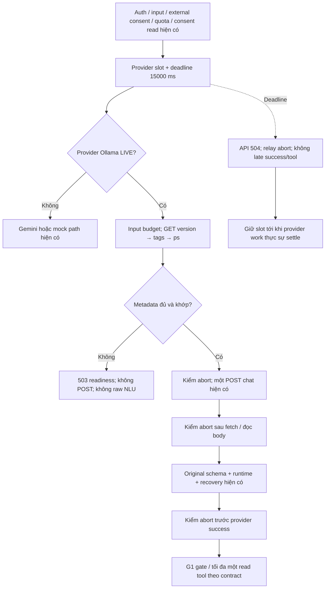

# T-AI-04-G1-READINESS-ABORT-GUARD-FIX

Ngày 10/11/2026, Asia/Ho_Chi_Minh. **FIX implementation/offline acceptance PASS. LIVE readiness chưa được nghiệm thu. P1 NLU và P2 deadline vẫn OPEN.**

Đã triển khai guard GET-only cho Ollama LIVE và chặn late response sau abort. **33/33 test mới, 13/13 diagnostic còn áp dụng, 181/181 regression áp dụng PASS; backend build PASS.** Các kết quả đều MOCK_ONLY/offline; không chứng minh chất lượng NLU thật. **0 inference LIVE, 0 request tới Ollama thật, không truy cập PostgreSQL hoặc gọi Catalog/Planner thật.**

## 1. Baseline và phạm vi thay đổi

Đã đọc đầy đủ [Readiness/Raw Clarify investigation](HUGO_T_AI_04_G1_READINESS_RAW_CLARIFY_INVESTIGATION_REPORT.md), [M01–M06 LIVE check](HUGO_T_AI_04_G1_MISSING_SLOT_LIVE_CHECK_REPORT.md), [Missing-Slot Decision FIX](HUGO_T_AI_04_G1_MISSING_SLOT_DECISION_FIX_REPORT.md), [Safe Contract FIX](HUGO_T_AI_04_G1_SAFE_CONTRACT_FIX_REPORT.md), source provider/deadline/limits/orchestrator và test/harness liên quan.

Evidence kế thừa: M01/M02 timeout trong lúc load, watchdog GPU discovery, load abort/HTTP 499; M03 load được; M04–M06 warm nhanh. Điều tra trước chưa chứng minh nguyên nhân sâu của GPU discovery chậm. Guard hiện tại tránh tự bắt đầu cold-load khi không xác minh được residency; không sửa Ollama/GPU, không giải quyết slot-filling P1.

| File | Thay đổi và mục đích |
|---|---|
| [ollamaReadiness.ts](../backend/src/agent/ollamaReadiness.ts) — mới | GET-only loopback; kiểm version, exact tag/digest, resident/context/expiry; lỗi readiness an toàn |
| [liveProvider.ts](../backend/src/agent/liveProvider.ts) | Gọi guard chỉ trong nhánh Ollama LIVE trước POST; kiểm abort sau fetch/body và trước success; structured trace; khai báo hai error code an toàn; tùy chọn pin digest từ env operator |
| [provider.ts](../backend/src/agent/provider.ts) | Truyền cùng `AGENT_TIMEOUT` làm abort reason và lỗi Promise.race, để log nhận biết outer deadline; giữ thứ tự abort → reject và thời hạn hiện có |
| [agentReadinessAbort.test.ts](../backend/src/tests/agentReadinessAbort.test.ts) — mới | 33 test offline độc lập; fake fetch, logical timers, controlled promises và API HTTP mock loopback |

Diff đầy đủ so với source local đầu task: [source-diff.patch](evidence/t-ai-04-g1-readiness-abort-guard-fix/source-diff.patch). Không so với HEAD vì working tree có thay đổi hợp lệ từ các task trước. Các script/fixture tương thích chỉ nằm trong evidence task này; không được import bởi application. Build sinh thêm compiled test runner trong `backend/dist/tests`.

Không sửa frontend, AgentService, limits, tools, schema/validators, prompt, G1 gate hoặc recovery policy. Không sửa Planner/Catalog/Trip/Booking/pricing/Map/sentiment, env file, model/tag/quantization; không migration/reset/seed/truncate, commit/push/deploy.

## 2. Readiness state machine và contract

Guard chỉ chạy khi đã đi vào `LiveLlmProvider.generate()` của Ollama, sau kiểm input byte-budget, trước inference. Không fetch lúc tạo provider. Luồng mock, Gemini, deterministic `needs_input`/recovery và authorization của tool giữ vị trí hiện có; không thêm guard toàn cục vào API/service. Auth/consent/rate order không đổi. Readiness thất bại vẫn tiêu thụ request quota bình thường vì `limits.consume()` vốn nằm trước provider; không hoàn quota/reset limit hoặc đổi principal.

Các kiểm tra theo thứ tự, không parallel, không retry, không cache:

1. Base URL giữ allowlist HTTP loopback `127.0.0.1`, `::1`, `localhost` (chuẩn hóa localhost sang IP); cấm credentials/path/query/hash/redirect. Helper tự kiểm lại URL. Chỉ GET `/api/version`, `/api/tags`, `/api/ps`; không có POST download/load/restart/warm-up trong helper.
2. Version phải có JSON object và version string không rỗng. HTTP 200 của version chưa đủ.
3. Tags phải có exact `name` và `model` bằng tag operator cấu hình; digest dạng 64 hex. Nếu có `OLLAMA_MODEL_DIGEST`, digest installed phải khớp pin.
4. `/api/ps` phải có đúng tag đang resident; digest phải khớp tags; `context_length` phải đúng **16384**. Thiếu context hoặc context khác bị từ chối an toàn, không tự reload để đổi context.
5. `expires_at`, nếu có, phải là timestamp hợp lệ còn hạn. `size`/`size_vram`, nếu có, phải là số nguyên không âm. Không suy diễn RAM/VRAM free từ số allocation, không đặt ngưỡng VRAM tùy ý, không bắt buộc GPU-only; resident CPU allocation 0 VRAM vẫn được kiểm thử chấp nhận.

Metadata có giới hạn **65536 bytes/response**. Toàn bộ readiness GET/body dùng một abort budget **2000 ms**, nằm bên trong deadline provider/API **15000 ms** không đổi; không cộng thêm 2 giây vào deadline. Đây là giới hạn control-plane mới, chưa đo latency trên Ollama thật. Nếu GET/body không tuân abort, outer API vẫn trả ở deadline 15 giây, nhưng slot chưa được nhả cho tới khi work settle.

| Trường hợp | API contract | Inference / NLU |
|---|---|---|
| Không kết nối, GET HTTP lỗi, JSON/metadata lỗi, readiness abort budget hết | HTTP 503, `AGENT_OLLAMA_READINESS_FAILED` | 0 POST; NLU **NOT EVALUATED** |
| Tag/digest/context không khớp, không resident hoặc hết hạn | HTTP 503, `AGENT_OLLAMA_NOT_READY` | 0 POST; NLU **NOT EVALUATED** |
| Outer/provider deadline hết | HTTP 504, `AGENT_TIMEOUT` | Nếu chưa POST: không chấm NLU; nếu đã POST mà không có output: lỗi deadline, không giả raw decision |
| Metadata ready, chưa abort | POST `/api/chat` như trước | Vẫn bắt buộc original schema, runtime validators, G1 gate/recovery |

AgentService sử dụng `SAFE_PROVIDER_ERRORS` như trước; hai code readiness được thêm vào tập này. HTTP response giữ envelope/message an toàn hiện có, không gửi metadata, stack hoặc `missingFields` giả cho readiness failure. Test HTTP kiểm cả hai code và status 503. Không có client flag bypass; unknown `skipReadiness` bị input validator từ chối.

`OLLAMA_MODEL_DIGEST` là cấu hình **server/operator tùy chọn**, không lấy từ request, không sửa env hiện tại. Pin sai định dạng làm provider unconfigured; pin hợp lệ nhưng không khớp metadata gây readiness 503. Khi chưa pin, guard chỉ chứng minh tags/ps nhất quán, **không chứng minh tag chưa bị retag so với model đã được chủ dự án duyệt**. Bước LIVE tiếp theo cần đặt pin approved `0edcdef34593eac1aa2be9c7d06c432dcf81945adca5eca2f27662c18f168ba0` qua cấu hình operator được duyệt, đối chiếu metadata trước khi chạy.

GET readiness là signal tại thời điểm đọc, không bảo đảm inference tiếp theo thành công, không đo free GPU memory, queue hay cleanup. Có race model eviction/resource pressure sau `/api/ps`; vẫn giữ deadline/error handling. Guard không biến version/tags thành bằng chứng NLU PASS.

## 3. Abort lifecycle và concurrency

Provider kiểm `signal.throwIfAborted()` trước mỗi inference fetch, ngay sau await fetch, sau các lần đọc body và trước khi trả decision. Helper GET có các kiểm tương tự và relay parent abort. Nếu fetch trả headers muộn sau abort, provider cancel body rồi reject; nếu body đến muộn, đọc/cancel xong vẫn reject `AGENT_TIMEOUT`. Không parse thành success, không biến malformed/timeout thành tool execution hoặc `needs_input` do thiếu dữ liệu người dùng.

`withinDeadline()` vẫn dùng Promise.race hiện có. Outer API không chờ cleanup vô hạn; timeout trả 504 và abort signal. `AgentLimits.providerCall()` **không sửa**: finally giảm active chỉ khi promise provider thực sự settle. Không dùng Promise.race nội bộ readiness để trả sớm và nhả slot trong khi fetch vẫn pending. Tests chứng minh slot vẫn `AGENT_BUSY` sau API timeout khi fetch/body/cancel chưa settle, rồi được nhả khi work kết thúc; không phát POST thứ hai hoặc late tool.

Provider riêng vẫn có timer **15000 ms** ngay cả caller không abort. Một fetch/body giả bỏ qua abort vĩnh viễn có thể giữ slot lâu dài: đây là fail-closed accounting; API vẫn timeout. Task không thêm auto-restart hoặc giả lập work đã hoàn tất để lấy lại slot. Với request không qua outer service, caller phải dùng deadline contract hiện có.

`underlying_fetch_settled` chỉ ghi promise fetch đã resolve/reject (headers/transport), **không có nghĩa response body, server inference hoặc GPU cleanup đã xong**. Client abort/cancel không chứng minh Ollama GPU đã được giải phóng. Native server/driver cleanup chưa kiểm lại ở task offline.

## 4. Logging policy

Structured JSON events: `provider_request_started`, `readiness_check_started`, `model_not_resident`, `readiness_check_failed`, `readiness_verified`, `inference_request_started`, `deadline_triggered`, `abort_propagated`, `underlying_fetch_settled`, `provider_completed`, `request_rejected_safely`.

Mỗi event chỉ có fixed source/provider/event, UTC timestamp, elapsed milliseconds, random UUID correlation ID mới cho lượt provider, `inferenceStarted` và operation/reason thuộc enum cố định khi áp dụng. Readiness budget timeout ghi `readiness_check_failed` với reason `deadline`; event `deadline_triggered` dành cho deadline provider/outer API. Gemini token-count operation ghi riêng `token_count`, không coi countTokens là inference started.

Không log raw prompt/history, user/account ID, JWT/key, URL/query/headers/body, model output, error.message từ network, account hoặc DB credentials. Không lấy correlation ID từ client. Trace sink có thể được inject từ server/test; không phải API bypass. Sink throw không làm đổi decision. Canary tests kiểm secrets trong prompt, account, API key và network error không xuất hiện trong events/response.

## 5. Kiểm thử offline và regression

Kết quả có thẩm quyền: [final-run/verified-summary.json](evidence/t-ai-04-g1-readiness-abort-guard-fix/final-run/verified-summary.json). Đây là tổng hợp các suite PASS trên cùng source production cuối; transport được chạy lại sau khi hoàn thiện fixture readiness cho HTTP mock server. Các log FAIL ban đầu vẫn giữ để kiểm toán.

| Suite | PASS | FAIL | Kênh / evidence |
|---|---:|---:|---|
| Readiness/abort mới | **33** | **0** | [new-readiness-abort.log](evidence/t-ai-04-g1-readiness-abort-guard-fix/final-run/new-readiness-abort.log), chạy trực tiếp, **không shim** |
| 13 diagnostic kế thừa, scheduling tương thích | **13** | **0** | [results](evidence/t-ai-04-g1-readiness-abort-guard-fix/prior-diagnostics-compatible/offline-diagnostic-results.json) |
| Missing-slot recovery | 33 | 0 | MOCK_ONLY |
| Slot-filling prompt | 21 | 0 | MOCK_ONLY |
| G1 safe contract | 26 | 0 | MOCK_ONLY |
| Decision routing | 10 | 0 | MOCK_ONLY |
| Decision format safety | 17 | 0 | MOCK_ONLY |
| Agent foundation | 22 | 0 | MOCK_ONLY |
| Transport/controls, readiness-compatible | 19 | 0 | [transport log](evidence/t-ai-04-g1-readiness-abort-guard-fix/final-run/agentTransport-ready-control-plane.log) |
| F applicable runner từ task G1 | 23 | 0 | Giữ nguyên runner applicable và original source |
| Frontend conversation | 10 | 0 | Offline unit, frontend source không đổi |
| **Tổng applicable regression kế thừa** | **181** | **0** | Không cộng historical unsafe F vào số này |
| Backend build `npm.cmd run build --silent` | **PASS** | — | [build log](evidence/t-ai-04-g1-readiness-abort-guard-fix/final-run/backend-build.log), exit 0 |
| Frontend build | **NOT RUN** | — | Không sửa frontend |
| Ollama/native LIVE, V2, Browser E2E, DB | **NOT RUN** | — | Ngoài quyền thực thi task offline |

33 test mới bao phủ: unavailable/HTTP error/JSON lỗi/version-only, sai tag/digest installed/resident, empty ps, thiếu/sai context, expired/invalid allocation/oversized metadata; ready path với một POST nguyên cấu hình; không tự retry; readiness timeout; GET bỏ qua abort; fetch/body/cancel đến muộn; standalone deadline; no provider success/late tool và active slot lifetime; logging/canaries; Gemini countTokens/consent; auth/rate/consent ordering; client flag; G1 current-only gate; typed recovery/schema; mock clarify và unknown/malformed/mutation rejection. API HTTP test chạy server test loopback bằng `node:http`; không phải Ollama hoặc Browser LIVE. Global fetch ngoài fake và Sequelize query bị chặn trong suite mới.

**Tương thích harness được công khai:**

- Old fakes chỉ mô phỏng POST, không có version/tags/ps. [legacy-ready-shim.cjs](evidence/t-ai-04-g1-readiness-abort-guard-fix/legacy-ready-shim.cjs) chỉ dùng ở process regression cũ, cấp metadata GET **MOCK_ONLY ready** rồi chuyển tiếp POST không sửa. HTTP mock server của transport cũ chỉ nhận `/api/chat`, nên shim cũng cấp synthetic GET cho server này. Production và suite guard mới không dùng shim. Đây là fixture control-plane, không phải xác minh Ollama thật.
- Test abort cũ gọi `generate(); outer.abort()` ngay lập tức, trước khi GET readiness hoàn thành; biến quan sát POST signal chưa được gán. Bản compiled chạy tương thích chỉ thêm microtask flush trước abort để vẫn kiểm đúng **POST abort propagation**. Test mới riêng xác minh abort trước readiness → 0 GET/POST. Không sửa assertion cũ.
- Diagnostic standalone cũ nhảy logical clock thẳng 15000 ms khi GET fixture còn pending, nên timer readiness hết trước khi đến POST fake. Bản copy chạy tương thích thêm flush ở logical time 0 trước advance; giữ nguyên 15000 và mọi assertion. Các diagnostic khác giữ nguyên. [compatibility-diff.json](evidence/t-ai-04-g1-readiness-abort-guard-fix/compatibility-diff.json) lưu chính xác ba phép thay (scheduling hai test và relative root cho thư mục output riêng), hash và `assertionsChanged: 0`.
- Lượt đầu: 31 test mới PASS; sau bổ sung API/cancel coverage là 33. Diagnostic bản chưa chỉnh scheduling: 12 PASS/1 FAIL; original transport runner dừng vì POST chưa bắt đầu. Lượt tương thích tiếp theo vẫn phát hiện HTTP mock fixture chưa hiểu GET; log giữ tại `final-run/agentTransport-compatible.log`. Sau sửa **fixture**, transport 19/19 PASS. Không sửa production để né guard hoặc thay expected. Không cộng các lượt chạy lặp thành case mới.
- Observation cũ `providerReturnedDecisionAfterAbort` từ **true → false** với source cuối. Chuỗi mô tả `sourceGap` và comment “production unchanged” trong diagnostic copy được giữ nguyên văn lịch sử, không còn mô tả source FIX hiện tại; kết luận dùng boolean đo mới và tests mới.
- [F historical log](evidence/t-ai-04-g1-readiness-abort-guard-fix/final-run/historical-F.log): original unsafe observation vẫn FAIL `expected completed / actual needs_input`, **22 PASS trước khi dừng, 1 FAIL, 1 NOT RUN**. Không đổi assertion này; báo riêng như baseline G1. 23 F applicable vẫn PASS.

Có thể chạy riêng suite mới sau build bằng `node dist/tests/agentReadinessAbort.test.js` trong backend. [run-offline.cjs](evidence/t-ai-04-g1-readiness-abort-guard-fix/run-offline.cjs), [prepare-compatible-runs.cjs](evidence/t-ai-04-g1-readiness-abort-guard-fix/prepare-compatible-runs.cjs), [run-final.cjs](evidence/t-ai-04-g1-readiness-abort-guard-fix/run-final.cjs) và [verify-final.cjs](evidence/t-ai-04-g1-readiness-abort-guard-fix/verify-final.cjs) lưu cách chạy/audit. Evidence write-once; không chạy lại script vào output đã tồn tại để ghi đè.

## 6. Integrity và bảo vệ dữ liệu

[Before](evidence/t-ai-04-g1-readiness-abort-guard-fix/integrity-before.json) / [after](evidence/t-ai-04-g1-readiness-abort-guard-fix/integrity-after.json): **4157 file baseline** trong backend/src, frontend/src/tests, docs và package/locks; **4155 file không đổi**, chỉ hai existing source file được sửa đúng phạm vi, thêm helper và test. Không có thay đổi bất ngờ. **3801 historical evidence files không đổi**. [Protected hashes](evidence/t-ai-04-g1-readiness-abort-guard-fix/protected-hashes.json) xác minh 10 source bảo vệ, gồm toàn bộ AgentService/SYSTEM, schema, validation, tools/parsers, limits, G1 provenance, recovery, conversation/privacy và routes nguyên vẹn.

| Artifact/source | SHA-256 sau FIX |
|---|---|
| liveProvider.ts | `52a4e971608a5d663e1d87a3a94356925497d525de36ccb6d215c15bf418dd35` |
| provider.ts | `8e4ead59f206be166c1bb26d4b5d6f5a537a8c55dfad34a55744fc5b9edf137e` |
| ollamaReadiness.ts | `01ee551e8d4655bf3dbf6639b751d74353544531ae8a91b2d58b989de3b4ac4c` |
| agentReadinessAbort.test.ts | `beb6667f87a969b7829006d1444395f0636f9cf6ac52f4539a3414632ffcb2dc` |
| V2 APPROVED — không đổi | `0f1e0f1e87418bca591c6dfcd06645bd9a534326cac23989d58c7a7fd5e6fe6e` |
| V2 lock — không đổi | `f4f3294623f763418393bcfa89cbb39dae9c7af080552c8ce377b3d890549706` |

Không có DB access, fixture, migration hoặc write PostgreSQL. **Fingerprint/cleanup DB: NOT RUN / N/A**; không tuyên bố fingerprint mới 25/25 khi không truy cập DB. Không tác động 27 Trip lịch sử; không dùng demo/seed. Working tree và evidence cũ được giữ theo hash snapshot; không revert thay đổi của các task trước.

## 7. Kết luận và lỗi còn mở

Acceptance implementation offline đạt: không resident → 0 POST; readiness failure → safe 503/code; abort muộn → không provider success/tool; slot không nhả sớm; ready path và Gemini/mock/G1/recovery vẫn hoạt động trong mock; build và applicable regression PASS.

| Vấn đề | Trạng thái |
|---|---|
| **P1 TAI03B-B1-01 — raw NLU/slot-filling** | **OPEN**; không thay model/prompt/schema/required slot policy; không inference mới |
| **P2 Ollama readiness/deadline** | **OPEN — FIX implemented, OFFLINE PASS; LIVE verification NOT RUN** |
| GPU discovery watchdog/load/cleanup nguyên nhân sâu | Chưa xác minh/sửa; guard không giải quyết runtime GPU root cause |
| Model eviction, control-plane latency, memory pressure sau GET | Risk còn lại; cần controlled native check, không có bảo đảm success từ residency |
| F unsafe historical expectation | Báo riêng như trên; không phải regression mới để đổi policy an toàn |
| Map P2 | Giữ OPEN, ngoài phạm vi |

Không đóng P1/P2 bằng mock tests; không tuyên bố LIVE_LLM hoặc Browser E2E PASS.

## 8. NEXT TASK PLAN — chờ chủ dự án duyệt

**Đề xuất `T-AI-04-G1-READINESS-CONTROLLED-CHECK`**, dependency: duyệt FIX và kế hoạch POST/request body, principal/rate-window, privacy/local-only và operator preparation trước khi chạy. **Tối đa 2 POST kỹ thuật local tổng cộng, chỉ sau phê duyệt riêng**, không hidden inference/warm-up, không benchmark V2.

1. Khóa technical input/expected mới, body, latency/schema/abort criteria và attempt ledger trước POST. Giữ Qwen3 tag/digest approved, context 16384, output 2048, temperature 0, timeout Agent 15000 ms. Kiểm source/hash/benchmark, cùng principal/rate-limit bình thường, local/no-cloud/proxy, GPU/RAM/VRAM và GET version/tags/ps. Nếu không đủ điều kiện, BLOCKED, không POST.
2. **Cách đưa model vào ready phải được duyệt rõ:** nếu model chưa resident/context chưa đúng, dành **POST #1** cho operator load-only loopback Ollama (đề xuất `/api/generate` với prompt rỗng, model/digest đã xác minh và `options.num_ctx=16384`, stream false; body/keep-alive/load deadline phải được khóa và duyệt trước task đó). Đây vẫn là một POST có load/GPU work, **tính vào trần 2**, không gọi ngầm trong guard hoặc harness. Không tự kéo model/đổi context của production/request timeout để tạo PASS. Nếu operator không duyệt preparation hoặc không load kịp thì dừng; không thử load lại.
3. GET `/api/ps` đối chiếu resident/tag/digest/context và ghi snapshot tài nguyên sau preparation. Chưa ready → BLOCKED, không dùng POST thứ hai để lặp cold-load. Nếu đã resident từ đầu thì có thể bỏ preparation, tổng số POST ít hơn 2.
4. Dành **tối đa POST #2** cho một technical request qua provider production cuối, expected khóa trước, original schema/parseDecision; không gọi tool thật/Catalog/Planner/DB. Thu raw response, status, latency/token, trace deadline/fetch settlement và resource snapshots. Không retry hoặc sửa expected. Cần thiết kế trước input ngoài V2/probe lịch sử, loại supported/unsupported và tiêu chí tương ứng; đây là smoke/readiness, không phải điểm NLU.
5. Báo PASS/FAIL/BLOCKED thực tế, client settlement và giới hạn GPU cleanup; kiểm integrity/ledger. Không tăng timeout/context/model nếu FAIL; đề xuất riêng khi có evidence. Nếu cần DB ở task khác, chỉ exact test DB cùng guard/sentinel/checksum/fingerprint/ledger.

Sau readiness controlled check mới xem xét **`T-AI-04-G1-SERVER-COMPLETENESS-POLICY-FIX`** trong task được duyệt riêng: giải quyết raw missing-slot/clarify và policy dựa trên evidence; không gộp vào FIX readiness này. Đã dừng sau báo cáo, chưa triển khai các bước tiếp theo.
