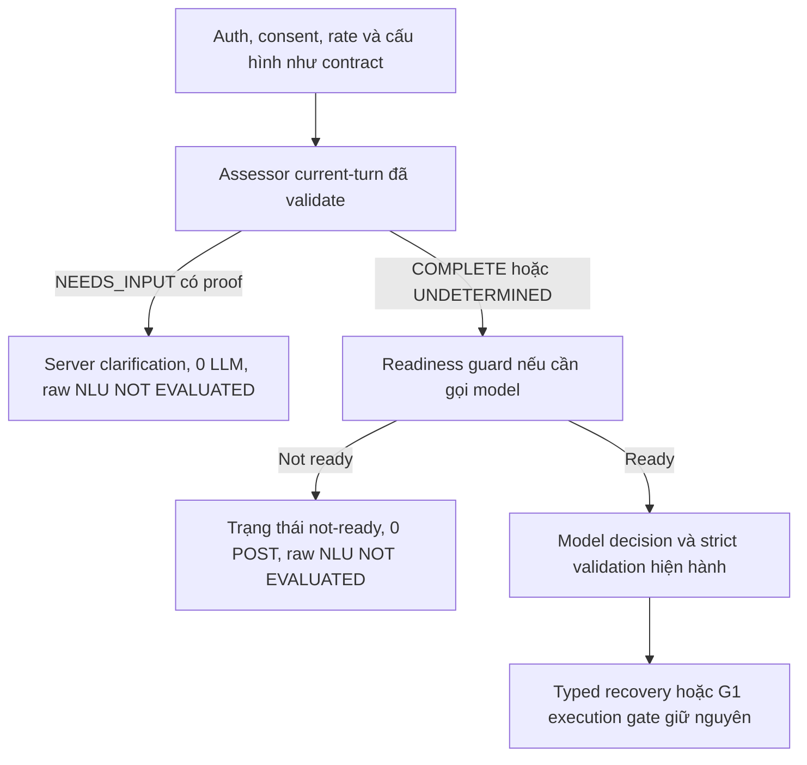

# T-AI-04-G1-READINESS-AND-RAW-CLARIFY-INVESTIGATION

Ngày 10/11/2026, Asia/Ho_Chi_Minh. **Điều tra offline hoàn tất; không sửa production, không inference mới.** Có bằng chứng trực tiếp rằng M01/M02 bị hủy **trong lúc runner/model chưa load xong**: server ghi GPU discovery watchdog timeout, aborting load, Load failed và HTTP 499. **Nguyên nhân sâu khiến GPU discovery/load chậm chưa được xác định.** M03 vẫn là raw NLU FAIL; recovery LIVE trước đó PASS không thay đổi kết luận này.

**13/13 diagnostic tests + 181/181 regression còn áp dụng PASS**. Một observation về late response của fake fetch được ghi riêng, không phải acceptance đã sửa. **P1 NLU và P2 deadline tiếp tục OPEN.** Không đóng lỗi bằng một kết quả điều tra hoặc mock test.

## 1. Phạm vi và nguồn chứng cứ

Đã đọc [M01–M06 LIVE report](HUGO_T_AI_04_G1_MISSING_SLOT_LIVE_CHECK_REPORT.md), [Missing-Slot FIX](HUGO_T_AI_04_G1_MISSING_SLOT_DECISION_FIX_REPORT.md), [S01–S06 LIVE report](HUGO_T_AI_04_G1_SLOT_FILLING_LIVE_REVALIDATION_REPORT.md), [Slot-Filling FIX](HUGO_T_AI_04_G1_SLOT_FILLING_FIX_REPORT.md), các request/response/envelope/exception/ledger và source provider, deadline, limits, schema, runtime validation, recovery, provenance và conversation.

Evidence mới chỉ trong `docs/evidence/t-ai-04-g1-readiness-raw-clarify-investigation/`. Chỉ đọc Windows process/listener/log/model metadata và GET `/api/version`, `/api/tags`, `/api/ps`. **0 POST Ollama**, không restart/preload/unload/model download, sửa config/GPU settings, truy cập DB, Catalog/Planner thật, fixture/migration/reset/seed/truncate, commit/push/deploy, G2 hoặc V2 evaluation.

Nguồn chính:

- [Runtime/log snapshot](evidence/t-ai-04-g1-readiness-raw-clarify-investigation/runtime-readonly.json): native listener, process start, sanitized log rows và GET-only readiness.
- [Timeline tương quan](evidence/t-ai-04-g1-readiness-raw-clarify-investigation/deadline-timeline.json): ledger client và server log rows theo timestamp/order; log không có case ID/principal nên correlation không phải request-ID tracing.
- [Runner structural log](evidence/t-ai-04-g1-readiness-raw-clarify-investigation/runner-structural-log.json), [memory/config chọn lọc](evidence/t-ai-04-g1-readiness-raw-clarify-investigation/runtime-config-and-memory.json): không lưu toàn bộ env, prompt hoặc credentials từ log.
- [Raw clarify comparison](evidence/t-ai-04-g1-readiness-raw-clarify-investigation/raw-clarify-analysis.json), [diagnostic results](evidence/t-ai-04-g1-readiness-raw-clarify-investigation/offline-diagnostic-results.json).

Metadata listing ban đầu báo `server.log` rỗng; đọc trực tiếp bằng filesystem đã thu được **103.181 bytes**, SHA-256 tại thời điểm đọc `0956b5fdcafa9a3fda540ac8725333992c693d4950942beb103376c0f09c4c69`, gồm **51 timestamped rows** trong cửa sổ M run. Kết luận dùng snapshot đọc trực tiếp, không dựa vào metadata ban đầu. Runtime log là file đang chạy và có thể append tự nhiên; task chỉ đọc, không tuyên bố log live bất biến.

## 2. Root-cause matrix

| Phát hiện | Mức chứng cứ | Kết luận / giới hạn |
|---|---|---|
| API process đã chạy từ trước, nhưng model không resident trước M01 | **CONFIRMED** từ preflight, startup log và process inspection | Service alive/tag installed không đồng nghĩa model ready. Không phải chỉ nhìn GET version 200 là đủ |
| GPU discovery watchdog timeout và dùng memory values cũ trong M01/M02 loading path | **CONFIRMED** server.log dòng 710–713, 727–729 | Runtime discovery gặp deadline; chưa biết vì sao CUDA discovery chậm |
| Client ngắt khi model còn loading; server abort load, Load failed/context canceled và hai HTTP 499 | **CONFIRMED** về events; liên hệ M01/M02 được hỗ trợ mạnh bởi thời gian/thứ tự/sáu POST khớp | Xác định nguyên nhân gần: provider budget 15 giây hết trước model readiness, không có raw NLU để chấm |
| Ba runner launch khác port 62464 → 62516 → 62581; runner thứ ba ready sau 6,82 giây | **CONFIRMED** log | Có repeated load/start attempts; không có bằng chứng một HTTP retry tự động trong harness |
| Model loading bị hủy rồi request sau lại phải khởi tạo/load | **LIKELY** giải thích cascade từ log và residency | Không chứng minh toàn bộ thời gian cleanup hoặc mọi GPU work của runner cũ đã kết thúc |
| GPU memory báo free 6,9 GiB trong khi nvidia-smi client samples khoảng 5.159 MiB | **CONFIRMED** mismatch và warning dùng old values | Sizing có dữ liệu cũ; mức đóng góp vào timeout là **LIKELY/risk**, không đủ để khẳng định thiếu VRAM gây lỗi |
| Model/context memory đáng kể, headroom sau load hẹp | **CONFIRMED** log/samples | Context 16k có chi phí; chưa chứng minh context là nguyên nhân timeout hoặc 8k sẽ giải quyết |
| OOM hoặc queue contention gây M01/M02 | **HYPOTHESIS**, chưa có log OOM/queue event rõ trong window | Không suy từ memory thấp hoặc `MAX_QUEUE=512` rằng có queue thực tế |
| Disk/cache, CUDA initialization, Windows scheduling/antivirus, GPU workload khác hoặc phiên bản runtime gây load chậm | **HYPOTHESIS** | Cần profiling/đối chứng riêng; không sửa driver/config/model theo phỏng đoán |
| Source giữ 15 giây, truyền abort xuống fetch; outer deadline không chờ toàn bộ pending work settle | **CONFIRMED** source và fake-fetch tests | Client timeout không tự chứng minh server/GPU đã dừng; historical server cancellation được kiểm riêng |
| S01/M03 chọn tool thiếu field thay vì clarify | **CONFIRMED** raw output | Lỗi decision/contract của model còn mở; không phải backend thêm/xóa required args |
| Omitted-vs-unset wording/model prior/schema anchoring gây raw failure | **HYPOTHESIS** về cơ chế nội tại | Có pattern quan sát được, chưa có A/B cùng input/chỉ một biến để xác định nguyên nhân |

Không phát hiện transport không tới Ollama ở M01/M02: server có POST và client-close/499 tương ứng. Không có bằng chứng timeout do model sinh JSON quá dài: hai request chưa load xong, còn M03/S01 kết thúc `stop`, chỉ 60/69 output tokens, dưới giới hạn 2.048.

## 3. Ollama initialization, model và hardware

Native Windows listener tại lúc đọc: **PID 20468**, `ollama.exe`, start **09:34:51.083 UTC+07**. App log ghi startup 09:34:49.951; server log ghi listen `127.0.0.1:11434` lúc **09:34:51.268**, version **0.40.16**. Process hiện tại bắt đầu trước M run khoảng ba giờ; historical preflight không ghi PID nên không gán các request chỉ bằng PID hiện tại.

Model API vẫn là `qwen3:4b-instruct-2507-q4_K_M`, digest `0edcdef34593eac1aa2be9c7d06c432dcf81945adca5eca2f27662c18f168ba0`. [Local identity verification](evidence/t-ai-04-g1-readiness-raw-clarify-investigation/model-identity.json) xác minh blob original manifest **859 bytes** có đúng SHA đó; local wrapper manifest **1.022 bytes**, SHA `6214d088d3846e16c9fe00adcbabdbfddc61ce4a70daacc46cb2310c38603054`, tham chiếu original manifest như một layer. Cả hai tham chiếu weight blob `sha256:85e4a5b7b8ef0e48af0e8658f5aaab9c2324c76c1641493f4d1e25fce54b18b9` được in trong M-run logs. Đây là các file khác nhau, không coi wrapper hash khác API digest là model đã bị đổi; không hash/tải lại file weights lớn.

Các default startup chọn lọc từ log: `OLLAMA_CONTEXT_LENGTH=0`, `NUM_PARALLEL=1`, `MAX_LOADED_MODELS=0`, `MAX_QUEUE=512`, `LOAD_TIMEOUT=5m0s`, `KEEP_ALIVE=5m0s`, `GPU_OVERHEAD=0`, `FLASH_ATTENTION=false`. Đây là **giá trị log**, không phải cấu hình mới. Log startup chọn default context 4096, nhưng request và runner command M run override **16384**, `-np 1`; không nhầm default startup với context thực tế.

M preflight: RAM free 3.618/16.202 MiB, VRAM free 5.159/8.188 MiB, model không resident. Sau model load, VRAM free samples khoảng **333–339 MiB**. Runner log ghi:

| Thành phần | Evidence M run |
|---|---|
| CUDA model buffer | **2.375,91 MiB**, offloaded 37/37 layers |
| CUDA KV buffer | **2.304 MiB** với context 16384 |
| CUDA compute buffer | **186,03 MiB** |
| Projected device use | Khoảng **4.865 MiB**; fitter dùng free **7.099 MiB** và dự kiến còn 2.233 MiB |

Số free mà fitter dùng không khớp live nvidia-smi snapshots; warning stale memory củng cố cần readiness/resource freshness. Không thấy explicit OOM trong log window đã thu, nhưng absence of OOM không chứng minh không có transient pressure. Background VRAM trước model ở M cao hơn S run (khoảng 2.799 so với 1.611 MiB); chưa có process-level profiler để quy cho ứng dụng nào.

Read-only snapshot sau run lúc **13:02:22 UTC+07**: GET version 0.40.16, tag/digest khớp, `/api/ps` models `[]`; RAM free khoảng 3.031 MiB, VRAM free 4.910 MiB. Kết hợp `KEEP_ALIVE=5m` và expiry 12:39:47 từ evidence M phù hợp với việc model không còn resident sau thời gian idle; không dùng sample muộn để tái tạo peak memory lúc M01.

## 4. Deadline/abort timeline

Thời gian dưới đây là **UTC+07**, lấy từ client ledger và server logs cùng máy. Deadline tính từ POST chỉ là xấp xỉ: outer provider timer bắt đầu hơi trước lúc ghi ledger.

| Sự kiện | M01 | M02 | M03 |
|---|---|---|---|
| Client POST attempt | 12:34:01.014 | 12:34:16.292 | 12:34:31.600 |
| GPU discovery warning | 12:34:04.272 | 12:34:19.307 | Không thấy warning tương tự trong window |
| Launch runner | 12:34:05.342, port 62464 | 12:34:19.376, port 62516 | 12:34:34.599, port 62581 |
| Loading/waiting | Từ 12:34:05.377–05.383 | Từ 12:34:19.382 | Từ 12:34:34.604 |
| Client-close, abort load | **12:34:16.073** | **12:34:31.421** | Không |
| Load failed/context canceled | 12:34:16.079 | 12:34:31.421 | Không |
| Server HTTP log | **499 / 15,07 s** | **499 / 15,26 s** | 200 / 12,01 s |
| Client provider reject/capture | 12:34:16.287, TIMEOUT | 12:34:31.596, TIMEOUT | 12:34:43.648, invalid partial tool |
| Runner ready | Chưa ready trước cancel | Chưa ready trước cancel | **12:34:41.423**, startup **6,82 s** |

Client provider reject của M01/M02 có trước POST kế tiếp **5 ms / 4 ms**: không có bằng chứng harness gửi hai fetch đồng thời. Server cancellation đã được log; không có bằng chứng hai request timeout tiếp tục tạo một completion thành công phía sau. **Chưa chứng minh thời điểm toàn bộ runner process/GPU cleanup hoàn tất**; HTTP canceled không phải full cleanup acknowledgement.

M03 có `load_duration≈9.820 ms`, gồm cả khoảng trước runner ready; prompt evaluation ≈865 ms, generation ≈1.292 ms. M04/M05/M06 load vài ms, wall lần lượt **1.655 / 827 / 165 ms**. Khác biệt lớn nằm ở readiness/load; không coi hai timeout là lỗi raw NLU semantic, vì không có raw.

Source:

- [withinDeadline](../backend/src/agent/provider.ts:36): tạo AbortController, timer và `Promise.race`; timer abort rồi reject `AGENT_TIMEOUT`, cuối hàm clear timer. Promise bên dưới có thể còn pending nếu không cooperate.
- [liveProvider](../backend/src/agent/liveProvider.ts:54): relay outer abort vào controller riêng, timer riêng 15.000 ms, truyền `signal` cho fetch; `signal.aborted` được map thành timeout ở catch, timer/listener được cleanup ở finally.
- [AgentLimits](../backend/src/agent/limits.ts): active slot chỉ được nhả khi `providerCall` thật sự settle, không nhả ngay vì service race đã trả timeout. Giữ nguyên behavior này để không phá concurrency accounting.
- [orchestrator](../backend/src/services/agentService.ts:78): consent/provider/tool có `withinDeadline` riêng. 15 giây hiện là các phase budget, không phải bằng chứng mọi API turn có tổng deadline duy nhất 15 giây. M run dùng fake consent/executor nên gần như toàn bộ wall là provider phase.

## 5. Đánh giá giải pháp readiness

| Hướng | Hiệu quả dự kiến/local demo | Rủi ro và policy | Chi phí/độ phức tạp | Evidence cần thêm |
|---|---|---|---|---|
| **A. Giữ 15s, yêu cầu ready trước LIVE** | Ngăn người dùng/benchmark vô tình chịu cold-load cascade; trạng thái not-ready rõ | Không resident thì chưa phục vụ được; reject/NOT RUN không được tính thành NLU hoặc readiness PASS | Thấp; cần operator workflow minh bạch | Kiểm ready/warm thực tế trước acceptance; cold lifecycle riêng |
| **B. GET model/resource check** | Version/tag/digest/context/residency/freshness trước inference; không warm-up bí mật | GET tag/version 200 chưa đủ; ps là necessary signal, không bảo đảm generation/schema/latency. Không tải model nếu chưa ready | Thấp–vừa; bounded loopback-only GET, không raw user data/credentials/cloud | Chính sách resource margin cần dữ liệu; chưa đủ để khóa một ngưỡng VRAM mới |
| **C. Deadline/abort lifecycle** | Giữ deadline, quan sát fetch settlement; tránh request kế tiếp đi vào trạng thái load/drain chưa rõ | Không reset active counters khi job còn chạy; không claim AbortSignal là server cleanup. Không giữ API chờ vô hạn | Vừa; trace không chứa prompt/key, post-fetch/body abort checks và readiness recheck sau timeout | Fake tests đã có; native cancellation/cleanup tracing cần protocol rõ |
| **D. Đổi timeout/context/model** | Có thể tăng cơ hội load hoặc giảm memory | Thay contract/latency; 30s có thể chỉ che runtime failure. Context thấp phải đồng bộ input/output budgets; model đổi cần benchmark lại | Cao hơn và cần owner approval | Chỉ thử sau profiling có cơ sở, controlled inference được duyệt riêng |

**Chưa khuyến nghị tăng 15 → 30 giây.** Đã có cold success dưới 15 giây ở S run/M03 và warm success nhanh; chưa có bằng chứng 15 giây tự thân là không thể đáp ứng. Ollama load timeout startup là 5 phút, nhưng client 15 giây đã hủy trước đó; tăng server load timeout không giải quyết client deadline.

Context 16k thật sự tiêu tốn KV memory, nhưng chưa chạy đối chứng. Ước lượng giảm KV theo context chỉ là thiết kế cần đo; không tự hạ `num_ctx` trong khi giữ các giới hạn input 12.288/output 2.048 như cũ. Không đổi model/GPU settings/keep-alive trong task này.

Sau một timeout, harness/operation tương lai nên kiểm readiness lại và có thể dừng phần còn lại **NOT RUN** nếu chưa ready, thay vì tự thử load thêm để có PASS. Mọi preload/warm-up qua POST dù input rỗng cũng phải được phê duyệt và ghi ledger/ngân sách; không giấu dưới tên “readiness”.

## 6. Raw clarify: omitted, explicit unset và pipeline

[So sánh bốn raw cases](evidence/t-ai-04-g1-readiness-raw-clarify-investigation/raw-clarify-analysis.json):

| Case | Input thiếu/unset | Raw | Kết luận |
|---|---|---|---|
| S01 | Không đề cập transportation | tool plan_trip thiếu transportation, 69 output tokens, stop | Raw FAIL, schema reject |
| S02 | Explicit chưa chọn | clarify transportation | PASS lịch sử trên prompt trước |
| S03 | Phủ định ô tô/chưa chọn thay thế | clarify transportation | PASS lịch sử trên prompt trước |
| M03 | Không đề cập adults/totalBudget | tool plan_trip thiếu hai field, 60 output tokens, stop | Raw FAIL; typed recovery LIVE PASS riêng UX |

Không được kết luận model phân biệt omitted/unset một cách tổng quát: request/missing fields/prompt versions khác nhau. M01/M02 trên prompt mới nhất timeout trong load, không có raw để đối chiếu. Pattern quan sát được là **model có thể chọn intent tool và sao chép các field có mặt nhưng không chuyển sang clarify khi một số field vắng mặt**; cơ chế nội tại vẫn chưa biết.

Prompt mới đã ghi thứ tự unsupported → required evidence → clarify → tool, cấm defaults, có ví dụ explicit unset và câu nhắc field không được đề cập cũng là thiếu. AGENT_TOOLS/schema liệt kê required đúng; không có contract cho partial tool. Ollama `format:"json"` chỉ được dùng để tạo JSON; **runtime** mới cưỡng chế original schema. Không có cơ sở khẳng định metadata cố tình cho phép thiếu field hoặc schema bị thay để cứu output.

Backend kiểm missing fields được vì dùng intent/grammar hẹp, canonical values và required list xác định từ AGENT_TOOLS. Model đang thực hiện mapping ngôn ngữ theo instruction, không phải thuật toán missing-set cưỡng chế. Hai lớp có thể cho kết quả khác nhau. Raw partial đã có ngay tại provider boundary; không phải backend sửa/xóa field. S01/M03 không bị cắt vì output limit: JSON khép kín, `done_reason=stop`, số token thấp.

## 7. Hai hướng kiến trúc và phạm vi nhỏ đề xuất

| Hướng | Ưu điểm | Hạn chế | Khuyến nghị |
|---|---|---|---|
| **1. Tiếp tục cải thiện raw LLM decision** | Giữ cơ chế orchestrator hiện tại, cần cho tiếng Việt tự nhiên và benchmark raw | Nhiều vòng prompt vẫn có partial tool; mock không dự đoán quality; mỗi thay đổi cần LIVE riêng | Giữ như một track đánh giá, không tiếp tục sửa prompt theo phỏng đoán trong task này |
| **2. Server-side completeness** | Với current message rõ và field proof hợp lệ, hỏi thiếu bằng missing-set xác định; UX ít lệ thuộc model | Parser G1 không tổng quát; cần phân biệt unknown với missing. Có thể không gọi LLM nên raw NLU NOT EVALUATED | Ưu tiên cho UX trong **phạm vi grammar đã chứng minh**, không thay thế bài đo NLU |

Đề xuất không tạo lại Agent: tái sử dụng [readCurrentRequiredSlots](../backend/src/agent/toolProvenance.ts:131) và tách phần validation/missing-set của `currentMissingSlots` trong [missingSlotRecovery.ts](../backend/src/agent/missingSlotRecovery.ts:19) thành assessor dùng chung, thay vì thêm regex hoặc tool spec thứ hai. Assessor đề xuất trả **COMPLETE / NEEDS_INPUT / UNDETERMINED**; chỉ NEEDS_INPUT với intent và observations hợp lệ mới hỏi trước inference. Không suy COMPLETE từ `null` của helper hiện tại, vì null cũng biểu thị invalid/không chứng minh được; cần tri-state rõ ràng. Không lấy Planner defaults hoặc history client để làm đủ field.

Đây là **thiết kế, chưa triển khai**. Không biến “không hiểu câu” thành “mọi field đều thiếu”; UNDETERMINED đi theo đường model/safety hiện có. Assessor không được cho phép tool chỉ nhờ model name hoặc substring city. Current-turn-only vẫn áp dụng; reply ngắn “Xe máy nhé” và history chưa được xác thực không thể lấp các slot cũ. G2 mới có thể giải quyết verified multi-turn theo task riêng.

Coverage diagnostic trực tiếp: labeled complete/incomplete được reader nhận; natural prose, short follow-up, explicit unset, mixed intent và mutation trả null. Vì vậy **không coi G1 là NLU tiếng Việt tổng quát** và không hứa UX đa lượt hoàn chỉnh bằng một precheck.

Các trục đo phải tách:

| Trục | Cách ghi |
|---|---|
| Raw model NLU | Chỉ PASS/FAIL khi thật sự có model output; no inference → NOT EVALUATED; timeout không quan sát được semantic |
| Deterministic clarification | Origin SERVER_COMPLETENESS, exact missing set, 0 POST; không cộng vào raw NLU PASS |
| Invalid model + recovery | Raw/schema FAIL vẫn giữ, origin MODEL_REJECTED_RECOVERY, UX/safety chấm riêng |
| Authorization/tool safety | Auth/consent/rate/schema/provenance độc lập, tối đa một read-only tool, không mutation |
| UX | needs_input/completed/error theo acceptance; không thay thế model metric bằng API status |

Nếu có precheck trong product, raw V2 cần đường evaluation được operator kiểm soát, giữ auth/consent/rate/schema/gate và không real tool; không thêm client flag để bypass. Nếu không gọi model trong một V2 case thì case raw vẫn NOT EVALUATED/NOT RUN, không tự đổi acceptance benchmark thành deterministic UX.

## 8. Offline diagnostics và regression

[Diagnostic script](evidence/t-ai-04-g1-readiness-raw-clarify-investigation/offline-diagnostics.cjs), [plan/hash khóa trước chạy](evidence/t-ai-04-g1-readiness-raw-clarify-investigation/diagnostic-plan-lock.json), [kết quả](evidence/t-ai-04-g1-readiness-raw-clarify-investigation/offline-diagnostic-results.json): **13 PASS / 0 FAIL**.

Bao phủ outer/provider deadline 15.000 ms, already-aborted request, fetch/body-read abort, no response, no late tool, concurrency slot giữ tới settlement, network không thành needs_input, one/multi missing-only recovery, complete tool, malformed/unknown tool, negation/unset fail closed, current-turn/cross-account history, auth/consent/rate và grammar coverage. Dùng **logical clock trong process test**, không đổi thời gian Windows hoặc production timeout; không lấy logical 15.000 ms làm latency model.

**Observation riêng, không phải acceptance đã đạt:** fake fetch cố tình bỏ qua AbortSignal và trả response muộn có thể khiến standalone provider nhận valid decision sau abort, vì success path hiện không recheck signal sau fetch/body. Outer service `Promise.race` vẫn chặn mọi late tool, và active slot chỉ nhả khi pending provider settle. Đây là cơ sở đề xuất defensive checks; **không chứng minh Node fetch hoặc Ollama M01/M02 bỏ qua cancellation**. Log native server cho hai case đã ghi abort/load failed.

[Regression runner](evidence/t-ai-04-g1-readiness-raw-clarify-investigation/run-regression.cjs), [summary](evidence/t-ai-04-g1-readiness-raw-clarify-investigation/regression-summary.json):

| Suite | PASS / FAIL |
|---|---:|
| Missing-Slot Recovery | 33 / 0 |
| Slot-Filling Prompt | 21 / 0 |
| G1 Safe Contract | 26 / 0 |
| Decision Routing | 10 / 0 |
| Decision Format Safety | 17 / 0 |
| Agent Foundation | 22 / 0 |
| Agent Transport | 19 / 0 |
| F applicable derived runner | 23 / 0 |
| Frontend conversation | 10 / 0 |
| Tổng baseline còn áp dụng | **181 / 0** |
| Diagnostic mới, riêng | **13 / 0** |
| Backend build | **PASS**, exit 0 |

Tổng **194 test còn áp dụng PASS**, không cộng observations hoặc lượt lặp thành test/model case. [F nguyên bản](evidence/t-ai-04-g1-readiness-raw-clarify-investigation/agentContractSlotInvestigation.log) vẫn **22 hoàn tất trước lỗi / 1 FAIL / 1 NOT RUN** tại assertion unsafe cũ expected completed, actual needs_input; không sửa test/expected. Derived runner giữ 23 assertion còn lại như baseline. Frontend build NOT RUN, frontend source không đổi.

Tất cả unit/regression **MOCK_ONLY/offline**. Foundation có code Planner/adapter chạy trên catalog synthetic/test loader, DB query bị chặn; không truy cập real Catalog/Planner/DB. HTTP test server trong baseline dùng fake model, không POST Ollama.

## 9. Minimal FIX đề xuất và acceptance — chưa thực hiện

**Ưu tiên FIX nhỏ thứ nhất: readiness guard + abort observability**, không sửa prompt/model/schema:

- Bounded loopback-only GET check version/tag/digest/context/residency/freshness sau các auth/consent/limit gates khi thật sự cần LLM. Nếu chưa ready, trạng thái riêng/NOT RUN; không tự preload hoặc đổi quota.
- Thêm recheck AbortSignal sau fetch/body và trước provider success; giữ 15 giây, không sửa raw output, không reset active counters để che pending work. Trace lifecycle tối thiểu request/abort/settlement/deadline, không raw prompt/key hoặc dữ liệu private.
- Sau timeout kiểm readiness lại trước request tiếp theo; không bắt đầu vòng cold-load lặp khi trạng thái chưa đủ rõ. Không đợi cleanup vô hạn hoặc tuyên bố GET ps chứng minh GPU hoàn toàn quiescent.

File cần review trong task FIX riêng: `liveProvider.ts`, bounded readiness helper mới và vị trí gọi trong `agentService.ts`/harness; giữ original runtime/gate và budgets. Không cần DB schema/migration, Planner, pricing hoặc frontend module mới để bắt đầu.

**FIX nhỏ thứ hai, cần owner chốt policy:** reuse validated current-slot assessor cho pre-inference clarification trong grammar hẹp. Có thể tác động tests vốn mong một provider call: giữ evidence/diagnostic cũ, phân loại compatibility thay đổi có chủ ý; không sửa assertion lịch sử để giả rằng behavior luôn giống cũ. Không triển khai G2 hoặc mở rộng natural-language grammar như một phần “completeness fix”.

Acceptance đề xuất cho task FIX:

1. Cold/nonresident không tự phát sinh POST; raw NLU NOT EVALUATED, không gán PASS. Chuẩn bị model cần action/budget phê duyệt riêng.
2. Abort được propagate, late response không thành provider success sau deadline; service/tool không chạy muộn. Concurrency accounting không được nhả trước settlement.
3. Known missing fields được hỏi đúng, 0 LLM/0 tool nếu owner chọn precheck; COMPLETE/UNDETERMINED không bị gộp nhầm. No history trust/default completion.
4. Generic network/timeout/consent/backend lỗi vẫn là lỗi; model invalid vẫn raw FAIL dù recovery đúng.
5. Complete proven tool vẫn đúng một read-only invocation; unknown/mutation/injection không chạy; schema/allowlist/authorization giữ nguyên.
6. Build và 181 baseline + diagnostics/test mới phù hợp PASS; F history được báo riêng; integrity và decision-origin metrics reviewable. Không tuyên bố acceptance model thật từ mock.

## 10. Trả lời các quyết định bắt buộc

1. **Đã tìm nguyên nhân timeout chưa?** Đã xác nhận cơ chế gần: model chưa ready, GPU discovery watchdog/memory refresh có lỗi, loading vượt phần budget còn lại và bị client cancel. Chưa tìm ra nguyên nhân sâu của discovery/load chậm.
2. **Điều gì còn giả thuyết?** Driver/CUDA initialization, I/O/cache/Windows scheduling, GPU contention, context gây áp lực quyết định hoặc version regression; không có đối chứng để khẳng định.
3. **Có nên đổi 15 giây?** Chưa. Cần readiness/lifecycle profiling và cold/warm measurements có kiểm soát; thay timeout/context/model phải là quyết định contract riêng, không dùng để biến FAIL thành PASS.
4. **Có nên ưu tiên server completeness?** Có cho UX khi current intent/fields được chứng minh trong grammar hẹp; không coi đó là hiểu tiếng Việt tự nhiên hay hoàn thành Agent.
5. **Tránh tính deterministic là NLU PASS thế nào?** Ghi decision origin và model-evaluated flag; server/precheck → raw NOT EVALUATED, rejected model/recovery → raw FAIL, UX/safety riêng; giữ expected V2.
6. **Minimal production FIX tiếp theo?** Readiness guard + abort/settlement observability và post-await abort checks trước; sau đó owner quyết định validated server-first completeness. Không tiếp tục prompt tweaking thiếu đối chứng trong task này.
7. **Cần inference mới bao nhiêu?** Không cần cho các kết luận offline hiện có, task này **0**. Đề xuất giai đoạn readiness tối đa **2 POST kỹ thuật** cold/warm, chỉ sau phê duyệt; nếu cold không đạt/không ready thì warm NOT RUN, không tải lén bằng request khác. Sau readiness/FIX, tối đa **6 POST NLU mới** cho omitted-one/multi/unset/valid plan/search/unsupported, một task/phê duyệt riêng. Tổng tối đa **8 nếu cả hai giai đoạn được duyệt**, không dùng quota cũ, không benchmark tuning. Hai sample readiness là smoke, chưa đủ tuyên bố p95 hoặc root cause thống kê.
8. **Khi nào G2/V2?** Owner chốt origin/evaluation policy; readiness và strict safety được kiểm chứng, verified-history design bind account/TTL/tamper có review, regression/integrity đạt. V2 raw chỉ chạy với manifest/lock nguyên vẹn và số POST/rate schedule duyệt riêng. Không cần P1 CLOSED trước phép đo V2, nhưng chỉ xem xét đóng sau nghiệm thu LIVE phù hợp; không đóng từ deterministic UX. G2 không được tin client history.

## 11. Integrity và NEXT TASK PLAN

[Before](evidence/t-ai-04-g1-readiness-raw-clarify-investigation/integrity-before.json) / [after](evidence/t-ai-04-g1-readiness-raw-clarify-investigation/integrity-after.json): **4.125/4.125 file baseline khớp, 0 source/history changes, 0 additions ngoài artifact task**. Không sửa production hoặc test source cũ; chỉ thêm diagnostic/evidence/report trong docs, build tái sinh dist.

V2 APPROVED SHA `0f1e0f1e87418bca591c6dfcd06645bd9a534326cac23989d58c7a7fd5e6fe6e`; V2 lock `f4f3294623f763418393bcfa89cbb39dae9c7af080552c8ce377b3d890549706`; M manifest SHA `dafcf5f1bed80e17eff03306a18ae0f641fb2728c99f080b406d5b866d7a60ab` giữ nguyên. Source hashes trong audit cho provider/recovery/provenance/orchestrator/schema/limits khớp trước task. Không DB nên không fixture/cleanup/fingerprint DB mới.

| Thứ tự / NEXT TASK đề xuất | Dependency | Phạm vi / điểm dừng |
|---|---|---|
| 1. `T-AI-04-G1-READINESS-ABORT-GUARD-FIX` | Owner duyệt report/design | Implement guard/trace/late-abort checks, offline tests/build/integrity, chưa inference; không thay 15s/context/model |
| 2. `T-AI-04-G1-READINESS-CONTROLLED-CHECK` | FIX review và phê duyệt tối đa 2 POST riêng | New technical inputs/criteria khóa trước, cold/warm state quan sát rõ, no hidden warm-up, no real tools; FAIL/NOT RUN đúng thực tế |
| 3. `T-AI-04-G1-SERVER-COMPLETENESS-POLICY-FIX` | Owner chốt server-first vs model-first/evaluation policy | Assessor dùng chung, exact slots/source, origin metrics, no G2/grammar rewrite; test/benchmark acceptance không bị đổi ngầm |
| 4. Raw NLU revalidation / G2 / V2 task riêng | Readiness/policy/FIX và POST budget mới | Raw + deterministic UX + safety đo độc lập; expected/limits giữ nguyên, DB guard chỉ khi task sau thật sự cần DB |

**P1 và P2 OPEN. Dừng sau báo cáo; chưa thực hiện FIX hoặc LIVE inference tiếp theo.**
