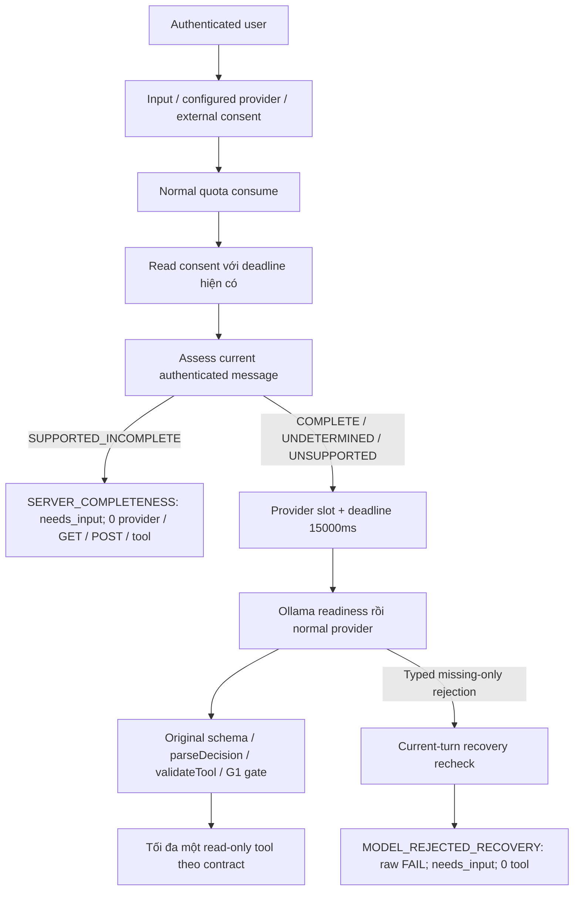

# T-AI-04-G1-SERVER-COMPLETENESS-POLICY-FIX

Ngày 10/11/2026, Asia/Ho_Chi_Minh. **FIX implementation/offline acceptance PASS: 52/52 test mới, backend build PASS. LIVE NOT RUN.** Đã triển khai server-first completeness cho grammar G1 có bằng chứng. Known incomplete hỏi đúng missing fields với **0 provider / 0 readiness GET / 0 LLM POST / 0 tool**. COMPLETE vẫn qua model, schema/runtime, readiness và G1 gate; không tự gọi tool.

**Regression lịch sử trên policy mới không phải 181/181 PASS:** actual **150 PASS / 31 FAIL / 0 NOT RUN**, readiness **32/1/0**, diagnostics **8/5/0**. Toàn bộ FAIL này được giữ nguyên, phân loại là xung đột expectation với server-first đã được duyệt; không đổi assertion. Kiểm thử downstream riêng đạt **181/181, 33/33, 13/13**, nhưng dùng test-only assessor stub để cô lập lớp downstream, **không được coi là PASS end-to-end của policy production**. **P1 raw NLU và P2 runtime stability vẫn OPEN.**

## 1. Policy và baseline

Đã đọc [Controlled Check](HUGO_T_AI_04_G1_READINESS_CONTROLLED_CHECK_REPORT.md), [Readiness/Abort FIX](HUGO_T_AI_04_G1_READINESS_ABORT_GUARD_FIX_REPORT.md), [Readiness/Raw Clarify investigation](HUGO_T_AI_04_G1_READINESS_RAW_CLARIFY_INVESTIGATION_REPORT.md), [Missing-Slot FIX](HUGO_T_AI_04_G1_MISSING_SLOT_DECISION_FIX_REPORT.md), [Safe Contract FIX](HUGO_T_AI_04_G1_SAFE_CONTRACT_FIX_REPORT.md), source và harness liên quan. Không thay kết quả các task trước.

Hai attachment yêu cầu `479de637-...` và `e7b51ffa-...` **byte-identical**, SHA-256 `a552c32aa3e79d45b7dac42680d46e0927e9d967bc4960c7d6e10f267e6eb2ef`; file gửi lại không đổi scope. [Approval record](evidence/t-ai-04-g1-server-completeness-policy-fix/final-verified/task-approval.json).

Chỉ current authenticated message và grammar G1 hiện có được dùng làm bằng chứng. Required/type/enum lấy từ AGENT_TOOLS; không tin model assumptions, assistant/client history, account khác hoặc Planner defaults. Không tạo general Vietnamese parser, không mở rộng read/mutation tools.

| Assessment | Điều kiện / hành vi |
|---|---|
| `SUPPORTED_INCOMPLETE` | Đúng một read intent, observation hợp lệ và chứng minh được các required field bị bỏ sót → server needs_input trước provider |
| `COMPLETE` | Các required observations đều hiện diện/hợp lệ → provider path; không tự execute |
| `UNDETERMINED` | Không chứng minh được intent/grammar, field được đề cập nhưng không chứng minh được giá trị, invalid date/range/count, phủ định/unset/mâu thuẫn chưa được grammar hỗ trợ → provider path, không tự tạo missing list |
| `UNSUPPORTED` | Diagnostic cho một tập command mutation độc lập, khớp cả câu; **không dùng để tự trả unsupported hoặc chặn bằng substring**. Vẫn qua provider/safety path hiện có |

Explicit unset/negation ngoài positive grammar G1 **không được mở rộng thành deterministic clarification**. Chúng trả UNDETERMINED; null từ reader không có nghĩa COMPLETE. Đây là giới hạn có chủ ý theo nguồn hiện hành, không phải parser đã hiểu mọi cách phủ định tiếng Việt.

## 2. Source diff và tái sử dụng

| File | Thay đổi |
|---|---|
| [currentCompleteness.ts](../backend/src/agent/currentCompleteness.ts) — mới | Assessor bốn trạng thái; shared validated current-slot reader; validator field compile từ original AGENT_TOOLS, date/range/safe-integer checks lấy từ recovery cũ; định nghĩa internal decision-origin event |
| [toolProvenance.ts](../backend/src/agent/toolProvenance.ts) | Tập trung label roles; factor các extractor positive destination/transport hiện có, thêm inspection SET/OMITTED/UNPROVEN. Khi label che một positive correction mâu thuẫn, inspector từ chối COMPLETE. Không thay body `checkToolProvenance()` hoặc grammar execution |
| [missingSlotRecovery.ts](../backend/src/agent/missingSlotRecovery.ts) | Tái sử dụng shared field/date validation; giữ nguyên argument-schema validation, missing-required-only classification, typed error/current-turn recheck/provenance agreement |
| [agentService.ts](../backend/src/services/agentService.ts) | Precheck sau tất cả gate hiện có; chỉ short-circuit SUPPORTED_INCOMPLETE. Thêm server-only `onDecision` observer/default safe log; public response shape không thêm field |
| [agentServerCompleteness.test.ts](../backend/src/tests/agentServerCompleteness.test.ts) — mới | 52 unit/integration cases, fake provider/fetch/executor, actual orchestrator và HTTP API test server loopback |

[Diff đầy đủ theo source local trước task](evidence/t-ai-04-g1-server-completeness-policy-fix/final-verified/source-diff.patch), [source hashes](evidence/t-ai-04-g1-server-completeness-policy-fix/final-verified/source-hashes.json). Không dùng HEAD để quy thay đổi cũ cho task này. Không sửa liveProvider/readiness/provider deadline, schema, tools, limits, auth/privacy, SYSTEM, frontend hoặc business modules.

Assessor và recovery dùng chung `readValidatedCurrentSlots()`. Recovery vẫn giữ semantics cũ; pre-inference assessor bổ sung điều kiện chặt hơn: undefined observed value **không được coi là OMITTED** nếu field thực sự được nhắc nhưng không chứng minh được. Không duplicate required specification hoặc thêm default/coercion/argument completion.

## 3. State machine và thứ tự gate

Authentication, input validation, configured-provider check, external consent, request quota và existing consent read giữ nguyên thứ tự. Server-first không bỏ readConsent hoặc miễn quota. Gemini external consent vẫn bắt buộc trước server question ngay cả lượt đó không inference. Consent failure/rate 429/auth 401 vẫn trả lỗi cũ, không bị đổi thành needs_input.

Configured-provider gate cũng giữ nguyên: provider chưa cấu hình → 503 trước precheck. Task không thêm chế độ chat mới khi LIVE bị disable/unconfigured. Provider đã configured nhưng Ollama model không resident: **known incomplete không cần GET**, còn COMPLETE/UNDETERMINED vẫn qua readiness và có thể nhận 503. Client flag như `skipCompleteness`/`bypassCompleteness` bị input validator từ chối; không có public bypass.

## 4. Decision origin và measurement

| Origin nội bộ | providerInvoked | rawNlu marker | Ý nghĩa |
|---|---:|---|---|
| `SERVER_COMPLETENESS` | false | `NOT_EVALUATED` | Chưa gọi provider; UX needs_input và safety chấm riêng; 0 LLM/tool |
| `MODEL` | true | `REQUIRES_EXPECTED_COMPARISON` | Model/provider decision đi vào normal parse path; chưa tự kết luận semantic PASS |
| `MODEL_REJECTED_RECOVERY` | true | `FAIL` | Typed raw rejection được giữ; recovery UX không biến raw FAIL thành PASS |

`providerInvoked` **không đồng nghĩa một inference POST**: readiness có thể chặn trước POST. Error không có decision như readiness/network/timeout không được tạo origin SERVER_COMPLETENESS hoặc NLU score giả; evaluation harness phải thu transport/raw boundary riêng. MODEL marker không tự chấm chất lượng; so expected/schema/raw semantics vẫn do evaluator thực hiện. Toàn bộ fake-provider results task này là **MOCK_ONLY**, không phải điểm Qwen3.

Observer chỉ nhận fixed source/origin/assessment/providerInvoked/rawNlu và random correlation UUID; không current message, args, user ID/account, JWT/key/profile hoặc DB credentials. Default logger và injected observer đều có canary tests; observer exception không đổi response/gate. Public API không trả decisionOrigin hoặc raw output. HTTP compatibility test giữ các keys `status/reply/missingFields/history/historyTruncated/context`, `persisted:false`.

Historical S01/M03 raw FAIL và tất cả VI/E/G/S/M manifests/locks/expected giữ nguyên. Nếu chạy qua API sau FIX mà server hỏi trước thì **lượt mới raw NOT EVALUATED**, không đổi lịch sử thành model clarify PASS. Direct-provider evaluation cần path/phê duyệt riêng, không dùng client bypass.

## 5. Các trường hợp đã kiểm và giới hạn

| Input/context | Assessment và kết quả |
|---|---|
| Plan đủ sáu required, bỏ transportation | SUPPORTED_INCOMPLETE; hỏi đúng transportation; 0 provider/readiness/tool |
| Plan thiếu adults + totalBudget | Hỏi đúng hai field theo required order; không default adults/budget |
| Search thiếu destinationCity hoặc dailyBudgetPerPerson | Hỏi đúng field thiếu; group budget không lấp daily budget |
| Chỉ `Tìm địa điểm` | Đúng một intent được chứng minh, hỏi **cả destinationCity và dailyBudgetPerPerson**; không tin mock chỉ hỏi một field |
| Daily budget 0 | SET/COMPLETE theo search schema; không coi là thiếu |
| Total group budget 0, invalid dates/range/year/count | UNDETERMINED; không che invalid observation bằng một missing list đoán |
| Explicit chưa chọn, phủ định phương tiện/địa điểm, natural prose, short follow-up | UNDETERMINED theo grammar G1 cũ; provider quyết định, không tự điền/đoán |
| Duplicate label/positive destination mâu thuẫn; label cũ + correction xung đột | UNDETERMINED/UNPROVEN; không nhầm thành OMITTED hoặc COMPLETE |
| Positive correction G1 đã hỗ trợ, không label cũ che | New city/motorbike proof như trước; full valid tool qua model/gate đúng một fake read invocation, old car không ALLOW trong mẫu được chứng minh |
| History/assistant/account khác chứa đủ field nhưng current thiếu | Vẫn hỏi từ current turn, 0 provider; không lấp slot từ history |
| Mixed read intents, quoted/assistant context, injection/mutation | Không deterministic list theo keyword; normal provider/schema/gate giữ safety, 0 unauthorized tool |

Machine-readable inspection chỉ gán SET khi reader có value, OMITTED khi không được nhắc, UNPROVEN khi được nhắc mà không chứng minh được. Unset/negation ngoài grammar trả UNDETERMINED toàn assessment, **không giả rằng đã xác định an toàn từng field UNSET**. Không bổ sung general negation parser.

Recovery sau inference vẫn tồn tại khi precheck chưa đủ chứng cứ. Test dùng labeled daily budget `abc`: precheck UNDETERMINED; old reader không có numeric budget; model partial search thiếu budget bị original schema reject, old typed classifier/current proof recheck hỏi lại budget. Event **MODEL_REJECTED_RECOVERY / FAIL**, provider rejection giữ nguyên, 0 tool. Đây là backward-compatible recovery sau raw failure, không server precheck success hoặc repair output.

## 6. Unit/integration và regression cuối

Evidence nghiệm thu trên source cuối: [final-verified/execution.json](evidence/t-ai-04-g1-server-completeness-policy-fix/final-verified/execution.json), [test mới](evidence/t-ai-04-g1-server-completeness-policy-fix/final-verified/new-completeness.log), [compatibility review từng case](evidence/t-ai-04-g1-server-completeness-policy-fix/final-verified/compatibility-review.json).

| Suite | Actual policy PASS / FAIL / NOT RUN | Downstream control PASS / FAIL |
|---|---:|---:|
| **New completeness acceptance** | **52 / 0 / 0** | Không dùng stub |
| Readiness/abort cũ | **32 / 1 / 0** | **33 / 0** |
| Diagnostic cũ | **8 / 5 / 0** | **13 / 0** |
| Missing-slot recovery | 13 / 20 / 0 | 33 / 0 |
| Slot-filling prompt | 11 / 10 / 0 | 21 / 0 |
| G1 safe contract | 26 / 0 / 0 | 26 / 0 |
| Decision routing | 10 / 0 / 0 | 10 / 0 |
| Decision format safety | 17 / 0 / 0 | 17 / 0 |
| Agent foundation | 22 / 0 / 0 | 22 / 0 |
| Transport/controls | 18 / 1 / 0 | 19 / 0 |
| F applicable runner | 23 / 0 / 0 | 23 / 0 |
| Frontend conversation | 10 / 0 / 0 | 10 / 0, source không đổi |
| **Baseline 181 cases** | **150 / 31 / 0** | **181 / 0** |
| Backend build | **PASS**, exit 0 | Không đổi compiler/dependencies |
| Frontend build | **NOT RUN**, source/API shape không đổi | — |
| LIVE/model load/V2/G2/Browser/DB | **NOT RUN** | — |

52 test mới bao phủ mỗi omitted required field, multi-missing, pure intent, COMPLETE/provider/readiness, unset/negation/corrections/conflicts, budget roles/zero, dates/adults, history/cross-account, mandatory auth/consent/rate gates, malformed/unknown/mutation/schema enforcement, typed recovery, model/server origins, default log privacy, observer failure, exact public API shape và no late tool trên COMPLETE timeout path. Global native Ollama/external fetch và DB query bị chặn. API test dùng ephemeral loopback HTTP với fake provider, không Browser hoặc real-model E2E.

Các lượt 47 và 50 test đầu được giữ nguyên; bổ sung hai correction tests phát hiện COMPLETE chưa đủ chặt ở inspector và đã sửa trước nghiệm thu. [Correction counterexample trước FIX inspector](evidence/t-ai-04-g1-server-completeness-policy-fix/correction-before-fix.log) giữ 50 PASS/2 FAIL. Source cuối chạy đủ **52 PASS**, không cộng lượt lặp thành case độc lập. Một runner final đầu dừng vì biến output bị shadow; `final-run/` được giữ, sau đó `final-verified/` chạy đủ mọi suite trên source cuối. Không sửa assertion để chữa harness hoặc làm PASS.

## 7. Phân loại compatibility, không che FAIL

Tất cả **181 registered legacy cases** được chạy, không chọn subset thuận lợi. Runner copy compiled chỉ thay vòng main để tiếp tục sau failure và capture origin; **case bodies, registrations và assertions giữ nguyên**. Hash/prefix proof ở [runner derivations](evidence/t-ai-04-g1-server-completeness-policy-fix/final-verified/runner-derivations.json). Khi một assertion fail, phần còn lại trong chính case/subcase group có thể chưa chạy; không đếm thành các test độc lập đã PASS.

31 FAIL baseline đều có SERVER_COMPLETENESS trước assertion thất bại, và từng case qua downstream control không đổi assertion đều PASS:

- **20 recovery conflicts:** fake raw decision/rejection/call count cũ không còn được quan sát khi current input đã known incomplete. Bao gồm fault injection malformed/network/timeout: fake provider chưa được gọi, **không phải lỗi thật đã phát sinh rồi bị catch che thành needs_input**. New COMPLETE/UNDETERMINED tests kiểm lỗi thực sự xảy ra vẫn giữ code/error.
- **10 prompt conflicts:** sáu mock-clarify contracts, hypothetical hallucinated tool, raw capture/history và request metadata cũ đòi provider call. Server nay hỏi đúng fields nhưng không phát payload hoặc nhận raw; raw NLU NOT EVALUATED. Prompt/SYSTEM không bị sửa để vượt test.
- **1 transport conflict:** test privacy/account isolation chờ payload của lượt incomplete đầu tiên; payload không tồn tại theo thiết kế. Normal provider path privacy được giữ ở downstream control và cases COMPLETE/new logging tests.
- **1 readiness conflict riêng:** mock clarify của pure search chỉ hỏi destinationCity, trong khi server now hỏi đúng toàn bộ required destinationCity + dailyBudgetPerPerson. Không phải lỗi readiness/abort; new acceptance kiểm riêng expected mới đã được policy duyệt.
- **5 diagnostic conflicts riêng:** lỗi timeout/body/network/raw-recovery/malformed được inject vào provider của fixture incomplete. Provider không được gọi nên observation cũ không thể xảy ra. Các standalone provider/full-input abort tests còn áp dụng vẫn PASS.

Trong 150 legacy case PASS có **3 case đã short-circuit server**, nên PASS đó cũng không được dùng làm bằng chứng raw/provider được kiểm ở lượt ấy. Không đổi `originalStatus:FAIL` thành PASS trong [review JSON](evidence/t-ai-04-g1-server-completeness-policy-fix/final-verified/compatibility-review.json); disposition riêng `APPROVED_POLICY_EXPECTATION_CONFLICT`. Không phát hiện FAIL ngoài policy change sau review, không khẳng định rằng các original assertions đều PASS.

**Downstream control là gì:** [test-only preload](evidence/t-ai-04-g1-server-completeness-policy-fix/downstream-control.cjs) thay exported assessor bằng UNDETERMINED **chỉ trong child process test**, sau khi actual-policy run đã được đo đầy đủ. Nó cô lập original provider/schema/recovery/gate/limits để kiểm các assertion downstream lịch sử. Đây là unit-layer stub được công khai, **không phải source production, không phải client flag hoặc end-to-end acceptance của server-first**. New 52 tests chạy actual assessor, không dùng stub. Legacy readiness GET fixture/scheduling adapters kế thừa vẫn là MOCK_ONLY như task FIX trước.

[F historical nguyên bản](evidence/t-ai-04-g1-server-completeness-policy-fix/final-verified/historical-F-unchanged.log) vẫn **22 PASS trước stop / 1 FAIL / 1 NOT RUN**, expected unsafe completed, actual needs_input. Không sửa source/assertion này; báo riêng ngoài 181 applicable. Không ghi đè evidence hoặc kết quả F cũ.

## 8. Integrity và SHA-256

[Before](evidence/t-ai-04-g1-server-completeness-policy-fix/integrity-before.json) / [after-final](evidence/t-ai-04-g1-server-completeness-policy-fix/integrity-after-final.json): **4.277 baseline files; 4.274 không đổi**, ba existing source thay đổi đúng scope, thêm một module + một test; **0 thay đổi bất ngờ**. **3.917 historical evidence files** nguyên vẹn. Scope snapshot: backend/src, frontend/src/tests, docs và package/locks; dist rebuild/compatibility runners là generated artifacts, không source lịch sử.

| File | SHA-256 trước → sau |
|---|---|
| toolProvenance.ts | `15226e7bd608759e0f4dcf71a24d3676ff4be0549a45364dd94a3bf39afd85d4` → `b59832d0ac1c3973609c098a5375f95360ef1bbf198a8557b6719cea8d859a8d` |
| missingSlotRecovery.ts | `71d4f6fe9be152917350aa76e95a6705d75b6074034267ea236ac85a950e821f` → `4ddb6e0de391e1c4989c44e0f9cbc17dd83f7af3ae349c05fc7f675aed1c0f4e` |
| agentService.ts | `b3deaf407cb86167fc63ac846a2eda4821128f5318c8178b133866fd8ed8d36e` → `5edb362d600011bd979cb2180e7483ad878d08f7ac3b2b0f44731571a193065f` |
| currentCompleteness.ts mới | `43f8742693b0b1f6545ee793a501ea7e29958667e911513826a3295fe3552096` |
| Test mới | `2367866796cc568d8efaabdbcca028f05d2ba76518ed876f49b40c495f5d1905` |

Audit chứng minh SYSTEM literal và execution gate body **byte-identical**. liveProvider, provider timeout, ollamaReadiness, original schema/Ajv/parseDecision/validateTool/AGENT_TOOLS, AgentLimits, conversation/privacy/routes giữ hash trước task; đầy đủ trong [protected source hashes](evidence/t-ai-04-g1-server-completeness-policy-fix/final-verified/source-hashes.json).

V2 APPROVED vẫn `0f1e0f1e87418bca591c6dfcd06645bd9a534326cac23989d58c7a7fd5e6fe6e`; V2 lock `f4f3294623f763418393bcfa89cbb39dae9c7af080552c8ce377b3d890549706`. Không sửa VI01–VI24, V1, E/G/S/M hoặc locked evidence. Không inference/GET Ollama thật, không model load, Cloud/Gemini call, PostgreSQL/fixture/fingerprint mới (**N/A**), migration/reset/seed/truncate, Planner/Catalog thật, Trip/Booking mutation, pricing/Map/sentiment, G2, commit/push/deploy.

## 9. Rủi ro, lỗi còn OPEN và acceptance

**P1 TAI03B-B1-01 raw NLU OPEN.** Server-first cải thiện UX/safety có chứng cứ, không sửa model hiểu omission, không tạo raw clarify. **P2 runtime stability OPEN**; không có measurement Ollama/GPU mới để đóng watchdog/stale-memory/deadline. Map P2 giữ OPEN.

**OBS-COMP-01 — pre-existing semantic/provenance limitation, P2 OPEN:** label `Phương tiện: ô tô` cộng `à đổi sang xe máy` có thể khiến original execution proof ưu tiên label cũ nếu model cũng trả car. [Pure offline before/after observation](evidence/t-ai-04-g1-server-completeness-policy-fix/legacy-correction-observation.json) transpile baseline snapshot và so source cuối: gate **ALLOW car trước và sau**, assessor mới **UNDETERMINED**. Không gọi model/tool thật. Task này không tự sửa gate hoặc cấp proof mới; không tuyên bố mọi correction tự nhiên đã an toàn chỉ vì assessor từ chối COMPLETE. Mẫu correction G1 đã có test, không label cũ che, vẫn hoạt động đúng. Cần owner review riêng về execution-proof policy; observation không do server-first tạo ra.

Trong phạm vi selected proven grammar, acceptance đạt: exact omitted set, 0 provider/tool, no auth/consent/rate bypass; COMPLETE đi qua model/readiness/schema/gate, tối đa một tool; unknown không tự tạo fields; typed recovery/readiness không regression ngoài compatibility đã phân loại; origin không trộn raw NLU/UX; build/integrity PASS. Không tuyên bố toàn bộ legacy assertions PASS hoặc model quality được nghiệm thu. Các grammar chưa chứng minh tiếp tục fail closed/UNDETERMINED.

## 10. NEXT TASK PLAN — chờ duyệt

Đề xuất **`T-AI-04-G1-SERVER-COMPLETENESS-LIVE-VALIDATION`**, chưa thực hiện:

1. Owner duyệt diff, compatibility/measurement policy và observation OBS-COMP-01. Khóa manifest mới, expected UX/raw NLU/safety/origin, request hashes, account/rate schedule và **số POST riêng**, không dùng lại ngân sách cũ.
2. Nhóm known incomplete: một/multi omitted, search missing destination/daily budget, pure read intent; expected SERVER_COMPLETENESS, exact fields, **0 GET/POST/tool**, raw NOT EVALUATED. Không coi server success là điểm Qwen3. Vẫn giữ configured/auth/external-consent/rate/readConsent gates.
3. Nhóm cần model: COMPLETE plan/search, UNDETERMINED theo current grammar và out-of-scope input mới, expected khóa trước. Production readiness/model tag/digest/16k/15s/JSON mode/schema/gate giữ nguyên; một POST/case, concurrency 1, không retry. Fake consent/executor nếu muốn tránh DB. Raw schema/NLU, service UX và safety đo riêng; typed recovery giữ raw FAIL.
4. Nếu cần model preparation, khai báo load-only body/deadline/keep-alive và tính **mọi POST chuẩn bị** vào tổng budget được duyệt; model ready thì bỏ prep. Nonresident/guard 503/preflight không an toàn → dừng/NOT RUN đúng thực tế, không hidden warm-up, đổi principal hoặc tăng timeout.
5. OBS-COMP-01 cần một scope review/FIX riêng hoặc điều kiện nghiệm thu được owner chốt trước khi kiểm correction qua tool; không dùng LIVE để âm thầm đổi gate/expected. Sau đó regression/integrity/report, giữ P1/P2 đúng mức evidence.

G2 Verified History, benchmark V2, Browser/API/PostgreSQL E2E và runtime/GPU profiling vẫn là task riêng. **Đã dừng sau FIX offline/report; chưa chạy inference hoặc NEXT TASK.**
