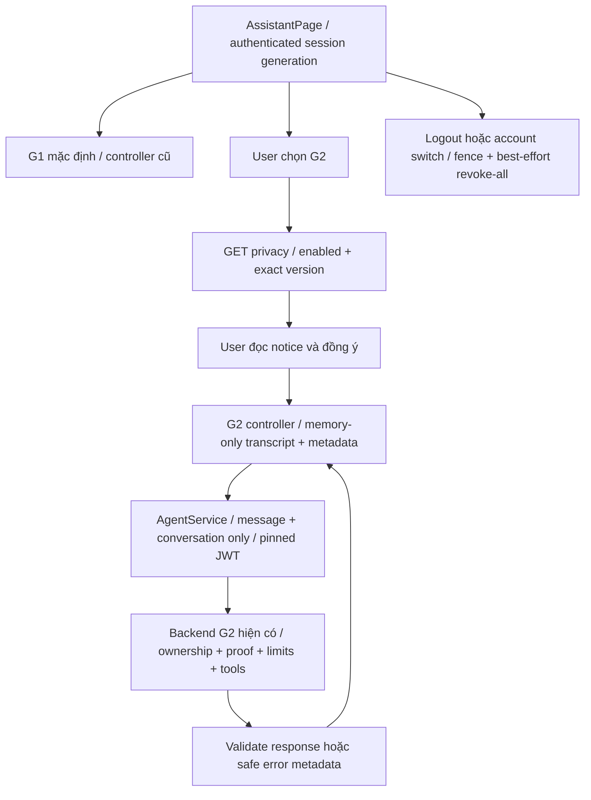

# T-AI-04-G2-FRONTEND-INTEGRATION-AND-LOGOUT

Ngày **11/11/2026**, Asia/Ho_Chi_Minh. Kết luận **FRONTEND_DEMO_ACCEPTANCE_PASS — MOCK_ONLY_BROWSER**. Đã triển khai G2 opt-in trên frontend thật; **39/39 unit G2**, **10/10 unit G1**, **74/74 lượt browser** PASS: desktop 1440×900 và mobile giả lập 390×844, mỗi viewport gồm 20 G2 + 17 G1. Frontend/backend build PASS. Regression bắt buộc **68/68, 79/79, 61/61, 42/42, 52/52 PASS**.

Original legacy vẫn **145 PASS / 36 FAIL**, controls **176 PASS / 5 FAIL**, khớp từng tên và trạng thái case của baseline; không đổi assertions để cộng PASS. Những FAIL này không nằm trong 39 unit G2 hoặc 74 browser acceptance mới. **P1 raw NLU và P2 runtime vẫn OPEN. Không có inference, Ollama readiness/load, PostgreSQL hoặc real-tool E2E trong task này.**

## 1. Baseline, phạm vi và design review

Đã đọc bốn báo cáo [Natural Correction](HUGO_T_AI_04_G2_NATURAL_CORRECTION_ENUM_INVESTIGATION_REPORT.md), [Verified History](HUGO_T_AI_04_G2_VERIFIED_HISTORY_REPORT.md), [LIVE Multi-turn](HUGO_T_AI_04_G2_LIVE_MULTI_TURN_VALIDATION_REPORT.md), [Controlled Diagnostic](HUGO_T_AI_04_G2_RAW_CLARIFY_CONTROLLED_DIAGNOSTIC_REPORT.md), 18 acceptance D01–D18 và source frontend/backend được yêu cầu. [Owner task](evidence/t-ai-04-g2-frontend-integration-logout/owner-task.txt), [design review trước implementation](evidence/t-ai-04-g2-frontend-integration-logout/design-review.json) và [design lock](evidence/t-ai-04-g2-frontend-integration-logout/design-review-lock.json) ghi phạm vi đã nhận.

Tái sử dụng chat layout, message/result rendering, Axios, AuthContext, loading/error states và privacy dialog. Giữ nguyên controller G1. Thêm controller G2 riêng; không thay AgentOrchestrator, prompt, proof reader, schema, validator, tools, execution gate hoặc AgentLimits. Không áp dụng candidate SYSTEM B; không thay `.env`, bật G2 toàn cục hoặc thêm dependencies.

Backend vẫn local/demo, default OFF, state theo process và mất khi restart, absolute TTL 15 phút; chỉ server tạo conversation ID và verified state. Task frontend này không thay đổi các giới hạn đó.

## 2. Source diff

Có **7 file frontend hiện có được sửa**, **6 file mới**, không sửa backend production hoặc original test. [Diff so với source đầu task](evidence/t-ai-04-g2-frontend-integration-logout/source-diff.patch), [source hashes](evidence/t-ai-04-g2-frontend-integration-logout/source-hashes.json).

| File | Thay đổi |
|---|---|
| [AssistantPage.tsx](../frontend/src/pages/AssistantPage.tsx) | Giữ chat/result layout; chọn G1/G2, opt-in notice, xác nhận phương tiện, reset/end/new session và thông báo lifecycle |
| [types/agent.ts](../frontend/src/types/agent.ts) | G2 envelope/privacy/metadata và union response G1/G2 |
| [agentContract.ts](../frontend/src/utils/agentContract.ts) | Strict G2 metadata/privacy, projection request, error an toàn gắn request; giữ kiểm result type/source/cost |
| [agentService.ts](../frontend/src/services/agentService.ts) | Client pin token theo phiên, năm endpoint hiện có, response/mode validation |
| [api.ts](../frontend/src/services/api.ts) | Riêng Agent: giữ metadata lỗi hợp lệ; không đổi token của request cũ thành token tài khoản mới; không log raw Agent errors |
| [AuthContext.tsx](../frontend/src/context/AuthContext.tsx) | Generation tăng khi session đổi, fence Agent, best-effort revoke-all khi logout/login thay tài khoản |
| [PrivacyConsentModal.tsx](../frontend/src/components/agent/PrivacyConsentModal.tsx) | Tái sử dụng dialog; phần giải thích retention G2 tách với consent external của G1 |
| [agentG2Conversation.ts](../frontend/src/utils/agentG2Conversation.ts), mới | Controller G2, request/revision/concurrency, metadata lỗi, expiry/reset/revoke và fence response cũ |
| [agentSessionLifecycle.ts](../frontend/src/utils/agentSessionLifecycle.ts), mới | Registry fence theo token và cleanup hint theo tab; deadline revoke best effort 3 giây |
| [agentG2Conversation.test.ts](../frontend/tests/agentG2Conversation.test.ts), [loader](../frontend/tests/agentG2.loader.cjs), mới | 39 unit trên controller/contract/service/interceptors/lifecycle thật; loader chỉ dùng Node offline tests |
| [G2 browser spec](../frontend/e2e/t-ai-04-g2-frontend.spec.ts), [config](../frontend/playwright.t-ai-04-g2.config.ts), mới | 20 scenario × 2 viewport; chạy cùng 17 scenario G1 gốc × 2; API giả lập, retries=0 |

Original `agentConversation.ts`, `agentConversation.test.ts` và `t-ai-02-assistant-ui.spec.ts` giữ nguyên byte. Các runner/evidence bổ sung chỉ nằm trong thư mục evidence mới; các runner regression sao chép có [provenance/hash](evidence/t-ai-04-g2-frontend-integration-logout/regression-runner-provenance.json).

## 3. Kiến trúc mode G1/G2



Không tự gọi privacy G2 khi mount. Backend disabled hoặc privacy sai contract không cho opt-in; G1/draft vẫn dùng được. Agree retention không gửi chat, không tự bật external processing hoặc personalization. Start chỉ xảy ra khi user gửi yêu cầu. Chuyển từ G2 về G1 thử revoke-all và bỏ local context; G1 không nhận transcript G2 làm history.

## 4. API integration và trust boundary

| Endpoint | Frontend gửi/nhận |
|---|---|
| `GET /api/agent/verified-history/privacy` | Kiểm `version=LOCAL_DEMO_SLOTS_V1`, `mode=LOCAL_DEMO`, `ttlSeconds=900`, `enabled`, exact notice text |
| `POST /api/agent/chat` | Start: `{message,conversation:{action:"start",requestId,consentVersion}}`; continue thêm **server ID/latest revision** |
| `POST /api/agent/verified-history/:id/reset` | Body `{}`; nhận metadata thuộc ID hiện tại, revision tăng, expiry giữ nguyên |
| `DELETE /api/agent/verified-history/:id` | Revoke phiên đã biết; kiểm `{success:true,data:{revoked:true}}` |
| `DELETE /api/agent/verified-history` | Revoke-all khi logout/account switch, hoặc khi không biết ID do pending start/network failure/reload |

G2 wire body chỉ có `message` và `conversation`. Không history, owner/userId, slots/proof dựng ở client, tool arguments, bypass flags hoặc external-consent thay cho retention acknowledgement. Transcript chỉ phục vụ hiển thị. Mỗi logical request/retry do user chủ động có UUID mới; không auto retry.

Success/error metadata của continue phải cùng ID và revision đúng `request.revision + 1`; expiry không được kéo dài so với phiên đã biết. Start chỉ nhận revision 1 từ response của authenticated request đang active. Frontend không tự chứng minh ownership từ UUID; ownership vẫn do router/store server, còn token/generation/sequence bảo đảm response thuộc request hiện tại. Reset dùng revision server trả, có thể lớn hơn một bước vì lượt đang pending đã commit trước reset.

Error interceptor riêng Agent chỉ giữ status, code an toàn, cancellation và metadata hợp lệ; không giữ message/stack provider. Controller kiểm lại ID/revision/expiry và generation trước khi cập nhật. Metadata từ response cũ, foreign ID, stale revision, kéo dài TTL hoặc 401/409 không được dùng để tiến phiên. Unknown network/error không xác định được commit sẽ khóa gửi tiếp và yêu cầu reset/end/new session, không đoán revision.

## 5. Session lifecycle

| Tình huống | Hành vi đã triển khai và kiểm offline |
|---|---|
| Start/continue | Lưu ID/revision/expiry trong RAM trang; continue chỉ gửi current message |
| Provider error đã commit | Nhận metadata hợp lệ, giữ revision mới; retry explicit dùng UUID mới, không duplicate turn |
| 409 revision/replay/busy/stale | Không last-response-wins, không auto retry/ghi đè metadata; cho reset/end/new session |
| Reset | Bỏ transcript/draft, abort/fence pending; dùng reset endpoint cho known ID. Unknown start dùng revoke-all trước khi bắt đầu lại |
| End | Known ID dùng revoke-one; bỏ local ID/revision/transcript. End khi start pending dùng revoke-all và fence late response |
| Expiry | Kiểm trước send và timer 1 giây; không POST khi đã hết hạn; old history không cấp lại proof |
| Restart/unavailable | Hiển thị session unavailable, không tự restore từ transcript; user chủ động bắt đầu phiên mới |
| Reload/navigate trở lại | G1 mặc định, transcript và metadata rỗng. Không có backend authenticated restore API nên không triển khai tự khôi phục phiên |

`sessionStorage` chỉ có cleanup hint `{owner,until,stamp}` trong tab đã tham gia G2; không có JWT/chat/slots/ID/revision. Hint không gửi lên API hoặc làm proof. Nhờ hint, logout sau reload vẫn thử revoke-all; có nút xóa các phiên trước khi đang ở G1. Marker của account A không được hiển thị như context của B. Xóa hint chỉ sau xác nhận revoke-all, có kiểm generation/stamp chống completion cũ xóa marker mới. Nếu storage không dùng được thì giữ hint trong memory, không cam kết cleanup sau reload.

## 6. Confirmation UX

Khi G2 trả `needs_input` có `transportation`, UI giữ status và missingFields đó nhưng hiển thị **“Agent đang yêu cầu bạn xác nhận lại phương tiện.”** Không kết luận user chưa nhập. Reply cho các missing fields khác giữ theo server; không dựng clarification thành completed.

Hai nút ở lượt mới nhất gửi đúng **`Phương tiện: motorbike`** hoặc **`Phương tiện: car`** sau một click chủ động. Request vẫn đi qua G2 envelope bình thường: cùng owned conversation, latest revision, UUID mới, normal quota và backend gate. Không gửi bare enum, auto-resend, dựng tool/arguments, tự gọi Planner hoặc tự hoàn thiện trường thiếu. Repeated clarify vẫn cho nhập tay, đổi lựa chọn, reset, end và mở Planner.

Các xác nhận này là cách thao tác trong demo, **không bảo đảm chữa raw NLU failure**. Không cộng MOCK_ONLY confirmations vào điểm model.

## 7. Logout, revoke và account switch

AuthContext fence controller và tăng generation khi session đổi; keyed page bỏ state của tài khoản trước. Agent client pin token lúc tạo; queued POST/GET cũ bị cancel nếu token không còn current. Riêng DELETE cleanup được phép dùng captured old JWT, không bị interceptor ghi đè bằng JWT của B.

Logout/account replacement khởi tạo best-effort revoke-all rồi clear local auth ngay, không đợi mạng. JWT đã cấp vẫn có thể còn hợp lệ ở server sau khi bị xóa khỏi browser, nên callback cleanup dùng captured credential. Deadline 3 giây abort và kết thúc cleanup promise ngay cả khi transport không tuân cancellation. Không claim server đã xóa nếu request lỗi/timeout; server TTL là giới hạn giữ tạm dự phòng. Response 401 muộn của A không xóa login B. Không tuyên bố logout vô hiệu hóa mọi JWT.

Đã kiểm logout khi start còn pending, cleanup success, cleanup lỗi 401 về sau login B, direct SPA login A→B không qua logout, reload rồi logout, controller bị transport phớt lờ abort và callback cleanup cũ. Không response/draft/metadata account A xuất hiện trong B ở các kênh kiểm này.

## 8. Auth/privacy/security tests và coverage D01–D18

[39 unit chi tiết](evidence/t-ai-04-g2-frontend-integration-logout/frontend-g2-final.json), [coverage matrix](evidence/t-ai-04-g2-frontend-integration-logout/acceptance-coverage.json), [API/auth backend G2 results](evidence/t-ai-04-g2-frontend-integration-logout/g2-results.json).

| Case | Kết quả trong phạm vi frontend/offline | Bằng chứng chính |
|---|---|---|
| D01 | PASS | Disabled/enabled, exact notice/version, decline/focus, agree không POST |
| D02 | PASS | Actual service projection, start/continue ID/revision/UUID, không client history/proof |
| D03 | PASS | Needs_input giữ nguyên, wording trung lập, không auto resend |
| D04 | PASS | User click xe máy gửi labeled motorbike; normal Agent request |
| D05 | PASS | User click ô tô và sửa ngân sách/địa điểm/ngày bằng current message |
| D06 | PASS | Repeated clarify không loop; edit/Planner/reset/end thao tác được |
| D07 | PASS offline | UI không sửa args hoặc tự execute; backend gates cũ được regression trên synthetic inputs |
| D08 | PASS offline | Missing/conflict/error không thành itinerary giả; backend completeness regression |
| D09 | PASS | Timeout metadata revision mới, manual retry UUID mới; foreign/stale/extended-TTL bị chặn |
| D10 | PASS | Replay/revision browser; busy/stale/cross-owner unit/API; không phục hồi proof từ client |
| D11 | PASS | Expiry bằng virtual clock, unavailable/restart simulation, reload về G1 |
| D12 | PASS | Reset/revoke-one/revoke-all endpoints, pending/late-response fence |
| D13 | PASS | Logout/account switch/late 401, không cross-account UI leak, failure không chặn logout |
| D14 | PASS offline | Duplicate submit/quota không retry; limits/readiness production unchanged |
| D15 | PASS frontend validation | Completed mock render và malformed source/result bị từ chối; real fidelity NOT RUN |
| D16 | PASS | Hai viewport, buttons/forms/modal focus và screenshot review, không horizontal overflow |
| D17 | PASS về compatibility | G1 10 unit + 34 browser; required backend regressions PASS; original legacy baseline unchanged |
| D18 | PASS về phân loại evidence | Tất cả acceptance mới MOCK_ONLY; raw/model/service claims riêng, P1/P2 OPEN |

Đây là **18 tiêu chí coverage**, không phải 18 inference hoặc 18 case LIVE. D07/D08/D14 có backend offline thật với fake provider/executor; browser dùng response giả lập. `G34` kiểm unauthenticated request trước state; `G57` chạy Express/JWT/router HTTP thật trên ephemeral loopback, cross-owner 404, committed-error metadata, reset/delete/no-store. Provider, consent và executor trong test backend vẫn MOCK_ONLY; counters G2 native network/PostgreSQL/inference đều 0.

Không thêm API key vào frontend/Git. Unit dùng canary lỗi để kiểm raw secret/stack không vào state; browser kiểm console/DOM không có raw canary. Không thay các consent hiện có. Đây không phải chứng nhận DLP tổng quát hoặc pentest ngoài phạm vi.

## 9. Desktop/mobile MOCK_ONLY browser

[Browser summary và từng case](evidence/t-ai-04-g2-frontend-integration-logout/browser-summary.json), [Playwright raw results](evidence/t-ai-04-g2-frontend-integration-logout/browser-01/results.json), [execution log](evidence/t-ai-04-g2-frontend-integration-logout/browser-01/execution.log).

| Viewport | G2 mới | G1 gốc | FAIL / skipped / retry |
|---|---:|---:|---|
| Desktop 1440×900 | 20 PASS | 17 PASS | 0 / 0 / 0 |
| Mobile giả lập 390×844 | 20 PASS | 17 PASS | 0 / 0 / 0 |
| Tổng | **40 PASS** | **34 PASS** | **0 / 0 / 0** |

Edge headless, Asia/Ho_Chi_Minh, concurrency 1; **74 lượt PASS**, khoảng 124 giây. Components/service/controllers/AuthContext thật; mock network tại Playwright, không chạy backend ứng dụng. Vite API proxy được trỏ tới cổng đóng `127.0.0.1:1`; new G2 spec chặn ngoại mạng và fail với Agent/mutation chưa khai báo. Fixture trong mock chỉ là dữ liệu test, không DB fixture hoặc Planner fidelity.

Screenshot: [desktop notice](evidence/t-ai-04-g2-frontend-integration-logout/browser-01/g2/desktop/D01a-notice.png), [mobile notice](evidence/t-ai-04-g2-frontend-integration-logout/browser-01/g2/mobile/D01a-notice.png), [mobile confirmations](evidence/t-ai-04-g2-frontend-integration-logout/browser-01/g2/mobile/D03.png), [desktop reset](evidence/t-ai-04-g2-frontend-integration-logout/browser-01/g2/desktop/D12.png). Mỗi case có screenshot và API body/owner-label audit JSON tương ứng; credentials trong browser chỉ là `MOCK_ONLY_TOKEN_*`. Các nút xác nhận, reset, end, menu/logout thực sự được click ở cả hai viewport; mobile là giả lập, chưa phải thiết bị vật lý.

## 10. Frontend/backend regression

| Suite | Kết quả chạy mới | Evidence |
|---|---|---|
| Frontend G1 conversation gốc | **10 PASS / 0 FAIL** | [unit G1](evidence/t-ai-04-g2-frontend-integration-logout/frontend-g1-final.json) |
| Frontend G2 mới | **39 PASS / 0 FAIL** | [unit G2](evidence/t-ai-04-g2-frontend-integration-logout/frontend-g2-final.json) |
| G2 backend + API/auth | **68 PASS / 0 FAIL** | [G2](evidence/t-ai-04-g2-frontend-integration-logout/g2-results.json) |
| Natural Proof | **79 PASS / 0 FAIL** | [Natural](evidence/t-ai-04-g2-frontend-integration-logout/natural-results.json) |
| Compatibility Acceptance | **61 PASS / 0 FAIL** | [Compatibility](evidence/t-ai-04-g2-frontend-integration-logout/compatibility-results.json) |
| Execution Correction | **42 PASS / 0 FAIL** | [Correction log](evidence/t-ai-04-g2-frontend-integration-logout/final-verified/new-execution-correction.log) |
| Server Completeness | **52 PASS / 0 FAIL** | [Completeness log](evidence/t-ai-04-g2-frontend-integration-logout/final-verified/new-completeness.log) |
| Original legacy 181 | **145 PASS / 36 FAIL**, baseline match | [case-by-case compare](evidence/t-ai-04-g2-frontend-integration-logout/regression-comparison.json) |
| Downstream isolated controls 181 | **176 PASS / 5 FAIL**, baseline match | Cùng comparison; test-process assessor stub, không tính production-policy PASS |
| Single-intent Foundation fixture control | **22 PASS / 0 FAIL** | [fixture diff](evidence/t-ai-04-g2-frontend-integration-logout/foundation-fixture-diff.json); original Foundation vẫn 17/5 |
| Readiness bổ sung | Actual-policy **32/33**, isolated **33/33**, không đổi baseline | [actual log](evidence/t-ai-04-g2-frontend-integration-logout/final-verified/readiness-33.log), [control log](evidence/t-ai-04-g2-frontend-integration-logout/final-verified/downstream-control-readiness-33.log) |
| Diagnostics bổ sung | Actual **8/13**, isolated **13/13**, không đổi baseline | [execution](evidence/t-ai-04-g2-frontend-integration-logout/final-verified/execution.json) |
| Historical F unmodified | Exit 1 fail-fast như baseline, không nhận PASS hoặc suy ra số case chưa chạy | [log](evidence/t-ai-04-g2-frontend-integration-logout/final-verified/historical-F-unchanged.log) |

Runner legacy chỉ đổi vòng chạy để tiếp tục/quan sát mọi registered case; case bodies/registrations/assertions giữ nguyên. Transport/readiness shims và downstream controls được sao chép nguyên byte theo các runner đã dùng trước, không sửa production. [Runner derivation](evidence/t-ai-04-g2-frontend-integration-logout/final-verified/runner-derivations.json). Không cộng các suite/control trùng coverage thành một điểm chất lượng Agent.

Development run ban đầu 38/39: fixture reset D06 trả revision 2 sau hai lượt đã commit, nên controller đúng khi từ chối nonadvancing revision. Chỉ sửa **mock reset response thành revision 3**, không đổi expected/assertion hay production rule. [Initial log giữ nguyên](evidence/t-ai-04-g2-frontend-integration-logout/frontend-unit-initial.log), [observation](evidence/t-ai-04-g2-frontend-integration-logout/development-observations.json); final 39/39. Browser run đầu và duy nhất đạt 74/74.

## 11. Build và cách chạy lại offline

Frontend **`npm.cmd run build` PASS** trên source cuối: TypeScript + Vite; [log](evidence/t-ai-04-g2-frontend-integration-logout/frontend-build-final.log), [result](evidence/t-ai-04-g2-frontend-integration-logout/frontend-build-final.json). Backend **`npm.cmd run build --silent` PASS**; [log](evidence/t-ai-04-g2-frontend-integration-logout/final-verified/backend-build.log).

PowerShell chặn `npm.ps1` theo execution policy hiện có nên dùng `npm.cmd`; sandbox ban đầu chặn esbuild đọc thư mục cha khi load Vite config. Build/browser được chạy với quyền đọc phù hợp qua approval review; không sửa config ứng dụng hoặc policy để che lỗi. Node v24.20.0; new unit cần `--experimental-transform-types` và loader test để resolve các relative TS imports của Vite. Không thay tsconfig/package/lock.

```text
cd frontend
node --experimental-strip-types tests/agentConversation.test.ts
node --require ./tests/agentG2.loader.cjs --experimental-transform-types tests/agentG2Conversation.test.ts
npm.cmd run build
```

Các evidence runner dùng thư mục mới/`flag:wx`; không chạy lại vào tên output cũ. Browser config yêu cầu `T_AI_04_G2_EVIDENCE` mới và `T_AI_02_EVIDENCE` riêng cho G1, API/mock boundary như run đã lưu. Không dùng runner LIVE hoặc seed-based suite.

## 12. Source/benchmark/historical integrity

[Before](evidence/t-ai-04-g2-frontend-integration-logout/integrity-before.json), [after](evidence/t-ai-04-g2-frontend-integration-logout/integrity-after.json): **5.526 file baseline**, **5.519 nguyên vẹn**, chỉ **7 thay đổi frontend được phép**; thêm 6 file source/test/config nêu trên. Không xóa file baseline. Toàn bộ docs/evidence cũ, backend/src, package/locks và original tests trong snapshot giữ hash. Working tree trước task đã có nhiều thay đổi/untracked; không dùng Git HEAD làm baseline và không hoàn nguyên chúng.

| Anchor giữ nguyên | SHA-256 |
|---|---|
| V2 APPROVED | `0f1e0f1e87418bca591c6dfcd06645bd9a534326cac23989d58c7a7fd5e6fe6e` |
| V2 lock | `f4f3294623f763418393bcfa89cbb39dae9c7af080552c8ce377b3d890549706` |
| Backend AgentService | `67d67b5ef92b66c81692586bb713bade5cbfa2fffa102e233aa4c4482731cb07` |
| Backend verifiedHistory | `a835b9781684fd5b759be461e56d6d0fc4034797b96eb0c3018754230ff8bd78` |
| Backend liveProvider | `52a4e971608a5d663e1d87a3a94356925497d525de36ccb6d215c15bf418dd35` |
| G1 controller frontend | `218a4361e0e07240fb627848cad4d1e8f02ee72b6ead2f431f8737b833fd3087` |

[Benchmark compare](evidence/t-ai-04-g2-frontend-integration-logout/benchmark-integrity.json) giữ V1/V2/draft/candidate/locks trong snapshot; không chỉnh expected. [Artifact seal](evidence/t-ai-04-g2-frontend-integration-logout/artifact-checksums.json) đối chiếu báo cáo/evidence mới. Backend build tạo lại dist và các derived test runners trong dist/tests; không sửa backend/src. Không commit/push/deploy, migration, DB access hoặc fixture. Vì PostgreSQL không được truy cập, **DB fingerprint/cleanup là NOT APPLICABLE**, không nhận là fingerprint PASS mới hoặc đếm lại 27 Trip.

## 13. Giới hạn và observations còn lại

- Acceptance là frontend/offline và mocked browser, chưa chứng minh live backend deployment, LLM NLU, Catalog/Planner fidelity, chi phí thực hoặc thiết bị mobile vật lý. Không phát lại V2/các probe lịch sử.
- Backend không có read/restore-session API; UI không khôi phục ID/revision sau reload hoặc navigation remount. Đây là hành vi rõ ràng theo contract, không tự thêm API ngoài scope.
- G2 retention in-memory/absolute TTL, restart loss/default OFF giữ nguyên. Transcript hiển thị chỉ giữ trong RAM trang và không là verified server state.
- Logout/revoke là best effort. Không có JWT revocation toàn cục; storage bị chặn/tab đóng/mất mạng có thể khiến server slots còn đến TTL. Revoke-all là theo authenticated principal, có thể kết thúc các phiên khác cùng tài khoản; không cam kết isolation từng tab hoặc coordination đa tab. Các giới hạn này chưa được kiểm bằng live runtime trong task này.
- **Observation về notice backend:** nguyên văn `LOCAL_DEMO_SLOTS_V1` vẫn chứa câu mô tả logout website cũ chỉ xóa token và chưa gọi API. Giữ nguyên text/version theo giới hạn task, thêm giải thích frontend hiện tại có thử revoke best effort. Đề xuất task backend/privacy riêng để chủ dự án duyệt wording/version phù hợp; không tự đổi notice hoặc consent contract.
- Nếu malformed/timeout/network error không có metadata hợp lệ, UI chặn gửi tiếp thay vì đoán state. User cần reset/end/new session. Không thêm hidden retry, quota bypass hoặc capability ngoài backend hiện tại.

Không phát hiện regression mới ngoài các observation/giới hạn nêu trên. Development fixture error đã được giữ evidence và sửa đúng contract.

## 14. Trạng thái lỗi và nghiệm thu

| Hạng mục | Trạng thái |
|---|---|
| Frontend G2 local/demo | **FRONTEND_DEMO_ACCEPTANCE_PASS — MOCK_ONLY_BROWSER** |
| P1 `TAI03B-B1-01` raw NLU | **OPEN**; frontend confirmation không đóng lỗi model |
| Runtime P2 | **OPEN**, không readiness/inference mới |
| Budget grammar P2 / Map P2 / VI14 / T13-B | **Giữ nguyên**, ngoài phạm vi |
| Candidate SYSTEM B | **NOT APPLIED**, chưa production-approved |
| LIVE NLU / V2 / real Planner-Catalog-PostgreSQL / Browser LIVE | **NOT RUN** |
| Global G2 / production rollout | **Không thực hiện** |

Đạt các tiêu chí frontend opt-in/privacy/envelope, manual confirmation, lifecycle/fencing, G1 compatibility và responsive trong các kênh offline đã đo. Kết quả này không phải Agent hoàn chỉnh, production NLU PASS hoặc bằng chứng P1/P2 đã được giải quyết.

## 15. NEXT TASK PLAN — chờ duyệt riêng

Đề xuất **`T-AI-04-G2-BROWSER-AND-REAL-TOOL-E2E`**, chưa triển khai.

1. **Dependency:** chủ dự án review task này và chấp thuận giới hạn demo/P1/P2 OPEN; kiểm source hashes sau review. Xử lý hoặc ghi quyết định về observation privacy notice bằng task backend riêng nếu muốn thay contract. Candidate B tiếp tục không áp dụng.
2. **Khóa manifest và permissions:** thiết kế case mới cho browser→API→Agent→tool→PostgreSQL thật; khóa expected trước chạy. Tách server completeness, raw model, tool fidelity và UI. Cần approval riêng cho local inference (đề xuất hard cap không quá 8 POST, concurrency 1, không retry/probe ngoài manifest) và mọi service/DB fixture; không dùng V2 để tuning.
3. **Readiness trước LIVE:** operator bật G2 local/demo chỉ cho runtime đã duyệt, xác minh local model/tag/digest, loopback/no-cloud, GPU residency và RAM/VRAM, model context/timeout, principal và rolling-hour ledger; không đổi prompt/provider/limits để làm PASS. Readiness load/inference nếu cần phải có scope được duyệt, không thực hiện ngầm.
4. **Data guard:** chỉ `travelgo_ai_m0_test`; exact identity/sentinel/12 migration checksum/schema guard/fingerprint before. Ưu tiên dữ liệu đọc công khai; nếu cần fixture phải ledger ID, tạo bằng kênh được duyệt, không seed/demo destructive, cleanup theo FK/ID rồi fingerprint after=before và kiểm dữ liệu nền/Trip lịch sử.
5. **E2E đề xuất:** search; plan nhiều lượt với incomplete rồi complete; correction ngân sách/địa điểm/ngày/phương tiện; redundant clarify rồi user xác nhận labeled; reset/revoke/unavailable/logout/account switch. Chỉ gọi tool đọc hiện có, không Trip/Booking mutation. Dùng actual Catalog/Planner/DB result để đối chiếu, không mock itinerary/price thành fidelity.
6. **Evidence/score:** desktop1440×900/mobile390×844, API responses, provider-boundary decision trước fallback, origin/correlation, request IDs/revisions, tool call count/arguments, DB evidence/fingerprint/cleanup, latency/token/resources. FAIL giữ nguyên expected; raw clarify đúng an toàn vẫn có thể FAIL NLU. Tách số chat/API request với số POST inference thật.
7. **Stop:** dừng khi đạt cap hoặc có guard/severity blocker, không retry hoặc FIX tự động. Viết báo cáo kết quả thật và bảo toàn baseline; không đóng P1/P2 bằng frontend/tool smoke. Chờ chủ dự án duyệt trước khi chạy bất kỳ phần nào của task kế tiếp.
