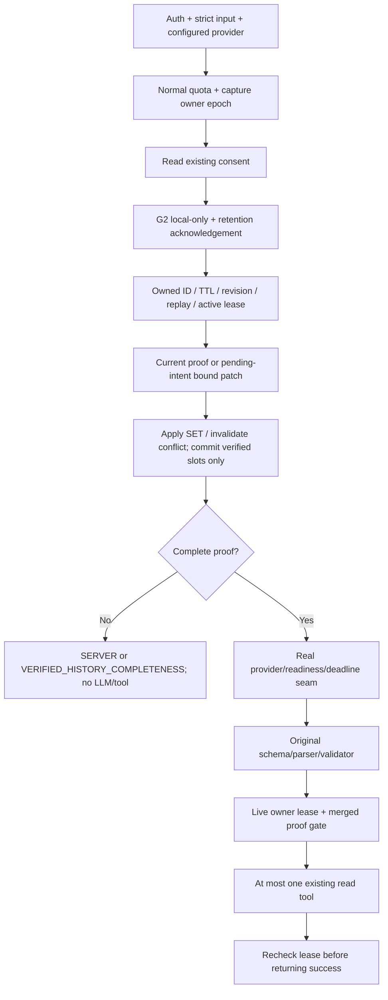

# T-AI-04-G2-VERIFIED-HISTORY

Ngày **10/11/2026**, Asia/Ho_Chi_Minh. **G2_OFFLINE_LOCAL_DEMO_PASS**: đã triển khai backend verified-history opt-in, **68/68 test G2 PASS**, backend build PASS. Regression **79/79 Natural Proof, 61/61 Compatibility, 42/42 Correction, 52/52 Completeness** PASS. Original legacy vẫn **145 PASS /36 FAIL**, isolated controls **176 PASS /5 FAIL**; không cộng gộp các lớp.

**Chỉ nghiệm thu offline local/demo**, không nhận là durable/shared production conversation service. Mặc định G2 **tắt**, state mất khi restart, frontend hiện tại chưa opt-in G2, logout website chưa tự gọi revoke. Không sửa auth/JWT hoặc DB để che các giới hạn này. **0 inference/preload/readiness GET thật, 0 PostgreSQL, không V2 LIVE/Browser E2E. P1/P2 vẫn OPEN.**

## 1. Design gate và storage decision

Trước production edits đã đọc năm baseline reports được yêu cầu, source Agent/proof/conversation/auth/consent/limits/tools, frontend Agent request projection và AuthContext logout. [Design contract](evidence/t-ai-04-g2-verified-history/design-contract.json) / [design lock](evidence/t-ai-04-g2-verified-history/design-contract-lock.json) ghi quyết định, API, precedence, replay/concurrency và giới hạn trước implementation. Đây là implementation theo ngoại lệ in-memory local/demo được task cho phép, không tự thay một yêu cầu durability thành memory rồi nhận production acceptance.

Repository chưa có server-owned Agent session store. G1 nhận `history` từ client và xử lý stateless; JWT middleware xác minh chữ ký/expiry nhưng không có server revocation registry; website `logout=clearSession` chỉ xóa token phía trình duyệt. Reuse PostgreSQL/model/service hiện có cho persistence sẽ cần write/schema/retention contract ngoài task, nên **không làm**. Reuse AuthUser, router/auth, readConsent, AgentLimits, shared proof reader, provider/readiness/schema và read-only tools.

| Quyết định | Contract local/demo đã triển khai |
|---|---|
| Enable | `AGENT_G2_MODE=local-demo` tại operator startup; không tự bật env toàn cục. Trusted dependency injection chỉ dùng trong offline harness |
| Storage | In-memory **mỗi process**, không DB/Redis/file persistence, không đồng bộ replica |
| TTL | **15 phút absolute từ creation**, expiry trả trong metadata; continue/reset không kéo dài TTL |
| Bounds | **128 sessions/process**, **8 sessions/owner**, **32 accepted request IDs/session**, **4096 bytes serialized session data**; start replay tombstones và owner epochs tối đa **1024** mỗi map |
| Expiry/retention | Sweep trước access và timer unref60s; expired lookup fail closed, không tự tái tạo state từ ID/history. Serialized byte limit không phải cam kết tổng Node heap |
| Restart | Xóa toàn bộ state; old conversation ID không còn dùng được |
| Production status | Durable/multi-instance storage, tự động gắn logout JWT và frontend G2 cần quyết định/task riêng. Không migration hoặc sửa auth ngoài scope |

## 2. Server-owned state và trust boundary

[Store implementation](../backend/src/agent/verifiedHistory.ts) tạo `randomUUID()` cho conversation; bind ownership bằng SHA-256 của **authenticated principal ID**, không nhận owner/userId từ body. Một record chỉ có ID, owner hash, revision/expiry, pending tool intent, slots, minimal per-slot state/source revision, bounded request UUIDs và active lease controller. Không lưu JWT, API key, profile, raw prompt, whole chat, model result, Trip hoặc Booking.

Slots có `SET / OMITTED / UNPROVEN / CONFLICT / INVALIDATED`. SET giữ value đã được independent current-message proof + schemas xác minh; các state chưa chứng minh không giữ lại stale value. EXPIRED là lifecycle chuyển sang xóa record, không giữ travel-data tombstone; lookup expired/unknown/cross-owner đều **404 AGENT_G2_SESSION_UNAVAILABLE**.

Chỉ server current proof tạo giá trị; model-generated args không cập nhật store. Client history G2 bị từ chối, không dùng làm raw context hoặc proof. G1 không opt-in vẫn xử lý history theo contract cũ, không có verified-state authority.

Các city slots được persist có thêm local-demo guard cho chữ/số định dạng credential, email/URL/JWT-like punctuation, long opaque tokens và lựa chọn bất định; field như `PRIVATE_KEY_CANARY` không được giữ thành destination. Đây không phải general DLP hoặc entity resolver; notice vẫn yêu cầu không nhập bí mật. Required numeric/date/enum validation lấy từ source/schema hiện hành, không tạo pricing hoặc dữ liệu Catalog mới.

## 3. Ownership, reset, revoke và logout

Mọi continue/reset/delete đều qua authenticated principal và owned record lookup; UUID khó đoán không thay ownership check. UUID spelling được canonicalize lowercase; không có client-supplied session creation ID. Response không trả owner hash/slots cho người khác; cross-account/unknown/expired ID không có conversation metadata để dò tồn tại.

| Lifecycle | Hành vi |
|---|---|
| Continue | Cần đúng ID, revision và fresh requestId; ownership/TTL kiểm trước update |
| Reset | Clear pending intent/slots, increment revision, abort active lease, giữ ID/TTL/replay protection; phải bắt đầu lại intent rõ |
| Revoke one | Abort active work, xóa canonical owned record |
| Revoke all / G2 logout-style | Xóa mọi session của đúng owner; đổi owner epoch để chặn cả request start đang chờ async consent |
| Account switch | Principal khác không dùng được ID cũ; không migrate state sang account mới |
| Expiry/restart | Old ID fail closed; không replay client history để khôi phục |

Revoke/reset không cần đọc consent DB hoặc LLM để xóa state. Request accounting dùng normal AgentLimits. **Nếu quota đã hết, revoke vẫn áp dụng erasure trước khi trả safe429**, không cấp model/tool allowance; reset vẫn yêu cầu quota vì giữ một active session. Client nên xóa local G2 reference khi logout kể cả request erasure trả quota error; nếu request không tới server, TTL vẫn là giới hạn retention dự phòng.

Revoke xóa **travel slots** ngay; security-only start replay tombstones/owner epochs còn tối đa15 phút theo expiry riêng (epoch được refresh khi revoke-all) để fence replay/pending requests. Không gọi các metadata này là chat persistence hoặc JWT revocation.

**Giới hạn logout thật:** endpoint G2 revoke-all không vô hiệu JWT. Frontend hiện tại chỉ clear local auth và chưa gọi G2 lifecycle API; vì frontend chưa opt-in G2 nên task này không nhận đã tích hợp logout website. API/demo operator phải gọi revoke-all trước khi kết thúc. Muốn automatic/global logout revocation hoặc durable sessions cần owner duyệt design/auth/storage riêng; không triển khai lén trong task này.

## 4. Multi-turn proof và precedence

[Current proof entry](../backend/src/agent/currentTurnProof.ts) thêm internal `readPendingTurnProof(message, pendingIntent)`. Nó chỉ bind một intent từ owned server session, không nhận model-selected intent, không ghép prior fields hoặc cả câu chat cũ vào current message. G1 entry không bật follow-up grammar này; VI14 grammar không mở rộng.

| Input hiện tại | State transition |
|---|---|
| Explicit independent intent, kể cả cùng intent | New request: clear prior slots/optional evidence rồi chỉ dùng proof hiện tại |
| Recognized short follow-up cùng pending intent | Current SET override prior SET; OMITTED giữ prior verified SET |
| Verified correction | Budget/adults/start/end/city/transport được đọc từ current message, không từ model; new value có precedence |
| Explicit negation/unset/conflict | Related prior SET bị thay UNPROVEN/CONFLICT và bỏ value; chưa rõ thì không execute |
| Unknown/mutation/injection/unparsed correction | Invalidate toàn bộ pending proof, clear optional values, hỏi lại; không giữ values cũ để âm thầm execute |
| Không có pending intent | Hỏi rõ tìm địa điểm hay lập lịch trình; không đoán intent từ một field rời |
| Intent khác | Clear old proof hoàn toàn; không mang group budget/dates của plan sang daily-budget search |

Hỗ trợ bounded follow-ups như “Tôi xuất phát từ Vinh”, “Đổi ngân sách cả nhóm thành9 triệu, giữ thông tin còn lại”, “Đổi thành4 người lớn”, “Đổi ngày kết thúc thành15/05/2050”, “Đổi điểm đến thànhHuế”, “Đổi sang xe máy”, labeled field patches và explicit unset. Unknown phrasing vẫn hỏi lại. Không implement general Vietnamese parser/G2 dựa trên literal VI09–VI13.

Merged proof chạy cùng field validators/date rules; invalid combined date range không được tool. Model args sai vẫn bị gate chặn và không sửa thành giá trị đúng. Verified input correction vẫn được giữ nếu model/network lỗi, kèm revision mới an toàn trong G2 error để client tiếp tục; model lỗi không được ghi thành state.



## 5. Replay, concurrency và stale responses

Client requestId phải là UUID được normalize và chưa dùng trong session. Start cũng có owner-scoped replay tombstone; không dùng case variant UUID để tạo session lần hai. Không evict used IDs để tạo chỗ: đạt32 turns thì yêu cầu conversation mới, không tái dùng revision/ID cũ. Replay protection có TTL/bounds, không phải idempotency registry vĩnh viễn.

Một active lease/session, optimistic exact revision và controller identity. Hai correction đồng thời không “last write wins”: một lượt nhận409 BUSY/revision conflict, state không bị overwrite bởi stale input. Reset/revoke có quyền clear/cancel; worker cũ phải recheck ownership/record identity/revision/TTL trước tool và sau await. Owner epoch được capture **trước async readConsent**, nên logout-style revoke-all cũng fence request chưa kịp tạo session.

State commit chỉ từ verified user proof trước model, không từ model/tool success. Kết quả cũ không được ghi ngược về slots. Provider không cooperative có thể còn work pending sau API timeout; **AgentLimits provider slot vẫn giữ tới actual settlement** theo original contract. G2 late return không execute/return stale success. Nếu một read tool đã bắt đầu hợp lệ trước reset, không thể “unread” nó, nhưng stale response bị chặn; không có mutation/rollback giả.

## 6. API compatibility và consent

Không `conversation` → G1 response/context/history vẫn như cũ. G2 là **API-only local/demo opt-in**; frontend request projector/type hiện tại chưa gửi envelope này và chưa render G2 mode. Không thay frontend nên frontend build NOT RUN; không nhận đã hoàn tất Chat UI G2.

```json
{
  "message": "Lập lịch trình; Điểm đến: Quy Nhơn",
  "conversation": {
    "action": "start",
    "requestId": "<fresh-client-request-uuid>",
    "consentVersion": "LOCAL_DEMO_SLOTS_V1"
  }
}
```

Continue gửi `action:"continue"`, server-created `id`, exact `revision`, fresh requestId và cùng consentVersion. **Không gửi lại history**. Start có id/revision, missing/invalid ID, root userId/proof/bypass flags hoặc extra owner/fields đều bị từ chối. Fresh request UUID là replay key, không phải client-generated conversation ID.

| Endpoint | Contract |
|---|---|
| `POST /api/agent/chat` | Existing G1 hoặc validated G2 envelope; current message vẫn qua original readConversation |
| `GET /api/agent/verified-history/privacy` | Auth-required, local/demo notice/version/TTL/enabled; no-store |
| `POST /api/agent/verified-history/:id/reset` | Auth owner, empty body, clear/cancel + new revision |
| `DELETE /api/agent/verified-history/:id` | Auth owner, empty body, revoke one |
| `DELETE /api/agent/verified-history` | Auth owner, revoke-all + epoch fence |

G2 response thêm `conversation:{id,revision,expiresAt,mode:"LOCAL_DEMO",persisted:false}`; context mode **LOCAL_DEMO_VERIFIED_HISTORY**, không tự gọi là STATELESS. `persisted:false` nghĩa không durable storage; in-memory slot retention được notice công bố. Response history chỉ current user/reply pair, không replay cả server state/raw chats. G2 safe model/tool errors có thể kèm current owned conversation metadata; cross-account/stale/revoked errors không trả fresh metadata của session khác.

Retention acknowledgement **LOCAL_DEMO_SLOTS_V1** tách biệt telemetry `personalizationEnabled`. False không tự nghĩa là cấm một feature local-state user đã explicit opt-in, cũng không cho phép behavioral lookup. Thiếu/sai acknowledgement →428, consent read unavailable →503 trước khi tạo travel slots. Minimal owner-epoch security metadata có thể tồn tại khi request đang chờ consent, nhưng không chứa travel values. Revoke không phụ thuộc consent DB để erasure.

G2 local/demo từ chối external provider; không sửa Gemini/external-consent contract G1, không bật Cloud/billing. Normal request quota20/principal/hour và concurrency policy giữ nguyên, deterministic G2 questions cũng consume. Không cho client bật G2 server mode hoặc khai verified proof bằng flag.

## 7. Provider context và raw NLU measurement

**G1 SYSTEM literal giữ nguyên byte-for-byte**. G2 opt-in thêm static instruction giới hạn nguồn required fields là current user proof + SERVER_VERIFIED_SLOTS. Structured SET data được backend tạo thành **user-role JSON message riêng**, không nhúng raw prior chats/client history thành privileged system instruction, không nối old slots vào current user text để vượt G1. Values là data; gate vẫn kiểm owned lease/proof độc lập, không tin lời model.

| Prompt/cohort | SHA-256 wire system gồm tool metadata/schema |
|---|---|
| G1, không đổi | `5902945e22dfe3b9b3432c669125daf4d7929fbfd5a330ffce0581fc62c4fe1f` |
| G2 opt-in, cohort mới | `76e1aa153284ef953685d1f2289dc788ac2e962b763c0a3404495268459632a0` |

Original provider abstraction/format/schema/tools/readiness/15s/context16384 không đổi. G2 merged-complete vẫn phải gọi model và strict original schema/parser/runtime before gate; không backend tự synthesize tool decision để nhận NLU PASS. Provider token/byte limits vẫn có thể reject context lớn, không nới/truncate slot proof để làm PASS.

Origin tách **SERVER_COMPLETENESS / VERIFIED_HISTORY_COMPLETENESS / MODEL / MODEL_REJECTED_RECOVERY**. Hai completeness sources không gọi LLM → raw NOT_EVALUATED. G1 typed recovery giữ nguyên và raw FAIL vẫn FAIL. G2 không biến malformed/partial provider output thành model clarification PASS; error trước valid decision không bị gán origin MODEL giả. MODEL chỉ ghi cần expected comparison, không tự chấm PASS từ backend UX.

## 8. Security findings và việc sửa test-authoring

Lượt đầu **59 PASS /1 FAIL**, giữ [initial results](evidence/t-ai-04-g2-verified-history/g2-results-initial.json), [initial source](evidence/t-ai-04-g2-verified-history/g2-test-source-initial.ts). Final **68/68** gồm added security/readiness/concurrency cases; không cộng hai lượt thành tổng case acceptance.

| Finding | Evidence / fix | Trạng thái |
|---|---|---|
| **G2-F01 indefinite location** | “Tôi muốn đi nơi nào cũng được” có thể trở thành literal SET city trong bound reader; matching fake args có thể ALLOW. Store guard giờ đánh UNPROVEN, bỏ prior destination và hỏi, không gọi provider. G49/G63 |
| **G2-F02 UUID-case revoke** | Lookup đã normalize ID nhưng delete dùng raw spelling; uppercase ID báo revoked mà record còn. Xóa theo canonical `record.id`, G58 xác minh remaining0 |
| Pre-consent start race | Owner epoch fence capture trước await, revoke-all vô hiệu pending start. G26 PASS; không tạo state mới sau logout-style revoke |

[Before pure-store reproducers](evidence/t-ai-04-g2-verified-history/security-findings-before.json) / [after](evidence/t-ai-04-g2-verified-history/security-findings-after.json): F01 ALLOW→blocked, F02 remaining1→0. Reproducers không model/tool/DB. Hai findings **FIXED/OFFLINE VERIFIED**, không che bằng stub hoặc đổi expected G49.

[Authoring note](evidence/t-ai-04-g2-verified-history/test-authoring-note.json): helper HTTP ban đầu truyền undefined nên vẫn dùng default authenticated actor; sửa thành explicit null và expected401 cho request **thực sự anonymous**. Original auth source không sửa. Đây là sửa setup test mới, không đổi historical expected hoặc biến một auth failure ứng dụng thành PASS.

## 9. Offline G2 test coverage

[Final68 results](evidence/t-ai-04-g2-verified-history/g2-results-final.json), [log](evidence/t-ai-04-g2-verified-history/g2-final.log), [case manifest](evidence/t-ai-04-g2-verified-history/g2-case-manifest-final.json). Expected fixture là itinerary2050 độc lập; không seed server state từ V2 client history hoặc từ model output. Hard-coded scripted decisions được so với expected values, không tự lấy model args làm input proof.

| Coverage | Case IDs / kết quả |
|---|---|
| Creation/pending/progressive filling | G01/G02 **PASS**, exact required order, zero model trước complete |
| Budget/adults/start/end/destination/departure/transport corrections | G03–G09 **PASS**, new values + prior verified others, exactly one read call/complete turn |
| Negation/unset/ambiguous/unknown/new intent | G10–G15, G49/G61/G63 **PASS**, no stale execution, no cross-intent budget |
| TTL/reset/revoke/account isolation/history/restart | G16–G20/G56/G58/G60 **PASS**, uniform unavailable, no client-history proof |
| Replay/revision/concurrent correction | G21–G23/G54 **PASS**, no eviction of replay IDs to bypass limit |
| Reset/revoke/expiry/timeout/stale response/no late tool | G24–G28/G59/G65 **PASS**, includes pending consent fence and uncooperative provider slot accounting |
| Malformed ID/owner/proof/flags/auth/consent/config/quota | G29–G41/G62 **PASS**, controls and normal deterministic accounting |
| Original schema/wrong args/provider failure | G42–G48 **PASS**, no mutation/default repair, safe error revision retains new verified user value |
| Privacy/memory | G50–G55 **PASS**, no full private user/raw prior message in stored state/provider context; per-owner/global/bytes/turn bounds |
| HTTP/auth/lifecycle/error metadata | G57 **PASS**, actual router/auth/controller, synthetic token and fake consent/provider; 401/404/503/no-store |
| Provider factory/readiness G2 lane | G64 **PASS**, fake sequential GET3 then POST1 only when resident; no model resident →safe503, no inference/autoload; JSON/16k/2048/temp0/15s unchanged |

**68 PASS /0 FAIL /0 NOT RUN; 0 native network/DB; 0 unauthorized tool call trong final suite.** Provider/consent/executor/fetch replies là **MOCK_ONLY**; source store/shared reader/Orchestrator/gate/schema/auth/router là thật. Unit timeout mapping15000ms→10ms và fake store clock không phải latency/expiry/GPU measurement thật. Không tuyên bố Qwen3 hiểu multi-turn từ scripted outputs.

## 10. Full regression trên source cuối

[Execution summary](evidence/t-ai-04-g2-verified-history/final-verified/execution.json), [final audit](evidence/t-ai-04-g2-verified-history/final-audit.json). Original case bodies/assertions không sửa; derived runner/transparent observation và readiness-compatible fixtures/control giữ procedure baseline.

| Suite | Actual policy PASS / FAIL / NOT RUN | Isolated downstream/control PASS / FAIL |
|---|---|---|
| G2 mới | **68 /0 /0**, LOCAL_DEMO | Không assessor/gate stub |
| Natural Language Proof | **79 /0 /0** | — |
| Compatibility Acceptance | **61 /0 /0** | — |
| Execution Correction | **42 /0 /0** | — |
| Server Completeness | **52 /0 /0** | — |
| Readiness/abort | **32 /1 /0** | **33 /0** |
| Diagnostics | **8 /5 /0** | **13 /0** |
| Missing-slot recovery | 13 /20 /0 | 33 /0 |
| Slot-filling prompt | 11 /10 /0 | 21 /0 |
| G1 safe contract | 26 /0 /0 | 26 /0 |
| Decision routing | 10 /0 /0 | 10 /0 |
| Decision format safety | 17 /0 /0 | 17 /0 |
| Foundation original | **17 /5 /0** | **17 /5** |
| Transport/controls | 18 /1 /0 | 19 /0 |
| F applicable | 23 /0 /0 | 23 /0 |
| Frontend conversation | 10 /0 /0 | 10 /0 |
| **Original181** | **145 /36 /0** | **176 /5** |
| Foundation single-intent control | **22 /0 /0**, riêng | Không assessor/gate stub |
| Backend build | **PASS, exit0** | — |
| Frontend build | **NOT RUN**, không đổi frontend | — |
| Native LIVE/Browser/PG/V2 evaluation | **NOT RUN** | — |

All case names/status của eight legacy suites, readiness và diagnostics khớp Natural Proof baseline. **Không failure mới chưa phân loại** trên source cuối. 36 historical FAIL vẫn là31 server-first provider assumptions +5 mixed-intent Foundation fixtures; readiness1/diagnostic5 conflicts giữ riêng. Không đổi các FAIL thành PASS bằng controls. Historical F original vẫn dừng ở unsafe expected completed vs needs_input (22 preceding/1FAIL/1NOTRUN), ngoài23 applicable.

Controls stub assessor chỉ trong child test process, không production E2E PASS. Foundation single-intent22/22 dùng synthetic Catalog/real Planner code như baseline, không PG thật; [exact fixture diff](evidence/t-ai-04-g2-verified-history/foundation-fixture-diff.json) và [log](evidence/t-ai-04-g2-verified-history/foundation-single-intent-control.log) giữ riêng.

## 11. Source diff và integrity

[Full diff](evidence/t-ai-04-g2-verified-history/source-diff.patch), [before](evidence/t-ai-04-g2-verified-history/integrity-before.json) / [after](evidence/t-ai-04-g2-verified-history/integrity-after.json): **5024 baseline files, 5019 không đổi**, đúng **5 Agent existing files sửa**, thêm **2 files**. Original tests/fixtures, historical reports/evidence, frontend, auth/consent storage, packages/locks/business code không đổi. Check seal239 artifacts/report Natural Proof PASS.

| Source | Vai trò / SHA-256 cuối |
|---|---|
| [verifiedHistory.ts](../backend/src/agent/verifiedHistory.ts), mới | Store/lifecycle/envelope/notice/lease: `a835b9781684fd5b759be461e56d6d0fc4034797b96eb0c3018754230ff8bd78` |
| [currentTurnProof.ts](../backend/src/agent/currentTurnProof.ts) | Bound follow-up entry dùng cùng proof validation, G1 behaviour giữ: `81b354fbb59ce4c06e51870e439b9642691a55077db5e14637ba0bade8fa67ca` |
| [toolProvenance.ts](../backend/src/agent/toolProvenance.ts) | Factor shared comparison, G2 lease calls server-only seam: `f195523913adea6daac7ca9149b113b0cc5d4f721c4b9733b28a7b11c9e803a6` |
| [currentCompleteness.ts](../backend/src/agent/currentCompleteness.ts) | Thêm origin type, không đổi G1 assessor: `d4ebfccc0e5a05f08e0c2cf2046d77d9b7aeafd3f407c0a6193052a4adb0970e` |
| [agentService.ts](../backend/src/services/agentService.ts) | Opt-in G2 branch/lifecycle, G1 SYSTEM unchanged: `67d67b5ef92b66c81692586bb713bade5cbfa2fffa102e233aa4c4482731cb07` |
| [agentRoutes.ts](../backend/src/routes/agentRoutes.ts) | Auth lifecycle/privacy routes, safe G2 error metadata: `6e3fa8ca7e439aa69c079e7895e71af381f50ec34d1210572e55065d5cab84af` |
| [agentVerifiedHistory.test.ts](../backend/src/tests/agentVerifiedHistory.test.ts), mới |68 offline cases: `d8c4fa63475882df9c79c904e98b059794ad22260eb1d74e6a19191f23a36134` |

Before/after SHA từng file có trong snapshot/diff/final audit. Original provider/liveProvider/readiness/limits/schema/tools/missing-slot recovery/AuthContext/auth middleware/tokenService/TelemetryService/Planner/Catalog/pricing/Trip/Booking/Map không đổi. Node runtime kiểm thử hiện tại v24.20.0; không nhận compatibility với Node versions cũ chưa kiểm.

DB **NOT ACCESSED**, fixtures/cleanup/residual/fingerprint **N/A**. Không nhận có fingerprint25/25 mới hoặc read lại27 Trips. **0 native Ollama inference/preload/GET**, không Cloud/Gemini request, không set AGENT_G2_MODE/LLM flags toàn cục. Không migration/reset/seed/truncate, commit/push/deploy. [Final artifact checksums](evidence/t-ai-04-g2-verified-history/artifact-checksums.json) giữ report và evidence mới; dist/derived runners là generated artifacts.

## 12. VI09–VI13 và VI14 static compatibility

[Static review đủ24](evidence/t-ai-04-g2-verified-history/v2-static-compatibility.json) xác nhận V2 APPROVED SHA **`0f1e0f1e87418bca591c6dfcd06645bd9a534326cac23989d58c7a7fd5e6fe6e`**, lock **`f4f3294623f763418393bcfa89cbb39dae9c7af080552c8ce377b3d890549706`**, nguyên vẹn. G1 static results không thay đổi: **7/8 single-turn tool proof**, VI14 vẫn NEEDS_INPUT; không thêm parser general/bare-arrow để khớp VI14.

| Locked case / capability | Kết luận đúng phạm vi |
|---|---|
| VI09 bổ sung nơi xuất phát | Immutable client-history packet **vẫn không là server proof**. Progressive flow tương ứng kiểm bằng actual server sessions/synthetic2050 trong G02 |
| VI10 budget | Same packet vẫn blocked G1; G2 verified session correction G03/G47/G48 PASS offline |
| VI11 adults | Same packet vẫn blocked G1; G2 state correction G04 PASS offline |
| VI12 date | Same packet vẫn blocked G1; G2 verified date update G05/G06 PASS offline |
| VI13 destination | Same packet vẫn blocked G1; G2 owned current correction G07/G11 PASS offline |

Không lấy `history` khóa sẵn của VI09–VI13 để seed sessions rồi gọi đó là benchmark PASS; G2 envelope có nonempty client history bị400. Muốn đánh giá multi-turn G2 phải chạy các turn thực trong owned server sessions với expected/budget riêng. **Raw NLU/fidelity/LIVE của V2: NOT RUN/NOT EVALUATED**. Full product acceptance còn cần UI/lifecycle/product policy và real tool/DB evaluation nếu owner yêu cầu, không được suy từ MOCK_ONLY68.

## 13. Acceptance và lỗi còn mở

| Hạng mục | Trạng thái |
|---|---|
| G2 owned local-demo state, progressive fill/corrections | **PASS offline** |
| Negation/conflict/unknown/replay/concurrency/no stale tool | **PASS final tests** |
| Client history/owner/proof injection | **Rejected**, no authority |
| Original guards/schema/limits/build/integrity | **PASS** với historical conflicts báo riêng |
| G2-F01/G2-F02 | **FIXED/OFFLINE VERIFIED**, chưa LIVE |
| Durable/multi-instance state, automatic website/JWT logout | **NOT IMPLEMENTED / NEEDS_OWNER_DECISION**, không nhận production acceptance |
| Frontend G2 integration | **NOT IMPLEMENTED**, default website G1 không đổi |
| VI14 | **OPEN LIMITATION**, fail closed |
| TAI03B-B1-01 P1 raw NLU | **OPEN**, không inference mới |
| Ollama runtime P2 / Map P2 | **OPEN**, không điều tra/sửa |

## 14. NEXT TASK PLAN — chưa thực hiện

Đề xuất **`T-AI-04-G2-LIVE-MULTI-TURN-VALIDATION`**, chỉ sau owner duyệt riêng:

1. **Dependency:** review source diff, local/demo storage+consent notice, API error/lifecycle semantics, two fixed findings và68/79/61/42/52 results. Owner phải chấp nhận đây là local API demo, không durable website rollout; yêu cầu auth/global logout/persistence/UI khác phải có design/scope riêng trước implementation.
2. **Khóa exact LIVE manifest:** synthetic itinerary mới, đúng server-created sessions; same approved principal/rate ledger, no client history seeding; expected args/state/origin/gate/no-tool và raw scoring khóa trước model. Không dùng V2 immutable history để tuning hoặc sửa expected.
3. **Ngân sách đề xuất cần duyệt:** tối đa **4 genuine inference +1 conditional operator load-only**, không retry/hidden warm-up. Chuỗi có thể gồm server-only initial partial/fill→complete LIVE1, budget correction LIVE2, negation server question0, positive transport LIVE3, destination correction LIVE4. Các deterministic/lifecycle turns vẫn tính normal quota20/h, do đó kiểm tổng lượt và rolling ledger trước chạy; không đổi account/reset rate limit.
4. **Readiness:** exact Qwen3 tag/digest approved, loopback/no proxy/cloud, resources/resident16k/15s và source/manifest hashes; G2 chỉ bật trong approved harness/local-demo context, không toàn cục. Một conditional preparation với body/deadline/ledger riêng nếu được duyệt; eviction/failure dừng, không second warm-up.
5. **Lane và data:** real provider/readiness/schema/gate + owned store; fake consent/read-only executor nếu owner chọn noDB probe. Không coi fake marker là real itinerary/cost fidelity. Bất kỳ real PG/service/fixture scope cần approval và exact test DB/guard/sentinel/checksums/fingerprint/ledger/cleanup riêng.
6. **Measurement/stop:** native raw trước recovery, G2 prompt cohort ghi rõ, no LLM raw NOT EVALUATED, raw mismatch vẫn FAIL dù UX/safety đúng; actual POST/latency/tokens/resources/abort/lease evidence. No stale or wrong-value tool; safety failure dừng và báo, không sửa trong run. Sau report dừng, không tự Browser/G2 rollout/V2 rerun.

Task G2 **offline local/demo** hoàn tất; production durability/UI/auth lifecycle và LIVE quality chưa được nghiệm thu. **Dừng sau báo cáo, không tự thực hiện NEXT TASK.**
