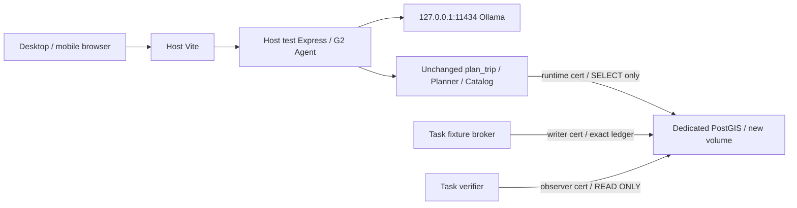

# T-AI-04 — Planner Isolated Test Environment Design Review

Ngày11/11/2026, Asia/Saigon. **Gate B — DESIGN_REQUIRES_OWNER_DECISIONS. DESIGN ONLY.** Đề xuất ưu tiên **Option A: PostgreSQL/PostGIS instance riêng, mTLS admission theo role và private key riêng của task**, tách provisioning administrator khỏi runtime. Có conditional writer-exclusion argument; chưa có môi trường thực tế được triển khai hoặc nghiệm thu.

**45/45 offline adversarial cases PASS theo expected**, gồm18 tình huống bắt buộc và450 tổ hợp25bảng×6phases×3credential classes. Cases giả lập mất key/privileged admission vẫn kết luận **BOUNDARY_BREACH**, không architecture security PASS. **PostgreSQL connections0, SQL0, Docker commands0, fixtures0, Planner/Ollama/browser LIVE0**. Owner còn phải chọn trust boundary, identity/resources, dataset permission/new baseline và staged implementation scope.

[Owner task](evidence/t-ai-04-planner-isolated-test-environment-design/owner-task.txt), [reviewed gate](evidence/t-ai-04-planner-isolated-test-environment-design/independent-design-review.json), [proposal](evidence/t-ai-04-planner-isolated-test-environment-design/proposal.json), [offline results](evidence/t-ai-04-planner-isolated-test-environment-design/independent-adversarial-acceptance.json), [implementation gate](evidence/t-ai-04-planner-isolated-test-environment-design/implementation-gate.json), [artifact seal](evidence/t-ai-04-planner-isolated-test-environment-design/artifact-checksums.json).

## 1. Baseline

Đã đọc năm required reports: [Continuity](HUGO_T_AI_04_PLANNER_MAINTENANCE_HANDOFF_CONTINUITY_REPORT.md), [Multi-connection](HUGO_T_AI_04_PLANNER_MULTI_CONNECTION_MAINTENANCE_ACCEPTANCE_REPORT.md), [Address normalization](HUGO_T_AI_04_PLANNER_CONNECTION_OWNERSHIP_ADDRESS_NORMALIZATION_REPORT.md), [Targeted resume](HUGO_T_AI_04_PLANNER_LIVE_TARGETED_REVALIDATION_RESUME_REPORT.md), [Adapter acceptance](HUGO_T_AI_04_PLANNER_ADAPTER_BINDING_ACCEPTANCE_FIX_REPORT.md). Đọc proof obligation/canonical witness/all25 sweep/options/independent review, exact fixture proposal, original identity/sentinel/schema/migration/fingerprint evidence, local Compose/backend/managed connections/runtime/cleanup/source closure. [Read/hash index](evidence/t-ai-04-planner-isolated-test-environment-design/baseline-review.json), [static findings](evidence/t-ai-04-planner-isolated-test-environment-design/local-source-findings.json).

Giữ **historical31 offline PASS, current handoff REFUTED,24/25 target counterexamples trong schedule đã xét; historical149/149; actual historical DB_UNCHANGED25/25 và Trip27/27**. Không rerun/cộng các suites cũ vào45 mới. Những khẳng định no-gap trước review được giữ nguyên trong báo cáo gốc, nhưng không dùng chúng để nâng gate hiện tại. Không có fresh DB observation trong task này.

## 2. Confirmed counterexample và root cause

Canonical valid order: last guard PASS → W queue RX/public.users trước B request users → A COMMIT → **W RX GRANTED tại model event91** trong I → W disconnect → B đủ25 → post guard PASS. B chờ relation đầu không queue các relation sau. Snapshot ownership nhận diện client đã quan sát; không deny client mới giữa samples. Historical8-client trace không bị quy thành writer intrusion thật.

Formal requirement giữ nguyên: **không outside-task actor được GRANTED RX trên bất kỳ approved25 relation trong I**; bảo vệ xuyên `ISOLATION_READY → INSERT → COMMIT → Planner → cleanup → final fingerprint`, không kết thúc chỉ vì STOP/dispose.

Điểm cần bổ sung khi dùng privileges: **DML denied không tương đương zero RX grants**. Source PG15 setTargetTable lấy RowExclusiveLock trước executor permission check. Suy luận từ source: outside authenticated readonly client có thể nhận transient automatic RX trước khi modifying statement bị ACL/READ ONLY reject. Không có PG experiment mới. Vì vậy đề xuất không cho outside clients authenticate, kể cả với tên role RO; không chỉ revoke write grants. [Parser source](https://raw.githubusercontent.com/postgres/postgres/REL_15_STABLE/src/backend/parser/parse_clause.c), [executor source](https://raw.githubusercontent.com/postgres/postgres/REL_15_STABLE/src/backend/executor/execMain.c).

[Formal argument và counterconditions](evidence/t-ai-04-planner-isolated-test-environment-design/WRITER_EXCLUSION_ARGUMENT.md) phân biệt strict RX property với no-data-change, giữ clean-entry/authentication/key-custody/persistent-policy/task-authority/failure/safe-end obligations.

## 3. Threat model và trust boundary

| Actor | Trust/admission policy |
| --- | --- |
| Task maintenance broker | Trusted, key riêng, chỉ authorizes exact approved fixture operations; không arbitrary SQL API |
| Task Planner/Agent/observer | Trusted hash-locked code và owned connections; runtime/observer chỉ RO privileges; browser/model input untrusted |
| Existing TravelGo app writers | Untrusted với isolated instance; không có task private key, không dùng chung dev credentials |
| Other dev tools | Untrusted nếu không có admin authority/task keys; network reachability không cho authentication |
| Shared database credentials | Dev postgres password không được chấp nhận ở new instance; không copy role/password dump |
| Unknown external client | Reject authentication; nếu thật sự authenticated thì boundary đã hỏng: STOP/quarantine, không whitelist/adopt |
| PostgreSQL administrator/superuser | Provisioning trusted ngoài I; không admitted/runtime login trong I. Admitted unknown privileged identity là FAIL, không evidence an toàn |
| Infrastructure/host/Docker administrator | Explicitly trusted: có thể override local controls. Không tuyên bố chống active administrator hoặc task-key/process compromise |

Developer giữ Docker daemon authority cũng nằm ở trusted administrator boundary khi sử dụng quyền đó. Nếu owner không chấp nhận trust này, local container không đủ; cần VM/host với administrator khác. Việc chọn boundary là owner decision, không mặc định mọi developer đều trusted writer.

## 4. Option A/B/C comparison

| Tiêu chí | A dedicated instance | B same instance / separate DB | C revised locks |
| --- | --- | --- | --- |
| Isolation correctness | Conditional sufficient với exclusive task authentication và explicit admin trust | **NOT ACCEPTABLE** dưới current shared-superuser boundary | **NOT PROVEN** |
| Safety existing data | Volume/instance/data source tách; không runtime tới original | Same cluster/admin có blast radius tới original | Shared original data vẫn chịu protocol risk |
| Complexity | Vừa: TLS/key custody, roles, baseline và test adapters | Ban đầu thấp hơn, security closure/admin removal khó | Cao/chưa bounded proof effort |
| Local demo preparation | Ước lượng2.5–5.5 engineering days sau decisions | Nhanh bề ngoài nhưng không đạt threat model hiện tại | Chưa ước lượng an toàn |
| Reproducibility | Pinned image, deterministic synthetic seed và manifest riêng | Phụ thuộc shared cluster state/sessions | Phụ thuộc concurrency/failure protocol |
| Credential security | New cert/key per task role; no dev credential reuse | Shared postgres vẫn bypass ACL nếu reachable/admitted | Locks không xóa shared write authority |
| Cleanup/recovery | Exact ledger + quarantine/rebuild isolated baseline | Recovery dễ tác động shared cluster | Disconnect/ambiguous commit/cleanup phải chứng minh lại |
| Real browser→Agent→Planner | Có thể nối bằng new test-only TLS adapter | Có thể nối, admission chưa đủ | Fixture visibility/lock continuity chưa proven |
| Existing dev impact | New resources only, không đổi dev config/volume | Role/HBA/session changes đụng shared instance | Maintenance locks trên shared tables |
| Independent verification | Clear resource/auth/privilege/dataset/provenance manifests | Cần chứng minh mọi privileged cross-path | Cần proof cho mọi relevant interleaving |

Option B: separate DB name, CONNECT revoke hoặc role grants không chặn current shared superuser/privileged session, không tự đóng authenticated sessions. Nếu chuyển mọi privileged holder thành trusted/loại authority thì đó là threat/scope change cần approval, không là proof cho current environment. [PG15 privileges](https://www.postgresql.org/docs/15/ddl-priv.html), [superuser attributes](https://www.postgresql.org/docs/15/role-attributes.html).

Option C phải xử lý per-relation order, earlier waiters/priority, A commit visibility/B acquisition, timeout/deadlock/disconnect, ambiguous commit, cleanup/unknown/cap10. Current A/B không được tái sử dụng; advisory không enforce noncooperators. Chưa có protocol mới được chứng minh; không kết luận mọi protocol≤10 đều bất khả thi.

## 5. Recommended architecture

[Detailed architecture](evidence/t-ai-04-planner-isolated-test-environment-design/ARCHITECTURE.md), [machine-readable proposal](evidence/t-ai-04-planner-isolated-test-environment-design/proposal.json). Đề xuất project `travelgo_planner_e2e`, service `planner_pg`, dedicated volume/network, DB `travelgo_planner_test_v1`, **new identity/sentinel/baseline riêng**, host port proposed127.0.0.1:15432. Không giá trị nào đã allocate/verify/approve.

Host runtime giữ Ollama loopback11434; Vite/Express riêng proposed15173/15500. Maintenance process chỉ nhận writer key, Express chỉ runtime RO key, observer có key riêng. Không key trong browser/prompt/env/evidence hoặc dev .env; dedicated OS/service identity và file ACL enforce key custody. CA signing key offline; no admin key tại runtime.

Architecture recommendation không là environment PASS. Các trust/OS/TLS/dataset/adapter assumptions còn phải được triển khai và đo ở task có approval riêng.

## 6. PostgreSQL privilege design

NOLOGIN `planner_owner` sở hữu application objects; provisioner/bootstrap postgres tắt runtime login/password/cert/HBA paths. Runtime SELECT places/businesses/users/user_roles; observer SELECT approved25+reviewed metadata; maintenance SELECT/INSERT/DELETE places duy nhất. Các login non-superuser, không owner/membership/grant option/CREATEROLE/CREATEDB/REPLICATION/BYPASSRLS; không PUBLIC app write/CREATE/TEMP hoặc callable privileged writer path. Không dùng NOINHERIT thay membership closure. [PG15 memberships](https://www.postgresql.org/docs/15/role-membership.html).

Audit effective grants gồm column/default ACL, owner, SET ROLE, functions/procedures/views/rules/triggers/operators/casts/extensions/FDW and background paths. RO startup+transaction verification+SELECT/SHOW guard giữ nguyên purpose nhưng không thay authorization. [Transaction modes](https://www.postgresql.org/docs/15/sql-set-transaction.html), [privileged function review](https://www.postgresql.org/docs/15/sql-createfunction.html).

Direct INSERT/DELETE grant không restrict rows; trusted broker + exact ticket/ledger/full-row/FK checks restrict task actions. Không claim DB row policy đã có. Nếu muốn chống maintenance broker compromise, cần thêm design approval, không silently hứa RLS bảo vệ mọi trường hợp.

Minimal privileges không chạy được old all25 SRE/SHARE LOCK contract; **không mở rộng writer quyền other24 để tương thích harness cũ**. Cần new versioned admission/cleanup proof adapter. [Explicit LOCK privileges](https://www.postgresql.org/docs/15/sql-lock.html).

## 7. Docker/network/authentication design

New pinned PostGIS15/3.4 image digest, PGDATA volume riêng, internal network không join dev network, no pgAdmin/Docker socket/replication/scheduler. Loopback-only publish15432 phục vụ host E2E; chưa inspect runtime/ports/capacity. Private network/DB name không đủ proof vì host vẫn reachable. [Docker bridge](https://docs.docker.com/engine/network/drivers/bridge/).

Full ordered HBA: TLS cert exact DB/role/verified source, CN=role, reject other roles/DBs/all IPv4/IPv6/local sockets, no password/trust/admin fallback. Server CA/name/SAN/pin verification mandatory. Shared postgres credential thất bại trước SQL session. [HBA15](https://www.postgresql.org/docs/15/auth-pg-hba-conf.html), [cert auth](https://www.postgresql.org/docs/15/auth-cert.html), [server verification](https://www.postgresql.org/docs/15/libpq-ssl.html).

Secret mounts per process/service và file ACL; Docker/host administrator vẫn trusted. No volume/config changes now. [Compose secret mounts](https://docs.docker.com/compose/how-tos/use-secrets/).

## 8. Exclusive writer-admission proof obligation

READY chỉ sau clean provisioning boundary/restart, no existing outside sessions/prepared transactions/user background writers, all task clients registered, exact persistent auth/privilege/resource/security manifest và new baseline accepted. Không rely REVOKE/reload để vô hiệu existing sessions; unknown trước READY chặn I.

Conditional proof: at READY no outside authenticated session; any subsequent outside client lacks task private capability nên cannot authenticate, không gửi SQL tới parser và không nhận RX; stable auth/key/authority policy không đổi bởi COMMIT/disconnect/cleanup. Runtime/task clients có explicit scoped authority; admin/background/indirect write paths không admitted. Vì vậy bảo vệ xuyên fixture visibility/Planner/final verification mà không có lock transfer.

Persistent policy còn deny outsider khi task crash; same sealed policy sau DB restart vẫn deny, nhưng runtime STOP và cần fresh acceptance epoch, không autoreconnect. Đây là argument dưới explicit assumptions, không mechanized PostgreSQL proof hoặc real config acceptance. Snapshot dùng để phát hiện drift, không tạo enforcement.

Full private key bị lộ hoặc unknown privileged client authenticated là **FAIL/boundary breach**; dữ liệu có thể đã chịu rủi ro trước guard. Hệ thống dừng/quarantine và withdraw safety claim, không giả no-gap. Active host/admin overrides nằm ngoài accepted threat model; owner cần chốt. [Argument/counterconditions](evidence/t-ai-04-planner-isolated-test-environment-design/WRITER_EXCLUSION_ARGUMENT.md).

## 9. Dataset và database baseline strategy

[Dataset plan](evidence/t-ai-04-planner-isolated-test-environment-design/DATASET_PLAN.md), [exact input/hash binding](evidence/t-ai-04-planner-isolated-test-environment-design/design-inputs.json). Original25/12/Place22/Trip27 và old schema hash giữ historical, không đo/sửa ở đây. New identity/sentinel/security overlay/baseline phải owner approve riêng, không giả clone equality.

Preferred new baseline:25tables/12migrations/22 deterministic synthetic catalog-compatible Places + needed synthetic Business parents + synthetic same-principal CUSTOMER/UserRole; **new Trip0**, original27Trip untouched. Planner reads catalog, không cần clone historical Trip/Booking/User records. Auth profile bootstrap cần synthetic same-principal row; không đổi approved principal hoặc reset global historical quota.

Potential PII/auth/contact/booking/trip/telemetry data không được raw copy; chưa có quyền hoặc row-level privacy audit. Cần owner field-level allowlist và synthetic generation/sanitize manifest. Giữ eligible14baseline/16withfixtures, exact selected IDs/prices/coords/public output/ranking-critical text/rating; Business status và hotel preference text cũng ảnh hưởng algorithm. Chưa có exact sanitized22-row manifest/parity proof, nên dataset **NOT READY**. Không điều chỉnh expected khi sanitize làm sai kết quả.

PROFILE2 full values và IDs nguyên approved proposal; defaults timestamps đo mới. Independent oracle giữ3500000 total,2600000/900000 per day, A02day1/A01day2, approved Seafood/hotel IDs và low-budget/no-price-cut/ETA controls. Trước LIVE phải có direct real loader+Planner parity và static oracle validation mới; task này không chạy.

New measured fingerprint gồm count+sorted row hashes đủ25, migration/expanded schema/security closure/sequences/extensions metadata; approve separately. Cleanup compares **new** fingerprint/counts (preferredTrip0), không fake oldTrip27. Backup/recreate chỉ approved isolated synthetic resources, retain unresolved ledger/volume, owner approval cho destruction/recovery. Original DB không restore/reset.

## 10. Planner LIVE compatibility

[Impact matrix](evidence/t-ai-04-planner-isolated-test-environment-design/ADAPTER_IMPACT.md) chỉ rõ hardcodes ở old guards/registry/readonly/maintenance/source-lock. Production testDatabaseGuard rejects DB_SSL=true và old factories force ssl:false; generic backend SSL branch không verify peer. Chưa thể point old adapter tới new target rồi nhận PASS.

Future test-only cohort cần stronger immutable DB/TLS/epoch descriptor, startup RO trước first query, full PID/backend_start/token/pool-bootstrap lifecycle, raw-before-verdict, physical cap10 và exact query boundaries. Cleanup contract nhận versioned admission proof với new baseline; old required all25 SHARE evidence không được gán giả true. New source closure/hash và independent original/new negatives bắt buộc trước use; production source và old suites không sửa trong review.

Giữ Planner algorithm/tool schema/gates, G2 verified history, consent/auth, approved principal, Agent20/hour/global ledger, H02 exact public JSON normalize2fields, H03 UTF-8/UI, H04 stop/abort/no subsequent dispatch, exact fixtures/cost oracle. Giữ qwen3 tag/digest/options/loopback/concurrency1/deadline15s/no retry. Fresh LIVE task phải reserve đủ actual planned Agent turns+operator, lock manifest/body/source trước native POST, cap mới được owner cấp riêng. Không kế thừa unused native allowance từ task cũ.

## 11. Independent adversarial acceptance

[Fixed parent expectations](evidence/t-ai-04-planner-isolated-test-environment-design/acceptance-vectors.cjs), [parent](evidence/t-ai-04-planner-isolated-test-environment-design/acceptance-parent.cjs), [child](evidence/t-ai-04-planner-isolated-test-environment-design/acceptance-child.cjs), [symbolic model](evidence/t-ai-04-planner-isolated-test-environment-design/admission-model.cjs), [source lock before execution](evidence/t-ai-04-planner-isolated-test-environment-design/acceptance-source-lock-before.json). One run45PASS/0FAIL, golden decisions/recovery locked trước execution, separate children/network fence. Không human/sub-agent independent reviewer được tuyên bố.

| Required case | Expected security decision | Recovery rule |
| --- | --- | --- |
| Unauthorized application writer | REJECT_AUTH trước SQL session | Denied; chỉ tiếp tục khi guards vẫn hợp lệ |
| Unauthorized DB credential | REJECT_AUTH, thiếu task private key | Không retry/whitelist credential |
| Shared superuser path | REJECT_AUTH tại A; B shared-admin countercondition FAIL | Nếu path admitted: security review/quarantine |
| Existing session trước test | STOP_BEFORE_READY | Fresh clean boundary/provision review; không revoke giả session hết quyền |
| Writer connect trong test | REJECT_AUTH | Deny persistent qua mọi phase |
| Connection sau fixture COMMIT | REJECT_AUTH | COMMIT không mở admission |
| Runtime nhầm writer credential | STOP_BEFORE_READY; runtime cert xin writer role REJECT_AUTH | Sửa wiring trước I; không downgrade guard |
| Maintenance identity mismatch | STOP_BEFORE_READY | Không INSERT; review exact identity |
| Database endpoint mismatch | REJECT_ENDPOINT | Không connect tới original/fallback |
| Container/network mismatch | STOP_BEFORE_READY | Fresh resource proof, không adopt stale identity |
| Unknown privileged authenticated client | **BOUNDARY_BREACH / security FAIL** | Giữ quarantine, withdraw guarantee, no blind cleanup |
| Crash before INSERT | STOP_SAFE_ABORT | Verify absence/baseline trong scope mới |
| Crash after INSERT before COMMIT | STOP_SAFE_ABORT chỉ với known rollback | Nếu commit state uncertain → quarantine |
| Crash after COMMIT | STOP_QUARANTINE, I active | Ledger/reconcile/admission proof mới |
| Crash during Planner | STOP_QUARANTINE, no later dispatch | Safe cleanup chỉ khi đủ exact guards |
| Cleanup failure | STOP_QUARANTINE | No force DELETE/restore/expected change |
| Database restart | STOP_QUARANTINE, persistent deny vẫn giữ có điều kiện | No automatic reconnect; new incarnation/security review |
| Failed final fingerprint | STOP_QUARANTINE dù fixture absent | Không safe_end hoặc DB_RESTORED PASS |

Additional cases kiểm ambiguous commit, leaked RO/writer full private capabilities, TLS/plaintext/CN/server pin, wrong source, PUBLIC writes/privileged functions/owner membership/role escalation, admin admission, prepared transaction/background jobs/shared volumes/network, missing owner/baseline/adapter approval, old lock proof, privilege expansion/row drift/restart policy drift và success lifecycle.450 combinations đều deny outside sessions/RX trong **model assumptions**.

Leaked RO key test cho outside RX=true/change=false; leaked writer key có possible places change=true. Expected BOUNDARY_BREACH được giữ nguyên:45testPASS xác nhận failure detection/classification, không chứng minh kiến trúc chống key theft. Security thực tế cho mọi case còn **UNVERIFIED**, required authorization chưa có; không bỏ case để nâng gate.

## 12. Crash/recovery model và evidence

[Architecture recovery](evidence/t-ai-04-planner-isolated-test-environment-design/ARCHITECTURE.md), [stage plan](evidence/t-ai-04-planner-isolated-test-environment-design/DEPLOYMENT_PLAN.md). Intent trước write, committed ledger sau ACK/readback, full row/ID/slug hashes, all five incoming FK tables/Trip JSON refs0, pre-existing rows/fingerprint và identity/security epoch đủ proof mới exact cleanup2. Ambiguous commit không retry INSERT/DELETE. Final mismatch hoặc unknown authenticated client không safe_end. Không automatic admin recovery/watchdog.

Future audit package phải có owner approvals, pinned resource/image/config/auth/role/security manifests, data permission/sanitize/seed manifest, new DB+baseline approval, source closure, physical attempt ledger và per-client protocol PID/backend_start/TLS/raw-self evidence, no-outside-auth security results, fixture intent/commit/exact-row ledger, independent oracles, locked native request bodies/quota/limits, screenshots/raw NLU/fidelity/stop results, cleanup/final25 fingerprints/disposal. Keys/passwords/real sensitive rows không vào report logs.

## 13. Implementation milestones và approval boundaries

1. **Owner decision**: architecture/admin trust, exact identity/roles/network/TLS/dataset. STOP khi thiếu authority/custody/data permission.
2. **Provisioning**: new resources only, sau approval riêng. STOP nếu shared dev resources/credentials/config bị động tới.
3. **Security acceptance**: actual auth/privilege/provenance/RO under explicit cap. STOP bất kỳ bypass/unknown/failed guard; negative DML không tự được phép.
4. **Baseline acceptance**: migrations/schema/catalog/privacy/new fingerprint. STOP khi unapproved data hoặc unchanged business expected không đạt; owner accept measured baseline riêng.
5. **Controlled maintenance**: separately approved exact2INSERT/DELETE/ledger/oracle/final fingerprint, no native. STOP collision/FK/drift/ambiguous cleanup.
6. **Planner LIVE R01–R03**: approval và quota/manifest/native cap mới. STOP ngay mandatory failure, no retry, later NOT RUN.
7. **Final cleanup/demo review**: guarded exact cleanup/regression/build/report trong scope được cấp; unsafe recovery/recreate cần approval riêng, không deploy.

Chi tiết deliverable/STOP/approval từng bước ở [deployment plan](evidence/t-ai-04-planner-isolated-test-environment-design/DEPLOYMENT_PLAN.md). **Không thực hiện STEP2–7** trong task này; không READY/executable LIVE manifest.

## 14. Owner decisions required

[Decision table](evidence/t-ai-04-planner-isolated-test-environment-design/OWNER_DECISIONS.md):

- Chấp nhận dedicated local instance và trusted-host/admin boundary, hoặc chọn independently administered VM/host.
- Chốt new UUID/sentinel/DB/ports/image/network/volume/roles/CA và OS key-custody identity.
- Cấp dataset field-level reuse/sanitize scope và exact catalog parity requirements; không raw sensitive clone.
- Chọn newTrip0/synthetic auth baseline hoặc approve một dataset khác với measurement/approval riêng; original27Trip giữ nguyên.
- Phân scope approval cho provisioning/security/versioned adapters/baseline, sau đó mới exact fixture maintenance và LIVE budgets.

Đây là lý do **B**, không tự suy owner đã chọn/approve hạ tầng. Không cần bỏ dở review để hỏi permission: concrete proposal/evidence đã hoàn tất; việc triển khai nằm ở task tiếp theo.

## 15. Estimated scope/complexity

Ước lượng planning, không benchmark: provisioning/TLS/roles0.5–1.5 ngày; test adapters/ownership/cleanup acceptance1–2 ngày; measured security/baseline/maintenance0.5–1 ngày; separately approved LIVE/regression/report0.5–1 ngày, tổng2.5–5.5 engineering days sau owner/data decisions. Risks là data permission/ranking parity, OS key isolation, Windows Docker forwarding/TLS và new cleanup contract. Chưa đo host resources/port availability; không hứa demo sẵn sàng trong một phiên.

## 16. Source/benchmark integrity và execution boundary

[Integrity](evidence/t-ai-04-planner-isolated-test-environment-design/integrity-after.json): **11240 protected files unchanged;166 sealed continuity artifacts/report nguyên hash;84 compiled production modules match**. Local reviewed source/input closure khớp trước/sau; benchmark/fixture proposal/expected/history không sửa. Chỉ thêm current design/model/tests/evidence/report.

[Offline audit](evidence/t-ai-04-planner-isolated-test-environment-design/offline-audit-summary.json):46 Node process audits, PG/network/forbidden child commands0.45children chỉ chạy symbolic model; không actual SQL/entity DML, Docker/psql commands, model metadata/GET/POST, Planner imports/browser LIVE. Official primary docs/source được đọc bằng web riêng, [source index](evidence/t-ai-04-planner-isolated-test-environment-design/sources-reviewed.json). Đây là process fence, không OS-wide packet capture.

Không broad regression/build ở design-only task; old31/149/135/64 và previous builds giữ historical. Không production edits, roles/grants/schema/config changes, data copy, fixture creation, quota reset, commit/push/deploy hoặc V2. Test-source expectations không thay sau run.

## 17. PID9686/P1/P2 và remaining limitations

**PID9686 UNKNOWN; P1 NLU OPEN; P2 runtime OPEN; actual Planner LIVE R01–R03 NOT RUN.** New architecture/model không quy ownership PID quá khứ, không sửa historical gate/expected hoặc biến counterexample thành flaky.

Current original maintenance handoff vẫn **REFUTED/LIVE BLOCKED**. Option A có concrete conditional design, nhưng chưa actual security/data/adapter/baseline acceptance; no environment PASS, no model/NLU/demo-ready claim. Active trusted admin attack/key theft không được kiến trúc hứa ngăn; nếu owner yêu cầu đưa chúng vào untrusted scope thì phải thay authority architecture, không nới formal property.

## 18. NEXT TASK PLAN — chỉ đề xuất

**T-AI-04-PLANNER-ISOLATED-ENVIRONMENT-OWNER-DECISION-AND-PROVISIONING-SPEC**: chốt các decisions và exact resources, chuẩn bị/review implementation specification; chỉ sau explicit approval riêng mới provisioning. Không chuyển thẳng Planner LIVE, V2 hoặc deploy; không tự thực hiện next task.

**Dừng sau báo cáo và niêm phong design evidence.**
