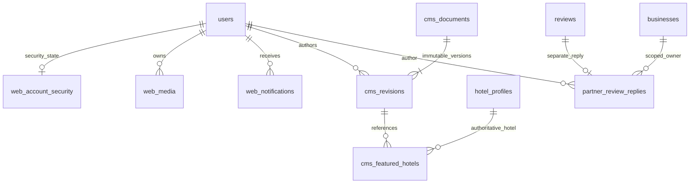

# WEB-INTEGRATION-02 — Migration 19 review

Source: integration/web-backend, based on WEB 46839ea and main e76d187. Review date: 2026-11-25 ICT.

Exact SQL: [20261125_19_web_foundation.sql](../database/migrations/20261125_19_web_foundation.sql).

Verdict: additive candidate authorized ONLY on the one new WEB-INTEGRATION-02 isolated database. Never apply to original, catalog staging15452 or old Hotel sandboxes. Migrations1–18 stay byte-identical. Native execution/results will be recorded below after testing.

## ERD delta and ownership

Seven new tables: 52→59 public tables, 18→19 tracked migrations. Existing users already hold name/phone/avatar/bio and scrypt hashes; no duplicate profile or authentication table. Security state is an additive side table, not an ALTER to users. Existing audit_logs is reused; secrets and password hashes are excluded from all audit payloads. Existing hotel_promotions remains the ONLY commercial promotion store. Editorial content cannot modify room rates.

CMS uses one common document/revision mechanism for BANNER, SECTION and SETTINGS. Current and published versions reference exact immutable revision rows through deferred composite FKs. Published content is pinned while a new draft is edited. Featured hotels have relational FKs to hotel_profiles, never copied prices. Publication additionally validates current hotel eligibility. Media metadata references its owner; nested media references are validated transactionally and retained revisions prevent media deletion. Runtime does not receive DELETE on revision/media tables.

Constraints enforce enums, positive versions, reference ownership, unique positions and bounded text. Indexes cover public publication, status filtering, notification ownership/unread state and business replies. Existing hotel inventory/pricing/review constraints are unchanged.

## Shared dependency impact / backwards compatibility

The protected manifest covers257 files; none may change. Additional shared surfaces: API router, authService/authMiddleware, Hotel postgresStore guard, frontend API adapters. New routes are disabled unless WEB_FOUNDATION_ENABLED=true. Account-security checks are separately opt-in; default-OFF authentication returns the identical existing public user/token contract and does not query new tables. Existing scrypt and tokenService implementations remain unchanged. With the flag ON, a signed optional sessionVersion claim revokes old tokens after password changes; backend rechecks current roles/status. No Agent DTO, consent, quota, prompt, algorithm or worker changes.

Hotel runtime currently demands52/18. Preserve that branch exactly. An explicit WEB flag permits ONLY59/19 with exact tracked migration18 AND19 source checksums, the same test database sentinel and nonprivileged hotel_runtime role. Unknown schemas remain rejected. This is an additive schema recognition change, not a rewrite of HotelReadService.

Shared schema and role changes are confined to the new target. SUPER_ADMIN/self/protected Owner edits are rejected. No schema change to AI tables or existing Review/User/Hotel columns. Partner replies never alter customer reviews or Review Intelligence inputs.

## Migration / recovery

Reuse schema_migrations SHA256 tracker, transaction per migration and advisory migration lock. Test migration19 rollback in a transaction first, then apply and record checksum. Do not change old checksums or use sync({alter/force}). A failed migration rolls back both DDL and tracker. Rollback a clean test19 in dependency order: partner_review_replies, web_notifications, cms_featured_hotels, remove two cms_documents revision FKs, cms_revisions, cms_documents, web_media, web_account_security, web_immutable_revision(), then only its exact tracker row. This is test/operator-only; exported CMS data/media must be backed up before any future destructive rollback. Runtime is least-privilege; migration owner is separate.

Production/staging application requires a future migration decision, data/backup review, Linux persistence acceptance and authorization. This task grants none of those deployments.

## Native result25/11/2026

Migrations1–18 applied natively to the new target:52/18, tracker/source hashes PASS. Candidate19 rollback probe and apply:59/19 PASS. Exact old SQL/checksums remain in evidence.

Review revisions were needed before final acceptance:

1. Candidate1 reply FK NO ACTION would block existing customer ReviewService.remove. Candidate2 changes only new FK edges to cascade/anonymize and adds reply tombstones to prevent delete/recreate version reset. Native down/up/restoration preserved every new-table row; original migration1–18 and protected source unchanged.
2. A native rolled-back SYNTHETIC author-deletion probe then found `CMS_REVISION_IMMUTABLE` blocked the new FK anonymization itself. Candidate3 permits ONLY actor→NULL after actual parent removal, while every other revision field remains identical. Direct content rewrite and nulling a live actor are still rejected. The corrected delete/anonymization succeeded for4 revisions in a transaction which was rolled back; no account was deleted. API self/Owner/SUPER_ADMIN protections remain unchanged.

Final SQL is candidate3. [migration19-v3-native.json](evidence/web-integration-02-20261125/migration19-v3-native.json) records exact checksums, row fingerprints, rollback probes and59/19. Each candidate transition was a native rollback of ONLY19 (52tables), removal of ONLY its old tracker row by checksum, then apply/restore in one transaction. No blind tracker checksum UPDATE; no existing database migration.

Runtime remained READ ONLY during final candidate3 testing: no DML was regranted. Existing `hotel_runtime` database-specific READ ONLY setting persists. Root/staging/old Hotel targets were not used for DDL or writes.

Native setup also proved existing Sequelize findOrCreate needs SQL TEMP for pg_temp functions. Grant TEMP only on this exact new database; no public-schema CREATE/superuser/createrole grant. Actual onboarding rollback/affected-only revalidation are recorded. Final deployment to any existing database is still NOT AUTHORIZED/NOT RUN.
