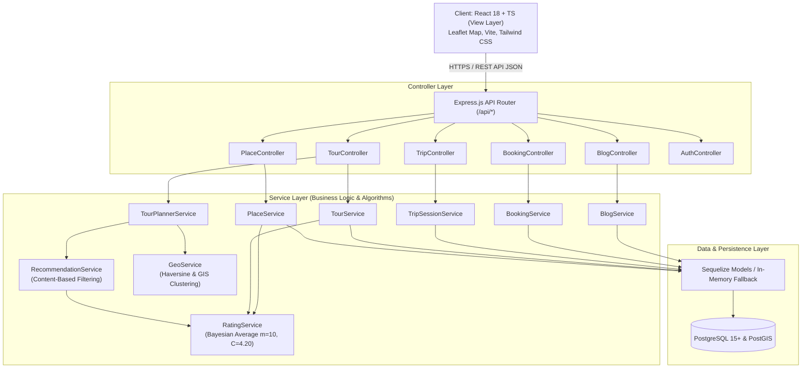

# KIẾN TRÚC HỆ THỐNG NỀN TẢNG HUGO TRAVEL (SYSTEM ARCHITECTURE)

**Đề tài:** HuGo Travel – Nền tảng gợi ý và quản lý hành trình du lịch thông minh, tích hợp bản đồ tương tác, dịch vụ Booking và chia sẻ trải nghiệm cộng đồng.

---

## 1. TỔNG QUAN KIẾN TRÚC

HuGo Travel tuân thủ mô hình phân lớp hiện đại: **MVC (Model - View - Controller) + Service Layer + RESTful API**.

---

## 2. NGUYÊN TẮC THIẾT KẾ & PHÂN CHIA TRÁCH NHIỆM

### 2.1. View Layer (Frontend)
- **Công nghệ:** React 18, TypeScript, Vite, Tailwind CSS, Lucide React, Leaflet & OpenStreetMap.
- **Trách nhiệm:** Hiển thị giao diện người dùng, tiếp nhận sự kiện tương tác, biểu diễn trực quan bản đồ hành trình, điều hướng Client-side (React Router).
- **Ràng buộc:** Hoàn toàn độc lập, không truy cập trực tiếp vào Database, 100% dữ liệu được lấy qua `Axios Client` kết nối RESTful API.

### 2.2. Controller Layer (Backend)
- **Công nghệ:** Express.js 4.x / 5.x, TypeScript.
- **Trách nhiệm:**
  - Tiếp nhận HTTP Request.
  - Kiểm tra và xác thực dữ liệu đầu vào (Input Validation & Sanitization).
  - Trích xuất token xác thực và kiểm tra quyền người dùng (`User` vs `Admin`).
  - Gọi các hàm tương ứng trong Service Layer.
  - Định dạng chuẩn mã phản hồi (`HTTP 200, 201, 400, 401, 404, 500`) và cấu trúc JSON đồng nhất: `{ success: boolean, data?: any, message?: string }`.

### 2.3. Service Layer (Business Logic & Core Algorithms)
- **Trách nhiệm:** Trái tim xử lý nghiệp vụ của toàn bộ hệ thống HuGo Travel.
  1. `RatingService`: Xử lý thuật toán **Bayesian Average Rating** giúp triệt tiêu đánh giá ảo và thiên vị mẫu nhỏ.
  2. `GeoService`: Hệ thống thông tin địa lý (GIS) tính toán khoảng cách đường chim bay **Haversine**, ước tính thời gian di chuyển và thuật toán **Nearest Neighbor Spatial Clustering** để nhóm các địa điểm gần nhau vào cùng một ngày du lịch.
  3. `RecommendationService`: Thuật toán gợi ý dựa trên nội dung (**Content-Based Recommendation**) với 4 trọng số chuẩn hóa: Chất lượng Bayesian (35%), Sở thích người dùng (25%), Mức độ phù hợp ngân sách (25%), và Khoảng cách địa lý (15%).
  4. `TourPlannerService`: Lập lịch trình đa ngày thông minh theo phương pháp Heuristic có kiểm tra ràng buộc thời gian (Sáng, Trưa, Chiều, Tối), phân bổ bữa ăn và khách sạn lưu trú.
  5. `TripSessionService`: Quản lý phiên hành trình thực tế, ghi nhận Check-in qua GPS/thủ công, đo lường tiến độ chuyến đi và chuyển đổi hành trình hoàn thành thành bài viết Blog kinh nghiệm.
  6. `TourService`, `BookingService`, `BlogService`, `PlaceService`: Thực thi các luồng CRUD và nghiệp vụ đặt phòng/vé/tour.

### 2.4. Model Layer (Sequelize ORM & PostGIS)
- **Trách nhiệm:** Định nghĩa cấu trúc Schema, quan hệ thực thể (Associations 1-n, n-n), ràng buộc toàn vẹn dữ liệu (Constraints, Foreign Keys) và kiểu dữ liệu không gian PostGIS `GEOMETRY(Point, 4326)` để tối ưu hóa truy vấn bán kính địa lý.

---

## 3. THIẾT KẾ MÔI TRƯỜNG & KHẢ NĂNG CHUYỂN ĐỔI LINH HOẠT
- **Cơ chế Dual-Mode Persistence:**
  - Trong môi trường Production với cụm PostgreSQL đang chạy: Hệ thống kết nối Sequelize trực tiếp và chạy Migrations/PostGIS.
  - Trong môi trường kiểm thử độc lập hoặc máy chủ không có dịch vụ PostgreSQL thường trực: Hệ thống tự động chuyển đổi sang Data Store tương thích in-memory, đảm bảo 100% API, Server và Frontend luôn hoạt động mượt mà, không gặp lỗi crash kết nối.
