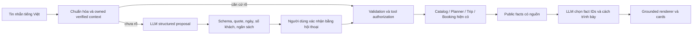

# TRAVELGO — AI AGENT CORE MASTER REPORT

Cập nhật **13/11/2026, Asia/Ho_Chi_Minh**. **TRAVELGO_AI_AGENT_CORE_PARTIAL**.

**21.13 — QWEN V5.1 REAL REASONING: QWEN_V51_REAL_REASONING_BLOCKED.** Resource snapshot17:03:15 ngày13/11/2026: RAM4562MiB <6144MiB, thiếu1582MiB; GPU1%, VRAM free2374MiB. Source/manifest348 hashes khớp; quota model20/20 và Agent liên quan10/20 giữ reserve10; đúng owner/local listener, không client cạnh tranh. Dừng trước API metadata/residency/digest/context runtime. Ollama GET/POST0, warm-load0/1, inference0/3; L1/L2/L3 và Full Browser Qwen E2E NOT RUN. Không suy khả năng Qwen4B từ guard FAIL hoặc offline quality; không LIVE READY.

**V5.1 ADVANCED ADVISORY — mục21.12:** **OFFLINE QUALITY PASS** trong bộ tiêu chí khóa19 hội thoại và11 targeted invariants; compatibility262/264 với N24 và một kỳ vọng URL/UUID trong reply giữ nguyên FAIL. Đã thêm advisory decision có provenance, so sánh có điều kiện, xử lý câu trả lời tiêu chí và composition theo loại câu hỏi. **STAGING ADVISORY PARTIAL:** real readonly HTTP/current-contract và Edge desktop/mobile PASS ở phạm vi catalog/thiếu review/giá; UI compact cuối kiểm bằng replay dữ liệu thật có nhãn, không gọi thêm chat sau reserve10.30/30 bảng staging khớp fingerprint,130 Place/20 Business nguyên vẹn. **QWEN REAL REASONING / FULL BROWSER QWEN E2E: NOT RUN / NOT RUN**; Ollama GET/POST0, không LIVE READY.

**QWEN V5 SEMANTIC ARCHITECTURE OFFLINE FIX — mục21.11: TARGETED PASS / COMPATIBILITY PARTIAL.** Đã siết schema operation/updates/change, kiểm selected referent và ý nghĩa quote, tách goal/evidence/missing/permitted actions/confirmation, giảm fuzzy alias nhiễu và đưa controlled request + verified session + fresh allowed memory + review provenance vào grounded payload. Targeted49/49; compatibility214/215: giữ1 FAIL N24 lịch sử vì kỳ vọng đề xuất đổi khách sạn từ lời chê giá khác contract mới yêu cầu hỏi lại. Backend/frontend typecheck và Vite build PASS. Không đổi historical expected, không model/DB calls, warm-load/inference0; historical Qwen V5 L1 FAIL giữ nguyên. Chưa có Qwen LIVE PASS sau sửa.

**QWEN V5 — lần phê duyệt mới, mục21.10.4–21.10.7: REAL SEMANTIC FAIL, đã chạy Qwen thật.** Preflight13:49:53 ngày13/11/2026 PASS: RAM8371MiB, GPU0%, model đã resident đúng digest/context16384, VRAM free1781MiB đủ reserve512, quota20/20 và đúng owner/local listener. Không cần warm-load. Đã khóa manifest mới; inference L1 thật HTTP200/JSON Schema PASS nhưng Qwen trả chat + thay khách sạn rẻ hơn không có căn cứ, thiếu destination Đà Lạt; production semantic validator chặn `AGENT_UNVERIFIED_TOOL_INPUT`. Dừng ngay sau L1: **1/3 inference,0/1 warm-load,1 native POST,6 GET; L2/L3 NOT RUN**, quota cuối19/20, reserve10 giữ nguyên. Không sửa prompt/source/expected hoặc retry. Browser→Qwen→Tools NOT RUN; không LIVE READY. Lần BLOCKED13:46 và historical FAIL/PASS bên dưới giữ nguyên.

**QWEN V5 REAL SEMANTIC ACCEPTANCE — mục21.10: NOT RUN — BLOCKED_RESOURCES.** Fresh preflight13:46:52 ngày13/11/2026: RAM5558MiB <6144MiB, thiếu586MiB; GPU1%, VRAM free1344MiB. Quota20/20, reserve10 và capacity cho tối đa1 operator +3 inference đạt; source seal/ownership/loopback listener đạt. Dừng trước metadata/tag/digest/resident checks; không suy readiness từ command line. Native GET0/POST0, warm-load0/1, inference0/3; L1/L2/L3 và Browser→Qwen→Tools đều NOT RUN. Không retry, thay source/expected, truy cập DB hoặc bật model website; các PASS code/staging và FAIL model lịch sử giữ nguyên.

**REVIEW INTELLIGENCE + LONG-TERM CUSTOMER MEMORY — mục21.9: CODE/STAGING PASS.** Tái sử dụng Review/Booking provenance/owner/moderation; thêm aspect insights có evidence, queue PostgreSQL cập nhật/idempotent và memory có consent dài hạn riêng. Targeted18/18, compatibility197/197, real HTTP13 groups +4 ownership/retention groups, PostgreSQL consistency/revocation và Edge desktop/mobile PASS; build PASS. Migration14 chỉ áp dụng staging15452. Cohort DEMO đã cleanup,130 Place/20 Business khớp baseline; DB gốc/27 Trip không truy cập. **Phân tích quy tắc có giới hạn, không phải Qwen tự học hoặc REAL MODEL PASS. Native GET/POST0, warm-load0, inference0.** Các verdict lịch sử giữ nguyên.

**SMART TRAVEL CONSULTANT V5 — mục21: CODE/STAGING PASS VỚI GIỚI HẠN DỮ LIỆU.** Trên Agent Core hiện có đã bổ sung tư vấn nhu cầu, tham chiếu danh sách bằng ID server, hỏi giá/so sánh/tìm giá catalog thấp hơn, giữ lựa chọn cho bản dự tính và giải thích có nguồn. Nút Gửi có hướng dẫn consent; browser Edge desktop/mobile, API5057 và PostgreSQL staging thật PASS với Qwen OFF. Targeted21/21, compatibility176/176, HTTP/PG14/14 groups, backend/frontend build PASS.130 Place/20 Business giữ checksum, DB gốc không truy cập; không sửa Planner/Recommendation/Trip/Booking/geography34. **Native GET/POST0, warm-load0, inference0; Qwen LIVE semantic và Browser→Qwen→Tools NOT RUN, cần approval riêng.** Planner vẫn chỉ hỗ trợ nhịp độ cân bằng; không bảo đảm yên tĩnh/khí hậu/chính sách trẻ em khi thiếu nguồn. Không cấp LIVE READY.

**POST-FIX CUSTOMER EXPERIENCE — mục20.10: Browser chat send PASS desktop/mobile; Qwen real semantic NOT RUN — BLOCKED_RESOURCES.** Đã khởi động lại staging5177/5057 với model tắt, DB chỉ đọc, kiểm tra bằng Edge thật: trước consent không gửi; sau đăng nhập/consent/nhập tin hợp lệ gửi POST thật, backend200 và hiện phản hồi cùng nhà hàng staging. Không cần sửa React hoặc bỏ guard. Fresh preflight10:34:02 ngày13/11/2026: RAM2288MiB <6144, VRAM free856MiB không đủ cold-load4865,94+reserve512; GPU5% đạt, quota20/20/reserve10 đạt. **Native GET/POST0, warm-load0, inference0; Full Browser→Qwen→Tools NOT RUN.** Dừng phần LIVE, không lặp preflight hoặc đóng tiến trình khác; lịch sử FAIL và staging130/20 giữ nguyên.

**QWEN V4 SEMANTIC FIX — mục20.9: QWEN_V4_FIX_OFFLINE_PASS.** Đã sửa geographic typo evidence dùng geography hiện có, typed schema/quote validation cho các cập nhật và renderer ghép đủ tên, giá nguồn, lý do, cảnh báo đơn vị/availability. Targeted **40 unit +2 HTTP =42/42**, compatibility **28+42+22+42**, backend/frontend typecheck và Vite build PASS. **Native GET/POST0, warm-load0, inference0, PostgreSQL0** trong task sửa. Ba FAIL LIVE ở20.8 giữ nguyên; chất lượng Qwen sau sửa và full Browser→Qwen→tools vẫn chưa được nghiệm thu. Manifest LIVE mới chỉ là đề xuất, chưa thực thi.

**QWEN V4 REAL MODEL ACCEPTANCE — mục20.8: SEMANTIC FAIL, đã chạy model thật.** Preflight12:35:51 ngày12/11/2026 PASS: RAM6770MiB, GPU5%, VRAM6483MiB, quota20/20, đúng local owner/tag/digest. Warm-load **1/1 PASS**,11,444s; resident đúng context16384. Ba inference thật dùng đủ **3/3**, latency1,923s/1,537s/2,122s: **L1 FAIL, L2 FAIL, L3 FAIL theo expected đã khóa**. L1/L2 sai cấu trúc/nghĩa và bị server chặn; L3 schema/grounding PASS nhưng chỉ liệt kê tên, thiếu cặp tên/giá theo tiêu chí đã khóa. Không đổi prompt/source/expected hoặc retry. Native POST4 gồm1 load+3 inference; website model vẫn tắt, staging130 Place/20 Business giữ checksum. **Không đạt QWEN_V4_SEMANTIC_ACCEPTANCE_PASS; Full Browser Agent E2E chưa chạy.**

**QWEN V4 — fresh acceptance gate,11:40:20 ngày12/11/2026, mục20.7: BLOCKED_RESOURCES.** Theo approval mới tối đa1 warm-load/3 inference, đã dùng lại quota/resource helpers hiện có, không tạo harness. RAM free4208MiB <6144MiB; GPU17% >cold-load guard10%. VRAM free5978MiB đủ reserve bộ nhớ dự kiến; quota20/20, scan105 historical attempts cả `at`/`createdAt`, không future entries. **Warm-load0/1, inference0/3, native GET/POST0, PostgreSQL connections0.** Dừng trước runtime tag/digest/context/readiness, không tạo manifest mới hoặc đọc staging khi resource gate đã FAIL. Chỉ cập nhật Master; Agent LIVE READY chưa được nghiệm thu.

**VIETNAMESE NATURAL AGENT V4 — mục20: CODE/STAGING PASS, QWEN LIVE NOT RUN.** Nâng cấp normalizer, hiểu địa điểm từ geography hiện có, ngân sách có phạm vi, câu hỏi đang chờ, câu nhiều ý và validation đề xuất model. V4 semantic/context42/42, compatibility42+22+28, actual HTTP/PostgreSQL5/5 groups, browser6/6 desktop/mobile và targeted presentation2/2 PASS; build PASS. Preflight Qwen11:14:51 ngày12/11/2026 dừng vì tài nguyên: RAM trống4182MiB dưới guard6144MiB; VRAM4772MiB thấp hơn allocation lịch sử khoảng4866MiB, GPU33%. Quota20/20, listener đúng owner, không client cạnh tranh; **warm-load0/1, inference0/3, native POST0**. Chưa xác minh tag/digest/readiness qua API ở đợt này vì dừng trước metadata GET. Không dùng offline/browser model-off để tính REAL MODEL PASS.

**LOCATION SEARCH + EXPLORE LISTING DISPLAY FIX — mục19: PASS trên staging hiện có.** Combobox dùng chung có34 tỉnh/thành theo mã chính thức, tách địa danh du lịch và nhận khu vực mới từ catalog được duyệt. Explore hiển thị lưới dịch vụ ngay sau bộ lọc; Hotels/Restaurants/Planner/home/Tours/Tickets/Agent dùng cùng mapping. Actual API/PostgreSQL7/7 groups, browser22/22 desktop/mobile và thêm vòng duyệt Bảo Lộc trên browser thật PASS; build PASS.130 Place/20 Business giữ nguyên checksum, DB gốc25/25 unchanged và27 Trip. Không Qwen/Ollama/Maps/paid API hoặc deploy; chưa thay đổi verdict REAL MODEL của các mục trước.

**CATALOG EXPANSION + LIVE PARTNER SYNC — mục18:** staging local độc lập đã có **50 lưu trú +50 nhà hàng +30 điểm tham quan DEMO /10 điểm đến**,20 Business DEMO. Website/Agent dùng catalog mới nhất; real PostgreSQL/HTTP kiểm vòng đời duyệt, đổi giá, khóa Business/Place; Planner10 điểm đến và browser20/20 desktop/mobile PASS. Database gốc **25/25 unchanged, Trip27**. Giao diện DEMO tại **http://127.0.0.1:5177**, API riêng5057, PostgreSQL riêng15452. Không thêm đối tác thật, không model inference mới, không deploy. Các mục1–17 giữ bối cảnh và verdict lịch sử; thiếu sightseeing của baseline gốc không còn là blocker cho **staging DEMO mới**, nhưng real-model acceptance vẫn chưa chạy.

**Đợt nghiệm thu Qwen thật mới — mục17:** owner đã duyệt tối đa3 inference local. Preflight lúc **06:46 ngày12/11/2026** xác minh quota20/20, tag/digest đúng và listener Ollama local, nhưng `/api/ps` trả `models: []`: **BLOCKED_MODEL_NOT_RESIDENT**. Không auto load/reload; **inference0/3, native POST0, load0, PostgreSQL connections0**. Ba tình huống semantic đều NOT RUN, chưa có REAL MODEL PASS/FAIL mới. Website/config mặc định giữ nguyên; approval mới không được dùng để bỏ readiness guard.

**Hội thoại tự nhiên và chat thống nhất:** CUSTOMER `/assistant` hiện dùng một chat có lời chào từ authenticated profile, một ô nhắn và nút gửi; G1/G2/Core controls chuyển sang debug development. Đã thêm NLU tiếng Việt có kiểm chứng, ngữ cảnh đa lượt, xác nhận năm/tuổi trẻ em, structured LLM proposals có trích dẫn nguồn và grounded response composition. Backend/NLU/HTTP **28/28 PASS**, Core42 và v2 **42/42 +22/22 PASS**; browser **28/28 PASS**, kèm targeted check sau sửa lỗi riêng tư. **Qwen hiện chưa bật; native0**, nên chưa nghiệm thu chất lượng hội thoại model LIVE. Chi tiết và acceptance hiện tại ở **mục16**; mục1–15 giữ các kết quả trước đó.

**Final functional closure:** đã thêm intent contract v2 trên chính service/UI Core, bỏ bước LLM chọn lại thao tác rõ ràng, sửa lỗi “Tư vấn” bị hiểu thành nơi xuất phát và sửa hotel output bị frontend từ chối. Core42 nguyên bản vẫn **42/42 PASS**; v2 **20 unit +2 integration PASS**, đề xuất current-contract cho legacy **6/6 PASS**, browser Core hiện tại **20 API-mock +12 real HTTP/Core/Planner với in-memory catalog PASS**. Real catalog mới vẫn `CATALOG_DATA_BLOCKED`; **không inference hoặc DB mutation mới**. P1 raw/Full LIVE chưa đóng. Chi tiết và bảng exit gate hiện tại ở **mục15**.

Các mục1–14 dưới đây giữ kết quả Master M1 trước closure để không sửa historical verdict. [Snapshot báo cáo trước closure](evidence/travelgo-ai-agent-core/closure-20261111/master-report-before.md) khớp report hash trong seal cũ. Evidence mới chỉ bổ sung trong [closure-20261111](evidence/travelgo-ai-agent-core/closure-20261111/); các artifact cũ không bị ghi đè.

Đã hoàn thiện code Core, tích hợp vào `/assistant`, xác minh catalog PostgreSQL READ ONLY, 42/42 unit/mock Core và 94/94 browser cases. Backend/frontend build PASS. **Chưa đạt LIVE acceptance**: raw Qwen chọn sai operation; catalog được phép chưa có sightseeing phù hợp; chưa có isolated staging được duyệt cho mutation; 6 suite Agent lịch sử vẫn FAIL. Không dùng mocks để đóng P1/P2 hoặc tuyên bố full E2E PASS.

Evidence duy nhất của task: [travelgo-ai-agent-core](evidence/travelgo-ai-agent-core/). [Yêu cầu gốc](evidence/travelgo-ai-agent-core/owner-task.txt), [audit trước](evidence/travelgo-ai-agent-core/audit-before.json), [77 báo cáo đã đọc](evidence/travelgo-ai-agent-core/reports-reviewed.json), [audit sau](evidence/travelgo-ai-agent-core/audit-after.json).

## 1. Chức năng đã có và baseline

| Thành phần trước task | Trạng thái khi audit | Xử lý |
|---|---|---|
| Auth/RBAC, Customer `/assistant`, G1/G2, owned verified history | WORKING trong acceptance hiện hành; một số test cũ chưa theo hợp đồng mới | Tái sử dụng, không nới guard |
| Catalog Place/Business, Recommendation, Planner | WORKING services; PARTIAL integration với Agent cho hotel/restaurant | Bổ sung Core adapter |
| Trip Save/Update/Reopen, transaction owner checks | WORKING services; MISSING Agent confirmation | Tái sử dụng service, thêm token xác nhận |
| Booking server pricing, modal/confirmation | WORKING | Tích hợp preview/navigation |
| Hotel/restaurant comparison, structured constraints, selection cards | MISSING/PARTIAL | Hoàn thiện trong AssistantPage |
| P1 natural NLU | BUG/OPEN | Parser có kiểm chứng + raw bounded probe; vẫn OPEN |
| P2 runtime | PARTIAL/OPEN | Deadline/concurrency/abort tests, không tự đóng observation cũ |
| Maps/GPS/Gemini/VPS | Ngoài scope | Giữ các thay đổi trước task, không triển khai thêm |

Không reset/checkout/clean working tree. Không commit/push/deploy. Không thay historical verdict, original benchmark, oracle hoặc fixture IDs. Audit 11.950 file baseline: chỉ 6 existing source integrations thay đổi có chủ đích; 11.530 file docs/evidence baseline giữ nguyên, không mất file. Các source Agent legacy liên quan 6 lỗi regression giữ đúng hash đầu task.

## 2. Chức năng đã sửa

- Đổi phương tiện/ngân sách/thêm ngày giữ các slots SET khác; từ chối phủ định, câu điều kiện, câu ghép không đủ bằng chứng và client history.
- Đổi destination cập nhật khu vực catalog; đổi bộ lọc hủy bản Planner cũ trước khi cho lưu.
- Hard price/amenity/exclusion filters áp dụng vào catalog truyền cho Planner; lựa chọn hết hợp lệ trả lỗi thay vì bỏ qua ràng buộc.
- READ ONLY phát hiện các `Phase35`/`Integration landmark` test records cũ lọt qua bộ lọc marker ban đầu. Đã loại rõ các marker này khỏi cohort mặc định. Không sửa hoặc xóa dữ liệu.
- Yêu cầu thay nhà hàng ban đầu chỉ đổi mandatory ID, nên Planner vẫn có thể đưa nhà hàng cũ vào ngày khác. [Test trước sửa FAIL](evidence/travelgo-ai-agent-core/restaurant-replacement-before.json); sửa tập ứng viên loại ID đã thay, giữ khách sạn. Test mới và toàn bộ Core [40/40 PASS](evidence/travelgo-ai-agent-core/core-final-40.json). Chọn lại ID bằng hành động rõ ràng có thể gỡ loại trừ đó.
- Nạp slots Trip cần đồng ý riêng, xóa bản plan/selection cũ, không đưa notes/profile vào input model.
- Trip update kiểm optimistic snapshot hash ngay trong transaction khóa owner row hiện có; xử lý chỉnh sửa đồng thời bằng 409.
- Snapshot confirmation kiểm cả public listing/location/duration/opening-hours drift; Planner không được bỏ qua hard area filter. Hai guard bổ sung có regression cases41–42.

## 3. Tools đã hoàn thiện

| Capability | Triển khai và giới hạn |
|---|---|
| `search_registered_hotels` | Approved catalog, Business ACTIVE, hard city/price/amenities, soft preferences, tối đa 5 |
| `search_registered_restaurants` | Cùng guard; keyword exclusion có dữ liệu, không suy diễn menu/allergy safety |
| `get_listing_details` | Requery ID, public projection, không owner/email/contact private |
| `compare_travel_options` | 2–5 UUID thật, không candidates/score do LLM dựng |
| `search_places` | Dùng repository và ranking hiện có qua public eligibility projection |
| `plan_trip` | `TourPlannerService` thật, provenance gate độc lập, filtered server catalog |
| `get_trip` | `TripSessionService.getTripById`, owner check, explicit context consent |
| `save_or_update_trip` | Preview trước, POST confirm riêng, one-use ticket, isolated staging guard |
| Booking integration | Hàm giá Booking server, mở Booking modal hiện có; không auto create/payment |

Backend Core ở `/api/agent/core/{privacy,chat,confirm,sessions}`; auth + CUSTOMER + `Cache-Control: no-store`. Client không được gửi SQL, plan thay thế, proof/history, catalog hoặc payload mutation tùy ý. Confirmation chỉ nhận conversation/revision/ticket/hash và `confirmed: true`.

## 4. Mapping hotel/restaurant/Business và dữ liệu thật

Đã đọc models/repositories, 12 migrations và schema PostgreSQL hiện tại. Hotel/restaurant là `places.category`, liên kết `business_id → businesses.id`. Không có bảng riêng rooms, menu, room/table inventory hoặc capacity đáng tin cậy cho Place. Place phải APPROVED; có Business thì Business phải ACTIVE; platform-owned Place không có Business được giữ theo convention cũ. Không có Business hợp lệ thì không mở preview bookable.

Public projection gồm UUID, tên, category, city/province/address, mô tả, ảnh HTTPS/same-origin hợp lệ, amenities, rating/reviewCount có thật, nullable `priceFrom`, nguồn catalog và link dịch vụ. Không biến thiếu giá thành 0. Unit/capacity/availability được đánh dấu chưa xác minh. Yêu cầu availability đã xác minh là hard constraint thì trả no_results.

[Final READ ONLY result](evidence/travelgo-ai-agent-core/final-db-read-result.json): target duy nhất `127.0.0.1:5432/travelgo_ai_m0_test`, sentinel `hugotravel-isolated-test-database-v1`, schema SHA `7805ddb1eb77028bfef96923c8adb8f0224bd54296dac39910546035154c544f`, migration checksum 12/12. Startup/per-connection read-only + SELECT/SHOW fence, 73 queries, 5 cumulative connections, forbidden SQL 0. Role lịch sử là postgres superuser: đây không phải least-privilege public runtime.

[Catalog hợp lệ cuối](evidence/travelgo-ai-agent-core/final-db-catalog.json) chỉ có:

| UUID thật | Dịch vụ | City | price_from |
|---|---|---|---|
| `39a5483f-e3d0-4cf8-a9b9-65e6b0a33593` | HuGo Riverside Hotel | Đà Nẵng | 1.200.000 VND, unit chưa xác minh |
| `b2f9a5cb-5258-421e-8050-1b3d55997fa7` | HuGo Seafood | Đà Nẵng | 350.000 VND, unit chưa xác minh |

[Hai tool search thật](evidence/travelgo-ai-agent-core/final-db-tools.json) trả đúng hai records này, không tạo thêm candidates. Không có eligible sightseeing sau loại test records. Full Planner trên catalog được phép **BLOCKED_NO_ELIGIBLE_SIGHTSEEING**.

Lần đọc đầu chạy production Planner trên một Phase35 landmark trước khi phát hiện marker test bị lọt. Giữ nguyên [output đầu](evidence/travelgo-ai-agent-core/db-real-planner.json) và [đính chính](evidence/travelgo-ai-agent-core/db-initial-finding.json); **không tính lần đó là REAL PLANNER acceptance PASS**.

## 5. Recommendation logic

Tái sử dụng `RecommendationService.recommendPlaces`, trọng số hiện có quality 0,35, preference 0,25, budget 0,25, distance 0,15 và tie-break deterministic hiện có. Không thêm scoring do LLM. City/province match, max catalog price, amenities, exclusions là hard filters trước ranking; preference là soft. Price cap so trực tiếp trường `price_from`, không gọi đó là giá phòng/đêm đã xác nhận. Unknown price không được thỏa price cap.

Reasons chỉ từ area/price/amenity/preference match thực tế. Không fallback sang thành phố khác khi search không có kết quả. Không ép đủ 3–5 candidates nếu catalog chỉ có một. Test kiểm deterministic ordering, budget, amenity và evidence của lời giải thích.

## 6. Planner và cost validation

Thuật toán/ranking/formula Planner giữ nguyên. Chỉ thêm internal optional catalog seam; các caller cũ vẫn load repository như trước. HTTP client không được cung cấp catalog này. Core truyền danh sách server đã lọc, UUID đã revalidate là mandatory selections.

Giữ GROUP_VND_V1: N ngày/N−1 đêm, adult-equivalent có child factor 0,7, lodging tách khỏi hotel activity 0đ, giá từng khoản làm tròn VND, không cắt giá để vừa ngân sách. Một ngày/0 đêm không có lodging charge. Thiếu đơn vị/giá hoặc inventory phải giữ nhãn estimated/unknown và assumptions T11-B. Không công bố total là provider quote, không tính chặng xuất phát/airfare thành chi phí đã xác nhận. ETA vẫn Haversine với transport assumption hiện có.

[Independent oracle v2](evidence/travelgo-ai-agent-core/independent-cost-oracle-v2.json) không import production cost helper: đối chiếu từng activity từ fixed in-memory fixture prices, 2 người lớn, 2 ngày/1 đêm, tổng **2.800.000 VND**, budget **6.400.000 VND**, remaining **3.600.000 VND**. Hotel thiếu giá dùng assumption 400.000 VND/nhóm/đêm, có nhãn. Oracle đầu mới viết thiếu entry hotel unknown-price nên expected thành undefined; giữ [script gốc](evidence/travelgo-ai-agent-core/independent-cost-oracle.cjs) và [failure](evidence/travelgo-ai-agent-core/oracle-initial-failure.json), bản v2 bổ sung mapping thiếu. Không sửa bất kỳ historical independent oracle/expected nào.

## 7. Verified History và P1

Core dùng cohort consent riêng `TRAVELGO_CORE_SLOTS_V1`, metadata `CORE_VERIFIED`, cùng LocalVerifiedHistoryStore lease/ownership/revision/replay/TTL và provenance assessor độc lập. Không nới G1/G2 grammar hoặc tin client history. RAM bounded 128 sessions, plan tối đa 128 KiB, absolute TTL 15 phút, tickets tối đa 5 phút. Không lưu chat/profile/Booking vào session store. Revoke/expiry và stale request làm mất authority.

Parser kiểm toàn mệnh đề cho 7 natural corrections được yêu cầu. Optional LLM chỉ chọn operation; không được sửa args/cost/SQL. Model name phải khớp operation được server xác minh mới dispatch tool. Khi model chưa bật, các thao tác rõ ràng chạy deterministic và response báo `model.invoked: false`, `rawNlu: NOT_EVALUATED`.

**P1 OPEN.** Đã khóa [manifest model](evidence/travelgo-ai-agent-core/model-two-locked-manifest.json) và [hash lock](evidence/travelgo-ai-agent-core/model-two-lock.json), giữ expected `{kind: core, name: plan_trip}` cho câu “Đổi sang xe máy, giữ thông tin còn lại.”. Cùng principal approved SHA `6b982d095bc6bc30c87955cd38c78afa9ef31d3447ef30f62e8684bbe8bce600`; full historical scan cả at/createdAt, initial 20/20, reserve 10. Tổng đúng **1 conditional load-only + 1 inference**, native cap 2, không retry, không V2. Quota cuối **18/20**.

Qwen `qwen3:4b-instruct-2507-q4_K_M`, digest `0edcdef34593eac1aa2be9c7d06c432dcf81945adca5eca2f27662c18f168ba0`; local loopback, stream false, JSON, temperature 0, ctx 16384, predict 2048, inference deadline 15s. Raw quyết định là **`compare_travel_options`**, nên **REAL MODEL RAW FAIL**; không sửa expected/prompt rồi thử tiếp. [Native response](evidence/travelgo-ai-agent-core/model-two-native-response.json), [result](evidence/travelgo-ai-agent-core/model-two-result.json). Inference khoảng 378ms, prompt 218/output 12 tokens, done_reason stop. Đây là raw probe với controlled verified context, không phải browser/DB E2E. Gate mismatch behavior được kiểm riêng bằng unit; raw probe không thực thi tool.

Preflight đầu chỉ GET thấy model chưa resident. Sau đối chiếu approval load-only cũ, preflight load đầu bị harness nhận nhầm own metadata keep-alive sockets là competing clients. Giữ [failure](evidence/travelgo-ai-agent-core/model-one-result.json); sửa phân loại đúng client-side remote11434 và exact current Node PID, unknown PID vẫn STOP. [Đính chính](evidence/travelgo-ai-agent-core/model-preflight-classification-fix.json). Trước sửa có 0 POST; sau sửa vẫn chỉ 1 inference. Không bỏ qua unknown connection hoặc sửa lịch sử PostgreSQL ownership.

## 8. Runtime và P2

Giữ shared Agent limiter 20 turns/principal/hour và provider concurrency 1 giữa các cohort, không tạo thêm allowance Core. Server deadline provider 15s; UI deadline 25s; readonly readiness version/tags/ps xác minh digest/context/residency trước native inference. Không auto load/reload/retry trong provider.

Tests xác minh unavailable/aborted provider tạo 0 POST, mismatch không dispatch tool, timeout kể cả provider bỏ qua abort, slot vẫn occupied đến underlying promise settle, revoke ngăn late result và replay. UI pending latch chống double submit, token/owner fence, trusted bound error metadata mới advance revision; không có metadata an toàn thì yêu cầu end/new session, không retry ngầm.

**P2 vẫn OPEN**: một raw inference trả nhanh không chứng minh runtime ổn định lâu dài, các observation watchdog/free-memory lịch sử không bị đóng. Không thử cold-load/inference lần hai. Không chạy Google/Gemini API.

## 9. Trip và Booking

Trip preview giữ server-owned snapshot + SHA256 payload + exact revision/owner/expiry. Confirmation one-use, consume trước await để ngăn replay; requery catalog price/status, recheck Trip version và lock owner row qua repository hiện có. Không tạo Trip persistence thứ hai. Cập nhật giữ consistency days/dates/budget/metadata/checkins qua prepareTripUpdate hiện có. Stale catalog/Trip trả 409; UI hướng dẫn kiểm My Trips trước khi lập preview mới nếu kết quả ghi chưa chắc chắn.

**Actual Trip mutation BLOCKED/NOT RUN**: chưa có isolated staging được duyệt. `assertPublicStagingWrite` giữ disabled mặc định, reject trước DB query nếu chưa opt-in, không chấp nhận travelgo_dev/travelgo_ai_m0_test hoặc postgres. Tests inject riêng Trip/write-guard doubles; không được coi là DB write PASS. Original 27 Trips chưa bị chỉnh sửa.

Booking preview dùng `calculateBookingPrice` thật. Test 2 adults +1 child, unit 350.000: discount 105.000, total **945.000 VND**. Booking MVP tính theo guest, không tự biến thành room-night pricing. Click mới mở BookingContext/modal hiện có; chưa submit Booking/payment, chưa xác nhận phòng/bàn trống. Header/confirmation bug cũ đã có fix: sau confirmation lấy server unitPrice/quantity/discount/total; trước confirmation ghi ước tính. Không viết lại phần đang đúng.

## 10. Desktop/mobile và cách dùng

Đăng nhập CUSTOMER, vào `/assistant`, chọn **Catalog và Trip · Core**, đọc notice và đồng ý giữ slots tạm. Có chat, bộ lọc city/price/amenities/preferences, hotel/restaurant cards, nullable price, UUID selection, comparison table, existing itinerary/cost card, Trip reopen link, preview/confirm và Booking navigation. Đây là một mode trong AssistantPage hiện có, không thêm chatbot route mới.

Ví dụ input rõ ràng: “Tìm khách sạn ở Đà Nẵng”, “Tìm nhà hàng ở Đà Nẵng ngân sách 400000 VND”; Planner có thể nhập các mệnh đề nơi xuất phát/đích/ngày/số người/ngân sách/phương tiện như G1. Chỉ hỏi required slots chưa SET. Unknown request fail closed, không giả vờ hiểu natural language tùy ý.

Model default tắt theo [env example](../backend/.env.agent-core.example); UI thông báo rõ đang chạy deterministic Core. Production loader là repository thật, không có mock catalog fallback trong LIVE UI. Không bật Qwen mặc định sau raw FAIL. G1/G2 navigation và behavior giữ nguyên.

## 11. Actual tests và acceptance matrix

Full offline regression chạy **một milestone**, [35 commands/suites: 29 PASS, 6 FAIL](evidence/travelgo-ai-agent-core/regression-final/summary.json), gồm backend/frontend build, types, Planner/Trip/Booking/Recommendation/RBAC/telemetry và Agent/frontend units. Sau đó chỉ targeted rerun Core + backend build khi sửa restaurant defect và bổ sung area/location consistency guards; [42/42 PASS](evidence/travelgo-ai-agent-core/core-final-42.json). Không chạy lại full regression để tìm một bộ xanh. Raw model probe diễn ra trước hai guard tool bổ sung cuối, cùng provider/prompt/options; không rerun model hoặc suy diễn full journey trên revision cuối.

Browser [94/94 PASS](evidence/travelgo-ai-agent-core/browser-final-01/results.json): desktop 47 + mobile 47; Core 20, G1/G2 74. Edge + actual React/Auth/Axios/controller, API fixtures được chặn/intercept; đây là **BROWSER MOCK API PASS**, không phải Browser→Ollama→Real Planner→DB LIVE PASS. Artifacts/screenshots ở cùng evidence dir. Network ngoài bị chặn; không Google/Gemini/GPS API.

| Acceptance bắt buộc | Evidence/tier hiện tại |
|---|---|
| 1. Registered hotels | UNIT/MOCK PASS; REAL DATABASE READ PASS, 1 hotel |
| 2. Registered restaurants | UNIT/MOCK PASS; REAL DATABASE READ PASS, 1 restaurant |
| 3. Exclude unapproved/inactive/test | UNIT/MOCK PASS; Phase35 exclusion kiểm qua final real query |
| 4. No hotel | UNIT/MOCK PASS, không region fallback |
| 5. No restaurant | UNIT/MOCK PASS |
| 6. Budget recommendation | UNIT/MOCK PASS; hard cap không dùng unknown price |
| 7. Preference recommendation | UNIT/MOCK PASS, deterministic reasons |
| 8. Compare two hotels | UNIT/MOCK + BROWSER MOCK PASS; real DB chỉ có 1 hotel |
| 9. Full itinerary | Production Planner + in-memory catalog PASS; approved real catalog BLOCKED |
| 10. Budget correction | UNIT/MOCK PASS |
| 11. Natural transport correction | UNIT/MOCK + BROWSER MOCK PASS; REAL MODEL RAW FAIL |
| 12. Keep hotel/change restaurant | UNIT/MOCK PASS, regression case40; BROWSER controls PASS |
| 13. Cheaper hotel/reprice | UNIT/MOCK PASS |
| 14. Save after confirm | UNIT/MOCK + BROWSER MOCK PASS; actual mutation BLOCKED |
| 15. Reopen Trip | UNIT/MOCK PASS, owner service reused; real reopen NOT RUN |
| 16. Foreign Trip denied | UNIT/MOCK/HTTP ownership gate PASS |
| 17. No auto Booking | UNIT/MOCK + BROWSER MOCK PASS |
| 18. Booking server total | Real price function UNIT PASS; actual Booking mutation NOT RUN |
| 19. Provider timeout/error | UNIT/MOCK PASS; real raw response observed, stress NOT RUN |
| 20. Desktop/mobile | BROWSER MOCK API PASS; full LIVE E2E NOT RUN |

Tier tổng: **UNIT PASS**, **MOCK PASS**, **REAL DATABASE READ PASS**, **REAL PLANNER (approved complete catalog) BLOCKED**, **REAL MODEL RAW FAIL**, **REAL BROWSER FULL E2E NOT RUN**. Không đánh đồng production Planner chạy với in-memory rows thành real-data LIVE acceptance.

[Final before fingerprint](evidence/travelgo-ai-agent-core/final-db-fingerprint-before.json) và [after](evidence/travelgo-ai-agent-core/final-db-fingerprint-after.json): **25/25 unchanged; Trip27; writes0; fixtures0**. Không INSERT/DELETE cleanup vì task không tạo fixture. Offline preloads chặn actual PostgreSQL/model/network; auditable process files ở `offline-audit/`.

## 12. Remaining bugs, failures và blockers

1. **P1 raw Core classifier sai operation**, như raw response đã ghi. Không bật model mặc định hoặc tuyên bố FIXED; cần một task bounded follow-up được duyệt, giữ failed case/expected hiện tại.
2. Catalog approved không có sightseeing; không thể hoàn tất full real Planner journey mà không có thêm dữ liệu hợp lệ. Không nhập fixture vào shared DB hoặc thay expected.
3. Chưa có isolated staging/least-privilege principal được duyệt cho actual Trip Save/Update acceptance.
4. **6 legacy suites FAIL**: agentReadinessAbort 32/1 (clarify expected chỉ destination nhưng current completeness còn daily budget); agentG1SafeContract và agentTransport mock transport không mô phỏng readiness GET mới; agentFoundation/agentMissingSlotRecovery còn giả định provider được gọi trước current completeness; agentDecisionFormatSafety còn kỳ vọng error path cũ. Không nới production gates hoặc đổi historical assertions. [Counterfactual diagnosis](evidence/travelgo-ai-agent-core/legacy-regression-diagnosis.json): tất cả 6 tái hiện khi Core route bị bỏ **trong bộ nhớ**, runtime/test hashes liên quan giữ nguyên từ đầu task. Đây không phải full regression GREEN. Một số incompatibilities đã được ghi trong báo cáo G2 lịch sử; giữ nguyên verdict cũ.
5. Chưa có inventory rooms/menu/capacity/price units cho Place; keyword exclusion không xác nhận thực đơn hay allergy safety. Chưa có chứng cứ real Browser→model→catalog→Planner→saved Trip trong cùng journey.

## 13. Files changed và bảo toàn

Existing integrations đổi trong task: `backend/src/routes/agentRoutes.ts`, `backend/src/services/tourPlannerService.ts` (internal catalog seam), `backend/src/services/tripSessionService.ts` (optional optimistic version), `frontend/src/pages/AssistantPage.tsx`, `frontend/src/services/api.ts`. `registeredCatalogService.ts` được tạo ngay đầu task trước baseline snapshot rồi tiếp tục hoàn thiện, là existing-hash delta thứ sáu trong audit.

Core files mới/hoàn thiện: `backend/src/agent/coreInput.ts`, `coreProvider.ts`; `backend/src/services/registeredCatalogService.ts`, `agentCoreService.ts`; `backend/src/routes/agentCoreRoutes.ts`; `backend/src/tests/agentCore.test.ts`; `backend/.env.agent-core.example`; `frontend/src/services/agentCoreClient.ts`; `frontend/src/components/agent/AgentCorePanel.tsx`; `frontend/playwright.agent-core.config.ts`; `frontend/e2e/agent-core.spec.ts`; report này và evidence dir duy nhất.

Không sửa Maps/GPS/Gemini/Public provider/VPS code của task trước, không chạy paid API. Không thay migration/schema/container config, không ghi DB, không thay original27 Trips. Không coi PID9686 đã xác định hoặc hồi tố sửa maintenance/concurrency conclusions. [Final integrity](evidence/travelgo-ai-agent-core/audit-after.json) ghi tất cả intentional deltas và missing/unexpected đều rỗng.

## 14. Next implementation priorities và điểm dừng

Ưu tiên tiếp theo là xử lý raw classifier failure trên đúng bounded case, bảo trì test harness legacy theo current contract trong task riêng có expected mới được review và vẫn giữ historical artifacts, bổ sung catalog sightseeing hợp lệ qua quy trình business có sẵn, rồi cấp isolated staging để nghiệm thu Save/Update thực. Sau đó mới chạy một full real user journey với quota/manifest đã khóa và xác nhận persistence/reopen.

M1 hiện **PARTIAL**, chưa READY. Dừng tại kết quả/báo cáo này. Không chuyển sang M2 Maps/GPS, M3 public provider/VPS; không commit, push hoặc deploy.

## 15. Final functional closure — kết quả hiện tại

### 15.1. Baseline và phạm vi

[Task closure](evidence/travelgo-ai-agent-core/closure-20261111/owner-task.txt), [baseline](evidence/travelgo-ai-agent-core/closure-20261111/baseline.json). Đã xác minh335 sealed artifacts cũ, snapshot12.290 file trước chỉnh sửa, giữ dirty tree. Original Core42 source/assertions, Browser94 evidence, historical raw Qwen FAIL và PostgreSQL fingerprints được bảo toàn. Seal cũ mô tả revision trước closure; không sửa seal để giả vờ nó xác nhận source/report mới.

Không tạo Agent/Trip/Planner/Booking khác. Vẫn cùng routes, consent/owned session/TTL, catalog repositories, Planner, existing Trip/Booking services. Không sửa thuật toán, trọng số recommendation, migration hoặc data để làm PASS.

### 15.2. P1: nguyên nhân và authority của intent

Luồng cũ được truy lại từ [locked request](evidence/travelgo-ai-agent-core/model-two-locked-manifest.json) và [raw response](evidence/travelgo-ai-agent-core/model-two-native-response.json): message → `coreInterpretation` xác định đúng `plan_trip` → merge server-verified slots → provider vẫn được gọi để chọn lại operation → raw chọn `compare_travel_options` → mismatch gate từ chối. Lỗi tích hợp xác nhận được là **LLM có quyền phủ quyết thao tác server đã biết rõ**. Prompt cũ chỉ đưa enum tên operation, không mô tả rõ trách nhiệm edit-versus-compare. Đây là điểm yếu thiết kế prompt; không đủ bằng chứng để khẳng định chính xác cơ chế nội tại làm Qwen chọn sai.

`CORE_INTENT_V2` là version của wire contract trên cùng Core service. Frontend hiện tại luôn gửi version này, gắn cố định suốt owned session; không cho upgrade/downgrade giữa các revision. Client cũ không gửi version vẫn dùng v1 fail-closed để giữ tương thích, được original42 kiểm lại. Version không bỏ qua provenance hoặc tăng quyền mutation.

- **Yêu cầu rõ ràng:** parser xác minh toàn mệnh đề; thao tác được thực hiện deterministic, model không được gọi. Giữ slot không được sửa và vẫn qua required-slot/provenance/catalog/owner guards trước tool.
- **Yêu cầu phức tạp/chưa rõ:** LLM chỉ đề xuất một operation enum. Registry mới mô tả đủ9 operation, phân biệt compare chỉ đọc selected UUIDs với plan/replan thay travel slots. Backend từ chối unknown tool, SQL, extra arguments, array hoặc schema sai; không lấy args/giá/UUID từ model.
- Đề xuất chỉ trả `needs_input` và `requiresExplicitRequest: true`; không query catalog, đổi slots hoặc chạy tool. UI chỉ hiện nút tác vụ có canonical command cố định. Người dùng click mới gửi một request/revision mới được server parse lại; lưu Trip vẫn cần preview và confirmation riêng.

Các family deterministic được kiểm: đổi/chuyển phương tiện xe máy/ô tô; tăng/giảm/đổi ngân sách tuyệt đối và tương đối từ ngân sách đã xác minh; thêm/bớt số ngày với min/max/date checks; thay hotel/restaurant, cheaper hotel, giữ thông tin còn lại. Phủ định/điều kiện không dispatch hoặc gọi model. Mơ hồ không được tự biến thành thay đổi.

Hai lỗi bổ sung đã được chứng minh và sửa:

1. Legacy pending-role reader bỏ dấu “Tư vấn…” thành `tu van...`, rồi đọc như “Từ [nơi xuất phát]”. V2 phân biệt advisory speech với patch travel-role trước khi kế thừa proof reader. [Hai lần unit FAIL ban đầu](evidence/travelgo-ai-agent-core/closure-20261111/unit-01.json) được giữ; [unit cuối](evidence/travelgo-ai-agent-core/closure-20261111/unit-final.json) chứng minh không ghi nhầm departure và không chạy tool từ lời tư vấn.
2. Internal catalog fixture hợp lệ không có boolean `catalogPriceAvailable` làm hotelSuggestion bị frontend contract từ chối. Đã dùng public price projection xác minh để luôn trả boolean và nullable price; unknown giá giữ assumption/label, không đổi phép tính Planner. [Browser lần đầu](evidence/travelgo-ai-agent-core/closure-20261111/browser-01/results.json):22 PASS/10 FAIL; giữ nguyên assertions, sửa adapter rồi [12 affected cases PASS](evidence/travelgo-ai-agent-core/closure-20261111/browser-03/results.json).

**Phân biệt verdict:** functional deterministic corrections PASS ở unit/service/HTTP/browser với test catalog; historical raw LLM semantic **FAIL vẫn giữ nguyên**; raw semantics revision mới **NOT RUN**, full Agent LIVE E2E **BLOCKED/NOT RUN**. Không tuyên bố P1 global FIXED bằng mocks. Task closure yêu cầu fresh owner approval cho E; approval cũ không được dùng để inference lại. Closure thực tế **Ollama GET0/native POST0/load0/retry0**.

### 15.3. Catalog và quy trình bổ sung hợp lệ

[READ ONLY mới](evidence/travelgo-ai-agent-core/closure-20261111/catalog-result.json) xác nhận đúng target/sentinel,12 migration checksums và schema cũ;74 queries,5 cumulative connections, forbidden SQL0. [Raw inventory](evidence/travelgo-ai-agent-core/closure-20261111/catalog-inventory.json):22 Place gồm8 attraction SUSPENDED ở Hội An,8 APPROVED Phase35 test landmarks,4 APPROVED hotels có Business không ACTIVE,1 eligible hotel và1 eligible restaurant tại Đà Nẵng. Không có approved non-test sightseeing tại Đà Nẵng. Nguyên nhân là data/status/cohort, không phải lỗi ranking hoặc city normalization. **CATALOG_DATA_BLOCKED**; không chạy Planner trên Phase35 và không tự tạo điểm tham quan.

[Tools thật](evidence/travelgo-ai-agent-core/closure-20261111/catalog-tools.json) trả hotel/restaurant thật; không bịa candidates. [Before](evidence/travelgo-ai-agent-core/closure-20261111/db-fingerprint-before.json)/[after](evidence/travelgo-ai-agent-core/closure-20261111/db-fingerprint-after.json) khớp nhau và baseline Master: **25/25 unchanged, Trip27, writes0, fixtures0**. Quota scanner cùng principal đọc105 historical attempts, cả at/createdAt, còn18/20 tại lần kiểm; không phát sinh attempt mới.

Quy trình đang có, đã kiểm source:

1. `PartnerApplicationService.decide(APPROVED)` tạo Business, membership/quyền PARTNER; Business model mặc định ACTIVE. Không tự duyệt application trong closure.
2. Partner có quyền `MANAGE_BUSINESS` dùng `POST /api/partner/places`, chọn category `attraction` hoặc `tour`, city/province/coordinates và nội dung có thật. `PlaceService.createForPartner` tạo DRAFT.
3. `POST /api/partner/places/:id/submit` chuyển DRAFT/REJECTED → PENDING; `PATCH /api/admin/places/:id/status` do SUPER_ADMIN chuyển APPROVED trong transaction và ghi AuditLog.
4. Core requery APPROVED + Business ACTIVE + cohort eligibility rồi rank. SUPER_ADMIN cũng có route tạo platform-owned Place hiện có; không cần một import/fixture API mới cho Agent.

Closure chỉ đọc/kiểm source quy trình này. Không tạo application/Business/Place, sửa trạng thái, bỏ test marker hoặc dùng suspended attractions làm data demo. Để nghiệm thu toàn bộ compare/replacement bằng data thật, ngoài sightseeing còn cần ít nhất hai hotel và hai restaurant hợp lệ cùng khu vực; cheaper-hotel case cần giá catalog khác nhau. Có thể dùng dữ liệu business thực qua quy trình trên, hoặc cohort staging riêng được duyệt rõ nguồn/IDs. Không seed shared DB. Room-night/person units và availability/capacity vẫn chưa được schema Place xác minh.

### 15.4. Planner, Trip, Booking và runtime

Planner/recommendation/formulas không đổi. V2 giữ hard area/price/amenity/exclusion filters, mandatory IDs và source snapshots, estimated/unknown labels, day/night/group costs và over-budget warnings. Data tier mỗi evidence được ghi rõ. Không có **REAL DATABASE PLANNER PASS** mới vì sightseeing thiếu.

Trip read/preview/confirm/update/reopen vẫn qua owner service và optimistic version dưới row lock hiện có. Unit/HTTP integration dùng Trip doubles riêng có nhãn; browser qua **real staging guard** xác minh confirmation trả `AGENT_STAGING_WRITE_BLOCKED`, zero query/write shared DB. Booking preview đi actual price function, sau click mở existing modal, không gọi create Booking/payment. Original42 tiếp tục kiểm forged confirmation, replay, stale price/location/version, TTL, owner và P2 deadline/concurrency.

Để chạy mutation LIVE tối thiểu cần owner duyệt **một target staging riêng** khớp `PUBLIC_STAGING_DB_NAME`/ENV DB_NAME, ngoài travelgo_dev/travelgo_ai_m0_test, role khác postgres và không superuser, sentinel riêng dạng `travelgo-public-staging:...`, schema đúng, dữ liệu Customer/Business/Place đủ FK và hai customer identities cho ownership negative. Phải duyệt rõ create/update/read/reopen và cleanup của các Trip mới của cohort; không chạm Trip nền. Guard `PUBLIC_STAGING_WRITES_APPROVED` mặc định false; chỉ khi authorization và identity thực khớp mới bật. Không dùng A/B maintenance handoff, không tạo Docker/staging resources trong task này.

P2 vẫn OPEN ngoài phạm vi offline đã kiểm. API provider deadline15s, UI25s, absolute TTL15m, shared20 turns/hour và concurrency1 giữ nguyên. Model suggestion pending sau revoke không thành authority; untrusted output không tạo tool call. Không suy diễn stable runtime từ một raw response cũ.

### 15.5. Sáu legacy failures — phân loại riêng, không đổi verdict

[Reviewed diagnosis](evidence/travelgo-ai-agent-core/closure-20261111/legacy-diagnosis-reviewed.json) đối chiếu từng source, baseline M1 và [historical execution ngày10/11 trước M1](evidence/t-ai-04-g2-live-multi-turn-validation/final-verified/execution.json). Các test và runtime legacy liên quan không đổi trong closure; không có production bug legacy mới được chứng minh nên không sửa guard cũ.

| Original suite | Phân loại và bằng chứng | Current-contract v2 probe |
|---|---|---|
| agentReadinessAbort | Historical32/1; expected thiếu dailyBudgetPerPerson khi completeness yêu cầu cả destination/budget | Kiểm đủ missing fields trước readiness, provider0 |
| agentG1SafeContract | Raw transport fixture không mô phỏng GET metadata; historical26/26 là **có readiness compatibility shim**, không phải original raw PASS | GET version/tags/ps rồi1 POST, valid pinned envelope |
| agentFoundation | Shared fixture chứa hai intent; current single-intent policy chặn trước tool. Historical17/5 đã có trước M1 | Complete single-intent input, consent/opt-out đúng |
| agentDecisionFormatSafety | Raw fake transport lỗi trước intended malformed-output assertion; historical17/17 có shim. Không quy shim PASS thành raw PASS | Complete current input + GET-aware/token-count-bearing envelope rồi reject malformed decision |
| agentMissingSlotRecovery | Historical13/20; các expected provider-before-completeness không còn đúng với policy hiện tại | Missing transport được hỏi trước model/tool |
| agentTransport | Raw fixture predates readiness; historical readiness-compatible18/1 vẫn còn một incompatibility | Invalid readiness trả503, inference0 |

[Versioned probes6/6 PASS](evidence/travelgo-ai-agent-core/closure-20261111/legacy-v2-contracts-02.json) là đề xuất test hợp đồng hiện tại riêng, **không thay thế hoặc nâng original six FAIL thành GREEN**. Probe đầu5/1 do fake success envelope mới thiếu token counters đã giữ trong evidence; sửa fixture riêng theo runtime envelope contract, không sửa production/old assertions. Không xóa/skip original cases.

### 15.6. Thứ tự kiểm thử và bảng nghiệm thu

A → B → C → D đã chạy. A: [Core42 nguyên bản42/42](evidence/travelgo-ai-agent-core/closure-20261111/core42-final.json), [v2 unit20/20](evidence/travelgo-ai-agent-core/closure-20261111/unit-final.json), legacy v2 probes6/6. B: [integration2/2](evidence/travelgo-ai-agent-core/closure-20261111/integration-final.json). C:20 API-mock Core browser cases PASS trong lần đầu; sau adapter fix12 real HTTP/Core/Planner cases PASS desktop/mobile. Đây là32 current impacted cases, không cộng các lần rerun thành thêm coverage. Browser94 lịch sử giữ nguyên, không tuyên bố đã rerun94 trong closure. D: PostgreSQL READ PASS, Planner data-blocked. E/F **NOT RUN**: thiếu fresh approval/preconditions. Backend build sau sửa PASS; frontend types/bundle [PASS](evidence/travelgo-ai-agent-core/closure-20261111/build-result.json), không đổi frontend sau build. Không rerun full35-suite regression vì lỗi nhỏ.

Trong bảng, “browser offline HTTP” nghĩa là browser thật chạy Core/Planner thật với in-memory catalog, injected model/Trip doubles. Nó không đồng nghĩa với browser dùng real DB/model.

| Feature | Code status | Unit/mock | Real DB | Real model | Real browser | PASS/FAIL/BLOCKED | Exact blocker |
|---|---|---|---|---|---|---|---|
| Deterministic edits, preserve slots | DONE v2 | PASS | Full plan BLOCKED | Không gọi model theo thiết kế | PASS offline HTTP | Functional PASS; LIVE BLOCKED | Sightseeing data + full journey chưa có |
| Complex-language suggestions | DONE, explicit action required | PASS | Không auto query | NOT RUN mới | PASS với model double | PARTIAL | Fresh owner approval E, quota/manifest/native cap; semantic quality chưa đo |
| Historical raw Qwen correction | Evidence immutable | Không dùng mocks để chấm lại | N/A | **FAIL cũ** | Không có full LIVE | FAIL/OPEN | Raw compare khác expected plan; không retry |
| Hotel/restaurant catalog | DONE | PASS | **READ PASS 1+1** | N/A | PASS in-memory cards/Booking | READ PASS | Real DB browser journey chưa chạy; alternatives thật chưa đủ |
| Sightseeing and full Planner | Adapter DONE, algorithm unchanged | PASS in-memory | **CATALOG_DATA_BLOCKED** | NOT RUN | PASS offline HTTP | BLOCKED real acceptance | Eligible sightseeing0; không dùng Phase35/suspended records |
| Hard filters/recommendation/costs | DONE | PASS, original oracle preserved | Source prices read; full plan blocked | Không tính bằng LLM | PASS offline HTTP | PARTIAL | Units/inventory chưa xác minh, thiếu catalog để E2E thật |
| Trip get/save/update/reopen/owner/replay | DONE, existing services | PASS | Mutation NOT RUN | N/A | Preview/staging-block guard PASS | LIVE BLOCKED | Isolated approved staging/role/sentinel/users/cohort absent |
| Booking price preview/navigation | DONE, existing price function/modal | PASS | Catalog read only | Không tự booking | PASS offline HTTP, create0 | Functional PASS | Actual Booking mutation không nằm trong authorization |
| Runtime/abort/concurrency | Guard DONE | PASS targeted + Core42 | No writes | NOT RUN mới | Safe error/no retry PASS | P2 OPEN | Chưa có controlled real-runtime acceptance |
| Legacy contract maintenance | Diagnosis DONE, v2 proposal | New6/6 PASS; old FAIL preserved | N/A | N/A | G1/G2 old evidence preserved | Original suites FAIL | Old assertions/harness need separately reviewed versioned adoption |
| Full Agent production-like E2E | Implementation PARTIAL | Không thay thế LIVE | Catalog/staging blocked | Fresh approval absent | Full LIVE NOT RUN | **BLOCKED** | CATALOG_DATA_BLOCKED + E approval/manifest + F approved staging |

### 15.7. Files, integrity và điểm dừng

Existing source chỉnh trong closure: `backend/src/agent/coreInput.ts`, `backend/src/services/agentCoreService.ts`, `frontend/src/services/agentCoreClient.ts`, `frontend/src/components/agent/AgentCorePanel.tsx`. Files mới: `backend/src/agent/coreIntent.ts`, `backend/src/tests/agentCoreIntentV2.test.ts`, `backend/src/tests/agentLegacyCurrentContractV2.test.ts`, `frontend/e2e/agent-core-intent-v2.spec.ts`, `frontend/playwright.agent-core-closure.config.ts`. Chỉ cập nhật báo cáo Master này; artifact mới nằm trong một functional closure group. Planner/Trip/Booking/catalog repositories, original tests và old evidence không sửa.

**TRAVELGO_AI_AGENT_CORE_PARTIAL.** Phần code độc lập với data/credentials đã được hoàn thiện và kiểm tra targeted. Không ghi DB, không tạo fixture, không inference hoặc paid API mới, không sử dụng rejected maintenance handoff, không Google Maps/GPS/Gemini/VPS, không commit/push/deploy. Dừng trước E/F; không tự chạy LIVE để tìm PASS hoặc tạo chuỗi NEXT TASK.

## 16. Hội thoại tiếng Việt và giao diện thống nhất — 12/11/2026

### 16.1. Trải nghiệm CUSTOMER

[Yêu cầu hiện tại](evidence/travelgo-ai-agent-core/natural-chat-20261112/owner-task.txt), [baseline trước thay đổi](evidence/travelgo-ai-agent-core/natural-chat-20261112/baseline.json), [snapshot Master trước thay đổi](evidence/travelgo-ai-agent-core/natural-chat-20261112/master-report-before.md). Đã kiểm hai seal trước task và bảo toàn artifact cũ. Không reset working tree hoặc đổi verdict raw Qwen lịch sử.

`AssistantPage` vẫn là trang duy nhất. CUSTOMER vào `/assistant` thấy **Trợ lý du lịch TravelGo**, một log hội thoại, một textarea, một nút Gửi và nút Cuộc trò chuyện mới. Card hotel/restaurant, comparison, itinerary/cost, lựa chọn UUID, preview/confirm và Booking vẫn dùng components/services hiện có ngay trong trải nghiệm này. Bộ lọc phụ nằm trong details, không bắt khách điền form hoặc chọn mode kỹ thuật.

Code G1/G2 và Core v2 giữ lại. Chỉ khi **development build**, `VITE_AGENT_DEBUG_CONTROLS=true` và URL có `?debug=legacy` mới hiện controls cũ. Production không mở debug bằng query này. Không thêm chatbot page hoặc endpoint song song, không xóa chức năng cũ. Browser94/closure32 lịch sử giữ nguyên; không dùng chúng để khẳng định default UI mới đã chạy lại các assertion giao diện cũ.

Lời chào được render một lần cho mỗi cuộc trò chuyện từ **AuthContext đã nhận auth/me/login**, không lấy cached display name hoặc nội dung chat. Ví dụ Huy chỉ nằm trong test; tên production không hard-code. Account/profile tên thiếu, email/phone hoặc nội dung không phù hợp có fallback “Xin chào!”. Backend privacy endpoint cũng nhận AuthUser đã xác thực để tạo greeting. Không POST chat, tạo model request hoặc tạo context server chỉ để chào.

“Cuộc trò chuyện mới” abort/fence pending request, revoke owned server context và xóa message/slots UI, draft, filters, selected IDs, Trip ID, pending preview/confirmation. Giữ một greeting cho conversation mới, consent được hỏi lại. Token/account key và current-token fence ngăn response cũ vào phiên/tài khoản mới. Không lưu chat vào localStorage; server tiếp tục chỉ giữ slots, câu hỏi/proposal có cấu trúc và plan trong RAM có TTL.

### 16.2. Luồng NLU, LLM và tool authority

Hợp đồng `NATURAL_CHAT_V3` đi qua chính `AgentCoreService`, cùng ownership/revision/replay/TTL/quota và existing tool gate. Client tự pin version; không đổi version giữa phiên. V1/v2 vẫn tương thích, original tests không sửa expected.



Deterministic normalizer xử lý các biểu đạt rõ, không được gọi đó là toàn bộ trí thông minh của Agent. Với câu ngoài grammar/typo, LLM nhận current message + travel slots đã xác minh, không nhận auth token, account name/email, profile hoặc Trip notes. Output `natural` có operation, typed updates kèm **quote là substring nguyên văn của current message**, optional change frame cho hotel/dining đang chọn. Backend kiểm allowlist/schema, số khách, ngân sách, enum preferences/transport, ngày tồn tại/không quá khứ và giới hạn Planner. Unknown SQL/tool/UUID/profile fields không được nhận.

Proposal chưa được SET hoặc chạy tool. Server diễn đạt rõ cách hiểu, khách trả lời “đúng rồi”/xác nhận ở lượt kế mới áp dụng các giá trị đã kiểm. Tham chiếu “chỗ ở này quá mắc” có thể thành đề xuất đổi **selected hotel** rẻ hơn; sau xác nhận vẫn tìm bằng catalog và UUID server đang giữ, không để model tạo khách sạn. Phủ định/điều kiện không bị hiểu thành xác nhận; đặc biệt đã tách **đúng** và **đừng** dù chúng trùng khi bỏ dấu. Proposal stale/replayed/expired không thành authority. Social/chat act không có thay đổi được trả lời/hỏi tiếp trực tiếp, không bắt xác nhận xã giao vô ích.

Với intent đã rõ, model không được chọn lại hoặc phủ quyết operation. Sau tool execution, khi được cấu hình, LLM có thể chọn và sắp xếp tối đa3 **fact IDs từ kết quả thực** để dựng phần giải thích. Model không được viết giá/availability/Booking claims tùy ý; renderer chỉ dùng facts server cung cấp. Invalid fact IDs hoặc provider failure không thay thế kết quả tool: trả đúng dữ liệu gốc và thông báo phần AI diễn giải chưa sẵn sàng. Đây là cách diễn giải có ràng buộc, **chưa phải bằng chứng rằng model hội thoại tự nhiên tổng quát đã đạt**.

Mỗi lượt không quá một model call: unknown request dừng ở proposal; known request chỉ có thể gọi phần grounded response sau tool. Auto greeting/social greeting không gọi model. Model/options/readiness/deadline/concurrency giữ policy cũ; không retry để tìm PASS. Không đưa `responseSchema` từ client vào provider: schema được chọn nội bộ, body API vẫn allowlist.

### 16.3. Tiếng Việt, thời gian và nhớ ngữ cảnh

| Biểu đạt đã kiểm | Kết quả/guard |
|---|---|
| `hcm đi đà nẵng`, `sg ra dn` | Alias TP. Hồ Chí Minh (proof lưu tên đầy đủ **Thành phố Hồ Chí Minh**) và Đà Nẵng trong ngữ cảnh route rõ |
| `dn` đứng riêng | Không thay mù quáng; chỉ nhận khi đang hỏi destination hoặc cần xác nhận |
| `hcm ... 13/11-15/11 2 lớn 1 bé 12tr` | Giữ departure/destination, adults2, children1, group budget12.000.000; **chưa SET ngày khi thiếu năm** |
| `đúng rồi` sau câu hỏi năm2026 | Chỉ xác nhận năm đã hỏi; sau đó hỏi tuổi trẻ em còn thiếu |
| `2026` sau câu hỏi năm | Xác nhận năm rõ ràng, vẫn kiểm ngày tồn tại/không quá khứ |
| `đi đà nẵng 3n2đ` | Duration3 ngày/2 đêm, không tự bịa ngày bắt đầu; tối đa10 ngày như Planner |
| `2ng lon 1 tre em`, `HCM, 2 lớn 1 bé` | Party và departure bổ sung trong cùng phiên, không hỏi lại destination/budget đã SET |
| `ngan sach 12tr`, `tăng thêm 3tr` | Chuyển VND; tương đối cần ngân sách đã xác minh,12tr→15tr khi cộng3tr |
| `xe máy`, `đổi xe máy`, `thôi đổi ô tô` | Chỉ sửa transportation, giữ các travel slots khác |
| `ks nào rẻ hơn`, `khách sạn kia mắc quá, đổi rẻ hơn` | Dùng selected hotel + giá catalog để chọn alternative hợp lệ |
| `đổi chỗ ăn`, `giữ ks đổi nhà hàng` | Giữ hotel, đổi restaurant và loại ID cũ khỏi replan candidates |
| `tìm quán ăn ngon` | Gọi registered restaurant search; không khẳng định khẩu vị/đánh giá do model bịa |
| `tìm nhà hàng ngon gần ks` | Cần selected hotel có tọa độ server; dùng centerCoords của ranking hiện có và khoảng cách đường chim bay, không GPS/road route |
| `tư vấn giúp tôi`, câu tự do/typo | Structured LLM path nếu được bật; nếu tắt/unavailable thì thông báo đúng, không mock fallback |
| `xin chào`, `hello` | Social reply tự nhiên, có thể nhắc destination đã SET, model0 |

Ngày hiện tại được tính bằng **Intl timezone Asia/Ho_Chi_Minh**, date-only arithmetic dùng UTC để không lệch ngày theo host. “Ngày mai” được tính từ ngày Việt Nam; ngày thiếu năm hỏi xác nhận, ngày năm nay đã qua thì yêu cầu năm rõ thay vì tự chuyển sang năm sau. Ngày vô hiệu, quá khứ, duration/night không khớp bị chặn. Tuổi từng trẻ được hỏi trước khi dùng party cho dự toán/Booking có children; tuổi được kiểm tính nhất quán, **không suy diễn chính sách giá theo tuổi của nhà cung cấp**. MVP vẫn dùng công thức nhóm/guest hiện có với nhãn assumption, không tự có inventory hoặc room-night units.

Giá tối đa listing không bị biến thành group budget: direct hotel/restaurant search giữ maxPriceFrom filter; câu giá mơ hồ như `ks rẻ hơn400k` hỏi lại vai trò số tiền. Typed proposal chỉ thành input khi khách xác nhận. Server summary/output chỉ công bố fields trạng thái SET, không gọi dữ liệu UNPROVEN là verified.

### 16.4. TravelGo data và guard được giữ

Planner/Trip/Booking không viết lại, không đổi recommendation weights hoặc cost oracle. Catalog chỉ bổ sung internal `nearListingId` option: lookup hotel trong eligible server catalog rồi đưa actual coordinates vào existing ranking. Không nhận tọa độ tùy ý từ client, không Google/GPS/Routes hoặc khẳng định “gần nhất”. PriceFrom/rating/amenity/result IDs vẫn từ repository; thiếu sightseeing trả `CATALOG_DATA_BLOCKED`, không fake itinerary.

[Fresh READ ONLY](evidence/travelgo-ai-agent-core/natural-chat-20261112/catalog-result.json), lúc **12/11/2026 01:17 Asia/Ho_Chi_Minh**: target/sentinel/schema/migrations giữ baseline,74 queries/5 cumulative connections/forbidden0,22 Place/14 APPROVED nhưng eligible chỉ **1 hotel +1 restaurant, sightseeing0**. [Before](evidence/travelgo-ai-agent-core/natural-chat-20261112/db-fingerprint-before.json)/[after](evidence/travelgo-ai-agent-core/natural-chat-20261112/db-fingerprint-after.json) khớp Master baseline: **25/25 unchanged, Trip27, writes0, fixtures0**. Full real-data Planner journey vẫn data-blocked. Role READ ONLY cũ là superuser, không dùng nó để tuyên bố least-privilege public runtime.

Save/Update chỉ preview rồi confirm ticket/hash/revision/owner riêng; natural-language “đồng ý” với proposal **không phải Trip mutation confirmation**. UI vẫn bắt xem plan/cost và bấm xác nhận riêng. Existing staging guard chặn trước query khi chưa được duyệt. Booking chỉ price preview/navigation, không auto create hoặc payment. Đổi Trip context xóa natural clarification/age/proposal cũ để không áp dụng nhầm vào Trip mới.

Consent, bounded RAM, absolute15m TTL, replay/stale revision/owner guards, shared20 turns/principal/hour và provider concurrency1 giữ nguyên. Câu chat chỉ ở UI trong phiên, không ghi vào DB hoặc localStorage. Không sử dụng lại rejected A/B maintenance handoff.

### 16.5. Cấu hình model và bằng chứng kiểm thử

[Config inspection](evidence/travelgo-ai-agent-core/natural-chat-20261112/provider-config.json): `AGENT_CORE_LLM_ENABLED`, `LLM_LIVE_ENABLED`, `LLM_USAGE_APPROVED`, `OLLAMA_LOCAL_ONLY_CONFIRMED` hiện đều false, provider unset, **configured=false**. Tag/digest/options Qwen được khóa như trước; không thay model. Không gọi version/tags/ps, load hay inference để kiểm readiness vì chưa có fresh approval. UI báo AI ngôn ngữ chưa bật; không gọi deterministic mode là model LIVE PASS.

**Native GET0/POST0/load0/retry0 trong task này.** Quota scan READ ONLY cùng principal còn20/20, nhưng quota không thay thế fresh owner approval. Historical raw Qwen `compare_travel_options` FAIL giữ nguyên, P1 raw và P2 real runtime vẫn OPEN.

- [Backend/NLU/HTTP28/28 PASS cuối](evidence/travelgo-ai-agent-core/natural-chat-20261112/unit-final-accepted.json):27 targeted behavioral/transport-contract cases và1 actual HTTP auth/greeting case, sau build backend cuối. Production Core/Planner chạy với in-memory catalog, model/Trip doubles. First run21/2 FAIL được [giữ](evidence/travelgo-ai-agent-core/natural-chat-20261112/unit-01.json): async explanation làm try/finally finish lease sớm; đã sửa `return await` để giữ authority đến lúc response hoàn tất. Không sửa expected để lấy PASS.
- Original [Core42/42](evidence/travelgo-ai-agent-core/natural-chat-20261112/core42.json) và [v2 compatibility22/22](evidence/travelgo-ai-agent-core/natural-chat-20261112/v2-compat.json) PASS, old assertions không đổi. Sáu legacy FAIL và versioned probes trước đó bảo toàn, không chạy full regression lặp lại.
- [Browser28/28](evidence/travelgo-ai-agent-core/natural-chat-20261112/browser-01/results.json):14 user journeys × desktop/mobile, actual React/Auth/Axios → HTTP Core → Planner; catalog/model/Trip persistence là doubles. Bao phủ14 tình huống bắt buộc, gồm no-sightseeing và provider unavailable. Không ghi thành Browser→real model→real DB PASS.
- Visual inspection phát hiện thông báo riêng tư giả do request bị StrictMode cleanup abort; đã lọc abort thay vì hiện lỗi, thêm assertion không có alert. [Targeted browser follow-up8/8 PASS](evidence/travelgo-ai-agent-core/natural-chat-20261112/browser-02/results.json) kiểm greeting/privacy, catalog replacement, unavailable provider và structured typo confirmation. Không cộng rerun thành coverage mới hoặc sửa screenshot cũ.
- [Final backend/types/frontend bundle build](evidence/travelgo-ai-agent-core/natural-chat-20261112/final-build-result.json) PASS. Screenshots, request/result traces và offline deny audits ở cùng evidence group; không paid API hay shared-DB fixture.

### 16.6. Acceptance và giới hạn hiện tại

| Capability | Code / offline evidence | Real status | Blocker/giới hạn |
|---|---|---|---|
| Chat greeting | PASS, authenticated-profile origin/fallback, no LLM call | Browser với authenticated test account PASS | Không khẳng định đã login một tài khoản Huy thật trong staging |
| Unified CUSTOMER chat | PASS desktop/mobile, debug view riêng development | Actual browser PASS | G1/G2 old UI assertions chỉ áp dụng debug/historical version |
| Vietnamese shorthand extraction | PASS các family đã kiểm, year/age safeguards | Semantic LLM LIVE NOT RUN | Không bảo đảm mọi lỗi chính tả/viết tắt đều hiểu đúng |
| Multi-turn context | PASS giữ slots/relative edits/confirm/revoke/replay | Browser/HTTP PASS với test data | Model understanding tổng quát chưa đo |
| Real tool implementation | PASS production catalog/Planner/service code | Real DB catalog READ PASS; full Planner BLOCKED | Eligible sightseeing0, alternatives real chưa đủ |
| LLM structured NLU + response composition | Code/validation/grounding + model doubles PASS | **REAL MODEL NATURAL-LANGUAGE NOT RUN** | Provider disabled, fresh approval/readiness/manifest/native cap thiếu |
| Trip save/update/reopen | Preview/owner/version/confirm guards giữ nguyên, offline PASS | Mutation LIVE BLOCKED | Chưa có approved isolated staging và cohort |
| Booking | Existing server pricing + navigation, no auto create | Catalog read only | Units/availability/inventory chưa được xác minh |
| Full Agent E2E | Partial | **NOT RUN/BLOCKED** | Catalog data + model approval + approved staging |

**Không tuyên bố trợ lý hội thoại tự nhiên đã hoàn thiện chỉ vì parser/fixtures PASS.** Đã hoàn thiện phần code có thể triển khai an toàn, nhưng real model natural-language acceptance và full Agent E2E chưa có. Exit vẫn **TRAVELGO_AI_AGENT_CORE_PARTIAL**.

### 16.7. Source và điểm dừng

Existing integrations đổi: `backend/src/agent/provider.ts`, `coreProvider.ts`, `backend/src/services/agentCoreService.ts`, `registeredCatalogService.ts`, `backend/src/routes/agentCoreRoutes.ts`, `frontend/src/pages/AssistantPage.tsx`, `frontend/src/components/agent/AgentCorePanel.tsx`, `frontend/src/services/agentCoreClient.ts`. Helpers/tests mới: `vietnameseConversation.ts`, `naturalGrounding.ts`, `agentNaturalChat.test.ts`, `naturalChatPresentation.ts`, `natural-chat.spec.ts`, `playwright.natural-chat.config.ts`. Không đổi Planner/Trip/Booking implementation, migration/schema hoặc original tests. Chỉ cập nhật báo cáo Master; evidence bổ sung trong [natural-chat-20261112](evidence/travelgo-ai-agent-core/natural-chat-20261112/).

[Acceptance cuối](evidence/travelgo-ai-agent-core/natural-chat-20261112/acceptance-final.json) đối chiếu baseline12.487 files, hai seal lịch sử335 và192 artifacts, snapshot báo cáo trước task, build/tests, offline deny audits và READ ONLY fingerprint. [Seal hiện tại](evidence/travelgo-ai-agent-core/natural-chat-20261112/artifact-checksums.json) khóa SHA256 source, báo cáo và evidence group mới; không thay seal lịch sử. Attachment gửi lại cuối có cùng nội dung yêu cầu đã triển khai.

Dừng sau kết quả/báo cáo này. Không bật model hoặc native probes khi chưa fresh approval, không ghi DB, không tạo fixture, không Google Maps/GPS/VPS/Gemini paid API, không commit/push/deploy. Các điều kiện tối thiểu model/staging ở mục15 vẫn áp dụng; không tự chuyển sang một chuỗi task nghiên cứu.

## 17. Nghiệm thu hội thoại Qwen local thật — preflight ngày12/11/2026

### 17.1. Phạm vi approval và điều kiện dừng

Owner duyệt riêng **tối đa3 inference Qwen local**, chỉ khi preflight an toàn và quota hiện hành cho phép; không retry để tìm PASS, không paid/external provider, không PostgreSQL mutation, không đổi production/default website. Đây là approval mới cho semantic acceptance của mục16; không sửa historical Qwen raw FAIL hoặc tính mock PASS thành LIVE.

Giữ model `qwen3:4b-instruct-2507-q4_K_M`, digest `0edcdef34593eac1aa2be9c7d06c432dcf81945adca5eca2f27662c18f168ba0`, temperature0, num_ctx16384, num_predict2048, inference deadline15s, concurrency1, no retry. Provider hiện có yêu cầu model đã resident đúng digest/context trước POST, không auto load. Không kế thừa load-only approval của task lịch sử sang đợt này. Nếu guard không đạt thì dừng; không cold inference để load ngầm hoặc đổi context/expected.

### 17.2. Preflight thực tế

[Lần kiểm tra đầu](evidence/travelgo-ai-agent-core/qwen-natural-live-20261112/preflight.json) dừng ở thao tác đọc CIM bị Windows sandbox từ chối, chưa có metadata GET hoặc native POST. Đã hoàn tất chính kiểm tra read-only đó bằng quyền OS cần thiết trong [preflight readiness](evidence/travelgo-ai-agent-core/qwen-natural-live-20261112/preflight-readiness.json); đây không phải retry inference hoặc bỏ kiểm tra tiến trình. Không có auto-review rejection. Kết quả lúc **12/11/2026 06:46:30 Asia/Ho_Chi_Minh**:

| Guard | Quan sát thực | Kết quả |
|---|---|---|
| Quota/principal | Cùng approved principal SHA `6b982d095bc6bc30c87955cd38c78afa9ef31d3447ef30f62e8684bbe8bce600`; scan105 historical attempts, cả `at` và `createdAt`, dùng timestamp muộn hơn; recent0, future0 | PASS, còn20/20; giữ conservative reserve10 |
| Website configuration | Bốn flags model vẫn false, provider website configured=false; `.env` chỉ đọc | PASS, chưa bật isolated override hoặc đổi mặc định |
| Local endpoint/process | `127.0.0.1:11434`, listener PID24432 là `ollama.exe`, parent `ollama app.exe`; không listener public hoặc client lạ | PASS tại thời điểm kiểm tra |
| Proxy/redirect | Không proxy env, redirect error, loopback local | PASS trong phạm vi URL/env/process/metadata, không khẳng định OS packet capture |
| Ollama metadata |3 GET version/tags/ps đều HTTP200; version0.40.16 | READ PASS |
| Installed model | Đúng tag/digest đã khóa, không remote model | PASS |
| Resident readiness | `/api/ps` trả **`{"models":[]}`**, không có runner/model resident; context resident chưa thể xác minh | **FAIL GUARD — STOP** |
| Resources | RTX4060, free GPU5895MiB, free RAM2327MiB | Chỉ là số đo; không suy thành load/runtime PASS |

Các socket ESTABLISHED sau metadata đều thuộc đúng Node PID24644 của preflight; không nhầm own keep-alive socket với competing client. Không terminate process, không đổi Ollama service, không gửi load/unload hoặc chat POST. GPU đang sử dụng một phần không được coi là bằng chứng model đang resident.

Nguyên nhân dừng là **MODEL_NOT_RESIDENT_STOP_NO_LOAD_APPROVAL**. Đây là blocker vận hành trước inference, không phải bằng chứng Qwen hiểu sai tiếng Việt hoặc production code mới có bug. Không sửa Planner/Trip/Booking hoặc các chức năng đã PASS.

### 17.3. Kết quả semantic và điểm dừng

| Tình huống được yêu cầu | REAL MODEL status | Input/output/latency/operation/validation |
|---|---|---|
| Yêu cầu viết tắt, thiếu dấu và diễn đạt tự nhiên | **NOT RUN — readiness blocked** | Chưa gửi input; không có raw model output, latency inference hoặc operation để chấm |
| Yêu cầu nhiều nghĩa/cần xác nhận, không bịa dữ liệu | **NOT RUN — readiness blocked** | Không tạo proposal hoặc gọi tool để thay thế model acceptance |
| Hội thoại/diễn giải từ facts đã xác minh | **NOT RUN — readiness blocked** | Không đưa catalog doubles vào để lấy LIVE PASS; không có model prose để đánh giá tính tự nhiên |

**REAL MODEL PASS0, REAL MODEL FAIL0, NOT RUN3; inference0/3; native GET3/POST0; load0/reload0/retry0.** Các GET là kiểm tra metadata, không phải inference. Không khóa expected/manifest cho POST hoặc bắt đầu ba tình huống sau khi readiness đã FAIL. Các số unit/mock/browser PASS ở mục16 giữ nguyên phạm vi; không được dùng để lấp khoảng trống semantic này.

Không truy cập PostgreSQL trong đợt này: connections0, queries0, writes0, fixtures0; không chạy lại fingerprint để tránh tạo thêm DB access không cần thiết. Số25/25 và Trip27 gần nhất vẫn thuộc lần READ ONLY ở mục16, **không ghi thành một phép đo DB mới**. Không bật model trong tiến trình kiểm thử vì preflight chưa đạt, không sửa source/config production, không commit/push/deploy, không Google Maps/Gemini/VPS.

[Acceptance/integrity cuối](evidence/travelgo-ai-agent-core/qwen-natural-live-20261112/acceptance-final.json), [seal evidence mới](evidence/travelgo-ai-agent-core/qwen-natural-live-20261112/artifact-checksums.json), [snapshot Master trước đợt này](evidence/travelgo-ai-agent-core/qwen-natural-live-20261112/master-report-before.md). Các seal335/192/131 artifacts và source đã PASS trước đợt này được kiểm nguyên vẹn. **TRAVELGO_AI_AGENT_CORE_PARTIAL / REAL_MODEL_ACCEPTANCE_BLOCKED**. Dừng tại đây; điều kiện để tiếp tục là readiness đúng digest/context đã duyệt hoặc một approval riêng rõ ràng cho operator load, cùng preflight/quota/manifest mới trước inference. Không tự thực hiện bước đó trong đợt này.

## 18. CATALOG EXPANSION + LIVE PARTNER SYNC — 12/11/2026

### 18.1. Catalog và môi trường đã triển khai

[Yêu cầu](evidence/travelgo-ai-agent-core/catalog-expansion-20261112/owner-task.txt), [snapshot Master trước task](evidence/travelgo-ai-agent-core/catalog-expansion-20261112/master-report-before.md), [baseline source/evidence](evidence/travelgo-ai-agent-core/catalog-expansion-20261112/baseline.json). Task này phê duyệt tạo staging local riêng và dữ liệu DEMO; không dùng lại authorization native Qwen để inference.

| Điểm đến | Lưu trú | Nhà hàng | Tham quan DEMO |
|---|---:|---:|---:|
| Đà Nẵng |5|5|3|
| Đà Lạt |5|5|3|
| Nha Trang |5|5|3|
| Hội An |5|5|3|
| Huế |5|5|3|
| Hà Nội |5|5|3|
| TP. Hồ Chí Minh |5|5|3|
| Phú Quốc |5|5|3|
| Hạ Long |5|5|3|
| Sa Pa |5|5|3|
| **Tổng** |**50**|**50**|**30**|

**130 Place,20 Business,0 đối tác thật mới.** Tên các cơ sở đều bắt đầu DEMO; địa chỉ và tọa độ là kịch bản mô phỏng, không phải vị trí đã xác minh. Không dùng làm chỉ đường; Explore không vẽ các tọa độ DEMO lên bản đồ thật. Giá có mặt là **giả định VND**, không gắn đơn vị phòng/đêm hoặc món/phần đã xác minh;30 Place giữ `price_from=NULL`. Rating130/130 `NULL`, review_count0, giờ hoạt động/inventory chưa biết. Bayesian4.2 chỉ là prior nội bộ khi chưa có review, UI hiển thị “Chưa có đánh giá xác minh”. Ảnh là [SVG minh họa tự tạo](../frontend/public/images/catalog-demo.svg), không ảnh cơ sở thật hoặc ảnh lấy từ Google.

[Dataset](../database/fixtures/catalog-10.cjs) có namespace `travelgo-catalog-10-v1`, UUID xác định và metadata nguồn, phân loại, giả định giá/vị trí, bản quyền ảnh. [Nguồn tham khảo](evidence/travelgo-ai-agent-core/catalog-expansion-20261112/sources.json) gồm trang điểm đến của Vietnam Tourism và [UNESCO Hội An](https://whc.unesco.org/en/list/948/); chỉ dùng làm cảm hứng cho chủ đề tham quan, **không xác minh giá, tọa độ mô phỏng hoặc đối tác**. Không sao chép mô tả/ảnh của nguồn.

[Docker riêng](../docker-compose.catalog-staging.yml): container `travelgo_catalog_staging_20261112_db`, volume mới `travelgo_catalog_staging_20261112_data`, network riêng, image local có sẵn,512MiB RAM limit và128 PID limit. Port chỉ **127.0.0.1:15452**; DB `travelgo_staging_catalog_20261112`, sentinel `travelgo-public-staging:catalog-20261112`, runtime role `catalog_runtime` **NOSUPERUSER/NOCREATEDB/NOCREATEROLE**. Bootstrap admin chỉ dùng trong container mới để tạo extension/role/database. [Bằng chứng cấu hình và tài nguyên](evidence/travelgo-ai-agent-core/catalog-expansion-20261112/docker-isolation.json) không chứa mật khẩu. Không thay Docker volumes/container cũ hoặc cấu hình `.env` mặc định.

Staging dùng13 migrations; chỉ thêm [catalog_metadata và approved_at](../database/migrations/20261112_13_catalog_metadata.sql), không tạo bảng Hotel/Restaurant. Metadata cần để phân biệt DEMO/provenance và loại hình/ẩm thực có cấu trúc; highlights/contact_info không được dùng thay dữ liệu có kiểu. Có [rollback](../database/rollback/20261112_13_catalog_metadata.down.sql), đã chạy thử trong transaction rồi ROLLBACK, dữ liệu còn nguyên. Không apply migration13 vào `travelgo_dev`, `travelgo_ai_m0_test` hoặc DB chứa27 Trip. Model mapping các cột mới chỉ bật khi `CATALOG_METADATA_ENABLED=true`, mặc định tắt để tương thích DB12 migrations cũ.

### 18.2. Seed, cleanup và integrity

[Migrator staging](../backend/scripts/catalog-staging-migrate.cjs), [seed/inspect/cleanup](../backend/scripts/catalog-staging-seed.cjs) đều khóa host/port/name/role, đọc actual sentinel/privileges trước thao tác; có advisory lock và transaction. Collision UUID/slug/cohort khác làm STOP. Seed `ON CONFLICT DO NOTHING`, không ghi đè giá/nội dung đã có.

[Idempotence và cleanup thật](evidence/travelgo-ai-agent-core/catalog-expansion-20261112/cleanup-check.json): seed lại thêm0; cleanup chỉ130 Place và20 Business theo exact ID/cohort; từ chối unknown cohort, Booking/foreign Place references hoặc Trip tồn tại. Đã cleanup/reseed trên staging, giữ nguyên tài khoản CUSTOMER DEMO; cuối cùng **130 Place/20 Business, Trip0, Booking0**. UUID giữ nguyên; seed sau restore thêm0 và fingerprint bằng nhau. Fixture dynamic acceptance có [committed ledger và cleanup riêng](evidence/travelgo-ai-agent-core/catalog-expansion-20261112/committed-ledger-03.json), chỉ xóa IDs do lượt đó tạo; không xóa130 seed listings.

Database gốc được đọc bằng startup/per-connection read-only và SELECT/SHOW fence: [before](evidence/travelgo-ai-agent-core/catalog-expansion-20261112/original-before.json)/[after](evidence/travelgo-ai-agent-core/catalog-expansion-20261112/original-after.json), mỗi lần41 queries, forbidden0. Identity/sentinel/schema và12 migration checksum giữ baseline; **25/25 bảng không đổi, Trip27 →27**. Không INSERT/UPDATE/DELETE vào DB gốc. Các source Planner/Trip/Booking và artifacts lịch sử giữ hash đầu task; audit cuối ở mục18.6.

### 18.3. Search, phân loại và website

Mở rộng **GET `/api/places` hiện có**, không thêm API catalog trùng chức năng. Destination/search kết hợp bằng AND, không để search thay điều kiện city. Public list/details bắt buộc Place APPROVED và Business ACTIVE (hoặc platform-owned không Business); query status không thể vượt public scope. DEMO bị loại khỏi public/default catalog; chỉ bật trong tiến trình staging đúng environment, và mỗi kết nối phải khớp actual DB sentinel/role. Production không bật DEMO.

Bộ lọc backend hỗ trợ category, city, search, khoảng `price_from`, amenities, accommodationType, cuisine, minRating có review, thời điểm duyệt, sorting và pagination. Validation từ chối NaN/negative/range ngược, enum lạ, query shape sai. Giá NULL không thỏa price cap; sorting đặt NULL sau. `relevance` tái sử dụng RecommendationService và trọng số cũ, lọc cứng trước khi xếp hạng; không tính điểm bằng model. Sorting `approvedDesc` chỉ dùng approved_at có thật trong hợp đồng mới, không thay bằng created_at/updated_at.

Giữ layout/card/banner hiện tại, bổ sung bộ lọc thật và trạng thái rỗng/lỗi/phân trang tại **`/explore`, `/hotels`, `/restaurants`**. Hỗ trợ hotel/resort/homestay/villa/apartment/guesthouse và8 loại ẩm thực. Partner form gửi classification có allowlist; không được sửa source/cohort/approvedAt hoặc tự xác nhận giá/availability. Không diễn giải đánh giá khách hàng thành phân hạng sao hoặc suy ra thực đơn/dị ứng.

Cards và chi tiết có tên DEMO, giá chưa xác minh đơn vị, unknown price/rating, link chi tiết và **Tư vấn bằng AI**. Booking CTA của DEMO bị vô hiệu hóa; Agent booking preview đánh dấu không bookable. `/assistant?listing=UUID` vẫn vào chính AssistantPage; không auto chat/mutation, phải consent và bấm xem. UI lấy tên từ GET detail thật, Agent requery ID khi dùng; không nhận candidates hoặc tên/giá từ query URL làm authority. Lời chào, reset/owner/replay/TTL và shared20 turns/hour giữ nguyên.

### 18.4. Agent tự cập nhật và Planner thật

Không danh sách đối tác/UUID trong prompt, không training hoặc restart để nhận listing mới. Mỗi lượt gọi RegisteredCatalogService → RecommendationRepository → PlaceRepository, đọc đủ pagination từ DB. Không cache catalog cần invalidation. Search/details/selection/replan dùng trạng thái hiện tại; snapshot confirmation requery và so source proof.

[Actual PostgreSQL + HTTP acceptance](evidence/travelgo-ai-agent-core/catalog-expansion-20261112/acceptance-03.json), [HTTP traces](evidence/travelgo-ai-agent-core/catalog-expansion-20261112/http-traces-03.json): đăng ký CUSTOMER test → submit partner application → SUPER_ADMIN test duyệt → login lấy PARTNER role mới → tạo Place DRAFT → PENDING → APPROVED. DRAFT/PENDING không xuất hiện; APPROVED/ACTIVE xuất hiện trên website và Agent; approvedAt chỉ ghi khi duyệt. Sửa giá250.000→180.000 đi qua workflow trả nháp/sửa/gửi/duyệt lại hiện có, Agent đọc180.000 ngay. Place SUSPENDED hoặc Business SUSPENDED biến mất ở query mới và detail404. Không auto approve đối tác thật. Business suspend được thao tác ORM trên đúng Business test vì chưa có HTTP endpoint chỉnh Business status; không trình bày bước đó là một endpoint đã triển khai.

Câu “Có khách sạn nào mới đăng ký ở Đà Nẵng không?” trả những bản ghi có thời điểm **được duyệt**, đồng thời cảnh báo không phải thời điểm đăng ký; legacy approvedAt NULL không được gọi là mới. Đổi giá không giả làm đăng ký mới. Không cần sửa prompt hoặc restart API giữa các bước kiểm tra này.

Planner production đã chạy trên PostgreSQL staging cho **10/10 điểm đến**, đúng3 ngày/2 đêm; mọi selected UUID tồn tại tại đúng điểm đến. [Filtered Planner và cheaper replacement](evidence/travelgo-ai-agent-core/catalog-expansion-20261112/filtered-planner.json): hotel dưới800k, restaurant có cuisine local, chỉ dùng catalog hợp lệ; câu “Khách sạn này mắc quá, đổi rẻ hơn” dùng selected hotel và query mới,1.100.000→750.000 giả định. Ví dụ compound Đà Lạt3N2Đ/2 người/hotel800k/đặc sản trả hotel +restaurant, không biến hotel cap thành group budget. Các thông tin còn thiếu về ngày/năm vẫn cần xác nhận, không gọi Planner tự động khi chỉ tìm dịch vụ.

[Freshness guards trên DB thật](evidence/travelgo-ai-agent-core/catalog-expansion-20261112/freshness.json): giá thay sau preview → `AGENT_CATALOG_CHANGED`; Business bị khóa → detail `AGENT_LISTING_NOT_FOUND` và Booking `BUSINESS_NOT_ACTIVE`. Trip confirmation kiểm actual staging sentinel bằng guard hiện có trong tiến trình riêng; SQL fence chặn mọi Trip/Booking write nếu code lọt qua. Kết quả **không có attempt ghi đến fence, Trip0/Booking0**; giá/trạng thái seed được khôi phục. Flag Trip-write tạm chỉ dùng kiểm stale rejection trên staging, được trả false; không nghiệm thu actual Trip/Booking creation, không thay nghiệp vụ hoặc cost oracle.

### 18.5. Kiểm thử và lỗi đã sửa

| Tầng kiểm chứng | Kết quả | Phạm vi |
|---|---|---|
| PostgreSQL + actual HTTP/services |8/8 groups PASS | Identity/counts/FK/idempotence/exclusion/16 API checks/10 Planner/compound/dynamic partner/rollback |
| Freshness before confirm/Booking |4/4 checks PASS | DB thật, production Core/Planner/Booking, không mock persistence để lấy PASS |
| Filtered Planner + selected hotel replacement |PASS | DB staging thật, giả định DEMO được giữ nhãn |
| Vietnamese destination normalization |[10/10 PASS](evidence/travelgo-ai-agent-core/catalog-expansion-20261112/destination-language.json) | Pure NLU, không DB/model;10 điểm đến, date không tự SET |
| Browser desktop/mobile |**20/20 PASS** | [16 Explore/detail/Assistant](evidence/travelgo-ai-agent-core/catalog-expansion-20261112/browser-04/results.json) +[4 Hotels/Restaurants](evidence/travelgo-ai-agent-core/catalog-expansion-20261112/browser-06/results.json); actual React/Auth/HTTP/PostgreSQL, không API/model doubles |
| Original Core/v2/natural compatibility |[42/42](evidence/travelgo-ai-agent-core/catalog-expansion-20261112/core42.json), [22/22](evidence/travelgo-ai-agent-core/catalog-expansion-20261112/v2-compat.json), [28/28](evidence/travelgo-ai-agent-core/catalog-expansion-20261112/natural-destinations-compat.json) PASS | Offline tests với in-memory/model/Trip doubles; không gọi là LIVE model |
| Recommendation regression |PASS2 commands | Existing correctness8 checks +repository pagination; không đổi trọng số/expected |
| Build |[Backend/frontend types/bundle PASS](evidence/travelgo-ai-agent-core/catalog-expansion-20261112/build-result.json) | Backend build lại sau mở rộng normalization10 điểm đến; frontend không đổi sau bundle |
| REAL MODEL natural dialogue |**NOT RUN** | Task này không cấp inference; GET/POST/load/retry0; không dùng3 lượt chưa chạy của task trước |

Giữ failures ban đầu: [HTTP run01](evidence/travelgo-ai-agent-core/catalog-expansion-20261112/acceptance-01.json) phát hiện Sequelize dùng text-path `@>` array sai kiểu cho cuisine; đã sửa JSONB containment tại root. [HTTP run02](evidence/travelgo-ai-agent-core/catalog-expansion-20261112/acceptance-02.json) bị guard per-owner session capacity vì harness mở nhiều cuộc trò chuyện độc lập mà không revoke; sửa lifecycle harness, giữ nguyên capacity/quota. Run03 PASS, không sửa business expected để che lỗi.

Browser run01 dừng sau phát hiện UI crash `rating=NULL`; run02 còn lỗi tương tự trong “dịch vụ tương tự”; đã sửa renderer giữ unknown thay vì bịa rating. Run03 lỗi selector consent của harness không khớp nhãn hiện có; chỉ sửa selector, không đổi consent behavior. Traces/screenshots cũ giữ lại; run04 clean16/16 và run06 clean4/4 cho hai trang dịch vụ. Không cộng rerun thành coverage mới. Visual inspection desktop/mobile và assertion không tràn ngang đã thực hiện; consent notice cũ vẫn được giữ.

### 18.6. Xem kết quả, giới hạn và điểm dừng

Giao diện staging riêng: **http://127.0.0.1:5177/explore?category=hotel&city=Đà%20Nẵng**, các trang `/hotels`, `/restaurants`, `/assistant` cùng API riêng `http://127.0.0.1:5057`. Một CUSTOMER DEMO được giữ để review; thông tin đăng nhập trong `.local/catalog-staging/accounts.json` (ignored, không đưa mật khẩu/JWT vào báo cáo). PID/log của hai tiến trình nền ẩn được giữ trong `.local/catalog-staging/`; launcher [catalog-staging-start.cjs](../backend/scripts/catalog-staging-start.cjs) không tái sử dụng hoặc stop listener không thuộc task. Database DEMO/volume được giữ cho localhost review, không phải deploy.

Các entrypoint cấu hình/migrate/seed/server đều nằm trong `backend/scripts/catalog-staging-*.cjs`; env/credentials chỉ sinh vào `.local/catalog-staging/`. Không sửa `.env` website. Nếu chạy lại từ môi trường mới: generate local config, kiểm collision/tài nguyên, `docker compose --env-file .local/catalog-staging/compose.env -f docker-compose.catalog-staging.yml up -d --pull never`, chạy migrator →seed →account →isolated launcher. Không chạy các entrypoint này với database gốc. Dừng Docker staging bằng đúng compose file/project này; không reset/remove volumes cũ.

**CATALOG_EXPANSION_LOCAL_DEMO_PASS.** Dữ liệu đủ cho so sánh/Planner trong staging; luồng đối tác động và revalidation đã kiểm bằng DB/services/HTTP thật. **Chưa có100 đối tác thật, tariff/coordinates/rating/inventory được nhà cung cấp xác minh, hoặc REAL MODEL natural-language PASS**. Giá và tọa độ mô phỏng chỉ phục vụ QA; chưa nghiệm thu actual Trip/Booking mutations hoặc production readiness. Trạng thái Agent tổng thể vẫn **TRAVELGO_AI_AGENT_CORE_PARTIAL**.

[Acceptance/integrity cuối](evidence/travelgo-ai-agent-core/catalog-expansion-20261112/acceptance-final.json), [seed committed ledger](evidence/travelgo-ai-agent-core/catalog-expansion-20261112/seed-committed.json), [seal SHA256](evidence/travelgo-ai-agent-core/catalog-expansion-20261112/artifact-checksums.json). Chỉ cập nhật Master này, không sửa historical raw Qwen FAIL, oracle hoặc legacy expected. Không model/paid API/Google Maps/GPS/VPS, không commit/push/deploy. Dừng sau kết quả và báo cáo.

## 19. LOCATION SEARCH + EXPLORE LISTING DISPLAY FIX

**LOCATION_SEARCH_EXPLORE_LOCAL_STAGING_PASS — 12/11/2026.** Phạm vi theo [owner task](evidence/travelgo-ai-agent-core/location-search-20261112/owner-task.txt): bộ lọc địa lý dùng chung và hiển thị danh sách dịch vụ. Tiếp tục đúng frontend5177 → API5057 → PostgreSQL staging15452 của mục18. Không tạo lại container/volume/database, không chạy migrate hoặc seed/reseed130 bản ghi. [Snapshot báo cáo trước task](evidence/travelgo-ai-agent-core/location-search-20261112/master-report-before.md) khớp SHA256 của seal mục18; nội dung lịch sử được giữ nguyên.

### 19.1. Danh mục34 tỉnh/thành và địa danh du lịch

Nguồn hành chính: [Quyết định19/2025/QĐ-TTg, bản ký chính thức](https://datafiles.chinhphu.vn/cpp/files/vbpq/2025/7/19ttg.signed.pdf), [bảng34 mã do Cổng Chính phủ công bố](https://baochinhphu.vn/bang-danh-muc-va-ma-so-cua-34-tinh-thanh-moi-3321-don-vi-hanh-chinh-cap-xa-moi-102250704153652947.htm), đối chiếu [danh mục của Cục Thống kê](https://danhmuchanhchinh.nso.gov.vn/TongHop.aspx) ngày12/11/2026. Dùng **mã2 chữ số giữ số0 đầu** làm identity; UI ghi chung “Tỉnh/thành”, không suy luận lại loại đơn vị từ dữ liệu địa chỉ cũ.

| Mã | Tỉnh/thành | Mã | Tỉnh/thành |
|---|---|---|---|
|01|Hà Nội|04|Cao Bằng|
|08|Tuyên Quang|11|Điện Biên|
|12|Lai Châu|14|Sơn La|
|15|Lào Cai|19|Thái Nguyên|
|20|Lạng Sơn|22|Quảng Ninh|
|24|Bắc Ninh|25|Phú Thọ|
|31|Hải Phòng|33|Hưng Yên|
|37|Ninh Bình|38|Thanh Hóa|
|40|Nghệ An|42|Hà Tĩnh|
|44|Quảng Trị|46|Huế|
|48|Đà Nẵng|51|Quảng Ngãi|
|52|Gia Lai|56|Khánh Hòa|
|66|Đắk Lắk|68|Lâm Đồng|
|75|Đồng Nai|79|Hồ Chí Minh|
|80|Tây Ninh|82|Đồng Tháp|
|86|Vĩnh Long|91|An Giang|
|92|Cần Thơ|96|Cà Mau|

[Backend geography](../backend/src/geography/vietnam.ts) là nguồn duy nhất cho ID/name/alias/parent và normalization, version `VN_ADMIN34_2025_CODES_REVIEWED_20261112`. Frontend không có mảng34 tỉnh hoặc bảng mapping riêng. **GET `/api/places/locations`** trả34 tỉnh dù kho dịch vụ rỗng, các địa danh du lịch có kind riêng, selected value và kết quả search; không cache danh mục động.10 địa danh du lịch có sẵn là lựa chọn tiện dụng, không phải giới hạn các tỉnh hoặc listing được tìm kiếm.

`destination:da-lat` thuộc68 Lâm Đồng, `destination:sa-pa` thuộc15 Lào Cai, `destination:phu-quoc` thuộc91 An Giang, `destination:hoi-an` thuộc48 Đà Nẵng. Tên tỉnh trước sáp nhập được dùng làm alias đọc, ví dụ Quảng Nam→48, Kiên Giang→91; **không UPDATE địa chỉ lịch sử**. Chọn mã tỉnh mở rộng theo province/legacy region/các địa danh liên quan; chọn địa danh chỉ khớp city đã chuẩn hóa. Vì thế **Đà Nẵng — địa danh** trả5 hotel hoặc5 restaurant DEMO; **Đà Nẵng — tỉnh/thành48** trả10 mỗi loại, gồm cả Hội An. Đây là hai phạm vi riêng có nhãn rõ ràng, không đổi expected5 của khu vực Đà Nẵng.

Khu vực mới từ Place APPROVED/Business ACTIVE có city và parent xác định được sẽ tự xuất hiện, ID dạng `area:<mã tỉnh>:<slug chuẩn hóa>`. Acceptance dùng **Bảo Lộc/68**, ngoài10 địa danh có sẵn: trước duyệt không có option, sau duyệt có `area:68:bao-loc`; sau khóa Business option biến mất. Không suy đoán parent cho chuỗi địa chỉ không nhận diện được. Static34 tỉnh vẫn luôn tồn tại. Mapping này không phải bộ danh mục đầy đủ mọi xã/phường.

Search xử lý NFD/NFC, đ/Đ, chữ hoa/thường và khoảng trắng thừa. `H`, `Ho`, `Da`, `Ha` lọc theo phần tên chuẩn hóa; alias chỉ khớp có kiểm soát như HCM/SG, DN, ĐL. Query dữ liệu dùng [normalized SQL](../backend/src/geography/query.ts) và cùng keys với Agent; không dựa vào wildcard không dấu trên chuỗi có dấu, không thêm extension hoặc sửa schema. Bộ lọc địa lý được AND với search/category/price/rating/classification; giá NULL không thỏa price cap; không tự chuyển sang nơi khác khi rỗng.

### 19.2. Component/API đã sửa và nguyên nhân Explore khó thấy danh sách

[LocationCombobox](../frontend/src/components/common/LocationCombobox.tsx) dùng chung cho Explore, Hotels, Restaurants, home search, Planner departure/destination, Tours, Tickets from/to và **Khu vực Agent**. Click mở ô tìm kiếm; chọn bằng chuột hoặc Arrow/Home/End/Enter, Escape/Tab đóng, nút xóa từ khóa và danh sách cuộn riêng trong popup. Popup portal tránh bị cắt bởi container, giới hạn theo viewport mobile. Các trang dịch vụ dùng [CatalogPageFilters](../frontend/src/components/explore/CatalogPageFilters.tsx), truyền geographic ID về backend và reset pagination khi đổi điều kiện.

API thay đổi nằm ở [placeRoutes](../backend/src/routes/placeRoutes.ts), [catalogQuery](../backend/src/services/catalogQuery.ts), PlaceController/PlaceRepository/PlaceService; thêm readonly geography projection, không ghi lại city/province gốc. TourRepository/TicketRepository dùng cùng mapping cho filter; TourPlannerService chỉ sửa đối chiếu địa lý và tên hiển thị từ ID. **Không đổi thuật toán lập lịch, cost oracle hoặc weights RecommendationService**, không sửa Trip/Booking. [AgentCoreService](../backend/src/services/agentCoreService.ts), catalogLanguage và RegisteredCatalogService sử dụng cùng locationId; mỗi lượt đọc lại catalog eligible, giữ nguyên APPROVED/ACTIVE, DEMO isolation, consent, owner/replay/TTL và quota20 turns/hour.

Ảnh [Explore trước sửa, desktop](evidence/travelgo-ai-agent-core/location-search-20261112/before-desktop-explore.png) và [mobile](evidence/travelgo-ai-agent-core/location-search-20261112/before-mobile-explore.png) cho thấy **dữ liệu đã về**, nhưng layout cũ đặt filter và danh sách vào cột hẹp, còn panel “Khám phá catalog DEMO” chiếm phần nội dung lớn. Hai vùng filter dài đẩy card xuống dưới viewport; sidebar lại có max-height/scroll riêng. Không phải DB thiếu50 hotel, API/auth/Axios làm mất toàn bộ kết quả hoặc panel giới thiệu chính là listing.

[ExplorePage](../frontend/src/pages/ExplorePage.tsx) nay hiển thị tab loại dịch vụ → bộ lọc gọn → tổng số thật → lưới card toàn vùng nội dung. Thông báo DEMO thu nhỏ thành dòng chữ; bộ lọc nâng cao và sở thích/ngân sách one-shot vào vùng mở rộng, vẫn dùng ranking cũ, không ghi profile. [PlaceSidebar grid](../frontend/src/components/explore/PlaceSidebar.tsx) có1/2/3 cột theo viewport, không nested scroll của danh sách. Card có ảnh, tên, địa danh/tỉnh, loại lưu trú/ẩm thực, giá VND và cảnh báo đơn vị chưa xác minh, rating unknown đúng dữ liệu, Chi tiết và Tư vấn bằng AI. Phân trang nằm dưới danh sách; “Tất cả” trả50 hotel với20 card/trang và3 trang, toàn catalog130 bản ghi.

Hotels/Restaurants giữ card riêng nhưng dùng cùng combobox, điều kiện lọc, loading/empty/error/retry/total/pagination. Empty đúng loại “Chưa có khách sạn/nhà hàng tại địa điểm này”; không ẩn Hà Tĩnh42 chỉ vì chưa có dịch vụ. Browser kiểm cả vị trí và toàn bộ tiêu đề card đầu trong viewport ban đầu, không chỉ kiểm tồn tại trong DOM; desktop/mobile không tràn ngang.

| Đối chiếu ảnh thật | Desktop | Mobile |
|---|---|---|
|Explore trước sửa|[Before](evidence/travelgo-ai-agent-core/location-search-20261112/before-desktop-explore.png)|[Before](evidence/travelgo-ai-agent-core/location-search-20261112/before-mobile-explore.png)|
|Explore sau sửa|[Full page](evidence/travelgo-ai-agent-core/location-search-20261112/browser-05/desktop-G07.png)|[Full page](evidence/travelgo-ai-agent-core/location-search-20261112/browser-05/mobile-G07.png)|
|Card thực trong viewport|[Viewport](evidence/travelgo-ai-agent-core/location-search-20261112/browser-05/desktop-G07-viewport.png)|[Viewport](evidence/travelgo-ai-agent-core/location-search-20261112/browser-05/mobile-G07-viewport.png)|
|Province48 gồm Đà Nẵng và Hội An|[Restaurant10](evidence/travelgo-ai-agent-core/location-search-20261112/browser-05/desktop-G03.png)|[Restaurant10](evidence/travelgo-ai-agent-core/location-search-20261112/browser-05/mobile-G03.png)|

### 19.3. Kiểm thử thực và regression

| Tầng | Kết quả | Bằng chứng/phạm vi |
|---|---|---|
|Actual API5057 + PostgreSQL staging|**7/7 groups PASS**|[Acceptance04](evidence/travelgo-ai-agent-core/location-search-20261112/acceptance-04.json), [traces](evidence/travelgo-ai-agent-core/location-search-20261112/http-traces-04.json):34 codes, aliases, province/area, empty/all/paging, combined filters/invalid IDs, Agent parity, Planner, dynamic approval|
|Browser Edge desktop/mobile|**22/22 PASS**, retry0/flaky0/skipped0|[Browser05](evidence/travelgo-ai-agent-core/location-search-20261112/browser-05/results.json), [test source](../frontend/e2e/location-search.spec.ts):11 cases×2 viewports; actual React/Auth/API/DB, no successful response doubles|
|New partner/new area on real browser|**PASS**, thêm1 lifecycle scenario, không cộng vào22|[Bảo Lộc sau duyệt](evidence/travelgo-ai-agent-core/location-search-20261112/new-approved-area-04.png): newly-approved option/card và Agent hiện ngay, không reload/restart server giữa các bước|
|Core/v2/natural compatibility|**42/42 +22/22 +28/28 PASS**|[Core](evidence/travelgo-ai-agent-core/location-search-20261112/core42.json), [v2](evidence/travelgo-ai-agent-core/location-search-20261112/v2-compat.json), [natural](evidence/travelgo-ai-agent-core/location-search-20261112/natural-compat.json): offline in-memory/model/Trip doubles, không tính REAL MODEL PASS|
|Planner/recommendation regression|**50 +9 +8 checks PASS**|[Planner validation/costs](evidence/travelgo-ai-agent-core/location-search-20261112/planner-validation.log), [mandatory places](evidence/travelgo-ai-agent-core/location-search-20261112/planner-mandatory.log), [recommendation correctness](evidence/travelgo-ai-agent-core/location-search-20261112/recommendation-correctness.log); offline SQL/network fence, không thay expected|
|Backend/frontend types/bundle|**3/3 PASS**|[Build final](evidence/travelgo-ai-agent-core/location-search-20261112/build-result.json)|
|REAL MODEL natural conversation|**NOT RUN**|Ollama/Qwen/Gemini/native GET/POST/load/inference0 trong task này; không đổi verdict mục17|

Browser G10 chủ động **abort request mạng**, xác minh error/retry rồi cho request đi tiếp tới API/DB thật; không dùng mocked successful response để lấy PASS. Những case còn lại đều dùng actual HTTP. Browser G11 gửi tỉnh68→Agent5 kết quả, tỉnh42→no_results và0 items, `model.invoked=false`. Direct Planner mã01→68 trả Hà Nội→Lâm Đồng,3 ngày/2 đêm, selected IDs thuộc đúng vùng; dùng Planner/cost code thật với dữ liệu DEMO giả định.

Luồng partner: đăng ký3 tài khoản task → SUPER_ADMIN test duyệt application → PARTNER tạo listing Đà Lạt NFD/uppercase/double-space và listing Bảo Lộc với province68. DRAFT/PENDING ẩn; APPROVED/ACTIVE hiện trong website và Agent. Chọn tỉnh68 thấy cả hai; chọn Đà Lạt chỉ thấy listing Đà Lạt; chọn Bảo Lộc chỉ thấy listing Bảo Lộc. Khóa đúng Business test bằng ORM (chưa có HTTP endpoint Business status) làm cả hai biến mất. [Committed ledger04](evidence/travelgo-ai-agent-core/location-search-20261112/committed-ledger-04.json) ghi exact IDs và cleanup PASS. Không tự duyệt đối tác thật; không hard-code UUID vào ứng dụng hoặc prompt.

Giữ lại các lần phát hiện lỗi, không đổi expected để PASS: [API01](evidence/travelgo-ai-agent-core/location-search-20261112/acceptance-01.json) lộ Sequelize escape `\s` thành regex không đúng khiến Sa Pa không khớp; [SQL diagnosis](evidence/travelgo-ai-agent-core/location-search-20261112/sql-normalization-diagnosis.json) xác nhận, đã sửa POSIX whitespace. API02 đạt7/7 cho baseline. [API03](evidence/travelgo-ai-agent-core/location-search-20261112/acceptance-03.json) bổ sung Bảo Lộc và phát hiện nhánh parent-code query chưa nhận province68; sửa mapping, API04 PASS. Tất cả lượt đều cleanup đúng fixture task. Browser01 lỗi selector option của harness lẫn native select, đã scope custom option; Browser02 đạt18/18 ban đầu. Browser03 tăng coverage và kiểm viewport chặt hơn phát hiện mobile card còn thấp; sửa header/tab/advanced-filter layout, Browser04 và Browser05 đạt22/22. Không cộng rerun thành coverage mới; artifacts FAIL vẫn giữ nguyên.

### 19.4. Integrity, giới hạn và điểm dừng

[Staging before](evidence/travelgo-ai-agent-core/location-search-20261112/staging-before.json)/[after](evidence/travelgo-ai-agent-core/location-search-20261112/staging-after.json): **130 Place và20 Business**, toàn bộ row hashes giống nhau. Place checksum `e5f7779de16530dec6455ccdf5101174595b06a9f8ca56c5f9f7196bb034dc08`; Business checksum `7083e8b01b05e03ba9739c33cabb8c974f26956b77eeea69e5384b5737568640`. Không cập nhật hàng loạt địa chỉ, sửa seed, migration hoặc tạo lại staging. Các tài khoản/listing/Business acceptance chỉ là fixture task và đã cleanup, giữ CUSTOMER DEMO để review như mục18.

Database gốc [before](evidence/travelgo-ai-agent-core/location-search-20261112/original-before.json)/[after](evidence/travelgo-ai-agent-core/location-search-20261112/original-after.json): identity/sentinel/schema/migrations đúng baseline; **25/25 bảng unchanged, Trip27→27**. Mỗi lần41 SELECT/SHOW được kiểm read-only, forbidden0; writes0. Không dùng database gốc cho API/browser của task này.

Mở **http://127.0.0.1:5177/explore?category=hotel&locationId=destination%3Ada-nang**, `/hotels`, `/restaurants` hoặc `/assistant` để review staging. API5057/DB15452 vẫn tách khỏi website mặc định. Chỉ reload PID API staging đã đối chiếu command line/ownership trong local running ledger; không stop tiến trình không thuộc task. `.env` website và production defaults giữ hash cũ. Không model/Google Maps/paid API/VPS, không commit/push/deploy.

Không còn lỗi tái hiện trong phạm vi34 tỉnh, combobox, filter và Explore đã kiểm. **Catalog vẫn là DEMO10 điểm đến, không phải dịch vụ thật phủ34 tỉnh**; tỉnh chưa có dữ liệu hiển thị rỗng. Vị trí/giá/đơn vị/rating/inventory chưa xác minh giữ nguyên nhãn và booking guard. Khu vực mới cần province có thể mapping, không tự đoán từ địa chỉ bất kỳ. Chưa nghiệm thu mọi xã/phường hoặc chất lượng hội thoại model thật; Agent tổng thể vẫn **TRAVELGO_AI_AGENT_CORE_PARTIAL**.

[Acceptance/integrity cuối](evidence/travelgo-ai-agent-core/location-search-20261112/acceptance-final.json) và [SHA256 seal](evidence/travelgo-ai-agent-core/location-search-20261112/artifact-checksums.json) bảo vệ source/evidence task, snapshot báo cáo trước và5 nhóm artifacts lịch sử. Dừng sau kết quả và báo cáo.

## 20. VIETNAMESE NATURAL AGENT V4

**V4_CODE_AND_STAGING_PASS_LIVE_BLOCKED_RESOURCES.** Phạm vi theo [owner task](evidence/travelgo-ai-agent-core/natural-v4-20261112/owner-task.txt), tiếp tục chính Agent Core/NATURAL_CHAT_V3 và staging5177→5057→15452. Không tạo hợp đồng chat song song, mapping34 tỉnh mới hoặc catalog mới. [Snapshot Master trước task](evidence/travelgo-ai-agent-core/natural-v4-20261112/master-report-before.md) giữ nguyên toàn bộ mục1–19 và các verdict model lịch sử.

### 20.1. Lỗi hiểu tiếng Việt và ngữ cảnh đã sửa

[VietnameseNormalizer](../backend/src/agent/vietnameseNormalizer.ts) tách raw message khỏi dạng chuẩn hóa, giữ nguyên raw để kiểm quote của model; không lưu raw vào RAM hội thoại. Chuẩn hóa dấu/chữ hoa/khoảng trắng, từ viết tắt thông dụng và từ ghép rõ; sửa một ký tự thừa khi chỉ có một cách khớp trong từ vựng nghiệp vụ. Không fuzzy-rewrite số, ngày hoặc tự sửa địa danh mơ hồ. Cách viết mới ngoài grammar đi tới nhánh LLM proposal khi provider được cấu hình, thay vì thêm câu test nguyên văn vào parser.

Geographic spans lấy trực tiếp tên/alias từ **geography hiện có**. Vai trò nơi đi/đến dựa trên từ chỉ quan hệ và câu hỏi đang chờ; hỗ trợ sg/hcm/tphcm, dn/dl/hn/pq/nt khi có ngữ cảnh. Initialism bổ sung được suy ra từ tên địa danh trong cùng nguồn, không có bảng tên→ID thứ hai. Viết tắt đứng riêng chưa có ngữ cảnh không tự thành điểm đến. Địa điểm ngoài10 DEMO như **Hà Tĩnh42** được hiểu, nhưng dịch vụ trả rỗng đúng dữ liệu. Source geography,34 IDs/component bộ lọc không đổi hash trong task này.

[VietnameseConversation](../backend/src/agent/vietnameseConversation.ts) sử dụng typed money mentions với amount/role/scope, không đồng nhất giá listing và ngân sách chuyến đi. `5tr`, `5000k`, `2tr5`, `2.5tr`, `2,5 triệu` có cùng nghĩa số tiền tương ứng; “thêm2 củ”, “giảm500k” chỉ tính trên ngân sách nhóm đã xác minh. `ks dưới800k` là giới hạn nơi ở; `500k/người/ngày` hỏi lại ngân sách cả nhóm/toàn chuyến, giữ ngân sách cũ. Hai giới hạn riêng cho hotel/restaurant chưa được tự gộp thành một price cap; Agent hỏi chọn dịch vụ cần tìm trước.

Sửa lỗi câu nhiều ý trả catalog quá sớm và làm mất party/budget/trip updates. Câu có yêu cầu chuyến đi/thời lượng và điều kiện nơi ở/chỗ ăn nay giữ các thông tin rõ, hỏi phần còn bắt buộc rồi dùng Planner với constraints. `2ng`, `2 ng`, `2 lớn`, `2ng lớn1 bé` được tách; “gia đình4 người” hỏi thành phần người lớn/trẻ em, không mặc định cả4 là người lớn. Tổng thành phần mâu thuẫn không ghi đè số khách đã xác minh.

Thời lượng3n2d/3n2đ/3 ngày2 đêm, thêm/rút ngày giữ được trước khi biết ngày cụ thể. “Mai”, “ngày kia” dùng ngày hiện tại Asia/Ho_Chi_Minh; ngày thiếu năm vẫn yêu cầu xác nhận. “Cuối tuần này” đưa ra ngày cụ thể để **xác nhận trước khi SET**, “tuần sau” hỏi ngày khởi hành, `t7` hỏi nghĩa. Ngày quá khứ/không tồn tại và duration ngoài giới hạn Planner bị từ chối; không sửa Planner để nhận dữ liệu sai.

Ngữ cảnh giữ verified travel fields, duration/child ages, câu hỏi đang chờ và loại tìm kiếm catalog gần nhất; không giữ transcript ở backend. Nhánh LLM trước đây nhận `awaiting` đã bị xóa ở đầu lượt; nay nhận đúng câu hỏi trước lượt hiện tại, cùng các trường đã xác minh và trạng thái lựa chọn có giới hạn. “Cho mình vài lựa chọn” có thể tiếp nối loại tìm kiếm gần nhất; không tự sinh UUID tham chiếu. Phiên mới/revoke không dùng lại câu hỏi hoặc câu trả lời số từ phiên cũ. Phủ định/đổi ý/điều kiện được phân biệt với xác nhận; yêu cầu bỏ nơi đã nói chưa tự xóa hoặc thay bằng một nơi đoán được.

Sửa xung đột khi locationId cũ có thể che bộ lọc city gửi rõ ở lượt sau. Bộ lọc hiện tại được tôn trọng; destination mới xóa lựa chọn hotel/restaurant cũ theo cơ chế sẵn có. Không đổi quota20/hour, ownership/replay/TTL, Trip confirmation hoặc quyền truy cập.

### 20.2. LLM proposal, grounded response và giao diện

[AgentCoreService](../backend/src/services/agentCoreService.ts) giữ cùng hợp đồng **NATURAL_CHAT_V3**, explicit intent đi qua server validation; model không được chọn lại để veto thao tác đã xác minh. Prompt cho câu chưa rõ có verified context, geographic catalog dùng chung, phân biệt ngân sách, tham chiếu, câu mơ hồ và các operation hiện có. Mọi LLM update cần quote nguyên văn tin nhắn hiện tại. Ngoài kiểm schema/type/range, ngân sách đề xuất phải khớp số tiền/phép cộng trừ có căn cứ; ngày phải khớp ngày và năm được trích; không được dùng quote bất kỳ để bịa số tiền hoặc ngày. Proposal còn cần xác nhận trong lượt riêng trước khi dùng; confirmation không thay thế Trip/Booking authorization.

Qwen vẫn đi qua **CoreOllamaProvider** đã khóa tag/digest, context16384, temperature0, num_predict2048, readiness và timeout15s; source provider không đổi. Nhánh diễn giải chỉ chọn/order fact IDs từ kết quả công cụ và render facts đã xác minh, không nhận prose chứa listing/giá/availability mới làm authority. Điều này bảo vệ grounding nhưng **chưa chứng minh khả năng viết hội thoại tự do của Qwen**. Không output model thực nào được tạo trong task này vì preflight dừng; không lấy model doubles làm bằng chứng LIVE.

Lời chào vẫn lấy authenticated profile. Reply xác nhận các thông tin đã nhận và chỉ hỏi một điều cần thiết ở lượt hiện tại, không hỏi lại destination/party đã biết, không lặp lời chào ở mỗi tin nhắn. [AgentCorePanel](../frontend/src/components/agent/AgentCorePanel.tsx) bỏ từ “slots” khỏi phần thông tin chuyến đi cho khách. [AgentResultCard](../frontend/src/components/agent/AgentResultCard.tsx) có customer presentation cho cost basis/priceFrom/activity/T11-B và mô tả khoảng cách; **mọi số tiền, giả định và cảnh báo chưa xác minh được giữ nguyên**, debug renderer vẫn giữ nhãn cũ. Không sửa công thức hoặc output Planner. Reply rõ hiện vẫn dùng câu xác nhận có cấu trúc; chưa khẳng định đạt mức linh hoạt của nhân viên tư vấn thật với cách diễn đạt bất kỳ.

### 20.3. Hội thoại thực qua API và PostgreSQL staging

[HTTP final](evidence/travelgo-ai-agent-core/natural-v4-20261112/http-final.json), [raw HTTP traces](evidence/travelgo-ai-agent-core/natural-v4-20261112/http-traces-final.json) dùng API5057 và các services/catalog PostgreSQL thật.16 lượt chat trong một run dưới cap20, provider tắt; JWT CUSTOMER/role fixture chỉ trong harness staging, không tạo tài khoản/bản ghi DB. Browser dùng login CUSTOMER DEMO thật như mục18, không dùng fixture JWT của HTTP harness.

| Input thực, cùng conversation | Nghĩa đã xác minh/kết quả |
|---|---|
|`t muon di dl 3n2d`|Đà Lạt,3 ngày2 đêm; hỏi nơi xuất phát, chưa gọi Planner|
|`2ng 5tr`|2 người lớn, ngân sách cả nhóm5.000.000 VND; giữ Đà Lạt/thời lượng|
|`tu sg`|Nơi đi Thành phố Hồ Chí Minh; giữ party/budget/destination|
|`xe may nha` → `thoi doi oto`|Chỉ đổi phương tiện motorbike→car, các thông tin còn lại giữ nguyên|
|`them 2 cu`|Từ5.000.000→7.000.000 VND bằng ngân sách đã xác minh, hỏi ngày còn thiếu|
|`20/12/2026`|Planner thật trả20–22/12/2026,3 ngày2 đêm, selected IDs đều thuộc catalog Đà Lạt; dự toán DEMO cả nhóm3.760.000 VND, không lưu Trip/Booking|
|`di da lat 3n2d 2ng 7tr, ks duoi 800k, an dac san`|Giữ7 triệu ngân sách nhóm,800k hotel cap và local cuisine; hỏi nơi đi trước. Sau bổ sung nơi đi/ngày/ô tô, Planner dùng đúng hotel≤800k và restaurant có classification local|
|`tim khachh san o da lat re re xiu`|Search hotel, sort giá thấp trước;5 listing thật từ staging, không tự đặt một giá tối đa|
|`tim khach san o ha tinh`|locationId42; no_results,0 items, không bịa dịch vụ|
|`500k/nguoi/ngay` sau ngân sách nhóm5tr|Hỏi phạm vi/ngân sách nhóm, giữ nguyên5tr|

Những số tiền trên là **giả định DEMO trong catalog/Planner**, không báo giá thật hoặc đơn vị phòng/đêm đã xác minh. Không gắn claimed rating/room availability, không tạo Booking/thanh toán hoặc tự lưu Trip. So sánh cần ít nhất hai lựa chọn có ID đã chọn; thay khách sạn rẻ hơn vẫn cần khách sạn đã chọn và chỉ nhận alternative eligible có giá thấp hơn. Các path thay khách sạn/giữ hotel đổi dining vẫn nằm trong compatibility tests với in-memory catalog; đợt V4 này không gọi chúng là thử thay dịch vụ trên DB thật mới.

### 20.4. Kiểm thử phân tầng

| Tầng nghiệm thu | Kết quả | Bằng chứng và giới hạn |
|---|---|---|
|Vietnamese NLU offline|**PASS42/42**|[V4 semantic tests](evidence/travelgo-ai-agent-core/natural-v4-20261112/v4-unit-final.json), [source](../backend/src/tests/agentNaturalV4.test.ts); so structured values/context/tool, không chấm keyword; model/catalog doubles được ghi nhãn|
|Multi-turn context|**PASS trong targeted coverage**|Chuỗi nhiều lượt, chỉ đổi một trường, numeric pending answer, revoke/new session, phủ định, family ambiguity và budget scope; unit +actual HTTP +browser|
|Tool selection|**PASS trong targeted coverage**|Explicit search/plan/compare guards, unknown phrase đi proposal/confirmation trong offline provider-double tests; không tính là model chọn tool thật đúng|
|Real catalog/Planner|**PASS5/5 groups**|[Actual HTTP final](evidence/travelgo-ai-agent-core/natural-v4-20261112/http-final.json);16 turns, production RegisteredCatalog/Recommendation/TourPlanner, DB15452; no seed/mock persistence|
|Core/v2/natural compatibility|**42/42 +22/22 +28/28 PASS**|[Core](evidence/travelgo-ai-agent-core/natural-v4-20261112/core42-02.json), [v2](evidence/travelgo-ai-agent-core/natural-v4-20261112/v2-compat.json), [natural](evidence/travelgo-ai-agent-core/natural-v4-20261112/natural-compat-final.json); offline/in-memory/model doubles, expected cũ không đổi|
|Browser Agent E2E, model OFF|**PASS6/6 desktop/mobile**|[Browser02](evidence/travelgo-ai-agent-core/natural-v4-20261112/browser-02/results.json), [source](../frontend/e2e/natural-v4.spec.ts); real React/Auth/API5057/DB15452, không successful-response doubles|
|Customer Planner wording sau kiểm ảnh|**PASS2/2 targeted**, không cộng thành8 unique|[Browser03](evidence/travelgo-ai-agent-core/natural-v4-20261112/browser-03/results.json) kiểm lại B02 desktop/mobile sau presentation fix, không còn priceFrom/T11-B/GROUP_VND_V1/activity trên log|
|Build backend/frontend types/bundle|**PASS3/3**|[Build cuối](evidence/travelgo-ai-agent-core/natural-v4-20261112/build-02/build-result.json)|
|Qwen LIVE semantic|**NOT RUN**|Resource guard dừng trước warm-load/metadata/inference;0/3|
|Browser full Agent E2E với Qwen thật|**NOT RUN**|Không được suy từ browser model-off hoặc offline doubles|

Screenshots thật: [desktop conversation](evidence/travelgo-ai-agent-core/natural-v4-20261112/browser-02/desktop-conversation.png), [mobile conversation](evidence/travelgo-ai-agent-core/natural-v4-20261112/browser-02/mobile-conversation.png), [desktop Planner sau presentation fix](evidence/travelgo-ai-agent-core/natural-v4-20261112/browser-03/desktop-planner.png), [mobile Planner sau presentation fix](evidence/travelgo-ai-agent-core/natural-v4-20261112/browser-03/mobile-planner.png). Chat log có scroll riêng theo thiết kế hội thoại; ảnh full-page giữ vị trí log cuối, không đại diện toàn bộ transcript đã cuộn ra ngoài vùng xem.

Giữ evidence phát hiện lỗi: natural-compat01 có27/28 do “nhà hàng gần khách sạn” bị nhận nhầm hotel intent; đã tách đối tượng cần tìm khỏi mốc tham chiếu “gần”. Core run đầu41/42 phát hiện city filter rõ bị locationId cũ che; đã sửa precedence. V4 unit01 có37/38, phát hiện “du lịch Hà Tĩnh” chưa gán destination role; sửa role span dùng geography. Browser01 dừng sau một turn vì harness đòi nút Gửi enabled khi ô chat đã được xóa; nút disabled lúc rỗng là đúng. Sửa wait theo ô trống/hết busy, giữ browser01 FAIL. Run02 dùng18 turns +1 turn lỗi harness trước đó=19 trong cap20 của process lúc đó; không nới quota. Injection coverage ở unit/actual HTTP; browser B03 tập trung empty province. Không cộng rerun thành coverage mới.

### 20.5. Fresh quota/resource gate và điểm dừng Qwen

[LIVE manifest](evidence/travelgo-ai-agent-core/natural-v4-20261112/live-manifest.json) và [SHA256 lock](evidence/travelgo-ai-agent-core/natural-v4-20261112/live-manifest.sha256) khóa3 input/expected trước native POST: L1 cách nói không dấu/typo ngoài mẫu, L2 tham chiếu ngân sách mơ hồ trong context, L3 diễn giải facts nhà hàng từ staging. Không đổi expected sau khi thấy model output; thực tế **không có model output**. Sau preflight blocked, chỉ bổ sung guard/presentation và kiểm model-off; manifest cũ không được dùng để chạy inference trên source mới.

[Preflight](evidence/travelgo-ai-agent-core/natural-v4-20261112/preflight-live.json) lúc **11:14:51–11:14:54 Asia/Ho_Chi_Minh ngày12/11/2026**:

- Cùng approved principal lịch sử, scan105 attempts toàn evidence, đọc cả `at` và `createdAt` theo timestamp muộn hơn; không future entry. **Remaining20/20**, reserve10 conservative slots đủ. [Quota cuối](evidence/travelgo-ai-agent-core/natural-v4-20261112/quota-final.json) vẫn20/20, không dùng principal HTTP/browser test để lấy quota LIVE.
- Listener đúng127.0.0.1:11434, ollama.exe PID24432 thuộc user **Danh**, current user Danh; không client ESTABLISHED/SYN_SENT cạnh tranh. Đúng executable local; không proxy/cloud/provider ngoài.
- RAM total16202MiB, free**4182MiB**. Guard an toàn của đợt này yêu cầu free≥**6144MiB** trước cold-load; dừng `INSUFFICIENT_FREE_RAM`. Đây là ngưỡng vận hành bảo thủ của harness, không phải tuyên bố yêu cầu RAM tối thiểu của nhà cung cấp.
- RTX4060 total8188MiB, free**4772MiB**, GPU utilization**33%**. Allocation lịch sử cho model/context đã khóa là5102307901 bytes≈4866MiB; headroom dự kiến âm khoảng94MiB, chưa đạt reserve512MiB của cold-load. Không suy từ metadata này rằng model chắc chắn sẽ load được bằng CPU spill/offload.
- Dừng trước GET `/api/version`, `/api/tags`, `/api/ps`: **metadata GET0**. Tag `qwen3:4b-instruct-2507-q4_K_M`, digest `0edcdef34593eac1aa2be9c7d06c432dcf81945adca5eca2f27662c18f168ba0` và context16384 đã khóa trong source/manifest nhưng **chưa được đối chiếu với installed/resident model trong lần preflight này**.
- **Operator warm-load0/1; inference0/3; native POST0; retry0; preflight PostgreSQL connections0.** Không kill app/runner khác, không auto giải phóng RAM, đổi model/context, tăng timeout hoặc bật model mặc định. Không lặp preflight để tìm PASS.

[LIVE result status](evidence/travelgo-ai-agent-core/natural-v4-20261112/live-results.json) ghi cả3 case NOT RUN, raw output/latency/operation null và validation NOT_EVALUATED; không có raw output giả hoặc semantic PASS do doubles. Phần còn thiếu để nghiệm thu V4 là tài nguyên an toàn, fresh preflight/tag/digest/readiness và nghiệm thu3 model outputs cùng full Browser→Qwen→tools. Những cách nói mới, lỗi chính tả nặng, slang ngoài từ vựng và tham chiếu sâu vẫn cần bằng chứng model thật; parser42/42 không chứng minh hiểu mọi tiếng Việt tự do.

### 20.6. Integrity và kết quả cuối

Database gốc [before](evidence/travelgo-ai-agent-core/natural-v4-20261112/original-before.json)/[after](evidence/travelgo-ai-agent-core/natural-v4-20261112/original-after.json): **25/25 unchanged,27 Trip**, identity/sentinel/schema/migrations giữ baseline;41 SELECT/SHOW mỗi snapshot, forbidden0/writes0. Staging [before](evidence/travelgo-ai-agent-core/natural-v4-20261112/staging-before.json)/[after](evidence/travelgo-ai-agent-core/natural-v4-20261112/staging-after.json): **130 Place/20 Business**, toàn bộ row checksums giống nhau. Không thêm fixture Place/Business, seed/reseed/migration hoặc recreate staging. Trip/Booking staging vẫn0; không phát sinh mutation do hội thoại.

Hash source Planner/cost oracle/RecommendationService/Trip/Booking, geographic34/filter components và quy trình partner giữ baseline. Chỉ backend Agent/normalizer, các Agent presentation components, targeted tests/harness và Master được thay đổi. Six nhóm artifacts lịch sử được kiểm SHA256; raw Qwen FAIL và các verdict cũ giữ nguyên. `.env`, package/dependencies và cấu hình website mặc định không đổi; API5057 chỉ reload đúng owned staging PID để nạp code, model vẫn tắt. Có thể review tại **http://127.0.0.1:5177/assistant**; không phải production deployment.

**Code/staging V4 PASS trong phạm vi đã kiểm; Qwen LIVE NOT RUN; tổng thể TRAVELGO_AI_AGENT_CORE_PARTIAL.** [Acceptance/integrity cuối](evidence/travelgo-ai-agent-core/natural-v4-20261112/acceptance-final.json), [seal SHA256](evidence/travelgo-ai-agent-core/natural-v4-20261112/artifact-checksums.json). Không Google Maps/GPS/Gemini/paid API/VPS, không reset/clean/commit/push/deploy. Dừng sau kết quả và báo cáo; không tự dùng tiếp approval inference khi môi trường chưa đạt guard.

### 20.7. Fresh Qwen-only acceptance gate — 12/11/2026,11:40:20

Owner cấp approval mới tối đa **1 warm-load local và3 inference**, yêu cầu giữ guards, không viết lại Agent hoặc tạo harness mới. Đã đọc lại mục20, dùng trực tiếp `rate()` và `resources()` của [common helper hiện có](evidence/t-ai-04-g2-live-multi-turn-validation/common.cjs), áp dụng ngưỡng của [preflight hiện có](evidence/travelgo-ai-agent-core/natural-v4-20261112/preflight-live.cjs). Không chạy lại entrypoint cũ có side effect ghi đè evidence hoặc sử dụng manifest đã lệch source.

Kết quả cuối được đo lúc **2026-11-12T04:40:20.599Z =11:40:20.599 Asia/Ho_Chi_Minh**:

| Guard | Đo thực tế | Điều kiện giữ nguyên | Kết quả |
|---|---|---|---|
|RAM|Total16202MiB, free**4208MiB**|Free≥6144MiB|**FAIL**, thiếu1936MiB|
|VRAM, RTX4060|Total8188MiB, free**5978MiB**, used1980MiB|Allocation lịch sử4865,94MiB +reserve512MiB|PASS phần headroom bộ nhớ dự kiến:1112,06MiB≥512MiB; không phải bằng chứng load thành công|
|GPU utilization|**17%**|Cold-load≤10%|**FAIL** nếu đi tới cold-load; không hạ ngưỡng|
|Quota LIVE|**20/20 remaining**, recent0, known105|Reserve10 conservative slots, cap20/hour|PASS; scan toàn bộ historical attempts cả `at` và `createdAt`, dùng timestamp muộn hơn; future0|
|Current V4 source/evidence|9 source hashes và136 artifacts từ seal V4|Khớp SHA256 trước cập nhật Master|PASS; không sửa Agent, prompt/schema, parser, provider hoặc tests|
|Runtime tag/digest/context/readiness|**NOT CHECKED trong lượt này**|Chỉ tiếp tục khi resource gate đạt|Dừng trước metadata GET; không suy từ cấu hình source hoặc dữ liệu lịch sử|

Quota dùng đúng approved principal lịch sử, hash `6b982d095bc6bc30c87955cd38c78afa9ef31d3447ef30f62e8684bbe8bce600`, source `docs/evidence/t-ai-04-e-final/run-20261109T041645807Z-ae626a88/attempt-E04-B.json`. Không dùng principal HTTP/browser test thay thế để có quota. Lần đọc OS đầu lúc11:39:35 cũng cho RAM dưới guard; số trong bảng là kết quả helper hiện có tại lần kiểm xác nhận, không chọn mẫu có lợi để tiếp tục.

**BLOCKED_RESOURCES → STOP.** Warm-load **0/1**, inference **0/3**, native GET **0**, native POST **0**, retry **0**, PostgreSQL connections **0**. Không đóng tiến trình khác, không thay model/context16384, timeout hoặc resource guards, không bật Qwen cho website. Không chạy regression/browser/build, không đọc catalog staging hoặc database gốc trong đợt chỉ ưu tiên LIVE này. Không phát sinh model output để chấm PASS/FAIL.

Manifest mới theo source hiện hành và ba semantic cases **NOT RUN** vì resource gate đã FAIL; manifest cũ vẫn giữ nguyên và không được dùng để inference. L1 viết tắt ngoài mẫu, L2 context mơ hồ, L3 grounded hotel/restaurant facts đều **NOT RUN / validation NOT_EVALUATED**. Không tạo raw output giả hoặc tuyên bố Agent LIVE READY. Điều kiện còn thiếu là free RAM đạt guard và GPU đủ nhàn; sau đó vẫn phải fresh-check quyền sử dụng/ownership/no competing clients, actual tag/digest/resident context16384/readiness, khóa manifest mới trước inference và chấm raw outputs thật.

Chỉ Master thay đổi trong đợt này; không thêm harness, manifest hay artifact mới, không sửa seal/evidence lịch sử hoặc runtime configuration. Seal V4 vẫn mô tả báo cáo tại thời điểm kết thúc đợt V4 trước; phần bổ sung20.7 này không tự ghi đè report hash của seal cũ. Đồng thời sửa lỗi quy đổi giờ trong phần tóm tắt/20.5: raw timestamp04:14 UTC tương ứng **11:14 giờ Việt Nam**, không phải13:14 như ghi trước; raw preflight JSON và verdict cũ giữ nguyên. Không Google Maps/GPS/Gemini/paid API/VPS, không reset/clean/commit/push/deploy. **Đã dừng sau guard và cập nhật báo cáo.**

### 20.8. QWEN V4 REAL MODEL ACCEPTANCE — 12/11/2026

**QWEN_V4_SEMANTIC_ACCEPTANCE_FAIL.** Đã thực hiện nghiệm thu thật theo approval mới tối đa1 warm-load và3 inference local. Không dùng model doubles. Kết quả này thay thế trạng thái NOT RUN của **đợt nghiệm thu hiện tại**; các mục20.5/20.7 vẫn giữ kết quả lịch sử bị chặn. Chỉ sửa báo cáo Master; raw/manifest/ledger mới bổ sung trong [evidence đợt này](evidence/travelgo-ai-agent-core/qwen-v4-real-20261112-1236/final-scoring.json), không tạo báo cáo riêng hoặc thêm harness/testsuite/source mới. Dùng lại lock/preflight helpers hiện có qua orchestration trong RAM, production AgentCoreService/CoreOllamaProvider, validators và renderer hiện hành.

#### 20.8.1. Preflight, manifest và warm-load

[Manifest mới](evidence/travelgo-ai-agent-core/qwen-v4-real-20261112-1236/live-manifest.json) và [SHA256 lock](evidence/travelgo-ai-agent-core/qwen-v4-real-20261112-1236/live-manifest.sha256) ghi đúng hash source V4 hiện hành,3 input/expected và facts5 nhà hàng Đà Lạt từ API staging trước inference. Giữ nguyên expected từ lúc khóa; không sửa để phù hợp với output. Manifest lịch sử của mục20 không được tái sử dụng để chạy source lệch hash.

[Preflight thực](evidence/travelgo-ai-agent-core/qwen-v4-real-20261112-1236/preflight-live.json) lúc **05:35:51–05:36:04 UTC =12:35:51–12:36:04 giờ Việt Nam** đạt:

| Guard | Thực tế ngay trước load | Kết quả |
|---|---|---|
|RAM khả dụng|**6770MiB ≥6144MiB**|PASS|
|GPU utilization|**5% ≤10%**|PASS|
|VRAM|Free6483MiB; allocation lịch sử4865,94MiB; headroom1617,06MiB ≥reserve512MiB|PASS|
|Ollama localhost|127.0.0.1:11434, PID24432, đúng executable ollama.exe, owner/current user Danh|PASS|
|Client cạnh tranh|Không ESTABLISHED/SYN_SENT từ PID khác tiến trình nghiệm thu|PASS|
|Quota|Scan105 historical attempts, cả `at`/`createdAt`; future0, recent0, remaining**20/20**, reserve10|PASS|
|Tag/digest|`qwen3:4b-instruct-2507-q4_K_M`, digest `0edcdef34593eac1aa2be9c7d06c432dcf81945adca5eca2f27662c18f168ba0`, local/non-remote|PASS qua actual `/api/tags`|
|Context sau load|**16384**, đúng tag/digest, chưa hết residency, không model khác|PASS qua actual `/api/ps`|

[Warm-load raw](evidence/travelgo-ai-agent-core/qwen-v4-real-20261112-1236/warm-load-response.json): **1 lần POST `/api/generate`**, prompt rỗng, keep_alive10m, context16384/temperature0/num_predict2048; HTTP200, `done:true`, `done_reason:"load"`, response rỗng, không eval tokens. Latency **11444,018ms**, trong deadline15s. [Operator ledger](evidence/travelgo-ai-agent-core/qwen-v4-real-20261112-1236/attempt-v4-operator.json) được reserve trước POST. Không đổi cấu hình source để load; timeout warm-load được giữ trong giới hạn15s của approval mới thay vì60s của entrypoint lịch sử.

Mỗi inference dùng **CoreOllamaProvider thật**, metadata readiness trước POST, digest/context khóa, options temperature0/num_ctx16384/num_predict2048, deadline15s và concurrency1. Không gửi Gemini/provider ngoài/proxy. Model chỉ được inject vào tiến trình nghiệm thu; `.env` và default website flags không bật. Các raw envelope đều `done:true`, `done_reason:"stop"`.

#### 20.8.2. Ba inference thật và kết quả độc lập

| Case | Input thật/verified context | Raw operation và validation | Latency native POST | Verdict |
|---|---|---|---:|---|
|L1 — viết tắt/typo ngoài grammar|`tui tinh len xu suong mu, da latt ay; ban hieu cho minh muon toi dau hem`|Model trả operation **chat**, cập nhật preferences bằng chuỗi toàn bộ câu; không nhận destination Đà Lạt. Strict schema FAIL; Core từ chối `AGENT_UNVERIFIED_TOOL_INPUT`.|**1923,152ms**|**FAIL**|
|L2 — tham chiếu mơ hồ|Setup thật qua Core: `di da lat 3n2d` →`2ng 5tr` →`tu sg`; giữ verified destination Đà Lạt,2 người lớn, budget5.000.000, departure TP.HCM, chưa có transport. Input model: `cai muc tien vua noi ay, nhich no len chut nhe, con di xe nao thi de minh tinh`|Operation **chat** nhưng đề xuất totalBudget chuỗi `"5000000"` và transportation `"xe"`; expected là chat với updates rỗng vì chưa có mức tăng/phương tiện rõ. Strict schema FAIL; server chặn ngân sách không có căn cứ từ quote.|**1537,021ms**|**FAIL**|
|L3 — grounded nhà hàng staging|`tim nha hang o da lat`; facts từ5 listing APPROVED/Business ACTIVE hiện tại tại Đà Lạt|Model chọn `option.0`, `option.1`, `option.2`, lead suggestion. Schema PASS, các IDs/facts đều hợp lệ; không bịa giá/rating/availability. Nhưng không có cặp option/price, không đáp ứng tiêu chí giải thích tên +giá đã khóa.|**2121,805ms**|**FAIL về semantic acceptance**; grounding safety PASS|

Raw evidence bất biến: [L1 native envelope/request/output](evidence/travelgo-ai-agent-core/qwen-v4-real-20261112-1236/native-L1.json), [L2 native](evidence/travelgo-ai-agent-core/qwen-v4-real-20261112-1236/native-L2.json), [L3 native](evidence/travelgo-ai-agent-core/qwen-v4-real-20261112-1236/native-L3.json). Mỗi file giữ actual messages/options/raw content/envelope, ordinal, timestamp và latency. [Final scoring](evidence/travelgo-ai-agent-core/qwen-v4-real-20261112-1236/final-scoring.json) ghi rõ schema validation, semantic validation, proposed operation, digest và số inference sử dụng1/2/3; không chấm bằng keyword match hoặc phản hồi fallback.

L3 dùng contract `grounded`, không có operation field: tool `search_registered_restaurants` đã được server chọn từ yêu cầu rõ trước khi model diễn giải. Nhãn `grounded_fact_selection` ở artifact điều phối ban đầu chỉ mô tả vai trò model, không phải một Core operation do Qwen đề xuất; final scoring ghi proposedOperation null và serverSelectedTool riêng. Không dùng case này làm bằng chứng model chọn tool đúng.

Raw L1:

```json
{"kind":"natural","operation":"chat","updates":[{"field":"preferences","value":"tui tinh len xu suong mu, da latt ay; ban hieu cho minh muon toi dau hem","quote":"tui tinh len xu suong mu, da latt ay; ban hieu cho minh muon toi dau hem"}],"change":null,"changeQuote":null}
```

Raw L2:

```json
{"kind":"natural","operation":"chat","updates":[{"field":"totalBudget","value":"5000000","quote":"cai muc tien vua noi ay, nhich no len chut nhe"},{"field":"transportation","value":"xe","quote":"con di xe nao thi de minh tinh"}],"change":null,"changeQuote":""}
```

L3 raw chọn ba tên địa điểm, renderer hiện hành cho ra: “Mình gợi ý bạn cân nhắc các thông tin sau. DEMO Đà Lạt — Đồ chay ở Đà Lạt. DEMO Đà Lạt — Hải sản ở Đà Lạt. DEMO Đà Lạt — BBQ và lẩu ở Đà Lạt.” Các tên là facts thật trong staging, **không phải ba cơ sở thật đã được xác minh ngoài đời**. Đây là phản hồi an toàn về grounding nhưng chỉ liệt kê, chưa có phần giá/diễn giải đủ hữu ích theo expected đã khóa. Không đổi expected để gọi case này là semantic PASS.

#### 20.8.3. Nguyên nhân có bằng chứng và sự cố execution L3

L1 không khớp loại thao tác/địa danh cần đề xuất, đồng thời đưa preferences sai kiểu. L2 có verified context đúng trong actual provider request nhưng vẫn đề xuất hai cập nhật khi chưa đủ căn cứ; số tiền là chuỗi và phương tiện không thuộc car/motorbike. Cả hai trả `change:null`; L1 còn `changeQuote:null`, L2 `changeQuote:""`, không hợp schema yêu cầu bỏ field optional khi không dùng. Payload transport hiện dùng `format:"json"`, còn schema được mô tả trong system prompt; JSON hợp cú pháp không đồng nghĩa hợp contract. Core validator chặn các đề xuất, chưa có tool/mutation dựa trên chúng. Đây là **model/schema/context-following FAIL**, không phải timeout hay quota failure.

L3 schema hợp lệ và mọi factId nằm trong facts. Production grounded prompt/schema hiện chỉ yêu cầu chọn/order facts, không bắt buộc một cặp tên/giá; model chọn ba tên nên không đạt điều kiện chất lượng của manifest. Phân biệt rõ **không hallucinate** với **đủ ích lợi để semantic acceptance PASS**. Các hướng cần xem xét trong một đợt sửa riêng là ràng buộc typed updates/optional fields, nhận địa danh typo và không cập nhật khi mơ hồ, cùng yêu cầu nội dung grounded nhất quán với tiêu chí chất lượng. **Không triển khai các sửa này, không thay prompt/schema/model/expected hoặc chạy inference bổ sung trong task hiện tại.**

Lần điều phối L3 đầu tiên dừng **trước native inference**: SQL fence tạm của tiến trình chỉ cho câu bắt đầu SELECT/SHOW/SET, trong khi Sequelize `_refreshDynamicOIDs` dùng câu **`WITH ranges AS (... SELECT ...) SELECT ... FROM pg_type`** để đọc metadata. Source thư viện xác nhận đường khởi tạo này; đây là read-query không hợp allowlist, không phải SQL mutation. Preliminary [result-L3](evidence/travelgo-ai-agent-core/qwen-v4-real-20261112-1236/result-L3.json) và [aggregate ban đầu](evidence/travelgo-ai-agent-core/qwen-v4-real-20261112-1236/acceptance.json) được giữ nguyên để audit; `writeAttempts:1` trong audit tạm đếm query bị reject, **không phải một DML đã gửi vào PostgreSQL**.

Không nới/bỏ SQL fence. Hoàn thành **lần model L3 đầu tiên** qua [API Core staging hiện có](evidence/travelgo-ai-agent-core/qwen-v4-real-20261112-1236/L3-actual-core-catalog.json), xác nhận provider website đang tắt, tool search đúng locationId và eligible IDs trong manifest; sau đó dùng đúng [production grounded system/schema/facts](evidence/travelgo-ai-agent-core/qwen-v4-real-20261112-1236/L3-grounded-input.json), CoreOllamaProvider thật và renderer hiện hành. Tiến trình hoàn thành L3 cấm kết nối DB trực tiếp; chỉ cho loopback5057/11434. [L3 result thật](evidence/travelgo-ai-agent-core/qwen-v4-real-20261112-1236/result-L3-native.json) là kết quả inference ordinal3. Không retry output model nào, không đổi tiêu chí hoặc prompt; điều chỉnh execution path lấy facts không biến L3 thành full Browser/Core integration PASS.

Final scoring độc lập sửa nhãn sơ bộ `schemaValidation:NOT_EVALUATED` của L1/L2 thành **FAIL** bằng chính schema đã khóa và validator strict, không sửa raw output/expected. L3 preliminary không có model output được phân biệt với L3 native thật; không cộng thành bốn inference hoặc một semantic model FAIL bổ sung. **Số inference thực tế là3, không phải số lần điều phối Core.**

#### 20.8.4. Giới hạn, integrity và điểm dừng

| Hạng mục | Kết quả cuối |
|---|---|
|Warm-load|**PASS,1/1**,11,444s|
|Inference1/2/3|**FAIL /FAIL /FAIL**, raw output thật và schema/meaning scores riêng|
|Semantic model acceptance|**FAIL0/3 PASS**, không cấp `QWEN_V4_SEMANTIC_ACCEPTANCE_PASS`|
|Grounding safety L3|PASS trong facts đã cung cấp; chưa đạt nội dung tên/giá theo manifest|
|Full Browser →Qwen →TravelGo tools E2E|**NOT RUN** trong task này|
|Native usage|**1 warm-load +3 inference =4 POST**,13 metadata GET, retry0, concurrency tối đa1, deadline15s|
|Quota cuối|**11/20 remaining**, cùng principal lịch sử;9 ledger entries mới =1 conservative operator +8 normal turns/preparation, không đổi cap20/hour|
|Staging|**130 Place/20 Business giữ nguyên toàn bộ checksum**, Trip0/Booking0|
|Database gốc|**Không kết nối hoặc gửi SQL**, không ghi dữ liệu; baseline25/25 bảng và27 Trip được giữ, không trình bày là fingerprint DB gốc mới trong task này|
|Source/config|Agent/provider/prompt, Planner/Recommendation/Trip/Booking/geography34 và `.env` giữ hash; default website không bật model|

[Staging before](evidence/travelgo-ai-agent-core/qwen-v4-real-20261112-1236/staging-before.json), [after phase đầu](evidence/travelgo-ai-agent-core/qwen-v4-real-20261112-1236/staging-after.json) và [final sau đủ3 inference](evidence/travelgo-ai-agent-core/qwen-v4-real-20261112-1236/staging-final.json) cùng Place SHA256 `e5f7779de16530dec6455ccdf5101174595b06a9f8ca56c5f9f7196bb034dc08`, Business SHA256 `7083e8b01b05e03ba9739c33cabb8c974f26956b77eeea69e5384b5737568640`. Kết nối trực tiếp staging dùng role catalog_runtime, actual sentinel đúng và startup `default_transaction_read_only=on`; network fence không cho port DB gốc5432/15432 hoặc mạng ngoài. Không seed/fixture/migrate/recreate hoặc Trip/Booking write. Các raw artifacts lịch sử không bị ghi đè.

**Đã dừng sau đúng1 warm-load và3 inference.** Không sửa code/prompt sau FAIL, không test lại để lấy PASS, không gọi model thêm. Chỉ khép evidence/integrity và cập nhật Master. Hướng tiếp theo, sau một đợt sửa/approval riêng, là nghiệm thu lại semantic rồi mới Browser→Qwen→tools với authenticated session, facts và proposed-operation validation; không tự chạy bước đó trong task này. **Agent chưa LIVE READY; tổng thể vẫn TRAVELGO_AI_AGENT_CORE_PARTIAL.** Không Google Maps/GPS/Gemini/paid API/VPS, không commit/push/deploy. [Final scoring](evidence/travelgo-ai-agent-core/qwen-v4-real-20261112-1236/final-scoring.json), [integrity/seal](evidence/travelgo-ai-agent-core/qwen-v4-real-20261112-1236/artifact-checksums.json).

### 20.9. QWEN V4 SEMANTIC FAILURES — OFFLINE FIX — 13/11/2026

**QWEN_V4_FIX_OFFLINE_PASS.** Đây là đợt sửa code và kiểm thử offline được phê duyệt riêng sau20.8. Không có inference, warm-load hoặc native metadata request mới. **Kết quả Qwen LIVE vẫn FAIL0/3 PASS theo manifest lịch sử; chưa nghiệm thu model sau sửa, chưa LIVE READY.** [Evidence offline](evidence/travelgo-ai-agent-core/qwen-v4-fix-offline-20261112/integrity-final.json) tách biệt với39 artifacts LIVE đã khóa. Đã đọc nguyên bản manifest, native L1/L2/L3, final scoring cùng production prompt/schema/validator; không sửa những artifacts hoặc expected lịch sử đó.

#### 20.9.1. Nguyên nhân và bản sửa

| Nhóm | Nguyên nhân có bằng chứng | Thay đổi hiện hành |
|---|---|---|
|L1 — địa danh/typo|Raw model chọn chat, nhét toàn câu vào preferences; request trước sửa không cung cấp candidate typo gắn với quote/vai trò. Parser đang chờ địa điểm còn có thể giữ cách viết sai như một city tự do.|Sinh candidate từ chính `DESTINATIONS/PROVINCES` và aliases/legacyNames của geography hiện có; không thêm bảng địa danh hoặc nickname riêng. Chỉ fuzzy tối đa một thao tác ký tự với tên đủ dài, có travel cue hoặc pending question; giữ quote nguyên văn và phân biệt departure/destination. Một ứng viên đủ rõ chỉ thành **đề xuất cần xác nhận**; nhiều ứng viên hỏi lại, phủ định/câu điều kiện không cập nhật. Bỏ đường tự SET typo khi đang hỏi city, giữ các slots rõ ràng khác. NLU nhận candidate evidence; whole-message preferences và city sai vai trò bị từ chối. Không hard-code câu L1 trong production.|
|L2 — suy diễn cập nhật|Raw model chép budget cũ thành chuỗi và chọn `xe` khi khách chưa cho mức tăng hay loại phương tiện; `chat` vẫn mang updates. Optional fields trả null/rỗng, schema trước sửa chưa ràng buộc kiểu theo field tại transport.|Typed schema, chat không được mang updates; quote phải nằm trong tin nhắn hiện tại và đủ chứng minh đúng field. Budget phân biệt group/listing/person/day, tiền cũ với tiền mới và mức thay đổi tương đối có số cụ thể; không coi verified context là bằng chứng mới. Transport cần ô tô/xe máy rõ ràng trong cả quote và tin nhắn, không chọn khi khách còn phân vân/phủ định. Câu tăng ngân sách chưa có số hỏi **tổng ngân sách cả nhóm mới**, giữ budget5 triệu và transport UNSET của setup. Các verified slots khác được giữ.|
|L3 — chỉ liệt kê tên|Contract model chỉ chọn/order fact IDs, renderer trước sửa chỉ nối đúng những IDs được chọn. Raw `option.0/1/2` hợp lệ, nhưng không có server-side bundle bảo đảm đủ nội dung, nên expected tên+giá không đạt.|Model tiếp tục chỉ chọn facts; renderer gắn mỗi option với tên/địa điểm, giá nguồn hoặc thông báo chưa có giá, lý do từ catalog hoặc category/city đang có và DEMO notice nếu phù hợp. Giá có nguồn vẫn ghi rõ **đơn vị giá và tình trạng còn chỗ chưa được xác minh**; không gọi là giá/món hoặc giá/người. Giá0 được giữ đúng, null không biến thành0. Không sinh rating/review, không yêu cầu model viết giá. Server renderer dùng cả khi model tắt hoặc output lỗi; không sửa RecommendationService hay ranking/catalog prices.|

Các kiểm tra schema và semantic chạy trước khi nhận proposal. Proposal của model vẫn cần xác nhận; xác nhận proposal không thay thế quyền truy cập tool, ownership, proof, preview/confirmation hoặc các guard lưu Trip/Booking hiện có. Không thêm đường tự gọi tool hoặc mutation.

#### 20.9.2. Structured outputs và hỗ trợ runtime

Đã chuyển **NATURAL/GROUNDED** sang gửi JSON Schema object qua `format`, đồng thời giữ schema trong prompt và Ajv validation phía backend. Contract operation là enum; từng biến thể update có kiểu riêng: budget/party là integer, transportation là car/motorbike, city là string có giới hạn và tiếp tục qua semantic geography validation, preferences là mảng ID hợp lệ. `additionalProperties:false`; optional change/changeQuote phải đi cùng nhau khi có và bỏ hẳn khi không dùng. Không ép chuỗi thành số, không thêm defaults, không xóa field lạ để hợp thức hóa output. CORE decision v1/v2 giữ transport `format:"json"` để giới hạn phạm vi thay đổi; raw backend validation vẫn được giữ.

[Ollama chat API](https://docs.ollama.com/api/chat) và [structured outputs](https://docs.ollama.com/capabilities/structured-outputs) mô tả `format` nhận JSON Schema object. Đã đối chiếu actual version **0.40.16** trong metadata lịch sử20.8 với [API types đúng tag runtime](https://raw.githubusercontent.com/ollama/ollama/v0.40.16/api/types.go), [runner/server source](https://raw.githubusercontent.com/ollama/ollama/v0.40.16/llm/server.go) và version embedded trong executable local; không thực thi executable. [Static runtime support evidence](evidence/travelgo-ai-agent-core/qwen-v4-fix-offline-20261112/runtime-schema-support.json) ghi binary SHA256 và giới hạn kết luận. Offline adapter test chứng minh request gửi schema object/giữ options và từ chối raw sai kiểu, không repair/retry. **Chưa gọi server để nghiệm thu grammar của schema cụ thể hoặc chất lượng inference sau sửa.** JSON hợp schema vẫn có thể sai ý khách, nên quote/role/semantics và quyền thực thi tiếp tục là guard độc lập.

#### 20.9.3. Những file thay đổi

| File | Vai trò |
|---|---|
|`backend/src/agent/geographicEvidence.ts` — mới|Candidate từ shared geography, fuzzy/context/role, uncertainty và transport evidence, câu hỏi budget mơ hồ|
|`backend/src/agent/naturalContract.ts` — mới|Typed natural response schema, optional contract và no-extra-fields|
|`backend/src/agent/structuredOutput.ts` — mới|Ajv validator dùng chung, không coercion/defaults/removal|
|`backend/src/agent/vietnameseConversation.ts`|Prompt, typed/quote/semantic proof và tránh tự SET city typo|
|`backend/src/agent/coreProvider.ts`|Schema-object transport cho natural/grounded và strict raw validation|
|`backend/src/agent/naturalGrounding.ts`|Facts có source price/reason/caveats và renderer ghép đầy đủ theo option|
|`backend/src/services/agentCoreService.ts`|Truyền evidence/pending context, proposal/clarification, dùng renderer đầy đủ cho tool reply|
|`backend/src/tests/agentQwenV4Fix.test.ts` — mới|Replay negative raw fixtures, paraphrases/negation/context/schema/renderer và HTTP isolation/authorization|

Chỉ Master là báo cáo được cập nhật. Evidence/scripts kiểm chứng offline mới nằm trong `qwen-v4-fix-offline-20261112`; không thêm LIVE harness, không thay tests/expected cũ, dependencies, frontend source, website flags hoặc `.env`.

#### 20.9.4. Kiểm thử thực tế trong task

| Kiểm chứng | Kết quả | Phạm vi |
|---|---:|---|
|[Targeted regression cuối](evidence/travelgo-ai-agent-core/qwen-v4-fix-offline-20261112/agentQwenV4Fix-verified.json)|**42/42 =40 unit +2 HTTP**|Raw L1/L2 bị reject nguyên trạng; L3 vẫn âm tính theo old paired-price criterion, renderer mới bổ sung đầy đủ. Có typo/paraphrase ngoài L1, ambiguity, phủ định, nhiều lượt, quote role, relative budget, zero/null prices, malicious facts, auth403 và fresh-session isolation|
|Natural chat compatibility|**28/28**|Original suite/expected, gồm HTTP profile/ownership; catalog/provider/trip dùng doubles|
|V4 semantics/context compatibility|**42/42**|Original suite/expected, shared geography/abbreviations/date/budget/context|
|Core Intent V2 compatibility|**22/22**|Original suite/expected; production Planner với in-memory catalog/Trip double|
|Core compatibility|**42/42**|Original suite/expected; production Core/Planner với in-memory catalog|
|[Build cuối](evidence/travelgo-ai-agent-core/qwen-v4-fix-offline-20261112/build-verified.json)|**PASS**|Backend TypeScript, frontend TypeScript, Vite production bundle; không start/reload website|
|Network/DB fence audits|**11 processes,0 PostgreSQL,0 Ollama,0 external-network attempts**|Tests chặn pg.connect và các port DB/Ollama/staging; HTTP integration chỉ dùng server loopback ephemeral trong bộ nhớ|

[Compatibility results](evidence/travelgo-ai-agent-core/qwen-v4-fix-offline-20261112/compatibility-final.json) giữ kết quả từng case. Đây là **offline/unit/HTTP integration với doubles và snapshot**, không phải model thật hoặc PostgreSQL integration PASS mới. Tests không tiêu quota LIVE. Không chạy browser E2E trong task này.

Giữ nguyên cả lỗi phát triển ban đầu: [targeted-01](evidence/travelgo-ai-agent-core/qwen-v4-fix-offline-20261112/targeted-01.json) có38 unit PASS/2 HTTP FAIL401 do JWT test owner mới thiếu email bắt buộc. Đã sửa fixture của test mới để có email hợp lệ; không sửa auth hoặc expected để vượt guard. [Targeted-02](evidence/travelgo-ai-agent-core/qwen-v4-fix-offline-20261112/targeted-02.json) đạt41/41, sau đó thêm kiểm tra departure/destination quote role và đạt42/42. Vite lần đầu bị sandbox từ chối đọc config; [log lỗi giữ nguyên](evidence/travelgo-ai-agent-core/qwen-v4-fix-offline-20261112/frontend-bundle.log), chạy cùng build ngoài sandbox thành công trong [log cuối](evidence/travelgo-ai-agent-core/qwen-v4-fix-offline-20261112/frontend-bundle-verified.log). Không có model retry.

#### 20.9.5. Integrity, giới hạn và manifest đề xuất

Baseline **14.019 file** được khóa trước sửa. Kiểm tra cuối chỉ có4 existing source files trong bảng trên và Master thay đổi;4 source/test files mới được thêm đúng phạm vi. Toàn bộ historical evidence/expected/config/geography/Planner/Recommendation/Trip/Booking được kiểm hash, bao gồm39 artifacts LIVE20.8; không sửa/ghi đè các FAIL. [Seal đợt offline](evidence/travelgo-ai-agent-core/qwen-v4-fix-offline-20261112/artifact-checksums.json) giữ source hashes và snapshot Master sau cập nhật.

**Native GET0, POST0, warm-load0, inference0, retry0; PostgreSQL connections0.** Không query staging hoặc database gốc, không tạo fixture hoặc ghi dữ liệu.130 Place/20 Business và baseline gốc25/25 bảng/27 Trip không bị task này tác động; không trình bày như đã fresh-read fingerprint DB. Không scan lại quota hoặc tạo ledger attempt mới: số11/20 và reserve10 ở20.8 chỉ là số lịch sử, không phải quota hiện tại. Không bật model mặc định, không reload tiến trình staging đang chạy, không Google Maps/Gemini/paid API/VPS, không commit/push/deploy.

[Manifest LIVE mới được đề xuất](evidence/travelgo-ai-agent-core/qwen-v4-fix-offline-20261112/proposed-live-manifest.json) có trạng thái **PROPOSED_NOT_EXECUTABLE_NOT_APPROVED_NOT_RUN**, source hashes sau sửa và3 inputs/expected mới: typo Nha Trang ngoài câu L1; budget/transport mơ hồ với verified setup; restaurant facts từ staging cần fresh-lock. Giữ model/digest đã duyệt, context16384, temperature0, num_predict2048, deadline15s, concurrency1, tối đa1 warm-load/3 inference, retry0. Đây không phải cấp quyền dùng quota hoặc khởi chạy LIVE.

Một đợt LIVE riêng cần approval, fresh resource/ownership/quota gate cùng principal/cap20/hour/reserve10, xác minh runtime/tag/digest/context và khóa manifest/facts trước inference. L1/L2 phải chấm **raw Qwen schema + nghĩa**, không dùng fallback parser để cấp model PASS. L3 tách selection/grounding safety khỏi presentation: model chỉ chọn valid facts, server phải render đầy đủ giá nguồn/lý do/caveats. Tiêu chí mới này không regrade L3 lịch sử. Nếu exact schema runtime không được hỗ trợ hoặc raw model còn sai thì dừng, giữ evidence, không giảm context/đổi prompt/retry để lấy PASS. Full Browser→Qwen→TravelGo tools cần scope và nghiệm thu tiếp theo; chưa chạy hoặc cấp PASS trong task sửa này.

Vấn đề còn lại là **chưa có bằng chứng Qwen thật hiểu tốt hơn sau sửa**, exact-schema native grammar chưa được chạy, fuzzy chỉ giải quyết typo ngắn có context và phải hỏi lại khi thiếu bằng chứng. Grounded reasons chỉ được dùng dữ liệu catalog đang có; không biến DEMO thành review/availability thật. **Đã dừng với QWEN_V4_FIX_OFFLINE_PASS; tổng thể TRAVELGO_AI_AGENT_CORE_PARTIAL, không LIVE PASS.**

### 20.10. POST-FIX CUSTOMER CHAT SEND AND QWEN ACCEPTANCE — 13/11/2026

**Browser chat send PASS trên desktop/mobile thật. Qwen real semantic NOT RUN do resource gate FAIL. Full Browser→Qwen→TravelGo tools E2E NOT RUN.** [Final acceptance](evidence/travelgo-ai-agent-core/v4-experience-20261113/acceptance-final.json) phân biệt ba kết quả; không dùng browser model-off hoặc kết quả offline20.9 để cấp Qwen LIVE PASS.

#### 20.10.1. Nút Gửi trên /assistant

Đầu task, kiểm tra listener OS cho thấy frontend5177 và API5057 đều không chạy; PostgreSQL staging15452 còn hoạt động. Đã khởi động lại đúng localhost staging bằng source sau20.9, build backend TypeScript PASS. API dùng production app/Core/catalog với **model flags false**, network boundary chặn DB gốc/Ollama, startup PostgreSQL `default_transaction_read_only=on` được assert trên mỗi kết nối. Frontend proxy `/api` tới5057; không đổi `.env` hoặc website configuration mặc định. [Process record](evidence/travelgo-ai-agent-core/v4-experience-20261113/running.json) ghi API/frontend PID và phạm vi isolated staging. Không phát hiện lỗi React/auth/consent/pending cần sửa; không thay source để ép nút hoạt động.

Kiểm tra bằng **installed Edge headless thật**, viewport desktop1440×1000 và mobile390×844 có touch/mobile emulation, đăng nhập tài khoản CUSTOMER DEMO có sẵn qua API thật; không mock API, privacy, auth, catalog hoặc model response. Browser chỉ được truy cập localhost5177/5057, các tài nguyên ngoài bị chặn. [Browser results cuối](evidence/travelgo-ai-agent-core/v4-experience-20261113/run-02/browser-send-results.json): **2/2 viewport PASS**, mỗi viewport xác minh:

- Chưa đồng ý: Gửi bị khóa cả khi đã nhập tin hợp lệ, không phát sinh chat request.
- Đã đăng nhập + tích consent + có tin hợp lệ: Gửi hoạt động, actual POST `/api/agent/core/chat` mang authorization và `TRAVELGO_CORE_SLOTS_V1`.
- `xin chao` trả HTTP200; đúng reply backend hiện trong chat, draft được xóa, pending kết thúc. Draft trống/chỉ khoảng trắng tiếp tục khóa Gửi đúng chức năng.
- `tim nha hang o da lat` trả HTTP200, actual tool `search_registered_restaurants`, dùng catalog staging thật; tên/giá nguồn và cảnh báo đơn vị giá được render. Mọi response ghi `model.invoked:false`.
- Thu hồi consent khóa gửi và xóa phiên/nháp; chờ DELETE session hoàn tất, tích lại consent và nhập tin mới thì gửi `cam on` thành công trong phiên mới.
- Không page/React error, không overflow ngang. [Desktop screenshot](evidence/travelgo-ai-agent-core/v4-experience-20261113/run-02/desktop-backend-response.png), [mobile screenshot](evidence/travelgo-ai-agent-core/v4-experience-20261113/run-02/mobile-backend-response.png); có ảnh trạng thái chưa consent trong cùng thư mục.

Lần kiểm tra đầu cũng gửi greeting/catalog thật thành công trên cả hai viewport nhưng assertion cuối FAIL vì script mong nút bật ngay sau thu hồi/tích lại consent, trong khi `end()` chủ động xóa draft và đang kết thúc phiên. [Kết quả đầu giữ nguyên](evidence/travelgo-ai-agent-core/v4-experience-20261113/browser-send-results.json). Đã sửa **bước kiểm thử**, chờ session deletion và nhập lại tin hợp lệ trước assertion; không sửa app hoặc bỏ điều kiện consent/draft/pending. Tổng10 normal browser chat attempts gồm4 lượt ở vòng đầu và6 lượt ở vòng cuối đều được ghi ledger theo đúng tài khoản CUSTOMER DEMO. Đây là model-off browser traffic, không phải inference Qwen hay đổi principal LIVE để lấy quota.

#### 20.10.2. Fresh LIVE gate và điểm dừng

Chỉ sau Browser PASS mới thực hiện **một fresh preflight**, resource snapshot **03:34:02 UTC =10:34:02 giờ Việt Nam ngày13/11/2026**. [Raw preflight](evidence/travelgo-ai-agent-core/v4-experience-20261113/preflight-live.json) và [assessment cuối](evidence/travelgo-ai-agent-core/v4-experience-20261113/acceptance-final.json) giữ số đo thực:

| Guard | Thực tế | Kết quả |
|---|---|---|
|RAM khả dụng|**2288MiB**, minimum6144MiB; thiếu3856MiB|**FAIL**, đủ để dừng LIVE độc lập|
|GPU utilization|**5%**, maximum10%|PASS|
|VRAM RTX4060|Total8188MiB, used7102MiB, free**856MiB**; cold-load dự kiến4865,94MiB +reserve512MiB =5377,94MiB|Cold-load headroom **FAIL**; chưa dùng metadata để xác định model resident hoặc allocation thực tại thời điểm này|
|Quota approved principal|Scan toàn bộ historical attempts cả `at`/`createdAt`, lấy timestamp muộn hơn; known114, recent0, future0; remaining**20/20**, reserve10|PASS; giữ cap20/hour và principal hash `6b982d095bc6bc30c87955cd38c78afa9ef31d3447ef30f62e8684bbe8bce600`|
|Listener/ownership|127.0.0.1:11434, PID19272 `ollama.exe`, executable local đã biết, owner/current user Danh; không active client connection|PASS phần OS ownership; không đồng nghĩa tag/digest/readiness PASS|
|Native readiness, tag/digest, resident context16384|**NOT CHECKED FRESH** vì resource gate đã thất bại|Không suy từ cấu hình source hoặc command line của runner|

Preflight helper ban đầu gắn nhãn `Competing model runtime` cho mọi `llama-server.exe`. Đối chiếu **chính process snapshot đã có**, PID13132 là child của owned Ollama PID19272, executable trong thư mục Ollama; không có bằng chứng đây là runtime đối thủ độc lập. Assessment cuối sửa cách diễn giải nhãn này, giữ nguyên raw preflight; **không chạy lại preflight, không đọc metadata hoặc bỏ resource guard để tiếp tục**. RAM vẫn FAIL rõ ràng; khả năng resident/VRAM đủ reserve cho model đang chạy chưa được xác minh. Không đóng/unload bất kỳ tiến trình nào.

**BLOCKED_RESOURCES → STOP phần LIVE.** Native GET0, POST0, warm-load**0/1**, inference**0/3**, retry0. L1_NEW/L2_NEW/L3_NEW đều **NOT RUN**, không có raw Qwen output mới hoặc latency inference để chấm. [Manifest đề xuất20.9](evidence/travelgo-ai-agent-core/qwen-v4-fix-offline-20261112/proposed-live-manifest.json) đã được đọc và source hashes kiểm khớp; input/expected không đổi. Không tạo manifest LIVE lock giả hoặc dùng lại old lock để chạy; việc khóa manifest/fresh staging facts trước inference chưa tới phase thực hiện vì guard FAIL. Approval tối đa1 warm-load/3 inference không được dùng để hạ RAM/VRAM threshold, đổi model/context hoặc bật Qwen mặc định cho website.

#### 20.10.3. Dữ liệu, integrity và trạng thái nghiệm thu

[Staging before](evidence/travelgo-ai-agent-core/v4-experience-20261113/staging-before.json) / [after](evidence/travelgo-ai-agent-core/v4-experience-20261113/staging-after.json) đọc bằng role catalog_runtime, startup read-only và verified sentinel `travelgo-public-staging:catalog-20261112`. Cùng **130 Place**, SHA256 `e5f7779de16530dec6455ccdf5101174595b06a9f8ca56c5f9f7196bb034dc08`, **20 Business**, SHA256 `7083e8b01b05e03ba9739c33cabb8c974f26956b77eeea69e5384b5737568640`, khớp20.8 và không mutation. Database gốc không kết nối/SQL; baseline25/25 bảng/27 Trip không bị task tác động, không tuyên bố có fingerprint mới. Không create/save Trip, Booking, fixture, account hoặc catalog record.

| Hạng mục | Verdict đợt này |
|---|---|
|Browser chat send — desktop/mobile thật, auth/consent/backend/render|**PASS / PASS**|
|Browser→TravelGo restaurant tool với model tắt|**PASS**, không phải Qwen LIVE evidence|
|Qwen real semantic acceptance sau sửa|**NOT RUN — BLOCKED_RESOURCES**|
|Warm-load, inference1/2/3|**NOT RUN / NOT RUN / NOT RUN / NOT RUN**|
|Full Browser→Qwen→TravelGo tools E2E|**NOT RUN**|
|Historical L1/L2/L3 LIVE20.8|**FAIL / FAIL / FAIL giữ nguyên**|
|Bản sửa20.9 offline|**QWEN_V4_FIX_OFFLINE_PASS giữ nguyên**, chưa suy thành model PASS|

Baseline mới14.072 files được khóa trước task; chỉ Master thay đổi, không sửa backend/frontend source, auth/consent/authorization, Planner/Recommendation/Trip/Booking/geographic34, `.env`, package hoặc evidence lịch sử. [Integrity/seal](evidence/travelgo-ai-agent-core/v4-experience-20261113/artifact-checksums.json) giữ hashes và Master snapshot. Các scripts/evidence mới chỉ dùng cho nghiệm thu phạm vi này. Staging localhost5177/5057 đang chạy với model tắt, API chỉ đọc; khách có thể sử dụng chat rõ ràng và tra cứu catalog. **Khả năng hiểu tiếng Việt của Qwen thật sau sửa vẫn chưa được nghiệm thu.** Bước còn lại là một phiên LIVE được chỉ định sau khi tài nguyên đạt guard và vẫn phải fresh-check quota/ownership/tag/digest/context, khóa manifest trước inference. Không tự thực hiện bước đó trong task này.

**Đã dừng sau báo cáo.** Không Google Maps/Gemini/paid API/VPS, không commit/push/deploy; không mở rộng nhiệm vụ hoặc thử lại resource gate. Tổng thể **TRAVELGO_AI_AGENT_CORE_PARTIAL**, không LIVE READY.

## 21. SMART TRAVEL CONSULTANT V5 — 13/11/2026

**SMART_TRAVEL_CONSULTANT_V5_CODE_STAGING_PASS_WITH_LIMITS.** Đã triển khai trên một Agent Core và trang `/assistant` hiện có, hoàn thành các kiểm chứng A/B/C được phép. [Final acceptance](evidence/travelgo-ai-agent-core/smart-v5-20261113/acceptance-final.json) phân biệt code/offline, real HTTP/PostgreSQL và browser thật. **Qwen semantic LIVE D và Browser→Qwen→Tools E đều NOT RUN**: task này không cấp quyền chạy D/E và không tái sử dụng approval cũ. Không suy chất lượng hiểu ngôn ngữ của Qwen từ deterministic dispatch, provider double hoặc số lượng tests.

### 21.1. Chat cơ bản và trải nghiệm CUSTOMER

Phase0 chạy trước nâng cấp tư vấn: [desktop/mobile browser thật](evidence/travelgo-ai-agent-core/smart-v5-20261113/phase0/browser-send-results.json) PASS. Gửi luôn khóa khi chưa consent hoặc draft trống; thêm lời hướng dẫn ngay cạnh ô nhắn/nút Gửi và liên kết accessibility tới hướng dẫn consent. Không tự tích checkbox. Khi CUSTOMER đã đăng nhập, đồng ý và nhập tin hợp lệ, actual POST tới backend200 và reply hiện trong chat; pending kết thúc, draft xóa đúng lúc. Thu hồi consent kết thúc phiên/nháp; khách có thể đồng ý lại và nhập tin mới. Privacy chưa tải xong có trạng thái rõ, không bỏ guard notice.

Giữ authenticated greeting và một khung chat, không đưa G1/G2/Core trở lại giao diện CUSTOMER. Thẻ dịch vụ có thứ tự, tên, khu vực, địa chỉ khi có, loại dịch vụ, giá/caveat DEMO, tiện ích, review thực sự có, lý do và link chi tiết. Thứ tự giúp khách tham chiếu “cái thứ2” mà không nhập mã. Phản hồi giữ xuống dòng; so sánh mobile dùng bảng đủ rộng và cuộn **bên trong**, giá không vỡ dòng. [Mobile presentation check](evidence/travelgo-ai-agent-core/smart-v5-20261113/mobile-comparison-result.json) PASS sau khi ảnh đầu cho thấy cột bị ép. Không sửa auth hoặc consent để ép gửi.

### 21.2. Hiểu nhu cầu và nhớ ngữ cảnh

`travelConsultant.ts` là một bước phân tích/tư vấn trong `AgentCoreService`, dùng Vietnamese normalizer, shared geography và V4 proof hiện có. Không có chatbot/trang Agent/provider thứ hai. Từ vựng được ghép theo vai trò yêu cầu, đối tượng dịch vụ, thuộc tính, quan hệ gần/chọn/so sánh và ngữ cảnh đang có; không hard-code toàn bộ các câu ví dụ hoặc danh sách cơ sở vào prompt.

Đã phân biệt nhu cầu nghỉ ngơi/thư giãn, gia đình, nhóm bạn, công tác, tiết kiệm, thiên nhiên, văn hóa/lịch sử, ẩm thực và mong muốn nhịp độ. Sở thích được ánh xạ sang ID hợp lệ và kiểm tra bằng validator hiện có, dùng làm ưu tiên mềm. Tiện ích cụ thể, loại dịch vụ và giới hạn giá catalog được giữ như hard filters khi tra cứu; mong muốn “yên tĩnh”, “phù hợp trẻ nhỏ” không tự biến thành chứng nhận của cơ sở. Những câu cần hiểu sâu hơn vẫn đi qua Qwen proposal/typed schema/quote validation/confirmation khi có provider được cấp quyền; model OFF trả lời trung thực về giới hạn.

Bộ nhớ tư vấn chỉ trong phiên owner/TTL hiện có: needs có giới hạn, mong muốn nhịp độ, bộ lọc từng loại dịch vụ, danh sách vừa hiển thị gồm ID/category và một listing đang tham chiếu. Không lưu raw lời khách thành preferences hoặc hồ sơ lâu dài. Budget/party/dates/transport tiếp tục dùng verified proof; ambiguity/phủ định không đổi các giá trị đã biết. Mở phiên mới/revoke không tái sử dụng authority của danh sách cũ. Không hỏi lại các trường đã xác nhận khi hỏi bước còn thiếu.

Đã sửa hai lỗi nối luồng có bằng chứng từ tests: `2 đứa` không được nhận như số khách rõ trong cách nói thông dụng; alias `nhe→nha` làm sai “nhẹ nhàng”. Bước đọc nhu cầu đối chiếu cả raw accent-folded text để không dùng kết quả lexical fuzzy làm mất nghĩa của từ hợp lệ. Sở thích typed được gắn vào optional verified proof thay vì gửi chuỗi `Sở thích: [...]` qua parser hẹp vốn không đọc được field đó. Không mở rộng quyền của model hoặc bỏ semantic validation.

### 21.3. Retrieval và nguồn dữ liệu thực sự đọc

Luồng giữ nguyên: user → Vietnamese NLU/verified context → read-only intent/tool → `RegisteredCatalogService` → `RecommendationRepository.getApprovedPlaces` → `PlaceRepository.list(publicOnly)` → catalog facts → server renderer → UI. Repository phân trang đọc dữ liệu mới mỗi lần, không có cache listing hội thoại để thay thế database. Chỉ Place được hiển thị, APPROVED và Business ACTIVE hoặc platform-owned đúng policy mới đủ điều kiện. Không bỏ Business/Place approval.

Nguồn đã kiểm chứng trong task là **130 Place/20 Business DEMO của PostgreSQL staging**, gồm giá tham khảo, classification lưu trú/cuisine, tiện ích, địa chỉ, giờ mở cửa nếu có, rating/review count nếu có và approvedAt hiện có. Public listing bổ sung `openingHours` để trả đúng thông tin đang được lưu, không suy giờ mở cửa từ loại hình dịch vụ. Sửa `search_places` vốn trả lẫn hotel/restaurant: tìm tham quan hiện chỉ trả attraction/tour đủ điều kiện. Không sửa RecommendationRepository, RecommendationService hoặc geography34.

Mỗi tool reply có nguồn TravelGo và `retrievedAt`; listing có link chi tiết nội bộ. **approvedAt là thời điểm duyệt listing, không được gán thành verifiedAt của mọi thông tin dịch vụ.** Không có kho nội dung điểm đến được quản trị viên duyệt/source URL bên ngoài đủ căn cứ để dùng cho khí hậu, lượng khách hoặc độ yên tĩnh; chưa tích hợp nguồn du lịch chính thức. Hướng hợp lệ là nội dung được duyệt có source URL/retrievedAt/verifiedAt và version, đưa qua cùng grounding; task này không dựng scraper, không gọi Google Maps hoặc giả vờ có dữ liệu thời gian thực.

Ví dụ “muốn đi chơi chỗ nào mát mát, ít đông, tầm5tr”: Agent nhận nhu cầu và budget rõ, đọc những khu vực thực sự có catalog, nói rõ chưa xác minh khí hậu/đông đúc rồi hỏi nơi xuất phát. Những khu vực được nêu không phải khuyến nghị đã được chứng minh về thời tiết hoặc yên tĩnh.

### 21.4. Chọn công cụ, xếp hạng và giải thích

- Các yêu cầu rõ được dispatch read-only: tìm nơi ở/chỗ ăn/tham quan, xem chi tiết, so sánh. Catalog thực thi giá/tiện ích/loại dịch vụ trước xếp hạng bằng **RecommendationService và trọng số cũ**. Bộ lọc từng nhóm giúp yêu cầu bãi đỗ xe của khách sạn không tự thành điều kiện của nhà hàng ở lần tìm tiếp theo.
- Danh sách vừa trả được server giữ bằng ID. “Cái thứ2 giá sao” lấy ID thứ2 và **requery** listing hiện tại; listing bị loại/khóa không còn được trả như fact cũ. Không nhận ID do Qwen tự viết. Không có danh sách hoặc có ambiguity thì hỏi lại. Nếu khách yêu cầu so sánh3 nhưng chỉ có2, hỏi lại thay vì âm thầm so sánh2 hoặc tạo thêm một nơi.
- So sánh dùng listing hiện tại và các tiện ích/giá có nguồn. Chỉ nhận định “giá tham khảo catalog thấp nhất” khi có cùng loại dịch vụ, currency/trường đơn vị và đủ giá; không suy thành chất lượng tốt nhất, mức hài lòng hoặc tổng chi phí thực tế. Giá chưa xác minh đơn vị vẫn có caveat rõ.
- Tìm “rẻ hơn” dùng giá tham khảo của listing đã requery và hard cap thấp hơn, giữ những điều kiện cùng nhóm. Nếu không có giá/lựa chọn hợp lệ thì nói rõ. Luồng khám phá này không tự thay lựa chọn đã chọn; khách cần nói rõ để ghi nhận listing cho bản dự tính. Luồng thay thế Planner đã PASS trước đây vẫn giữ hành vi/guards cũ.
- “Giữ phòng đó nhưng đổi chỗ ăn” được hiểu là tra cứu chỗ ăn, giữ lựa chọn nơi ở; nhà hàng gần khách sạn đang chọn dùng ID/coordinates server và cảnh báo khoảng cách đường chim bay, không gọi đường đi thực. Không biến từ “khách sạn” trong mệnh đề “gần khách sạn” thành mục tiêu tìm khách sạn.
- Grounded renderer ghép tên/khu vực, địa chỉ, loại dịch vụ, giá hoặc thông báo thiếu giá, tiện ích, review chỉ khi thực sự có, lý do và nguồn chi tiết. Model vẫn chỉ chọn fact IDs, không tự viết giá/review. Phản hồi có bước tiếp theo phù hợp; câu hỏi đơn giản không bị buộc tạo một bài tư vấn dài. Chọn thẻ hoặc chọn theo thứ tự chỉ ghi nhận cho bản dự tính, không giữ phòng/đặt bàn.

**Giới hạn Planner có kiểm chứng:** `validatePlannerInput` và tool contract hiện chỉ nhận balanced, tối đa2 điểm tham quan/ngày. Không sửa Planner để giả hỗ trợ relaxed/packed. Agent nhớ khách mong “nhẹ nhàng”/“khám phá nhiều” nhưng bản dự tính từ Planner vẫn balanced và có cảnh báo chưa bảo đảm nhịp độ mong muốn. Những sở thích hợp lệ khác đi vào Planner qua verified optional proof; không thay thuật toán/cost oracle hoặc nới validation.

### 21.5. Hội thoại đã chạy thực tế

[Actual HTTP turns](evidence/travelgo-ai-agent-core/smart-v5-20261113/http-complete/http-staging-results.json) lưu input, status, reply, facts/tool và latency; [browser journey](evidence/travelgo-ai-agent-core/smart-v5-20261113/browser-complete/results.json) lưu các lượt thực trên UI. Ví dụ hành trình Edge desktop/mobile, mỗi viewport8 lượt:

| Khách gửi | Hành vi thực đã kiểm chứng |
|---|---|
|`di da lat 3n2d 2ng 6tr tu sg`|Giữ Đà Lạt,3 ngày2 đêm,2 người lớn,6 triệu,TP.HCM; hỏi thông tin còn thiếu|
|`thich thien nhien, lich trinh nhe nhang`|Giữ các dữ liệu trên, ghi nhận sở thích và mong muốn nhịp độ; không tự đổi budget/transport|
|`tim khach san o da lat`|Đọc catalog staging mới, hiển thị5 nơi ở DEMO có cards và caveats|
|`cai thu 2 gia sao`|Tra lại đúng ID thứ2 và trả đúng giá nguồn hiện có|
|`so sanh 3 lua chon nay`|So sánh đúng3 IDs đầu của danh sách vừa hiển thị, có giải thích và giới hạn giá|
|`thoi chon cai dau`|Ghi nhận nơi ở cho bản dự tính, nói rõ chưa đặt dịch vụ|
|`kiem nha hang dac san`|Tra cứu restaurant cuisine local, giữ lựa chọn khách sạn và context|
|`20/12/2026 oto, len lich trinh giup minh`|Gọi Planner thật,3 ngày2 đêm, budget6 triệu và khách sạn đã chọn được giữ; render lịch trình/cảnh báo nhịp độ|

Luồng HTTP thật còn kiểm: hotel dưới900k có bãi đỗ xe → kết quả đều thỏa hard filters; đổi ngân sách thêm1 triệu →7 triệu; hỏi trẻ em → không bịa chính sách; tìm lựa chọn rẻ hơn hoặc báo không có; “Đà Lạt có gì chơi” → chỉ attraction/tour. Tất cả là **model OFF**, không phải bằng chứng Qwen đã hiểu độc lập những câu đó.

### 21.6. Kết quả kiểm thử và build

| Tier | Kết quả cuối | Evidence/phạm vi |
|---|---:|---|
|A — targeted backend V5|**21/21 PASS**|[Results](evidence/travelgo-ai-agent-core/smart-v5-20261113/targeted-complete.json); production Core/Planner, in-memory catalog/provider doubles được ghi nhãn offline; nhu cầu, hard filters, quotes/verified context kế thừa, references, freshness, ambiguity và không mutation|
|Compatibility nguyên bản|**176/176 PASS**|[Results](evidence/travelgo-ai-agent-core/smart-v5-20261113/compatibility-complete.json): Natural28, V442, IntentV222, Core42, offline Qwen-fix42. Không sửa tests/expected lịch sử|
|B — real HTTP + PostgreSQL staging|**14/14 groups PASS**|Production router/auth/Core/repository/Recommendation/Planner thật qua HTTP loopback ephemeral;16 normal turns trong accepted run, giữ production cap20/hour. Không API/catalog successful response mocks|
|C — phase0 chat send|**desktop/mobile PASS**|Actual API5057 và PostgreSQL staging, Qwen OFF; consent/auth/send/render/pending|
|C — hành trình V5|**desktop/mobile PASS**,8 lượt mỗi viewport|Edge thật, frontend5177 → API5057 → PostgreSQL; greeting chỉ1, source prices, so sánh3, Planner, no horizontal page overflow|
|Mobile comparison sau sửa trình bày|**PASS**,2 lượt thực|Bảng cuộn trong vùng riêng,3 giá không vỡ dòng, không tràn trang|
|Build|**PASS**|[Build summary](evidence/travelgo-ai-agent-core/smart-v5-20261113/build-complete.json): backend TypeScript, frontend TypeScript và Vite bundle cuối|
|D — Qwen LIVE semantic|**NOT RUN**|Không current approval cho D; không preflight/model metadata/warm-load/inference|
|E — Browser→Qwen→Tools|**NOT RUN**|Chỉ được chạy sau D đạt và scope riêng; không dùng browser model-off thay thế|

HTTP approval freshness được kiểm trên **Place DEMO hiện có**, không đăng ký hay approve đối tác thật: transaction chuyển APPROVED→PENDING, HTTP details404; chuyển về APPROVED trong cùng transaction, HTTP kế tiếp thấy listing; cuối cùng **ROLLBACK** cả transaction.2 temporary status updates trong accepted run, **0 committed writes**, Place130/Business20/Trip0/Booking0. Điều này chứng minh repository không giữ cache stale; không trình bày như đã kiểm đủ vòng đời đăng ký một đối tác thật mới. Targeted offline còn kiểm listing mới được thêm rồi duyệt xuất hiện ở truy vấn kế tiếp, không huấn luyện model.

Giữ các lỗi phát triển để audit, không cộng những lần chạy lại thành nhiều test PASS độc lập: targeted ban đầu13/17 rồi hoàn thiện21/21; compatibility đã bắt lỗi điều phối nhầm nhà hàng gần khách sạn và câu “giá mềm”, được sửa ở source, không đổi expected cũ. HTTP setup đầu dùng sai shape của Sequelize SHOW response, dừng trước chat; đổi check sang SELECT current_setting, không sửa DB/config để vượt. Browser run ngay sau restart có ECONNREFUSED khi API chưa listen, không gửi chat; xác minh health200 rồi chạy hành trình cuối PASS. Vite sandbox từ chối đọc config; giữ log lỗi và chạy cùng build ngoài sandbox thành công. Các lần này **không có inference hoặc model retry**. Ledger của normal model-off test attempts được giữ trong evidence; không tính số lần chạy phát triển thành số semantic cases mới.

### 21.7. File thay đổi, dữ liệu bảo vệ và integrity

| File | Thay đổi |
|---|---|
|`backend/src/agent/travelConsultant.ts` — mới|Đọc nhu cầu/goal, references, per-category filters, câu trả lời về thuộc tính và lý do so sánh|
|`backend/src/services/agentCoreService.ts`|Tích hợp tư vấn vào Core hiện có, giữ danh sách server, requery/clarification, typed preferences, grounded explanations và Planner limitation|
|`backend/src/agent/vietnameseConversation.ts`|Hiểu số khách “đứa”, làm rõ prompt/current-message evidence và mục tiêu tư vấn; giữ V4 schema/validator|
|`backend/src/agent/vietnameseNormalizer.ts`|Bỏ alias làm mất nghĩa “nhẹ”|
|`backend/src/agent/naturalGrounding.ts`|Facts địa chỉ/loại dịch vụ/tiện ích/reviews/nguồn và renderer bundle đầy đủ|
|`backend/src/services/registeredCatalogService.ts`|Public openingHours; tìm tham quan loại hotel/restaurant khỏi candidates|
|`frontend/src/components/agent/AgentCorePanel.tsx`|Hướng dẫn consent, cards có thứ tự/địa chỉ/loại dịch vụ, xuống dòng và bảng so sánh mobile dễ đọc|
|`backend/src/tests/agentConsultantV5.test.ts` — mới|21 targeted regressions theo các luồng khách dùng thật|

Baseline **14.117 files**,6 existing source files và2 source/test files mới đúng bảng; chỉ Master là báo cáo cập nhật. Không thay typed contract/provider/options/strict validator của20.9, Planner, Recommendation weights, Trip, Booking, geography34, `.env` hoặc dependencies. [Source hashes](evidence/travelgo-ai-agent-core/smart-v5-20261113/source-hashes.json), [seal](evidence/travelgo-ai-agent-core/smart-v5-20261113/artifact-checksums.json) và snapshot Master giữ provenance. Các HTTP tests dùng role catalog_runtime/verified staging sentinel và network fence; normal API staging chạy startup DB read-only, model tắt.29 offline audited processes có0 PostgreSQL/0 Ollama/0 external attempts; đây là fence của tests, không phải OS-wide packet capture.

[Staging before](evidence/travelgo-ai-agent-core/smart-v5-20261113/staging-before.json), [after](evidence/travelgo-ai-agent-core/smart-v5-20261113/staging-after.json), [final](evidence/travelgo-ai-agent-core/smart-v5-20261113/staging-final.json) khớp toàn bộ checksum20.8: **130 Place**, SHA256 `e5f7779de16530dec6455ccdf5101174595b06a9f8ca56c5f9f7196bb034dc08`; **20 Business**, SHA256 `7083e8b01b05e03ba9739c33cabb8c974f26956b77eeea69e5384b5737568640`. Không tạo lại fixtures/accounts/catalog. Database gốc không kết nối hoặc gửi SQL; baseline25/25 bảng/27 Trip không bị task tác động, không tuyên bố fresh fingerprint DB gốc.

Launcher staging kế thừa ban đầu còn ghi API/HMR log vào evidence20.10. Đã dừng đúng các tiến trình phiên quản lý, giữ toàn bộ phần log mới ở V5 và khôi phục byte-identical prefix theo SHA256 của baseline; [log preservation record](evidence/travelgo-ai-agent-core/smart-v5-20261113/historical-log-preservation.json). Không đổi raw native/manifest/scoring/expected hay verdict FAIL lịch sử. Runtime sau cùng ghi vào `.local/catalog-staging/v5-*.log`, tách khỏi immutable evidence. [Runtime record](evidence/travelgo-ai-agent-core/smart-v5-20261113/running-persistent.json) và [health cuối](evidence/travelgo-ai-agent-core/smart-v5-20261113/runtime-final-readiness.json) cho biết5177/5057 đang phục vụ source V5, model OFF, DB chỉ đọc. Không thay website mặc định hoặc production.

### 21.8. Giới hạn còn lại và điều kiện LIVE

Chưa có bằng chứng Qwen thật hiểu tốt hơn sau V5. Khả năng hiểu hiện đã kiểm chứng là các ngữ nghĩa rõ/compositional, quote/proof và orchestration; những yêu cầu mới phức tạp vẫn có thể cần model hoặc clarification. Không gán nhãn LIVE PASS cho fallback an toàn. Thiếu dữ liệu thời tiết/đông đúc/yên tĩnh, child policy, capacity, inventory/còn chỗ và đơn vị giá; các dòng DEMO không phải cơ sở/báo giá thật. Không tạo review hay khẳng định “ngon”, “phù hợp trẻ em” từ tên/loại listing. Nguồn điểm đến chính thức/admin-verified knowledge chưa được tích hợp. Nhịp độ relaxed/packed là mong muốn được nhớ, chưa được Planner hiện có thực thi.

Để nghiệm thu D cần approval mới với giới hạn rõ, manifest/source V5 hiện hành và expected khóa trước output, fresh resource/ownership/quota scan cùng principal/cap/reserve, đúng model digest và context16384, temperature0/num_predict2048/deadline15s/concurrency1. Manifest V4 đề xuất20.9 đã lệch source sau V5, **không được dùng như LIVE lock hiện hành**. Chỉ sau raw Qwen semantic D đạt và có scope riêng mới chạy E Browser→Qwen→TravelGo tools, giữ consent/owner/TTL/replay/authorization và mọi guard mutation. Không tự tiến hành D/E hoặc tạo chuỗi NEXT TASK riêng.

**Đã dừng với code/staging V5 PASS có giới hạn; tổng thể TRAVELGO_AI_AGENT_CORE_PARTIAL. Native GET0/POST0, warm-load0, inference0.** Không dùng Google Maps/Places/Routes, Gemini/paid API/VPS; không training, commit, push hoặc deploy. Historical Qwen LIVE FAIL giữ nguyên.

### 21.9. REVIEW INTELLIGENCE + LONG-TERM CUSTOMER MEMORY — 13/11/2026

**REVIEW_INTELLIGENCE_LONG_TERM_MEMORY_CODE_STAGING_PASS.** Mục21 đã có Smart Travel Consultant21.1–21.8, nên bổ sung phần này trong cùng mục21, không tạo số mục trùng hoặc sửa verdict cũ. [Final acceptance](evidence/travelgo-ai-agent-core/review-memory-v5-20261113/acceptance-final.json) tách offline/rules, real HTTP/PostgreSQL và real browser. **Qwen LIVE semantic / Full Browser→Qwen→Tools: NOT RUN / NOT RUN.** Không gọi Ollama, warm-load, inference, fine-tuning hoặc sử dụng approval/quota cũ. Không dùng model doubles để nói AI đã học từ review thật.

#### 21.9.1. Review system hiện có và phần bổ sung

[Physical schema audit](evidence/travelgo-ai-agent-core/review-memory-v5-20261113/schema-before.json) và source xác nhận đã có Review/rating/comment, quan hệ Customer/Place/Booking, owner PATCH/DELETE, Booking verification và admin moderation. Staging đầu task có0 review,1 user, Trip0/Booking0. Tái sử dụng hệ thống đó, không tạo Review/Comment API hoặc bảng đánh giá thứ hai.

Giữ rating integer1–5, comment10–2000 ký tự và provenance: chỉ Booking **COMPLETED**, đúng owner/dịch vụ mới VERIFIED; không có Booking hợp lệ vẫn UNVERIFIED. Client không được tự gửi userId/verificationStatus/provenance. Bổ sung:

- Thành viên Business không được tự đánh giá dịch vụ của Business mình; HTTP403 đã kiểm chứng.
- Một review thông thường CUSTOMER_SUBMISSION/user/Place; sửa review cũ thay vì tạo trùng. Place row lock serialize kiểm tra, unique Booking rule cũ giữ nguyên.
- Consent `REVIEW_INSIGHTS_V1` cho phân tích bình luận công khai, có thể DECLINED khi tạo/sửa; không tự nâng quyền AI của LEGACY review. Consent lịch sử vẫn tương thích.
- Report SPAM/ABUSE/PRIVACY/MISLEADING, idempotent theo reporter/review; SUPER_ADMIN có queue và nút ẩn/republish. Report không tự ẩn review theo số lượt để tránh brigading.
- Trang chi tiết có ngày, sao, Booking verification label, owner edit/delete, report, consent phân tích, aspect/ưu/nhược điểm và liên kết review gốc. Review DEMO được ghi rõ. Profile có “Đánh giá của tôi” để chủ sở hữu sửa/xóa cả review PENDING/HIDDEN; sửa review bị ẩn không tự công khai lại.

#### 21.9.2. Schema và quyền sở hữu

[Migration14](../database/migrations/20261113_14_review_insights_customer_memory.sql) chỉ áp dụng staging15452 sau verified identity/sentinel, giữ checksum13 migration cũ. [Execution log](evidence/travelgo-ai-agent-core/review-memory-v5-20261113/migration.log). Launcher kiểm số lượng và checksum từng migration thay vì cố định13. Có5 bảng mới:

| Bảng | Contract |
|---|---|
|`review_insight_jobs`|Một job/Place, revision/processed_revision, attempts/error/update time; FK Place cascade|
|`review_insights`|Một insight/Place, source revision, method/version, READY/INSUFFICIENT, aggregate JSONB và computed_at; không sao chép identity/raw comments|
|`review_reports`|Review/reporter/reason/time, unique pair, FK cascade; queue chỉ admin|
|`customer_memory_settings`|Customer PK/FK, enabled/allow_new, policy/consented_at; mặc định false, CHECK consent khi bật|
|`customer_travel_preferences`|Server UUID, Customer FK, whitelisted typed JSONB, source DECLARED/CONFIRMED, ACTIVE/INACTIVE, TRAVEL_ADVICE scope và timestamps; unique owner/type/value, cascade khi xóa user|

Memory API lấy owner từ authenticated CUSTOMER, không nhận userId client. GET chỉ trả owner; PATCH/DELETE có owner predicate. Không có preference cache hoặc profile/transcript copy thứ hai. Insights phải kiểm Place/Business vẫn public/eligible trước khi trả cache.

`REVIEW_INSIGHTS_ENABLED` và `AI_LONG_TERM_MEMORY_ENABLED` mặc định tắt, chỉ bật trong launcher staging. [Feature-off guard tests](evidence/travelgo-ai-agent-core/review-memory-v5-20261113/default-disabled-results.json) trả503 trước DB access. Không thay `.env`, packages, production hoặc model defaults. Staging launcher có network/identity/SQL fence: chỉ review/insight/memory/report/audit/consent và Place rating aggregates; chặn DB gốc/Ollama và Trip/Booking/Business writes. Fixture helper riêng chỉ thao tác cohort đã khóa.

#### 21.9.3. Pipeline, evidence và tự động cập nhật

Pipeline: validation/visibility/consent → preprocessing → bounded Vietnamese aspect rules → evidence verification/counts → PostgreSQL insights → Agent renderer. Method cuối **BOUNDED_VI_ASPECT_RULES_V3**, chưa phải trained/model-validated sentiment analysis.

Aspects lưu trú: vệ sinh, giá, vị trí theo nhận xét, nhân viên, tiện ích, phòng, tiếng ồn/cách âm, tổng thể. Ăn uống: món ăn, giá, phục vụ, không gian, vệ sinh, chờ, tổng thể. Sentiments gồm POSITIVE/NEGATIVE/NEUTRAL/MIXED/UNKNOWN; không nhắc thì không tự gán tích cực. Có accentless/viết tắt/phủ định, phân biệt “ngân sách/đọc sách” với vệ sinh và “không yên tĩnh/không ổn” với nhận xét tích cực về tiếng ồn. Ambiguity ngoài phạm vi giữ UNKNOWN.

Persisted data gồm số review công khai, số được phép/phân tích được, public-review rating, Booking-verified count, aspect counts/review IDs, method/version/revision/status/time. Không có reviewer name/avatar/email/phone hoặc raw comment/transcript trong insights/model facts. Raw text chỉ xử lý tạm trên server; review chứa chỉ dẫn tấn công giữ UNKNOWN, không được điều khiển tool/SQL/model. Không gửi nguyên văn bình luận vào prompt.

Mọi aspect là **ý kiến khách**, không phải vendor-verified amenity/vị trí/availability. Một review không được gọi là nhiều khách hay xu hướng;2–4 vẫn là mẫu ít; từ5 chỉ gọi nhận xét lặp trong mẫu, không khẳng định đại diện. MIXED giữ counts/evidence trái chiều. Evidence basis là explicit lexical rules, không phải confidence probability được hiệu chuẩn.

Trigger INSERT/UPDATE/DELETE review tăng revision cùng transaction, bao gồm sửa/ẩn/xóa/thu hồi AI-use consent/anonymization. Worker mỗi10s, tối đa20 jobs/lượt, không chồng; chỉ lấy eligible listing và nhận lại khi được duyệt/active. On-read refresh bắt buộc nếu revision hoặc method lệch. Row lock giữ consistency; lỗi ghi attempts/error code, không trả stale cache. Retry là application job retry, **không phải retry model**. [Storage fault/idempotence](evidence/travelgo-ai-agent-core/review-memory-v5-20261113/job-consistency-final.json) PASS; computedAt dùng actual PostgreSQL INSERT RETURNING. [Visibility test](evidence/travelgo-ai-agent-core/review-memory-v5-20261113/visibility-consistency-results.json) chặn cached insight khi Business suspended/Place pending trong rollback transaction. Review changes trong HTTP/browser tests có hiệu lực không cần restart/fine-tune; các restart chỉ để nạp source code mới.

#### 21.9.4. Long-term memory và thu hồi

Policy **TRAVELGO_MEMORY_V1** tách khỏi ngữ cảnh15 phút và analytics. GET khi chưa bật không tạo settings/preference. Câu “tôi thường thích...” chỉ đề xuất candidates; chỉ ghi khi authenticated Customer bật consent riêng và bấm xác nhận. Không tự lưu dù session đã consent; không lưu toàn bộ chat, budget, dates, party, listing đang so sánh hoặc dữ liệu nhạy cảm.

Whitelist: quality quiet/clean/value; interest nature/culture/food/relax; transportation car/motorbike; pace relaxed/balanced/packed. Mỗi preference có type/value/source/scope/status/timestamps, max20; backend đặt source CONFIRMED, không tin owner/source client. UI Profile/assistant dùng cùng phần quản lý: bật/tắt, xem, thêm/sửa/xóa, xóa tất cả và ngăn ghi mới. Không tự cập nhật từ suy đoán hoặc từ một câu nói mơ hồ.

Tắt thì giữ bản ghi để owner quản lý nhưng ngừng sử dụng; allow_new=false chặn ghi mới. Xóa tất cả xóa settings/preferences và đưa về disabled; save/delete-all khóa cùng settings row để không sót dữ liệu do race. Mỗi lượt đọc lại quyền/preference, không chép vào verified trip proof. Ngay trước tool reply kiểm tra lại snapshot: nếu bị sửa/xóa/tắt trong lúc retrieval, chặn kết quả cũ bằng `AGENT_MEMORY_CHANGED`, UI yêu cầu gửi lại, không tự retry. [In-flight revocation](evidence/travelgo-ai-agent-core/review-memory-v5-20261113/inflight-revocation-results.json) PASS với Core/repository/PostgreSQL thật, toàn bộ test rows rollback.

“Đừng dùng sở thích cũ cho chuyến này” chỉ tắt sử dụng trong phiên; DB memory vẫn nguyên. Yêu cầu hiện tại thắng sở thích cũ. Không suy một budget cố định hoặc tự chọn phương tiện/Planner pacing từ memory. Nội dung đã gửi trước đó là lịch sử phiên, không được tái sử dụng như preference còn hiệu lực.

#### 21.9.5. Tư vấn kết hợp catalog + reviews + memory

Trên Core hiện có: authenticated owner → allowed preferences → verified session → catalog hard filters/RecommendationService cũ → fresh public insights → grounded explanation. Travel interests tương thích dùng soft-preference signals đang có; **không thêm trọng số/numeric review-quality reranking**. Quiet/clean/value được giải thích theo review evidence và giới hạn mẫu, không bảo đảm cơ sở đáp ứng. Bayesian aggregation/weights vẫn nguyên; không khẳng định một review5 sao chắc chắn tốt hơn100 review tốt.

Model vẫn chỉ chọn/order fact IDs. Context facts không có raw review instructions/identity; phần cấp model giới hạn7500 bytes, giữ provider guard12288 bytes, digest/context/options cũ. Chỉ chấp nhận IDs thực sự được cung cấp; server vẫn trình bày bundle nguồn đầy đủ. Byte-budget/grounding được kiểm offline, không có inference mới. Model không được ghi memory, SQL, Trip hoặc Booking; confirmation/owner/TTL/replay guards cũ giữ nguyên.

Ví dụ từ dữ liệu DEMO thực trong staging trước cleanup:

| Input/thay đổi | Hành vi có evidence |
|---|---|
|A: `ks sach se, nv ok, gia mem, gan bien nhung hoi on`|Hygiene/staff/price tích cực; location là nhận xét trung tính; noise tiêu cực, review ID hỗ trợ từng aspect|
|B: `khong sach, nhan vien khong than thien, gia cao`|Hygiene MIXED với2 evidence khi kết hợp A, không kết luận sạch chắc chắn|
|Ẩn B, sửa B, republish|Loại evidence khi ẩn, lấy nội dung mới khi công khai lại|
|A lưu quiet/clean/nature, đăng nhập mới|Đọc đúng memory PostgreSQL của A; B không đọc/sửa/xóa được dữ liệu A|
|Tìm khách sạn Nha Trang, xem dịch vụ, hỏi nhận xét|Catalog hiện hành + allowed memory + insights có source; review opinions không biến thành amenities/availability verified|
|`toi thuong thich khach san sach se va thien nhien`|Không tăng số preference cho đến khi bấm xác nhận lưu|
|`dung dung so thich cu cho chuyen nay`|Phiên ngừng dùng memory, bản ghi dài hạn không bị xóa ngoài ý muốn|
|Review injection hoặc DECLINED|Không phát sinh aspect claim/chỉ dẫn từ nội dung không được phép; không tool/SQL/model execution|

#### 21.9.6. Kiểm thử và build

| Tier | Kết quả | Evidence/phạm vi |
|---|---:|---|
|Targeted extraction/privacy/typed memory/budget|**18/18 PASS**|[Results](evidence/travelgo-ai-agent-core/review-memory-v5-20261113/reviewMemoryV5-targeted-acceptance.json), offline rules, không native model/DB|
|Compatibility nguyên bản|**197/197 PASS**|[Results](evidence/travelgo-ai-agent-core/review-memory-v5-20261113/compatibility-final.json): Natural28,V442,IntentV222,Qwen-fix42,ConsultantV521,Core42; không sửa historical tests/expected|
|HTTP5057 + PostgreSQL15452 thật|**13 groups PASS**|[Evidence](evidence/travelgo-ai-agent-core/review-memory-v5-20261113/http-01/results.json): CRUD/owner/duplicate/self-business, report/moderation, evidence/consent/unknown, memory/Agent/mutation guard; không successful API mocks|
|Ownership/retention/races bổ sung|**4/4 PASS**|[Results](evidence/travelgo-ai-agent-core/review-memory-v5-20261113/owner-retention-results.json): B đã consent vẫn không sửa A; xóa/tắt có hiệu lực trong phiên; concurrent save/delete-all không sót bản ghi|
|PostgreSQL consistency/revocation|**PASS**|Real persisted jobs/retry/idempotence, visibility và in-flight tests; các tình huống visibility/revocation rollback-only|
|CUSTOMER Edge thật|**desktop/mobile PASS**|[Results](evidence/travelgo-ai-agent-core/review-memory-v5-20261113/browser-03/results.json): login mới, memory consent/store, review edit/evidence, separate session consent/send, candidate confirmation, trip-only opt-out|
|UI management/moderation|**2/2 PASS**|[Results](evidence/travelgo-ai-agent-core/review-memory-v5-20261113/browser-management-results.json): mobile sửa/xóa/ngăn ghi mới/xóa tất cả; admin hide/republish invalidates evidence|
|Feature-off storage guards|**3 routes PASS**|Offline production routers/auth,503 trước DB; không gọi tier này là real PostgreSQL PASS|
|Owner review HIDDEN trên mobile|**1/1 PASS** — sửa/xóa đúng owner, không tự publish hoặc đưa vào Agent evidence|[Real browser](evidence/travelgo-ai-agent-core/review-memory-v5-20261113/own-hidden-browser-results.json)|
|Build|**backend/frontend TypeScript + Vite PASS**|[Build complete](evidence/travelgo-ai-agent-core/review-memory-v5-20261113/build-delivery.json)|
|Qwen LIVE / Browser→Qwen→Tools|**NOT RUN / NOT RUN**|Native GET0/POST0, warm-load0, inference0; không model doubles để cấp LIVE PASS|

Ảnh memory/reviews/Agent desktop/mobile nằm trong `browser-03/`; ảnh mobile management/admin nằm cùng evidence. Booking COMPLETED mới không được tạo trong task để tránh Booking mutation: giữ provenance contract cũ và kiểm đúng nhãn UNVERIFIED của cohort không có Booking.

Giữ các lỗi phát triển: test đầu phát hiện nhầm “sách” trong ngân sách; bổ sung negative cases và giới hạn phủ định/UNKNOWN. Browser đầu dùng check() trong khi checkbox đợi server; đổi test sang click rồi đợi xác nhận. Mobile bị analytics banner che thao tác; chọn **Từ chối analytics** thật và cho phép đúng bảng consent cũ trong launcher fence, không force-click/bỏ consent. Worker test bắt computedAt lệch cached timestamp, đã dùng DB RETURNING. Không tính các lần chạy lại thành nhiều test PASS hoặc model retry.

#### 21.9.7. Cleanup, file thay đổi và integrity

[Fixture ledger](evidence/travelgo-ai-agent-core/review-memory-v5-20261113/fixture-ledger.json) khóa4 user DEMO,1 membership partner-test và các review/memory/report/audit liên quan. Passwords chỉ trong `.local`. Kiểm thử bổ sung owner UI tạo riêng1 Customer/1 HIDDEN review, đã xóa cả hai và khôi phục timestamp/aggregate chính xác; tổng5 test users đã được dọn. [Cleanup](evidence/travelgo-ai-agent-core/review-memory-v5-20261113/cleanup.json) xóa đúng cohort, không approve partner thật hoặc tạo lại130 Place/20 Business. Review aggregate fields được cập nhật trong kiểm thử có kiểm soát rồi khôi phục chính xác.

Cleanup guard đầu FAIL vì JavaScript Date làm mất **480 microgiây** của original updated_at. Giữ failure; thử1000 ứng viên timestamp **chỉ đọc**, chỉ khôi phục ứng viên duy nhất khớp checksum khóa của toàn bộ130 Place. Không đổi expected hoặc giá/listing. [Proof](evidence/travelgo-ai-agent-core/review-memory-v5-20261113/timestamp-precision-restoration.json); fixture helper đã sửa snapshot sang timestamp text chính xác.

[Before](evidence/travelgo-ai-agent-core/review-memory-v5-20261113/staging-before.json) / [delivery](evidence/travelgo-ai-agent-core/review-memory-v5-20261113/staging-delivery.json): Place130 SHA256 `e5f7779de16530dec6455ccdf5101174595b06a9f8ca56c5f9f7196bb034dc08`, Business20 SHA256 `7083e8b01b05e03ba9739c33cabb8c974f26956b77eeea69e5384b5737568640`, khớp baseline. [Final DB audit](evidence/travelgo-ai-agent-core/review-memory-v5-20261113/final-database-closure.json): user về1; review/report/settings/preferences đều0; Trip0/Booking0.5 insight cache records còn lại đều rỗng, không review IDs/aspect opinions, method V3 và revisions khớp. Không để lại review giả hoặc preference test như dữ liệu khách thật.

Baseline14.368 files;14 existing source/script files thay đổi,11 source/UI/test/migration mới. Các nhóm chính: reviewAspects/customerPersonalization; reviewInsightService/customerMemoryService và memory routes; review service/routes và Core/grounding; Memory/ReviewInsights/Moderation/OwnReviews UI, Profile/PlaceDetail/Assistant/error presentation; migration14 và targeted test. [Source hashes](evidence/travelgo-ai-agent-core/review-memory-v5-20261113/source-hashes.json), [seal](evidence/travelgo-ai-agent-core/review-memory-v5-20261113/artifact-checksums.json). Không sửa provider/schema/digest/context, Planner, Recommendation weights, Trip, Booking, geographic34, `.env` hoặc packages. Chỉ Master là báo cáo cập nhật; historical evidence/FAIL/expected giữ nguyên.

27 offline audited processes có0 PG/0 Ollama/0 external attempts; real staging tests có scope/network/identity riêng. DB gốc không kết nối/SQL/migrate,27 Trip và baseline25/25 không bị task tác động; không tuyên bố fresh fingerprint DB gốc. [Runtime delivery](evidence/travelgo-ai-agent-core/review-memory-v5-20261113/running-delivery.json) giữ5177/5057, features chỉ bật staging, Qwen OFF, logs trong `.local` ngoài immutable evidence.

#### 21.9.8. Giới hạn và điểm dừng

Quy tắc chưa được hiệu chuẩn trên corpus đại diện, chưa chứng minh sarcasm/mọi tiếng lóng/câu ghép; ambiguity giữ UNKNOWN. Review là ý kiến và có thể ít/trái chiều; không xác minh sạch/yên tĩnh/vị trí/giá/availability/child safety thay cơ sở. Quiet/clean/value chưa có numeric reranking được đánh giá. Memory transport/pace không tự thành lệnh Planner; nhịp độ balanced của Planner cũ giữ nguyên.

Cần nhiệm vụ LIVE có fresh approval, manifest/source hiện hành, resource/ownership/quota/reserve/tag/digest/context guards và expected khóa trước inference để nghiệm thu Qwen dùng facts/giải thích tự nhiên. Full Browser→Qwen→Tools chỉ chạy sau semantic gate và scope riêng. Không mở chuỗi NEXT TASK hoặc gọi model thêm trong task hiện tại.

**Đã dừng sau triển khai, unit/compatibility, real HTTP/PostgreSQL/browser, cleanup và báo cáo. REVIEW_INTELLIGENCE_LONG_TERM_MEMORY_CODE_STAGING_PASS; tổng thể TRAVELGO_AI_AGENT_CORE_PARTIAL, chưa LIVE READY.** Không Google Maps/Places/Routes, VPS, paid API, training, commit, push hoặc deploy.

### 21.10. QWEN V5 REAL SEMANTIC ACCEPTANCE — 13/11/2026

**NOT RUN — BLOCKED_RESOURCES.** Task mới cấp tối đa1 conditional operator warm-load và3 inference local, không retry. Đã thực hiện một fresh preflight bằng resource/quota/local metadata helpers hiện có, không chỉ viết kế hoạch. [Raw preflight](evidence/travelgo-ai-agent-core/qwen-v5-semantic-20261113/preflight-live.json) ghi snapshot06:46:52 UTC =13:46:52 giờ Việt Nam. RAM FAIL nên dừng trước mọi native request; không lặp snapshot, đóng tiến trình khác hoặc giảm ngưỡng/context để tiếp tục.

#### 21.10.1. Guard và bằng chứng điểm dừng

| Guard | Số đo/kiểm chứng lần này | Kết quả |
|---|---|---|
|Source hiện hành sau21.9|Seal180 artifacts và25 source hashes khớp; baseline14.560 files được khóa trước preflight|**PASS**; không dùng manifest V4 lệch source|
|RAM khả dụng|**5558MiB**, tổng16202MiB; minimum6144MiB, thiếu**586MiB**|**FAIL — đủ để STOP**|
|GPU utilization|RTX4060, **1%**, cold-load maximum10%|PASS giá trị đo; chưa quyết định cần cold-load hay không|
|VRAM|Total8188MiB, used6614MiB, free**1344MiB**; cold allocation lịch sử4865,94MiB +reserve512MiB =5377,94MiB, thiếu4033,94MiB nếu cold-load|Cold-load headroom không đạt; **resident state NOT CHECKED**, không kết luận VRAM cho model resident từ command line|
|Quota cùng approved principal|Scan114 historical attempts, cả `at`/`createdAt`, lấy timestamp muộn hơn; recent0/future0, remaining**20/20**|**PASS**; reserve10; yêu cầu đủ14 để tối đa4 conservative entries vẫn còn≥10|
|Listener/owner|Chỉ127.0.0.1:11434, PID19272 ollama.exe, executable trong thư mục Ollama đã biết, owner/current user Danh|**PASS OS ownership/locality**, không đồng nghĩa API readiness|
|Cạnh tranh|Không Established/SynSent clients; app11900/server19272/runner13132 đều cùng owner/path; runner là child của owned server|Không thấy client/runtime cạnh tranh trong snapshot; không phải OS-wide packet capture|
|Ollama API readiness/tag/digest/resident context|Không GET version/tags/ps vì RAM đã FAIL|**NOT CHECKED FRESH**|

Quota principal hash giữ `6b982d095bc6bc30c87955cd38c78afa9ef31d3447ef30f62e8684bbe8bce600`, cap20/hour; operator load cũng được tính bảo thủ. Không có attempt mới, không sử dụng principal khác hoặc quota còn lại. Model bắt buộc vẫn `qwen3:4b-instruct-2507-q4_K_M`, digest `0edcdef34593eac1aa2be9c7d06c432dcf81945adca5eca2f27662c18f168ba0`, context16384, temperature0, num_predict2048, inference deadline15s, concurrency1. Đây là **cấu hình bắt buộc chưa được xác minh runtime đợt này**; runner command line `-c16384` không thay thế `/api/ps`.

#### 21.10.2. Kết quả nghiệm thu theo từng lớp

| Hạng mục | Verdict | Evidence/giới hạn |
|---|---|---|
|Preflight|**BLOCKED_RESOURCES**|RAM FAIL; không bỏ guard để tiếp tục|
|Warm-load|**NOT RUN —0/1**|Native POST0; không load/unload/reload|
|L1 — tiếng Việt tự nhiên/địa danh|**NOT RUN**|Raw model output, JSON Schema, semantic và grounding chưa được chấm|
|L2 — verified context/ambiguity|**NOT RUN**|Không tạo phiên/verified context mới hoặc đưa proposal tới tool/mutation|
|L3 — insights + allowed memory facts|**NOT RUN**|Không dựng fixture SYNTHETIC hoặc truy vấn review thật sau guard FAIL; không có real-review integration PASS mới|
|Raw output/renderer/latency/token usage/digest/context thực tế|**N/A — không inference**|Không thay parser fallback, mock hoặc offline PASS thành bằng chứng Qwen|
|Qwen V5 semantic acceptance|**NOT RUN — BLOCKED_RESOURCES**|Không cấp `QWEN_V5_SEMANTIC_ACCEPTANCE_PASS`; không gọi các case chưa chạy là model FAIL|
|Browser→Qwen→TravelGo tools|**NOT RUN**|Không mở Full Browser E2E trong task này|

Native GET**0**, POST**0**, warm-load**0**, inference**0**, retry**0**. Không tạo manifest LIVE/expected lock như thể đã đến phase inference. Chỉ sau fresh task được phép và guard đạt mới khóa manifest mới từ source hiện hành, rồi mới POST. Phạm vi L3 nếu dùng synthetic facts phải gắn SYNTHETIC và chỉ kết luận semantic-on-fixture; không suy thành real review integration. Lỗi lần này là thiếu RAM ở resource gate, **không có output mới để quy lỗi prompt/model/validator/renderer**. Historical20.8 L1/L2/L3 FAIL và20.9/21/21.9 code/staging PASS giữ nguyên.

#### 21.10.3. Integrity và bảo vệ dữ liệu

Không kết nối PostgreSQL, không fixture/account/review/preference/Trip/Booking/payment writes; không đọc hoặc sửa DB gốc.130 Place/20 Business được giữ theo boundary không DB access; không tuyên bố có fresh database fingerprint hoặc kiểm lại27 Trip. Không chạy regression/build để tăng số tests; không thay Agent, provider, prompt/schema, Planner, RecommendationService, geography34, migration14, insights/memory implementation, `.env` hoặc cấu hình website mặc định.

Chỉ Master là báo cáo thay đổi; evidence/helper mới nằm trong [qwen-v5-semantic-20261113](evidence/travelgo-ai-agent-core/qwen-v5-semantic-20261113/). [Integrity](evidence/travelgo-ai-agent-core/qwen-v5-semantic-20261113/integrity-final.json) và [seal](evidence/travelgo-ai-agent-core/qwen-v5-semantic-20261113/artifact-checksums.json) kiểm source/baseline/historical evidence và giữ snapshot Master. Không Google Maps/GPS/Gemini/paid API/VPS, commit, push hoặc deploy.

**Đã dừng sau một preflight và báo cáo. TRAVELGO_AI_AGENT_CORE_PARTIAL; Qwen V5 semantic NOT RUN — BLOCKED_RESOURCES; Browser Agent LIVE READY chưa được nghiệm thu.**

#### 21.10.4. Lần phê duyệt mới — fresh preflight PASS

Người dùng gửi lại task với approval mới tối đa1 warm-load nếu cần và3 inference; thực hiện đúng **một preflight mới cho lần này**, không lặp trong cùng lần bị chặn13:46. Evidence cũ ở21.10.1–21.10.3 giữ nguyên byte/hash. [Fresh raw preflight](evidence/travelgo-ai-agent-core/qwen-v5-semantic-20261113-r2/preflight-live.json), thời điểm06:49:53 UTC =13:49:53 giờ Việt Nam ngày13/11/2026:

| Guard | Thực tế lần mới | Verdict |
|---|---|---|
|RAM|**8371MiB ≥6144MiB**|PASS|
|GPU/VRAM|RTX4060, GPU**0%**, free**1781MiB**, used6177/total8188MiB|PASS cho model resident với reserve512; **không đủ cold-load**, không thực hiện cold-load|
|Ollama local/ownership|127.0.0.1:11434, owned ollama.exe19272; app/server/child runner cùng Danh và executable trong thư mục Ollama; không client Established/SynSent|PASS OS snapshot; listener được kiểm lại bằng netstat trước POST|
|Quota|Cùng principal hash `6b982d095bc6bc30c87955cd38c78afa9ef31d3447ef30f62e8684bbe8bce600`;114 historical attempts, scan cả at/createdAt, recent0/future0, remaining**20/20**|PASS; cần14 trước đợt để tối đa4 conservative entries vẫn giữ reserve10|
|Readiness/tag/digest|API version/tags/ps HTTP200; version0.40.16, tag `qwen3:4b-instruct-2507-q4_K_M`, digest `0edcdef34593eac1aa2be9c7d06c432dcf81945adca5eca2f27662c18f168ba0`; không remote model/host|PASS|
|Resident context|`/api/ps`: đúng một approved model, **context_length16384**, size_vram5102307901 bytes, expiry chưa hết hạn|PASS; readiness được production provider kiểm lại ngay trước inference|
|Source|Seal8 artifacts của lần BLOCKED trước và25 source hashes khớp; baseline**14.569 files**; manifest mới khóa344 source/schema/dependency files|PASS; không tái sử dụng manifest V4|

**Warm-load NOT RUN — model đã resident**, không cần operator POST. Giữ temperature0, num_ctx16384, num_predict2048, deadline15s, concurrency1; không đổi website/model defaults hoặc unload model của phiên có sẵn.

#### 21.10.5. Manifest mới và phạm vi semantic

[Manifest mới](evidence/travelgo-ai-agent-core/qwen-v5-semantic-20261113-r2/live-manifest.json), [SHA256 lock](evidence/travelgo-ai-agent-core/qwen-v5-semantic-20261113-r2/live-manifest.sha256): `d14f326f1cc34f1879bd046b2d4e8b5b2fa3f4ed2e65f7bfce5e001cd615c59e`. Khóa cả ba inputs/expected, production prompts/JSON Schemas/options và source hashes **trước native POST**. Runner kiểm hash, exact native request body, quota/reserve và listener trước POST; ghi ledger trước gửi. Chạy source TypeScript hiện hành qua production `CoreOllamaProvider`, không lấy dist cũ hoặc parser fallback để chấm model PASS. Đây là provider/validator semantic seam, không phải Browser/Core/tools E2E.

| Case khóa | Input/context | Expected trước inference |
|---|---|---|
|L1|`tui muon den da latt ma chua ro nen bat dau sao, giup tui voi`; verified slots rỗng|plan_trip, duy nhất destinationCity=`Đà Lạt`, quote lấy từ lời khách; không change/preferences hoặc tool; chờ xác nhận. Shared geography cung cấp duy nhất ứng viên destination:da-lat từ `da latt`, fuzzy distance1|
|L2|`muc tien ca nhom ban vua ghi ay, nhich len chut cho de tho nha; xe nao thi tui chua chot`|chat + updates rỗng, không change; giữ Đà Lạt/Hồ Chí Minh/2 người lớn/5.000.000VND, transportation chưa SET, hỏi rõ ngân sách. Context được tạo bằng current proof parser/merge từ hai setup messages đã khóa; không DB/session website|
|L3|Hai hotel A/B **SYNTHETIC**, A sạch nhưng bị chê tiếng ồn; B có nhận xét tích cực về sạch/yên tĩnh nhưng thiếu giá; mỗi aspect chỉ1 evidence; allowed memory clean/quiet có synthetic explicit consent|Chọn listing B trước A bằng offered fact IDs; renderer phải trình bày cả hai, review-opinion/sample caveats và thiếu giá B. Không bịa rating/giá/review; chỉ semantic-on-fixture nếu chạy đạt, không real-review integration|

L3 dùng production grounded schema/prompt/bounded facts/renderer, với hai fact keys test-only `customer.preference` và `customer.request` được khóa rõ. **Giới hạn tích hợp đã thấy từ source:** current Core toolReply gửi catalog/review facts cho model nhưng chưa tự đưa quality memory/current request vào payload này; allowed preferences được server nối vào text sau model. Vì thế fixture adapter không chứng minh production Qwen đã tự nhận memory ở bước diễn giải; cần đánh giá riêng trước một claim personalized LIVE integration. L3 chưa chạy nên không có PASS cho adapter hoặc renderer lần này.

[Preparation observations](evidence/travelgo-ai-agent-core/qwen-v5-semantic-20261113-r2/preparation-observations.json) giữ các bước trước lock: source loader trong sandbox lỗi uv_os_get_passwd ENOMEM, chạy cùng bước offline ngoài sandbox tiến tới fixture checks, không đo lại RAM. Câu L1 dự kiến đầu bị loại **trước lock/inference** vì current fuzzy rules còn nhận `chuyen` thành Đắk Lắk qua alias, làm evidence ambiguous; câu L1 cuối có đúng một địa danh. Đây là giới hạn false-positive của helper đã ghi nhận, không sửa geography/prompt hay expected sau output, không phải retry Qwen. Source loader dùng tsx có IPC client; boundary logs ghi4 blocked connect attempts trước khi mở socket, không gán counter này thành0 external attempts. Chỉ native URL localhost11434 được phép kết nối, mọi DB connect bị chặn.

#### 21.10.6. Raw Qwen thật và final scoring

[Native L1](evidence/travelgo-ai-agent-core/qwen-v5-semantic-20261113-r2/native-L1.json) giữ exact request và nguyên văn HTTP200 envelope/content. Raw output, không normalize/sửa:

```json
{"kind":"natural","operation":"chat","updates":[],"change":"hotel_cheaper","changeQuote":"tui muon den da latt ma chua ro nen bat dau sao, giup tui voi"}
```

| Lớp chấm | L1 | L2 | L3 |
|---|---|---|---|
|Inference thật|**RUN —1 POST**|NOT RUN|NOT RUN|
|Envelope/JSON Schema|**PASS / PASS**|NOT RUN|NOT RUN|
|Semantic|**FAIL**|NOT RUN|NOT RUN|
|Grounding/quote authority|**FAIL**|NOT RUN|NOT RUN|
|Renderer output|**NOT RUN**, null: proposal bị chặn trước presentation|NOT RUN|NOT RUN|
|Overall|**FAIL**|NOT RUN — STOP sau L1|NOT RUN — STOP sau L1|

L1 runtime digest/context từ fresh provider `/api/ps` đúng model khóa/16384; options thực gửi temp0/context16384/predict2048. Latency native HTTP **2618,755ms**, provider+readiness/guards **3269,102ms**, dưới15s. Token usage Ollama: **prompt2315/completion46**, cached prompt4; eval_duration1.179.009.000ns, prompt_eval_duration986.381.000ns, total_duration2.614.609.300ns. Envelope load_duration35.040.500ns là timing runtime, **không phải operator warm-load POST**.

Nguyên nhân có bằng chứng: model không đề xuất destination dù có một địa danh rõ trong current evidence; quan trọng hơn, tự tạo `hotel_cheaper` khi khách chưa nhắc khách sạn/giá hoặc có selected hotel. `changeQuote` khớp nguyên văn **không đồng nghĩa nội dung chứng minh thao tác**. JSON Schema typed/enum/additionalProperties chấp nhận shape này; contract hiện không encode quan hệ `change` chỉ hợp lệ với plan_trip. Production `naturalProposal` chặn tại check này bằng **AGENT_UNVERIFIED_TOOL_INPUT**. Không có proposal tới tool/Planner/mutation, không có parser fallback được tính PASS. Một lần này chưa đủ chứng minh nguyên nhân nội bộ model hoặc mọi lỗi do structured-output runtime; không suy rằng Ollama chắc chắn ép optional fields.

[Per-case result](evidence/travelgo-ai-agent-core/qwen-v5-semantic-20261113-r2/result-L1.json), [independent final scoring](evidence/travelgo-ai-agent-core/qwen-v5-semantic-20261113-r2/final-scoring.json), [acceptance/ledger summary](evidence/travelgo-ai-agent-core/qwen-v5-semantic-20261113-r2/acceptance-live.json). **Dừng ngay sau L1 FAIL**, không gửi L2/L3 hoặc request thay thế, không sửa prompt/model/manifest/expected. Tổng **native GET6** (3 preflight +3 provider readiness), **POST1**, inference**1/3**, warm-load**0/1**, retry**0**. Quota cuối scan115 known/recent1/future0, remaining**19/20**, reserve10 giữ nguyên. Không sử dụng2 lượt còn lại để tìm PASS.

#### 21.10.7. Kết luận, giới hạn và integrity lần mới

**QWEN_V5_SEMANTIC_ACCEPTANCE_FAIL** trong đợt có giới hạn này; không đạt QWEN_V5_SEMANTIC_ACCEPTANCE_PASS. Preflight PASS; warm-load NOT RUN/already resident; L1 FAIL, L2/L3 NOT RUN. **Browser→Qwen→Tools: NOT RUN; real review + persisted memory model integration: NOT RUN.** Không dùng offline/staging PASS hoặc synthetic fixture chưa chạy để suy thành Qwen hiểu tốt hay Agent LIVE READY.

Các hướng sửa có căn cứ để review sau, **chưa triển khai trong task nghiệm thu**: biểu diễn rõ quan hệ operation/change trong schema và semantic evidence cho thay khách sạn; tách lời khách chưa biết bắt đầu từ đâu khỏi ambiguity về địa danh đã nêu rõ; đánh giá nhiễu fuzzy alias trên câu thông thường; đưa allowed memory/current request vào grounded context theo privacy/budget guards trước claim personalized model integration. Cần manifest/approval riêng cho lần chạy mới; không tự dùng quota còn lại hoặc mở Full Browser E2E.

Không kết nối PostgreSQL hoặc thay130 Place/20 Business/27 Trip; không có fresh DB fingerprint claim. No Trip/Booking/payment writes, no website default activation; Agent/Planner/RecommendationService/geography34/migration14/insights/memory source và lịch sử FAIL giữ nguyên. Không regression/build không cần thiết, Google Maps/GPS/VPS/paid AI, commit/push/deploy. Chỉ Master là báo cáo cập nhật, các artifact mới nằm trong r2. [Integrity](evidence/travelgo-ai-agent-core/qwen-v5-semantic-20261113-r2/integrity-final.json), [seal](evidence/travelgo-ai-agent-core/qwen-v5-semantic-20261113-r2/artifact-checksums.json) kiểm baseline/source/evidence và giữ snapshot báo cáo.

**Đã dừng sau1 inference thật, scoring và báo cáo. TRAVELGO_AI_AGENT_CORE_PARTIAL; chưa LIVE READY.**

### 21.11. QWEN V5 SEMANTIC ARCHITECTURE OFFLINE FIX — 13/11/2026

**OFFLINE_TARGETED_PASS_COMPATIBILITY_PARTIAL.** Đã sửa code trên Agent Core hiện tại và kiểm thử offline. Không native Ollama GET/POST, warm-load, inference hoặc paid AI trong task này. [Targeted49/49](evidence/travelgo-ai-agent-core/qwen-v5-fix-offline-20261113/targeted-verified.json), [compatibility214/215](evidence/travelgo-ai-agent-core/qwen-v5-fix-offline-20261113/compatibility-verified.json), [build](evidence/travelgo-ai-agent-core/qwen-v5-fix-offline-20261113/build-closure.json). Một legacy expectation khác contract mới được ghi rõ bên dưới; không gọi compatibility toàn bộ PASS hoặc suy offline thành Qwen semantic PASS.

#### 21.11.1. Nguyên nhân L1 có bằng chứng

Đã đọc exact [manifest khóa21.10](evidence/travelgo-ai-agent-core/qwen-v5-semantic-20261113-r2/live-manifest.json), [native request/envelope/raw L1](evidence/travelgo-ai-agent-core/qwen-v5-semantic-20261113-r2/native-L1.json), [result](evidence/travelgo-ai-agent-core/qwen-v5-semantic-20261113-r2/result-L1.json) và [final scoring](evidence/travelgo-ai-agent-core/qwen-v5-semantic-20261113-r2/final-scoring.json), đối chiếu production provider/prompt/schema/validator/Core. Những điểm xác minh được:

- L1 gửi selected.hotel=false, verified slots rỗng, duy nhất geographic candidate Đà Lạt từ `da latt`. Raw Qwen bỏ địa danh và tự tạo hotel_cheaper; không có hotel reference hoặc yêu cầu rẻ hơn.
- Schema cũ typed/enum/extra-field strict nhưng không ràng buộc operation với change. Do đó raw chat+change đã Schema PASS theo contract cũ; production semantic guard đã chặn đúng trước tool. Kết quả lịch sử **không bị regrade**.
- Prompt/descriptions cũ liệt kê plan_trip cho nhiều kiểu thay đổi và chưa cung cấp một ranh giới permitted actions theo context. Đây là khoảng trống thiết kế có thể gây nhầm; không đủ bằng chứng kết luận nguyên nhân nội tại model hoặc Ollama ép optional fields.
- Quote là nguyên văn cả câu vẫn không chứng minh khách yêu cầu đổi khách sạn. Guard cũ kiểm operation/change nhưng chưa kiểm đủ referent và ý nghĩa hành động của quote trong trường hợp plan_trip+change.
- Fuzzy helper từng ghép token `chuyen` với multiword legacy alias tạo Đắk Lắk giả. Native L1 cuối đã không có nhiễu này; đây là lỗi độc lập từ bước chuẩn bị fixture, không phải nguyên nhân candidate của native L1 cuối.

Raw output, old schema/expected, native envelope, scoring, ledger và verdict FAIL21.10 giữ byte-identical. New negative regression nạp nguyên raw này rồi kiểm **contract hiện hành** từ chối; đồng thời assert record lịch sử vẫn schema PASS/overall FAIL.

#### 21.11.2. Ranh giới hiểu ý định và contract mới

`naturalIntent.ts` là helper dùng chung trong Core/validator, không Agent/provider khác. NLUpayload giữ raw lời khách hiện tại để trích quote, shared geographic evidence và current money/transport evidence; bổ sung `intentEvidence`:

| Ranh giới | Biểu diễn và trách nhiệm |
|---|---|
|A — khách muốn làm gì|goal: travel advice, tìm hotel/restaurant, hotel rẻ hơn, details, compare hoặc clarify|
|B — khách đã cung cấp gì|current evidence/quote có vai trò, typed updates; verifiedSlots riêng, không coi lịch sử là bằng chứng cập nhật|
|C — còn thiếu gì|missing từ verified slots; “chưa biết bắt đầu” không tự phủ định điểm đến đã nêu|
|D — được đề xuất gì|permittedOperations và allowedChanges từ lời khách + selected referent đã xác minh; không nhận UUID/SQL/price claims từ model|
|E — cần xác nhận gì|proposal/confirmation trong verified session hiện có; backend xác minh trước tool hoặc mutation, không thay owner/TTL/replay guards|

Schema giữ wire shape/enum/typed fields, không coerce hoặc bỏ extra fields. Root oneOf tách:

- chat: updates rỗng, không change/changeQuote.
- plan_trip: typed slot updates và optional change có contract riêng.
- search hotel/restaurant/place: chỉ có thể đề xuất destinationCity, không tự thay budget/transport.
- details/compare/getTrip/save preview/Booking preview: không slot updates hoặc change; semantic boundary còn kiểm yêu cầu và verified reference.

`naturalProposal` kiểm operation được phép, change có đủ selected hotel/restaurant và hành động tương ứng trong **cả message và quote**. Hotel_cheaper cần lời yêu cầu rẻ hơn, không nhận lời chê “giá cao” hoặc quote không liên quan. Phủ định/điều kiện/lựa chọn chưa chốt không tạo authority; preferences bị phủ định không thành positive updates. Chat bỏ mất một destination rõ trong travel-advice request bị từ chối, không tự sửa output hoặc lấy parser fallback làm model PASS.

Prompt làm rõ việc đề xuất destination khi khách muốn đi nhưng chưa biết chuẩn bị gì, và bỏ change fields khi allowedChanges rỗng. Missing departure/party/dates/budget tiếp tục hỏi qua naturalQuestion sau confirmation; không bịa slots còn thiếu. Parser-proven exact destination vẫn theo verified proof cũ, fuzzy destination vẫn cần xác nhận.

#### 21.11.3. Tiếng Việt và geographic evidence

Fuzzy matching vẫn dùng duy nhất shared geography/normalizer hiện có. Canonical names còn hỗ trợ typo có ngữ cảnh. Legacy alias fuzzy chỉ so multiword cùng số từ; không so một token thông thường với alias nhiều từ đã nối lại. Exact aliases vẫn hoạt động, ambiguity như `a giang` vẫn giữ nhiều khả năng để hỏi lại. Không tạo city map thứ hai hoặc thay geography34.

Accent folding làm “thấy” trùng “thay” là một bẫy khác được test phát hiện khi xử lý lời chê giá. Action evidence giữ phân biệt observation “thấy” với replace “thay”; raw quotes không thay đổi. Câu “mình thấy chỗ ở này quá mắc” nay hỏi khách muốn tìm nơi rẻ hơn hay xem lại giá, chưa tạo change proposal, giữ hotel đã chọn. Câu yêu cầu rõ “đổi khách sạn rẻ hơn” có reference và quote đúng nghĩa vẫn qua semantic validation. Đây là compositional vocabulary/evidence, không hard-code riêng câu native L1.

#### 21.11.4. Grounded Qwen nhận context cá nhân hóa có kiểm soát

Luồng mới trong toolReply: existing catalog/Recommendation hard filters → fresh eligible review insights → kiểm lại allowed memory của đúng authenticated owner → `personalizedGroundingContext` + bounded facts → model chọn fact IDs → kiểm offered IDs + full server renderer → revocation fence trước publish.

Payload grounded hiện có `context` và `facts`, với:

- Current request **có cấu trúc**: goal, requested aspects, V5 needs và quality ưu tiên/deprioritized trong chuyến. Tái sử dụng vocabulary consultant; không chuyển thêm nguyên văn câu chat tự do hoặc toàn bộ history/profile vào grounded stage. Bước NLU riêng vẫn chỉ dùng tin hiện tại theo consent hiện hành để chứng minh quotes.
- Verified session whitelist: departure/destination, dates, party, budget, transport và valid preference IDs; typed projection không ép chuỗi budget/adults, không nhận notes/email/UUID/unknown fields.
- Fresh authorized preferences chỉ type/value whitelist, ACTIVE, tối đa8; bỏ owner IDs, preference UUIDs, labels tự do, source profile và transcript. Current-trip quality override thắng saved quality; không ghi lại DB. Trip opt-out giữ DB memory nhưng không gửi preference cũ.
- Catalog facts của các listing server đã truy xuất đủ điều kiện; reviewSummary giữ aspect counts/positive/negative/mixed/sample caveats. ReviewEvidence thêm method/revision/scope và tối đa3 valid review UUID/aspect, tối đa4 aspects/listing. Không reviewer identity/raw comment hoặc chỉ dẫn từ review; IDs phục vụ provenance, không hiển thị JSON/UUID cho CUSTOMER.
- Context budget2400 bytes, facts7500 bytes, giữ provider guard12288 bytes/context16384. Cắt bớt needs/preferences phụ khi cần và đánh dấu wasTruncated; server vẫn giữ full facts để render. Không đổi model/options/deadline/concurrency hoặc Recommendation weights.

Model prompt yêu cầu cân nhắc noise/cleanliness phù hợp sở thích, giữ ý kiến trái chiều/mẫu ít và giá/đơn vị/availability chưa rõ. Model vẫn chỉ chọn/order **offered fact IDs**, không tự viết giá/review hoặc trả Booking/Trip commands. `reviewEvidence.N` chọn từ model vẫn bind full listing bundle; metadata UUID không bị render thành nội dung kỹ thuật. Invalid model explanation còn fallback có languageWarning, không tính fallback thành model PASS.

Memory được đọc lại ngay trước dispatch và khi publish. Thay đổi quyền/preference lúc retrieval chặn stale model request; thu hồi trong model work chặn output bằng AGENT_MEMORY_CHANGED. Không thể thu hồi dữ liệu đã gửi vào một request đang chạy; không tự retry, không tái dùng memory đã tắt/xóa ở turn tiếp theo. Storage API/authorization/consent/persistence logic của Review/Memory, migration14 và insight extraction đã PASS không thay đổi.

#### 21.11.5. Files thay đổi

| File | Phạm vi |
|---|---|
|`backend/src/agent/naturalIntent.ts` — mới|Goal/missing/permitted operations, selected reference + action/quote evidence, phân biệt thấy/thay|
|`backend/src/agent/personalizedGrounding.ts` — mới|Current-trip quality, structured request/session/allowed memory, privacy projection và context cap|
|`backend/src/agent/naturalContract.ts`|Root operation/update/change alternatives, không nới typed validation|
|`backend/src/agent/vietnameseConversation.ts`|Prompt/semantic boundary, current evidence, destination retention và negated preference guard|
|`backend/src/agent/geographicEvidence.ts`|Giảm fuzzy legacy alias false-positive, giữ ambiguity|
|`backend/src/agent/travelConsultant.ts`|Dùng lại concept vocabulary, hỏi rõ lời chê giá, transient quality override type|
|`backend/src/agent/naturalGrounding.ts`|Review provenance fact, giữ full renderer và byte-budget priorities|
|`backend/src/services/agentCoreService.ts`|Intent/context payload, fresh memory trước dispatch, ưu tiên chuyến hiện tại và notes tương ứng|
|`backend/src/tests/agentQwenV5Fix.test.ts` — mới|49 targeted offline regressions và Core journeys, ghi rõ provider/review/memory doubles|

6 existing source files +3 files mới; không sửa tests/expected lịch sử hoặc dependencies. Chỉ Master là báo cáo cập nhật. [Source hashes](evidence/travelgo-ai-agent-core/qwen-v5-fix-offline-20261113/source-hashes.json).

#### 21.11.6. Kiểm thử và compatibility difference

| Suite/lớp | Kết quả | Phạm vi |
|---|---|---|
|Targeted V5 fix|**49/49 PASS**|Schema, raw L1 negative, independent paraphrases/typos, ambiguous money/transport, quotes/negation, selected hotel/complaint, structured request/needs, fresh memory/override/opt-out/revocation, mixed reviews/injection/PII, renderer và byte budgets|
|Natural V3 nguyên bản|**27/28; N24 FAIL**|Legacy contract khác yêu cầu mới, không sửa test để lấy PASS|
|Natural V4|**42/42 PASS**|Geography/typed context/role compatibility|
|Intent V2|**22/22 PASS**|Không đổi legacy intent execution/authorization|
|Qwen V4 offline fix|**42/42 PASS**|Raw old FAIL replay, strict types/quotes/grounding và2 HTTP cases với doubles|
|Consultant V5|**21/21 PASS**|V5 nhu cầu/references/catalog filters|
|Core nguyên bản|**42/42 PASS**|Planner/Trip/Booking adapter guards hiện có, test doubles đúng nhãn|
|Review/Memory offline|**18/18 PASS**|Extraction/consent/privacy/typed values/large evidence|
|Backend final typecheck/build|**PASS**|[Compiler](evidence/travelgo-ai-agent-core/qwen-v5-fix-offline-20261113/backend-build-verified.log)|
|Frontend TypeScript/Vite|**PASS / PASS**|[Build closure](evidence/travelgo-ai-agent-core/qwen-v5-fix-offline-20261113/build-closure.json); frontend source không đổi sau build|
|Qwen LIVE / Browser→Qwen→Tools|**NOT RUN / NOT RUN**|Native GET0/POST0, warm-load0, inference0; không model doubles cấp LIVE PASS|

N24 cũ dùng raw proposal hotel_cheaper cho câu “mình thấy chỗ ở này quá mắc”, rồi mong “đúng rồi” đổi selected hotel sang nơi rẻ hơn. Yêu cầu mới đòi actual request trước change proposal; hiện Core hỏi rõ hai lựa chọn và không có pending hotel change để generic “đúng rồi” thực thi. Test lịch sử thất bại ở kỳ vọng selected.hotelId; **không phải đã đổi nhầm hotel hoặc mutation**. New targeted selected-reference test chứng minh hotel cũ giữ nguyên qua complaint và truy vấn details kế tiếp. Tổng compatibility **214 PASS/1 FAIL**, không gọi215/215 hoặc đánh dấu N24 PASS bằng wrapper/expected mới.

Giữ development failures trong evidence: targeted đầu36/43 phát hiện travel phrasing, ambiguity và synthetic fixture bị production eligibility guard loại; fixture loader dùng existing explicit test-ID allowlist, không mở production eligibility. Bước compatibility đầu chạy sai cwd, sau đó chạy đúng backend cwd. Test lời chê giá bắt vấn đề thấy/thay, đã sửa action evidence. Không cộng các vòng phát triển thành nhiều cases PASS, không có model retries.

#### 21.11.7. Integrity và giới hạn

Baseline**14.599 files**, previous real semantic seal29 artifacts được kiểm trước sửa. [Integrity](evidence/travelgo-ai-agent-core/qwen-v5-fix-offline-20261113/integrity-final.json) kiểm chỉ6 source integrations + Master thay đổi và3 source/test files mới; [seal](evidence/travelgo-ai-agent-core/qwen-v5-fix-offline-20261113/artifact-checksums.json) giữ source/report/evidence hashes. Historical Master body đến21.10.7, Qwen FAIL, manifests/native/scoring/ledger và old expected giữ nguyên.

Các test processes có network/PG fence: **0 PostgreSQL,0 Ollama,0 external attempts**; ephemeral HTTP offline compatibility là production router với provider/catalog doubles được gắn nhãn, không localhost5057/staging DB/browser LIVE. Không truy cập DB gốc/27 Trip hoặc staging130 Place/20 Business; không fresh DB checksum claim, fixture data chỉ in-memory. Không sửa Planner, Trip, Booking, RecommendationService/weights, geography34, migration14, Review/Memory persistence services, model/provider/options, `.env` hoặc default website. Không Google Maps/GPS/VPS/paid API, commit/push/deploy.

Hiểu tiếng Việt hiện vẫn có lexical/evidence boundaries, chưa chứng minh mọi tiếng lóng, sarcasm, implicit request hoặc scope phủ định. Ambiguity ưu tiên hỏi lại. Structured grounded request giữ nội dung đã hiểu có cấu trúc, có thể mất nuance ngoài vocabulary; không gán khả năng hiểu sâu cho Qwen từ doubles. New root schema đã kiểm AJV và transport offline; **chưa kiểm Qwen/Ollama native với contract mới**. Review là opinions/mẫu ít, không thành vendor guarantees. Compatibility N24 còn contract difference công khai; chưa có toàn bộ legacy suite xanh theo expected cũ.

#### 21.11.8. Điều kiện nghiệm thu LIVE tiếp theo

Cần fresh approval riêng, manifest mới từ source sau21.11 và input/expected khóa trước POST. Kiểm một lần RAM≥6144MiB; ownership/client/local endpoint; đúng tag/digest/context16384; GPU≤10% và VRAM lịch sử4866MiB+reserve512 nếu cold-load; same principal quota20/hour và reserve10. Giữ temp0/predict2048/deadline15s/concurrency1, bounded warm-load/inference theo approval mới, không retry.

Ba nhóm cần raw evidence: L1 travel advice có typo ngoài mẫu; L2 ambiguity giữ verified slots; L3 dùng **production controlled-context builder** với allowed preferences/current request/review provenance. Nếu fixture SYNTHETIC, ghi đúng semantic-on-fixture; không dùng adapter test-only cũ để suy real integration. Chấm riêng raw schema/semantic/grounding/renderer, dừng khi FAIL. Không tự làm những bước này hoặc Full Browser E2E trong task offline.

**Đã dừng sau sửa code, targeted/compatibility/typecheck/build và báo cáo. OFFLINE_TARGETED_PASS_COMPATIBILITY_PARTIAL; Qwen LIVE sau sửa NOT RUN, historical QWEN_V5_SEMANTIC_ACCEPTANCE_FAIL giữ nguyên; TRAVELGO_AI_AGENT_CORE_PARTIAL, chưa LIVE READY.**

### 21.12. ADVANCED ADVISORY REASONING & NATURAL RESPONSE — 13/11/2026

| Hạng mục đợt này | Verdict |
|---|---|
|OFFLINE QUALITY|**PASS trong phạm vi19 hội thoại khóa +11 invariants**, không phải đánh giá model thật|
|STAGING ADVISORY|**PARTIAL** — real HTTP/Edge/readonly PG có evidence; phần UI cuối và dữ liệu review/memory có giới hạn nêu rõ|
|QWEN REAL REASONING|**NOT RUN**|
|FULL BROWSER QWEN E2E|**NOT RUN**|

Không tạo Agent thứ hai hoặc gọi model. Dùng chính Core/consultant/catalog/Recommendation/verified session/reviews/memory hiện có. [Acceptance](evidence/travelgo-ai-agent-core/advisory-v51-20261113/acceptance-final.json) tách các tầng và giới hạn; không cộng doubles/replay thành LIVE PASS.

#### 21.12.1. Những điểm yếu đã xác định

Renderer cũ ghép full listing bundle kể cả câu hỏi giá ngắn, thiếu tách câu hỏi thông tin với mục tiêu tư vấn. Price comparison có dữ liệu nhưng chưa nối rõ giá/review/mẫu nhận xét với ưu tiên của khách. Lời chê giá có hai lựa chọn cần giữ pending clarification; generic “đúng rồi” không được thành quyền đổi hotel. Bản readonly staging còn thiếu một đường đọc review mới mà không ghi job/cache.

Quan sát thực tế bổ sung: API bắt lỗi thứ tự từ **“mắc quá”** so với “quá mắc”; giữ [HTTP failure](evidence/travelgo-ai-agent-core/advisory-v51-20261113/http-failure.json), sửa cách nhận xét giá theo ngữ cảnh, không đổi guard để tự thay hotel. Ảnh mobile thật cho thấy reply giá ngắn nhưng UI chèn full card/reviews và cuộn tới đáy card, làm câu trả lời khuất. Đã sửa riêng presentation/scroll, không bỏ consent/auth.

#### 21.12.2. Advisory decision và response planning trên Core hiện tại

`advisoryReasoning.ts` tạo một **advisory decision phục vụ trình bày**, mutationAuthority=false. Input là speech goal, verified result, allowed preferences và current-trip override; catalog vẫn được server hard-filter/kiểm eligibility theo service hiện hành. Không thêm numeric scoring model hoặc thay Recommendation weights/ranking.

Goal tách bắt đầu chuyến đi, gợi ý điểm đến, tìm dịch vụ, suitability, compare/value, why/why-not, replace, comment, itinerary và review/indecision. Đây là lớp nhận biết yêu cầu có giới hạn dùng lại normalizer/consultant; reasoning tiếp theo dựa trên typed facts/evidence relations, không dựa riêng một câu mẫu.

Mỗi option có source identity, giá nguồn, các claims loại MATCH/STRENGTH/LIMIT/UNKNOWN/CONDITION, fact IDs và review references. Conditions chỉ nhận khi có dữ liệu tương ứng, ví dụ tiện ích đã ghi nhận. Fit là quan hệ qualitative SUPPORTED/CONFLICTING/MIXED/UNKNOWN, **không số điểm mới**. Chỉ gợi ý có điều kiện khi có một lựa chọn được evidence hỗ trợ cho ưu tiên đang có; không suy chất lượng từ tên, giá cao hoặc một rating5 sao. Mixed/unknown/thiếu giá giữ giới hạn tương ứng.

Price tradeoff chỉ dùng giá cùng loại dịch vụ/tiền tệ từ nguồn, không đổi thành kết luận “đáng tiền hơn” khi đơn vị chưa xác minh. Khác loại/tiền tệ giữ UNKNOWN. Review counts không đầy đủ được nêu rõ; unknown không thành winner cá nhân hóa. Advisory giới hạn tối đa3 options/lượt như bounded fact context hiện có, không tuyên bố tối ưu toàn catalog.

Sentence planning theo goal:

- Giá: trả trực tiếp đúng listing/giá hoặc missing-price, caveat đơn vị/availability; không hỏi Planner fields.
- Tư vấn/so sánh: lý do theo ưu tiên, tín hiệu phù hợp, hạn chế, tradeoff giá/mẫu review và một câu hỏi phân biệt khi còn cần.
- Why/why-not: chỉ giải thích điều có source; nếu không có căn cứ loại một lựa chọn thì thừa nhận, không tạo lý do loại giả.
- Review/suitability: dùng aspect evidence, trái chiều/mẫu ít/thiếu review; policy trẻ em/giờ mở cửa/tiện ích chưa có vẫn giữ câu trả lời trung thực của consultant.
- Bắt đầu chuyến đi: giữ destination/party/budget/duration đã có, xác nhận typo rồi hỏi trường quan trọng còn thiếu. Tra cứu hotel không ép điền toàn bộ Planner.

Giữ tối đa một câu hỏi thông thường. Khi đã biết ưu tiên từ context, không hỏi lại cùng ưu tiên chỉ vì vừa so sánh. Khi hỏi tiêu chí còn thiếu, session giữ pending state: “yên tĩnh” hoặc “giá thấp hơn” tiếp tục **compare read-only** trên options đã hiển thị, không chuyển sang Planner; “đúng rồi” hỏi rõ tiêu chí. Không tự chọn dịch vụ, ghi Trip/Booking hoặc suy UUID từ câu trả lời.

#### 21.12.3. Reviews + memory + catalog và grounding

Tiếp tục dùng controlled grounded context21.11: typed verified session, current request/needs/aspects, allowed memory của đúng owner và current-trip priority. Style sôi động của chuyến này có thể tạm ngừng dùng saved preferences xung đột trong phiên; không xóa hoặc cập nhật long-term memory. Revocation fence trước model dispatch và trước publish giữ nguyên, không phát hành output dựa trên memory bị thu hồi.

Review strengths/limits có aspect counts, sample size, fact IDs/review IDs; raw comments/PII không đi vào model hay prose. Khi dữ liệu bị ẩn/xóa/thu hồi AI-use, fresh reader không tái dùng aspect evidence cũ. Không có review thì nói thiếu bình luận được phép, không tự tạo lời khen/chê. Review opinions không thành vendor guarantee.

Qwen, nếu sau này được cấp quyền, vẫn chỉ select/order offered fact IDs. Server quyết định sentence plan và các nhận định; không phát hành prose tự do chưa kiểm chứng, không chain-of-thought. Invalid model explanations còn languageWarning/fallback riêng, không tính fallback là model reasoning PASS. Không tăng model calls/turn, byte/context/deadline/concurrency/quota guards.

Readonly staging dùng `ADVISORY_STAGING_READ_ONLY` **chỉ trong isolated launcher**: ReviewInsightService đọc fresh PUBLISHED rows, phân tích đúng AI-use permission và đọc revision bằng SELECT; không ghi insights/jobs/cache. Worker không chạy ở mode này. Default persisted pipeline/migration14/Review CRUD/Memory storage vẫn giữ nguyên. Mọi connection bị kiểm host15452/DB/role/sentinel và PostgreSQL default_transaction_read_only=on; SQL fence chặn DML. Bước startup đầu chặn nhầm CTE SELECT metadata của Sequelize; giữ diagnostic, cho đúng read CTE, vẫn chặn DML và giữ DB read-only.

#### 21.12.4. Ví dụ trước/sau và UI

[Before/after cùng source](evidence/travelgo-ai-agent-core/advisory-v51-20261113/before-after.json) dùng function bundle cũ còn nguyên, không giả làm một lần rerun whole website cũ:

| Tình huống/source | Trước | Sau |
|---|---|---|
|Hỏi giá thứ2, SYNTHETIC fixture|Bundle899 ký tự, có thông tin dài không trực tiếp được hỏi|**117 ký tự**: đúng tên/giá nguồn và caveat; link nguồn ở UI thay full card|
|SYNTHETIC A400.000VND,6 review sạch/tín hiệu tiếng ồn tiêu cực; B700.000VND,2 review yên tĩnh, vệ sinh mixed; allowed quiet memory|Liệt kê bundle/source chung,1740 ký tự|1446 ký tự trong witness: gợi ý B **có điều kiện** theo yên tĩnh, A có giá tham khảo thấp hơn, mẫu6/2 khác nhau, B mixed vệ sinh và không là cam kết; không kết luận B tốt nhất tuyệt đối|
|Lời chê giá/ambiguous affirmative|Có thể trả fallback không hữu ích hoặc generic negation|Hỏi khách chọn tìm giá thấp hơn hay xem lại giá; “đúng rồi” vẫn hỏi rõ và không tool|
|Real DEMO Nha Trang Resort|Full card làm reply giá chìm trong log|Nội dung thực: giá giả định **550.000VND**, đơn vị/còn chỗ chưa xác minh; bản UI cuối hiển thị reply + link nguồn và cuộn tới đầu lượt mới|

UI mới không bỏ Send/consent/pending/authorization guards, không lặp greeting. Bản giá compact không render lại full review/Booking card. Auto-scroll ưu tiên đầu lượt vừa nhận; chủ động gửi lượt mới sẽ theo dõi reply mới, người đọc vẫn có thể cuộn lịch sử. [Ảnh mobile compact](evidence/travelgo-ai-agent-core/advisory-v51-20261113/mobile-compact-price-layout.png) và [desktop](evidence/travelgo-ai-agent-core/advisory-v51-20261113/desktop-compact-price-layout.png) là **layout replay có nhãn**, không ảnh current full backend E2E mới.

#### 21.12.5. Đánh giá chất lượng và targeted

[Criteria19 cases](evidence/travelgo-ai-agent-core/advisory-v51-20261113/quality-criteria.json) và SHA256 được khóa **trước sửa/chạy evaluation**; không thay inputs/expected sau output. Nhóm gồm destination, getting started, typo, multi-turn/short price, positive/negative/mixed review, allowed/disabled memory, override, compare/value, why/why-not, N24-current, missing reviews, injection/PII, indecision và explicit cheaper request.

[Kết quả/transcripts cuối](evidence/travelgo-ai-agent-core/advisory-v51-20261113/quality-closure.json): **19/19 PASS** theo criteria đã khóa. Tách correctness/grounding/reasoning/personalization/helpfulness/naturalness/safety; trục không áp dụng được ghi NOT_APPLICABLE, không tính như chứng minh mọi loại reasoning. Naturalness là question/length/repetition bounds và kiểm nội dung transcript/ảnh, **không panel người dùng hoặc bằng chứng Qwen fluent**. Dữ liệu review/memory/catalog trong tầng này gắn SYNTHETIC và chỉ in-memory.

[Targeted invariants](evidence/travelgo-ai-agent-core/advisory-v51-20261113/invariants-closure.json): **11/11 PASS**, gồm provenance links, cross-category/currency, unknown/mixed evidence, thiếu review, zero-price, readonly fresh reader sau source thay đổi, eligibility, injection/PII và3 kiểu follow-up ngắn. Storage substitutes trong readonly-reader tests được ghi rõ offline doubles; actual PG tách ở phần dưới.

#### 21.12.6. Compatibility, N24 và build

[Compatibility](evidence/travelgo-ai-agent-core/advisory-v51-20261113/compatibility-closure.json): **262/264**, không sửa old tests/expected:

| Suite | PASS/total |
|---|---:|
|Natural V3|27/28 — N24 historical FAIL|
|Natural V4|42/42|
|Intent V2|22/22|
|Qwen V4 fix offline|42/42|
|Consultant V5|20/21 — old raw source-URL expectation FAIL|
|Core|42/42|
|Review/Memory|18/18|
|Qwen V5 offline fix|49/49|

N24 nguyên bản vẫn mong lời chê giá + “đúng rồi” đổi hotel. Contract mới không làm vậy. Case **D12 — N24_CURRENT_V51**, actual [HTTP current-contract](evidence/travelgo-ai-agent-core/advisory-v51-20261113/http-current-contract.json) và các follow-up invariants chứng minh hỏi rõ, giữ selection, không mutation. Không regrade N24 thành PASS.

Consultant V5 còn một assert đòi `/places/UUID` nằm ngay trong reply text. V5.1 giữ sourceHref/links có nhãn trong UI, bỏ URL/UUID khỏi phần lời chat như task yêu cầu; nguồn không bị xóa khỏi result/advisory. Current compact-price link được browser layout kiểm thực sự visible. Giữ old FAIL công khai, không thêm URI giả hoặc sửa expected để làm xanh suite.

[Build closure](evidence/travelgo-ai-agent-core/advisory-v51-20261113/build-closure.json): backend TypeScript/build cuối, frontend TypeScript và Vite **PASS**. Development failures được giữ: evaluation đầu18/19 ở complaint không dấu; real API bắt “mắc quá”; compatibility bắt thiếu address, goal compare và caveat phrasing, đã giữ lại source fields/đúng view. Không cộng các vòng sửa thành nhiều PASS hoặc gọi đó là model retry.

#### 21.12.7. HTTP/PostgreSQL READ ONLY và browser thực

Staging dùng5177→5057→15452. Tài khoản CUSTOMER staging hiện có, không tạo account/cohort/review/memory. Login/auth/consent/session/API thật, không successful API mocks trong tầng real browser. SQL sessions cưỡng chế read-only và schema14 checksums được kiểm lúc startup.

- Real HTTP: 3 normal turns đầu gồm catalog/selection và1 content FAIL đã giữ. Sau sửa,3 turns current-contract kiểm selected source còn đủ điều kiện, lời chê giá và generic affirmative không gọi tool; model.invoked=false. Không trình bày lượt FAIL đầu như đã PASS.
- [Real Edge browser](evidence/travelgo-ai-agent-core/advisory-v51-20261113/browser-results.json): desktop1440×1000 và mobile390×844 touch **2/2 PASS** trước compact-UI patch;4 normal turns, mỗi viewport search + price thứ2. Kiểm Send trước/sau consent, reply backend trong chat, exact listing/price, DEMO/thiếu review/đơn vị caveats, không Planner form/overflow/page errors. Không phải mobile physical device hoặc Browser→Qwen.
- Sau đọc ảnh, đã sửa compact UI/scroll. [Browser layout cuối](evidence/travelgo-ai-agent-core/advisory-v51-20261113/browser-layout-results.json): **2/2 PASS REPLAY ONLY**, nội dung từ actual immutable API responses, metadata lease SYNTHETIC cho layout,0 backend chat calls. Reply + source link nằm trong chat viewport, không full card. Không gọi đây là current full real backend E2E PASS.
- [Final source scope](evidence/travelgo-ai-agent-core/advisory-v51-20261113/staging-final-source-scope-v2.json) kiểm price output khớp final backend trên cùng actual source. Search address/unknown/cross-category hardening và follow-up state cuối kiểm offline; không gửi thêm chat sau reserve. Bởi vậy verdict tổng **STAGING ADVISORY PARTIAL**.

Tổng **10 normal Agent turns** cùng staging principal, có ledger trước gửi; gồm3 đầu +3 current-contract +4 browser, giữ cap20/hour và reserve10, không đổi principal. Replay requests không tới backend chat, không dùng thêm quota. **Ollama native GET0/POST0, warm-load0/inference0**, không dùng lại approval/quota LIVE cũ.

[Before](evidence/travelgo-ai-agent-core/advisory-v51-20261113/staging-before.json) / [delivery](evidence/travelgo-ai-agent-core/advisory-v51-20261113/staging-delivery.json): **30/30 bảng staging fingerprint không đổi**. Place130 SHA `e5f7779de16530dec6455ccdf5101174595b06a9f8ca56c5f9f7196bb034dc08`, Business20 SHA `7083e8b01b05e03ba9739c33cabb8c974f26956b77eeea69e5384b5737568640`. Actual reviews/memory còn rỗng, nên không claim real review/persisted-memory recommendation integration PASS. Không cleanup cohort vì không tạo dữ liệu; không DB gốc/27 Trip access hoặc fresh original fingerprint claim. [Runtime cuối](evidence/travelgo-ai-agent-core/advisory-v51-20261113/runtime-delivery-audit.json): health/frontend200, read-only connections verified,0 DML attempts ở runtime hoạt động; launcher fail do CTE là read query bị chặn trước thực thi. Logs/auth secrets trong `.local`, ngoài seal.

#### 21.12.8. Files, integrity và giới hạn

5 existing files thay đổi: `personalizedGrounding.ts`, `travelConsultant.ts`, `agentCoreService.ts`, `reviewInsightService.ts`, `AgentCorePanel.tsx`.3 files mới: `advisoryReasoning.ts`, `agentAdvisoryV51.test.ts`, `advisoryReasoningV51.test.ts`. Chỉ Master là report cập nhật. [Source hashes](evidence/travelgo-ai-agent-core/advisory-v51-20261113/source-hashes.json), [integrity](evidence/travelgo-ai-agent-core/advisory-v51-20261113/integrity-final.json), [seal](evidence/travelgo-ai-agent-core/advisory-v51-20261113/artifact-checksums.json) bảo vệ baseline14.751 files và148 artifacts task trước; historical Master đến21.11/FAIL/expected giữ nguyên.

Không sửa Planner/Trip/Booking/Recommendation weights, geography34, migration14, data130 Place/20 Business hoặc Review/Memory persisted data. Không đổi Qwen model/context/deadline/concurrency/default website config. Runtime restart chỉ đúng API staging có ownership đã xác minh, flags chỉ trong launcher. Không Maps/GPS/VPS/paid API, commit/push/deploy.

Giới hạn: sentence plans vẫn có cấu trúc và có thể dài ở compare nhiều aspect; lexical speech reader chưa bao phủ mọi lời nói ngầm/tiếng lóng/scope phủ định. Structured request có thể mất nuance. Advisory chỉ xét tối đa3 options, không tối ưu toàn inventory. Unknown/mixed/sample-size safeguards và chỉ dẫn có nguồn đã kiểm; chất lượng Qwen hiểu/chọn/thứ tự/diễn đạt thật **chưa kiểm**. Latest compact UI chỉ replay sau khi chạm reserve; chưa current full fresh HTTP browser rerun. Hai legacy expectations vẫn FAIL công khai.

#### 21.12.9. Manifest Qwen đề xuất, chưa chạy

[Proposed manifest v2](evidence/travelgo-ai-agent-core/advisory-v51-20261113/proposed-live-manifest-v2.json) và [SHA256](evidence/travelgo-ai-agent-core/advisory-v51-20261113/proposed-live-manifest-v2.sha256) được capture **offline từ Core source cuối bằng provider double**, không native call. V1 giữ lại như proposal đã lệch source, không dùng để chạy. V2 có348 source hashes, exact inputs/schema/native bodies, ba nhóm L1 typo/advice, L2 ambiguity trên server-verified synthetic context, L3 SYNTHETIC reviews+allowed memory qua controlled payload thực. Expected raw semantic tách khỏi server recommendation/renderer; không lấy server bù output model sai làm model PASS.

Cần approval LIVE mới và fresh resources/ownership/locality/quota/reserve/tag/digest/context trước mọi POST; kiểm source hash còn khớp, khóa expected trước output. Giữ Qwen3:4b tag/digest đã duyệt,ctx16384,temp0,predict2048,deadline15s,concurrency1; số warm-load/inference chỉ theo approval mới, không retry, dừng khi FAIL. Real review/memory integration và Full Browser→Qwen→Tools cần scope/evidence riêng. Không tự thực hiện các bước này.

**Đã dừng sau code, offline quality/regressions, readonly staging/browser có giới hạn, build và báo cáo. OFFLINE QUALITY PASS trong locked scope; STAGING ADVISORY PARTIAL; QWEN REAL REASONING NOT RUN; FULL BROWSER QWEN E2E NOT RUN. TRAVELGO_AI_AGENT_CORE_PARTIAL, chưa LIVE READY.**

### 21.13. QWEN V5.1 REAL REASONING ACCEPTANCE — 13/11/2026

**QWEN_V51_REAL_REASONING_BLOCKED — RAM guard FAIL.** Approval của task tối đa1 conditional operator warm-load và3 inference local, không retry. Đã kiểm proposed manifest v2/source/evidence và thực hiện một lần đo tài nguyên/ownership, dừng trước mọi native Ollama request. [Fresh preflight](evidence/travelgo-ai-agent-core/qwen-v51-real-20261113/preflight-final.json) ghi resource snapshot10:03:15 UTC =17:03:15 giờ Việt Nam.

#### 21.13.1. Preflight, quota và manifest

| Guard | Bằng chứng thực tế | Verdict |
|---|---|---|
|Source/proposed manifest|188 sealed artifacts task21.12 giữ nguyên; **348 source hashes** trong proposed-live-manifest-v2 khớp source hiện tại; baseline task mới14.943 files|PASS; không dùng stale V4/V5 manifest|
|RAM|Total16202MiB, available**4562MiB**, minimum6144MiB, thiếu**1582MiB**|**FAIL — STOP**|
|GPU|RTX4060, utilization**1%**, cold-load maximum10%|PASS giá trị đo; chưa quyết định cần cold-load hay không|
|VRAM|Free**2374MiB**, used5584/total8188MiB; cold-load historical4865,94+reserve512 ≈5378MiB|Cold-load headroom không đủ; **actual resident state chưa kiểm** vì RAM FAIL, không suy từ runner process|
|Ollama OS ownership|Chỉ127.0.0.1:11434, owned ollama.exe PID19272, cùng current user Danh, executable trong thư mục Ollama; app11900/server19272/child runner13132 cùng owner/path; không Established/SynSent clients|PASS OS snapshot; không thay thế API readiness/tag/digest/context|
|Quota model|Cùng approved principal hash `6b982d095bc6bc30c87955cd38c78afa9ef31d3447ef30f62e8684bbe8bce600`;115 known attempts, recent0/future0, remaining**20/20**|PASS; giữ cap20/hour, reserve10; conservative budget tối đa4 entries yêu cầu≥14|
|Quota Agent liên quan|Giữ principal staging của21.12, hash `856f41c9ad2ffc1e3f467eeb45f0069a943196101062d0e3ab3927bec64b95c5`;124 known, recent10/future0, remaining**10/20**|PASS reserve10 với **planned new Agent turns0**; không dùng quota này cho thêm chat|
|Runtime model/residency|Không GET version/tags/ps, không POST|NOT CHECKED FRESH|

Cả hai quota scan toàn bộ attempts, đọc cả at và createdAt, lấy timestamp muộn hơn theo rolling hour thực tế. Native principal vẫn là principal LIVE đã duyệt từ lịch sử; Agent principal chỉ được kiểm thêm, không đổi sang principal khác để lấy slot. Direct provider semantic seam không cần normal Agent/browser turns. Không xóa/loại ledger entries hoặc hạ reserve; không có attempt mới trong task.

Scanner quota Agent lúc nối vào helper đầu thiếu binding `root`, dừng **trước** resources/ownership/native calls. Giữ [record đầu](evidence/travelgo-ai-agent-core/qwen-v51-real-20261113/preflight-live.json); sửa binding ở helper mới, dùng lại native quota scan10:02:22 và tiếp tục đo tài nguyên đúng một lần. Đây là lỗi nối helper, không phải bỏ qua hoặc chạy lại một resource guard đã FAIL. Sau RAM FAIL10:03:15 không polling/preflight lại hoặc đóng tiến trình.

Manifest proposal đã đối chiếu đúng source: SHA256 `f78567767e917be5e3f5c84baf232ccad1fb621b8fd408b6d1eef2e25072b2b5`. Chưa tới phase tạo LIVE lock trước POST vì preflight bị chặn; không coi proposal cũ là một lần LIVE đã chạy. Tag/digest **bắt buộc** vẫn `qwen3:4b-instruct-2507-q4_K_M` / `0edcdef34593eac1aa2be9c7d06c432dcf81945adca5eca2f27662c18f168ba0`, num_ctx16384,temp0,num_predict2048,deadline15s,concurrency1. Đây là contract cần giữ, **chưa phải runtime verification của đợt này**.

#### 21.13.2. Kết quả từng năng lực và từng lớp validation

| Hạng mục | Verdict đợt này |
|---|---|
|Warm-load|**NOT RUN —0/1**|
|L1 — typo/địa danh/advisory intent|**NOT RUN**|
|L2 — ambiguity trên verified context|**NOT RUN**|
|L3 — reviews + allowed memory|**NOT RUN**; nếu sau này chạy fixture đã khóa thì chỉ REAL QWEN SEMANTIC ON SYNTHETIC GROUNDED FACTS, không real review DB integration|
|Raw JSON/envelope/schema|**NOT RUN**, không raw model output mới|
|Semantic/grounding/reasoning selection|**NOT RUN**, không lấy parser hoặc server compensation chấm PASS|
|Operation/updates đề xuất|N/A — không inference|
|Rendered response/final helpfulness|**NOT RUN** ở tầng model acceptance, không tái dùng offline witness làm real-model response|
|Latency/prompt/eval tokens|N/A — không runtime inference, không giả lập số liệu|
|Actual digest/context/native POST ordinal|Runtime NOT CHECKED / NOT CHECKED / không có POST ordinal|
|Full Browser→Qwen→Tools|**NOT RUN**|

Ollama native **GET0/POST0**, warm-load**0**, inference**0**, retry**0**. Normal Agent attempts**0**, PostgreSQL connections**0**, Browser runs**0**. Không gọi model chỉ để thử xem có chạy được sau resource FAIL.

#### 21.13.3. Qwen4B có phù hợp TravelGo không?

Đợt này **không có bằng chứng model mới để đánh giá lại** khả năng hiểu ý định, giữ slots, ưu tiên review/memory facts hoặc chất lượng tư vấn. RAM guard chỉ cho thấy môi trường lúc kiểm chưa đủ điều kiện, không chứng minh Qwen4B semantic FAIL hoặc không phù hợp vĩnh viễn.

Evidence thật trước đây ở20.8 và21.10 đã có semantic FAIL; chúng giữ nguyên. Các bản sửa21.11/V5.1 và quality19/19 là evidence code/offline, chưa chứng minh Qwen4B thực sự chọn đúng facts sau sửa. Vì vậy chưa nghiệm thu được Qwen4B cho trải nghiệm TravelGo LIVE; không đổi model/prompt hoặc chạy thêm để lấy PASS. Các điểm hiểu sai cũ chưa được kiểm lại trong task này.

#### 21.13.4. Integrity và điểm dừng

Chỉ Master là report cập nhật. [Integrity](evidence/travelgo-ai-agent-core/qwen-v51-real-20261113/integrity-final.json) và [seal](evidence/travelgo-ai-agent-core/qwen-v51-real-20261113/artifact-checksums.json) giữ source/evidence/report snapshot. Agent/Review/Memory/Planner/Trip/Booking/Recommendation weights, migration14/geography34, default Qwen config và historical FAIL/expected không sửa. Không truy cập DB gốc/27 Trip hoặc staging, không reseed130 Place/20 Business, không fresh database fingerprint claim. Không regression/build/browser hoặc normal chat bổ sung.

Bước còn lại được đề xuất, **không thực hiện**: khi tài nguyên đạt và có lần nghiệm thu được phép, kiểm fresh guards/model+Agent quotas cùng principal/cap/reserve; kiểm source/manifest còn khớp, khóa inputs/expected/schema/facts trước native POST rồi chạy L1→L2→L3, dừng ở FAIL đầu. Tách raw model semantic khỏi renderer và helpfulness; L3 synthetic không thành real review integration. Không tự chuyển sang Full Browser E2E.

**Đã dừng sau kết quả guard và báo cáo. QWEN_V51_REAL_REASONING_BLOCKED; L1/L2/L3 NOT RUN; FULL LIVE READY chưa được nghiệm thu.** Không Maps/VPS/paid AI, commit/push/deploy hoặc thay đổi điều kiện tài nguyên để tiếp tục.

#### 21.13.5. TASK 21.13A — Resident readiness verification — 13/11/2026

**BLOCKED_RESOURCES.** Fresh resource snapshot duy nhất lúc **10:22:23 UTC =17:22:23 giờ Việt Nam**, dùng `resources()` trong helper hiện có `docs/evidence/t-ai-04-g2-live-multi-turn-validation/common.cjs`, chỉ đọc OS/NVIDIA, không chạy lại acceptance21.13.

| Hạng mục | Kết quả đợt21.13A |
|---|---|
|RAM|Total16202MiB; available **5298MiB**, minimum6144MiB; thiếu **846MiB — FAIL, STOP**|
|GPU/VRAM|RTX4060 utilization **45%**; used4816/free **3142**/total8188MiB. Free VRAM vượt reserve512MiB, nhưng chưa đủ chứng minh resident readiness khi RAM FAIL. Utilization vượt ngưỡng cold-load10%; không cold-load|
|Đối chiếu diagnosis17:13:38|Snapshot trước available6567MiB, GPU0%, free VRAM3447MiB; các giá trị đó không được dùng thay fresh guard|
|Resident tag/digest/context/expiry|**NOT CHECKED FRESH**; không gọi GET version/tags/ps sau RAM FAIL, không suy model/context từ PID13132 hoặc snapshot cũ|
|Ownership/competing clients|**NOT CHECKED FRESH** trong đợt này; không dùng kết quả ownership cũ để kết luận READY|
|Model/Agent quota, reserve, số inference có thể tiêu thụ|**NOT SCANNED FRESH — dừng tại resource gate**. Không tái dùng remaining20/20 hoặc10/20 lịch sử; cap20/hour và reserve10 giữ nguyên. Task chỉ đọc cho phép inference **0**; số slot có thể dùng sau reserve chưa xác minh|

Native **GET0/POST0**, warm-load**0**, inference**0**, retry**0**, PostgreSQL connections**0**. Không đóng/stop/restart/unload process, không thay resource guards/model/context16384/deadline/concurrency hoặc cấu hình website; không ảnh hưởng frontend/backend staging. Chỉ bổ sung Master; source/prompt/schema/manifest/expected và toàn bộ historical FAIL/BLOCKED/evidence giữ nguyên. **Không kết luận READY_FOR_APPROVED_INFERENCE; L1/L2/L3 và Browser→Qwen→Tools không chạy.** Đã dừng, không lặp preflight trong task này.

### 21.14. VERIFIED TRAVEL KNOWLEDGE & CONTEXTUAL INTELLIGENCE V5.2 — 13/11/2026

**CODE/OFFLINE triển khai trên cùng Agent Core và `/assistant`; STAGING INTEGRATION PARTIAL.** Không tiếp tục resource diagnosis/21.13A: **RAM/GPU/quota scans0; Ollama metadata GET0/POST0, warm-load0, inference0**. Không Qwen semantic PASS hoặc LIVE READY. Evidence mới: [knowledge-v52-20261113](evidence/travelgo-ai-agent-core/knowledge-v52-20261113/).

| Trạng thái | Kết quả và phạm vi |
|---|---|
|KNOWLEDGE PIPELINE|**PARTIAL**: code/storage/moderation/retrieval/freshness hoạt động trong kiểm thử; nguồn dùng được ngay là catalog nội bộ công khai. Bảng knowledge mới **0 bản ghi**, chưa có knowledge du lịch ngoài catalog được quản trị viên duyệt|
|OFFLINE ADVISORY QUALITY|**PASS trong phạm vi deterministic/SYNTHETIC**:20/20 quality,3/3 provider-payload/fence,12/12 client contract; không đánh giá thay Qwen hoặc người dùng thật|
|STAGING INTEGRATION|**PARTIAL**: repository PostgreSQL7/7, HTTP đọc/auth/RBAC PASS, Edge desktop/mobile **2/2 REPLAY ONLY**. Backend chat thật không chạy trong task này|
|QWEN REAL REASONING|**NOT RUN**|
|FULL BROWSER QWEN E2E|**NOT RUN**|

#### 21.14.1. Nguồn thực sự có và schema quản trị

Đã đối chiếu BlogPost/catalog/review/memory: blog có author/moderation nhưng không có hợp đồng nguồn kiến thức, quyền công khai, hiệu lực và revision riêng; không tự coi bài viết người dùng là kiến thức đã xác minh. Thêm duy nhất [migration15](../database/migrations/20261113_15_verified_travel_knowledge.sql) và [rollback](../database/rollbacks/20261113_15_verified_travel_knowledge.sql), không sửa migration14.

`verified_travel_knowledge` chứa location ID từ shared geography, optional Place FK, topic, title/content có giới hạn, source type/url/internal ID, provenance method/retrievedAt/evidenceHash, reviewedAt/reviewedBy, validFrom/expiresAt, DRAFT/APPROVED/REVOKED, publicUse và version. Chỉnh nội dung luôn về DRAFT, bỏ approval cũ; approve/revoke dùng version check/row lock và audit log cùng transaction. API `/api/admin/travel-knowledge` tái sử dụng authenticate + SUPER_ADMIN; backend kiểm quyền độc lập, strict input, không cho client tự gán approval/reviewer/version. Mặc định kho persistent tắt; chỉ bật bằng `TRAVEL_KNOWLEDGE_ENABLED` trong launcher staging riêng. API staging cưỡng chế READ ONLY nên không dùng để duyệt nội dung thật trong task này; chưa thêm màn hình quản trị knowledge riêng.

Nguồn hiện dùng được: tên/loại hình/tiện ích của attraction/tour đủ điều kiện từ catalog hiện hành, có liên kết Place và thời điểm truy xuất. Không nâng description, URL tham khảo trong metadata DEMO hoặc lời model thành kiến thức chính thức. Ví dụ Nha Trang hiện có **3 attraction DEMO** trong HTTP snapshot: chỉ trình bày như DEMO, không xác nhận địa chỉ/giá vé/giờ hoạt động/độ an toàn. Không có nguồn mới về khí hậu, văn hóa, chính sách gia đình hoặc quy định thực tế được nhập. Official/partner knowledge chỉ là hợp đồng và fixtures SYNTHETIC được gắn nhãn trong kiểm thử; không scraper, embedding model, vector DB, paid API hoặc external fetch.

#### 21.14.2. Retrieval và kết hợp nhiều nguồn

`travelKnowledge.ts` dùng VietnameseNormalizer, travelLocations/geographicEvidence và shared location IDs; không tạo danh sách địa danh thứ hai. Topic analysis + nhóm từ đồng nghĩa + fuzzy lexical một lỗi trong cụm từ giúp tìm các diễn đạt liên quan; loại chủ đề bị phủ định, lọc đúng location/approval/public permission/validity/attached Place eligibility trước xếp hạng, tối đa3 knowledge items. Đọc tối đa100 approved candidates của một destination; không đưa toàn bộ kho vào prompt. Thiếu địa danh hoặc fuzzy/ambiguous thì hỏi xác nhận, không tự đổi verified destination.

Thông tin điểm đến đi qua nhánh đọc, server renderer trả kiến thức hợp lệ hoặc nói rõ chưa có nguồn, kèm attraction/tour catalog khi có. Không tự gọi Planner để trả lời câu hỏi kiến thức. Lời yêu cầu tìm hotel/restaurant vẫn đi qua catalog/review/advisory cũ, tránh family advice bị đổi thành tìm attraction.

Ở toolReply, knowledge phù hợp được retrieve **trước** bước grounded provider, thành fact IDs `travelKnowledge.N`, cùng catalog/review summaries và controlled context/memory hiện có. Giữ ngân sách facts **7500 byte**, tối đa3 knowledge items; không gửi provenance private, raw reviews hoặc full memory profile. Model chỉ chọn fact IDs được cấp, không viết fact/giá/review tự do; renderer V5.1 tiếp tục giải thích dịch vụ, nối phần kiến thức điểm đến và nguồn riêng, không coi thông tin điểm đến là chính sách riêng của khách sạn. [Payload/fence3/3](evidence/travelgo-ai-agent-core/knowledge-v52-20261113/sealed-source-tests.json) dùng **provider double**, không chứng minh Qwen hiểu các facts này.

#### 21.14.3. Ngữ cảnh, freshness và những lỗi cụ thể đã sửa

- `Chỗ nào yên tĩnh hơn?` trên danh sách đã hiển thị trở thành so sánh đúng các IDs, không hỏi điểm đến hoặc ép form Planner. Thêm ưu tiên tiết kiệm giữ tiêu chí yên tĩnh đã xác nhận; phủ định rõ mới loại tiêu chí tương ứng. Saved preferences không trở thành ngân sách/phương tiện hay quyền mutation.
- `Cái thứ hai…` giữ thứ tự nguồn đã hiển thị; details lấy lại listing hiện hành. Listing stale trả một câu hỏi tìm lại, không tự thay thế. `Giữ nó để cân nhắc` chỉ giữ focus trong phiên, không gán hotel cho bản dự tính/Booking.
- Knowledge query có destination tạm để tiếp tục `ở đó…`; không ghi đè verified trip destination. Đổi destination chuyến đi theo luồng cũ sẽ xóa referent knowledge cũ. Giữ ownership/consent/revision/replay/TTL15 phút và memory revocation fence hiện có.
- Bắt lỗi cụ thể ở `catalogLanguage`: “khách sạn cho gia đình” trước đây gắn nhầm `cuisine=family`, khiến hotel bị loại hết. Cuisine giờ chỉ áp dụng khi có yêu cầu restaurant; không sửa RecommendationService hoặc weights.
- Repository không cache knowledge. Mỗi lượt đọc approval/expiry/visibility hiện hành; kiểm lại nguồn trước trả lời, thay đổi/revoke trong lúc provider xử lý bị409. Source instructions không trở thành thao tác; text/URL được lọc, renderer chỉ dùng typed fields/facts đã cấp. Không tuyên bố regex phát hiện được mọi PII hoặc mọi prompt injection; quyền công khai và duyệt nội dung vẫn cần quản trị viên thực hiện đúng.

Ví dụ trước/sau đã kiểm offline: hỏi hoạt động Nha Trang trước đây chỉ đi vào listing/advice chung, nay có danh sách tham quan có link, nhãn DEMO và nói rõ thiếu knowledge/chưa phải lịch trình tính toán; chuỗi tìm hotel → hỏi yên tĩnh hơn → muốn tiết kiệm hơn giữ đúng context; câu tư vấn gia đình kết hợp approved SYNTHETIC knowledge với catalog, review summaries và memory được phép dùng. Các ví dụ SYNTHETIC không trở thành review/knowledge thật trong DB.

#### 21.14.4. Quality, compatibility và build

[Criteria khóa trước kiểm thử](evidence/travelgo-ai-agent-core/knowledge-v52-20261113/quality-criteria.json), [kết quả20/20](evidence/travelgo-ai-agent-core/knowledge-v52-20261113/quality-sealed-source.json), [chấm theo từng trục](evidence/travelgo-ai-agent-core/knowledge-v52-20261113/quality-scoring.json): correctness, grounding, contextual consistency, relevance, helpfulness, naturalness, authorization; trục không được case kiểm là NOT_APPLICABLE. Naturalness chỉ kiểm giới hạn câu hỏi/cách trình bày trực tiếp/không lộ kỹ thuật, **không phải chấm fluency của Qwen hay khảo sát người dùng**.3 provider-double invariants kiểm payload phối hợp các nguồn, unoffered ID và revocation;12 frontend contract checks kiểm result/source URL/typed fields/không mutation, giữ strict metadata validation.

| Suite liên quan | Kết quả |
|---|---:|
|V5.1 conversation quality|19/19|
|V5.1 advisory reasoning|11/11|
|Qwen V5 offline semantic guards|49/49|
|Review/Memory|18/18|
|Core|42/42|
|Consultant V5 legacy|**19/21**, không gọi full compatibility PASS|
|Build|Backend TypeScript, frontend TypeScript/Vite PASS|

[Compatibility](evidence/travelgo-ai-agent-core/knowledge-v52-20261113/compatibility-closure.json), [final targeted/legacy](evidence/travelgo-ai-agent-core/knowledge-v52-20261113/final-targeted-compatibility.json). Hai assert legacy giữ nguyên FAIL: URI `/places/` phải nằm trong reply text (UI hiện có link nguồn riêng), và stale listing phải throw404 (task mới yêu cầu hỏi lại đúng trọng tâm; current quality kiểm clarification, không thay ID). Historical N24/REAL MODEL FAIL và expected cũ không đổi.

Giữ evidence các lỗi phát triển: quality đầu18/20 gồm case-sensitive assertions và fixture từ đơn “ồn” ngoài vocabulary review hiện có; sửa test để đo đúng tiêu chí, dùng bằng chứng “rất ồn”, không nới review rules/expected lịch sử. Compatibility bắt nhầm getting-started thành knowledge và quality follow-up rơi vào NLU; các lỗi routing đã sửa. Combined-source test bắt cuisine-family bug và comparative follow-up bug nêu trên. PostgreSQL fixture đầu thiếu UUID/text casts, transaction rollback; sau sửa đạt7/7. Browser đầu bắt client chưa whitelist `knowledge_options`; thêm contract typed, không bỏ validator. Replay lease cũng được giữ expiry cố định qua các lượt. Không cộng các vòng sửa thành nhiều case PASS hoặc model retries. [Offline boundary](evidence/travelgo-ai-agent-core/knowledge-v52-20261113/offline-boundary-summary.json):36 audited processes,0 PG/0 Ollama/0 external connection attempts.

#### 21.14.5. PostgreSQL/HTTP staging và browser

[Before](evidence/travelgo-ai-agent-core/knowledge-v52-20261113/staging-before.json) khớp đủ30 bảng của delivery21.12, identity/sentinel15452 và checksum14 migrations PASS trước DDL. Migration15 thêm một bảng, ledger migration thêm đúng một entry. [PostgreSQL integration7/7](evidence/travelgo-ai-agent-core/knowledge-v52-20261113/postgres-integration.json) chạy repository thật với fixture SYNTHETIC **chỉ trong transaction không commit**: DRAFT, APPROVED, expiry, REVOKED, future validity và cleanup; SQL rollback migration đã thử trong transaction rồi rollback lần thử, schema15 vẫn còn. Không sửa Place/Business/review/memory/Trip để tạo kịch bản; không có fixture phải cleanup ngoài DB transaction.

[Final fingerprint](evidence/travelgo-ai-agent-core/knowledge-v52-20261113/staging-final.json): **29/30 bảng nền byte-value fingerprint không đổi**; bảng nền còn lại `schema_migrations` có thay đổi hợp lệ thêm migration15. Tổng31 bảng, knowledge0 rows. Place130/Business20 khớp baseline và delivery21.12; không nói31/31 là baseline schema không đổi. Không truy cập DB gốc, không fresh25/25 hoặc27 Trip fingerprint claim.

[HTTP thực](evidence/travelgo-ai-agent-core/knowledge-v52-20261113/http-readonly.json): health, login Customer hiện có, privacy Qwen OFF, catalog attraction theo destination, Customer403/anonymous401 với knowledge admin. **Normal backend chat turns0**. Task cấm quota scan nhưng normal chat cần kiểm ledger để giữ reserve10; đã hỏi làm rõ, chưa có phản hồi nên giữ nguyên lệnh cấm, không dùng quota cũ hoặc bỏ reserve để gửi chat. Đây là giới hạn nghiệm thu, không kết luận nút Gửi hay backend chat đã FAIL.

[Edge desktop/mobile](evidence/travelgo-ai-agent-core/knowledge-v52-20261113/browser-results-v2.json): **2/2 PASS REPLAY ONLY** trên viewport1440×1000 và390×844 touch. Catalog source từ HTTP staging thật, response từ production Core offline trên snapshot đó và một case knowledge SYNTHETIC; chat responses được intercept, lease SYNTHETIC. Kiểm consent→Send, nội dung/links/ngày kiểm tra/DEMO/SYNTHETIC, không booking controls, JSON/UUID lộ trong lời chat, overflow hoặc React errors. **Không real backend chat E2E, không mobile physical-device test**. [Desktop](evidence/travelgo-ai-agent-core/knowledge-v52-20261113/desktop-knowledge-chat.png), [mobile](evidence/travelgo-ai-agent-core/knowledge-v52-20261113/mobile-knowledge-chat.png).

Runtime cuối giữ5177→5057→15452; chỉ API staging đúng PID/owner/launcher được restart để nạp build, frontend/Docker/Ollama không dừng. [Runtime audit](evidence/travelgo-ai-agent-core/knowledge-v52-20261113/runtime-final-audit.json): health/frontend200, modelConfigured=false, các connection API được xác minh read-only,0 blocked writes/0 native calls. Secrets/logs trong `.local`, không đưa vào evidence công khai.

#### 21.14.6. Files, integrity và giới hạn còn lại

Existing files thay đổi: `agentCoreService.ts`, `travelConsultant.ts`, `catalogLanguage.ts`, `personalizedGrounding.ts`, `advisoryReasoning.ts`, `naturalGrounding.ts`, `routes/api.ts`, frontend `agentCoreClient.ts`, `AgentCorePanel.tsx`. Files mới: `travelKnowledge.ts`, `travelKnowledgeService.ts`, `travelKnowledgeRoutes.ts`, `knowledgeV52.test.ts`, `knowledgePayloadV52.test.ts`, frontend `knowledgeContractV52.test.ts`, migration15 và rollback. [Integrity](evidence/travelgo-ai-agent-core/knowledge-v52-20261113/integrity-final.json) giữ baseline14.813 files, Master trước task và toàn bộ old raw outputs/manifests/expected/evidence. Chỉ Master là report cập nhật; không reset/clean working tree, packages/.env/default flags không sửa.

Retrieval còn là lexical/synonym/fuzzy có giới hạn, chưa được hiệu chuẩn trên corpus đại diện hoặc embedding search. Chỉ tối đa3 knowledge items/3 attractions; chưa tối ưu toàn bộ inventory hoặc truy vấn nhiều destination cùng lúc. Chưa có official destination knowledge được nhập/duyệt thật, chưa real review/memory data integration mới (staging hiện đã cleanup review/memory), chưa kiểm persisted admin CRUD bằng browser. Knowledge server renderer chủ động trả lời câu hỏi thông tin; Qwen chỉ được cung cấp knowledge fact IDs ở nhánh grounded tư vấn dịch vụ khi bật riêng và đủ guards.

Cần Qwen LIVE tương lai kiểm hiểu tiếng Việt ngoài vocabulary, context/referent/phủ định, lựa chọn knowledge/catalog/review facts và chất lượng tư vấn kết hợp memory. Manifest21.12 đã lệch source sau V5.2; phải approval mới, fresh guards và manifest source/input/expected mới trước mọi inference. Task này không tạo LIVE lock, không mở rộng Browser→Qwen→Tools. Planner/cost oracle/balanced pace, Recommendation weights, Trip/Booking/payment, geography34, migration14 và historical FAIL/BLOCKED giữ nguyên; không Google Maps/GPS/VPS/paid API, commit/push/deploy.

**Đã dừng sau code, offline, staging đọc/transaction rollback, browser replay và báo cáo. TRAVELGO_AI_AGENT_CORE_PARTIAL; QWEN REAL REASONING NOT RUN; chưa LIVE READY.**

#### 21.14.7. Bổ sung 14/11/2026 — Chat staging thật sau phê duyệt Agent quota

Người dùng đã trả lời rõ **“Cho phép kiểm Agent quota, chạy chat staging thật”**. Thực hiện phần nghiệm thu còn thiếu trên cùng source V5.2; **không sửa production source, prompt/schema/expected cũ hoặc restart runtime**. Giữ nguyên các kết quả PARTIAL/replay/FAIL lịch sử ở trên. Evidence riêng: [knowledge-v52-real-chat-20261114](evidence/travelgo-ai-agent-core/knowledge-v52-real-chat-20261114/).

Fresh Agent quota lúc **10:06:56 giờ Việt Nam**: cùng principal staging hash `856f41c9ad2ffc1e3f467eeb45f0069a943196101062d0e3ab3927bec64b95c5`,124 known/recent0/future0, remaining**20/20**; khóa tối đa10 normal turns + reserve10. Scanner hiện có đọc toàn bộ historical attempts, cả `at`/`createdAt`, lấy timestamp muộn hơn; reserve/ledger ghi **trước mỗi request**. Không đọc model quota hoặc đổi principal. [Criteria/source lock](evidence/travelgo-ai-agent-core/knowledge-v52-real-chat-20261114/criteria.json) và SHA khóa trước chat;365 source hashes và127 sealed artifacts của lần trước khớp. Ownership xác minh đúng frontend12256/5177 và API12768/5057, cùng owner Danh, localhost và launcher READ ONLY/Qwen OFF đã phê duyệt. Không đo lại RAM/GPU hay mở Ollama API.

| Phần nghiệm thu mới | Kết quả |
|---|---|
|HTTP chat thật → API5057 → PostgreSQL15452|**6/6 PASS**: tìm khách sạn cho gia đình không bị cuisine-filter nhầm; so sánh đúng danh sách theo yên tĩnh; thêm tiết kiệm giữ quiet/value và verified slots; “cái thứ hai” đúng listing; giữ để cân nhắc chỉ trong phiên; hỏi hoạt động lấy đúng attraction catalog và nói rõ thiếu knowledge/chưa phải lịch trình tính toán|
|Edge desktop1440×1000|**2 lượt chat thật PASS**, không successful chat mocks/replay|
|Edge mobile390×844 touch|**2 lượt chat thật PASS**, không successful chat mocks/replay; chưa phải thiết bị vật lý|
|Gửi/consent/auth/UI|PASS: chưa consent thì disabled, có consent/tin hợp lệ thì enabled; request thật có auth và reply backend hiện trong chat; links khớp IDs/tên catalog, DEMO/thiếu knowledge rõ, giữ destination ở lượt “ở đó…”, không JSON/UUID trong lời chat, horizontal overflow hoặc React errors|
|PostgreSQL cuối|**31/31 bảng fingerprint không đổi** so với đầu đợt và snapshot sau migration15 của lần trước; Place130/Business20/knowledge0, checksum15 migrations khớp|

[HTTP raw/results](evidence/travelgo-ai-agent-core/knowledge-v52-real-chat-20261114/http-resumed-results.json), [browser raw/results](evidence/travelgo-ai-agent-core/knowledge-v52-real-chat-20261114/browser-results.json), [desktop](evidence/travelgo-ai-agent-core/knowledge-v52-real-chat-20261114/desktop-real-chat.png), [mobile](evidence/travelgo-ai-agent-core/knowledge-v52-real-chat-20261114/mobile-real-chat.png), [DB before](evidence/travelgo-ai-agent-core/knowledge-v52-real-chat-20261114/staging-before.json)/[after](evidence/travelgo-ai-agent-core/knowledge-v52-real-chat-20261114/staging-after.json).

Giữ [harness FAIL đầu](evidence/travelgo-ai-agent-core/knowledge-v52-real-chat-20261114/http-failure.json): request đầu HTTP200 trả giá căn hộ `null`, đúng catalog; oracle lại dùng `Number(null)` thành0 nên assert FAIL. [Diagnosis](evidence/travelgo-ai-agent-core/knowledge-v52-real-chat-20261114/oracle-diagnosis.json) sửa kiểu nullable của oracle, không đổi expected/source hoặc backend output. Lượt đầu **không gửi lại**: revalidate raw response đã nhận, tiếp tục5 lượt còn lại với cùng conversation metadata còn hiệu lực. Không ghi đè FAIL hoặc tính lần gửi trùng thành PASS; tổng thực tế vẫn6 HTTP +4 browser =**10 normal chat POST**.

[Quota cuối](evidence/travelgo-ai-agent-core/knowledge-v52-real-chat-20261114/agent-quota-final.json):134 known/recent10/future0, remaining**10/20**, reserve10 giữ nguyên. **Dừng gửi chat ngay tại reserve**. [Runtime audit](evidence/travelgo-ai-agent-core/knowledge-v52-real-chat-20261114/runtime-final-audit.json):15 connection verifications read-only,0 blocked writes/0 native/0 DB gốc; không tạo fixture hoặc mutation PostgreSQL. Không chạy build/regression lại vì không đổi source. [Integrity](evidence/travelgo-ai-agent-core/knowledge-v52-real-chat-20261114/integrity-final.json) giữ toàn bộ source/old artifacts và phần Master trước đợt này nguyên byte.

**Chat staging customer Qwen OFF: PASS trong scope catalog hiện có + honest empty-knowledge/review behavior.** Trạng thái STAGING đã có bằng chứng backend chat thật, thay cho giới hạn chỉ replay của lần trước; không suy thành PASS real approved knowledge/review/memory data integration vì các nguồn này vẫn rỗng. KNOWLEDGE PIPELINE tổng thể vẫn **PARTIAL** về dữ liệu đã duyệt; offline quality cũ giữ nguyên. **QWEN REAL REASONING NOT RUN; FULL BROWSER→QWEN→TOOLS NOT RUN; chưa LIVE READY.** Ollama GET0/POST0, warm-load0/inference0, model-quota scans0; không thay cấu hình mặc định, data nền, DB gốc/27 Trip, Maps/GPS/VPS/paid API, commit/push/deploy. Đã dừng sau kết quả và bổ sung báo cáo.

### 21.15. ADAPTIVE VIETNAMESE LANGUAGE LEARNING & CONTINUAL INTELLIGENCE V5.3 — 14/11/2026

**Đã triển khai và chứng minh học động ở tầng ứng dụng trên cùng Agent Core/`/assistant`, có persistence PostgreSQL và customer HTTP/browser thật, Qwen OFF. Không huấn luyện trọng số model.** Evidence: [language-v53-20261114](evidence/travelgo-ai-agent-core/language-v53-20261114/).

| Verdict | Phạm vi có bằng chứng |
|---|---|
|DYNAMIC LANGUAGE LEARNING|**PASS**: biểu đạt chưa có trong production source → hỏi rõ → nghĩa được xác nhận → consent lưu riêng → PostgreSQL → phiên/đăng nhập mới dùng lại; không sửa source/restart giữa học và reuse|
|PERSONAL LANGUAGE MEMORY|**PASS** trong các luồng owner/consent/CAS/expiry/delete/replay đã kiểm; không phải bảo đảm nhận diện mọi PII hoặc mọi cách nói|
|SHARED LEXICON GOVERNANCE|**PASS** trong cohort: consent đóng góp riêng, dedup/count, conflict review, SUPER_ADMIN/version/history/approve/revoke/restore, không có personal memory trong màn hình admin|
|CONTEXTUAL SEMANTIC RESOLUTION|**PARTIAL**: typed read-only catalog concepts, spans/domain/current evidence và clarification khi chưa đủ; chưa học grammar/intent tùy ý hoặc hiểu mọi câu đa ý|
|BEFORE/AFTER LANGUAGE QUALITY|**PASS trong locked SYNTHETIC reuse holdout12 case**; chưa phải benchmark người dùng thực hoặc độ chính xác Qwen|
|STAGING PERSISTENCE|**PASS**, fixture đã cleanup; không để nghĩa thử nghiệm như dữ liệu khách thật|
|REAL CUSTOMER CHAT, QWEN OFF|**PASS trên build đã khóa trước10 chat requests**:4 HTTP +6 browser thật. Hai guard context bổ sung cuối chỉ kiểm offline, không gửi thêm chat khi chạm reserve|
|QWEN REAL SEMANTIC LEARNING|**NOT RUN**|
|MODEL WEIGHT TRAINING|**NOT PERFORMED**|
|FULL BROWSER QWEN E2E|**NOT RUN**|

#### 21.15.1. Audit và kiến trúc ba tầng

Đã đọc các module normalizer/conversation/geographic evidence/contract/Ajv, consultant/catalog language, travel knowledge/advisory/grounding/Core/provider, customer memory, verified history và client/UI. Base normalizer hiện có các aliases như `ks/ko/hong/hok/dc/oto`, vocabulary/fuzzy giới hạn; shared geography có aliases/initials và fuzzy evidence có điều kiện. Base rules, proof/quote semantics, schema strict không coercion, owner/revision/TTL/replay và Qwen provider guards được giữ. Không có dictionary địa danh/normalizer cạnh tranh mới.

Thêm `adaptiveLanguage.ts`: **Base Language** vẫn là nguồn server-owned; **PERSONAL** chỉ dùng khi đúng owner và consent; **SHARED** chỉ dùng khi APPROVED, còn hạn, đúng domain và vẫn có evidence được phép đóng góp. Canonical registry lấy accommodation/cuisine enums và geography IDs hiện có; không lưu arbitrary tool command, executable code, SQL hoặc regex. Runtime chỉ tạo các read-only search interpretations có kiểu; language mapping không cung cấp Budget/Trip/Booking/payment authority.

Luồng mới: current raw text → base normalization/token spans → fresh allowed mapping lookup → contextual resolution → existing Core interpretation/proof validation → catalog/knowledge/reviews/memory → grounded renderer. Raw message không bị bulk `string.replace`; spans có start/end/quote, canonical meaning và provenance riêng. Mapping ở controlled context có `executionAuthority:false`; xác nhận cho pending request cũ được gắn origin riêng, không giả quote đó là current-turn slot evidence.

#### 21.15.2. Discovery, xác nhận và sửa cách hiểu

Discovery phát hiện cụm từ chưa biết trong các cấu trúc tìm dịch vụ có destination cue; phân biệt observation abbreviation/elongation/unknown phrase nhưng **không tự suy ra nghĩa**. Có thể nhập biểu đạt hợp lệ qua quản lý memory mà không sửa source. Khi chưa đủ căn cứ, trả một câu hỏi tập trung và canonical choices; generic “đúng rồi” không đồng thời xác nhận nghĩa, lưu memory hoặc thực hiện mutation.

Pending candidate gắn owner qua session, conversation/revision, candidate ID, mục đích và TTL tối đa5 phút, nằm trong TTL phiên15 phút hiện có. Meaning confirmation dùng câu correction có canonical concept rõ hoặc action typed với quote/nghĩa nhất quán; sai candidate, stale revision, hết hạn và account switch bị chặn. Phiên chỉ giữ tối đa8 session mappings. Xác nhận nghĩa trước hết chỉ tạo **SESSION** mapping; không ghi DB tự động.

Consent **TRAVELGO_LANGUAGE_MEMORY_V1** tách khỏi CORE_SLOTS và MEMORY_V1 của sở thích. Nút lưu dùng ticket purpose `SAVE_PERSONAL`, đúng owner/conversation/revision/TTL, single-use. Thiếu consent bị428 trước khi consume ticket; sau khi bật consent vẫn có thể lưu ticket còn hạn. Transaction row lock + version CAS + in-flight guard chống stale/replay và correction đồng thời. Correction của nghĩa đã nhớ chỉ đổi session trước; cập nhật personal persistence cần xác nhận riêng với version cũ. Generic dislike không tạo mapping.

#### 21.15.3. Persistence, privacy, retention và shared governance

Source/migration history đầu đợt có15 migrations, nên thêm [migration16](../database/migrations/20261114_16_adaptive_language.sql), không sửa14/15; [rollback16](../database/rollbacks/20261114_16_adaptive_language.sql) đã chạy SQL thật trong transaction rồi rollback lần thử để giữ schema mới. Sáu bảng:

| Bảng | Dữ liệu và guard |
|---|---|
|`language_learning_settings`|Owner FK, enabled/allow_new, consent đóng góp riêng, policy versions, revision|
|`personal_language_mappings`|Expression/normalized expression, typed concept/domain, PERSONAL/USER_CONFIRMED, ACTIVE/REVOKED, version/timestamps/expiry; unique owner+expression+domain; tối đa50/customer|
|`shared_language_lexicon`|Candidate/approved/rejected/revoked, concept/domain/version/reviewer/expiry; unique expression+domain+concept|
|`language_contributions`|Private owner association để dedup/withdraw consent; admin chỉ nhận aggregate count, không nhận danh tính hoặc hội thoại|
|`language_lexicon_versions`|Sanitized immutable moderation snapshots/version/reason/actor; restore chỉ từ version đã duyệt qua review mới|
|`language_feedback_events`|Typed kind/outcome, event UUID idempotent, owner/time/expiry; không có raw text, transcript, profile, SQL hoặc prompt|

Personal expiry90 ngày, candidate chưa duyệt30 ngày, shared sau review90 ngày, feedback90 ngày. Reads loại expired ngay. Owner có prune expired riêng; admin chỉ xóa candidate hết hạn theo exact ID/version, cascade evidence/history của candidate đó. [Retention3/3](evidence/travelgo-ai-agent-core/language-v53-20261114/retention-results.json) kiểm xóa đúng expired rows và giữ mapping còn hạn. **Chưa có background retention scheduler**; physical pruning hiện qua thao tác owner/admin, còn expiry fence có hiệu lực tự động khi đọc.

Consent đóng góp **TRAVELGO_LANGUAGE_CONTRIBUTION_V1** riêng, không bật theo consent personal. Contribution lấy từ meaning đã xác nhận, sanitize lại, dedup mỗi contributor/candidate; giới hạn50/customer. Nhiều lượt không tự approve. Conflicting meanings yêu cầu admin xem/acknowledge đúng version; nếu nhiều approved meanings không phân giải được thì hỏi lại. Thu hồi consent đóng góp xóa association; candidate không còn allowed evidence bị loại khỏi runtime dù status vẫn APPROVED.

SUPER_ADMIN có trang `/admin/language-lexicon` xem sanitized candidates, domain, counts/conflicts/history, approve/reject/revoke/restore; không có API đọc personal memory của khách. Account thường không tự cấp quyền. Personal API `/agent/language` chỉ lấy owner từ auth, không nhận client owner ID. Expression bị giới hạn48 ký tự,1–3 từ, không số/identifier/regex/markup; chặn PII formats, control vocabulary và một số proper-name patterns. Đây là **bộ lọc bảo thủ, chưa phải bộ nhận dạng mọi tên riêng/PII**; không auto-persist raw unknown text, không auto-contribute và bắt buộc manual governance vẫn là ranh giới quan trọng.

#### 21.15.4. Ngữ cảnh, authority và model context

Resolution dùng vị trí trước/sau expression, explicit search/destination cues, domain, selected catalog location và current pending context. SESSION meaning mới được xác nhận ưu tiên hơn personal, personal ưu tiên shared trong cùng domain. Numeric slang/functional words không trở thành canonical amount/transport/party updates. Phủ định/điều kiện hoặc conflict thiếu căn cứ trả clarification; `chill`/trải nghiệm không là bằng chứng khách sạn yên tĩnh. Verified budget/transport/destination không bị tự ghi đè từ mapping; current-trip constraints vẫn thắng soft preferences.

Holdout bắt lỗi cụ thể cũ: `cho 2 người` bị consultant hiểu thành `chỗ thứ2`; đã phân biệt suffix người/khách/ngày/đêm với ordinal, không sửa geography/Planner/RecommendationService. Sau khi đủ10 chat và chạm reserve, code inspection thêm guard cho mapping địa danh xung đột base aliases và câu compound không phân giải được: **hỏi lại thay vì fallback âm thầm bỏ mapping**. [Guard criteria](evidence/travelgo-ai-agent-core/language-v53-20261114/context-guard-criteria.json) và targeted15/15 kiểm các trường hợp đó offline; không sửa chat manifest hoặc dùng thêm quota để gọi lại browser. Auto-application geography-only và câu không có domain cue còn giới hạn, không gọi contextual intelligence toàn diện PASS.

Khi provider được bật hợp lệ sau này, chỉ tối đa4 relevant mapping meanings/spans vào controlled context, không có owner ID/private row ID/toàn dictionary/raw history. Giữ provider input cap12288 bytes, bounded facts7500 bytes, schema/quote semantics và model config cũ. [Provider-double contract3/3](evidence/travelgo-ai-agent-core/language-v53-20261114/adaptive-provider-payload.json) kiểm production Core đưa mapping đúng vào payload, không PII, revoke trong lúc provider xử lý và unoffered fact rejection; chỉ **1 provider-double call/turn**, payload đo2195 bytes, không tăng inference count. Không phải Qwen output hoặc LIVE semantic PASS.

#### 21.15.5. Feedback và đo lường theo thời gian

Feedback nằm trong phần tùy chọn “Góp ý cách hiểu”: hiểu đúng/chưa đúng, sáu loại LANGUAGE/INTENT/REFERENT/CRITERIA/HELPFULNESS/DATA_GAP và correction rõ khi có referent. Save expression là action riêng; gửi feedback không tự lưu nghĩa hoặc thay trọng số Recommendation/Planner/model. Feedback ticket owner/revision/TTL, DB event UUID idempotent, tối đa100/day; feedback và save có trạng thái UI riêng.

`languageMeasurement.ts` cung cấp split leakage guard và phép đo từ **annotated ground truth**: unknown/clarification/correction/ambiguity rates, correct/incorrect reuse, cross-account leaks, wrong operations, unauthorized mutation, precision/recall, latency/query overhead. Trường chưa có nhãn trả **null/NOT MEASURED**, không giả0 hoặc suy accuracy từ like/count. Feedback API có counts và by-day summaries, ghi rõ chỉ là user declarations. Chưa có production-quality longitudinal study hay tự động chuyển phản hồi thành nhãn đúng.

[Criteria gốc](evidence/travelgo-ai-agent-core/language-v53-20261114/quality-criteria.json) ban đầu bị PowerShell pipe làm mất dấu thành `?`; giữ artifact và initial4/14 FAIL. [UTF-8 lock v2](evidence/travelgo-ai-agent-core/language-v53-20261114/quality-criteria-v2.json) sửa **input encoding**, xác minh mọi expected/type/location giữ nguyên. Không chỉnh expected holdout sau output. Training chỉ cung cấp expression/concept và câu xác nhận;12 holdout dùng câu khác, destination/context/negation khác; split IDs không trùng. Final results: [offline15/15](evidence/travelgo-ai-agent-core/language-v53-20261114/offline-final.json).

| Phép đo trong SYNTHETIC holdout12 | Không có mapping | Sau mapping được xác nhận |
|---|---:|---:|
|Correct intent/clarification theo nhãn khóa|7/12|12/12|
|Clarification|12/12|7/12 —7 câu cần hỏi lại theo expected|
|Typed service + location đúng trên5 positive cases|0/5|5/5|
|Labeled correct/incorrect reuse|Không reuse|5 đúng/0 sai|
|False-positive read operation trên7 negative/ambiguous cases|0/7|0/7|

Precision/recall1,0 chỉ trong5 positive +7 negative đã khóa; không có ý nghĩa “hiểu tiếng Việt100%”. Đây là **new sentences reusing a learned expression**, không generalization sang mọi từ chưa từng học. Cross-account read probe sau real persistence kiểm3 expressions của primary trên B đều0 matches; không gửi chat bằng B để né quota. Rates correction/ambiguity và production leakage chưa có denominator đại diện thì không báo số tổng quát. HTTP real learning đo31/9/118/63ms và query deltas2/2/18/20 gồm application queries quan sát, không phải benchmark thuần database/model.

#### 21.15.6. Targeted, compatibility và actual staging acceptance

| Tier | Kết quả và phạm vi |
|---|---|
|Adaptive unit/Core + locked holdout|**15/15 PASS**, storage double SYNTHETIC; dynamic session/reuse/consent/owner/delete/revocation/TTL/replay/correction/ambiguity/privacy/feedback/context guards|
|Actual provider payload contract|**3/3 PASS**, provider double only, native0|
|Frontend/measurement contract|**14/14 PASS**, strict metadata/purpose/authority và split/metric semantics|
|PostgreSQL services thật|**13/13 PASS**: real persistence/fresh reload, owner isolation, idempotence/CAS concurrent correction, consent, shared conflict/approval/revoke/restore/withdraw, expiry/delete, feedback dedup|
|HTTP management thật|**6 groups PASS**, auth/RBAC/owner/consent/version/contribution/PII, không normal chat|
|Retention HTTP/PostgreSQL|**3 checks PASS**, exact expired rows, không normal chat|
|Browser management thật|**3 groups PASS**: mobile personal consent/save/edit/contribute/delete và desktop admin approve/revoke/history/restore, không normal chat|
|Normal HTTP learning thật|**4/4 PASS**, cùng approved principal, Qwen OFF|
|Browser customer chat thật|**desktop3 + mobile3 PASS**, không replay/successful chat mocks; mobile là390×844 emulation, không physical device|
|Build|Backend TypeScript, frontend TypeScript/Vite PASS|

[PG13](evidence/travelgo-ai-agent-core/language-v53-20261114/postgres-results-v2.json), [HTTP management](evidence/travelgo-ai-agent-core/language-v53-20261114/http-management-results.json), [management browser](evidence/travelgo-ai-agent-core/language-v53-20261114/browser-management-results-v2.json), [client contract](evidence/travelgo-ai-agent-core/language-v53-20261114/frontend-contract.json). Giữ lỗi phát triển: feedback SELECT nhầm `customer_id` trên `users`, đã sửa thành ID/owner lock, dọn đúng language fixture IDs rồi kiểm lại; checkbox server-controlled dùng click + đợi HTTP state, không force/bỏ consent; build bắt state feedback/save chưa tách hết, đã sửa và build cuối PASS. Các lần lỗi không cộng thành nhiều case PASS, không liên quan model retry.

[Metadata corrections](evidence/travelgo-ai-agent-core/language-v53-20261114/preparation-corrections.json) giữ raw output: helper `reset-language` in nhầm `usersRemoved:3`, thực tế nhánh SQL đó chỉ dọn language rows và giữ accounts để kiểm tiếp;3 users chỉ bị xóa ở cleanup cuối. Audit53 DML là số statements trong allowlist, gồm cả stale/zero-row/rollback attempts, không phải53 committed rows.

[Relevant compatibility](evidence/travelgo-ai-agent-core/language-v53-20261114/compatibility.json): V5.1 quality19/19, V5.2 knowledge20/20 + payload3/3, Qwen V5 offline49/49, Review/Memory18/18, Core42/42. Consultant legacy **19/21**, giữ hai FAIL cũ về URI trong reply và throw404 thay vì stale clarification. N24 current-contract nằm trong suite V5.1; old raw/expected/REAL MODEL FAIL không sửa hoặc regrade. Không chạy toàn bộ regression lặp vô hạn.

#### 21.15.7. Dynamic persistence thật và quota

Fresh Agent quota [before](evidence/travelgo-ai-agent-core/language-v53-20261114/agent-quota-before.json) lúc **11:14:12 giờ Việt Nam**: cùng approved principal hash `856f41c9ad2ffc1e3f467eeb45f0069a943196101062d0e3ab3927bec64b95c5`,134 known/recent0/future0, remaining20/20. Không lấy snapshot10/20 của21.14.7 làm quota mới. [Chat manifest](evidence/travelgo-ai-agent-core/language-v53-20261114/chat-manifest.json) khóa inputs/expected và377 source hashes trước request; ledger reserve trước từng normal chat, cap20/hour/reserve10, tối đa10 task turns, không đổi principal. API restart chỉ để nạp source và scoped flags; không tạo thêm ledger slots.

**HTTP thật:** `Tìm qelanu ở Đà Lạt` → hỏi nghĩa; `đúng rồi` → vẫn hỏi, không mapping; `Ý mình là homestay` → tìm homestay catalog thật của staging, chưa persist. Save trước consent bị428, không consume ticket; bật consent ngôn ngữ riêng → save đúng ticket/purpose thành một row; replay409. Kết thúc phiên, login lại cùng account, `Kiếm qelanu ở Nha Trang giúp mình` → đúng homestay/location từ DB mapping. Không sửa source/restart giữa các bước. [Raw HTTP4](evidence/travelgo-ai-agent-core/language-v53-20261114/http-learning-results.json).

**Browser thật:** desktop học `velora`, mobile học `xelumi`, mỗi viewport3 chat: unknown → explicit typed meaning → save API riêng → kết thúc phiên → consent phiên mới → reuse ở Nha Trang. Feedback trước save không tự tạo mapping và không khóa quyền save riêng; DATA_GAP không trở thành correction. Kiểm actual authenticated requests/replies, DEMO/giá/nguồn hiện hành, không tự mutation, technical leakage/overflow/React errors. [Raw browser6](evidence/travelgo-ai-agent-core/language-v53-20261114/browser-learning-results.json), [desktop](evidence/travelgo-ai-agent-core/language-v53-20261114/desktop-dynamic-learning.png), [mobile](evidence/travelgo-ai-agent-core/language-v53-20261114/mobile-dynamic-learning.png). Các expression này không có trong production dictionary/source, không hard-code đặc biệt để PASS.

[Post-learning owner proof](evidence/travelgo-ai-agent-core/language-v53-20261114/post-learning-owner-proof.json) đọc DB READ ONLY sau real learning: primary có3 personal mappings, B không có matches cho cả3. Đây là service/DB probe, không giả thành chat bằng B. Tổng **4 HTTP +6 browser =10 normal chat POST**; [quota cuối](evidence/travelgo-ai-agent-core/language-v53-20261114/agent-quota-final.json) lúc11:24:02 còn **10/20**,144 known/recent10/future0. **Dừng chat tại reserve**, không gọi thêm để kiểm các context guards cuối; raw acceptance gắn đúng build/source hash trong manifest. Final guard delta và offline tests được ghi riêng trong integrity, không tuyên bố đã browser-revalidate toàn source cuối.

#### 21.15.8. Isolation, schema delta, cleanup và runtime bàn giao

Fresh identity/role/sentinel/checksum15 migrations và **31/31 fingerprints** khớp snapshot21.14.7 trước ghi. Chỉ áp dụng migration16 và tạo3 fixture accounts/cohort đã khóa; không sửa130 Place/20 Business. Scoped launcher tạm ở5057 giữ Qwen OFF, chặn DB gốc/Ollama/external sockets; DML chỉ cho sáu bảng language với đúng owner/expression/actor trong cohort. Trip/Booking/payment/catalog/review/preference/knowledge writes bị chặn. Hai API incarnations ghi53 language SQL statements vào đúng6 tables, blocked/out-of-scope writes0, native0; đây là **scoped-write**, không gán nhầm mọi connection là READ ONLY.14 audited offline processes có0 PG/Ollama/external attempts.

[Cleanup plan/commit](evidence/travelgo-ai-agent-core/language-v53-20261114/cleanup-committed.json) xóa exact mapping/feedback/candidate IDs, evidence/version cascade của các candidates đó, settings task tạo và3 fixture users/roles; không TRUNCATE/reseed. Primary account có sẵn giữ nguyên; task-created language settings/mappings của primary đã xóa, không để fake lexicon hoạt động. Ba file credential/token task trong `.local` đã xóa; file accounts gốc giữ lại.

[Before](evidence/travelgo-ai-agent-core/language-v53-20261114/staging-before.json)/[after](evidence/travelgo-ai-agent-core/language-v53-20261114/staging-after.json): **30 bảng nền fingerprint không đổi**, bảng nền `schema_migrations` thêm một row hợp lệ16; **6 bảng language mới đều0 rows**, tổng37 bảng. Không gọi37/37 là schema baseline không đổi. Không kết nối DB gốc/27 Trip hoặc fresh original fingerprint claim.

Sau cleanup, khôi phục API5057 với launcher **READ ONLY**, adaptive language **OFF ngoài phiên nghiệm thu**, Qwen OFF; frontend5177 không dừng. [Restored runtime](evidence/travelgo-ai-agent-core/language-v53-20261114/restored-runtime-audit.json): health/frontend/privacy200, modelConfigured=false, language endpoint503 trước DB vì feature off, read-only connections verified. Feature không được tự bật cho toàn website/production.

#### 21.15.9. Files, giới hạn và điểm dừng

Files mới: `adaptiveLanguage.ts`, `languageMeasurement.ts`, `languageMemoryService.ts`, language memory/shared lexicon routes, adaptive Core/payload tests, migration16/rollback, `LanguageMemoryPanel`, `LanguageTurnActions`, admin `LanguageLexiconPage`, client contract test. Existing files sửa có phạm vi: Core service/router, API mounts, consultant ordinal guard, Agent panel/client, existing Memory panel, admin navigation/router. [Integrity](evidence/travelgo-ai-agent-core/language-v53-20261114/integrity-final.json) kiểm baseline15.093 files và giữ old artifacts/Master prefix nguyên byte. Geography34, base normalizer, natural/structured schemas, CoreOllamaProvider/model/resource guards, Planner/cost oracle/Recommendation weights, Trip/Booking/payment, migration14/15, packages/.env và dirty work có sẵn không đổi.

Giới hạn: discovery còn dựa vào bounded search/domain cues, không hiểu tự động mọi tiếng địa phương/teencode/compound sentence hoặc functional grammar mới; unknown/conflict hỏi lại, không có Qwen đề xuất meaning tự do trong task. Canonical scope hiện giới hạn travel service/category/cuisine/location registry; không học arbitrary intent, numeric units hoặc executable policy. Personal multiword/proper-name heuristics có false rejects và chưa phát hiện mọi dạng sensitive entity; không dùng làm bảo đảm anonymization chung. Shared contributions còn cần human review thực sự, frequency không phải truth. Physical retention pruning chưa có scheduler. Metrics là nhỏ/SYNTHETIC hoặc user-declared, chưa có real longitudinal corpus/đánh giá người dùng. Review/knowledge/memory travel integration vẫn kế thừa source hiện hành, không tạo fake review hoặc official knowledge để lấp dữ liệu rỗng.

Cần Qwen thật và corpus được phép để kiểm multilingual slang reasoning, robustness ngoài registry/cues, quality/naturalness và mapping-context selection; cần approval/manifest/source locks và fresh guards riêng trước mọi model call. **Task này resource scans0, Qwen-quota scans0, Ollama metadata GET0/native POST0, warm-load0/inference0; không fine-tuning/download model/paid AI/Maps/GPS/VPS/commit/push/deploy.**

**Đã dừng sau triển khai, offline, persistence/HTTP/browser thật trong scope, cleanup, khôi phục READ ONLY và báo cáo. DYNAMIC APPLICATION LANGUAGE LEARNING đã có bằng chứng; TRAVELGO_AI_AGENT_CORE_PARTIAL, chưa Qwen semantic PASS hoặc LIVE READY.**

### 21.16. ADVANCED CONVERSATIONAL INTELLIGENCE, SEMANTIC REASONING & SELF-CORRECTION V5.4 — 14/11/2026

**OFFLINE_IMPROVED_STAGING_CHAT_BLOCKED_QUOTA; TRAVELGO_AI_AGENT_CORE_PARTIAL.** Đã triển khai trong chính Core, không tạo chatbot, NLU executor hoặc session store thứ hai. Benchmark SYNTHETIC khóa trước sửa tăng **31/60 →59/60**; development35/35, first locked holdout24/25. Một geographic-role FAIL còn nguyên. Không gọi model, không tuyên bố hiểu toàn bộ hội thoại hoặc LIVE READY. [Comparison](evidence/travelgo-ai-agent-core/conversation-v54-20261114/benchmark-comparison.json), [acceptance](evidence/travelgo-ai-agent-core/conversation-v54-20261114/acceptance-final.json).

| Phạm vi | Verdict |
|---|---|
|COMPOSITIONAL UNDERSTANDING|OFFLINE PASS trong typed/scoped cases; PARTIAL về độ bao phủ ngôn ngữ|
|MULTI-INTENT REASONING|OFFLINE PASS cho bounded sequential read goals, không multi-tool execution tự do|
|DIALOGUE STATE INTELLIGENCE|PARTIAL — state/referents/duration có evidence; H13 còn sai role|
|SELF-CORRECTION|OFFLINE PASS trong cases có nhãn, generic rejection hỏi lại|
|CONTEXTUAL LANGUAGE LEARNING|OFFLINE PASS trong registry/cues đã kiểm; chưa staging final-source PASS|
|RESPONSE QUALITY|PARTIAL — giữ grounded contracts; chưa human/Qwen quality acceptance|
|LANGUAGE BENCHMARK V2|IMPROVED/PARTIAL:59/60, không production accuracy|
|REAL STAGING CHAT QWEN OFF|NOT RUN — BLOCKED_QUOTA;0 normal attempts mới|
|QWEN REAL REASONING|NOT RUN|
|MODEL WEIGHT TRAINING|NOT PERFORMED|
|FULL BROWSER QWEN E2E|NOT RUN|

#### 21.16.1. Audit V5.3 và kiến trúc

Đã đối chiếu21.11–21.15.9 cùng normalizer/geography, natural contracts/proof, consultant, language memory/measurement, provider payload và Core. V5.3 giữ đúng consent/owner/TTL/replay/CAS/fresh-revocation, nhưng discovery dựa vào search cues; nhiều service có thể bị trộn; consultant chỉ nhớ danh sách vừa hiển thị nên ordinal nhà hàng có thể trỏ vào hotel; thiếu deferred goals và category-scoped constraints. Hai guards cuối21.15 mới kiểm offline.

`conversationSemantics.ts` là semantic projection không có provider/DB/tool dispatch. Dùng cùng VietnameseNormalizer, travelLocations/resolveLocation, canonical mappings và existing operations. Không có geography/normalizer cạnh tranh hoặc expression test hard-coded. Feature mới `CONVERSATIONAL_INTELLIGENCE_ENABLED` mặc định OFF, chỉ process-local; không sửa `.env`/website default. Code có lexical cues giới hạn và composition/state có kiểu; không gọi đây là semantic parser tổng quát hoặc thay regex bằng tên mới để tuyên bố hiểu toàn ngôn ngữ.

#### 21.16.2. Frames, scope, polarity và modality

Lexical tokens giữ raw offsets qua normalization, kể cả `ks` mở rộng và `800k` viết liền. Service anchors cùng scope attachment tạo tối đa24 frames: evidence span/quote, canonical meaning/value, trip/service scope, polarity, modality, referent, provenance, verification và ambiguity. Không tách theo dấu phẩy một cách máy móc.

Trip-budget cue rõ gắn tiền vào trip; cap rõ gắn vào category có evidence gần đó. D04 giữ totalBudget6.000.000, adults2, duration3 và hotel cap800.000 riêng. Hotel/restaurant caps, amenities và soft preferences không dùng chung. Giá vẫn là trường tham khảo catalog; yêu cầu rõ theo phòng/đêm/người/món hỏi lại vì đơn vị chưa xác minh. Sạch/yên tĩnh/ban công/central là tiêu chí khách CANDIDATE, không provider facts. Trung tâm chưa rõ hỏi một câu có trọng tâm.

Modality REQUEST/QUESTION/HYPOTHETICAL/COMMENT/PREFERENCE và local polarity giúp giữ verified data khi khách cân nhắc hoặc phủ định. Câu có điều kiện không tự patch budget/transport hoặc chạy tool. Grammar/negation phức tạp, sarcasm và implicit intents ngoài vocabulary/cues còn giới hạn, phải báo PARTIAL.

#### 21.16.3. Multi-intent tuần tự, bounds và response

Giữ current goal và tối đa3 deferred goals với constraints riêng hotel/restaurant/places. D01 tìm hotel Nha Trang trước, restaurant chờ; D31 yêu cầu rõ “tiếp phần nhà hàng” mới dispatch restaurant. Generic yes không tự chạy nhu cầu sau. Tham quan gần nơi ở chưa chọn giữ dependency, không lấy khách sạn đầu tiên làm referent.

Core dispatch một primary operation;60 benchmark runs quan sát tối đa1 catalog.search và1 details-validation call/lượt, catalog tối đa5 items. Nhánh legacy tự thêm dining query sau hotel tắt trong V5.4; nhu cầu dining giữ để tiếp tục ở lượt sau. Không auto-save Trip/Booking/payment hoặc fan-out model/Planner. PostgreSQL query overhead customer chat V5.4 NOT MEASURED vì bị quota chặn.

Response nói rõ nhu cầu đang chờ, giữ cảnh báo tiêu chí chưa có nguồn, tái sử dụng current catalog/review insights/allowed memory/knowledge và grounded renderer. Không tạo review/price/availability hoặc biến DEMO thành dữ liệu thực tế. Human response relevance/naturalness chưa có nhãn mới, không suy từ số test hoặc template.

#### 21.16.4. Dialogue state và referents

State nằm trong `State.consultant.dialogue` của phiên verified hiện có, TTL15 phút/revision/owner/consent/replay unchanged. Verified facts vẫn trong proof cũ. Dialogue giữ bounded current/deferred goals, constraints/preferences theo category, lists, active referent, rejected-option IDs, pending question, proposed changes và duration; không transcript store. Lists tối đa3 categories×5 IDs, SESSION mappings vẫn tối đa8.

D28/H24 dùng đúng restaurant list khi người dùng nói nhà hàng thứ2 sau hotel list; details được existing catalog revalidate. Không có list/ordinal rõ thì hỏi lại. Đổi location xóa dependent lists/focus/selections/comparison IDs, filters/goals và bản dự tính; budget/party độc lập được giữ. Duration delta cần base, trong1–10 ngày; không bịa ngày khởi hành. Explicit selection cập nhật referent trong phiên, không đặt dịch vụ.

**H13 còn FAIL:** sau “Đi Đà Lạt,3 người,tổng7tr”, câu “Lần này chuyển điểm đến sang Hội An” đi vào legacy awaiting-departure fallback: destination vẫn Đà Lạt và departure bị ghi Hội An. Cue `sang` trong cấu trúc này chưa được gắn destination nên semantic projection không tạo destination patch, pending-question fallback thắng. Budget/party giữ nguyên, không tool/mutation; nhưng đây là **unrequested slot change và sai geographic role**, không phải hiểu đúng toàn câu. V5.3 baseline sai y hệt. Không đổ lỗi DB/model, không tinh chỉnh source theo heldout H13 để lấy PASS.

#### 21.16.5. Self-correction và language learning

Generic “không phải ý mình” xóa proposal chưa xác nhận, hỏi một câu xác định phần cần sửa; không nói đã sửa khi thiếu evidence. Category correction đổi current read goal, không sửa hotel/Trip/Booking đã lưu. Correction số tiền so với số người bỏ alternative bị phủ định và giữ independent slots. Rejection giữ trong phiên không thành lệnh hủy.

Meaning correction vẫn qua V5.3 candidate/owner/revision/TTL/purpose guards. Confirmation nghĩa và SAVE_PERSONAL tách biệt; dislike/DATA_GAP không tạo shared candidate. Mapping dùng được với context, amenities, đổi loại nhưng giữ tiền và “loại đó”; so sánh chưa có listings hỏi referents. Geographic base-alias conflict và learned compound ambiguity vẫn hỏi; không bỏ ambiguity guards hoặc cấp executable intent từ mapping.

Save thành công bỏ SESSION copy tương ứng để lượt sau đọc persisted version mới, không để stale copy thắng DB correction/revocation. Storage service/retention/consent/CAS không đổi. Existing adaptive integration khi V5.4 ON phát hiện regression: semantic composition không nhận location của pending request dù nghĩa vừa xác nhận. Đã sửa đúng đường truyền typed adaptiveRead location; [final15/15](evidence/travelgo-ai-agent-core/conversation-v54-20261114/adaptive-final-v54-enabled-v2.json). Không thêm city/expression đặc biệt hoặc sửa expected cũ.

#### 21.16.6. Controlled model context và feedback metrics

Controlled dialogue chỉ có canonical goals/meanings, scope/polarity/modality/verification; không raw spans/history/private owner IDs. Projection giới hạn1200 bytes, executionAuthority=false. Không tăng inference/turn hoặc đổi provider guard12288 bytes/context16384/runtime/resource guards.

[Provider-context final3/3](evidence/travelgo-ai-agent-core/conversation-v54-20261114/provider-context-final.log) là **provider-double only**,1 fake generate/turn,2644 request bytes; offered-ID validation và inflight revocation giữ nguyên. Native0, không Qwen semantic PASS.

Sáu feedback kinds cũ giữ nguyên. `measureConversationQuality` bổ sung labeled compound/constraints/referent/recovery/hypothetical/unrequested-change/clarification/reuse/grounding/relevance dimensions. Chỉ boolean ground-truth labels có denominator, chưa đo trả null; reject transcripts/extra fields/duplicate IDs. Không lấy like/mapping volume làm accuracy, tự sửa ranking/model/business weights hoặc lưu private chat vào analytics.

#### 21.16.7. Benchmark V2 và before/after

[Lock](evidence/travelgo-ai-agent-core/conversation-v54-20261114/benchmark-lock.json):60 context-sensitive scenarios, **35 DEVELOPMENT/25 LOCKED_HOLDOUT**, hash trước implementation. Cùng SYNTHETIC catalog hash, feature conditions và expected hash cho hai builds. Bao phủ compound/caps, single-slot correction, negation/hypothetical, cross-list references, learned/unknown/conflicting/revoked mappings, recovery, thiếu criteria/source và injection. Mixed reviews/grounding/privacy còn được kiểm trong relevant compatibility; không gọi60 cases là60 real reviews/native calls.

| Phép đo có nhãn | V5.3 | V5.4 final |
|---|---:|---:|
|All-case composite acceptance|31/60|59/60|
|Development composite|19/35|35/35|
|First independent holdout composite|12/25|24/25|
|Operation/expected-clarification intent|46/60|60/60|
|Explicit location output|3/10|10/10|
|Learned accommodation type output|0/6|6/6|
|Category-qualified details|0/2|2/2|
|Explicit constraint/slot bundles preserved|10/17|16/17|
|Expected clarification appropriate|38/39|39/39|
|Wrong tool dispatch|1|0|
|Unauthorized mutation|0|0|

[Dimensional metrics](evidence/travelgo-ai-agent-core/conversation-v54-20261114/benchmark-dimensional-metrics.json) tách actual fields khỏi composite `checks.entities` (gồm deferred/duration metadata). Không gọi baseline0/23 composite là “không hiểu entity nào”. Baseline duration response capture không exposed →unobservable2; V5.4 duration labels2/2. H13 là role FAIL nên operation60/60 **không đồng nghĩa semantic60/60**. Có ít nhất1 unrequested departure update kiểm chứng ở cả hai builds; không tuyên bố unrequested changes0.

Mean synthetic Core latency baseline3,74ms/final4,18ms, không production benchmark. DB query overhead/grounding completeness/human relevance chưa đo →null. Correct reuse chỉ là learned expression trong câu/context mới, không generalization sang mọi expression chưa học hoặc mọi tiếng Việt.

First holdout mở sau source lock,24/25. Sau đó independent existing regression khi V5.4 ON phát hiện pending-location bug21.16.5; sửa một đường context, giữ raw FAIL, [revalidate cùng60](evidence/travelgo-ai-agent-core/conversation-v54-20261114/benchmark-revalidation.json) vẫn59/60/H13 FAIL. **Revalidation không phải holdout độc lập mới**. Không đổi expected/denominator hoặc tune H13. [Source lock v2](evidence/travelgo-ai-agent-core/conversation-v54-20261114/final-source-lock-v2.json) ghi delta sau first holdout.

#### 21.16.8. Offline/compatibility/build

[Targeted10/10](evidence/travelgo-ai-agent-core/conversation-v54-20261114/targeted-closure.json): spans/compact money/scopes, hypothetical safety, recovery, numeric correction, duration bounds, referents/location invalidation, controlled context, unit/injection guards và labeled-only metrics. Adaptive15/15 với V5.4 ON kiểm production Core/storage-double: dynamic consent/save/new-session reuse, owner switch, TTL/replay/purpose, deletion/revocation/fence và two old guards; không giả thành PostgreSQL/staging.

[Compatibility](evidence/travelgo-ai-agent-core/conversation-v54-20261114/compatibility.json), feature mới OFF: adaptive15+payload3, V5.1 quality19, V5.2 knowledge20+payload3, QwenV5offline49, ReviewMemory18, Core42 đều PASS. Consultant19/21 giữ **hai FAIL cũ**: reply URI và stale404 expectation. Không sửa raw/test/expected. V5.4 ON có targeted10, benchmark60, adaptive15, payload3; không suy toàn suite compatibility từng chạy ON.

Backend TypeScript build cuối **PASS** sau pending-location fix. Frontend source không đổi nên không chạy lại frontend build/toàn regression chỉ tăng số test. Giữ development failures; không cộng số vòng làm thêm PASS. Không model doubles cấp LIVE PASS.

#### 21.16.9. Actual staging/quota và các hành trình NOT RUN

Fresh READ ONLY identity/sentinel/role,16 migration checksums và37 fingerprints khớp21.15 after. DB `travelgo_staging_catalog_20261112`,127.0.0.1:15452; role catalog_runtime nonsuper/nocreatedb/nocreaterole, sentinel đúng. Không migration17/bảng mới. [Before](evidence/travelgo-ai-agent-core/conversation-v54-20261114/staging-before.json)/[after](evidence/travelgo-ai-agent-core/conversation-v54-20261114/staging-after.json): **37/37 fingerprints không đổi**,130 Place/20 Business nguyên trạng. Không DB gốc/27 Trip.

Fresh Agent quota **12:04:11 ngày14/11/2026 giờ Việt Nam**: same approved principal hash `856f41c9ad2ffc1e3f467eeb45f0069a943196101062d0e3ab3927bec64b95c5`,144 known/recent10/future0, remaining**10/20**, mandatory reserve10 →**0 slot tiêu thụ**. Scanner xét historical attempts cả at/createdAt theo conservative latest policy. [Quota](evidence/travelgo-ai-agent-core/conversation-v54-20261114/agent-quota-before.json), [BLOCKED](evidence/travelgo-ai-agent-core/conversation-v54-20261114/acceptance-blocked.json).

Ledger tại snapshot đó cho earliest một slot có thể kiểm lại **12:15:19**, đủ10 slots ngoài reserve sớm nhất **12:17:47**; vẫn cần fresh-scan tại thời điểm thực hiện, không tự động có quyền tiêu thụ từ dự kiến. Task không đợi/poll/restart/đổi principal để chạy tiếp sau BLOCKED.

[Chat manifest](evidence/travelgo-ai-agent-core/conversation-v54-20261114/chat-manifest.json) khóa380 source hashes và10 prospective inputs/expected: old two guards, compound→correction→reuse desktop, reuse+hypothetical mobile, HTTP unknown→meaning→session-only pronoun reuse. **Effective cap0**, toàn bộ NOT RUN. QA scripts là preparation, không actual chat evidence. Two old guards chưa HTTP/browser-revalidate; không dùng browser21.15/replay/doubles làm final-source PASS. Real persistence/CAS/HTTP management/browser mutation cycle mới cũng NOT RUN; không tạo fixture khi chat gate đã chặn.

#### 21.16.10. Runtime, cleanup, files và integrity

Không bật scoped launcher, không restart/stop frontend/API/PostgreSQL, không tạo fixture accounts/settings/mappings/review/knowledge và không DML staging. Không DB fixture cần cleanup. Token tạm của task đã xóa đúng absolute path; accounts/token/evidence cũ không sửa.

[Runtime unchanged](evidence/travelgo-ai-agent-core/conversation-v54-20261114/runtime-unchanged.json): frontend5177 HTTP200, authenticated privacy200/modelConfigured=false, language503 vì feature OFF; existing READ ONLY launcher có connections verified, blockedWrites/native/originalDB0. PID API11724/frontend12256 owner Danh/exact launcher được kiểm read-only. Process vẫn từ trước task, **không tuyên bố final source đã reload/enabled cho khách**. RAM/GPU/model-quota/Ollama metadata/native/warm-load/inference đều không chạy.

[Integrity](evidence/travelgo-ai-agent-core/conversation-v54-20261114/integrity-final.json) kiểm baseline15.218 files, Master prefix, old evidence/expected/FAIL. Existing source sửa4: adaptiveLanguage.ts (optional contextual domain), languageMeasurement.ts (metrics), travelConsultant.ts (typed dialogue attachment), agentCoreService.ts (composition/state/guards/context). Mới: conversationSemantics.ts và conversationV54.test.ts. Chỉ Master là report cập nhật; QA/locks/raw outputs ở evidence mới. Shared geography/base normalizer/natural schemas/CoreOllamaProvider/resource guards/Planner/Recommendation weights/TripBookingpayment/review-memory-knowledge persistence/migration14–16/packages/.env và dirty work cũ giữ nguyên.

#### 21.16.11. Giới hạn và điểm dừng

Ưu tiên còn lại: geographic role vs pending-question fallback bằng development cases riêng và holdout mới độc lập; actual final-source HTTP/browser two guards +compound/correction/reuse khi fresh quota cho phép. Chưa có corpus thực/longitudinal labels cho general Vietnamese intelligence, human relevance hoặc Qwen reasoning. Contextual registry/cues, privacy heuristics và retention scheduler limitations21.15 vẫn còn; không infer arbitrary executable intent/numeric units hoặc bảo đảm anonymization hoàn hảo.

**Đã dừng sau code, offline/compatibility/build, fresh READ ONLY staging/quota gate và báo cáo. V5.4 cải thiện đo được nhưng PARTIAL; real chat NOT RUN/BLOCKED_QUOTA, Qwen NOT RUN, chưa LIVE READY.** Không Maps/GPS/VPS/paid API, commit/push/deploy hoặc mở task khác.

### 21.17. PERSONALIZED DECISION INTELLIGENCE & PROACTIVE TRAVEL ADVISORY V5.5 — 14/11/2026

**OFFLINE_IMPROVED_REAL_STAGING_PARTIAL; TRAVELGO_AI_AGENT_CORE_PARTIAL, chưa LIVE READY.** Triển khai trực tiếp trên Core/advisory/dialogue cũ. H13 được sửa; benchmark mới giữ nguyên expected/rubric, tăng **21/50 →47/50**, first independent holdout20/22. Browser dùng đúng10 attempts:7 PASS trước wire fix,1 HTTP200 nhưng UI FAIL, rồi2 PASS trên final source. Không sửa/regrade raw FAIL. [Acceptance](evidence/travelgo-ai-agent-core/decision-v55-20261114/acceptance-final.json), [benchmark](evidence/travelgo-ai-agent-core/decision-v55-20261114/benchmark-comparison.json), [staging summary](evidence/travelgo-ai-agent-core/decision-v55-20261114/staging-acceptance-summary.json).

| Phạm vi | Verdict đúng evidence |
|---|---|
|GEOGRAPHIC ROLE RESOLUTION|H13 FIX PASS offline và real browser trước wire-only fix; overall PARTIAL do geography/rubric limits|
|PERSONALIZED DECISION REASONING|OFFLINE PASS trong24 SYNTHETIC decision cases; real-review personalization NOT RUN|
|MULTI-CRITERIA TRADE-OFFS|OFFLINE PASS trong typed price/quality/amenity scope; không chứng minh mọi tiêu chí du lịch|
|HYPOTHETICAL REASONING|PASS cho tested budget/duration/transport snapshots; final-source mobile what-if PASS; ngoài scope còn giới hạn|
|BUDGET ADVISORY|PASS theo Planner group-cost basis đã kiểm; real quote/inventory/đơn vị dịch vụ vẫn chưa xác minh|
|CUSTOMER RESPONSE QUALITY|PARTIAL — factual/rubric/contracts có kiểm, chưa human satisfaction hoặc Qwen quality acceptance|
|DECISION INTELLIGENCE BENCHMARK|IMPROVED/PARTIAL:47/50; first independent holdout20/22; không100% hoặc production accuracy|
|FINAL-SOURCE REAL STAGING CHAT QWEN OFF|PARTIAL: final-source2/2 mobile full-context +what-if PASS; không revalidate toàn bộ journey cũ trên revision cuối|
|QWEN REAL REASONING|NOT RUN|
|MODEL WEIGHT TRAINING|NOT PERFORMED|
|FULL BROWSER QWEN E2E|NOT RUN|

#### 21.17.1. Audit và sửa geographic role H13

Đã đối chiếu21.9–21.16.11, raw V5.4 H13 và production geographicEvidence/vietnameseConversation/conversationSemantics/consultant/Core, cùng existing advisory/reviews/memory/knowledge/Planner. Nguyên nhân: role cue “điểm đến … sang” chưa được bind, sau đó awaiting-departure fallback gán địa danh cho departure. Đây là lỗi semantic role, không DB hoặc Qwen.

`currentGeographicRoles` dùng chính shared travelLocations/resolveLocation, không city map mới. Explicit role trong current message thắng pending question; route departure/destination, old-location reference, “giữ” role và SEARCH_AREA phân biệt. “Đổi điểm đến từ A sang B” không dùng A làm departure. Conditional/negative/hypothetical/past comment không thành verified role patch. Search-area khác điểm đến chuyến đi không tự đổi trip destination. Ambiguous roles hỏi lại.

Known H13 nay là regression riêng, không tính unseen holdout. Sau câu “Đi Đà Lạt,3 người,tổng7tr” và “Lần này chuyển điểm đến sang Hội An”, destination=Hội An, departure vẫn absent, adults3/budget7tr giữ nguyên. Targeted kiểm old hotel/restaurant/comparison IDs và lastPlan bị invalidated; không Trip/Booking mutation. [H13 +targeted17/17](evidence/travelgo-ai-agent-core/decision-v55-20261114/targeted-wire-fixed.json); browser attempts1–3 có actual evidence bên dưới. V5.4 H13 FAIL lịch sử không đổi.

Đã giữ independent date/transport evidence khi semantic role override cùng turn; compact `đi10/12/...` được token-boundary normalization trong natural reader, không thay base normalizer. Với explicit labeled input, known city aliases được canonicalize bằng shared resolver trước existing proof validation; không nới provenance schema hoặc nhận arbitrary city/string để vượt proof.

#### 21.17.2. Decision architecture và profile

Thêm `decisionIntelligence.ts`, pure evidence/profile/scenario helpers được Core/advisory hiện có gọi, không Agent/NLU executor/DB profile mới. Feature process-local `PERSONALIZED_DECISION_ENABLED` mặc định OFF. Verified trip proof, consultant/dialogue state, owner/consent/revision/TTL15m/replay/revocation giữ nguyên; không transcript store hoặc migration17.

`DecisionProfile` được dựng fresh từ verified trip, active category filters, current-trip overrides, dialogue criteria/rejected IDs và allowed memory. Hard: location, **tripBudget riêng**, service reference-price cap, required type/amenities, rejected options. TripBudget không tự biến thành hotel cap. Soft: quality/price/travel priorities có allowlist. Flexible: desired reference price và willingness-to-consider-more, **không hard cap mới hoặc tự tăng budget**. Unresolved: price scope/units, balcony evidence và các câu cần làm rõ. Không dùng profile cá nhân hóa làm execution authority.

Current-trip quality/deprioritization thắng saved quality và stale dialogue preference; persisted travel memory không bị sửa từ quyết định một chuyến. “Tầm800k…hơn một chút…cân nhắc” chỉ tạo flexible criterion, giữ ngân sách cũ và hỏi phạm vi. Feedback về ban công giữ typed criterion/uncertainty trong phiên; thiếu dữ liệu không bị diễn đạt thành “không có ban công”. Không tạo arbitrary long-term preference nếu registry không hỗ trợ.

#### 21.17.3. Multi-criteria comparison và evidence

Luồng giữ existing hard catalog filtering/ranking, rồi `analyzeDecision` kiểm lại candidate eligibility và tạo qualitative evidence relations. Catalog order/RecommendationService weights không đổi. Hard cap/required amenity/type/rejected ID không được positive reviews bù trừ. Unknown price không thỏa hard price cap. Không có candidate đáp ứng thì nói rõ và hỏi tiêu chí cần xem lại, không nới điều kiện.

Mỗi candidate giữ original index, eligibility/reasons, criterion SUPPORTS/CONFLICTS/MIXED/UNKNOWN và fact references. Review support chỉ dùng valid counts/support total, READY, method V3 và PUBLISHED_AND_AI_ALLOWED_ONLY provenance. Missing review, mixed/negative opinions hoặc invalid provenance không thành positive quality. Không dùng rating/Bayesian prior/review volume/giá cao để suy chất lượng; không new score hoặc dynamic weights.

Giá chỉ so reference field khi cùng category/currency, luôn giữ unit caveat; khác category/currency không có value recommendation từ giá. Unique supported quality hoặc explicit reference-price priority có thể đưa conditional recommendation. Nếu khác thứ tự catalog, renderer nói rõ đây là advisory theo criteria, không thay điểm xếp hạng. Nếu ngang nhau/missing evidence, hỏi một câu thay vì chọn ngẫu nhiên. Repeated sample evidence vẫn là opinions, không guarantee yên tĩnh/vệ sinh.

SYNTHETIC example: A giá400k, noise-negative; B700k, noise-positive. Quiet priority nghiêng B có điều kiện, nêu giá cao hơn/unknown units/availability. Nếu hard cap500k thì B bị loại, không đề xuất vượt cap. Nếu reviews thiếu/mixed thì không khẳng định B tốt. Những fixture này chỉ ở offline test, không tạo review công khai trong staging.

#### 21.17.4. What-if snapshots và budget intelligence

`readDecisionAct` phân biệt hypothetical/flexible/temporary decision feedback. What-if dùng clone existing proof, typed patch validated, selected IDs phù hợp scenario destination, fresh catalog và existing checkDecisionAgainstProof. Đủ inputs mới gọi **tối đa1 primary Planner operation**; không fan-out nhiều runs. Sau Planner recheck source proof và state-size bound. Không gán lại verified proof, hotel/restaurant, comparison IDs, baseline lastPlan hoặc ticket từ scenario.

Thiếu inputs, amount scope, per-person/day units, savings từ `priceFrom`, negative ambiguity hoặc injection thì hỏi/stop; không tính chi phí bịa. Bench WD01–03 dùng **TourPlannerService thật trên catalog SYNTHETIC**, không Planner double. Unit snapshot kiểm verified state/selected hotel/baseline plan không đổi. Không sửa Planner/cost oracle hoặc gọi Planner mode mới; pacing vẫn balanced.

`plannerBudgetAdvice` dùng GROUP_VND_V1 totals và existing assessPlannerBudget, breakdown từ actual Planner day/activity/lodging amounts. Không nhân `priceFrom` thành phòng/đêm hoặc trộn đơn vị. Nêu tổng, budget remaining/overrun, phần lớn nhất trong các khoản đã tính và caveats. Không tự cắt chi phí cho vừa tiền. Gợi ý điều chỉnh soft criteria/duration/service chỉ để khách cân nhắc.

Final actual browser what-if budget7,5tr: Planner estimate **5.090.000 VND**, remaining2.410.000, meal component lớn nhất2.940.000 theo returned plan. Verified budget vẫn7tr, party3/dates/transport/destination không đổi. Đây là DEMO estimate theo assumptions, chưa báo giá thực, chưa inventory/đơn vị và chưa đầy đủ intercity costs. Không kết luận budget thực tế chắc chắn đủ.

Giới hạn: không phải mọi destination what-if/slang hoặc chained scenario đều được parse. Scope tiền chưa rõ và geographic hypothetical chưa đủ typed evidence hỏi lại; không âm thầm commit. Giá/availability chưa xác minh không được so thành actual savings.

#### 21.17.5. Proactive advice, feedback và response composition

Renderer dùng criterion evidence để kết luận ngắn khi đủ căn cứ, nêu trade-off/unknown và alternative khi đổi priority; không đọc toàn bộ catalog. Simple price request vẫn dùng existing compact price renderer. Comparison tối đa2 options được giải thích; source ranking được giữ. Không unsupported UUID/JSON/technical IDs trong customer reply, không biến DEMO thành cơ sở thật hoặc nói “phù hợp nhất” tuyệt đối.

Giữ mục tiêu deferred, existing next-step suggestion sau explicit selection và balanced-vs-relaxed warning; trả lời chính trước, không tự chạy dining/attractions/Booking. Travel preferences dài hạn, meaning correction, temporary decision feedback và generic dissatisfaction không bị nhập chung. Ban công chưa có lasting preference type thì chỉ giữ session uncertainty, không tự tạo canonical memory. Shared lexicon vẫn admin governance, không tự approve từ dislike/selection.

Đây là server evidence reasoning + deterministic grounded sentence planning, không bằng chứng model đã học tốt hơn hoặc tư vấn tự nhiên như con người. Proactive coverage còn bounded; không bịa weather/traffic/hours/safety/availability để làm response phong phú.

#### 21.17.6. Controlled Qwen context, schema và serialized bounds

Future model context chỉ có current goal/verified slots, hard-soft-flexible criteria, relevant allowed language meanings/preferences, offered candidate fact IDs, comparable fields, uncertainty và SELECT_OFFERED_FACT_IDS. Excluded private IDs/owner IDs/raw feedback/history/reviewer content không vào context. Decision projection1400 bytes, total controlled context3000; offered IDs align bounded facts. Không đổi response schema/provenance authority/provider guards/context16384/deadline/concurrency/inference-per-turn.

[Large payload3/3](evidence/travelgo-ai-agent-core/decision-v55-20261114/decision-payload-closure.json): **9.936 serialized input bytes**, facts6.868/context1.605, dưới12288/7500/3000.1 provider-double call/turn, offered-ID rejection và inflight memory revocation giữ nguyên. [Existing adaptive payload3/3 với V5.5](evidence/travelgo-ai-agent-core/decision-v55-20261114/provider-context-v55-v2.log):2856 bytes, private email/phone không leak. Doubles có nhãn, native0, không Qwen acceptance.

#### 21.17.7. Benchmark khóa trước implementation

[Lock](evidence/travelgo-ai-agent-core/decision-v55-20261114/benchmark-lock.json):50 cases, **28 DEVELOPMENT/22 LOCKED_HOLDOUT**,18 geographic-role,24 decision,8 what-if/flexible/injection; known H13 regression riêng. Inputs/expected/rubric hash trước sửa, cùng SYNTHETIC catalog và seed messages. Không dùng toàn50 làm development; không fine-tune source theo heldout failures. Historical V5.4 H13 vẫn FAIL.

| Metric theo exact locked rubric | V5.4 baseline | V5.5 |
|---|---:|---:|
|Composite full journeys|21/50|47/50|
|Development|10/28|27/28|
|First independent holdout|11/22|20/22|
|Geographic full-context exact strings +preservation|0/18|15/18|
|Decision exact recommendation/hard/grounding assertions|16/24|24/24|
|What-if full journeys|5/8|8/8|
|Known H13 regression, ngoài holdout|FAIL|PASS|

Supplemental [role/seed diagnostics](evidence/travelgo-ai-agent-core/decision-v55-20261114/benchmark-role-diagnostics.json): baseline compact seed `tổng7tr` chưa được giữ thành budget7tr nên geographic full-case0/18 không đồng nghĩa role recognition0/18. Role-only exact diagnostic7/18→15/18; seed budget present0/18→18/18. Cải thiện whole journey gồm numeric token boundary và role precedence, không chỉ decision layer. Original locked score giữ nguyên.

[Comparison/dimensions](evidence/travelgo-ai-agent-core/decision-v55-20261114/benchmark-comparison.json) giữ raw counts, actual responses, scenario call counts và immutable snapshots. Baseline WD01–03 còn bị canonical full-context seed chặn trước what-if; improvement là **whole-journey correctness**, không so model suy luận trên hai verified contexts giống nhau. Mean synthetic latency2,49ms baseline/2,44ms final revalidation không phải production performance.

Giữ3 FAIL: GD03/GH04 expected `TP. HCM`, actual shared canonical `Thành phố Hồ Chí Minh`; shared IDs bằng nhau trong supplemental analysis nhưng **không đổi exact-string rubric/regrade FAIL**. GH01 `Quy Nhơn` chưa có resolver match trong geography hiện hành; không thêm map thứ hai hoặc giả nhận diện. State an toàn nhưng reply generic chưa đạt expectation destination update.

Sau first holdout/browser có concrete wire bug, sửa public projection field rồi [revalidate](evidence/travelgo-ai-agent-core/decision-v55-20261114/benchmark-post-wire.json) vẫn47/50. Revalidation **không phải holdout độc lập mới**; nguyên47/50/20/22 và expected không đổi. Decision assertions/targeted có kiểm hard constraints, priorities, missing/mixed evidence, conditional price tradeoff, budget arithmetic và hypothetical immutability. Human usefulness/satisfaction, production unsupported-claim rate, broad evidence-coverage accuracy và controlled production query benchmark chưa đủ nhãn →NOT MEASURED, không lấy test count làm chất lượng khách thật.

#### 21.17.8. Targeted, compatibility và build

[Final17/17](evidence/travelgo-ai-agent-core/decision-v55-20261114/targeted-wire-fixed.json): H13/invalidation, role vs pending, area/comment/negative, current-vs-saved preference, hard cap/amenity/type, missing/mixed/provenance, cross-currency, flexible/feedback privacy, bounded payload, compact dates/transport, cross-category mapping và what-if public hotel contract/state preservation. [Adaptive V5.5 ON15/15](evidence/travelgo-ai-agent-core/decision-v55-20261114/adaptive-v55-enabled.json) giữ SESSION/persisted precedence, correction/revocation/TTL/owner/replay/purpose và two old guards.

[Compatibility](evidence/travelgo-ai-agent-core/decision-v55-20261114/compatibility.json), feature mới OFF: adaptive15+payload3, V5.4 projection10, advisory19, knowledge20+payload3, QwenV5offline49, ReviewMemory18, Core42 đều PASS. Consultant19/21 giữ đúng2 legacy FAIL. Không sửa expected/raw cũ. Các final wire changes được kiểm targeted17 và [real strict frontend parser5/5](evidence/travelgo-ai-agent-core/decision-v55-20261114/frontend-wire-contract.json), không gọi mọi compatibility suite là đã rerun sau wire fix.

Backend TypeScript build cuối PASS; frontend source/validator không đổi nên không chạy lại Vite build. Raw earlier response vẫn bị parser từ chối; corrected projection được parser chấp nhận, wrong/missing boolean và invalid cost basis vẫn reject, không coerce để qua guard. Synthetic targeted fixture bổ sung attraction/restaurant hợp lệ để Planner có dữ liệu, giữ hai lần test-refusal trước đó; không mở production eligibility cho fixture.

#### 21.17.9. Fresh staging identity và quota

Fresh identity/sentinel/role/checksum16 migrations và37 fingerprints khớp21.16 after, target127.0.0.1:15452/travelgo_staging_catalog_20261112/catalog_runtime nonsuper/nocreatedb/nocreaterole. Sentinel đúng; không migration/table mới, DB gốc/27 Trip không kết nối.

[Quota before](evidence/travelgo-ai-agent-core/decision-v55-20261114/agent-quota-before.json) fresh remaining20/20, same principal hash `856f41c9ad2ffc1e3f467eeb45f0069a943196101062d0e3ab3927bec64b95c5`, scan full historical attempts cả at/createdAt conservative latest. Cap20/hour/reserve10, task cap10. Không dùng snapshot10/20 của21.16. [Original manifest](evidence/travelgo-ai-agent-core/decision-v55-20261114/chat-manifest.json) khóa383 source +240 compiled hashes, inputs/expected/budget trước chat. Runtime startup xác minh exact file hashes/feature flags; Qwen OFF, source-reload restart không tạo thêm ledger slots.

[Quota final](evidence/travelgo-ai-agent-core/decision-v55-20261114/agent-quota-final.json):154 known/recent10/future0, remaining**10/20**, stop tại reserve. Mọi failed/HTTP200-but-client-invalid attempt vẫn được tính. Không đổi principal/account/xóa ledger hoặc dùng process restart để tiêu thêm quota.

#### 21.17.10. Scoped fixture/HTTP và launcher failure

Chỉ bật features trong isolated API5057, frontend5177 giữ nguyên; scoped SQL guard chỉ language fixture theo đúng approved owner/expressions. Không fixture review/preference/knowledge/users mới hoặc public partner. [Plan](evidence/travelgo-ai-agent-core/decision-v55-20261114/fixture-plan.json)/[commit](evidence/travelgo-ai-agent-core/decision-v55-20261114/fixture-committed.json):2 PERSONAL mappings `navomi→homestay`, `nt→Đà Lạt`, consent riêng và exact IDs. HTTP stale CAS409 không overwrite; chưa có review thật nên không claim real-review decision integration PASS.

Setup đầu HTTP500 vì launcher hai-table fence chặn exact `DELETE FROM language_contributions WHERE customer_id=$1` khi service tắt contribution consent. Transaction rollback; [recovery READ37/37](evidence/travelgo-ai-agent-core/decision-v55-20261114/fixture-recovery-read.json) chứng minh0 fixture committed,0 contributions. [Amendment](evidence/travelgo-ai-agent-core/decision-v55-20261114/maintenance-amendment.json) chỉ cho đúng SQL/approved owner, không mở global/shared writes. First blocked write1 được giữ trong raw audit; không sửa website service hoặc bypass consent. Counter languageDmlStatements không bao gồm exact zero-row consent-withdrawal DELETE sau narrow allowance; không gọi counter đó là tổng committed rows.

#### 21.17.11. Browser thật: hai source revisions, không gộp PASS

[First browser8](evidence/travelgo-ai-agent-core/decision-v55-20261114/browser-chat.json): no API mocks/replay/synthetic leases. Desktop auth +consent chưa tích khóa Gửi, consent thật rồi request backend/reply hiện chat. Attempts1–3 H13 và explicit departure+date/transport variant PASS;4–5 two adaptive guards PASS/no tool/verified slots unchanged;6 compound hotel→deferred restaurant PASS;7 comparison bằng existing catalog/recommendation PASS, reviews thiếu nói thiếu. Desktop screenshot trong evidence.

Attempt8 mobile viewport what-if: HTTP200, correct scenario budget7,5tr và verified slots giữ nguyên, nhưng **UI FAIL**. [Diagnosis](evidence/travelgo-ai-agent-core/decision-v55-20261114/browser-failure-diagnosis.json): sanitized public hotel thiếu boolean `catalogPriceAvailable` mà existing strict frontend yêu cầu. Client reject và block stale session là đúng; không sửa/giảm validation. Backend chỉ thêm field như normal itinerary path; raw FAIL không overwrite.

Còn2 slots, khóa [resume manifest UTF8](evidence/travelgo-ai-agent-core/decision-v55-20261114/chat-resume-manifest-v2.json), không chạy lại toàn bộ10. PowerShell pipe làm hỏng tiếng Việt trong resume manifest v1: giữ v1, chưa gửi request nào từ v1; corrected UTF8 input/semantic expected và source/cap không đổi trước POST. Runtime source hashes bind cùng compiled code; input correction không đòi restart hoặc thay guard.

[Final mobile2/2](evidence/travelgo-ai-agent-core/decision-v55-20261114/browser-final.json): genuine Edge mobile emulation390×844, fresh session/consent/full typed context→Planner, rồi what-if; both actual requests/replies render, no overflow/React errors/confirmation/mutation. [Mobile final image](evidence/travelgo-ai-agent-core/decision-v55-20261114/mobile-final-whatif.png). Không physical-device hoặc Qwen E2E claim. Original correction/language-reuse journeys9–10 **NOT RUN_TASK_CAP**, thay bằng final-source contract acceptance sau concrete failure.

**Tổng10 attempts,9 rendered PASS/1 preserved UI FAIL trên hai builds.** Không nói10/10 hoặc whole final-source suite PASS. First7 gắn original manifest, final2 gắn final-source v2; geographic/guard modules unchanged nhưng không dùng điều đó để regrade browser nguyên build cuối. [Source delta](evidence/travelgo-ai-agent-core/decision-v55-20261114/final-source-lock-v2.json) chỉ Core what-if field +targeted test sau first holdout/browser.

#### 21.17.12. Cleanup, fingerprint và runtime bàn giao

Dừng đúng task-owned scoped API trước cleanup, không dừng frontend/PostgreSQL/Ollama. [Exact cleanup](evidence/travelgo-ai-agent-core/decision-v55-20261114/cleanup-committed.json) xóa2 mapping IDs/owner settings task-created, không TRUNCATE/reseed/user delete. [Before](evidence/travelgo-ai-agent-core/decision-v55-20261114/staging-before.json)/[after](evidence/travelgo-ai-agent-core/decision-v55-20261114/staging-after.json):**37/37 fingerprints không đổi**,130 Place/20 Business,16 migrations. Sáu language tables trở lại0, review/knowledge/memory baseline không thay. Không fresh DB-gốc fingerprint claim.

[Restored runtime](evidence/travelgo-ai-agent-core/decision-v55-20261114/restored-runtime-audit.json): API5057 READ ONLY launcher cũ, Qwen OFF, adaptive/conversation/decision OFF ngoài phiên; frontend5177 HTTP200 giữ PID12256. Privacy200/modelConfigured=false, language503 vì feature OFF, read-only connections verified/blockedWrites0/native0/originalDB0. Task token tạm đã xóa; accounts/credentials lịch sử không sửa. Không bật mặc định toàn website/production.

#### 21.17.13. Files, integrity và giới hạn

Existing source sửa7 files: geographicEvidence.ts, vietnameseConversation.ts, conversationSemantics.ts, adaptiveLanguage.ts, advisoryReasoning.ts, travelConsultant.ts, agentCoreService.ts. Mới decisionIntelligence.ts, decisionV55.test.ts, decisionPayloadV55.test.ts. Chỉ Master là report cập nhật; new QA/raw/locks nằm evidence task. [Integrity](evidence/travelgo-ai-agent-core/decision-v55-20261114/integrity-final.json) kiểm baseline15.299 files, historical Master prefix/raw FAIL/expected và source locks. Không sửa geography34 data/base normalizer/Recommendation weights/Planner/cost/proof validators/TripBookingpayment/review-memory-knowledge persistence/migrations14–16/provider/resource guards/.env/packages hoặc dirty work cũ.

Giới hạn thực tế: registry chưa nhận mọi địa danh; exact-name rubric có canonical-equivalence false negatives nhưng giữ score; criteria/reasoning có phạm vi typed, không hiểu mọi ý ngầm/locale/sarcasm. Flexible tolerance không phải mức tiền được phép vượt cap; missing units/availability ngăn true-value/savings guarantees. Real reviews/memory personalization mới chưa nghiệm thu trong staging; rubric tự động không là customer satisfaction. Destination what-if/chained alternatives ngoài evidence được hỏi lại. Final-source browser còn thiếu correction/reuse và revalidation toàn bộ old guards do task cap; cần future manifest/quota riêng nếu làm tiếp.

**Đã dừng sau code/offline/actual scoped HTTP-browser,10 attempts, cleanup37/37, restore READ ONLY và báo cáo. PARTIAL, không LIVE READY.** RAM/GPU scan0, Qwen quota0, Ollama metadata/native POST0, warm-load/inference0; không Maps/GPS/VPS/paid API, fine-tuning, commit/push/deploy hoặc mở nhiệm vụ khác.

### 21.18 — INTELLIGENT TRAVEL PLANNING & PERSONALIZED ITINERARY OPTIMIZATION V5.6

Ngày thực hiện: 14/11/2026. **PARTIAL**, có code và nghiệm thu HTTP/PostgreSQL/browser thật với Qwen OFF. Không phải Qwen reasoning acceptance hoặc LIVE READY. Evidence riêng: [planning-v56-20261114](evidence/travelgo-ai-agent-core/planning-v56-20261114/). Không sửa historical FAIL/expected hoặc thay dữ liệu DEMO để lấy PASS.

#### 21.18.1. Audit và baseline trước thay đổi

Đã đối chiếu các mục21.14–21.17.13, Planner T03-A/T03-B/T11/T11-B và implementation thực tế: TourPlannerService, RecommendationService, validators/cost/feasibility, GeoService, Core/consultant/conversation/decision/geographic/adaptive layers, frontend contracts và Trip snapshot/reopen.

Baseline V5.5 chỉ Generate balanced: tối đa2 điểm/ngày, morning180/afternoon150 phút nhưng không có giờ bắt đầu/kết thúc; lunch90/dinner120; chưa kiểm opening hours/arrival/departure. Generic meal còn suy tọa độ từ điểm khác; V2 phải bỏ cách suy này. Mandatory eligibility/capacity, geographic matching, N ngày/N−1 đêm, phân tách lodging và GROUP_VND_V1 đã đúng nên tái sử dụng. Recommendation weights0,35/0,25/0,25/0,15 không đổi.

[Baseline hashes](evidence/travelgo-ai-agent-core/planning-v56-20261114/baseline.json) khóa15.436 files có trước task; [Master trước task](evidence/travelgo-ai-agent-core/planning-v56-20261114/master-before.md), [baseline raw benchmark](evidence/travelgo-ai-agent-core/planning-v56-20261114/benchmark-baseline.json) và [baseline regression](evidence/travelgo-ai-agent-core/planning-v56-20261114/baseline-regression.json) được lưu trước sửa thuật toán. Baseline Planner validation/cost50, modes17, mandatory9, Recommendation8, Trip snapshot35 đều PASS.

#### 21.18.2. Một Planner, contract có phiên bản và ba nhịp thực sự

Vẫn một TourPlannerService và cùng generatePersonalizedItinerary cho Core/normal Planner. Caller không gửi planningVersion giữ nguyên nhánh balanced cũ; relaxed/packed không phiên bản vẫn bị từ chối theo expected lịch sử. TIME_AWARE_V2 mở ba nhịp và optional arrivalTime/departureTime/excludedPlaceIds; giá trị sai không được tự ép kiểu.

Policy dựa trên quỹ ngày, meal210 phút/ngày và default visit150 phút đã audit: relaxed09:00–20:30/rest120/buffer20; balanced08:30–20:30/rest60/buffer15; packed08:00–21:00/rest30/buffer10. Capacity tương ứng1/2/3 điểm được suy từ quỹ thời gian sau meals/rest và allowance di chuyển, chỉ là giới hạn ứng viên. Duration/ETA/opening hours thực tế hoặc thiếu dữ liệu có thể làm lịch ít điểm hơn; không bỏ meals/rest để đủ số lượng. requestedPace/effectivePace biểu thị nhịp yêu cầu/policy được áp dụng, không phải cam kết đạt số điểm.

Current-turn pace dùng normalizer và consultant vocabulary hiện có; phủ định/mơ hồ không thành lệnh sửa. Explicit current request thắng nhịp trong phiên; khi chỉ có memory preference thì không ghi đè verified slots. Nhịp mới chỉ bật cho Core trong scoped launcher qua INTELLIGENT_PLANNING_ENABLED, default OFF.

#### 21.18.3. Cá nhân hóa và geography dùng chung

V2 ưu tiên ứng viên có highlights nguồn phù hợp thiên nhiên hoặc văn hóa/lịch sử, sau hard eligibility/mandatory/exclusion; không suy thuộc tính từ tên listing và không sửa Recommendation weights. SYNTHETIC test cùng nơi/ngày/budget đổi preference tạo tập sightseeing khác nhau, với classification đúng nguồn.

Đây là **PARTIAL personalized itinerary**: current-trip classifications/pace đã tích hợp và kiểm; các lớp allowed memory, review insights, knowledge/adaptive/advisory hiện hữu được giữ. Chưa có nghiệm thu staging chứng minh Planner tự tối ưu theo review/memory/knowledge cho mọi loại preference; không gọi missing review, tiện ích, accessibility hoặc family suitability là bằng chứng hỗ trợ. Không ghi memory từ lựa chọn chuyến đi.

Quy Nhơn được thêm duy nhất vào shared geography dưới destination:quy-nhon/province52; 34 official province rows và administrative version không đổi. Đây là destination du lịch, không phải bảng địa danh thứ hai hoặc tuyên bố ward boundaries. Provenance lưu trong registry và [evidence](evidence/travelgo-ai-agent-core/planning-v56-20261114/geography-provenance.json): nguồn [Gia Lai](https://gialai.dcs.vn/van-hoa-xa-hoi/-/view-content/669827/le-be-mac-nam-du-lich-quoc-gia-gia-lai-2026-se-dien-ra-tai-phuong-quy-nhon) và [văn bản Sở trên cổng địa phương](https://hoiphu.gialai.gov.vn/upload/105646/20260406/1284_SVHTTDL-QLVHGD_03042026-signed_d4fea.pdf), kiểm indexed official excerpts; direct full-PDF fetch chưa thành công, không claim đã đọc đầy đủ bản ký. Không tạo catalog Quy Nhơn.

New targeted assertions tách canonical identity Sài Gòn/TP.HCM khỏi display Thành phố Hồ Chí Minh; original GD03/GH04 exact-name FAIL và GH01 FAIL vẫn giữ nguyên evidence. H13 giữ làm historical known regression; relevant Decision17 checks được chạy, không regrade raw lịch sử.

#### 21.18.4. Time-aware scheduling

V2 mở rộng chính Activity/Day hiện có: start/end minute, giờ hiển thị, duration/source, transit/buffer, opening-hours status và travelWindow. Scheduler dành meals/rest trước, tìm khoảng trống hợp opening window, giữ mandatory; không xếp chồng hoặc vượt ngày. Hotel marker là mốc tham khảo15 phút, không xác nhận giờ nhận phòng; lodging vẫn tách riêng.

Catalog duration đọc trong giới hạn15–720 phút; thiếu/sai dùng150 phút có nhãn assumption. Published date/weekday/daily windows được kiểm; format chưa hiểu/missing được ghi UNVERIFIED, không mặc định mở cả ngày. Arrival/departure chỉ hạn chế ngày đầu/cuối; thiếu thì ghi assumption. Meal nằm ngoài cửa sổ không tính phí nhưng có warning; mandatory meal conflict bị từ chối. Tọa độ thiếu/sai trở thành null, không dựng điểm/route giả; unknown transit dùng buffer30 phút có nhãn và không được gọi là distance đã xác minh.

#### 21.18.5. Route và feasibility

Tái sử dụng GeoService clustering/Haversine/ETA, thêm bounded nearest-neighbor/2-opt trong cùng service. Metric so before/after trên cùng tập ứng viên và cùng anchor; giữ thứ tự cũ nếu heuristic dài hơn. Đây là đường chim bay/ETA giả định, không road routing, giao thông, GPS hoặc chỉ đường thực tế. Thiếu tọa độ cho ứng viên thì route metrics null, không trả0 như khoảng cách đã biết.

[Comparison](evidence/travelgo-ai-agent-core/planning-v56-20261114/benchmark-comparison.json) có39 candidate-order comparisons với metric không tăng; một số ứng viên sau đó bị scheduler loại nên tổng metric **không phải tổng đường đi của lịch đã thực thi**. Không dùng tổng benchmark so với baseline chưa hỗ trợ pace mới để suy ra route tốt hơn.

[Supplemental independent Haversine oracle](evidence/travelgo-ai-agent-core/planning-v56-20261114/route-oracle-v2.json): cùng3 điểm SYNTHETIC,9,79→5,44km; selected IDs giữ nguyên, schedule/window hợp lệ. Phép tính reference không gọi GeoService. [Lần oracle đầu FAIL](evidence/travelgo-ai-agent-core/planning-v56-20261114/route-oracle-initial-failure.json) do lấy raw catalog order thay vì existing Recommendation candidate order; được giữ. Bản kiểm sau sửa baseline reference, không sửa production hoặc locked holdout/expected.

Output phân biệt FEASIBLE_UNDER_ASSUMPTIONS/PARTIALLY_FEASIBLE/DATA_INSUFFICIENT. Hard mandatory/time conflicts trả domain422 thay vì lịch giả khả thi; không có nghiệm thu positive serialized INFEASIBLE trong task. Fixed-meal transit conflicts được cảnh báo partial. Không xác nhận inventory, weather, traffic, safety hoặc availability.

#### 21.18.6. Budget và independent cost oracle

GROUP_VND_V1 giữ nguyên: adults+0,7×children; round từng activity, sightseeing catalog/fallback300k, lunch catalog/fallback150k, dinner200k; hotel catalog/fallback400k cho một phòng/nhóm/đêm giả định và chỉ N−1 đêm. Giá0 được giữ, thiếu giá dùng fallback có nguồn. Chỉ hoạt động thực sự scheduled được tính, không cắt giá để khớp budget.

Independent oracle tái dựng khoản tiền từ fixture/catalog rows, không dùng day totals làm đáp án; tất cả returned plans trong benchmark khớp. [Actual staging HTTP oracle](evidence/travelgo-ai-agent-core/planning-v56-20261114/direct-planner-integration.json) dùng public SQL facts READ ONLY, kiểm activity/day/lodging/trip sum và budget difference cho3 nhịp. Core explanation nêu lodging/food/sightseeing, khoản vượt/còn, transport chưa tính và đơn vị giá chưa xác minh; không gọi priceFrom là giá Booking.

Các direct raw per-pace files được lưu trước assertion với placeholder verdict FAIL của helper; final aggregate và các file direct-*-scored mới chứa kết quả sau kiểm cùng response trong chính lần chạy đó. Giữ nguyên raw placeholder, không retry HTTP để đổi kết quả.

#### 21.18.7. Minimal-change replanning

Internal replanItinerary nhận server-held V2 baseline, kiểm geographic identity/inputs/cost basis và fingerprint catalog gồm giá/status/coords/duration/hours/classifications. Chỉ regenerate ngày được chọn qua cùng generate service; các ngày khác giữ byte-identical, không fan-out. Giữ hotel/mandatory, chặn bỏ mandatory hoặc stale catalog; bỏ điểm cụ thể không tự thêm điểm thay thế, đổi nhà hàng có explicit eligible ID giữ hotel. Tính lại chi phí/ngày/tổng, lodging và selected IDs.

Core dùng verified plan/context, trả changedDays/unchangedDays và giải thích chưa lưu Trip. Test actual Core/offline và browser có sửa riêng ngày2 PASS. Khi chưa chỉ rõ ngày, dịch vụ thay thế, mức “xa” hoặc giờ về, trả clarification. Typed replacement restaurant có test ở service; chưa có browser nghiệm thu mọi câu thay nhà hàng. Bỏ điểm cuối cùng của một ngày, nhiều chỉnh sửa kết hợp hoặc giữ mọi chi tiết dưới hard conflict chưa được hỗ trợ đầy đủ.

#### 21.18.8. What-if, proof và confirmation

Pace/local-day what-if dùng temporary plan; generic V5.5 what-if được mở thêm ngày tương đối và V2. Chỉ một primary Planner operation/turn, không mutate verified slots/selected hotel/restaurant/baseline. Chỉ tính delta cùng GROUP_VND_V1 và baseline source còn hiệu lực; thiếu/stale thì nói không có mốc hợp lệ.

Offline tests giữ proof/plan/selection và preview ID/hash/payload/expiry. Pending preview chỉ rebind transport revision của phiên sau read-only what-if; không đổi nội dung hoặc TTL, không tự confirm. Existing confirm vẫn kiểm owner/hash/current revision/source/TTL/replay. Normal ambiguous edit không phát sinh preview hoặc mutation. Task không cấp hay sử dụng quyền ghi Trip.

#### 21.18.9. Qwen planning context

controlledPlanningContext thêm requested/effective pace, feasibility/warnings có giới hạn, cost basis/totals, số hoạt động theo ngày và proposed changed days vào context hiện hữu; chỉ SELECT_OFFERED_FACT_IDS/executionAuthority=false. Không gửi arbitrary catalog prose/private owner/raw review vào phần context mới. Có byte-budget fallback trước provider; không thêm model call.

Targeted production serialized grounding với **1 provider double có nhãn**, input≤12288/facts≤7500/context≤3000, không private owner leak. Actual Qwen/Ollama metadata, native POST, warm-load, inference, model quota và resource scans đều0.

#### 21.18.10. Benchmark khóa trước implementation

[Lock50](evidence/travelgo-ai-agent-core/planning-v56-20261114/benchmark-lock.json)/SHA giữ nguyên:30 DEVELOPMENT,20 LOCKED_HOLDOUT, SYNTHETIC server Planner; không dùng holdout tuning. Có normal/legacy modes, dates/nights, prices/children/budget, mandatory/exclusion, preferences, missing/invalid coordinates/hours, late/early windows, duration/distance, route và one-day replan. Core/authorization/geography/what-if/wire nằm targeted integration riêng; không gọi50 case là bao phủ toàn bộ intelligence.

| Exact locked result | V5.5 baseline | V5.6 first acceptance |
|---|---:|---:|
|Toàn bộ|7/50|49/50|
|Development|5/30|30/30|
|Independent holdout|2/20|19/20|
|Legacy balanced cases|2/2|2/2|
|New relaxed/packed inputs, gồm reject guards|1/15|15/15|

[Final raw](evidence/travelgo-ai-agent-core/planning-v56-20261114/benchmark-final.json), [post-presentation revalidation](evidence/travelgo-ai-agent-core/planning-v56-20261114/benchmark-post-presentation.json): vẫn49/50/19/20, lần sau không phải holdout độc lập mới. D01/H20 legacy output bằng baseline sau bỏ generated id/createdAt. Mean synthetic latency khoảng1,66ms; không phải production latency/customer satisfaction.

**H14 FAIL giữ nguyên**: arrival18:00 ngày đầu, departure12:00 ngày cuối, expected partial; policy giữ dinner18:30–20:30 và rest60 không vừa ngày đầu nên trả422 PLANNER_TIME_WINDOW_CONFLICT. Đây là conservative rejection không đạt exact expectation, không sửa policy/expected để lấy PASS. Baseline chưa có timing contract/relaxed-packed nên số tổng không chứng minh route quality hoặc khả năng Qwen.

Scorer ban đầu bỏ sót kiểm partial/bounded dù đã có trong lock; [scorer note](evidence/travelgo-ai-agent-core/planning-v56-20261114/scorer-note.json) ghi việc thực thi các assertion này và chỉ chấp nhận domain4xx cho expected rejection. Original baseline/raw/criteria SHA không đổi; baseline pass count không đổi. Không nhận TypeError/network error làm expected PASS.

#### 21.18.11. Targeted, compatibility, frontend contracts và Trip

[Final targeted23/23](evidence/travelgo-ai-agent-core/planning-v56-20261114/presentation-backend-targeted.log): pace/negation/ambiguity, classifications, unknown data, mandatory, arithmetic, minimal/restaurant/removal/stale-source, snapshots, Core what-if/pending/owner/consent và bounded provider-double context.

[Regression](evidence/travelgo-ai-agent-core/planning-v56-20261114/offline-regression.json): Planner50/17/9, Recommendation8, Trip snapshot35/lifecycle9, adaptive15, conversation10, Decision17/payload3 PASS. Consultant **19/21 giữ2 legacy FAIL**; không đổi expected. [Frontend final checks](evidence/travelgo-ai-agent-core/planning-v56-20261114/final-source-checks.json): strict parser12, mode6, cost editing6, Trip display3 và conversation tests PASS. G2 strip-only runner không chạy được TS parameter properties; đúng transform-types runner [39/39](evidence/travelgo-ai-agent-core/planning-v56-20261114/frontend-g2-transform.log), giữ log runner failure. Không gọi đây là toàn bộ regression.

Backend TypeScript và frontend TypeScript/Vite build cuối PASS. Frontend mới dùng chung strict V2 parser cho normal Planner/Core: bounded enums/metadata, numeric timing, no overlap, coordinates, totals và hotel catalogPriceAvailable. Wrong/missing boolean, extras, wrong types, bad coordinate/timing/amounts bị reject; [real HTTP payload3/3 trước chat](evidence/travelgo-ai-agent-core/planning-v56-20261114/staging-wire-before-chat.json) PASS.

Snapshot schemaVersion2 dùng JSONB hiện có, strict allowlists/timing/null-coordinate checks, giữ schemaVersion1 contracts và auth/owner/write business rules. Offline prepare→repository-double reopen→update giữ timeline/metadata/cost, foreign owner không đọc được; **không phải real PostgreSQL Trip persistence PASS**. Không migration hoặc Trip/Booking/payment write.

#### 21.18.12. Actual HTTP/PostgreSQL và ví dụ lịch

Fresh identity/sentinel/nonsuper role/schema/checksum16 migrations,37 bảng khớp21.17 after trước fixture. Target duy nhất127.0.0.1:15452/travelgo_staging_catalog_20261112/catalog_runtime. Direct actual HTTP→Planner→PostgreSQL READ ONLY, không API mock và không tiêu Agent quota:

| Cùng Đà Lạt,2 ngày,2 người,7 triệu | Sightseeing thực xếp | Dự toán nhóm | Feasibility |
|---|---:|---:|---|
|Relaxed|2|1.910.000 VND|DATA_INSUFFICIENT|
|Balanced V2|2|2.410.000 VND|PARTIALLY_FEASIBLE|
|Packed|3|2.510.000 VND|DATA_INSUFFICIENT|

Không hứa ba nhịp luôn cho ba số lượng khác nhau khi catalog/time không đủ. Chi phí khác do hoạt động/dịch vụ được xếp, không đổi giá. SYNTHETIC fixture đủ dữ liệu chứng minh counts relaxed<balanced<packed và rest120>60>30; actual staging chứng minh ít nhất hai lịch khác thực sự.

Ví dụ relaxed actual staging ngày1: DEMO Hồ và vườn hoa09:25–11:55, lunch nhà hàng DEMO12:30–14:00, rest14:00–16:00, dinner chưa chọn dịch vụ18:30–20:30. Ngày2 có DEMO Đồi thông và meals/rest; tổng1,91 triệu gồm một đêm hotel550k theo unit assumption. DEMO coordinates không dùng dẫn đường; giá0 của listing được giữ; giờ/duration/availability chưa đủ nguồn nên không gọi lịch thực tế đã được xác minh hoàn toàn.

#### 21.18.13. Fresh quota và browser chat thực

[Quota before](evidence/travelgo-ai-agent-core/planning-v56-20261114/agent-quota-before.json) fresh20/20, same principal hash856f41c9ad2ffc1e3f467eeb45f0069a943196101062d0e3ab3927bec64b95c5; helper scan historical attempts cả at/createdAt, cap20/hour/reserve10/future0. [Manifest](evidence/travelgo-ai-agent-core/planning-v56-20261114/chat-manifest.json) khóa source/compiled hashes, inputs/expected/cap trước chat; runtime exact hashes và features/Qwen OFF.

Edge thật, auth và consent trước Gửi; request backend thật, reply/timing cards/cost/feasibility xuất hiện trên desktop/mobile viewport, không overflow/React error/API replay/synthetic lease. [First3](evidence/travelgo-ai-agent-core/planning-v56-20261114/browser-chat.json): learned homestay retrieval PASS; correction sang nhà hàng PASS; reuse third **FAIL exact expected**. Raw cho thấy correction tạo SESSION meaning navomi→restaurant rồi thắng PERSONAL homestay; expected third vẫn yêu cầu homestay nên xung đột với chính lượt sửa. Không đổi expected hoặc relabel FAIL thành PASS.

[Bảy case chưa chạy](evidence/travelgo-ai-agent-core/planning-v56-20261114/browser-remaining.json), giữ nguyên input/expected từ parent manifest, phiên mới và không retry first3: packed plan2 ngày, sửa ngày2, pace what-if, global relaxed, global packed, thêm ngày what-if và hỏi rõ “về sớm” đều PASS. Verified state giữ nguyên trong scenario; một primary op/turn. **Tổng10 attempts,9 PASS/1 preserved FAIL**, quota final10/20, dừng đúng reserve. Correction closure PASS; corrected-meaning-vs-personal reuse journey PARTIAL, không claim toàn bộ adaptive reuse acceptance.

#### 21.18.14. Visual review và source cuối

[Planner UI đầu](evidence/travelgo-ai-agent-core/planning-v56-20261114/planner-ui.json): actual desktop/mobile, hai read-only Planner POST, timelines/cost/notice/no-overflow PASS. Xem ảnh phát hiện day title lộ canonical destination ID và raw priceFrom/T11-B trong cost labels; PASS ban đầu chỉ phản ánh assertion hẹp, chưa đủ presentation acceptance.

Sửa đúng hai files: V2 themeTitle dùng shared canonical display name, không đổi legacy branch; normal Planner chuyển cost labels/header sang ngôn ngữ khách hàng, không đổi amounts hoặc algorithm. [Source delta v2](evidence/travelgo-ai-agent-core/planning-v56-20261114/final-source-lock-v2.json), backend/frontend build, targeted23 và benchmark revalidation giữ kết quả. Không dùng holdout FAIL làm lý do tuning.

[Final Planner UI2/2](evidence/travelgo-ai-agent-core/planning-v56-20261114/planner-ui-final-validated.json), [mobile](evidence/travelgo-ai-agent-core/planning-v56-20261114/planner-final-relaxed.png)/[desktop](evidence/travelgo-ai-agent-core/planning-v56-20261114/planner-final-packed.png): source v2 đã khóa trước request, public Planner guest trên API READ ONLY, kiểm thêm không lộ destination:/priceFrom/T11-B; không Agent POST/Trip save. Lần setup trước thiếu task token đã cleanup dừng trước request, raw giữ riêng. Không tạo token/account khác để né quota.

**Không chạy lại chat sau sửa presentation**, vì đã chạm reserve.9/10 chat thuộc original source lock, final Planner UI thuộc lock-v2; không gộp thành full final-source chat PASS. Core/NLU/authority files không đổi giữa hai locks, nhưng TourPlanner themeTitle/frontend page đã đổi nên verdict final-source chat vẫn PARTIAL.

#### 21.18.15. Fixture, cleanup, fingerprints và bàn giao

Chỉ một PERSONAL navomi→homestay và owner consent settings cần cho actual persisted-language acceptance: [plan](evidence/travelgo-ai-agent-core/planning-v56-20261114/fixture-plan.json)/[committed exact ID](evidence/travelgo-ai-agent-core/planning-v56-20261114/fixture-committed.json). SESSION correction không ghi đè PERSONAL row. Không tạo users/reviews/preferences/knowledge/catalog/Trips. Scoped SQL fence chỉ owner/tables/expressions, exact zero-row contribution-consent DELETE; [audit](evidence/travelgo-ai-agent-core/planning-v56-20261114/scoped-api-audit-final.json)31/31 connections identity verified,395 queries,5 allowed language DML statements,blockedWrites0/native0. Statements không phải số committed rows; cleanup direct statements có ledger riêng.

[Cleanup exact ID/owner](evidence/travelgo-ai-agent-core/planning-v56-20261114/cleanup-committed.json) và [final READ ONLY fingerprints](evidence/travelgo-ai-agent-core/planning-v56-20261114/staging-final-after-presentation.json): **37/37 không đổi,130 Place/20 Business,16 migrations**, language tables trở về baseline. Không kết nối DB gốc; không claim fresh25/25 hoặc kiểm lại27 Trip của DB gốc.

[Final handoff](evidence/travelgo-ai-agent-core/planning-v56-20261114/handoff-final.json): API5057 PID22588 READ ONLY, default_transaction_read_only được verify6/6 connections, blockedWrites0; frontend5177 PID12256/PostgreSQL listener15452 PID14656 giữ nguyên. Task-owned scoped API đã dừng, chỉ API READ ONLY nạp lại display fix. Qwen/adaptive/conversation/decision/planning flags OFF ngoài phiên; token task đã xóa, accounts/default .env không sửa. Không stop frontend/PostgreSQL/Ollama/ứng dụng khác.

#### 21.18.16. Files và integrity

Sửa15 existing source files: backend decisionIntelligence/travelConsultant, tourController, shared geography, agentCoreService/TourPlannerService/TripSessionService, plannerValidation/tripSnapshot; frontend AgentResultCard, TourPlannerPage, tourService, types/index, agentContract/plannerModes. Mới6 source/test files: planningIntelligence, plannerScheduling, planningV56.test, PlanningTimeline, plannerContract và planningV56Contract.test. New QA/locks/raw nằm riêng evidence directory; chỉ Master là report cập nhật.

RecommendationService/GeoService/proof/LLM schemas/provider/resource guards/Booking/payment/migrations14–16 và source của review/memory/knowledge/adaptive/conversation đã PASS giữ hash baseline. Trip chỉ mở rộng versioned JSON serialization/read; không đổi owner/confirmation/write authority. Historical Master prefix, old evidence/expected và dirty work trước task giữ nguyên; [integrity](evidence/travelgo-ai-agent-core/planning-v56-20261114/integrity-final.json) đối chiếu15.436 baseline files và14.833 old evidence files không đổi.

#### 21.18.17. Verdict và giới hạn

| Hạng mục | Verdict theo evidence |
|---|---|
|BALANCED COMPATIBILITY|PASS legacy contract;2 exact outputs và relevant T03/T11 checks|
|ADAPTIVE TRAVEL PACE|PASS bounded synthetic + actual staging khác lịch|
|PERSONALIZED ITINERARY|PARTIAL; current classification/pace PASS, broad review/memory optimization chưa nghiệm thu|
|TIME-AWARE SCHEDULING|PASS trong tested windows/assumptions; không xác nhận feasibility ngoài đời|
|ROUTE OPTIMIZATION|PASS bounded same-candidate heuristic/oracle; không road quality guarantee|
|PLANNER FEASIBILITY|PARTIAL; H14 locked holdout còn FAIL conservative rejection|
|COST ORACLE INTEGRITY|PASS GROUP_VND_V1 trong offline/actual returned plans|
|INTELLIGENT REPLANNING|PARTIAL; one-day/minimal/typed replacement PASS, câu mơ hồ hỏi lại và nhiều edit chưa hỗ trợ|
|WHAT-IF STATE IMMUTABILITY|PASS phạm vi pace/local/day-count/budget tested; không universal conversation claim|
|FRONTEND CONTRACT|PASS strict V2/current hotel boolean và final Planner UI2/2|
|FINAL-SOURCE STAGING CHAT|PARTIAL;10 attempts9/1 trên lock đầu, không chat lại lock-v2|
|QWEN REAL REASONING|NOT RUN|
|MODEL WEIGHT TRAINING|NOT PERFORMED|
|FULL BROWSER QWEN E2E|NOT RUN|

Không đo human usefulness/satisfaction, real-review integration, real-world journey feasibility hoặc production performance. Strict time policy vẫn reject late-arrival H14; local edits/price units/availability/catalog classification coverage còn giới hạn. Các legacy FAIL và new raw FAIL đều được giữ, không sửa expected sau output để đạt100%.

**Dừng sau source/offline/actual HTTP-browser,10 chat attempts,cleanup37/37,restore READ ONLY và báo cáo. PARTIAL, không LIVE READY.** RAM/GPU checks0, Qwen quota0, Ollama GET/POST/warm-load/inference0; không Maps/GPS/VPS/paid API, source training, commit/push/deploy hoặc tự mở task tiếp theo.


### 21.19. AI AGENT SYSTEM INTEGRATION, QUALITY CLOSURE & CUSTOMER EXPERIENCE V5.7 — 14/11/2026

**PARTIAL — source fixes và final-source staging chat đã được kiểm; chưa đủ evidence để tuyên bố toàn bộ functional closure hoặc LIVE READY.** Qwen OFF suốt task; RAM/GPU checks0, Qwen quota scans0, Ollama GET/POST0, warm-load/inference0, training NOT PERFORMED. Không actual Trip/Booking/payment writes. Evidence mới: [closure-v57-20261114](evidence/travelgo-ai-agent-core/closure-v57-20261114/). Các kết luận 21.18/H14 và Qwen FAIL/BLOCKED phía trên giữ nguyên theo thời điểm lịch sử.

#### 21.19.1. Capability audit trước/sau sửa

Đã đối chiếu Master21.9–21.18.17 và call paths hiện tại. [Capability before](evidence/travelgo-ai-agent-core/closure-v57-20261114/capability-before.json) ghi trước source fixes: conversation và verified state được audit chung; thêm replan riêng. Vietnamese/geography/Recommendation hoạt động trên pipeline hiện có; saved interests chưa tới Planner, review hotel/knowledge chưa đi hết nhánh planning, full-day rest gây partial-day conflict, zero-sight replan bị từ chối. Không tạo intelligence layer, registry, memory store hoặc Planner thứ hai.

Matrix sau sửa, phân biệt đúng tier evidence; không cộng các tầng thành chỉ số “AI intelligence”:

| Capability | Enabled conditions | Code status | Offline | Actual HTTP/PG | Browser final source | Real model | Limitations |
|---|---|---|---|---|---|---|---|
|Vietnamese Normalizer|NATURAL_CHAT_V3|ACTIVE; reuse normalizer/geography|V4 42/42; V57 scoped cases|10 real chats scoped|PASS scoped|NOT RUN|Bounded rules; not unrestricted Vietnamese reasoning|
|Adaptive Language|ADAPTIVE_LANGUAGE_ENABLED + consent|SESSION > PERSONAL in matching context|I01/I02; adaptive15/15 + payload3/3|Persistent correction, revoke, expiry/prune PASS|Turns1–4 PASS|NOT RUN|No automatic learning/shared approval; cross-owner/conflict mainly offline|
|Geographic Evidence|Natural current-turn evidence|UNCHANGED shared registry|Decision17/17; existing roles regression|Canonical Đà Lạt/Hà Nội used|PASS scoped|NOT RUN|No new city map; not model typo acceptance|
|Conversation + Verified State|CONVERSATIONAL_INTELLIGENCE_ENABLED; auth/revision/TTL|ACTIVE; scoped edits, what-if|Conversation10/10; Core42/42|Verified slots preserved|What-if and new-session PASS|NOT RUN|Unsupported compound asks; not universal dialogue|
|Long-term Memory|AI_LONG_TERM_MEMORY_ENABLED + allowed consent|FIXED saved interest reaches soft Planner input|I03 revoke atomicity/current override|Positive nature + revoke read PASS|Turns5/8 PASS|NOT RUN|Saved pace/transport do not authorize hard/current changes|
|Review Intelligence|REVIEW_INSIGHTS_ENABLED; published+AI allowed|FIXED plan-hotel advice/freshness fence|I04 + ReviewMemory18/18|Empty/no-review actual paths only|Honest missing-review text|NOT RUN|Positive opinions/freshness synthetic; real review integration NOT RUN|
|Verified Travel Knowledge|TRAVEL_KNOWLEDGE_ENABLED; approved/fresh/provenance|FIXED planning advice path|I05 + Knowledge20/20|Actual empty retrieval only|No positive knowledge case|NOT RUN|Positive approved/expiry integration synthetic only|
|Decision Intelligence|PERSONALIZED_DECISION_ENABLED|ACTIVE existing criteria/uncertainty|17/17 + payload3/3|Actual what-if scenarios|Turns7/10 PASS|NOT RUN|No new weights or unknown-to-positive conversion|
|RecommendationService|Existing public eligibility/hard filters|UNCHANGED weights|Core/Planner compatibility|Actual catalog reads|Hotel/restaurant search PASS|NOT RUN|Price unit/capacity/availability unverified|
|Planner V2 + partial days|TIME_AWARE_V2; Core planning flag|FIXED optional partial policy|18/18 new windows; 50/50 known|3/3 actual partial HTTP + cost oracle|Create/current preferences PASS|NOT RUN|Assumption feasibility; no road/real-world guarantee|
|Local Replanning|Existing verified V2 baseline/fresh catalog|FIXED zero sights/optional removal|I06 + planning23/23|Actual day2 zero-sight edit|Turn6 preserves day1|NOT RUN|Arbitrary activity rescheduling/multi-edit language not fully closed|
|Grounded Response|Natural mode; server facts|FIXED prose sanitization/precedence|I03–I06; current-contract evidence|Names/catalog prices/unknowns from actual rows|Latest reply rendered; debug prose absent|NOT RUN|No human satisfaction study; some warnings repetitive|
|Frontend Customer Experience|Auth + session consent; pending guard|Targeted partial-day warning change|G2 39; G1; mode6; parsers21+3|Final 10 real requests/no mocks|Desktop/mobile viewport PASS|NOT RUN|Not physical mobile; not all journeys through browser|
|Trip/Booking integration|Owner/hash/revision/TTL; separate confirmation|FIXED V2 metadata update projection|Snapshot35; lifecycle9; Core42; I06|Preview only; actual persistence NOT RUN|Preview/what-if hash immutable|NOT RUN|No Trip/Booking/payment writes approved or performed|
|Controlled Qwen context|Existing three opt-in/provider/runtime guards|UNCHANGED provider authority/options|Natural/payload/Planner bounds; doubles labeled|Qwen OFF|Browser Qwen Tools NOT RUN|NOT RUN|Historical P1/V4/V5 FAIL and V5.1 BLOCKED remain open|

[Machine-readable matrix](evidence/travelgo-ai-agent-core/closure-v57-20261114/capability-after.json). CURRENT message → language/verified goal → current constraints → allowed soft memory → eligible catalog → decision/Planner → grounded response; các privacy/source fences chạy lại trước trả kết quả. Nhánh local replan dùng snapshot server-held và kiểm memory proof; không coi review/knowledge vắng mặt là bằng chứng tích cực.

#### 21.19.2. Nguyên nhân cụ thể và source fixes

Bảy production files thay đổi trong task; thêm một test file tích hợp, không sửa các original tests:

- [plannerScheduling.ts](../backend/src/utils/plannerScheduling.ts): policy optional meals/rest không vừa arrival/departure rút ngắn; thu gọn hoặc bỏ phần optional với warning, giữ mandatory và khoản tham chiếu nếu hoạt động vẫn có trong lịch.
- [tourPlannerService.ts](../backend/src/services/tourPlannerService.ts): local replan cho phép target day không sightseeing, bỏ optional activity, giữ unrelated days/hotel và revalidate baseline/cost. V2 producer bỏ optional imageUrl null thay vì nới snapshot validator; lỗi này được phát hiện qua known D28/H15, không từ tuning unseen.
- [planningIntelligence.ts](../backend/src/agent/planningIntelligence.ts): day-scoped ordinal/last/activity removal và giải thích partial day; compatible pace/departure edits trong existing operation.
- [agentCoreService.ts](../backend/src/services/agentCoreService.ts): đưa allowed saved interests tới Planner soft input, current preferences thắng memory; memory proof và atomic commit sau privacy/source fences. Bổ sung planning-hotel review/advice, fresh review stamp, approved knowledge retrieval và tránh budget renderer ghi đè phần đã ghép. Khử debug identifiers trong prose; what-if giữ baseline/preview. Update projection giữ planningVersion/planning V2, không đổi Trip authority.
- [travelConsultant.ts](../backend/src/agent/travelConsultant.ts): preference negation/current correction được scope theo “thay vì/hơn là/không ưu tiên”.
- [conversationSemantics.ts](../backend/src/agent/conversationSemantics.ts): lời chê “hơi mắc” không chặn câu hỏi alternative rõ ràng; ordinal thiếu category chỉ được resolve khi đúng một retained list. Budget trip-level có cue không biến thành price cap của dịch vụ.
- [PlanningTimeline.tsx](../frontend/src/components/common/PlanningTimeline.tsx): partial-day warning/feasibility bằng lời khách hàng, giữ cảnh báo giá tham chiếu và chi phí chưa xác minh.

[systemClosureV57.test.ts](../backend/src/tests/systemClosureV57.test.ts) chứa sáu consolidated integration groups I01–I06; repositories/provider doubles được gắn SYNTHETIC, không phải PG/model/browser PASS. Giữ Recommendation weights, shared geography, GROUP_VND_V1, migrations và existing auth/confirmation guards.

#### 21.19.3. H14 và partial-day scheduling

[Lock mới24 cases](evidence/travelgo-ai-agent-core/closure-v57-20261114/integration-lock.json) cùng SHA được ghi trước sửa:12 DEVELOPMENT (6 partial +6 integration groups),12 LOCKED_HOLDOUT partial mới. H14 cũ là KNOWN regression riêng. [Baseline partial](evidence/travelgo-ai-agent-core/closure-v57-20261114/partial-baseline.json) 7/18 PASS,11 FAIL; sau development6/6, [first final](evidence/travelgo-ai-agent-core/closure-v57-20261114/partial-final.json) **18/18, gồm unseen12/12**. Không sửa source theo unseen output. Sau known optional-image fix, [revalidation](evidence/travelgo-ai-agent-core/closure-v57-20261114/partial-revalidated.json) vẫn18/18; lần này không phải holdout độc lập mới.

Ngày đến18–23h, ngày về sớm, một ngày45–120 phút, zero-sight/rest/meal-only và mandatory conflict được chấm bằng travel-window/nonoverlap + independent GROUP_VND_V1 oracle. Optional rest có thể thu gọn/bỏ, meal ngoài window không được gán là đã dùng; meal bị rút ngắn vẫn giữ nguyên reference cost, không prorate để đẹp tổng. Mandatory không vừa vẫn domain error422, không drop. Partial luôn PARTIALLY_FEASIBLE, không fully feasible.

[Known V5.6 revalidation](evidence/travelgo-ai-agent-core/closure-v57-20261114/known-v56-final.json): **50/50**, H14 PASS hiện tại; toàn bộ50 đều là KNOWN, không quảng bá old20 holdout thành unseen mới. Raw lần48/50 và historical49/50/H14 FAIL giữ nguyên. [Actual partial HTTP/PG](evidence/travelgo-ai-agent-core/closure-v57-20261114/direct-planner-integration.json) **3/3**: arrival18/departure12,19–20h và10–10:45; sightseeing counts1/0/0, window/cost checks PASS. Ba raw payload riêng giữ nhãn PENDING_ASSERTIONS lúc capture; aggregate là kết quả chấm cuối.

#### 21.19.4. Adaptive Language Learning lifecycle

SESSION chỉ thắng PERSONAL trong ngữ cảnh đã xác nhận, không sửa persistent row; phiên mới dùng PERSONAL còn hiệu lực. Browser source cuối: “lorami” PERSONAL homestay → correction restaurant → câu Wi-Fi khác vẫn restaurant → phiên mới lại homestay. [DB mapping unchanged](evidence/travelgo-ai-agent-core/closure-v57-20261114/personal-unchanged-after-session-correction.json) xác nhận điều này. Đây là acceptance version mới cho tình huống navomi21.18.13; không sửa expected/raw FAIL lịch sử vốn yêu cầu homestay ngay sau correction restaurant.

[Actual lifecycle](evidence/travelgo-ai-agent-core/closure-v57-20261114/retention-lifecycle-actual.json) **8 management/service-read checks PASS**: confirmed required400, stale CAS409, explicit persisted resort correction, consent OFF ngừng đọc dù row còn, expiry exclusion, owner TTL prune idempotent, positive allowed memory và consent revoke. Không gọi đây là browser chat lifecycle. Owner/conflicting shared/ambiguous mapping/revoke-inflight thêm ở I01/I02 và reused adaptive15/15; không giả actual cross-account/shared-positive browser.

Lần prune đầu HTTP500 là **harness SQL fence thiếu đúng TTL DELETE feedback**: transaction rollback, cleanup37/37. Giữ [raw guard failure](evidence/travelgo-ai-agent-core/closure-v57-20261114/retention-guard-failure.json) và audit cũ. Amendment chỉ cho đúng SQL DELETE expired feedback của approved owner, baseline feedback0; management-only runtime từ chối toàn bộ core/chat. Recreated exact cohort có ledger riêng, prune PASS rồi cleanup37/37 lần cuối; không nới shared/public/Trip writes. Không thêm maintenance job, tự học mỗi tin nhắn hoặc tự approve lexicon.

#### 21.19.5. Cross-module integration

[Consolidated integration](evidence/travelgo-ai-agent-core/closure-v57-20261114/integration-final.json) **6/6 groups PASS** trên Core/Planner thật với SYNTHETIC stores: language precedence/owner/expiry/conflict, current vs memory, mixed review opinions/freshness revoke, approved/expired knowledge, local replan và no mutation. Review stamp gồm revision/status/method/scope/aspects/count, bỏ computedAt biến động; revoke/source drift trước presentation trả409. Memory đổi trong planning làm reject và không để lastPlan chứa kết quả private vừa bị revoke.

Review hotel/knowledge tạo khác biệt kiểm được trong server reply ở I04/I05, không chỉ truyền context. Actual staging không có review/knowledge positive cohort an toàn được commit trong task này: chỉ kiểm actual no-data retrieval và lời thừa nhận thiếu evidence. **Real positive review/knowledge integration NOT RUN**; không dùng fixture offline để đóng journey D toàn diện.

#### 21.19.6. Personalized recommendation/planning

Precedence giữ business/auth → current hard → verified current trip → explicit current soft → allowed long-term soft → defaults. Actual turn5 saved nature tới Planner nhưng không thành verified user slot; turn8 “lần này thích văn hóa, muốn đi nhẹ nhàng” chọn culture/relaxed, không bị nature cũ ghi đè. I03 kiểm “thay vì thiên nhiên” và revoke giữa retrieval/Planner; nature/culture/food/relax classification được reused planning23 kiểm trong phạm vi catalog. Saved pace/transport không tự thay current execution fields. Review chỉ là ý kiến với sample/provenance, knowledge phải approved/fresh, thiếu nguồn giữ unknown. Không sửa weights hoặc tuyên bố tối ưu đa mục tiêu từ review/memory toàn diện.

#### 21.19.7. Intelligent replanning closure

Actual turn6 bỏ sightseeing cuối ngày2, day2 còn0 sights, day1 deep-equal; không tự thêm điểm thay thế, cost/selected IDs tính lại. I06 bỏ optional dinner, giữ unrelated day, snapshot cost oracle; planning23 kiểm restaurant replacement giữ hotel, giảm một visit giữ các visit khác, stale price/hours/duration và mandatory removal fail closed. Day/pace/departure-compatible edit được scope; request không rõ/không hỗ trợ phải hỏi, không suy arbitrary giờ hoạt động.

What-if thêm ngày và đổi pace (actual7/10) không đổi verified slots/main plan; turn10 giữ preview ID/hash/payload/expiry của turn9 (revision envelope có thể rebound theo turn). Không save/update PostgreSQL. Broad multi-edit hoặc tự di chuyển mọi activity theo ngôn ngữ tự do còn giới hạn; verdict scoped PASS, overall replan PARTIAL.

#### 21.19.8. Legacy contract diagnosis và inventory

| Original evidence | Phân loại và current contract | Revalidation |
|---|---|---|
|NaturalChat N24|Historical contract divergence: lời chê giá và “đúng rồi” thiếu yêu cầu đổi cụ thể; không tự chọn khách sạn khác|**27/28**, N24 vẫn FAIL; I06 kiểm giữ selected hotel và hỏi lại|
|Consultant URL/UUID reply|Presentation divergence: href typed nằm trong service card, prose không đọc raw /places/UUID|**19/21**; I06 kiểm typed href đúng ID, browser parser/render kiểm prose sạch|
|Consultant stale removed listing|Historical API divergence: clarification needs_input thay vì throw404, không thay ID|Original FAIL giữ; existing KnowledgeV52 current-contract stale-ordinal test PASS20/20|
|KnowledgePayloadV52|Harness limitation phát hiện bởi review freshness fence: fake review UUID random mỗi lần đọc nhưng revision không đổi|Original suite FAIL giữ; [versioned stable fixture](evidence/travelgo-ai-agent-core/closure-v57-20261114/legacy-knowledge-stable-fixture.json) chỉ ổn định doubled ID, giữ assertions:3/3 PASS|
|Legacy G1/G2/Core cũ|Inventory ở mục15 và21.12; không mở rộng refactor toàn bộ legacy suite|Current Core42, IntentV2 22, frontend G1/G2 reused checks PASS; không suy mọi legacy backend suite đã GREEN|
|Historical P1/V4/V5 raw model|Real semantic FAIL, khác deterministic contract tests|NOT REVALIDATED WITH MODEL; V5.1 resource BLOCKED vẫn giữ|

Thực tế có **3 historical assertions trong2 suites**, không chỉ hai assertions; thêm payload fixture limitation riêng. [Compatibility raw](evidence/travelgo-ai-agent-core/closure-v57-20261114/compatibility.json) và original logs không sửa/skip. Current-contract acceptance không đổi màu original FAIL thành PASS.

#### 21.19.9. Natural response từ actual tests

- **Offline SYNTHETIC Core:** “5 củ đi đâu chơi được ta, mình thích mát mát, đi nhẹ nhàng thôi.” → ghi nhận5.000.000 VND, relaxed, chưa tự chọn destination; “Mình chưa có nguồn xác minh khí hậu hiện tại, lượng khách hoặc độ yên tĩnh… Bạn xuất phát từ đâu?” Một câu hỏi, không khẳng định Đà Lạt mát/đủ tiền.
- **Offline SYNTHETIC ordinal:** “Thích cái thứ2 hơn mà hơi mắc, có cái nào tương tự rẻ hơn không?” → search hotel đúng retained list, không tự select. Fixture này không có rẻ hơn: “Chưa có lựa chọn có giá catalog thấp hơn đáp ứng các điều kiện hiện tại.” Nhánh positive cheaper ordinal chưa chứng minh bằng case này; every() trên empty set không được diễn giải là đã tìm ra alternative.
- **Actual browser turn5:** “Mình đang tham khảo những sở thích bạn đã cho phép lưu: Khám phá thiên nhiên… yêu cầu rõ trong chuyến này được ưu tiên”; “Chưa có đủ bình luận công khai được cho phép phân tích… mình không tự tạo nhận xét.” Có dự toán nhóm2.610.000/7.000.000 VND, cảnh báo giả định/DEMO/unknown unit, không báo giá Booking.
- **Actual turn6:** “Đã lập lại phần lịch yêu cầu trong phiên; chưa lưu Trip… Chỉ lập lại ngày2, giữ các ngày khác.” **Turn7/10:** nói rõ phương án giả định và giữ chuyến hiện tại.

Rubric kiểm riêng: trả lời trúng yêu cầu, giữ context, một câu hỏi hữu ích khi thiếu, source/unknown labels, không tự mutation, không UUID/canonical ID/T11-B/priceFrom trong chat prose. Một số phần dự toán/warning còn dài hoặc lặp; chưa đo human usefulness/satisfaction và không nhận là Qwen hiểu tự nhiên.

#### 21.19.10. Offline, compatibility, frontend và build

Tổng mới **24 consolidated cases =18 partial windows +6 integration groups**, không cộng subassertions thành một benchmark lớn. Development12 và unseen12 tách riêng; reused known50 đứng riêng. Kết quả:18/18 +6/6, known50/50. [Build cuối](evidence/travelgo-ai-agent-core/closure-v57-20261114/build-results.json) backend tsc/frontend typecheck+Vite PASS, generated source/compiled hashes khớp lock-v2 sau build.

Compatibility có liên quan: Planner validation50/modes17/mandatory9, snapshot35/lifecycle9, Core42/Intent22/NaturalV4 42, adaptive15+payload3, review-memory18, knowledge20, advisory11, conversation10, decision17+payload3 PASS. Final-source affected subset rerun Core42, Intent22, planning23, conversation10, decision17, snapshot35/lifecycle9; legacy Natural27/28/Consultant19/21 như bảng trên. [Final logs](evidence/travelgo-ai-agent-core/closure-v57-20261114/final-compatibility.json) và [cwd correction](evidence/travelgo-ai-agent-core/closure-v57-20261114/final-cwd-corrected.json): lần gọi từ repo root làm ba legacy suites không tìm thấy backend/src/evaluation fixture; giữ ENOENT logs, chạy lại đúng backend cwd, không chỉnh source/expected.

Frontend G2 transform-types39/39, G1 checks PASS, Planner mode6/6. [Actual frontend parser](evidence/travelgo-ai-agent-core/closure-v57-20261114/wire-before-browser.json) đọc21 offline Core payloads; [strict staging parser](evidence/travelgo-ai-agent-core/closure-v57-20261114/staging-wire-before-chat.json) đọc3 actual partial HTTP payloads trước chat, đều PASS. Các test dùng doubles không phải model LIVE hoặc PG persistence.

#### 21.19.11. Final-source HTTP/PostgreSQL/browser

[Source lock-v2](evidence/travelgo-ai-agent-core/closure-v57-20261114/final-source-lock-v2.json) → [chat manifest/SHA](evidence/travelgo-ai-agent-core/closure-v57-20261114/chat-manifest.json) → [runtime binding](evidence/travelgo-ai-agent-core/closure-v57-20261114/runtime-binding.json) trước first chat. Source fixes/build/parsers và [visual prelock](evidence/travelgo-ai-agent-core/closure-v57-20261114/visual-prelock.json) desktop/mobile đã hoàn tất trước lock; replay chỉ MOCK_REPLAY, không tính actual PASS. Không production source change sau final lock; final build hashes vẫn khớp.

[Real Edge final](evidence/travelgo-ai-agent-core/closure-v57-20261114/browser-final.json): **10/10 actual HTTP→PG chats PASS**, API mocks false, synthetic leases false, Qwen invoked false, no unexpected duplicate. Đăng nhập + consent unchecked khóaGửi, checked mởGửi; first double-click chỉ1POST. Journey language/session/personalmemory, actual Planner, day2 remove-last, what-if và Trip preview. Latest reply thực hiển thị, no page errors/overflow; chat language/memory DML0. [Desktop](evidence/travelgo-ai-agent-core/closure-v57-20261114/desktop-final.png)/[mobile](evidence/travelgo-ai-agent-core/closure-v57-20261114/mobile-final.png) đã xem ảnh; mobile là390px touch viewport trên Edge, không physical device. Source không có customer dark-theme contract nên không thêm redesign.

Coverage journeys: A partial (đủ slots tạo plan; thiếu destination ở offline), B partial (actual hotel/restaurant discovery; positive full ordinal-select journey chưa chạy), C PASS scoped actual, D partial (actual memory/current/revoke; positive review/knowledge synthetic), E PASS scoped actual+offline, F preview/boundaries PASS offline; persistence NOT RUN. Không cộng browser revision cũ thành final-source count.

#### 21.19.12. Performance và reliability

[Measurements](evidence/travelgo-ai-agent-core/closure-v57-20261114/performance-summary.json):10 real browser turns, click→actual response JSON **mean171,32ms, min70,53ms, p95/max291,76ms**; bao gồm Playwright click/interaction, không phải isolated server clock. Serialized response mean14.445,8 bytes/max26.564; SQL statements mean31,5/max76, tổng315 trong10chat (bao gồm service rechecks/identity, không phải315 tools). Mỗi turn có một primary dispatched tool/preview operation, what-if primaryOperations1; không Trip write.

Inclusive observer (gồm direct HTTP/management, không chỉ10chat):

| Phase | Calls | Mean ms | Max ms |
|---|---:|---:|---:|
|planner|8|16.29|77.11|
|catalog.eligible|43|14.20|45.58|
|memory|25|3.22|5.52|
|dialogue|7|1.33|5.18|
|nlu|7|2.65|8.98|
|catalog.search|4|19.12|23.24|
|catalog.details|28|15.19|20.39|
|review|28|18.74|27.16|
|response.grounded|6|1.82|10.61|
|decision|4|0.51|1.23|
|response.advisory|4|0.13|0.43|
|replan|1|4.37|4.37|
|knowledge|2|2.98|3.39|

Các phase có nested calls/freshness fences, **không cộng timing thành full latency**. Positive actual review/knowledge không được fixture ở đây. Known SYNTHETIC Planner mean1,52ms là riêng; không suy thành production SLA/throughput. Query cost ở restaurant turns76 và eligible/details/review rechecks đáng theo dõi; chưa load-test, chưa tối ưu bằng cache làm yếu freshness.

Giữ message<=2000chars, provider request<=12.288bytes, Core128 states, existing session TTL/one-use preview<=5phút, provider deadline15s/concurrency1. Controlled Planner context tối đa10days/6warnings; bounded decision/language/memory/knowledge giữ nguyên. Core42 kiểm replay/stale, revoke/TTL, ignored-abort giữ concurrency occupied, fallback/unavailable và catalog drift; adaptive/I03/I04 kiểm revoke/source change trước trả. Frontend G2 kiểm pending/draft/stale response; actual double-submit PASS. Session-capacity/excessive-input audit bằng source/existing contracts, **không chạy saturation stress hoặc production resilience load test mới**; không tăng bounds để PASS.

#### 21.19.13. Trip V2 persistence readiness

Offline snapshot V1/V2, timeline/cost, partial windows và local replan được prepareTripSnapshot/prepareTripUpdate strict kiểm; Core42 kiểm owner/version/hash/replay/expiry/catalog price/location drift. I06 phát hiện và sửa projection thiếu planningVersion/planning trong Core.confirm update; versioned V1-existing→V2-update double kiểm metadata schemaVersion2, owner/replay và64-char optimistic version. Đây là **service/repository double, actual PostgreSQL Trip writes0**.

[Proposed Trip manifest](evidence/travelgo-ai-agent-core/closure-v57-20261114/proposed-trip-persistence-manifest.json) = **PROPOSED_NOT_APPROVED_NOT_RUN**, chỉ đề xuất trip_sessions của cohort tối đa1 Trip mới, owner A/B fresh bắt buộc, explicit preview/confirmation, stale/foreign/replay negative cases và exact committed-ID cleanup37/37. Fresh A/B identities và created Trip ID chưa có nên không giả đã khóa execution-ready cohort. PUBLIC_STAGING_WRITES_APPROVED vẫn false; không create/update/reopen persistence thực, Booking/payment không thực thi.

#### 21.19.14. Feature flags và runtime handoff

Initial managed API22588 được verified command/owner rồi handoff task-scoped9640, không dừng frontend12256/PostgreSQL14656/ứng dụng khác. Trong10chat: adaptive/conversation/decision/planning/memory/reviews/knowledge ON, model/live/usage approvals OFF, ADVISORY_STAGING_READ_ONLY=true ngăn background review writes; exact owner language/memory SQL fence. Retention amendment là process riêng management-only và chặn POST core/chat, không reset limiter để lấy thêm quota.

[Restored runtime](evidence/travelgo-ai-agent-core/closure-v57-20261114/runtime-restored.json): API READ ONLY PID24380, planning/adaptive/conversation/decision OFF; review/memory/knowledge **ON đúng managed configuration trước task**, Qwen OFF; PG default_transaction_read_only=on + SQL fence. [Probe](evidence/travelgo-ai-agent-core/closure-v57-20261114/readonly-restoration-probe.json) privacy200, frontend200, readOnlyVerified2, blockedWrites0. Không sửa .env. Auth artifact tạm của task đã xóa sau probe. Handoff giữ source fixes, không rollback code đã nghiệm thu.

#### 21.19.15. Quota, ledger, cleanup và fingerprints

Fresh Agent ledger đúng principal hash856f41c9ad2ffc1e3f467eeb45f0069a943196101062d0e3ab3927bec64b95c5, scan cả at/createdAt, cap20/hour/reserve10. Initial20/20; [10 attempt records và final scan](evidence/travelgo-ai-agent-core/closure-v57-20261114/agent-quota-final.json) known174/recent10/future0, remaining**10/20**, spendable trên reserve0. Không setup chat ngầm, retry, polling chờquota, đổi principal hoặc thêm lượt sau restart.

[Before](evidence/travelgo-ai-agent-core/closure-v57-20261114/staging-before.json) xác minh127.0.0.1:15452/db travelgo_staging_catalog_20261112/catalog_runtime/sentinel,37tables/16migration checksums khớp21.18. Original cohort mapping f59576a6-4dd3-4db5-b9da-3edc6badab4e và preference dd06bde2-9766-4248-ae50-8e075be660ff cùng settings được exact ledger/owner cleanup; management-only retention cohort IDs riêng trong committed ledger và cleanup receipt riêng. Shared/public review/knowledge writes0, user creates/deletes0. [First cleanup](evidence/travelgo-ai-agent-core/closure-v57-20261114/staging-after.json) và [final cleanup](evidence/travelgo-ai-agent-core/closure-v57-20261114/staging-after-retention.json): **37/37 fingerprints equal**, Place130/Business20, migration16 không đổi. Không DB gốc; không fresh25/25 hay27Trip inspection claim.

Integrity baseline15.608 files gồm src/scripts/frontend/tests/database/docs; chỉ7 production files + appended Master đổi, một new test file; historical files/expected/raw giữ byte-identical. Final artifact integrity/seal trong evidence folder. Không migration/reseed/production change, Maps/GPS/VPS/paid API, commit/push/deploy.

#### 21.19.16. Chuẩn bị V6.0 Qwen — chưa thực thi

Đã đối chiếu P1 raw operation mismatch, V4 typo destination/L2 invented budget-vehicle/L3 names-only renderer, V5 L1 ungrounded cheaper-hotel proposal và V5.1 BLOCKED resources. Không lấy các parser/offline fixes làm raw model PASS. Current provider vẫn schema natural/grounded/core enum + strict typed updates/evidence + independent semantic/action authorization; model chỉ chọn offered facts, không write authority. Existing payload tests kiểm verified slots, bounded decision profile/allowed preferences/language mappings/structured review/knowledge và controlled Planner summary; không raw review instructions/full transcript/customer IDs/private Trip notes.

[Proposed V6 manifest](evidence/travelgo-ai-agent-core/closure-v57-20261114/proposed-v6-qwen-manifest.json) = **PROPOSED_NOT_APPROVED_NOT_RUN**. Phases: fresh resources/runtime/owner/quota → unseen raw semantic → grounded advisory → separately approved Browser→Qwen→Tools → abort/fallback → separate default-enablement decision. Giữ qwen3:4b-instruct-2507-q4_K_M, digest0edcdef34593eac1aa2be9c7d06c432dcf81945adca5eca2f27662c18f168ba0, context16384/temp0/predict2048/deadline15s/concurrency1; fresh guards và fresh input/expected/source lock trước bất kỳ native POST tương lai. Không khóa LIVE bằng facts hiện chưa fresh, không kế thừa approval inference từ task cũ.

#### 21.19.17. Verdict, bugs và blockers còn lại

| Hạng mục | Verdict trong task21.19 |
|---|---|
|PARTIAL-DAY PLANNER|PASS tested assumptions; new18/18, knownH14 PASS, actual3/3|
|CONTEXTUAL LANGUAGE LEARNING|PASS scoped offline + actual session/persistent lifecycle|
|MEMORY LIFECYCLE|PASS scoped positive/revoke/precedence; broader cross-owner/race offline|
|UNIFIED PERSONALIZATION|PARTIAL; actual memory→Planner PASS, positive review/knowledge synthetic only|
|INTELLIGENT REPLANNING|PARTIAL; tested last-sight/optional/day-preservation/what-if PASS, arbitrary compound edits limited|
|RESPONSE QUALITY|PARTIAL; tested rubric/grounding PASS, positive ordinal-alternative and human usefulness not established|
|LEGACY CONTRACT CLOSURE|PARTIAL;3 historical assertions remain FAIL, payload random-ID harness original FAIL preserved|
|CUSTOMER JOURNEY INTEGRATION|PARTIAL; prioritized scoped journeys actually usable, full A–F not browser-complete|
|FINAL-SOURCE STAGING|PASS scoped10/10 real browser chat; no final production source drift|
|PERFORMANCE & RELIABILITY|PARTIAL; actual latency/bounds measured, no throughput/saturation/production SLA|
|DATABASE INTEGRITY|PASS37/37,130Place/20Business,16migrations; original DB not accessed|
|ACTUAL TRIP PERSISTENCE|NOT RUN — separate approval/cohort/fresh identities required|
|QWEN REAL REASONING|NOT RUN — historical raw failures not revalidated|
|MODEL WEIGHT TRAINING|NOT PERFORMED|
|FULL BROWSER QWEN E2E|NOT RUN|

Các giới hạn không được che bằng số lượng test: positive reviews/knowledge actual chưa có; metadata giá/availability/đường đi vẫn cần xác minh; query overhead cần theo dõi khi quy mô lớn; compound/referent language có giới hạn; prose đôi lúc lặp và scenario delta thiếu khoảng trắng; chưa có đánh giá người dùng hoặc mobile physical. Không sửa presentation thêm sau khi cap10 đã hết để rồi gán browser PASS cho source chưa chạy. Không dùng V57_FUNCTIONAL_CLOSURE_PASS_QWEN_PENDING khi các mục trên còn PARTIAL.

**Dừng sau task21.19: PARTIAL, final-source chat10/10 PASS, cleanup37/37 và READ ONLY restored. Không LIVE READY, không tự chuyển sang Qwen/V6 hoặc persistence thật.**


### 21.20. WEB INTELLIGENCE, LIVE RAG & CONTINUOUS TRAVEL KNOWLEDGE V5.8 — 14/11/2026

**PARTIAL — đã triển khai code, thu thập bài Internet thật, ghi candidate trên PostgreSQL và nghiệm thu customer chat trên source cuối.** Search provider chưa có instance được phép; real-source knowledge APPROVAL NOT RUN. Approved-cost retrieval/moderation/citation tích cực chỉ dùng fixture **SYNTHETIC**, không phải review/giá thật đã duyệt. Source cuối [browser4/4 PASS](evidence/travelgo-ai-agent-core/web-v58-20261114/browser-final-v4.json); tổng task **9/10 normal attempts**, gồm các FAIL giữ nguyên. Qwen OFF, Ollama GET/POST/warm-load/inference0, RAM/GPU/Qwen-quota scans0, model training NOT PERFORMED. Không LIVE READY.

Evidence: [web-v58-20261114](evidence/travelgo-ai-agent-core/web-v58-20261114/). Không thực thi Trip persistence hoặc V6 manifest. Phần Master21.19 trở về trước giữ nguyên byte.

#### 21.20.1. Architecture audit và tái sử dụng

[Audit](evidence/travelgo-ai-agent-core/web-v58-20261114/architecture-audit.json) đối chiếu Core, V52 knowledge/service/admin route, grounded facts, advisory, decision, consultant, normalizer/geography, review worker, memory/language, Planner và frontend. **verified_travel_knowledge vẫn là kho duy nhất** chứa approved facts. Ba bảng mới chỉ quản source permissions, durable jobs/leases và extraction candidates/revisions; không Agent/Planner/geography/memory store thứ hai.

Luồng mới: approved source → bounded fetch/discovery → sanitized deterministic extraction → DRAFT candidate → authenticated SUPER_ADMIN review → existing V52 transaction/audit → eligible retrieval/freshness → server reply/source cards. Worker không có actor SUPER_ADMIN và không gọi approval. Source/review change không tự sửa catalog hoặc bản APPROVED cũ; retrieval đối chiếu source/candidate/version ngay khi đọc.

Code chính mới: backend travelWebHttp/travelWebService/travelWebWorker/travelWebRetrieval, webTravelPolicy/webTravelExtraction, travelWebRoutes; frontend WebSourceCards/strict validator/TravelWebPage. Thay đổi gọn trong Core/V52 và normalizer literal helper; cùng admin layout/router và API/worker hooks. Không dependency/package-lock mới.

#### 21.20.2. Web search provider

TravelSearchProvider có adapter SearXNG JSON API tùy chọn, query từ canonical public destination/topic/duration; locale vi, result tối đa3, response64KiB, deadline4s/cancellation, một retrieval stage. Không raw chat, account ID/token/email/private memory/Trip history. Local search chỉ được cấu hình riêng tại127.0.0.1:8080 hoặc8888, path/search; không chia quyền localhost đó cho article fetch.

[Tài liệu SearXNG chính thức](https://docs.searxng.org/dev/search_api.html) đã GET và kiểm q/format=json/language/time_range trong [receipt](evidence/travelgo-ai-agent-core/web-v58-20261114/searx-api-documentation.json). **Không có instance được phép**, theo xác nhận người dùng; runtime search OFF và SEARCH_PROVIDER_NOT_CONFIGURED. Queries thật0/2, không random public instance, Google scraping, proxy hoặc paid API. Source allowlist và result URLs vẫn phải qua policy. Adapter hiện chưa expose đầy đủ date/time_range filters; production availability và search freshness integration còn NOT RUN.

#### 21.20.3. Nguồn và quyền truy xuất

[Web-access lock](evidence/travelgo-ai-agent-core/web-v58-20261114/web-access-lock.json) khóa domain/endpoint policy/limits trước network; [permission review](evidence/travelgo-ai-agent-core/web-v58-20261114/permission-review.json) ghi metadata/hash, không lưu toàn bộ trang.

| Nguồn | Evidence và quyền | Kết quả |
|---|---|---|
|[Vietnam.travel](https://vietnam.travel/)|Robots và homepage200; site tự nhận Official, footer giữ quyền; chưa có permission tái sử dụng rõ và independent identity review đầy đủ|Không bật registry/đọc bài du lịch từ nguồn này; không coi tự nhận Official là verification|
|[Wikivoyage Copyleft](https://en.wikivoyage.org/wiki/Wikivoyage:Copyleft)|Copyleft200 công bố CC BY-SA4.0; robots200, article path được phép; attribution qua publisher/article link, không giữ nguyên văn bài|COMMUNITY_EXPERIENCE; chỉ source permission phục vụ collection, không tự APPROVE facts|
|docs.searxng.org|Tài liệu kỹ thuật công khai200|Chỉ kiểm adapter API, không nguồn travel knowledge|

Registry hỗ trợ OFFICIAL/EDITORIAL/COMMUNITY_EXPERIENCE/COMMERCIAL/UNKNOWN; enabled/review/permission, access method/endpoints, interval/rate/retention, robots/review time, source version/history, last fetch/error. UNKNOWN/permission chưa rõ/disabled/revoked không fetch hoặc thành knowledge. OFFICIAL yêu cầu independent identity URL khác domain, cộng explicit human review; không tự xác minh chỉ từ danh xưng. Robots không thay license. Không có bài báo/editorial và official travel article đủ quyền để nghiệm thu tích cực trong đợt này.

#### 21.20.4. Bài viết Internet thật

[Da Lat – Travel guide at Wikivoyage](https://en.wikivoyage.org/wiki/Da_Lat) trả200, khoảng303.814bytes tại lần đầu; [raw metadata/extraction failure](evidence/travelgo-ai-agent-core/web-v58-20261114/real-article-results.json) giữ nguyên. Guard đầu từ chối body có contact/unsafe paragraph. Sửa chung theo paragraph: loại PII/credential paragraphs, reject instructions, dùng literal documentary normalization; không hard-code bài Đà Lạt.

[Extraction v2](evidence/travelgo-ai-agent-core/web-v58-20261114/real-article-results-v2.json) xác định đúng destination từ shared geography và phát hiện link Đà Nẵng/Nha Trang từ bài thật. Nha Trang connection failure được giữ, không dùng fixture để thay REAL WEB PASS. [Actual worker](evidence/travelgo-ai-agent-core/web-v58-20261114/actual-worker-v2.json) sau đó fetch cùng bài Đà Lạt200 và tạo DRAFT candidate trong staging.

**Một URL travel article đọc thành công**, không gọi các lần đọc lặp là nhiều bài độc lập; không khẳng định đã khảo sát5 destinations hoặc nhiều nguồn độc lập. RSS/API/Sitemap parser/collector có code và offline tests, actual accepted run dùng public ARTICLE URL; real RSS/API feed ingestion chưa chạy.

#### 21.20.5. Metadata và travel facts thực tế

Title Da Lat – Travel guide at Wikivoyage; publisher Wikivoyage contributors; COMMUNITY_EXPERIENCE; locationId destination:da-lat; canonical URL/source license và retrievedAt được giữ. **PublishedAt/travelPeriod chưa xác định**, không lấy fetch date hoặc ngày sửa wiki thay ngày chuyến đi/hiệu lực giá. Quality **INCOMPLETE**. Content hash là SHA256 của sanitized article text; near-duplicate signatures là hashes, không nguyên văn.

Extractor baseline có deterministic article/main tokenizer, metadata/canonical, shared location, explicit party/duration/travel period, một số transport/accommodation cues, cost observations và bounded hours/preparation/tip patterns. Contact/script/style/form không thành facts; raw response tối đa512KiB chỉ trong memory, không lưu bài đầy đủ. Không general-purpose article intelligence, không model extraction; nhiều cuisine/POI/style/JSON-LD/multilingual structures còn UNKNOWN hoặc chưa hỗ trợ.

#### 21.20.6. Cost observations

Bài thật cho **12 bounded observations**; ví dụ150.000 VND và60.000 VND có **UNKNOWN_UNIT**, category OTHER, inclusions/travel date chưa rõ. Đây là extraction từ nguồn, không giá hiện tại/chi phí cả chuyến đã xác minh. Không suy party2 hoặc tự cộng/phóng đại các khoản. Các số này **không được đưa vào verified budget hoặc lời kết luận ngân sách**.

Fixture SYNTHETIC Nha Trang riêng kiểm3.000.000 VND PER_PERSON,3N2Đ, party3 được nguồn fixture nói rõ, travelPeriod10/2026, publication01/11/2026, flight EXCLUDED và các khoản bao gồm UNKNOWN. Actual approved retrieval và browser source card trình bày “mỗi người”, ngày/nguồn và cảnh báo; không chuyển thành Planner total hoặc Booking total. [Positive PG](evidence/travelgo-ai-agent-core/web-v58-20261114/positive-pg-retrieval.json) chỉ SYNTHETIC. observationMatches/costObservations hỗ trợ location/duration/party/origin/period/category/unit. Positive matching được offline W28 kiểm; lần direct positive-filter PG bị Docker outage trước revoke, không tính PASS giả. [Actual revoked-cost query](evidence/travelgo-ai-agent-core/web-v58-20261114/cost-filter-revoked-pg.json) trả0 đúng sau thu hồi.

Giữ riêng external reported observation, catalog priceFrom, Planner GROUP_VND_V1 estimate và Booking confirmed price. Không ghi đè giá, tạo listing hoặc market-average model.

#### 21.20.7. Validation, dedup, freshness và conflict

Canonical URL, content hash, bounded near-duplicate shingles và originating evidence chống bài trùng/syndication; không coi cùng domain/nhiều bản đăng lại là corroboration độc lập. [Real candidate receipt](evidence/travelgo-ai-agent-core/web-v58-20261114/real-candidate-committed.json) ghi duplicate probe qua cùng actual PG service/lease, không thêm GET chỉ để dedup.

Conflict chỉ khi scope thực sự so sánh được: location/duration/party/travel period/transport/category/unit/included/excluded; khác2tr/5tr nhưng khác scope không tự mâu thuẫn. Quality states UNREVIEWED/INCOMPLETE/CORROBORATED/CONFLICTING/STALE tách khỏi V52 approval DRAFT/APPROVED/REVOKED. CORROBORATED là supported state, chưa có actual multi-source corroboration PASS. Changed body tạo candidate revision mới và làm cũ STALE; không overwrite approved content. Source revoke/version/permission/robots freshness và candidate eligibility đều chặn retrieval. Không confidence-percent giả hoặc fetch-date-as-price-validity.

#### 21.20.8. Tích hợp verified knowledge

Migration17 mở rộng topic cost và source EXTERNAL_REVIEWED trên **bảng V52 hiện có**. Candidate review tái dùng TravelKnowledgeService.write trong shared transaction, có audit và version. Web provenance phải khớp source/candidate/extraction/hash/version trong DB, permission/approval còn hiệu lực. approved() yêu cầu candidate APPROVED đang trỏ đúng knowledge, nguồn enabled+ALLOWED+APPROVED và source version khớp. Feature OFF không cấp eligible external facts.

Real fetched article chỉ DRAFT và link metadata; **real-source knowledge approval0**. Positive APPROVED knowledge1 là SYNTHETIC cô lập, sau đó revoke và cleanup. Không nói candidate ingestion bằng approval hoặc mock bằng Internet PASS.

#### 21.20.9. Admin moderation

Thêm /admin/travel-web vào admin area sẵn có: thêm/sửa nguồn (reset review), bật/tắt/revoke, lần cập nhật/lỗi, job status, bài/candidate/facts/cost scope, link gốc, source version history và candidate revisions, approve/reject/revoke với reason/confirmation/expiry. API /api/admin/travel-web dùng authenticate+SUPER_ADMIN; V52 admin API vẫn giữ.

Một test actor **SYNTHETIC** được tạo theo exact ledger trong staging, grant đúng role rồi login thật; không gán quyền vào customer principal. HTTP kiểm Customer403, thiếu confirmation400, stale CAS409 và positive approval fixture200. Worker không được impersonate reviewer. Source Wikivoyage permission được đối chiếu license/robots chỉ cho collector; test actor không duyệt real facts. Admin UI build/typecheck PASS, **actual admin browser CRUD NOT RUN**; customer citations browser là tầng riêng. Actor/role/audit/cohort đã xóa cuối task.

#### 21.20.10. Continuous update worker

Producer dùng durable job next_due/lease_token/lease_until, claim transaction/SKIP LOCKED và global claim fence tối đa2 live leases; class runOnce chống overlap, xử lý tối đa2jobs, per-source last_attempt/rate, bounded exponential backoff, conditional ETag/Last-Modified/304, cancellation/shutdown và bounded retention prune. Không chạy bù vô hạn; expired lease cho recovery. Discovery tối thiểu6h, article refresh24h, cost recheck7days; manual enqueue idempotent không force reset due/rate.

Worker mặc định OFF, tách process khỏi customer API READ ONLY. Actual one-shot **1 job**,1 actual GET, real candidate commit, duplicate detected; khoảng427ms theo [worker receipt](evidence/travelgo-ai-agent-core/web-v58-20261114/actual-worker-v2.json). Fake-clock offline kiểm overlap/due/304; SQL leases và bounded writes có actual PG path, nhưng chưa long-run24/7/failure recovery load test. Final implementation còn thêm per-hop source policy callback và robots recheck khi snapshot>=6h; actual worker200 không redirect, không đồng nghĩa đã nghiệm thu mọi delayed branch bằng Internet thật.

Lần launcher đầu thiếu CATALOG_METADATA_ENABLED, existing guard dừng trước network/domain writes; [diagnosis](evidence/travelgo-ai-agent-core/web-v58-20261114/worker-launcher-diagnosis.json) giữ raw failure. Chỉ bổ sung đúng metadata flag của staging đã duyệt, không bỏ guard; dừng đúng worker bị kẹt pool. Batch worker sau đã stop/exit, không scheduler chạy ngầm. [Operator handoff](evidence/travelgo-ai-agent-core/web-v58-20261114/worker-review-handoff.json) nêu class/flags, fresh source approval và SQL/network scope cần có để review bật lại ở process riêng; không replay old fixture IDs hoặc bật mặc định website.

#### 21.20.11. Live retrieval behavior

Core truy xuất approved V52 trước. Nếu thiếu, optional web retrieval tối đa một stage; source allowlist/robots/version phải hợp lệ. Stored DRAFT hoặc live-search links chỉ public metadata với UNVERIFIED_CANDIDATE, **costs=[]**; không chuyển nội dung chưa duyệt thành fact/giá. Search absent/unavailable trả approved data hiện có + unknown status, không giả “đã đọc” hoặc “đã enqueue”. Không external search cho greeting, catalog đã đủ, Booking confirmation hoặc Trip mutation.

Actual chat dùng source-approved stored DRAFT link và SYNTHETIC approved observation, **externalStages0 mỗi lượt** vì provider OFF. Vì vậy LIVE RAG là **PARTIAL**, chưa có on-demand Internet search/read/approve integration. Một single primary search_places operation vẫn giữ; không recursive agent hay new write tool.

#### 21.20.12. Security và private data

Article fetch chỉ HTTPS/443/domain allowlist, no userinfo/cookies/auth headers/proxy, fresh vetted DNS trên mỗi hop và pinned lookup; kiểm actual peer public IP, deny localhost/private/link-local/mapped IPv6/internal destinations, kiểm URL/source/robots từng redirect, tối đa2redirects. Article call phải có source authorization callback; local SearXNG endpoint được cấu hình riêng không mở quyền article access tới nội bộ.

Deadline10s, raw512KiB/robots128KiB, max concurrency2 và request/article caps; từ chối compressed bodies, sai content types/oversize/DOCTYPE external entities. Bounded HTML/XML/JSON-feed parsing, không script execution; React escaped strings + strict safe links/no raw HTML. Instruction injection bị reject, contact/credential paragraphs không giữ. Source data không được đổi SQL/tools/system prompt/consent; model chỉ có typed allowed facts qua existing byte guards, Qwen task này OFF. Đây là tested baseline guards, không formal security audit hoặc proof mọi HTML/robots dialect đều được hỗ trợ.

#### 21.20.13. Internet request counts

[Event ledger](evidence/travelgo-ai-agent-core/web-v58-20261114/web-attempt-events.json): **10/30 actual HTTP attempts**,3/5 domains: Vietnam.travel2, Wikivoyage6, SearXNG docs2. Search queries0/2. Article attempts4/10, thành công đọc cùng Da_Lat3 lần, **unique travel article1**; một Nha_Trang connection failure. Các lần đọc lại gồm development extraction và actual worker, không nâng thành nhiều nguồn/bài. Max actual concurrency1/2. Không403/429 bypass, proxy, CAPTCHA, paid provider hoặc login/cookie scraping. Không fetch tiếp sau acceptance.

#### 21.20.14. Offline quality và compatibility

[Quality lock30](evidence/travelgo-ai-agent-core/web-v58-20261114/quality-lock.json)/SHA ghi trước implementation; tất cả DEVELOPMENT, không unseen claim. Bao phủ unit/party/date/unknown, permissions/dedup/conflict/changed content, scheduler/304, SSRF/DNS/redirect/size/timeout/injection, RBAC, public queries, source trust/grounding và no unauthorized price/Trip/Booking. Initial18/30 rồi28/30 FAIL giữ; source normalization/explicit travel date fixes cho30/30. Raw UTF16 log đầu có decoded copy riêng, không overwrite.

Hai lỗi integration thật phát hiện bằng browser được bổ sung **W26 full Core multi-turn regression**; không chỉ test knowledgeRequest riêng. Sau sửa cuối [30/30 + knowledge20 + planning23 + conversation10](evidence/travelgo-ai-agent-core/web-v58-20261114/post-reference-tests.json) PASS; [final affected compatibility](evidence/travelgo-ai-agent-core/web-v58-20261114/final-compatibility.json) Core42, Intent22, adaptive15, decision17 PASS. Earlier relevant NaturalV442, review-memory18 cũng PASS. Frontend strict wire14 subassertions + existing knowledge12 PASS; không cộng thành một chỉ số AI intelligence.

Historical **NaturalChat27/28 N24 FAIL, Consultant19/21 URL/reply và stale exception FAIL**, original KnowledgePayloadV52 random-review-ID fixture FAIL giữ nguyên trong [compatibility](evidence/travelgo-ai-agent-core/web-v58-20261114/compatibility.json). Không sửa/skip original expected để GREEN. Backend tsc và frontend typecheck/Vite build PASS, [build receipt](evidence/travelgo-ai-agent-core/web-v58-20261114/build-results.json). Offline preloader ban đầu tạo5 audit files mới ở folder cũ; đã chuyển đúng5 task-created files sang evidence21.20, không sửa historical originals. [Receipt](evidence/travelgo-ai-agent-core/web-v58-20261114/offline-audit-relocation.json).

#### 21.20.15. Actual PostgreSQL, HTTP và browser final source

Actual SQL/HTTP: source registry/candidate producer, duplicate, positive SYNTHETIC review/retrieval, revocation and exclusion. No service double làm actual PG PASS; offline transport/store doubles được ghi tier riêng. [Mock replay desktop/mobile](evidence/travelgo-ai-agent-core/web-v58-20261114/visual-prelock-offline.json)2/2 chỉ kiểm UI trước lock, **không backend chat**.

Lịch sử9 normal attempts, tất cả cùng approved customer principal, không hidden setup:

| Batch/source | Attempts | Kết quả |
|---|---:|---|
|[Initial browser](evidence/travelgo-ai-agent-core/web-v58-20261114/browser-final.json)|1|HARNESS FAIL: file input mất Unicode thành dấu?, vẫn tính quota; không quy thành semantic accuracy|
|[Unicode-corrected](evidence/travelgo-ai-agent-core/web-v58-20261114/browser-corrected.json)|1|PRODUCTION FAIL: duration “3 ngày2đêm” bị day-edit question preempt RAG|
|[Source lock-v3](evidence/travelgo-ai-agent-core/web-v58-20261114/browser-final-v3.json)|3|2 PASS,1 production FAIL: explicit Hội An hours question bị generic previous-list details reference|
|[Final source lock-v4](evidence/travelgo-ai-agent-core/web-v58-20261114/browser-final-v4.json)|4|**4/4 PASS**, actual Edge→API5057→PG15452, no successful API mocks|

Sửa chung: day-only replan scope phải có edit evidence, giữ explicit removal/time/pace; explicit destination knowledge không có listing category/deictic/ordinal/selection anchor thắng generic attribute/reference. Không sửa expected để hợp output, không đổi Planner algorithm/cost. Giữ raw [encoding](evidence/travelgo-ai-agent-core/web-v58-20261114/input-encoding-diagnosis.json), [duration](evidence/travelgo-ai-agent-core/web-v58-20261114/routing-failure-diagnosis.json), [reference](evidence/travelgo-ai-agent-core/web-v58-20261114/reference-failure-diagnosis.json). Final cases1/3 là known regressions, không unseen. Mỗi batch có source/input manifest/SHA trước POST, cuối là [lock-v4](evidence/travelgo-ai-agent-core/web-v58-20261114/final-source-lock-v4.json) và [chat manifest-v4](evidence/travelgo-ai-agent-core/web-v58-20261114/chat-manifest-v4.json).

Final4: Đà Lạt cost hỏi mở → real unreviewed article metadata, không dùng12 cost observations; Nha Trang → source card SYNTHETIC3tr/người/excluded flight/unknown included; Hội An hours → honest unknown; revoke SYNTHETIC trước lượt4 → không còn approved facts/cost. Auth/consent/Gửi/latest response PASS, no unexpected duplicates, no chat DML, no private slot/budget changes, no Trip/Booking/payment. [Desktop](evidence/travelgo-ai-agent-core/web-v58-20261114/desktop-final-v4.png)/[mobile390px touch](evidence/travelgo-ai-agent-core/web-v58-20261114/mobile-final-v4.png) đã xem, no overflow/React errors; không physical-device test.

#### 21.20.16. Latency và overhead

[Measurements](evidence/travelgo-ai-agent-core/web-v58-20261114/performance-summary.json): final4 click→actual JSON response mean**195,29ms**, min170,89/max234,70ms; gồm Playwright interaction, không isolated server SLA. Payload mean3.122,5/max3.720bytes. SQL mean25,25/max26 statements/turn gồm freshness/identity checks; chat DML0, một primary operation, external stages0. Worker one-shot khoảng426,99ms,34 SQL statements/8 DML vào đúng source/job/candidate scope, blocked0. Không đo system RAM/GPU, throughput, long-run24/7 hoặc production capacity; response/body/candidate/context limits không tăng để lấy PASS.

#### 21.20.17. Migration, outage, cleanup, fingerprints và handoff

[Before](evidence/travelgo-ai-agent-core/web-v58-20261114/staging-before.json) khớp37 baseline tables của21.19, đúng127.0.0.1:15452/travelgo_staging_catalog_20261112/catalog_runtime/sentinel;16 checksums verified trước write. [Migration17](../database/migrations/20261114_17_web_travel_intelligence.sql) thêm đúng3 tracking tables, mở rộng V52 enums, không seed/approve. [Apply+rollback test](evidence/travelgo-ai-agent-core/web-v58-20261114/migration-rollback-test.json) trong transaction PASS trước committed migration; [down script](../database/rollback/20261114_17_web_travel_intelligence.sql) từ chối khi còn linked web knowledge. Không apply DB gốc.

Giữa task, API/frontend listeners và Docker Desktop daemon mất; nguyên nhân shutdown bên ngoài chưa xác minh, không quy production semantic FAIL. Browser/setup và direct positive-cost-filter bị chặn, không tính PASS. Người dùng mở lại Docker; [recovery](evidence/travelgo-ai-agent-core/web-v58-20261114/staging-recovered.json) xác minh đúng old container/volume/identity và nguyên2sources/2jobs/2candidates/1knowledge/actor ledger, không recreate/reseed. Source hashes và quota được kiểm lại trước tiếp tục. Restart chỉ task-owned API đã verified PID/owner để nạp source; **ledger giữ đủ mọi attempts**, không restart để né cap.

[Cleanup exact committed IDs](evidence/travelgo-ai-agent-core/web-v58-20261114/cleanup-committed.json) xóa2sources/2jobs/2candidates/1SYNTHETIC knowledge, synthetic admin/user_role và đúng actor audit rows. [Final](evidence/travelgo-ai-agent-core/web-v58-20261114/staging-final.json): **36/37 original tables fingerprint equal**; bảng37 schema_migrations thay đúng migration17 có chủ đích. Tổng40 tables/17migrations; **3 new tables rỗng**, knowledge về baseline0, Place130/Business20 không đổi. Không nói37/37 hoàn toàn không đổi sau schema delta. Không DB gốc/27Trip inspection claim.

[Final quota](evidence/travelgo-ai-agent-core/web-v58-20261114/agent-quota-final.json): remaining**11/20**, reserve10,9 normal task attempts; same principal hash856f41c9ad2ffc1e3f467eeb45f0069a943196101062d0e3ab3927bec64b95c5, scan at/createdAt, không polling/chờquota hoặc đổi principal. **Dừng chat**, không dùng slot còn lại.

[Runtime restored](evidence/travelgo-ai-agent-core/web-v58-20261114/runtime-restored.json): API11900 READ ONLY, frontend20568/5177; WEB/webWrites/worker/search/Qwen OFF, planning/adaptive/conversation/decision OFF; review/memory/knowledge ON đúng managed defaults ban đầu. PG default_transaction_read_only=on + SQL fence, privacy200/modelConfigured=false/frontend200/readOnlyVerified2/blockedWrites0 trong [probe](evidence/travelgo-ai-agent-core/web-v58-20261114/readonly-restoration-probe.json). Worker đã dừng; private test credentials đã xóa. Không .env change, broad internet enablement, original DB mutation, Maps/GPS/VPS/paid API, commit/push/deploy.

#### 21.20.18. Verdict và giới hạn còn lại

| Năng lực | Verdict đúng phạm vi |
|---|---|
|WEB SEARCH PROVIDER|SEARCH_PROVIDER_NOT_CONFIGURED; adapter offline PASS, real search NOT RUN|
|REAL INTERNET DISCOVERY|PASS scoped article-link discovery; real RSS/API/search discovery NOT RUN|
|REAL ARTICLE FETCH|PASS Wikivoyage1 unique article,3 successful reads; official/editorial article NOT RUN|
|TRAVEL FACT EXTRACTION|PARTIAL; real metadata/cost references, bounded VI fixture patterns; broad content extraction unverified|
|COST OBSERVATION EXTRACTION|PARTIAL; actual12 UNKNOWN_UNIT observations, explicit scopes/units mostly SYNTHETIC offline; no current-price validation|
|SOURCE GOVERNANCE|PASS tested permissions/robots/RBAC/CAS/revoke; independent official-source review/multi-source corroboration not completed|
|CONTINUOUS UPDATE WORKER|PASS bounded one-shot + offline clock/overlap/304; not24/7 acceptance|
|POSITIVE KNOWLEDGE POSTGRESQL INTEGRATION|PASS **SYNTHETIC approved fixture only**; real-source approval NOT RUN|
|LIVE RAG|PARTIAL; approved V52 + unreviewed metadata/fallback PASS, live search provider absent|
|SOURCE CITATION UI|PASS final customer desktop/mobile viewport; actual admin UI CRUD NOT RUN|
|SECURITY & PRIVACY|PASS tested baseline controls; not full independent penetration/security audit|
|FINAL-SOURCE STAGING CHAT|**4/4 PASS lock-v4**, total task9 attempts with historical harness/production FAIL preserved|
|DATABASE INTEGRITY|PASS intended schema delta only,36/37 originals equal,3new empty,130/20 maintained|
|QWEN REAL REASONING|NOT RUN|
|MODEL WEIGHT TRAINING|NOT PERFORMED|
|FULL BROWSER QWEN E2E|NOT RUN|

Chưa đủ evidence để đóng mọi Web Intelligence capability: chưa provider hợp lệ, chưa real-source authorized knowledge approval, chưa corpus Việt đa dạng/official/editorial/corroboration, chưa đầy đủ freshness search filters hoặc extraction JSON-LD/POI/style, chưa long-run recovery. Retained cost included/excluded phrases được normalized nên có chỗ thiếu dấu; source cards/cost scope vẫn rõ. Không dùng vài observations để suy giá thị trường, độ chính xác tổng hợp hoặc human satisfaction.

#### 21.20.19. Chuẩn bị V5.9 Travel Cost Intelligence

Foundation đã tách observation amount/currency/unit/category/inclusions/exclusions, travel period/party/days/origin, source/hash/permission/review và approved retrieval khỏi catalog/Planner/Booking. Bước còn cần trước V5.9 là authorized real-source moderation, thêm nguồn có ngày và price scopes rõ, independent evidence/dedup, filter/date coverage và evaluation corpus có provenance. Chưa dự báo giá, không tự đổi GROUP_VND_V1 hoặc partner price, không tự lưu Trip/Booking.

**Dừng task21.20: PARTIAL, final-source chat4/4 PASS, cleanup và READ ONLY hoàn tất.** Giữ nguyên toàn bộ FAIL/evidence lịch sử và không tự bật worker/search/Qwen hoặc mở task/persistence tiếp theo.

---

### 21.21 — TRAVEL COST INTELLIGENCE, MULTI-SOURCE BUDGET REASONING & CONTINUOUS KNOWLEDGE ENRICHMENT V5.9

Ngày thực hiện: 14/11/2026, kết thúc kiểm thử 23:50 ICT; đối chiếu/cleanup sau đó. **Kết luận: PARTIAL — REAL KNOWLEDGE APPROVAL PENDING.** Code, offline và functional staging có bằng chứng; chưa có approved real-world cost knowledge hoặc ba nguồn thật độc lập đủ comparable. Không LIVE READY. Qwen OFF toàn bộ task.

Evidence riêng: [cost-v59-20261114](evidence/travelgo-ai-agent-core/cost-v59-20261114/), [tóm tắt có số đo](evidence/travelgo-ai-agent-core/cost-v59-20261114/acceptance-summary.json). Mọi mục21.20 trở về trước giữ nguyên byte; không thay expected/historical FAIL. Không commit/push/deploy, Google Maps/GPS/VPS, paid API, Ollama GET/POST, model load/inference, model quota hoặc RAM/GPU scan.

#### 21.21.1. Architecture audit

Tái sử dụng V5.8 registry → bounded HTTP → jobs/lease → candidates → human moderation → V5.2 `verified_travel_knowledge`. Thêm một lớp domain `costIntelligence.ts` vào Agent Core hiện có; không có Agent/Planner/knowledge store thứ hai. Core batch retrieve tối đa3 destinations trong cùng advisory operation, re-read approval/source/memory trước trả lời. Cost không có authority mutation và không sửa verified Trip slots. Feature `TRAVEL_COST_INTELLIGENCE_ENABLED` mặc định OFF, chỉ bật trong API nghiệm thu có SQL/network fence.

Source thay đổi: `backend/src/agent/{costIntelligence,webTravelExtraction,webTravelPolicy}.ts`; `backend/src/services/{agentCoreService,travelKnowledgeService,travelWebRetrieval,travelWebService}.ts`; `backend/src/routes/travelWebRoutes.ts`; `frontend/src/components/agent/{AgentCorePanel,WebSourceCards}.tsx`; `frontend/src/pages/admin/TravelWebPage.tsx`; `frontend/src/services/agentCoreClient.ts`; `frontend/src/utils/webSourceCards.ts`. Thêm targeted frontend contract test và scripts/evidence riêng. Không đổi Planner, RecommendationService/weights, geography, GROUP_VND_V1, migrations, `.env` hoặc package/lockfiles so với baseline task.

#### 21.21.2. Giới hạn V5.8 đã xử lý

Positive cost filters PostgreSQL đã thực chạy và PASS; admin desktop/mobile đã thực chạy thay vì chỉ API/offline. Sửa lỗi trang admin đọc `r.data.data` trong khi interceptor đã unwrap response: trước đó HTTP200 nhưng danh sách trống. URL import được permission/robots/domain check rồi enqueue; sửa field có kiểu, CAS, evidence và revision history, đưa candidate về DRAFT để duyệt lại. Chi phí giữ dấu tiếng Việt; bổ sung khoảng giá, nhiều đơn vị và provenance thay vì chỉ số tiền VND đơn lẻ. Chưa xử lý thành PASS: real independent corroboration, approved real knowledge, discovery RSS/API thực và vận hành liên tục24/7.

#### 21.21.3. Source permission inventory

- [Wikivoyage Copyleft](https://en.wikivoyage.org/wiki/Wikivoyage:Copyleft), robots EN/VI và trang VI được đọc thật. Nội dung COMMUNITY_EXPERIENCE; không gắn OFFICIAL. [CC BY-SA4.0](https://creativecommons.org/licenses/by-sa/4.0/) được kiểm thật: attribution tới article/contributors/history, license link, ghi adaptations và ShareAlike đối với bản chuyển thể. Chỉ giữ excerpt/facts/metadata, không lưu nguyên bài.
- `wikitravel.org/robots.txt`: HTTP403 → dừng domain, không proxy/alternate host/bypass.
- `hueworldheritage.org.vn`: robots200 nhưng homepage vượt redirect guard; chưa xác minh đủ quyền tái sử dụng, không enable hoặc dùng làm official corroboration.
- `creativecommons.org` chỉ nguồn giấy phép, không được đếm thành nguồn giá độc lập.

Receipt: [permission inventory](evidence/travelgo-ai-agent-core/cost-v59-20261114/permission-inventory.json), [license](evidence/travelgo-ai-agent-core/cost-v59-20261114/license-cc-by-sa4.json). Các ngôn ngữ của Wikivoyage cùng hệ nguồn; không tính thành nhiều nguồn độc lập.

#### 21.21.4. Real articles và cost observations

Đọc thành công6 travel articles distinct: VI Đà Lạt/Nha Trang/Đà Nẵng/Huế và EN Hue/Da Lat. EN Hoi An lỗi kết nối, không tính thành bài đọc thành công. Đây chủ yếu là cẩm nang cộng đồng, chưa phải corpus chi phí toàn chuyến có duration/party/scope tương đương.

Worker thực tạo **1 real DRAFT candidate,12 raw cost observations** từ [Da Lat](https://en.wikivoyage.org/wiki/Da_Lat):7 UNKNOWN_UNIT,1 USD, publication/travel period chưa xác định. Không gọi12 số này là12 facts đã xác minh, không approve hoặc tư vấn khách bằng chúng. [Raw candidate](evidence/travelgo-ai-agent-core/cost-v59-20261114/real-candidate-1.json) giữ source/candidate IDs, fetchedAt, hashes và locators. Candidate đã cleanup theo task; evidence vẫn giữ.

Corpus thủ công khóa trước extractor: [labels](evidence/travelgo-ai-agent-core/cost-v59-20261114/real-corpus-labels.json). R01 [VI Huế](https://vi.wikivoyage.org/wiki/Hu%E1%BA%BF):600.000–1.000.000 VND, chưa rõ đơn vị/ngày áp dụng, không phải tổng chuyến. R02 [EN Hue](https://en.wikivoyage.org/wiki/Hue):taxi không quá180.000 VND, đơn vị chưa rõ, không được coi là exact price. R03 cùng bài:50.000 VND, đơn vị chưa rõ; expected TRANSPORT nhưng excerpt cắt mất từ chỉ xe buýt, extractor giữ OTHER → **FAIL được giữ nguyên**. Không sửa label để lấy PASS.

#### 21.21.5. Advanced cost extraction

Literal parsing trên prose/list/table headers và shared geography, không đọc personal language mapping để phân tích bài công khai. Hỗ trợ2tr5,2,5triệu,2.500.000đ,500k,5củ có monetary context, ranges, tiền tệ khác, upper/lower bounds; nhận person/group/room-night/person-day/day/visit/one-way/round-trip/adult/child hoặc UNKNOWN_UNIT. Không lấy range midpoint. Fix trong development: ký hiệu2Đ ở3N2Đ từng có thể thành2VND; boundary giờ loại token nằm trong duration. Publication/travel/retrieval dates tách biệt. Included/excluded giữ nguyên dấu, unknown và freshness không biến thành giá hiện tại. Cap12 observations/article và các HTTP/HTML/injection/PII guards giữ nguyên.

Real-source classification còn hạn chế khi excerpt mất heading/context và khi một đoạn chứa nhiều phạm vi giá; candidate cần human review. Không tuyên bố universal extractor accuracy.

#### 21.21.6. Numeric/unit normalization

Reported giữ số/range/đơn vị gốc; derived chỉ khi đủ inputs:4triệu/group2 →2triệu/person,600k/room-night×2rooms×2nights →2,4triệu/group. Thiếu rooms/party, unknown unit hoặc one-sided bound không tự tạo interval đủ để aggregate. Lưu originalObservationId, formula, numeric inputs, assumptions và rounding gần nhất1VND bằng integer arithmetic. Loại negative/malformed/inverted/overflow; không ép string thành number qua validation. USD/EUR/GBP giữ nguyên, không fake FX hoặc lạm phát; aggregate VND loại ngoại tệ. Dự toán Planner là nhánh ESTIMATED riêng, không biến thành reported Internet fact. Full consistency của mọi bảng tổng cộng phức tạp và quy đổi ngoại tệ còn ngoài bằng chứng đạt.

#### 21.21.7. Trip comparability

Phân biệt COMPARABLE/PARTIALLY_COMPARABLE/NOT_COMPARABLE/INSUFFICIENT_DATA. Xét category, normalized unit/currency, destination, origin, days/nights, party, travel period, transportation, accommodation/style và included/excluded. Unknown dimension quan trọng chặn total aggregation. Car/plane và khác scope flight không được gộp total. Có thể đối chiếu riêng FOOD cùng phạm vi khi transportation khác, kèm caveat category-only. Không so chỉ bằng exact keyword, không có confidence% tùy ý.

#### 21.21.8. Independent-source aggregation

1 observation giữ riêng;2 comparable observations chỉ đối chiếu;>=3 comparable **reviewed independent source groups** mới có observed min/max/median interval. Không xóa9triệu outlier trong mẫu1,8/2,2/9triệu; median2,2triệu. Dedup canonical/content/near-copy/originating trip và latest revision; không đếm nhiều bài cùng chuyến nhiều lần. Bảng mẫu/period/missing/comparisons được trả về frontend strict contract. Không có market average, forecast hoặc confidence interval.

PASS logic bằng SYNTHETIC; **0 independent comparable approved real sources**, nên real aggregation PARTIAL. Khai báo independence cần evidence và admin review, không suy từ số domain hoặc số ngôn ngữ.

#### 21.21.9. Budget advisory

Tách external historical references, current catalog, personalized Planner estimate, Booking confirmed price và khoản chưa ước tính. Phạm vi tiền mơ hồ hỏi một câu, không mặc định5củ cho2người là per-person hoặc group. Chỉ tính budget-vs-historical interval khi đủ cùng điều kiện; `sufficientCurrentBudget:false` luôn được giữ. Không tự thêm budget/transportation vào proof hoặc phát sinh mutation. Functional browser xác nhận `verifiedTravel.totalBudget` vẫn chưa SET qua các advisory turns.

#### 21.21.10. Destination comparison

Tối đa3 destinations/3 article sources trong cùng bounded answer, không chạy hàng loạt Planner. Browser so Đà Lạt/Nha Trang: hiển thị dữ liệu SYNTHETIC Đà Lạt và thiếu approved evidence Nha Trang; không xếp Đà Lạt rẻ hơn. Thiếu nguồn thật nhiều điểm đến nên real-world comparative advice chưa PASS.

#### 21.21.11. Personalized cost reasoning

Ưu tiên explicit current style hơn allowed saved preferences; memory chỉ dùng sau consent/ownership/revocation fence, không được gửi qua external search. Source-derived allocations chỉ lấy các category cùng **knowledge article**, không ghép tổng từ các chuyến khác. Customer reserve là advisory riêng khi scope/amount rõ; không chia ngân sách theo tỷ lệ bịa. Existing what-if/Planner proof và pending confirmation không bị cost branch sửa. Không tuyên bố đã kiểm Browser→Memory→Real-cost integration trong task này; memory fixtures không được tạo.

#### 21.21.12. Cost-difference explanations và tiết kiệm

Giải thích theo dimensions đã có evidence, nêu phần còn thiếu; không tự quy chênh lệch cho mùa, chất lượng, thời tiết hoặc đường bộ. SAVING chỉ nêu phương án có điều kiện và category-source amounts, không sửa price, bỏ mandatory place, hạ hard constraint hay thực hiện booking. Phần lời khuyên vẫn bảo thủ khi dữ liệu thiếu; chưa phải optimizer tiết kiệm với real current prices.

#### 21.21.13. Admin article import/correction

[Actual Edge admin](evidence/travelgo-ai-agent-core/cost-v59-20261114/admin-browser-v3.json):1440px thực POST URL import, PATCH typed correction có evidence/reason, DRAFT và approve lại SYNTHETIC;390px thực đọc/list/edit form, không overflow/page error. Không API mocks. Frontend hỗ trợ correction metadata và existing observation amount/range/currency/unit/category; backend whitelist/no-extra/typed numeric/CAS/evidence check, audit và review revisions. Old approved knowledge snapshot không được overwrite; correction làm candidate DRAFT, retrieval loại snapshot cũ; approve lại tạo revision riêng. Negative CUSTOMER403 và stale version409 thực chạy. Real approval bị SQL cohort fence chặn; test actor chỉ duyệt SYNTHETIC.

Chưa nghiệm thu browser toàn bộ cost-correction enum/error paths hoặc real human-review workflow. Independence metadata có backend contract; UI reviewer workflow còn cần hoàn thiện theo nguồn thực.

#### 21.21.14. Continuous knowledge worker

Background worker mặc định OFF. Thực4 bounded cycles:2 sandbox connection failures được ghi ledger/backoff; sau khi job đến hạn,2 cycles qua môi trường cho HTTPS đọc thật:Hue HTTP200 nhưng WEB_LOCATION_AMBIGUOUS, Da Lat HTTP200 tạo DRAFT và duplicate-idempotency PASS. Không đổi next_due để ép retry, không bypass location guard. Hai client connection errors không được tính thành extraction PASS. Source/worker không có quyền approve.

[Worker actual](evidence/travelgo-ai-agent-core/cost-v59-20261114/worker-actual-v3.json); [offline durable lifecycle](evidence/travelgo-ai-agent-core/cost-v59-20261114/worker-offline-lifecycle.json) kiểm production store với SQL double/fake clock:lease overlap blocked, expired lease recover qua service instance mới,120s error backoff, source version change chặn in-flight store, disabled source dừng claim. V5.8 busy/304/due-clock tests vẫn giữ. Không có real RSS/API discovery, real crash/restart soak hoặc24/7 acceptance. Task-owned worker đã dừng.

#### 21.21.15. Evaluation baseline/final và compatibility

[Evaluation lock](evidence/travelgo-ai-agent-core/cost-v59-20261114/evaluation-lock.json) có24 DEVELOPMENT +16 LOCKED_HOLDOUT;3 real excerpts DEVELOPMENT được khóa riêng trước extractor. Tổng43 cases, không cộng unit subasserts/browser turns để thổi benchmark. Development lần đầu25/27 (duration money bug và R03), sau fix26/27:24/24 SYNTHETIC +2/3 real excerpts. Tất cả raw runs giữ lại; expected không đổi. [Strict frontend](evidence/travelgo-ai-agent-core/cost-v59-20261114/frontend-contract.json)17checks PASS, final7 journey wire contracts PASS; full offline Core7journeys PASS trước dùng quota. Backend tsc và frontend TypeScript/Vite build PASS; [build receipt](evidence/travelgo-ai-agent-core/cost-v59-20261114/build-verification.json).

Compatibility: Core42/42, IntentV2 22/22, NaturalV4 42/42, Knowledge20/20, Planning23/23, Decision17/17, Conversation10/10 PASS. WebV58 29/30:W06 vẫn expected `bua sang`; V5.9 trả `bữa sáng` đúng yêu cầu giữ dấu. Không sửa original test; versioned D07 PASS. Historical NaturalChat27/28 N24, Consultant19/21 hai FAIL và KnowledgePayloadV52 random-review-ID guard FAIL vẫn tồn tại như21.20. Không sửa các thành phần đó hoặc đổi expected để che lỗi. Hai lần launch test sai cwd được giữ và chạy lại đúng cwd; không phải production FAIL mới. [Compatibility](evidence/travelgo-ai-agent-core/cost-v59-20261114/compatibility.json), [correct cwd](evidence/travelgo-ai-agent-core/cost-v59-20261114/compatibility-cwd.json).

#### 21.21.16. Locked holdout

Source freeze trước lần đầu holdout:639 source/compiled/test/contract files được hash;16/16 PASS, chạy một lần, không tune sau khi thấy output. [Holdout raw](evidence/travelgo-ai-agent-core/cost-v59-20261114/holdout-1794674842410.json), [source freeze](evidence/travelgo-ai-agent-core/cost-v59-20261114/source-freeze.json). Holdout được thiết kế trong cùng task; **không phải external independent real-world holdout**. Real excerpts chỉ2 articles/cùng publisher family và đều DEVELOPMENT; không đổi nhãn thành independent holdout.

#### 21.21.17. Internet request counts

**31/50 HTTP attempts,5/5 domains,7/15 distinct travel article URLs attempted,6 read successfully, observed peak concurrency1≤2,search queries0.** Bao gồm failure/robots/redirect/license/repeated reads và4 worker article requests; count distinct attempt IDs, không đếm receipt start/end hai lần. [Ledger](evidence/travelgo-ai-agent-core/cost-v59-20261114/web-events.json), [pre-access lock](evidence/travelgo-ai-agent-core/cost-v59-20261114/web-access-lock.json). SearXNG chưa cấu hình; không random public instance. Không dùng search backend ngoài giới hạn ledger. Không còn fetch sau nghiệm thu worker.

#### 21.21.18. Actual PostgreSQL/admin/customer browser

[PG positive](evidence/travelgo-ai-agent-core/cost-v59-20261114/actual-pg-positive.json):location/days/party/origin/period/category/unit/currency đúng trả3 SYNTHETIC rows, chỉ matching observation; FOOD/person-day filter cũng trả3; party không khớp trả0. API/PG thật, không DB doubles trong kết quả này. Admin correction/re-review/revoke và candidate source-version fences đi qua backend thật; old approved snapshots vẫn immutable. Không real-source knowledge approval.

Fresh approved principal hash giữ nguyên `856f41c9ad2ffc1e3f467eeb45f0069a943196101062d0e3ab3927bec64b95c5`. Scan toàn bộ historical attempt files, cảat/createdAt lấy timestamp muộn hơn:before20/20, cho phép tối đa10normal theo reserve10, manifest chỉ khóa7. **Final-source Browser chat7/7 PASS,7actual POST,0duplicates,0chat DML,không retry; remaining13/20,reserve10**. [Manifest](evidence/travelgo-ai-agent-core/cost-v59-20261114/chat-manifest.json), [raw results](evidence/travelgo-ai-agent-core/cost-v59-20261114/customer-browser.json). Không đổi principal/reset ledger; API source handoff trước chat chỉ để nạp đúng source đã khóa.

C01 multi-source SYNTHETIC;C02 missing NhaTrang;C03 unknown budget scope;C04 explicit group budget;C05 savings;C06 differences;C07 revoke cả3 SYNTHETIC sources rồi không dùng giá cũ. Nút Gửi disabled trước consent, enabled sau consent+valid input; actual request UTF8 và chat UI được xác nhận desktop/mobile. Real draft link sau revoke không chứa approved costs. Đây là functional Browser→Core→PG, **không phải real-world advisory hoặc Browser→Qwen→Tools**.

#### 21.21.19. Source citations và presentation

Cost cards hiển thị tên nguồn/link HTTPS, publication/retrieval dates, license, source index, category, số tiền/range/bound, dimensional units, ngày/đêm/số khách, included/excluded, phép quy đổi và unknown caveats. Aggregate có đơn vị mỗi người rõ ràng. Mobile390 và desktop1440 không overflow/page error trong visual replay và actual browser; screenshots nằm cùng evidence. Không hiển thị UUID/JSON/raw enum làm lời tư vấn. SYNTHETIC được gắn nhãn, không giả danh reviewer/real prices. Các excerpt adaptations ghi rõ CC BY-SA4.0 và link source/history; không sử dụng license làm bảo chứng tính đúng hiện tại.

#### 21.21.20. Latency/query overhead

7final browser turns117–212ms, mean149ms; response3.320–7.125bytes;12SQL/turn,15 ở turn không còn approved sources cần fallback metadata; **0DML/turn**. Đây là số đo local một phiên, không percentile/production load claim. Batch fetch cộng revalidation fences nên không gọi từng Planner cho từng destination; search stages0,model0. [Measured deltas](evidence/travelgo-ai-agent-core/cost-v59-20261114/pre-report-integrity.json). Offline boundary receipts24processes:0PostgreSQL/0Ollama/0external socket attempts.

#### 21.21.21. Cleanup/fingerprints/default restoration

Fresh DB identity/sentinel đúng15452 `travelgo_staging_catalog_20261112`/`catalog_runtime`; baseline40table fingerprints bằng final21.20. Không migration mới. Task đã xóa đúng ledger:4sources,4candidates gồm1real pending,6jobs,**tất cả4 SYNTHETIC knowledge revisions**,11audit rows,1actor/role; không chỉ xóa latest knowledge_id. [Cleanup committed](evidence/travelgo-ai-agent-core/cost-v59-20261114/cleanup-committed.json). Không có owner-approved retained data.

[Final staging](evidence/travelgo-ai-agent-core/cost-v59-20261114/staging-final.json):**40/40 fingerprint unchanged,17migration checksums unchanged,130Place/20Business**. Original DB connections0; không đọc lại DB gốc để đếm27Trip, nên không tự nhận đã fresh-query27Trip. Không Trip/Booking/payment writes. API5057 đã restoreREAD_ONLY với DB read-only connections được verify, Cost/Web/worker/search/Qwen/planning/conversation/decision/adaptive OFF; review/memory/knowledge về profile ban đầu. Task-owned API/worker được dừng theo PID+owner+command xác minh; frontend5177 được giữ. Task private admin/auth credentials đã xóa. [Readonly restoration](evidence/travelgo-ai-agent-core/cost-v59-20261114/readonly-restored.json).

#### 21.21.22. Pending real-source review

[Review packet](evidence/travelgo-ai-agent-core/cost-v59-20261114/pending-real-source-review.json) chứa link Da Lat,12draft observations/locators, missing units/dates,3manually labeled excerpts và attribution/license obligations. Owner cần đối chiếu nguyên bài, units, publication/travel/effective dates, scope/category và quyền reuse; sau đó nhập/duyệt qua real admin workflow trong phiên được phép. Task actor không thể thay owner duyệt. Vì không có quyết định giữ lại, candidate/source thử nghiệm đã cleanup; packet là evidence, không phải knowledge đang active. Không dừng các phần code/offline/browser chỉ vì approval pending.

#### 21.21.23. Điều kiện trước V6.0 và verdict

Cần bổ sung licensed cost-trip corpus có duration/party/origin/inclusions rõ; ít nhất3 truly independent reviewer-approved comparable sources cho real range/median; external real holdout; sửa/examine contextual extraction failure R03 bằng source context trước nghiệm thu mới; hoàn thiện reviewer independence/correction-error UX; actual RSS/API discovery nếu có hợp đồng hợp lệ; real worker restart/soak và full Browser→Memory/Planner→Real approved cost journeys. Các historical compatibility FAIL vẫn cần task riêng. Qwen reasoning/full E2E cần authorization/preflight riêng; không dùng kết quả V5.9 thay bằng chứng đó.

| Verdict | Kết quả và phạm vi |
|---|---|
| REAL SOURCE DISCOVERY | PARTIAL —6licensed travel guides; chưa có independent comparable cost-trip corpus; search/RSS/API chưa chạy |
| REAL ARTICLE EXTRACTION | PARTIAL —1actual DRAFT/12raw observations; real excerpts2/3, giữR03 FAIL |
| COST UNIT ACCURACY | PARTIAL —offline typed-unit cases PASS;7/12real draft UNKNOWN_UNIT, chưa reviewer xác minh |
| COST NORMALIZATION | PASS —offline explicit inputs/rounding/overflow/unknown/no-FX; chưa real current-price claim |
| TRIP COMPARABILITY | PASS —locked offline scope/dimension tests; không gộp thiếu evidence |
| MULTI-SOURCE AGGREGATION | PARTIAL —SYNTHETIC algorithm/browser PASS;0approved independent real sources |
| PERSONALIZED BUDGET ADVISORY | PARTIAL —conditional functional PASS; không real budget-affordability/Memory integration claim |
| DESTINATION COMPARISON | PARTIAL —missing-evidence behavior PASS; chưa real comparison nhiều điểm đến |
| ADMIN ARTICLE IMPORT | PASS —actual browser/API/PG SYNTHETIC import, correction, re-review; chưa real owner approval |
| REAL APPROVED KNOWLEDGE | BLOCKED —REAL KNOWLEDGE APPROVAL PENDING;0real approvals/retained rows |
| CONTINUOUS UPDATE WORKER | PARTIAL —bounded real cycles và offline lifecycle PASS;Hue ambiguity/connection failures giữ nguyên, chưa24/7 |
| FINAL-SOURCE STAGING CHAT | PASS —7/7actual Browser→Core→PG, QwenOFF, SYNTHETIC costs,13quota remaining |
| DATA INTEGRITY | PASS —40/40,130Place/20Business,17migrations; DBgốc0connections |
| QWEN REAL REASONING | NOT RUN |
| MODEL WEIGHT TRAINING | NOT PERFORMED |
| FULL BROWSER QWEN E2E | NOT RUN |

Dừng sau V5.9; không tự mở V6.0, inference, background worker hoặc deployment.
---

### 21.22 — V5.9.1 REAL KNOWLEDGE VALIDATION, CONTEXTUAL COST EXTRACTION & PERSONALIZED TRAVEL ADVISORY

Thực hiện **15/11/2026 ICT**; timestamps evidence dùng UTC. **Kết luận: FUNCTIONAL PASS, REAL VALIDATION PARTIAL — REAL KNOWLEDGE APPROVAL PENDING.** Đã sửa code và chạy kiểm thử thật; không dùng staging SYNTHETIC để nhận real-world knowledge PASS. Qwen/Ollama GET/POST/load/inference0; paid AI/Maps0; không commit/push/deploy hoặc mở V6.0.

Evidence riêng: [cost-v591-20261115](evidence/travelgo-ai-agent-core/cost-v591-20261115/), [acceptance summary](evidence/travelgo-ai-agent-core/cost-v591-20261115/acceptance-summary.json). Baseline16198file hashes và Master trước task được lưu; dirty working tree, expected và historical evidence/FAIL được bảo toàn. Không coi quota13/20 của21.21 là quota hiện tại.

#### 21.22.1. Authorization, architecture và phạm vi source

Không sử dụng old approval cho scope mới. Owner đã trả lời riêng **“Cho phép bounded Internet theo manifest”** và **“Phê duyệt staging theo phạm vi này”**. [External authorization](evidence/travelgo-ai-agent-core/cost-v591-20261115/external-authorization.json), [staging authorization](evidence/travelgo-ai-agent-core/cost-v591-20261115/staging-authorization.json) gắn exact review packets, giới hạn và cleanup. Staging chỉ bắt đầu sau offline/build/source lock và fresh identity/fingerprints.

Giữ một Agent Core, TravelKnowledgeService, existing memory/consent/ownership, Planner và Booking. Sửa8production files: `backend/src/agent/{costIntelligence,webTravelExtraction}.ts`, `backend/src/routes/travelWebRoutes.ts`, `backend/src/services/{agentCoreService,travelWebService}.ts`, `frontend/src/components/agent/WebSourceCards.tsx`, `frontend/src/pages/admin/TravelWebPage.tsx`, `frontend/src/utils/webSourceCards.ts`. Thêm test `backend/src/tests/costContextV591.test.ts`; không thêm production module/Agent/KB thứ hai. Không đổi Planner algorithm, recommendation weights, geography, Booking logic, schema/migrations, package/lockfiles hoặc `.env`.

#### 21.22.2. R03 và contextual extraction

R03 cũ bị cắt mất subject xe buýt; extractor V5.9 còn cắt prefix ngắn, mất ranh giới paragraph/heading và có thể lấy unit của giá tiếp theo. Giữ nguyên historical excerpt/expected/FAIL. **Full paragraph mới** được kiểm riêng: bus50.000VND →TRANSPORT/BUS, UNKNOWN_UNIT; không hardcode câu R03. Excerpt mất subject vẫn OTHER, không bịa xe buýt từ từ “hotel”.

`articleParts` bổ sung bounded structured segments: paragraph/list/table-row, heading hierarchy, table headers và body locator. Extractor chỉ chia sẻ context trong cùng paragraph, hoặc heading/header có provenance; không mượn subject/unit từ paragraph cạnh. Câu trước/sau phải có quan hệ tham chiếu; child heading thay scope. Mỗi observation giữ clause locator, evidenceHash, quote≤500chars, preceding/following≤240chars, heading/header lists, category basis/rationale và transport kind. Không confidence% tùy ý. Source context không được gửi vào public cost wire hoặc model; renderer dùng typed facts.

Bổ sung explicit US$/EUR/GBP và giữ UNKNOWN cho `$` chưa rõ currency; adult/child prefixes, ticket/km/hour/vehicle/package units khi được ghi rõ. Không tự suy per-person/night/occupancy. Sửa inline ranges/one-way/round-trip, lower bound chỉ khi “from” thật sự bổ nghĩa giá, không nhầm nơi xuất phát; English included/excluded được giữ nguyên nguồn. Reject financial/macroeconomic statistics, unsafe instructions/PII và malformed context. Các cap HTTP/body/paragraph/12observations và documentary parsing giữ nguyên.

**Giới hạn còn lại đã đo được:** category còn lẫn khi một excerpt chứa giá package/attraction cùng cách đi bằng cáp treo hoặc sản phẩm cùng đoạn tham quan; xem holdout FAIL ở21.22.4. Không gọi extractor hoàn toàn đúng trên dữ liệu thật.

#### 21.22.3. Real sources, permissions và request budget

Manifest mới:≤30GET,5domains,≤10unique travel articles,concurrency≤2,search queries0. Thực tế **16HTTP attempts/30**,5domains,7article URLs attempted,5articles đọc thành công; bao gồm robots/license, lỗi kết nối và2worker reads lặp bài. [Ledger](evidence/travelgo-ai-agent-core/cost-v591-20261115/web-events.json), [pre-access corpus lock](evidence/travelgo-ai-agent-core/cost-v591-20261115/real-corpus-acquisition-lock.json).

- EN/VI Wikivoyage robots và [Copyleft](https://en.wikivoyage.org/wiki/Wikivoyage:Copyleft), [CC BY-SA4.0](https://creativecommons.org/licenses/by-sa/4.0/) được kiểm mới. Attribution tới contributors/article/history, license link, ghi adaptations và ShareAlike được gắn trong corpus/review packet. Không lưu nguyên bài.
- `danangfantasticity.com/robots.txt` và `visithue.vn/robots.txt` đều404; theo guard hiện hành dừng domain trước homepage/article, không tự suy quyền reuse hoặc bypass robots bằng URL/proxy khác. Không gọi đó là copyright denial hay official source PASS.
- EN Nha Trang/Da Nang lỗi kết nối; không retry để lấy bộ dữ liệu đẹp. EN Hue/Da Lat và VI Đà Lạt/Nha Trang/Đà Nẵng đọc thành công. Không random SearXNG, search provider hoặc RSS/API endpoint chưa xác minh.

Các ngôn ngữ/bài Wikivoyage vẫn **một publisher family**. Corpus là component travel-guide prices, phần lớn thiếu party/duration/origin/period; không có3truly independent comparable sources cho total-trip cohort. Không đếm repeated reads/copy/translation thành corroboration độc lập. [Permission inventory](evidence/travelgo-ai-agent-core/cost-v591-20261115/permission-inventory.json).

#### 21.22.4. Real development/holdout: before/after và FAIL giữ nguyên

[Labels lock](evidence/travelgo-ai-agent-core/cost-v591-20261115/real-corpus-labels-lock.json) khóa thủ công trước sửa extractor theo corpus mới: **30DEVELOPMENT/3articles**, **12HOLDOUT/2articles**. Mỗi label có URL, retrievedAt, paragraphHash, source locator, excerpt, expected amount/range/currency/unit/category và missing assumptions; không lấy extractor output làm ground truth. Development Hue/Đà Lạt tách article/destination khỏi holdout Nha Trang/Đà Nẵng. Cùng publisher family; originating trip không xác minh được từ các component guides, nên không tuyên bố độc lập originating-trip hoặc external blind holdout. Một số article đã được fetch ở21.21; đây là nhãn/evaluation mới, không phải chưa từng biết source metadata.

Baseline V5.9 trên cùng30labels: **5/30PASS**. Bản sửa: **30/30PASS**. Raw development18/30,28/30 và30/30 được giữ. Lần baseline launcher đầu truyền sai structured input cho hàm cũ tạo0/30 invalid harness; đã tách và sửa launcher, không dùng0/30 làm production baseline. Các lần chạy nằm trong evidence, không ghi đè.

[Real holdout](evidence/travelgo-ai-agent-core/cost-v591-20261115/real-holdout-1794678406487.json) chạy **một lần:10/12PASS,2FAIL**:

- `796d10f4326a`, Nha Trang `segment:127:money:0`:500.000VND, UNKNOWN_UNIT; expected ATTRACTION, actual TRANSPORT do ngữ cảnh cáp treo.
- `545cde2491aa`, Nha Trang `segment:154:money:0`:20.000VND, UNKNOWN_UNIT; expected OTHER cho sản phẩm, actual ATTRACTION do đoạn tham quan lân cận trong excerpt.

Không tune extractor hoặc expected sau khi xem kết quả, không chạy lại cùng bộ như unseen. **Mục tiêu20real holdout chưa đạt**, không bù bằng synthetic.42real cases gồm39positive price cases và3negative non-cost cases;20positive cases giữ UNKNOWN_UNIT có chủ ý. Đây chưa phải verified current-price corpus hoặc đủ mẫu đánh giá thị trường.

#### 21.22.5. Reviewer UI, typed correction và immutable history

Reviewer desktop/mobile có nguồn/license/independence evidence, dates, origin/duration/party/rooms, đơn vị/category/scope, source locator, heading/table context, preceding/following và rationale. Có thông báo lỗi riêng cho CAS409, permission/read-only và invalid typed correction; lỗi không đóng form hoặc bỏ nội dung đang nhập. Nhóm độc lập phải đi kèm evidence URL để reviewer đối chiếu, không suy từ số domain/ngôn ngữ.

Thêm authenticated SUPER_ADMIN **GET candidate history**, chỉ đọc tối đa10knowledge snapshots của exact candidate. Worker/CUSTOMER không có quyền đọc history hay approve. Typed correction vẫn đưa candidate về DRAFT và phải re-review; old approved external snapshot không overwrite. [Actual history](evidence/travelgo-ai-agent-core/cost-v591-20261115/actual-history.json) đối chiếu snapshot cũ với committed evidence:unchanged; sau re-review có2snapshots và chỉ1candidate-current reference, không đồng nghĩa source còn eligible khi đã revoke.

[Actual admin desktop mutation](evidence/travelgo-ai-agent-core/cost-v591-20261115/admin-actual.json) tạo concurrent CAS409 thật, giữ input, tải version mới, sửa và re-review **SYNTHETIC**. [Final desktop/mobile](evidence/travelgo-ai-agent-core/cost-v591-20261115/admin-actual-final.json) PASS cả1440/390px, context/history và invalid-input retention. Lần mobile đầu FAIL395pxscroll trên390px do chuỗi license không ngắt. Full DOM inspection loại giả thuyết header; đã revert thử nghiệm header và chỉ thêm `break-words` ở TravelWebPage, không dùng overflow-hidden che lỗi. [Diagnosis correction](evidence/travelgo-ai-agent-core/cost-v591-20261115/admin-overflow-diagnosis-v2.json).

[Semantic source lock](evidence/travelgo-ai-agent-core/cost-v591-20261115/source-freeze.json) có trước holdout. [UI lockv2](evidence/travelgo-ai-agent-core/cost-v591-20261115/source-freeze-ui-v2.json) sau sửa mobile chỉ khác đúng1CSS class tại TravelWebPage; toàn bộ backend/extractor/test/expected hashes giống nhau. Không chạy lại holdout hoặc restart backend để đổi kết quả. Frontend UIv2 đã build/actual browser verify riêng.

#### 21.22.6. Personalized advisory và room/night estimate

Cost branch dùng existing DecisionProfile và allowed memory sau consent/ownership; explicit current style được ưu tiên, memory/knowledge re-read trước xuất phản hồi. Sở thích không được dùng làm bằng chứng giá/chất lượng/yên tĩnh, không gửi ra external search. No-source/missing fields được nói rõ. Foreign/inactive/disabled memory không được dùng; snapshot thay đổi giữa retrieval chặn response cũ.

Room/night question có typed category/unit/rooms, không bị coi là yêu cầu lập Planner. Chỉ từ approved historical room-night observation và số phòng/đêm khách nêu mới tạo **ESTIMATED scenario riêng**:800k×2phòng×2đêm=3,2triệuVND trong SYNTHETIC test. Không gọi là derived source fact/current room price, Planner estimate hay Booking confirmation. GROUP_VND_V1 và catalog prices không đổi. Full-trip budget request xóa prior room-only criteria; ngân sách nhóm/cá nhân chưa rõ hỏi lại, không ghi verified slots hoặc Trip/Booking. What-if/hard constraints không bị advisory branch sửa.

#### 21.22.7. Offline/type/build/compatibility

[Targeted tests](evidence/travelgo-ai-agent-core/cost-v591-20261115/test-costContextV591.log) **25/25PASS**:context/contamination/units/bounds/currency/PII/injection, typed context, room assumptions, current style, owner-scoped memory SQL, revocation-in-flight, foreign conversation và role denial. [Frontend contracts](evidence/travelgo-ai-agent-core/cost-v591-20261115/frontend-contract-v2.json) **14checksPASS**; [6full offline Core journeys](evidence/travelgo-ai-agent-core/cost-v591-20261115/offline-core-journeys.json) PASS trước quota. [Browser replay](evidence/travelgo-ai-agent-core/cost-v591-20261115/browser-replay-v2.json) desktop/mobile PASS, tất cả API mocked và0backend chat POST; không tính là PG/live PASS. Replay lần đầu dùng SUPER_ADMIN khi vào customer assistant bị role gate; đã sửa actor role trong replay, không sửa/bỏ auth guard.

[Compatibility](evidence/travelgo-ai-agent-core/cost-v591-20261115/offline-tests.json):Core42/42,IntentV2 22/22,NaturalV4 42/42,Knowledge20/20,Planning23/23,Decision17/17,Conversation10/10 PASS. Old WebV58 W06 vẫn29/30 vì expected mất dấu; NaturalChat27/28 N24,Consultant19/21 hai FAIL và KnowledgePayload random-review-ID fixture guard FAIL giữ nguyên như21.20–21.21. Không sửa old tests/expected để GREEN.

Backend TypeScript và frontend TypeScript/Vite build PASS; [build receipt](evidence/travelgo-ai-agent-core/cost-v591-20261115/build-verification.json).23offline processes ghi0PostgreSQL/0Ollama/0external socket attempts; offline/read-double không bị gắn nhãn real.

#### 21.22.8. Actual PG, authorization và bounded worker

Fresh staging identity:15452,`travelgo_staging_catalog_20261112`,`catalog_runtime` không super/createdb/createrole,sentinel đúng. Baseline40/40 bằng final21.21, memory settings/preferences đều0 trước tạo fixture. [Actual PG/HTTP](evidence/travelgo-ai-agent-core/cost-v591-20261115/actual-pg-http.json) PASS filtered room-night data có structured context; CUSTOMER403,stale409,numeric string400,invalid unit400,unapproved source blocked bằng WEB_SOURCE_NOT_APPROVED502 trước job/fetch. [Foreign memory write](evidence/travelgo-ai-agent-core/cost-v591-20261115/memory-foreign-write-denied.json)404, owner read chỉ thấy quiet, không foreign clean. Chỉ exact SYNTHETIC knowledge được approve; scoped API SQL fence không cho insert real knowledge.

[Actual worker](evidence/travelgo-ai-agent-core/cost-v591-20261115/worker-actual.json):**2/2bounded cycles HTTP200/PG thật**,2real DRAFT candidates, duplicate-idempotency PASS,24raw observations/10UNKNOWN_UNIT. Chưa human-validated và không tính thành24facts đúng; không approve hoặc dùng chúng tư vấn khách. Producer chỉ3web tables; background worker OFF.

[Offline lifecycle](evidence/travelgo-ai-agent-core/cost-v591-20261115/worker-offline-lifecycle.json)3checks PASS:lease overlap, expired lease/service-instance recovery,120s backoff, source revision in-flight rejection và disabled source claim exclusion. Đây là fake-clock/SQL-double; actual2cycles không phải real crash/restart soak hoặc24/7. Không chạy discovery RSS/API vì chưa có endpoint/quyền đã xác minh.

#### 21.22.9. Actual customer browser, quota và performance

Fresh scanner đọc toàn bộ historical attempts cả`at`/`createdAt`, lấy timestamp muộn hơn, cùng principal hash `856f41c9ad2ffc1e3f467eeb45f0069a943196101062d0e3ab3927bec64b95c5`. Trước chat **20/20**; khóa **6attempts**, cap20/hour/reserve10. Không đổi principal hoặc reset ledger, không chờ/poll quota cho hồi. [Manifest](evidence/travelgo-ai-agent-core/cost-v591-20261115/chat-manifest.json), [fresh quota](evidence/travelgo-ai-agent-core/cost-v591-20261115/agent-quota-before.json).

[Actual customer browser](evidence/travelgo-ai-agent-core/cost-v591-20261115/customer-browser.json) **6/6PASS**,6HTTP POST chat thật,0API mocks,0duplicate/retry,0chat DML,remaining **14/20**. **Ollama/native model POST0**. Consent checkbox và nút Gửi được kiểm thật; desktop1440/mobile390 không overflow/page error. C1allowed memory;C2room/night estimate;C3current preference;C4unknown budget scope;C5actual memory revoke;C6actual source revoke, không dùng approved cost cũ. Real DRAFT links không được đính kèm approved costs.

Latency118–198ms,mean145ms;12SQL/turn,15ởfallback turn;responses4.028–4.939bytes. Đây là local single-session measurement, không production percentile. Browser→Core→PG+allowed memory chỉ dùng SYNTHETIC approved cost facts; không phải real-world advisory PASS hoặc Browser→Qwen→Tools.

#### 21.22.10. Cleanup, integrity và default restoration

[Committed cleanup](evidence/travelgo-ai-agent-core/cost-v591-20261115/cleanup-committed.json) đã xóa exact cohort:4sources,4candidates gồm2real pending,4jobs,**tất cả3knowledge revisions**,8audits,1admin/role,2preferences và2new memory settings. Không chỉ xóa latest knowledge_id, không sửa consent/preferences tồn tại trước task. Real approvals0/retained0. Owner chưa duyệt giữ lại dữ liệu nên không để candidate test tồn tại.

[Final fingerprint](evidence/travelgo-ai-agent-core/cost-v591-20261115/staging-final.json):**40/40unchanged,130Place/20Business,17migration checksums unchanged**. Original DB connections0; không đọc original27Trip để tự nhận fresh recount. Không Trip/Booking/payment writes hoặc migration. Task-owned API được dừng bằng PID+owner+command đã xác minh; bounded worker kết thúc; không kill process khác, giữ frontend5177.

[API restoration](evidence/travelgo-ai-agent-core/cost-v591-20261115/readonly-restored.json) PASS:5057READ_ONLY,2connections verify read-only;Cost/Web/worker/search/Qwen/planning/conversation/decision/adaptive OFF;review/memory/knowledge trở lại baseline. Task admin/auth credentials đã xóa. Historical Master/evidence không sửa; chỉ append21.22.

#### 21.22.11. Pending owner review và các blocker

[Review packet](evidence/travelgo-ai-agent-core/cost-v591-20261115/pending-owner-review.json) giữ2candidate snapshots/locators/URLs/license, uncertainty và2holdout FAIL; các DB rows đã cleanup. Owner cần kiểm nguyên nguồn, category/scope/units/period và reuse/independence evidence, rồi re-import/review qua workflow thật trong phiên được phép. Test actor không được thay owner duyệt.

Các blocker:chưa có3independent comparable sources hoặc approved real knowledge; real holdout12<20 và10/12PASS; originating-trip independence chưa chứng minh;2contextual category failures cần development corpus/task mới thay vì tune/re-score holdout này; chưa có valid RSS/API discovery hoặc real worker soak. Không dùng synthetic/DEMO/catalog để che những thiếu hụt đó.

| Hạng mục | Kết luận |
|---|---|
| R03 contextual extraction | PASS —full paragraph/new development; historical stripped FAIL giữ nguyên |
| Real development | PASS —30/30,baseline5/30 trên cùng manual labels |
| Real holdout | PARTIAL —10/12,2FAIL;goal20 chưa đạt;1run |
| Independent comparable real sources | BLOCKED —1publisher family,0eligible three-source cohort |
| Real approved knowledge | BLOCKED —PENDING OWNER REVIEW,0approvals/retained rows |
| Admin reviewer workflow | PASS —actual SYNTHETIC CAS/correction/history/re-review,desktop/mobile sau wrap fix |
| Personalized cost advisory | PASS chức năng —allowed owner memory,current preference,room scenario/revocation; real-world advice PARTIAL |
| Worker reliability | PARTIAL —2actual bounded cycles và3offline lifecycle checks; không real soak/RSS/API |
| Final-source staging chat | PASS —6/6,QwenOFF,14quota remaining,reserve10 |
| Data integrity/restoration | PASS —40/40,130Place/20Business,17migrations;READ_ONLY restored |
| Qwen real reasoning / Full Browser Qwen E2E | NOT RUN |
| Model weight training | NOT PERFORMED |

Dừng sau V5.9.1; không LIVE READY, không tự mở V6.0 hoặc task inference/deploy.
### 21.23 — V6.0-A REAL KNOWLEDGE ACTIVATION, CONTINUOUS LEARNING & INTEGRATION READINESS

Thực hiện ngày15/11/2026 trên source hiện hành; CODE/OFFLINE + bounded PostgreSQL/Edge thật. **PARTIAL integration readiness; REAL KNOWLEDGE APPROVAL PENDING; không LIVE READY.** Qwen OFF toàn task: Ollama GET/POST0, resource/model-quota checks0, warm-load/inference0. Không Google Maps/GPS/VPS/paid API/commit/push/deploy. Evidence tập trung tại [integration-v60a-20261115](evidence/travelgo-ai-agent-core/integration-v60a-20261115/).

#### 21.23.1. System integration map

`Current message → VietnameseNormalizer/shared geography → allowed adaptive mappings + verified session/context → consented soft memory → approved/selected knowledge + typed cost/public catalog/review eligibility → existing decision/advisory → một primary tool → fresh source/permission recheck → grounded server response.`

Không viết lại Agent, tạo KB/Planner/chatbot khác, embedding hoặc weight training. [Source audit](evidence/travelgo-ai-agent-core/integration-v60a-20261115/source-integrity-before-report.json) xác nhận AgentCoreService, Planner, RecommendationService, TripSessionService, geography34 và migration14 không đổi.

| Thành phần hiện có | Runtime bounded đã kiểm trong task | Trạng thái cuối task |
|---|---|---|
| AgentCoreService + VietnameseNormalizer/geography | Chat thực, shorthand/context/tool dispatch | Core hoạt động; không đổi code Core/geography |
| Adaptive Language V5.3 + Conversation V5.4 | Unknown → xác nhận → explicit save → phiên mới → revoke; xem J6 caveat | Flags OFF sau restore; mapping test cleanup |
| Decision V5.5 + Planner V5.6 + Integration V5.7 | Memory soft preference, review insufficiency, itinerary/what-if; consolidated offline6/6 | Flags OFF; không Trip/Booking write |
| Review Intelligence | FRESH_READ_ONLY kể cả khi web cohort được ghi; dữ liệu review hiện không đủ để kết luận chất lượng | ON/read-only; không thêm review/cache/job |
| Customer Memory | Consent/save/read/current-context precedence/revoke; owner scope | ON/read-only; settings/preferences test cleanup |
| Verified Knowledge + Web V5.8 | Per-fact review, selected retrieval, API restart persistence, source revoke | Knowledge ON/read-only; Web OFF; real facts0 |
| Cost V5.9/V5.9.1 | Typed object/category/unit, source-backed component/room scenario | OFF sau restore |
| Admin web workflow | `/admin/travel-web`, authenticated SYNTHETIC admin, Edge desktop/mobile, PostgreSQL thật | READ ONLY, actor test đã xóa |
| Existing Qwen provider | Chỉ audit source/schema/payload | DISABLED, không runtime/model readiness claim |

#### 21.23.2. Feature flags và profile thực tế

[Launcher](../backend/scripts/agent-staging-profile.cjs) tách `protected`, `integrated-review`, `scoped-knowledge-write`, `scoped-worker`; không sửa `.env`. Mọi mode khóa Qwen/search/default worker OFF. `integrated-review` bật các reader/advisory hiện có nhưng vẫn PG/SQL READ ONLY. Scoped write đòi manifest bounded còn hạn, exact actor/source/candidate/job/knowledge IDs; personal test writes có quyền riêng và owner hash. SQL fence không cho catalog/reviews/Trip/Booking/payment/schema writes.

Bổ sung `REVIEW_INSIGHTS_READ_ONLY=true` để scoped web acceptance không vô tình tạo review cache/jobs. Profile cuối: [READ ONLY restored](evidence/travelgo-ai-agent-core/integration-v60a-20261115/readonly-restored.json), API PID14476, owner/command đã kiểm;3connections xác minh identity/read-only, DML0. Cost/Web/adaptive/conversation/decision/planning/worker/search/Qwen OFF; review/memory/knowledge readers ON. Frontend PID14468,127.0.0.1:5177, proxy5057.

#### 21.23.3. Contextual extraction fixes và files

`costIntelligence.ts`: xác định priced object có kiểu (admission/cable-car ticket/transport fare/tour-package/food/merchandise/room/trip-total/unknown), bind từng amount trong clause; phân biệt access description với thứ được bán. Không thêm bản đồ địa danh hoặc hard-code hai câu cũ. Context không vượt paragraph, không suy đơn vị/inclusions từ nơi lân cận; trường hợp thiếu evidence giữ OTHER/UNKNOWN.

`webTravelExtraction.ts`: tokenizer tag hiểu dấu nháy, chặn HTML attribute có `>` lọt vào text/price/evidence; giữ structured headings/table/locator và PII/injection/size guards. Thêm bounded source-attributed facts hoạt động/ẩm thực/văn hóa, chưa coi chúng là đã duyệt. `travelKnowledge.ts`: mở rộng vocabulary hỏi kiến thức tự nhiên, deictic reference chỉ dùng verified location, ambiguity hỏi lại; short alias dùng shared geography trong read-only intent; relevance theo topic/fact kind, tối đa3 eligible sources.

`travelWebService.ts`, `travelKnowledgeService.ts`: explicit per-observation/non-cost-fact selection, snapshot/provenance/version/actor vẫn giữ; reader chỉ project phần được chọn. Rebuild cost summary bằng observation ID, không duyệt nhầm mọi giá cùng paragraph hash. Real legacy snapshot thiếu selection bị loại khỏi eligible retrieval cho đến khi human review; không xóa snapshot cũ, không migration. `TravelWebPage.tsx` có checkbox từng mục, ban đầu chưa chọn; reason/confirmation/expiry vẫn bắt buộc. `webSourceCards.ts` strict enum mới, không coercion. Worker claim có attempts<12 và charge attempt ngay khi claim để crash không tạo vòng retry vô hạn.

Tổng8 file tồn tại được sửa, thêm1launcher và1targeted test file; [exact inventory/source lock](evidence/travelgo-ai-agent-core/integration-v60a-20261115/source-integrity-before-report.json). Không sửa weights/GROUP_VND_V1, review insights algorithm hoặc customer memory implementation.

#### 21.23.4. Regression, holdout và build

[Final locked-source offline results](evidence/travelgo-ai-agent-core/integration-v60a-20261115/offline-tests-final.json): targeted V60A13/13; contextual V59125/25; consolidated integration V576/6; knowledge V5220/20. Web V58 vẫn29/30: historical W06 mong `bua sang`, thực tế giữ source `bữa sáng`; không sửa expected cũ. Đây là production helpers/Core/Planner với DB/repository doubles công khai, không PostgreSQL/model LIVE PASS.

Hai failure `796d10f4326a` và `545cde2491aa` nay PASS trong [KNOWN DEVELOPMENT lock](evidence/travelgo-ai-agent-core/integration-v60a-20261115/known-failures-development-lock.json); historical holdout10/12 và raw FAIL giữ nguyên. **New independent real-article holdout NOT RUN**: không lấy được article mới; không gọi development/cached/SYNTHETIC là unseen.

Backend TypeScript build PASS; frontend `npm.cmd run build` PASS (Vite1767modules). Lần frontend build đầu bị sandbox chặn đọc cấu hình; build được phép ngoài sandbox sau đó PASS. Hai legacy frontend test entrypoints trực tiếp không resolve extensionless import dưới Node24; không sửa chúng hoặc ghi evidence cũ. [Actual frontend parser check](evidence/travelgo-ai-agent-core/integration-v60a-20261115/frontend-contract.json) trên captured real HTTP responses và11negative mutations:14/14PASS. Browser thật cũng đi qua parser/UI hiện hành. Không chạy toàn bộ regression để tăng số test.

#### 21.23.5. Pending-owner review packet

[OWNER_REVIEW.md](evidence/travelgo-ai-agent-core/integration-v60a-20261115/OWNER_REVIEW.md) trình bày K1 shuttle150.000VND/person; K2 cable-car150.000khứ hồi và120.000một chiều (nguồn ghiFeb2026); K3 bus40.000VND/vé chưa rõ ngày. Có article URLs/title/publisher, license/attribution, quote/locator, category/unit, included/excluded UNKNOWN, dates/availability UNKNOWN, đề xuất approve-historical/reject/correct/pending. Cả EN/VI Wikivoyage cùng một publisher family, không độc lập.

Đây là snapshot lịch sử ngoài DB; candidate cũ đã cleanup. Parser mới có thể đổi locator/IDs; phải fresh import/bind trước review, không tự chuyển approval. Owner cần tự dùng SUPER_ADMIN thật, chọn từng mục đã đối chiếu bài gốc, reason và expiry, đồng thời quyết định retention rõ ràng. Tài khoản SYNTHETIC không được thay owner; đã bị cleanup. Không yêu cầu owner đọc JSON hoặc sửa SQL.

#### 21.23.6. Real knowledge approval và Internet

User đã phê duyệt mới [Internet](evidence/travelgo-ai-agent-core/integration-v60a-20261115/external-authorization.json) và [bounded staging](evidence/travelgo-ai-agent-core/integration-v60a-20261115/staging-authorization.json) theo [authorization packet](evidence/travelgo-ai-agent-core/integration-v60a-20261115/authorization-review-packet.json). Chúng không phải fact approval, quyền impersonate hoặc retention approval.

[Permission inventory](evidence/travelgo-ai-agent-core/integration-v60a-20261115/permission-inventory.json) và [attempt ledger](evidence/travelgo-ai-agent-core/integration-v60a-20261115/web-events.json):14/30 conservative attempts,5allowed domains,6unique article attempts trong cap8, concurrency1.8permission/robots/license attempts;6article attempts đều `WEB_CONNECTION_FAILED`, không article body nào được giữ/đánh giá, không retry. Không quy connection failure thành kết luận website từ chối quyền. `dulichvn.org.vn` robots upstream error nên không gọi homepage lại; `vietnamtourism.gov.vn` chưa tìm được reuse license trong response nên không đọc articles. CC BY-SA4.0 Wikivoyage permission có evidence, nhưng chưa có independent publisher đủ rights/facts. Không vượt access controls, proxy/search/paid API hoặc autoapprove knowledge.

**REAL KNOWLEDGE APPROVAL PENDING:0real approvals,0real pending/approved rows retained.** Không có fact-level owner/retention decision mới trong task.

#### 21.23.7. Persistent knowledge và retained IDs

[Admin Edge workflow](evidence/travelgo-ai-agent-core/integration-v60a-20261115/admin-browser.json) PASS trên PostgreSQL thật, không API mock: hai candidate SYNTHETIC, chọn từng khoản/fact, duyệt bởi authenticated temporary test admin, desktop/mobile screenshots. Snapshot đầy đủ lưu phần chưa chọn; reader/summary chỉ thấy phần được chọn.

[Before restart](evidence/travelgo-ai-agent-core/integration-v60a-20261115/persistence-before-restart.json) → restart đúng task-owned API → [after restart](evidence/travelgo-ai-agent-core/integration-v60a-20261115/persistence-after-restart.json) giữ nguyên2knowledge snapshots/versions. [Actual source revoke/selection proof](evidence/travelgo-ai-agent-core/integration-v60a-20261115/revocation-and-selection-proof.json) và J10 xác nhận accommodation source không còn eligible/scenario sau revoke. **PASS chức năng persistent SYNTHETIC; REAL persistent knowledge BLOCKED.** Exact generated/deleted IDs trong ledger; retained IDs cuối task=[]; không có authorized intentional DB delta.

#### 21.23.8. Knowledge/web/cost retrieval

J1 trả kiến thức hoạt động theo shorthand ĐL, selected fact + source; J2 hỏi vé vào dùng riêng ATTRACTION; J3 phòng/đêm tạo scenario lịch sử2phòng×2đêm=3.200.000VND, tách khỏi Booking/Planner. Một approved source đủ trình bày một fact có provenance; không ép mọi tư vấn phải3nguồn. Aggregation vẫn đòi independent/comparable evidence; không coi giá lẻ thành thị trường hoặc tổng chuyến đi.

DRAFT/revoked/expired/wrong location bị loại; source/version/consent recheck giữ fail-closed. Tối đa3sources/selected bounded facts, không all-KB prompt. Relevance có topic/lexical/fact-kind filtering; chưa chứng minh semantic retrieval toàn miền hoặc real-world prices khi chưa có approved real facts.

#### 21.23.9. Worker operation/restart/recovery

[Actual crash/lease recovery](evidence/travelgo-ai-agent-core/integration-v60a-20261115/worker-recovered.json):1task-owned child claim rồi bị stop theo PID+owner+command, đợi lease30s hết hiệu lực,1process restart, token mới, same-source duplicate không tạo candidate khác; stale-token finish không ghi. Tổng1claim-only +2bounded runOnce=3cycles, không chạy thêm. [Actual attempt-cap check](evidence/travelgo-ai-agent-core/integration-v60a-20261115/worker-attempt-cap.json): exhausted12 không được claim.

**Transport là SYNTHETIC double rõ ràng, external HTTP0 cho worker test**; actual PostgreSQL/child crash/restart là thật. Không gọi là real Internet worker/soak/RSS/API discovery/24×7PASS. Existing backoff/lease/concurrency/abort còn nguyên, không autoapprove hoặc ghi đè verified snapshot. `worker-status` đọc due/exhausted/lease/failures/last success thật; background worker OFF. Launcher worker-once chưa được nghiệm thu Internet vì local network fence; xem handoff, không dùng command đó để tự vượt mạng/quota hoặc chạy lâu dài.

#### 21.23.10. Adaptive Language Learning

J4 unknown `navomi` hỏi nghĩa; J5 xác nhận homestay trong phiên, sau đó browser bấm **Ghi nhớ cách diễn đạt này** qua explicit consent/ticket endpoint, không tự save từ chat. [Save receipt](evidence/travelgo-ai-agent-core/integration-v60a-20261115/language-personal-save.json) ghi PERSONAL/USER_CONFIRMED; J6 ở conversation mới resolve đúng concept và tìm homestay; J9 sau actual revoke không dùng PERSONAL evidence. Không raw-chat storage, community/global contribution hoặc địa danh/price authority mới. Foreign admin GET bị403; different-CUSTOMER isolation/conflict/revoke được kiểm offline trong consolidated suite, không tuyên bố đã chạy hai customer thật.

**J6 frozen scoring vẫn FAIL**: assertion đòi public `evidence.scope==='PERSONAL'`, nhưng controlled public projection không có `scope`; raw có USER_CONFIRMED/domain/concept/currentSpan/executionAuthority=false. [Failure analysis](evidence/travelgo-ai-agent-core/integration-v60a-20261115/J6-failure-analysis.json) giữ nguyên result/expected, chỉ đối chiếu save receipt và hai conversation IDs khác nhau. Không sửa Agent/public payload để thỏa assertion, không re-score/retry. J6 browser render assertion chưa chạy do scoring dừng trước; giới hạn này còn lại dù raw hỗ trợ backend reuse đúng.

#### 21.23.11. Customer Memory

Fresh baseline memory/language test tables rỗng trước khi tạo fixtures. Chỉ approved customer/principal, explicit test consent riêng và quiet preference; không dùng context15phút thay long-term consent. J6 phản hồi nói đang dùng sở thích được phép và **chưa đủ dữ liệu đối chiếu yên tĩnh**, không bảo đảm chất lượng. J9/J10 sau revoke không dùng saved preference. [Consent receipt](evidence/travelgo-ai-agent-core/integration-v60a-20261115/personal-consent-committed.json), current-message precedence/owner isolation/revoke được đối chiếu offline và PostgreSQL thực trong phạm vi nói trên; test rows cleanup đầy đủ.

#### 21.23.12. Review Intelligence

Không tạo review DEMO mới, không bịa rating/nhận xét. Runtime đọc review eligibility đúng nguồn/consent bằng fresh read-only path; khi dữ liệu không đủ, renderer nói thiếu evidence. Review tables/cache/jobs fingerprints không đổi. PASS đường xử lý insufficiency/read-only; real positive review recommendation và Qwen review reasoning NOT RUN.

#### 21.23.13. Unified customer journeys và response quality

[Locked10inputs/expected](evidence/travelgo-ai-agent-core/integration-v60a-20261115/chat-manifest.json) + [source lock](evidence/travelgo-ai-agent-core/integration-v60a-20261115/source-freeze-final.json) trước normal chat. [Edge desktop/mobile result](evidence/travelgo-ai-agent-core/integration-v60a-20261115/customer-browser.json): **10actual POST,9PASS/1FAIL(J6 instrumentation),0extra/retry/model calls**,0chat DML. Consent không tích thì Gửi disabled; tích consent + logged-in + input hợp lệ thì Gửi enabled, request đến backend, response hiện chat cho9scored PASS cases. Có desktop/mobile screenshots, không overflow trong các assertion đã chạy.

J1knowledge/shorthand;J2ticket cost/source;J3room scenario;J4–J6learning;J7verified Planner/GROUP_VND_V1;J8what-if giữ state/1primary operation;J9personal revoke;J10source revoke. Không Trip/Booking/payment persistence; Planner confirmation chỉ là preview, không được submit. Replies tiếng Việt do deterministic grounded renderer, có source/missing/demo/historical warnings; không gọi là Qwen-generated hoặc real-world recommendation. Full acceptance không được nâng thành10/10.

#### 21.23.14. Actual PostgreSQL/browser/quota

Ban đầu15452ECONNREFUSED/Docker daemon chưa khả dụng; không DB write trước guard. Sau khi user mở đúng container/volume cũ, [fresh baseline](evidence/travelgo-ai-agent-core/integration-v60a-20261115/staging-before.json) xác minh database `travelgo_staging_catalog_20261112`, rolecatalog_runtime không super/createdb/createrole, sentinel `travelgo-public-staging:catalog-20261112`,40tables/17checksums/130Place/20Business và40/40khớp cuối21.22.

[Fresh Agent scan](evidence/travelgo-ai-agent-core/integration-v60a-20261115/agent-quota-before.json) đọc tất cả historical attempts, cả at/createdAt, cùng approved principal:20/20remaining,reserve10,spendable10. [Final quota](evidence/travelgo-ai-agent-core/integration-v60a-20261115/agent-quota-final.json):10/20remaining,reserve10,spendable0. Không đổi principal/reset ledger/wait-poll hoặc tiêu reserve; không kiểm model quota.

#### 21.23.15. Integrated local demo

Một website/một `/assistant`, không demo chatbot khác. Integrated reader profile và scoped SYNTHETIC admin profile được start/status/stop thật; real knowledge chưa active. Cuối task protected mode được khôi phục, không để integrated feature flags hoặc writes mặc định. Mục đích profile là operator handoff có phạm vi; chưa phải approval giữ worker chạy lâu dài hoặc cấp quyền real admin write.

#### 21.23.16. Commands, URLs và owner handoff

[OPERATOR_HANDOFF.md](evidence/travelgo-ai-agent-core/integration-v60a-20261115/OPERATOR_HANDOFF.md) chứa commands đã kiểm và giới hạn worker. Từ thư mục `travelgo`:

```powershell
node backend/scripts/agent-staging-profile.cjs status
node backend/scripts/agent-staging-profile.cjs worker-status
node backend/scripts/agent-staging-profile.cjs describe integrated-review
```

Chuyển profile do owner điều khiển: `node backend/scripts/agent-staging-profile.cjs stop`, rồi `node backend/scripts/agent-staging-profile.cjs start integrated-review`; khôi phục bằng `stop` rồi `start protected`. Không tự chạy lại manifests đã cleanup. Customer URL `http://127.0.0.1:5177/assistant`; admin URL `http://127.0.0.1:5177/admin/travel-web`; API5057. Admin thực cần roleSUPER_ADMIN và bounded permission mới đúng dữ liệu, không mượn test actor. Không khởi động lại TASK21.23 hoặc V6B tự động.

#### 21.23.17. Cleanup, source/fingerprint integrity

[Committed cleanup](evidence/travelgo-ai-agent-core/integration-v60a-20261115/cleanup-committed.json):2sources/2candidates/2jobs/**tất cả2knowledge revisions**/4audits/1temporary admin+role/1quiet preference+1memory settings. Mapping/language settings đã bị xóa bởi actual revoke; global lexicon/feedback không tạo. Private auth của task đã xóa; existing accounts không đổi. Không giữ pending hoặc approved real rows vì chưa có retention approval.

[Final fingerprints](evidence/travelgo-ai-agent-core/integration-v60a-20261115/staging-final.json):**40/40unchanged,130Place/20Business,17migrations/checksums unchanged**. Original DB connections0; không đọc DB gốc/27Trip để tự nhận fresh count. [16.364preexisting file hash scan](evidence/travelgo-ai-agent-core/integration-v60a-20261115/source-integrity-before-report.json): đúng8existing code files đổi,0unexpected/missing; historical evidence và Master prefix trước append nguyên vẹn; final source lock drift0. Không reset working tree. Runtime scoped audit ghi đúng web/knowledge/audit/personal test tables; không catalog/review/Trip/Booking/schema DML. API cuối READ ONLY, worker OFF.

#### 21.23.18. Proposed Qwen V6.0-B

[Offline contract](evidence/travelgo-ai-agent-core/integration-v60a-20261115/qwen-v60b-offline-contract.json) và [new proposed manifest](evidence/travelgo-ai-agent-core/integration-v60a-20261115/qwen-v60b-proposed-manifest.json), trạng thái **PROPOSED_NOT_APPROVED_NOT_RUN**, bind final V6A source hashes; không dùng LIVE manifest/approval cũ. Gồm typo, ambiguous budget/transport, typed cost interpretation và grounded review/memory fact selection. Cần fresh explicit native budget/resource/ownership/quota/digest/context guards ở task tương lai; task này không kiểm hoặc gọi chúng.

Current NLU chỉ proposal có evidence và cần confirmation; grounding chọn≤3factIDs, additionalProperties=false, typed slots/no coercion, fresh authorization vẫn do server; tối đa1model call/turn. Context≤3000bytes/facts≤7500bytes, không private identity/raw HTML/raw reviewer text/toàn bộhistory/KB. **Gap được ghi rõ:** cost branch hiện deterministic, model-selectable typed cost-fact bridge chưa wired; B3 blocked đến khi bridge được implement/kiểm offline trong phạm vi mới. Không gọi contract preparation là Qwen integration/semantic PASS.

Audit bổ sung privacy: grounded-response dùng `safeCurrentRequest` và structured context; NLU fallback hiện truyền trực tiếp `body.message` cho provider. Task này không gọi model nên không có dữ liệu khách gửi đi. **Trước khi bật Qwen cho hội thoại bất kỳ cần kiểm/sửa NLU privacy projection, giữ đúng quote-evidence offsets và loại identity/credentials**; đây là gap thứ hai trong proposed contract, không tuyên bố privacy closure chỉ từ nhánh grounded đã sanitize.

#### 21.23.19. Verdicts và remaining blockers

| Hạng mục | Kết luận đúng phạm vi |
|---|---|
| CONTEXTUAL COST EXTRACTION | PASS development/targeted; historical holdout10/12 immutable, new real holdout NOT RUN |
| REAL KNOWLEDGE ACTIVATION | BLOCKED — fact-level owner review/retention pending;0real approved rows |
| PERSISTENT KNOWLEDGE | PASS actual SYNTHETIC approve→retrieve→APIrestart→retrieve→source revoke; REAL BLOCKED |
| CONTINUOUS WORKER | PARTIAL — actual PG crash/lease/attempt-cap/duplicate PASS với SYNTHETIC transport; Internet mode/discovery/soak chưa nghiệm thu |
| ADAPTIVE LANGUAGE LEARNING | PARTIAL acceptance — actual confirmation/save/reuse/revoke evidence; J6 frozen assertion FAIL giữ nguyên |
| PERSONALIZED MEMORY | PASS chức năng scoped consent/current preference/revoke; không general real-world advice claim |
| REVIEW INTELLIGENCE | PASS read-only/insufficiency handling; real positive review integration NOT RUN |
| WEB/COST RETRIEVAL | PASS SYNTHETIC selected-source/component/room scenario/revoke; real-source expansion BLOCKED |
| UNIFIED TRAVEL ADVISORY | PARTIAL — actual browser9/10, J6 instrumentation FAIL; không retry |
| INTEGRATED LOCAL DEMO | PARTIAL — reader/admin SYNTHETIC profiles hoạt động; real knowledge/Internet worker pending; protected restored |
| DATA INTEGRITY | PASS —40/40,130/20,17checksums,originalDB0,cleanup/read-only |
| QWEN V6.0-B PREPARATION | PREPARED OFFLINE WITH GAPS —new proposed manifest; cost-fact bridge và NLU privacy projection còn gap; không approval/native call |
| QWEN REAL INFERENCE | NOT RUN |
| FULL BROWSER QWEN E2E | NOT RUN |

Các blocker còn lại: chưa có owner fact/retention approval hoặc authenticated real review; chưa có fresh new article/independent reusable publisher; chưa có new real unseen holdout; worker Internet profile/network/discovery/soak chưa verified; J6 assertion cần sửa contract trong đợt nghiệm thu mới chứ không đổi kết quả đã khóa; cost fact bridge và NLU privacy projection vào Qwen còn thiếu. Bounded task kết thúc tại đây, không tự chạy thêm chat/model/worker hoặc mở V6.0-B.

### 21.24 — V6.0-B QWEN INTELLIGENCE BRIDGE & SAFE MODEL INTEGRATION

**V60B_OFFLINE_INTEGRATION_READY_FOR_BOUNDED_MODEL_TEST.** Đã sửa privacy projection và typed cost-fact bridge trên Agent hiện có,30/30targeted OFFLINE; bounded staging theo approval mới đạt6/6, gồm J6 current-contract thật. **Không phải Qwen semantic PASS hoặc LIVE READY.** Ollama metadata/native GET/POST0, warm-load/inference0, model-resource/model-quota checks0. Không Internet collection/paid API/Google Maps/GPS/VPS/commit/push/deploy. Evidence tại [bridge-v60b-20261115](evidence/travelgo-ai-agent-core/bridge-v60b-20261115/).

#### 21.24.1. Actual integration map và audit

Một AgentCoreService/một `/assistant`/một Planner/KB; không tạo model worker, chatbot, embedding store hay Agent thứ hai. Đã đối chiếu actual files: `agentCoreService.ts`, `coreProvider.ts`, `naturalContract.ts`, `structuredOutput.ts`, `vietnameseNormalizer.ts`, `vietnameseConversation.ts`, `adaptiveLanguage.ts`, `conversationSemantics.ts`, `naturalGrounding.ts`, `advisoryReasoning.ts`, `decisionIntelligence.ts`, `personalizedGrounding.ts`, `travelKnowledge.ts`, `costIntelligence.ts`, `travelWebRetrieval.ts`, `tourPlannerService.ts`.

`Raw current message → shared privacy projection + RAM evidence mapping → controlled verified context → NLU proposal hoặc server-selected tool → eligible catalog/approved knowledge/cost/review + allowed memory → bounded facts/context → một model proposal/fact selection → strict schema/semantic/freshness checks → server renderer/explicit confirmation.`

| Nhánh/module | Dữ liệu thực sự đến model khi được bật sau này | Authority/giới hạn |
|---|---|---|
| Natural unknown NLU | Safe currentRequest, verifiedSession, pending/awaiting, duration, last catalog operation, relevant geography/language, controlled dialogue/allowed preferences/intent evidence | Chỉ typed proposal + quoted evidence; chờ xác nhận |
| Verified search/details/compare/Planner | Existing tool result → controlled fact pool, decision hard/soft trade-offs, compact review evidence, relevant approved knowledge, controlled planning summary | Không cho model chọn lại/veto operation đã xác minh |
| Cost advisory | Advice-selected typed historical/derived/scenario/Planner/unknown facts; current cost criteria và missing fields | Model chỉ chọn/order IDs; không tính toán/đổi scope |
| Adaptive Language/Memory | Relevant SESSION/consented PERSONAL/APPROVED SHARED evidence; current meaning/soft preference precedence | Không entire lexicon, raw history, owner IDs hoặc tự save |
| Review/Web/Knowledge | Compact opinions/sample/provenance; approved selected facts, source versions/expiry | Không raw reviewer comments/HTML/article body hoặc DRAFT source costs |
| Catalog/Recommendation/Planner | Eligible public tool output/reasons và server estimates | Không thêm direct model calls/ranking weights vào RecommendationService/Planner |
| Consent/auth/confirmation, social/direct knowledge reads, mutation guards | Các nhánh đủ điều kiện vẫn deterministic; không ép mọi turn gọi model | RBAC/owner/TTL/replay/revoke/server arithmetic giữ authority |

Các gap cũ đã xử lý: raw NLU text; cost branch thiếu model fact IDs; mất pending/duration/last catalog context khi gom payload; nguồn giá có thể thay trong lúc model xử lý. Một lỗi routing có bằng chứng cũng được sửa: `gia mem` trong yêu cầu tìm quán ăn từng bị broad knowledge/cost intent bắt trước catalog parser; nay operation đã được existing reader xác minh thắng nhánh tư vấn rộng. Không hard-code nguyên câu ví dụ.

#### 21.24.2. Shared privacy projection

Thêm [modelPrivacy.ts](../backend/src/agent/modelPrivacy.ts), dùng chung với `safeCurrentRequest`/`assembleModelContext` và các Core provider request paths. Bảo vệ labeled password/token/API keys, JWT/Bearer/credential patterns, email/phone, identity/payment/account IDs, home-address/private-profile/sensitive clauses, URL/raw tags và forged redaction markers. Giữ budget có business evidence, dates/date ranges, party/duration/geography; không blanket-remove số8digits. NLU không còn gửi trực tiếp `body.message`; legacy Core clarification cũng dùng projection/whitelisted context. Không đưa profile/raw memory/transcript vào request.

Projection và mapping chỉ ở RAM của turn; raw message/sensitive spans không được thêm vào DB/log. Source quote chỉ được nhận khi nằm hoàn toàn trong vùng không redact và đối chiếu lại raw UTF-16 span. Có kiểm Vietnamese NFD, emoji/surrogate pairs, numeric/date preservation và contextual medical/privacy compatibility. Đây là deterministic protection cho các lớp đã kiểm, không phải tuyên bố DLP hiểu mọi cách diễn đạt hoặc model đã được chứng minh không suy đoán.

#### 21.24.3. Quote-evidence safety và semantic authority

`assertProjectedProposal` kiểm quote/value trước `naturalProposal`; semantic validator đối chiếu tin nhắn **đã sanitize**, giữ server money/date/transport/geography rules. Quote đi qua vùng redact, placeholder hoặc reconstructed sensitive value bị từ chối. Verified context không tự trở thành evidence cho cập nhật mới. Schema enum operations, typed values, optional omission, additionalProperties=false/no coercion không bị nới.

Bỏ model reclassification/veto trên explicit verified v1 operation theo yêu cầu task. Unknown NLU chỉ proposal, không tool/mutation trước confirmation. Một `askModel` gate cho mọi Core provider call; semaphore/deadline/abort/revoke vẫn giữ. Current-path tests Q27/Q28 xác nhận provider double bỏ qua abort vẫn giữ slot bận đến khi settle, late result không thực thi và deadline15s có hiệu lực.

#### 21.24.4. Typed cost-fact bridge

Mở rộng `costIntelligence.ts`/`naturalGrounding.ts` và nối vào **toolReply hiện có**. Chỉ advice-selected eligible observations vào pool; approved/public/fresh/provenance/selection/source gates và post-model revalidation tiếp tục áp dụng. Mỗi fact có server-owned ID, category/destination, amount/range/bound, currency/unit, REPORTED/DERIVED/ESTIMATED/UNKNOWN, source type/opaque source reference/version, period, included/excluded/unknowns, comparability, freshness và caveats. Không gửi mọi observation.

Phân biệt EXTERNAL_HISTORICAL, TRAVELGO_CATALOG (unitUNKNOWN), PLANNER_ESTIMATE và UNKNOWN_EXPENSE; **không có confirmed Booking price được cấp trong task**. Derived group/person và room scenario dùng existing server functions/formula/inputs. Không đổi GROUP_VND_V1/partner price/ranking hoặc tự tạo market average. Source references/citation URLs trong typed public cost facts do server xây dựng được giữ; private customer data đi qua projection riêng.

`renderCostFact` giữ đầy đủ amount/range, “không quá/từ”, unit/scope, source/version/period, inclusions/missing items và warnings. Model chọn một ID không được tách số khỏi điều kiện. Model output thêm amount/prose hoặc ID ngoài offered pool bị strict validation/fallback chặn; không xem fallback là model semantic PASS. Fresh source/consent/catalog/review rechecks chặn publish khi có revoke/change.

#### 21.24.5. Unified controlled context

`assembleModelContext` trong `personalizedGrounding.ts` dùng cùng cấu trúc cho NLU và grounding: safe current request, canonical verified fields, pending/goal/duration/last category, relevant geography/mappings, allowed preferences, hard/soft decision context, optional planning/cost summaries và permitted operations/uncertainty. Chỉ current relevant evidence; không full34-province table/all-KB/transcript. Relevant language spans được map sang safe text offsets, mapping về raw vẫn RAM-only.

Context≤3000bytes, facts≤7500bytes; prune soft/optional additions có cờ truncated, không nới giới hạn. Current verified request thắng saved preference; fresh approved source thắng stale; server-calculated cost thắng model output; authorization luôn do server. `CoreOllamaProvider` giữ readiness/digest/options/response guards; chỉ tách pure **production serializer** để kiểm serialized body và chặn oversize trước metadata/native request. Compact controlled NLU instructions phù hợp schema/context mới; actual native JSON cũng≤12288bytes. Tối đa1call/turn, chọn≤3fact IDs.

#### 21.24.6. Adaptive language và learning

Base vocabulary/shared geography vẫn do existing readers; relevant resolved mappings mang typed concept/domain/evidence status, không gửi toàn bộ personal/shared lexicon hoặc private owner scope. SESSION confirmation tách riêng personal consent/save; approved shared mappings vẫn cần admin review, model không tạo meaning hoặc ghi DB. Source module learning/memory implementation không bị viết lại.

Bổ sung version [J6_CURRENT_PUBLIC_CONTRACT_V1](evidence/travelgo-ai-agent-core/bridge-v60b-20261115/J6-current-contract-v1.json): save receipt + different conversation IDs + current expression span + canonical concept + correct retrieval + account isolation + actual rendering. **Không đòi hoặc thêm public `evidence.scope==='PERSONAL'`.** Historical J6FAIL và21.23score9/10 giữ nguyên.

#### 21.24.7. Natural grounded response

Model chỉ lựa chọn/sắp xếp facts theo schema; server renderer cung cấp complete bundles (identity/price/unit/reason/source/review caveats) và numeric conditions. Review thiếu thì nói thiếu; ý kiến/negative evidence và sample limits không thành guarantee. Giá lịch sử/catalog/Planner không thành current tariff hoặc Booking confirmation. Pure deterministic response không được gọi là Qwen-generated natural prose. Fact selection PASS không chứng minh khả năng viết hội thoại tự nhiên tổng quát; task này chưa có raw Qwen output.

#### 21.24.8. J6 current-contract — actual PASS mới

[Current J6 proof](evidence/travelgo-ai-agent-core/bridge-v60b-20261115/J6-current-acceptance.json) và [save receipt](evidence/travelgo-ai-agent-core/bridge-v60b-20261115/language-current-save-receipt.json): Edge thật gửi “Tìm vanuvi ở Đà Lạt” → hỏi nghĩa → “Ý mình là homestay” → explicit browser save với consent riêng → trang/phiên mới dùng đúng homestay. Conversation IDs khác nhau; currentSpan đúng `vanuvi`, concept`accommodation_type.homestay`, executionAuthority=false, response không thêm scope.

Existing approved customer GET thấy mapping; temporary foreign CUSTOMER GET language/memory đều rỗng/disabled, **foreign normal chat0**. Cùng response thực hiển thị reply và hotel result trên1440desktop/390mobile, không overflow/API mock. Account isolation không dựa vào việc lộ scope. Đây là **PASS cho acceptance mới trong bounded staging QwenOFF/SYNTHETIC fixtures**, không chấm lại21.23 thành10/10. [Offline historical-wire parser replay](evidence/travelgo-ai-agent-core/bridge-v60b-20261115/frontend-contract-current-v1.json)12checks trước approval được giữ nhãn riêng, không dùng thay actual PASS này.

#### 21.24.9. Targeted, compatibility và build

[Final targeted30/30](evidence/travelgo-ai-agent-core/bridge-v60b-20261115/targeted-final-v8.json), nhãn OFFLINE provider doubles/production serializer, actual model/PG0. Kiểm redaction/numeric/date/Unicode spans, raw negative schema/semantic cases, stale/unselected/revoked/duplicate sources, bounds/unit/group/person/scenario, quote forgery, invalid IDs/prose, no mutation, current preference/memory, controlled language, context limits, current NLU concurrency/deadline và explicit catalog authority. Các lần chạy development trước được giữ, không sửa historical expected.

Relevant compatibility: [Qwen V5 fix49/49 trên final privacy](evidence/travelgo-ai-agent-core/bridge-v60b-20261115/compat-privacy-final.json); [cost25/25 và consolidated integration6/6](evidence/travelgo-ai-agent-core/bridge-v60b-20261115/compatibility-final-source.json); advisory19/19. **Compatibility PARTIAL:** Core39/42 (3legacy tests vẫn đòi model veto/call trên explicit v1 intent; current-path revoke/deadline đã kiểm thay bằng Q27/Q28); Natural V441/42 (fixture đòi old verifiedSlots/full geography payload); Core Intent V221/22 (old verifiedSlots payload shape). [Initial results](evidence/travelgo-ai-agent-core/bridge-v60b-20261115/compatibility.json), [follow-up](evidence/travelgo-ai-agent-core/bridge-v60b-20261115/compatibility-v4.json) giữ raw FAIL; không sửa assertions cũ để gọi toàn bộ PASS. Một lần NaturalV4 chạy sai cwd không tìm fixture đã được chạy lại đúng backend cwd, không sửa fixture.

Backend TypeScript build PASS trên bản cuối; [frontend build](evidence/travelgo-ai-agent-core/bridge-v60b-20261115/frontend-build.log) PASS. Frontend source/public wire không sửa; current frontend parser12checks và actual Edge checks ở trên PASS. Không chạy toàn bộ regression hoặc tạo benchmark lớn mới.

#### 21.24.10. Actual serialized request bodies

Tests gọi đúng `serializeCoreRequest` mà CoreOllamaProvider dùng để gửi HTTP body, parse JSON string rồi kiểm sensitive canaries, schema format, model/options, context/fact/native byte caps. Không chỉ kiểm object trước serialize. [Captured OFFLINE bodies](evidence/travelgo-ai-agent-core/bridge-v60b-20261115/targeted-final-v8-payloads.json) đều nhãn **OFFLINE_PROVIDER_DOUBLES_ACTUAL_PRODUCTION_SERIALIZER_NO_OLLAMA_OR_POSTGRES**, không phải native responses.

[Proposed final-v3 payload templates](evidence/travelgo-ai-agent-core/bridge-v60b-20261115/proposed-serialized-payloads-v3.json): B1/B2/B3/B4 native bodies10.563/10.502/5.635/6.749bytes; contexts1.232/1.187/1.413/1.599bytes; B3/B4 facts2.732/3.617bytes. Không raw review comments, private identity/full history/HTML; B3 có riêng PER_TICKET/PER_PERSON/UNKNOWN facts, B4 compact review/knowledge/allowed soft preferences và catalog price-unit caveats. Chỉ serialized templates, **chưa gửi**.

#### 21.24.11. Actual PostgreSQL/HTTP/browser và source versions

[Fresh baseline](evidence/travelgo-ai-agent-core/bridge-v60b-20261115/staging-approved-before.json) đúng15452/db`travelgo_staging_catalog_20261112`, rolecatalog_runtime không super/createdb/createrole, sentinel`travelgo-public-staging:catalog-20261112`,40tables/17migration checksums/130Place/20Business. Original DB connections0.

User phê duyệt mới [packet21.24](evidence/travelgo-ai-agent-core/bridge-v60b-20261115/staging-authorization-review-packet.json) qua [receipt](evidence/travelgo-ai-agent-core/bridge-v60b-20261115/staging-authorization.json); không reuse cleaned21.23manifest. Đúng2temporary users (SYNTHETIC admin và foreign customer chỉ kiểm đọc),1source/candidate/job/knowledge SYNTHETIC, personal fixtures chỉ sau baseline rỗng. [Admin browser](evidence/travelgo-ai-agent-core/bridge-v60b-20261115/synthetic-admin-browser-review.json) dùng authenticated test admin/per-observation review thật; không giả quyền owner duyệt real facts.

[Source/input lock](evidence/travelgo-ai-agent-core/bridge-v60b-20261115/chat-manifest-approved.json) trước normal POST. [Actual Edge result](evidence/travelgo-ai-agent-core/bridge-v60b-20261115/customer-browser-approved.json): **6/6PASS,6POST,0retry/extra/model calls,API mocks=false,chat DML0**. A1–A3J6; A4source-backed historical room scenario2phòng×2đêm=3.200.000VND; A5actual personal revoke; A6actual source revoke loại cost source/scenario. Không Trip/Booking/payment writes.

**Giới hạn source rõ ràng:** actual staging6case chạy trên [v2 lock](evidence/travelgo-ai-agent-core/bridge-v60b-20261115/source-freeze-final-v2.json). Audit sau đó bổ sung privacy edge hardening cho UTF-16emoji và ISO date ranges; [final v3 lock](evidence/travelgo-ai-agent-core/bridge-v60b-20261115/source-freeze-final-v3.json) được build/targeted30/30 +privacy compatibility49/49 và restore/read-only checks, **không chạy lại6chat** vì cap đã dùng hết. Không gọi đó là full final-v3 Browser E2E hoặc nâng phạm vi semantic.

#### 21.24.12. Quota, cleanup và integrity

Fresh Agent gate **09:23:35VN** ban đầu10/20remaining,reserve10,spendable0 → dừng phần chat/fixture. Sau **explicit new staging approval**, fresh gate **09:46:39VN**20/20remaining, đủ required16; không quota wait-poll/reset/đổi principal. Scan historical attempts cảat/createdAt, dùng cùng approved principal hash`856f41c9ad2ffc1e3f467eeb45f0069a943196101062d0e3ab3927bec64b95c5`. [Final after6chat](evidence/travelgo-ai-agent-core/bridge-v60b-20261115/agent-quota-after-approved-chats.json):14/20remaining,reserve10; không dùng4spendable còn lại để thử thêm. Không scan model quota.

[Committed cleanup](evidence/travelgo-ai-agent-core/bridge-v60b-20261115/cleanup-approved-committed.json):1source/1candidate/1job/**all1knowledge snapshot**/2audits/2users+2roles/1quiet preference+1memory settings. Language mapping/settings đã xóa bằng actual revoke; không shared lexicon/review/catalog/schema data writes. Private task auth đã xóa; existing accounts không đổi; real retained IDs=[].

[Final v3 fingerprints](evidence/travelgo-ai-agent-core/bridge-v60b-20261115/staging-final-v3.json):**40/40unchanged,130Place/20Business,17migrations/checksums unchanged**. Original27Trip không đọc/fresh-count, originalDB0. [Restoration](evidence/travelgo-ai-agent-core/bridge-v60b-20261115/readonly-restored-approved-final.json):API PID27448 protected READ ONLY/actual modelConfigured=false, worker/search/Qwen OFF; frontend5177 giữ nguyên. Chỉ handoff/stop các API process do launcher sở hữu, xác minh PID/owner/command; không stop model/Docker/process khác. Không `.env`/schema/reseed/Recommendation weights/Planner/GROUP_VND_V1/geography/Trip/Booking authority changes.

#### 21.24.13. Real knowledge owner handoff

**REAL KNOWLEDGE APPROVAL PENDING;0real approved/retained rows.** [Owner handoff](evidence/travelgo-ai-agent-core/bridge-v60b-20261115/OWNER_HANDOFF.md) giữ URLs/locators/quotes/license/attribution/period/unit/scope/UNKNOWN từ [K1/K2/K3 packet lịch sử](evidence/travelgo-ai-agent-core/integration-v60a-20261115/OWNER_REVIEW.md): shuttle150.000/person; cable-car150.000khứ hồi hoặc120.000một chiều; bus40.000/vé. Chưa phải giá hiện tại. EN/VI Wikivoyage cùng publisher family.

Cần fresh authorized import/bind/source integrity và SUPER_ADMIN thật; owner chọn từng fact, reason/expiry, quyết định retention exact rows. Revoke phải làm source/fact ineligible ngay. Task21.24 không có Internet authorization mới, không collection hoặc approve/retain real facts, không dùng actor SYNTHETIC thay owner. Quy trình approve/retain/revoke cụ thể ở handoff, không yêu cầu đọc JSON/SQL để hiểu candidate.

#### 21.24.14. Proposed bounded real Qwen acceptance

[Manifest final-v3](evidence/travelgo-ai-agent-core/bridge-v60b-20261115/qwen-live-proposed-manifest-v3.json) trạng thái **PROPOSED_NOT_APPROVED_NOT_RUN**, bind source v3 và production serialized-body templates; manifest/approval V6A hoặc staging21.24 không cấp quyền LIVE. B1typo/new phrase; B2vague budget/transport với verified context; B3typed unit/cost fact selection; B4grounded knowledge/review/memory selection. Semantic expected/safety/scoring khóa trước native; fixtureSYNTHETIC được ghi nhãn, phải fresh-bind trước LIVE, không claim real review integration.

Model vẫn `qwen3:4b-instruct-2507-q4_K_M`, digest`0edcdef34593eac1aa2be9c7d06c432dcf81945adca5eca2f27662c18f168ba0`, context16384/temperature0/num_predict2048/deadline15s/concurrency1/no retry. **Chỉ đề xuất** tối đa1conditional warm-load+4inference cho task riêng, tùy approval mới và fresh resource/ownership/runtime/model+Agent quota/reserve guards. Chấm raw output/schema/semantic/grounding/renderer riêng; không parser fallback thành Qwen PASS; nếu semanticFAIL giữ raw và dừng trước khi đổi prompt/model. Task này không chạy bất kỳ model readiness/acceptance nào.

#### 21.24.15. Verdicts và giới hạn còn lại

| Hạng mục | Kết luận |
|---|---|
| NLU PRIVACY PROJECTION | PASS OFFLINE trong lớp dữ liệu/paths đã kiểm; final Unicode/date hardening v3 |
| QUOTE-EVIDENCE SAFETY | PASS OFFLINE —raw/safe spans RAM, placeholder/forgery/unsupported update fail closed |
| TYPED COST-FACT BRIDGE | PASS OFFLINE —reported/derived/estimated/unknown, bounds/unit/source/caveats, fresh revoke |
| UNIFIED MODEL CONTEXT | PASS OFFLINE —bounded assembled fields, server authority,1call/turn |
| ADAPTIVE LANGUAGE MODEL CONTEXT | PASS OFFLINE relevant controlled meanings; real reuse/current rendering chứng minh ở bounded staging v2 |
| GROUNDED RESPONSE CONTRACT | PASS OFFLINE —≤3offered IDs,complete server bundles; không unrestricted prose |
| J6 CURRENT-CONTRACT ACCEPTANCE | PASS ACTUAL NEW v2 staging, desktop/mobile/receipt/isolation; historicalFAIL/9of10 unchanged |
| REAL KNOWLEDGE ACTIVATION | BLOCKED —OWNER APPROVAL/RETENTION PENDING,0real retained |
| STAGING INTEGRATION | PASS6/6 trên locked v2; final v3 privacy-only hardening không rerun chat;40/40/read-only restored |
| QWEN OFFLINE INTEGRATION | V60B_OFFLINE_INTEGRATION_READY_FOR_BOUNDED_MODEL_TEST; compatibilityPARTIAL được công khai |
| QWEN REAL INFERENCE | NOT RUN |
| FULL BROWSER QWEN E2E | NOT RUN |

Còn lại trước inference: approval LIVE mới; fresh model/resource/ownership/quota/context guards; fresh fact binding và exact native lock; đánh giá Qwen raw semantics trên4case thay vì suy từ doubles. Chưa chứng minh general natural conversation, real-world knowledge/review/price quality hoặc full Browser→Qwen→Tools. Legacy payload/old-v1-call expectations chưa được migrate; final-v3 privacy hardening chưa có browser chat run mới trong cap của task. Đã dừng sau code/offline/bounded staging/report; không tự chạy LIVE, worker, commit/push hoặc deploy.


### 21.25 — V6.0-C REAL QWEN SEMANTIC REASONING ACCEPTANCE

**BLOCKED_RESOURCES — REAL QWEN SEMANTIC NOT RUN.** Task21.25 cấp approval mới cho một fresh preflight, tối đa1 conditional warm-load/4 inference/5 native POST, không retry. Đã đối chiếu source/compiled artifacts/production serializer rồi thực hiện đúng một resource snapshot; RAM FAIL nên dừng trước ownership/runtime/quota/metadata/model calls. Không lấy OFFLINE hoặc browser model OFF làm REAL MODEL PASS.

#### 21.25.1. Source, manifest và historical integrity

Đã đọc mục20.8,21.10,21.11,21.13,21.24, toàn bộ B1–B4 inputs/expected/scoring trong proposed final-v3 manifest và các serialized templates. [Source verification](evidence/travelgo-ai-agent-core/qwen-v60c-real-20261115/source-verification.json): **496 source hashes khớp finalv3, source drift0**; bao gồm ModelPrivacy, personalized/natural grounding, natural contract, structured output, cost intelligence, Core provider và AgentCoreService. Không sửa source/prompt/schema/validators/expected.

Đối chiếu **245 compiled backend artifacts** với output của cùng TypeScript compiler/tsconfig được emit trong RAM: **drift0**, không ghi đè dist hoặc chạy tests/regression. Production `serializeCoreRequest` từ compiled backend tái tạo byte-identical cả4 proposed bodies; schema identity/format đúng current contract. Historical evidence/FAIL được kiểm hash và giữ nguyên; [baseline mới](evidence/travelgo-ai-agent-core/qwen-v60c-real-20261115/baseline.json) khóa source/dist/scripts/frontend/database/evidence trước resource preflight.

| Proposed case không thay đổi | Native body bytes | Context bytes | Facts bytes | Trạng thái |
|---|---:|---:|---:|---|
| B1 — `Tui tính lên đờ lạt nghỉ ngơi vài bữa, chưa chốt ngày.` | 10563 | 1232 | 0 | NOT RUN |
| B2 — `Cái mức tiền nãy nhích lên nhẹ xíu nha, còn đi xe gì thì để mình tính sau.` | 10502 | 1187 | 0 | NOT RUN |
| B3 — `Chi phí vé vào này tính mỗi vé hay mỗi người; có cộng thành tiền cả chuyến được không?` | 5635 | 1413 | 2732 | NOT RUN |
| B4 — `Theo ưu tiên đã lưu, so sánh hai chỗ ở và lưu ý tại Đà Lạt; còn điều gì chưa rõ?` | 6749 | 1599 | 3617 | NOT RUN |

Mọi template nằm trong context3000/facts7500/native12288bytes. Đây là kiểm proposed templates, **không phải fresh LIVE manifest hoặc actual native requests**. Không fresh-bind/reimport SYNTHETIC fixtures sau resource FAIL; không dùng cleaned row IDs làm PostgreSQL assertions. B3/B4 nếu chạy sau này chỉ có thể chứng minh REAL MODEL + SYNTHETIC FACTS trong scope đã khóa, không real review DB integration.

#### 21.25.2. Actual resource snapshot và điểm dừng

[Fresh preflight](evidence/travelgo-ai-agent-core/qwen-v60c-real-20261115/preflight.json): **03:40:26.855UTC =10:40:26 ngày15/11/2026, Asia/Saigon**. Tái sử dụng `resources()` trong existing common helper và các ngưỡng đã duyệt; không polling hoặc đo lại để tìm snapshot thuận lợi.

| Guard | Thực tế | Đánh giá |
|---|---|---|
| Windows RAM | Total16202MiB; available **5014MiB**; minimum6144MiB | **FAIL**, thiếu **1130MiB** — đủ để STOP |
| GPU | NVIDIA GeForce RTX4060, driver560.94, utilization **34%** | Vượt cold-load maximum10%; chỉ áp dụng nếu thực sự cần cold-load |
| VRAM | Total8188MiB, used2321MiB, free **5637MiB** | Cold allocation4865.94 +reserve512 =5377.94MiB; đủ, dư259.06MiB, deficit0 |
| Resident headroom | Free VRAM vượt reserve512MiB | Chưa chứng minh readiness: model residency/digest/context/expiry chưa được kiểm |

**BLOCKED_RESOURCES, không phải model semantic FAIL.** Không suy model resident từ VRAM/process. Không giảm context, reserve, RAM/GPU guard, deadline hoặc concurrency; không kill/stop/restart/unload/đóng ứng dụng. Owner có thể tự đóng ứng dụng không cần cho Qwen-only để giải phóng tối thiểu1130MiB RAM theo snapshot này; số đó không bảo đảm readiness tương lai. Nếu cold-load cần thiết, GPU cũng phải về≤10%; nếu đã resident phải xác minh bằng metadata và đúng existing resident guards trong một đợt được phép tiếp theo.

#### 21.25.3. Runtime, quota, manifest lock và native usage

- **Runtime ownership/owned runner/competing clients/local listener: NOT CHECKED FRESH**, dừng tại RAM gate. Không tuyên bố đúng owner/readiness chỉ từ các lần lịch sử.
- **Model quota trước/sau: NOT SCANNED FRESH; Agent quota trước/sau: NOT SCANNED FRESH.** Không dùng quota14/20 của21.24 hoặc số20/20 lịch sử làm quota hiện tại. Planned normal Agent consumption0; model planned maximum5 conservative entries nếu warm-load cần, cap20/hour/reserve10/required≥15; Agent required reserve10 cho planned0. Chưa xác minh capacity, không reserve/tiêu thụ attempt nào.
- **Actual tag/digest/context/version/expiry: NOT CHECKED FRESH.** Contract bắt buộc giữ `qwen3:4b-instruct-2507-q4_K_M`, digest `0edcdef34593eac1aa2be9c7d06c432dcf81945adca5eca2f27662c18f168ba0`, num_ctx16384/temperature0/num_predict2048/streamfalse/productionJSONSchema/deadline15s/concurrency1. Đây là required configuration, không phải actual runtime verification.
- **Fresh LIVE manifest lock: NOT CREATED** vì chưa qua gates; [proposed final-v3 manifest](evidence/travelgo-ai-agent-core/bridge-v60b-20261115/qwen-live-proposed-manifest-v3.json) giữ nguyên, không chuyển thành execution lock hoặc thay expected để chạy dễ hơn.
- **Warm-load NOT RUN0/1; inference0/4; native metadata GET0; native POST0/5; retry0; normal Agent turns0; PostgreSQL/API staging connections0; Browser runs0.** Không có raw native response, operation đề xuất, token usage, done reason hoặc model latency mới. Metadata/warm-load/inference/validation/render latency đều N/A, không đo bằng doubles hoặc suy từ lịch sử.

#### 21.25.4. Per-case verdicts và model suitability

| Case | Raw output/schema | Semantic | Grounding/server validation | Renderer | Native POST |
|---|---|---|---|---|---:|
| B1 — typo/địa danh/typed quote proposal | NOT RUN | NOT RUN | NOT RUN | NOT RUN | 0 |
| B2 — verified context/vague budget/transport | NOT RUN | NOT RUN | NOT RUN | NOT RUN | 0 |
| B3 — typed cost units/provenance/selection | NOT RUN | NOT RUN | NOT RUN | NOT RUN | 0 |
| B4 — knowledge/review/allowed memory | NOT RUN | NOT RUN | NOT RUN | NOT RUN | 0 |

Historical20.8 vẫn L1/L2/L3FAIL: mất địa danh/typed fields, tự cập nhật budget/transport, và grounded presentation thiếu giá. Historical21.10 vẫn raw L1schemaPASS nhưng semanticFAIL do chat+hotel_cheaper không có evidence; server chặn.21.11 và21.24 OFFLINE fixes không được chuyển thành bằng chứng model đã khắc phục.21.13 là resourceBLOCKED. Đợt21.25 không có raw output mới nên **chưa thể đánh giá lại instruction following, language/context comprehension, schema compliance hoặc fact selection của Qwen4B**; không quy resourceFAIL cho prompt/model, không kết luận model yếu hoặc không phù hợp.

| Verdict riêng | Kết quả |
|---|---|
| RESOURCE READINESS | **BLOCKED_RESOURCES** |
| MODEL RUNTIME READINESS | NOT CHECKED — stopped at RAM guard |
| MODEL QUOTA | NOT SCANNED FRESH — stopped at RAM guard |
| RAW NLU SEMANTICS | NOT RUN |
| CONTEXTUAL REASONING | NOT RUN |
| TYPED COST FACT SELECTION | NOT RUN |
| KNOWLEDGE/REVIEW/MEMORY FACT SELECTION | NOT RUN |
| SERVER GROUNDING | NOT RUN |
| MODEL PRIVACY | NOT EVALUATED by real model; native disclosure0 |
| RUNTIME LATENCY | N/A — no native request |
| REAL QWEN SEMANTIC ACCEPTANCE | **NOT RUN — BLOCKED_RESOURCES** |
| MODEL WEIGHT TRAINING | NOT PERFORMED |
| FULL BROWSER QWEN E2E | NOT RUN |
| REAL KNOWLEDGE ACTIVATION | PENDING owner approval/retention; no new activation |
| LIVE READY | **NO** |

#### 21.25.5. Integrity, remaining blockers và điểm dừng

PostgreSQL connections0, unauthorized mutation0, tool calls0; không fresh-check40/40 tables hoặc130Place/20Business/27Trip trong task này và không dùng historical fingerprint như kiểm mới. Không thay AgentCoreService/ModelPrivacy/prompt/schema/validators/Planner/Recommendation/GROUP_VND_V1/geography/auth/consent/TTL/replay/revocation/runtime/quota guards,17migrations, source/dist hoặc default `.env`. Không bật Qwen website, worker/search; không DB fixture/Trip/Booking/payment write, knowledge approval, Internet collection/paidAI/Maps/GPS/VPS/commit/push/deploy.

Remaining blockers: available RAM thiếu1130MiB tại snapshot; cold-load GPU34% nếu cần load; actual ownership/runtime/residency/quota/fresh fact binding/LIVE lock vẫn chưa xác minh. Bước tiếp theo chỉ là một đợt preflight được owner cho phép sau khi tự giải phóng tài nguyên; nếu tất cả guards đạt mới khóa manifest và chạy B1→B4 theo strict stop. Chưa đủ bằng chứng đề xuất thực thi V6.0-D hoặc claim bounded semantic acceptance PASS.

Đã dừng sau một preflight và báo cáo. Không tự chạy lại21.25 hoặc mở rộng sang V6.0-D. [Acceptance record](evidence/travelgo-ai-agent-core/qwen-v60c-real-20261115/acceptance.json) và [final integrity](evidence/travelgo-ai-agent-core/qwen-v60c-real-20261115/integrity-final.json) phân biệt sourcePASS với resourceBLOCKED và toàn bộ caseNOTRUN.


### 21.26 — V6.1-A REAL TRAVEL KNOWLEDGE ACTIVATION, CONTINUOUS LEARNING & OPERATIONAL READINESS

**FUNCTIONAL STAGING PASS; REAL COLLECTION LIMITED; REAL KNOWLEDGE APPROVAL PENDING.** Đã triển khai phần thiếu trong review center/operating scope hiện có, thu thập bài thật và nghiệm thu6/6 customer chats bằng Edge/PostgreSQL thật. Functional cost/persistence/update/revoke dùng SYNTHETIC, không phải real-world advisory PASS. Giữ đúng2 real source/candidate rows theo approval mới, **chưa có real APPROVED knowledge**. API cuối `protected` READ ONLY, Qwen/search/worker OFF. Không LIVE READY.

Qwen21.25 tiếp tục **DEFERRED — BLOCKED_RESOURCES**, B1–B4 NOT RUN. Task21.26: resource/model-quota checks0, Ollama GET/POST0, warm-load0, inference0, model training NOT PERFORMED; không Google Maps/GPS/VPS/paid API/commit/push/deploy.

#### 21.26.1. Fresh operational audit và phạm vi tái sử dụng

[Fresh audit](evidence/travelgo-ai-agent-core/knowledge-v61a-20261115/fresh-audit.json) đúng15452, db`travelgo_staging_catalog_20261112`, role`catalog_runtime` không super/createdb/createrole, sentinel`travelgo-public-staging:catalog-20261112`; **40tables/17migration checksums/130Place/20Business**. Lúc audit source/candidate/job/verified knowledge đều0; memory/language settings/mappings/preferences0; reviews0,5insights/5insight jobs hiện có giữ nguyên. Không dùng báo cáo cũ thay fresh verification.

[Actual operational state](evidence/travelgo-ai-agent-core/knowledge-v61a-20261115/readonly-operational-state.json): approved principal hash`856f41c9ad2ffc1e3f467eeb45f0069a943196101062d0e3ab3927bec64b95c5`, CUSTOMER; **SUPER_ADMIN thật0**. Customer đọc privacy/memory HTTP200, admin HTTP403; protected language503 đúng flagOFF. Không tự tạo/thăng quyền/impersonate owner. Tài khoản SYNTHETIC sau đó chỉ phục vụ cohort acceptance và đã cleanup.

| Thành phần hiện có | Đối chiếu source/actual | Trạng thái và giới hạn |
|---|---|---|
| AgentCoreService, một `/assistant` | Giữ nguyên Core, single-primary operation/confirmation;6actual chats modelOFF | Functional selected journeys PASS; không full natural conversation hoặc Qwen reasoning claim |
| Verified Knowledge/Web Registry | Existing source/candidate/version/approval/expiry/revoke fences; không shared fact cache | Có thể retrieve dữ liệu hợp lệ không cần Qwen; cuối task chỉ1UNREVIEWED source/1DRAFT candidate,0knowledge |
| Cost Intelligence | Existing typed units/comparability/server arithmetic/source citations | Actual SYNTHETIC800k→900k room scenario/update/revoke PASS; real historical candidates chưa duyệt |
| Travel Web Worker | Existing scheduler/jobs/global leases/rate/duplicates/ETag/backoff/shutdown |2actual bounded PG cycles, transportSYNTHETIC; không Internet daemon/24x7 |
| Admin Travel Web | Existing import/moderation/correction/history, thêm evidence/queue/stored snapshots | Actual Edge desktop/mobile correction/review/revoke PASS trên SYNTHETIC; real-owner mode chưa chạy |
| Adaptive Language/Memory | Existing consent/SESSION/PERSONAL/SHARED/revocation/account isolation | Source không đổi; tích hợp đã có21.24 J6current PASS, historical21.23FAIL giữ nguyên. Không rerun J6/personal fixtures trong scope này |
| Review Intelligence | Existing opinion/sample/revision fences | Fresh reviews0; không bịa positive reviews, không real review integration PASS mới |
| Decision Intelligence/TourPlannerService/Recommendation | Existing hard/soft context, what-if/cost functions/catalog authority | Không sửa weights/GROUP_VND_V1/geography/Planner. Không tạo Agent/KB/launcher thứ hai |

#### 21.26.2. Fresh Internet authorization, permissions và collection

User phê duyệt riêng Internet21.26 theo [authorization packet](evidence/travelgo-ai-agent-core/knowledge-v61a-20261115/authorization-review-packet.json), [receipt](evidence/travelgo-ai-agent-core/knowledge-v61a-20261115/internet-authorization.json). Ceiling50attempts/5domains/15articles/concurrency2/search0; production transport vẫn giữ cap chặt hơn30requests/10articles mỗi client, bounded combined ledger; không tăng security limits. Không reuse21.23/21.24 approval.

[Permission probes](evidence/travelgo-ai-agent-core/knowledge-v61a-20261115/permission-probes.json), [applicability assessment](evidence/travelgo-ai-agent-core/knowledge-v61a-20261115/permission-assessment.json), [complete attempt ledger](evidence/travelgo-ai-agent-core/knowledge-v61a-20261115/internet-receipts-final.json): **12external HTTPS attempts**, gồm robots/license/article/404/timeout/connection failure;5domains,1article thành công/2article attempts, search queries0. Giữ existing public-IP/pinnedDNS/peer/redirect/body524288/timeout/robots guards, không alternate transport hoặc blocked-domain retry. Không lưu nguyên bài; chỉ extraction bounded, excerpts/locators/hashes/attribution.

| Nguồn | Permission/access đã kiểm | Kết quả thực tế |
|---|---|---|
| en.wikivoyage.org | robots +Copyleft +CC BY-SA4.0 đọc thành công; text reuse cần attribution/article history/license/changes/ShareAlike; manual article GET, tối thiểu5s giữa requests | [Da Lat](https://en.wikivoyage.org/wiki/Da_Lat) HTTP200,303814bytes xử lý trong RAM; **12cost observations/7fact candidates**, chưa fact approval. Hội An WEB_CONNECTION_FAILED, dừng domain, Huế NOT RUN |
| vi.wikivoyage.org | robots200; permission page404 | Dừng domain, không fetch bài hoặc fresh K3; cùng Wikivoyage publisher family với EN |
| creativecommons.org | robots vàBY-SA4.0 HTTP200 | License evidence; không phải publisher du lịch độc lập |
| whc.unesco.org | robots/disclaimer200; terms phân biệt UNESCO/third-party rights | Không chứng minh license áp dụng cho từng proposed article, không fetch bài; không tính independent-source corroboration |
| www.unesco.org | robots200; open-access page timeout | Dừng domain, không retry, không dùng blanket permission |

[Real extraction](evidence/travelgo-ai-agent-core/knowledge-v61a-20261115/real-extraction-Da_Lat.json) ghi retrievedAt thực, body/content hashes, actual URL và CC BY-SA attribution. Có5typed-unit/7UNKNOWN_UNIT observations; lượng extraction **không phải accuracy score**. K1shuttle150.000VND/person và K2cable-car150.000khứ hồi/120.000một chiều được fresh-fetch/bind lại, quote ghiFeb2026; không dùng cleaned DB IDs hoặc approval cũ. Hash observation có thể trùng vì deterministic evidence không đổi. K3bus40.000VND/vé lịch sử chưa có fresh article đợt này. Publication date/current fare/availability/whole-trip scope còn UNKNOWN khi nguồn không xác minh.

Một publisher family được thu thập, chưa có independent comparable multi-source cohort. Không gọi các mức giá này là tariff hiện tại, giá thị trường, giá catalog hoặc Booking confirmed price.

#### 21.26.3. Review center và exact real-owner scope

Các file sửa: `webTravelExtraction.ts` thêm bounded quote/headings/locator cho non-price facts mới; `travelWebService.ts` thêm evidence-based fact correction/history/stored snapshot metadata và scoped reviewer guard; `travelKnowledgeService.ts` giữ same reviewer/real-vs-SYNTHETIC fence; existing `agent-staging-profile.cjs` mở rộng chế độ owner-review. Files mới: `knowledge-review-scope.cjs`, `knowledgeOperationsV61A.test.ts`, `TravelKnowledgeReview.tsx`; existing `TravelWebPage.tsx` thêm queue filter, selection counts, correction/evidence/license/attribution và stored snapshots/expiry. Không migration/KB mới hoặc redesign website.

Owner mở `/admin/travel-web`, lọc dữ liệu thật/SYNTHETIC, đọc bài gốc/permission, từng fact/cost/quote/locator/included/excluded/unknown/date, sửa theo evidence, chọn mục, reason/expiry, duyệt/từ chối/thu hồi và xem snapshot history. Không cần sửa JSON/SQL. Legacy fact thiếu locator được báo rõ và không cho free-text correction; fresh-import cần thiết để bổ sung evidence. Fact correction chỉ sửa existing non-price evidence-backed summary; không tạo fact/price ngoài contract, giữ evidence hash/original quote/content hash và audit revision.

**`scoped-owner-review`** thuộc cùng launcher: cần explicit real-owner/retention manifest, existing REAL SUPER_ADMIN exactID, source/candidate/contentHash/version/selectedIDs, bounded snapshot count/expiry; từ chối SYNTHETIC reviewer, foreign admin, stale hash/version hoặc extra selection. Không personal writes, jobs/Internet/model/worker hoặc global DB writes; SQL fence kiểm authorization expiry trước mọi DML. Chế độ này chỉ được kiểm contract/OFFLINE/describe, **chưa startup bằng real owner** vì staging không có tài khoản đó và chưa có fact-level authorization.

Actual admin browser kiểm được trên1440desktop/390mobile, không API mocks: real DRAFT approval disabled; SYNTHETIC fact correction/audit, selection/review và source revoke hoạt động. Lần orchestration đầu dừng sau PATCH200 trước reviewPOST do chưa chờ React busy/confirmation reset; giữ [observation](evidence/travelgo-ai-agent-core/knowledge-v61a-20261115/admin-review-initial-observation.json), không lặp correction hoặc normal chat. Khi900k revision mangCONFLICTING, actual review bị409; giữ [blocked result](evidence/travelgo-ai-agent-core/knowledge-v61a-20261115/admin-review-2-blocked.json), xử lý qua existing typed correction/evidence review rồi duyệt candidate version mới. Không hạ guard hoặc sửa expected để lấy PASS.

#### 21.26.4. Tách authorization và persistent real DRAFT

Owner duyệt mới [bounded staging packet](evidence/travelgo-ai-agent-core/knowledge-v61a-20261115/staging-review-plan.json), [staging receipt](evidence/travelgo-ai-agent-core/knowledge-v61a-20261115/staging-authorization.json); duyệt riêng [real retention receipt](evidence/travelgo-ai-agent-core/knowledge-v61a-20261115/real-retention-authorization.json). Internet, fixtures, retention, fact approval và worker-long-term được tách biệt. Không tái dùng approval cũ hoặc tài khoản SYNTHETIC để ký real facts.

**Exact real rows được giữ:**

- Source`3c427f07-c1e2-42eb-b380-42e46c28a2ca`: en.wikivoyage.org, permissionUNKNOWN/reviewUNREVIEWED/enabledfalse.
- Candidate`92760bb5-b51a-440e-ab7d-c4c053a5d36b`: REAL DRAFT, actual fresh extraction/content hash, knowledge_idNULL/reviewed_byNULL.
- Retention maximum theo packet: **2026-12-15T00:00:00Z =07:00 ngày15/12/2026 ICT**. Không tự kéo dài quyền giữ hoặc bật cleanup daemon. Owner/operator cần duyệt hoặc cleanup đúng IDs trước deadline; một approval/retention scope mới cần thiết nếu muốn kéo dài/activate.

**Real approved/retained knowledge IDs=[]; REAL KNOWLEDGE APPROVAL PENDING.** Hai pending rows tồn tại qua các task-owned API restarts/new authenticated browser sessions và được fresh-check lại sau cleanup/protected restore; không được đưa vào customer cost facts. [Owner review dễ đọc](evidence/travelgo-ai-agent-core/knowledge-v61a-20261115/OWNER_REVIEW.md) trình bày từng khoản/link/quote/unit/UNKNOWN; không phải phiếu approval tự động. Sau khi có real SUPER_ADMIN và scope cụ thể, owner kiểm source/fact/expiry/retention trên UI. Pending retention không đồng nghĩa source approval hoặc approval cho giá.

#### 21.26.5. Continuous update, persistent snapshots và stale/revoke behavior

Existing worker chạy đúng **2bounded cycles** qua PostgreSQL thật với HTML **SYNTHETIC injected transport**, external attempts0/model0; không crawler/scheduler khác và không rerun crash/lease recovery suite21.23. [Cycle1](evidence/travelgo-ai-agent-core/knowledge-v61a-20261115/worker1-committed.json) tạo800k/phòng/đêm; [cycle2](evidence/travelgo-ai-agent-core/knowledge-v61a-20261115/worker2-committed.json) tạo proposed revision900k. Worker không approve; candidate mới chờ reviewer, old superseded candidate ineligible, approved snapshot cũ không bị overwrite. Conflict cần human correction/re-review.

[Persistence trước](evidence/travelgo-ai-agent-core/knowledge-v61a-20261115/persistence-before-restart.json)/[sau restart](evidence/travelgo-ai-agent-core/knowledge-v61a-20261115/persistence-after-restart.json) giữ exact snapshot/version/provenance/content/reviewedAt/expiry. Browser conversation reset/new authenticated session vẫn retrieve approved SYNTHETIC state. Sau source revoke, fresh chat không còn source/scenario; không cache bypass. Đây là **functional persistent/update/revoke PASS**, không real approved knowledge PASS.

Audit existing worker vẫn có global claim/advisory lock≤2leases, bounded batch, rate/source, attempt cap12, exponential backoff≤24h, hash/near duplicate, ETag/Last-Modified, graceful shutdown/resume/lease mechanism. Không thay các algorithms đã PASS. **Real Internet worker trong launcher vẫn BLOCKED** bởi local network scope và real source moderation chưa có; không bỏ boundary để fetch. Collector Internet riêng không chứng minh automatic Internet updates. Worker cuốiOFF,0jobs; không long-term approval hoặc24/7claim.

#### 21.26.6. Actual final-source customer acceptance và response examples

[Customer acceptance](evidence/travelgo-ai-agent-core/knowledge-v61a-20261115/customer-acceptance.json): **6/6PASS,6normal POST,0retry normal chat,0model,0chatDML,API mocks=false**; actual Edge1440/390 với overflow checks. Source/inputs/expected khóa trước normal POST; source giữ nguyên suốt6case. Scope personal/review fixture writes0, không J6 rerun chỉ tăng PASS.

| Case | Actual behavior |
|---|---|
| A1 | Approved SYNTHETIC800.000/phòng/đêm,2phòng×2đêm=3.200.000VND, source card/historical/unknown availability và missing travel costs rõ |
| A2 | Cùng kết quả3.200.000 sau exact API restart và browser session mới; snapshot persisted |
| A3 |900k revision chưa duyệt/CONFLICTING:0approved source/scenario, không dùng old superseded snapshot hoặc DRAFT price |
| A4 | Sau explicit SYNTHETIC correction/review:900.000/phòng/đêm→3.600.000VND; dùng dữ liệu mới không sửa source |
| A5 | Source SYNTHETIC revoked:0eligible observations/scenario; không tự search Internet khi providerOFF |
| A6 | Registered hotel search vẫn hoạt động, DEMO rõ; không bịa review/quiet/availability hoặc biến budget chuyến thành room price |

Actual A1/A4 nói “2phòng×2đêm=3.200.000/3.600.000VND”, kèm “ước tính theo giả định, không phải giá phòng hiện tại, dự toán Planner hay xác nhận Booking” và nhãn SYNTHETIC. Actual A3/A5 nói chưa có nguồn chi phí đã duyệt đủ điều kiện; A5 còn nói search provider chưa cấu hình. A6 nêu catalog DEMO và đơn vị/availability chưa xác minh. Đây là server-grounded replies khi modelOFF, không Qwen-generated prose.

Browser measured submit→HTTP-response latency **953–1276ms** trên6case; không throughput/stress/SLA claim. Approved real knowledge advisory, multi-destination comparison, positive real review+memory journey và whole four-message planning/what-if journey **chưa nghiệm thu trong task này**. Không dùng6case để claim toàn bộ unified advisory hoặc mọi tiếng Việt đều PASS.

#### 21.26.7. Adaptive learning, memory, review và destination advisory

Source lifecycle language/memory/review/Decision/Planner không đổi. Actual integrated-review GETlanguage/memory HTTP200, items0/enabledfalse; không consent persistent mới, không tự học raw chat hoặc ghi enduring preference. SESSION/PERSONAL/SHARED, current override/revoke/isolation giữ kết quả/evidence lịch sử, bao gồm J6current-contract21.24; không regrade historical FAIL. Personal mappings không được đưa vào article extraction.

Không có real reviews mới để kiểm positive quiet/clean claims. Không bịa review hoặc suy yên tĩnh từ tên khách sạn. Existing destination/cost advisory chỉ được sử dụng≤3eligible destinations theo evidence; hiện real approved facts/comparable costs0 nên không claim Đà Lạt rẻ hơn/mát hơn/ít đông hơn hoặc tư vấn multi-destination có căn cứ thật. Không tạo listing/partner/Booking khi knowledge chưa có catalog. Recommendation weights, Planner numeric functions, single-primary-operation/query bounds giữ nguyên.

#### 21.26.8. Tests/build, profiles và commands

[Targeted](evidence/travelgo-ai-agent-core/knowledge-v61a-20261115/knowledgeOperationsV61A-initial.log) **10/10**, same-source [integration compatibility](evidence/travelgo-ai-agent-core/knowledge-v61a-20261115/integrationReadinessV60A-initial.log) **13/13**; [web compatibility](evidence/travelgo-ai-agent-core/knowledge-v61a-20261115/webTravelV58-initial.log) **29/30**, giữ W06FAIL: legacy đòi `bua sang` trong khi existing CostIntelligence trả `bữa sáng`. CostIntelligence hash không đổi, không sửa expected hoặc algorithm để che FAIL. **Compatibility PARTIAL**, không all-green claim. Scoped expiry checks active/expired/invalidPASS; OFFLINE PG/model/external0 theo boundary audits. Backend TypeScript buildPASS, frontend TypeScript/Vite buildPASS. Initial new test compile lỗi tên`require` đã sửa thành`taskRequire`; frontend sandbox esbuild parent access lỗi, cùng build đã PASS ngoài sandbox, không code workaround.

Actual đã kiểm `status`, `describe integrated-review`, `describe scoped-owner-review`, `worker-status`; real profile **chưa start**. Integrated-review API8696 READ ONLY với advisory flagsON, modelConfiguredfalse, memory/languageGET200, customeradmin403, DML0. Scoped APIs29140/3628/20960 chỉ exact SYNTHETIC cohort. Stop/restart luôn kiểm PID/owner/command; không tự stop frontend/Docker/Ollama/process khác. Final API11584 protected READ ONLY/source lockv2, worker/search/QwenOFF; frontend5177 giữ nguyên.

[Operator handoff](evidence/travelgo-ai-agent-core/knowledge-v61a-20261115/OPERATOR_HANDOFF.md) có commands thực tế từ`travelgo`:

```powershell
node backend/scripts/agent-staging-profile.cjs status
node backend/scripts/agent-staging-profile.cjs describe integrated-review
node backend/scripts/agent-staging-profile.cjs describe scoped-owner-review
node backend/scripts/agent-staging-profile.cjs worker-status
```

Protected→integrated-review/restore dùng existing `stop` rồi`start <mode>` chỉ khi PID thuộc launcher; scoped modes cần manifest riêng còn hạn. Real owner đọc packet/UI, không sửa JSON/SQL; operator chuẩn bị authorization theo exact current IDs/selections. Không bật global writes, default `.env` hoặc worker lâu dài. Handoff ghi rõ Internet-worker limitation, due/lease/errors/last-success và cách dừng foreground cycle.

#### 21.26.9. Quota, cleanup và integrity

[Fresh Agent gate sau approval](evidence/travelgo-ai-agent-core/knowledge-v61a-20261115/agent-quota-before.json) **20/20**, cùng principal, scan historical attempts cả`at`/`createdAt`, dùng timestamp muộn hơn, future0; planned6required16/reserve10. Mỗi chat reserve ledger trước network POST, kiểm source lock/cap/reserve, không đổi account/reset/restart limiter/quota polling. [Sau A6](evidence/travelgo-ai-agent-core/knowledge-v61a-20261115/agent-quota-after-A6.json) **14/20remaining,reserve10**,4spendable không dùng. Model quota **không scan**.

[Cleanup committed](evidence/travelgo-ai-agent-core/knowledge-v61a-20261115/cleanup-committed.json): xóa exact1SYNTHETICsource/2candidates/2knowledge snapshots/1job/1admin+1role/6audits; không memory/language/review/catalog writes. Private task auth removed; existing account credentials không đổi. **Chỉ giữ2 real UNREVIEWED/DRAFT rows được cấp quyền**, không real approvals.

[Fresh final fingerprints](evidence/travelgo-ai-agent-core/knowledge-v61a-20261115/staging-final.json): **38/40tables unchanged**, intentional deltas đúng`travel_web_sources`/`travel_web_candidates`, mỗi bảng+1row. Không gọi40/40unchanged.17migration checksums,130Place/20Business và tất cả bảng ngoài scope khớp baseline. DB gốc connections0/27Trip không đọc hoặc fresh-count. [Protected restore](evidence/travelgo-ai-agent-core/knowledge-v61a-20261115/readonly-restored-final.json) kiểm lại retained IDs/status,0knowledge/0SUPER_ADMIN, READONLY/DML0/modelConfiguredfalse. Initial read-only audit dùng sai`reviews.status` và initial health probe`/health`404 được giữ observations; sửa read-query/route theo source thành count và`/api/health`, không resource/quota retry hoặc mutation.

[Source/manifest impact](evidence/travelgo-ai-agent-core/knowledge-v61a-20261115/source-impact.json):5existing source files drift so với21.25 finalv3 (extraction,2knowledge/web services,launcher,admin page) +3new source files; protected AgentCoreService/ModelPrivacy/provider/prompt/schema/validators/CostIntelligence/Planner/Recommendation/geography không đổi. **Lần Qwen sau phải có manifest/source+compiled+fact lock mới**, không reuse stale21.25 source freeze. Historical21.25BLOCKED/B1–B4NOTRUN và toàn bộ historical raw/expected/FAIL giữ nguyên. [Final integrity](evidence/travelgo-ai-agent-core/knowledge-v61a-20261115/integrity-final.json) kiểm baseline, historical prefix, source lock và evidence.

#### 21.26.10. Verdicts và remaining blockers

| Verdict | Kết quả |
|---|---|
| REAL SOURCE COLLECTION | LIMITED PASS —1licensed real article;12bounded attempts;1publisher family; không accuracy claim |
| REAL KNOWLEDGE APPROVAL | **PENDING** —real owner SUPER_ADMIN/fact selection/source moderation chưa có |
| PERSISTENT REAL KNOWLEDGE | **PENDING approved knowledge**; exact real DRAFT retention/persistence PASS, không active knowledge |
| CONTINUOUS KNOWLEDGE UPDATE | PARTIAL —2actual PG/SYNTHETIC cycles PASS; real Internet worker/long-term operation chưa cấp quyền hoặc nghiệm thu |
| COST INTELLIGENCE | FUNCTIONAL PASS SYNTHETIC selected observations/scenario/update/revoke; real-world costs chưa duyệt |
| DESTINATION ADVISORY | Existing implementation preserved; REAL multi-destination acceptance NOT RUN |
| ADAPTIVE LANGUAGE LEARNING | Preserved historical current-contract PASS; không rerun J6/source không đổi |
| CUSTOMER MEMORY | Existing lifecycle preserved; fresh settings/items rỗng/disabled; positive integration mới NOT RUN |
| REVIEW INTELLIGENCE | Existing logic preserved; real reviews0, positive real integration NOT RUN |
| UNIFIED CUSTOMER ADVISORY | PARTIAL —6selected actual QwenOFF journeys PASS, chưa whole planning/memory/real knowledge journey |
| ADMIN REVIEW CENTER | PASS actual SYNTHETIC desktop/mobile/409guard/correction/review/revoke; real-owner execution PENDING |
| INTEGRATED STAGING PROFILE | PASS actual protected/integrated/scopedSYNTHETIC; real-owner contract checked, startup NOT RUN |
| FINAL-SOURCE CUSTOMER ACCEPTANCE | **PASS6/6** trong exact SYNTHETIC-cost/catalog scope; không real-world advisory PASS |
| DATA INTEGRITY | **PASS** —38unchanged/2intentional authorized deltas, cleanup/READONLY restored |
| QWEN REAL MODEL | DEFERRED —BLOCKED_RESOURCES; no new gate/call |
| MODEL WEIGHT TRAINING | NOT PERFORMED |
| FULL QWEN E2E | NOT RUN |
| LIVE READY | **NO** |

Còn cần owner thật với SUPER_ADMIN và fresh per-fact/source/retention authorization trước activate; nguồn độc lập có explicit reuse permission; thêm dữ liệu thật đã reviewer xác minh và các journey chưa chạy; scoped Internet-worker approval/runtime trước automatic collection lâu dài. Không tự provision owner account, approve source/facts, gia hạn retention, bật daemon/search/Qwen hoặc mở task mới. Đã dừng sau code, bounded collection/staging, cleanup và báo cáo.


### 21.26-A — REAL KNOWLEDGE ACTIVATION CLOSURE

**PENDING OWNER ACTION — chưa có approved real knowledge hoặc real customer advisory PASS.** Hoàn thành fresh audit, fact-quality review, local owner provisioning workflow và các sửa code cần thiết/OFFLINE. Owner đã duyệt riêng provisioning và workflow/retention cho đúng1historical fact, nhưng fresh DB cuối task vẫn không có owner account đã chỉ định. Vì vậy không bật scoped-owner-review hoặc gửi source/fact approval thay owner, không chạy customer chat để lấy PASS.

#### 21.26-A.1. Fresh staging và retained data

[Fresh audit](evidence/travelgo-ai-agent-core/knowledge-activation-20261115/fresh-staging.json) xác minh127.0.0.1:15452, db`travelgo_staging_catalog_20261112`, role`catalog_runtime` không super/createdb/createrole, đúng sentinel;40tables/17migration checksums/130Place/20Business. Fingerprint khớp final21.26, không dùng historical report thay fresh check. Không truy cập DB gốc/27Trip.

Source`3c427f07-c1e2-42eb-b380-42e46c28a2ca` vẫn version1/UNREVIEWED/permissionUNKNOWN/enabledfalse. Candidate`92760bb5-b51a-440e-ab7d-c4c053a5d36b` vẫn source_version1/version1/REAL DRAFT, knowledge_idNULL/reviewed_byNULL; content hash **`d0080c152f76172bd5451601e100f6824b10f5f28b29efa5428e896593634f9c`** khớp extraction.12cost observations/7fact candidates không bị ghi đè. Retention hiện hành đến **07:00 ICT15/12/2026**, không gia hạn/re-import/cleanup hai row đã được phép giữ.

#### 21.26-A.2. Owner provisioning, quyền đã cấp và actual blocker

Audit AuthService/authRoutes/validators/passwordService/UserRole/RBAC: public register chỉ tạo CUSTOMER; existing login dùng scrypt và DB user_roles. Không có public SUPER_ADMIN registration phù hợp bootstrap. Không dùng SYNTHETIC admin hoặc thăng quyền existing CUSTOMER.

[Exact provisioning scope](evidence/travelgo-ai-agent-core/knowledge-activation-20261115/provisioning-scope.json) được [owner phê duyệt](evidence/travelgo-ai-agent-core/knowledge-activation-20261115/provisioning-authorization.json): chỉ NEW owner user`bae330d6-c3cb-462e-839e-cf07d73a64d2` và SUPER_ADMIN role`fe016c5b-63a1-4e9a-9938-465aaae58f69`, giữ account/role cho owner quản trị staging. Không existing customer mutation/source/fact approval/DB gốc. Helper kiểm receipt/expiry/exact IDs/identity/sentinel, collision/new-user-only,40tables/17migrations/catalog, retained candidate hash, dùng existing production registration validator +passwordService.scrypt; INSERT2rows trong transaction và kiểm chỉ users/user_roles có delta. Không default password/backdoor/network registration endpoint hoặc credentials file/log/evidence. Owner tự nhập credentials và tự login.

Owner ban đầu báo đã tạo nhưng [fresh verification](evidence/travelgo-ai-agent-core/knowledge-activation-20261115/owner-verification-1.json) và [lần sau](evidence/travelgo-ai-agent-core/knowledge-activation-20261115/owner-verification-2.json) không thấy exact account/role, SUPER_ADMIN0/receipt absent. Không lấy câu trả lời UI thay DB proof. Windows effective ExecutionPolicy=`Restricted` chặn `.ps1`; đã giữ nguyên policy, không auto bypass. Owner yêu cầu mở cửa sổ PowerShell riêng, đã thử mở interactive prompt; không đọc màn hình/credentials. Đã bổ sung Node terminal prompt che toàn bộ ký tự password, vẫn same approved provisioning/hasher, không cần sửa ExecutionPolicy. **Actual provisioning vẫn NOT VERIFIED/OWNER_ACTION_PENDING** ở [closure state](evidence/travelgo-ai-agent-core/knowledge-activation-20261115/closure-state.json), không tự tạo password để vượt blocker.

Owner chạy trong terminal riêng, từ thư mục`travelgo`:

```powershell
node .\docs\evidence\travelgo-ai-agent-core\knowledge-activation-20261115\owner-prompt.cjs
```

Nhập tên/email riêng và password≥12ký tự gồm chữ+số theo existing validator; không gửi qua chat. Chỉ coi hoàn tất khi thấy`OWNER_CREATED` và fresh exact role proof. Nếu prompt báo mã lỗi, chỉ gửi mã lỗi đã ẩn thông tin; không email/password/token. Helper một lần, từ chối account tồn tại/collision, không promote customer hoặc tự đăng nhập owner.

#### 21.26-A.3. Fact quality review và parser correction

[Human review packet](evidence/travelgo-ai-agent-core/knowledge-activation-20261115/OWNER_REVIEW_STEPS.md) phân loại từng12cost/7fact, không approve đồng loạt:

- Khoản1shuttle150.000VND/person, quoteFeb2026, locator body:block:50:clause:0: **READY_FOR_OWNER_REVIEW historical + STALE_FOR_CURRENT_PRICE**. Không xác nhận giá hiện nay, lịch/chuyến/tuyến đầy đủ/availability/tổng chuyến.
- Khoản2,4,6,9 thiếu đơn vị/context hoặc stale;3/5không đủ chủ thể. Giữ UNKNOWN, không kế thừa per-person từ khoản khác.
- Khoản7/8:150.000khứ hồi/120.000một chiều, Feb2026; giữ đúng unit, **không per-person**. Retained paragraph chỉ nói monastery, heading“See”; exact điểm/station **NEEDS_CONTEXT**. Historical corpus có tên ThienVienTrucLam nhưng heading đó nằm trên context **khác paragraph hash**; không dùng heading lệch hoặc trí nhớ để khẳng định. Muốn chọn7/8 cần owner đối chiếu đúng bài/context hoặc Internet authorization mới; scope đầu chưa chọn.
- Khoản10: source ghi rõ“ride in a Jeep (360,000dong for1Jeep)”. Defect tổng quát là unit grammar chưa nhận `for one/a/1 vehicle` và priced-object reader chưa nhận ride/hire vehicle. Sửa thành **PER_VEHICLE/TRANSPORT/TRANSPORT_FARE** khi evidence đủ; không hard-code nguyên câu. Có negative tests nhiều xe→UNKNOWN, per-person precedence, admission included vehicle và thiếu chủ thể. Không chia tiền/xe hoặc suy capacity. **Retained row10 vẫn originalUNKNOWN_UNIT/OTHER**, chưa sửa DB thay owner.
- Khoản11/12 cần category/context; bike fee không tự thành giá thuê xe.3REPORTED_COST summaries không lách per-observation selection;4non-cost facts còn subjective/context/locator gaps, không guarantee hoặc tự activate.

Không fresh Internet request/re-extraction/import trong task này. Source/terms evidence21.26 là căn cứ chuẩn bị review, không actual source approval. Bài text thuộc Wikivoyage contributors/CC BY-SA4.0: article/history/license/attribution/changes/ShareAlike cần owner kiểm; không ảnh/logo, không official/independent-family claim.

#### 21.26-A.4. Các gap cần sửa để workflow hiện có vận hành

**Giữ nguyên Agent/Core/KB/review center/launcher hiện có**, không tạo hệ thống mới. Source APPROVE tăng version1→2 trong khi retained candidate còn source_version1; guard cũ chặn cả correction, khiến không thể dùng retained DRAFT mà không re-import. Thêm explicit adjacent-source binding vào existing typed correction: đúng contentHash/DRAFT/chưa knowledge, source APPROVE liền kề/không config edit hoặc revoke, retrieval còn trong policy window; owner xác nhận/reason/evidence/current version. Không nhận stale/hash khác/approved candidate. UI báo rõ bind snapshot và giữ evidence/content hash; không tự fetch hoặc approve.

`renderCostAdvice` trước đây chỉ nêu số observations nếu1nguồn, còn giá ở card; QwenOFF reply chưa trực tiếp trả amount/unit/period. Bổ sung tối đa3reported entries toàn response bằng existing server-owned price label +period/source URL/current-price caveat. Không tính tổng mới, không đổi scope/units/independence/Planner/Booking values. Có renderer tests150.000VND/mỗi người/02-2026/citation/unknown unit/bounds. Đây là **OFFLINE proof**, chưa real customer reply.

Existing real-review scope giữ exact actor/source/candidate/hash/version/selection; thêm optional `knowledgeExpiresAt` upper bound khi INSERT snapshot để không vượt deadline owner đã duyệt. Expiry extension bị chặn. Không nới RBAC/strict validation/consent/TTL/revocation, không Qwen provider/prompt/schema change.

Files production sửa: `backend/src/agent/costIntelligence.ts`, `backend/src/services/travelWebService.ts`, `backend/scripts/knowledge-review-scope.cjs`, `frontend/src/pages/admin/TravelWebPage.tsx`. Provisioning/prompt/tests/packets mới chỉ ở evidence task, không public route hoặc launcher cạnh tranh. Source/compiled freeze mới đã khóa; lần Qwen sau cần fresh manifest, không reuse21.25 source hashes đã drift. Historical raw/expected/FAIL, gồm web29/30, giữ nguyên.

#### 21.26-A.5. Source/fact workflow và retention đã được cho phép nhưng chưa thực hiện

Owner duyệt [workflow packet](evidence/travelgo-ai-agent-core/knowledge-activation-20261115/owner-workflow-review-packet.json) qua [receipt](evidence/travelgo-ai-agent-core/knowledge-activation-20261115/owner-workflow-authorization.json): sau fresh real-owner proof, scoped-owner-review tối đa2h; owner tự source APPROVE, typed correction period02/2026 +adjacent bind, tự chọn **chỉ khoản1**; giữ đúng1snapshot sinh từ selection và owner audit đến07:00 ICT15/12/2026. Không các11khoản/7facts khác, không worker/search/Internet/Qwen. Đây là authorization để owner thao tác, **không phải source/fact đã được approve**.

[Exact staged manifest](evidence/travelgo-ai-agent-core/knowledge-activation-20261115/owner-review-manifest.json) ghi ownerID/sourceID/candidateID/hash/current1→planned2transition/selected observation`b3d1c91aa10db71369cc6168e41abf5a`, factHashes[],max1snapshot/expiry/retention. Chỉ có thể INSERT sau đúng candidate version2 và human review; actor chưa có trong DB nên **profile chưa bật**, assistant không login/submit owner approvals. Nếu scope hết hạn hoặc state/hash khác cần kiểm/authorization lại, không tự extend.

Owner flow đã chỉ dẫn đúng nút trong [review steps](evidence/travelgo-ai-agent-core/knowledge-activation-20261115/OWNER_REVIEW_STEPS.md): login riêng→source`Duyệt/bật`một lần→`Sửa dữ liệu theo bài gốc`/`Thời điểm nguồn giá/chuyến đi`=`02/2026`→`Lưu bản sửa chờ duyệt`→chọn chỉ khoản1/reason/expiry≤deadline→`Duyệt kiến thức`. Không yêu cầu sửaSQL/JSON. Actual source moderation/fact approval/review identity/knowledge ID **NOT RUN/PENDING**, approved knowledge IDs=[]; source/candidate vẫn version1/UNREVIEWED/DRAFT.

#### 21.26-A.6. Kiểm thử, customer acceptance và runtime

[Targeted20/20](evidence/travelgo-ai-agent-core/knowledge-activation-20261115/targeted-result.json) OFFLINE parser/renderer/binding; [cost compatibility25/25](evidence/travelgo-ai-agent-core/knowledge-activation-20261115/cost-context-compatibility.json), [review compatibility10/10](evidence/travelgo-ai-agent-core/knowledge-activation-20261115/review-compatibility.json), [owner input validation5checks](evidence/travelgo-ai-agent-core/knowledge-activation-20261115/owner-input-validation-final.json), [retention boundary](evidence/travelgo-ai-agent-core/knowledge-activation-20261115/retention-bound-check.json)PASS. Existing production registration validator/scrypt dùng nguyên trạng. OFFLINE boundary PG/model/Internet0; không chạy lại full benchmark hoặc regrade webW06. Backend TypeScript buildPASS; frontend TypeScript/Vite buildPASS.

**First real knowledge customer acceptance NOT RUN.** Conditional plan2normal chats (maximum task6): queryshuttle thật sau actual approval, rồi cùng query sau task-owned API restart/new authenticated session; đúng150.000VND/person,02/2026historical/source article, selection chỉ1/DRAFT khác không leak, desktop/mobile card href/unit/date. Không chạy khi prerequisite chưa đạt, không dùng OFFLINE doubles hoặc SYNTHETIC làm real PASS. Không revoke real rows để test; lifecycle evidence21.26 được giữ.

Agent quota **NOT SCANNED FRESH** do actual approval chưa có; không reuse14/20 lịch sử. Planned2turns cần freshremaining≥12/cap20/reserve10, tối đa6và không vượt spendable, no retry/poll/reset/account change. Actual normal turns0, source/fact approval requests thay owner0. Qwen resources/modelquota/OllamaGET/POST/load/inference0; không inference hoặc V6.0-D.

API protected task-owned11584 đã reload thành **23700**, cùng launcher/owner/command, READONLY, Qwen/search/workerOFF, `/api/health`200, DML0. Frontend5177/Docker/Ollama/process khác không bị đóng. Chỉ code/build/read-only được kiểm trên runtime này; real-owner startup/browser moderation/customer2cases/persistence/citations vẫn NOT RUN.

#### 21.26-A.7. Integrity, handoff và kết luận

[Closure fresh state](evidence/travelgo-ai-agent-core/knowledge-activation-20261115/closure-state.json) cuối task: ownerReadyfalse/ownerRows[], knowledge0, sourceUNREVIEWED/candidateDRAFT đúng IDs/hash/version; **40bảng khớp fresh baseline đầu21.26-A vốn đã chứa2retained DRAFT**, không delta DB mới. Không gọi đó là baseline trước21.26 hoặc fingerprint DB gốc. Nếu provisioning thành công sau snapshot này cần fresh-check và ghi intentional users/user_roles delta trước bước tiếp; không dựa lời báo thành công thay DB proof.

Không SYNTHETIC fixtures/account/reviews, không cleanup/gia hạn hai real rows, không Trip/Booking/payment/catalog/schema/migration/Recommendation/GROUP_VND_V1/geography mutations. Account/knowledge retention đã có authorization nhưng **chưa có new account/knowledge thực tế để retain**. Không `.env` default/production changes, Internet request, worker daemon, commit/push/deploy. [Final integrity](evidence/travelgo-ai-agent-core/knowledge-activation-20261115/integrity-final.json) kiểm source lock/historical evidence/Master prefix và DB baseline.

Handoff: sau `OWNER_CREATED` cần exact owner role fresh verification; sau đó mới operator bật same launcher `start scoped-owner-review <manifest>` theo approval còn hạn. Owner login/thực hiện các nút trên UI, không assistant; sau actual retained knowledge mới fresh Agent gate/source+expected lock/customer2cases. Để khách dùng approved knowledge trong READONLY: existing `stop`→`start integrated-review`; xem `status`/`worker-status`. Thu hồi bằng source/candidate`Thu hồi` do owner; update qua candidate revision/correction/re-review, không overwrite snapshot đã duyệt. Cuối acceptance `stop`→`start protected`. Commands/profile đã kiểm trong21.26, real-owner start lần này chưa thực hiện. Continuous Internet worker vẫn cần network/operating approval riêng, không tự bật.

| Verdict | Kết quả |
|---|---|
| REAL OWNER READY | **PENDING OWNER ACTION** —provisioning approved, exact account/role chưa có trong fresh DB |
| REAL SOURCE APPROVAL | PENDING —workflow approved, actual moderation NOT RUN |
| REAL FACT APPROVAL | PENDING —chỉ khoản1 đề xuất historical; actual approval NOT RUN |
| PERSISTENT REAL KNOWLEDGE | NOT RUN —approved IDs=[]; giữ2DRAFT cũ đúng retention |
| REAL KNOWLEDGE CUSTOMER ADVISORY | NOT RUN —prerequisites chưa đạt |
| CONTINUOUS INTERNET WORKER | BLOCKED/NOT ENABLED —separate scope pending |
| DATA INTEGRITY | PASS cho code/read-only scope;0new DBdelta, protected restored, historical unchanged |
| QWEN REAL MODEL | DEFERRED; no new calls/gates |
| LIVE READY | **NO** |

Đã hoàn thành phần độc lập và cập nhật Master, không bắt đầu21.27. Hành động còn thiếu: owner thực sự chạy Node prompt trong terminal riêng tới`OWNER_CREATED`, sau đó tự source/fact review trên UI khi profile đã được xác minh/bật đúng scope. Không gửi credentials qua chat, không tự thay owner để hoàn tất approval.


#### 21.26-A.8. Owner provisioning đã được xác minh — chờ owner review trên UI

Owner gửi ảnh`OWNER_CREATED`; [provisioning receipt](evidence/travelgo-ai-agent-core/knowledge-activation-20261115/owner-provisioned.json) và fresh PostgreSQL xác nhận exact owner`bae330d6-c3cb-462e-839e-cf07d73a64d2`/SUPER_ADMIN role`fe016c5b-63a1-4e9a-9938-465aaae58f69`. **REAL OWNER READY tại tầng account/RBAC**, không đọc/ghi password/token/email vào evidence. Historical PENDING snapshot phía trên giữ nguyên. [Fresh handoff state](evidence/travelgo-ai-agent-core/knowledge-activation-20261115/owner-ui-handoff-state.json) chỉ có intentional delta`users`+1/`user_roles`+1 so với fresh baseline21.26-A;38bảng khác khớp,130Place/20Business và17migrations giữ nguyên. Account/role được retain theo approval riêng, không existing CUSTOMER promotion.

Đã kiểm source/compiled freeze và approval còn hạn, chuyển đúng API task-owned23700protected sang18020`scoped-owner-review`. [Runtime proof](evidence/travelgo-ai-agent-core/knowledge-activation-20261115/owner-review-runtime-active.json):health200, role startup guardPASS, model/search/workerOFF,0DMLtrước human review. Đây là scoped operating mode đã được owner duyệt, không default website/global-write activation; expiry **20:48:14ICT15/11/2026**, SQL fence chặn DML sau expiry. Chưa restore protected vì owner review là bước đang chờ trong window đã cấp; sau review/customer acceptance sẽ restore như task yêu cầu.

Owner đã nhận hướng dẫn login riêng, source`Duyệt/bật`, typed period02/2026+explicit retained binding, chọn CHỈ khoản1/reason/expiry≤07:00ICT15/12, rồi`Duyệt kiến thức`. **Assistant source/fact approval requests0**. Ở snapshot`2026-11-15T12:25:29.029Z`, sourcev1UNREVIEWED, candidatev1DRAFT/knowledge_idNULL, approved knowledge0. Vì vậy **REAL SOURCE/FACT APPROVAL và PERSISTENT REAL KNOWLEDGE/CUSTOMER ADVISORY vẫn PENDING OWNER UI ACTION**, không real knowledge PASS.

Đã chuẩn bị2actual-customer cases/proof helpers, chưa gửi normal chat hoặc scan Agent quota khi real fact chưa được owner duyệt. Sau actual approval sẽ fresh-bind approved ID/version/selection, fresh same-principal cap20/reserve10 gate cho planned2, khóa manifest trước POST; kiểm150.000VND/mỗi người/02-2026/article citation/no current-fare claim/không leak unselected facts, API restart và desktop/mobile. Qwen/resource/model-quota/Internet0; no full Qwen E2E hoặc21.27. **LIVE READY:NO.**


### 21.26-B — AUTOMATED OWNER PROVISIONING & KNOWLEDGE ACTIVATION

Automation extension đã được owner phê duyệt theo [packet](evidence/travelgo-ai-agent-core/knowledge-automation-20261115/automation-review-packet.json) và [authorization receipt](evidence/travelgo-ai-agent-core/knowledge-automation-20261115/automation-authorization.json). Historical21.26-A và toàn bộ FAIL/PENDING/evidence cũ giữ nguyên.

**AUTOMATED OWNER: PASS.** [Committed receipt](evidence/travelgo-ai-agent-core/knowledge-automation-20261115/automated-owner-committed.json) và [fresh DB proof](evidence/travelgo-ai-agent-core/knowledge-automation-20261115/pre-ui-db-proof.json) xác nhận existing owner bae330d6-c3cb-462e-839e-cf07d73a64d2, TravelGo Admin, email local owner-admin@staging.travelgo.local, SUPER_ADMIN role fe016c5b-63a1-4e9a-9938-465aaae58f69. UPDATE đúng existing users row đã commit; không tạo account/role mới hoặc đổi CUSTOMER. Mật khẩu crypto-random qua RAM và production passwordService.scrypt, chỉ persist blob .local/catalog-staging/owner-credentials.dpapi. [Storage probe](evidence/travelgo-ai-agent-core/knowledge-automation-20261115/storage-probe.json) PASS: DPAPI CurrentUser, protected DACL current Windows SID only, roundtrip verified. Không plaintext password trong source/JSON/log/Master/chat; không đổi ExecutionPolicy.

**Secure login:** Node helper đã mở Edge và điền form password masked; owner tự bấm Đăng nhập. Những lần sau double-click [OPEN_OWNER_LOGIN.cmd](evidence/travelgo-ai-agent-core/knowledge-automation-20261115/OPEN_OWNER_LOGIN.cmd) cùng Windows user, không cần PowerShell hoặc chia sẻ credentials. Helper không click login/SOURCE/FACT, không đọc login token/body; không trace/screenshot/storageState owner.

Technical workflow đổi4file: backend/scripts/knowledge-review-scope.cjs kiểm preparedReview đúng source/candidate/hash/MM-YYYY; backend/scripts/agent-staging-profile.cjs chỉ truyền preparation cho scoped owner; backend/src/services/travelWebService.ts trả metadata trong existing overview; frontend/src/pages/admin/TravelWebPage.tsx thông báo và tự bind retained same hash + travelPeriod02/2026 qua existing typed correction sau HUMAN source APPROVE. Không đổi amount/unit, không chọn/duyệt fact thay owner; owner tự chọn CHỈ khoản1 và xác nhận FACT. Expiry đề xuất không vượt07:00ICT15/12/2026. Chặn bấm lại APPROVE nguồn đã APPROVED trong workflow này. Không sửa Agent/Planner/RecommendationService/Trip/Booking/geography/schema.

[Checks/build](evidence/travelgo-ai-agent-core/knowledge-automation-20261115/build-results.json): targeted preparedReview contract5/5 PASS; backend TypeScript và frontend TypeScript/Vite builds PASS. Không chạy lại benchmark PASS với source không đổi. [Source freeze](evidence/travelgo-ai-agent-core/knowledge-automation-20261115/source-freeze.json) và [runtime readiness](evidence/travelgo-ai-agent-core/knowledge-automation-20261115/runtime-ready.json) PASS. Scoped API PID11768, localhost5057/5177, Qwen/search/workerOFF, không .env/default changes. Window hết hạn21:59:08ICT15/11/2026; SQL fence chặn DML khi hết scope.

**ACTUAL OWNER APPROVAL: PENDING.** Owner báo đã duyệt trên UI, nhưng fresh committed DB13:12:51UTC (20:12:51ICT) vẫn sourcev1 UNREVIEWED/UNKNOWN/disabled, candidatev1 DRAFT/source_version1/knowledge_idNULL/periodNULL, approved knowledge0. [Verification](evidence/travelgo-ai-agent-core/knowledge-automation-20261115/owner-decision-verification.json): API DML0/blocked0. Existing factProof dừng đúng guard source.version1!==2, không sửa expected hoặc dùng lời báo thay DB proof. Chưa scan Agent quota/chạy chat khi prerequisite chưa đạt; đã hỏi trạng thái/lỗi UI.

[Automation integrity](evidence/travelgo-ai-agent-core/knowledge-automation-20261115/automation-integrity.json):40tables, chỉ users có intentional credential-rotation delta;39tables còn lại khớp baseline, user_roles/user count không đổi,130Place/20Business giữ nguyên,16.197 historical evidence hashes khớp. Không truy cập DB gốc/27Trip. Existing two-chat proof/browser scripts đã được chuyển sang evidenceB, chưa chạy: sau actual source/fact approval mới khóa committed knowledge ID/version/selection và fresh scan cả at/createdAt, cùng approved principal, cap20/hour/reserve10, require remaining≥12 cho2turns; integrated-review READ ONLY, desktop/mobile amount/unit/02-2026/caveats/citation, restart exact API và persistence/new conversation, cuối cùng protected READ ONLY.

| Verdict tại snapshot này | Kết quả |
|---|---|
| AUTOMATED OWNER / secure storage | PASS — transaction + fresh DB proof |
| REAL SOURCE / FACT APPROVAL | PENDING — chưa có committed approval |
| Retrieval / persistence / customer advisory | NOT RUN — prerequisite chưa đạt |
| Protected restoration | PENDING — bounded owner UI review đang chờ |
| Agent quota / normal chat | NOT RUN /0 |
| Qwen/Ollama, resources/model-quota, Internet |0 |
| Browser → Qwen → Tools / LIVE READY | NOT RUN / NO |

Khoản duy nhất vẫn150.000VND/người, dữ liệu lịch sử02/2026; không coi là giá hiện hành. Không fact khác/worker dài hạn/commit/push/deploy.

#### 21.26-B.1 — Protected restoration / kết quả cuối phiên

Fresh DB tới13:18:12UTC (20:18:12ICT) vẫn sourcev1UNREVIEWED/candidatev1DRAFT/knowledge_idNULL. Chưa xác minh được thao tác owner đã báo; không retry approval hoặc chạy chat để bỏ qua guard. Đã khôi phục exact task-owned API16972 sang protected READ ONLY, health200, startup READ ONLY identity hooks PASS, writes/model/search/workerOFF, DML0. [Final state](evidence/travelgo-ai-agent-core/knowledge-automation-20261115/final-state.json) xác nhận chỉ users có intentional delta và39bảng khác khớp baseline; original DB0.

**AUTOMATED OWNER PASS; REAL KNOWLEDGE ACTIVATION PENDING OWNER UI ACTION; CUSTOMER ACCEPTANCE NOT RUN; LIVE READY:NO.** Hai normal chat chưa chạy, Agent quota chưa scan vì prerequisite chưa đạt; native/Qwen/Ollama/resource/model-quota/Internet0. Khôi phục protection đã hoàn tất, thay cho PENDING restoration ở snapshot trên. Cần owner báo trạng thái/lỗi thực tế trên UI để xử lý bước duyệt; không yêu cầu thêm provisioning hoặc PowerShell và không thay historical evidence.


## 21.27 — V6.1-B REAL BUSINESS INTEGRATION, CONVERSATIONAL TRIP MANAGEMENT & PERSISTENCE

Thực hiện **16/11/2026** trên working tree hiện hành. **CODE/OFFLINE IMPROVED; ACTUAL BUSINESS ACCEPTANCE PARTIAL, ACTUAL TRIP SAVE FAIL, chưa LIVE READY.** Owner tạm đóng21.26-B; không tiếp tục provisioning, đổi owner credentials hoặc knowledge workflow. SUPER_ADMIN/DPAPI/hai real retained rows giữ nguyên; real knowledge vẫn PENDING. Không thêm Agent, Planner, Trip/Booking service hoặc migration. [Acceptance summary](evidence/travelgo-ai-agent-core/business-v61b-20261116/acceptance-summary.json).

### 21.27.1. Existing business capability audit

Đã đọc các mục9/15/18/21.17–21.19/21.23–21.26-B và các báo cáo T03-A/B, T04-A/B, T06, T11/T11-B, T13-A/T13-A-FIX; đối chiếu current source, không mặc định FAIL cũ còn tồn tại. Các tên thực tế: services/agentCoreService.ts, agent/vietnameseConversation.ts, adaptiveLanguage.ts + services/languageMemoryService.ts, conversationSemantics.ts, decisionIntelligence.ts, services/tourPlannerService.ts, tripSessionService.ts, repositories/tripRepository.ts, services/bookingService.ts, recommendationService.ts, registeredCatalogService.ts; frontend AgentCorePanel/AgentResultCard/AssistantPage/MyTripsPage/TripDetailPage/BookingContext.

| Luồng đã có trước task | Evidence/giới hạn đúng tầng |
|---|---|
| Hội thoại, catalog, chọn/comparison dịch vụ, V5.6 Planner/cost | Có source và các nghiệm thu staging trước; không phải Qwen understanding PASS |
| Agent save/update preview, one-use confirmation, catalog freshness, owner/version lock | Có contract và Trip doubles; Master9/15 chưa chứng minh Agent→committed Trip |
| Trip CRUD/lifecycle/reconciliation qua services hiện có | T04/T11/T13 có historical PostgreSQL thật, không được tính thành actual Agent persistence mới |
| Saved Trip editor và Booking confirmation header | T13-A-FIX đã sửa và14/14 historical E2E; current editor và server unitPrice binding còn tồn tại, không sửa lại hoặc chạy full T13 |
| Agent reopen→tiếp tục sửa | Trước task chỉ nạp slots, xóa lastPlan/lựa chọn; UI cần nhập mã Trip và thường gửi tripId trên mọi turn |
| Knowledge thật | Hai retained source/candidate vẫn UNREVIEWED/DRAFT; không phải prerequisite cho task này |

### 21.27.2. Những lỗi và phần thiếu đã sửa

1. Geographic role adapter trước đây bỏ qua địa danh viết liền với thời lượng như ĐL3n2đ và không nhận vai trò xuất phát trong “tui ở SG”. Tách biên chữ/số và nhận vai trò có ngữ cảnh, vẫn dùng shared geography, không thêm city map. Giữ hỏi lại khi thiếu date/transport/party hoặc có ambiguity.
2. Duration edit bằng từ “một/hai/ba” và câu đầy đủ chưa đi hết pipeline. ConversationSemantics nay dùng số ngày từ verified dates khi chưa có duration memory, qua calculatePlannerDays hiện có. Không suy số ngày từ dữ liệu chưa xác nhận.
3. Câu “Thêm một ngày thì tốn bao nhiêu?” nay là what-if dù không có “nếu”; dùng existing scenario/Planner, giữ verified state, draft, lựa chọn và pending ticket. Lệnh “Thêm một ngày vào lịch trình giúp tôi.” chỉ cập nhật draft; save riêng vẫn cần preview/confirmation.
4. Reopen theo consent riêng dựng lại snapshot đã lưu và lastPlanningInput từ DTO server, requery lodging/catalog, phục hồi mandatory selections và pace. Thêm **lodgingPlaceId trong planner_metadata JSON hiện có**, không thêm column/migration và không lưu client price làm authority. Snapshot cũ thiếu lodging ID vẫn xem được; không đoán khách sạn để replan. Không đưa notes/profile vào state model.
5. Bind server-owned Trip ID/version từ lúc mở hoặc saved receipt. Preview sau đó tự là UPDATE đúng ID, không CREATE nhầm; Trip đã đổi trước preview hoặc sau preview bị chặn. Giữ optimistic hash/transaction owner-row lock của TripSessionService/TripRepository. Preview ảnh hưởng activity đã check-in hỏi lại, không âm thầm sửa progress.
6. Thêm cancel preview theo owner/revision/ticket; không ghi Trip. UI kiểm response xác nhận hủy, không tự retry mutation khi kết quả chưa chắc chắn. MyTrips/TripDetail có link “Tiếp tục với trợ lý”; `/assistant` dùng danh sách owned Trips, consent riêng, trạng thái chuyến đang chỉnh và nút hủy preview, không yêu cầu khách nhập UUID.
7. Selection cho Planner requery catalog và phải thuộc danh sách/snapshot server đã offer trong natural session. Thêm chọn điểm tham quan bắt buộc bằng existing mandatoryPlaceIds, giữ qua what-if/reopen; không đổi Recommendation weights. Selected service chưa phải Booking. DEMO không được mở Booking thật.
8. **Lỗi phát hiện bằng browser thật J1:** canonical message có typed preferences nhưng strict required-slot proof không hiểu segment “Sở thích”, khiến adapter mất tất cả slots và Cost Intelligence chiếm routing trước Planner. Sửa coreInput adapter: tách/validate đúng preference IDs bằng validator hiện có rồi merge required proof; G1 grammar không nới. Prose/duplicate/extra segments không được dùng để tạo authority. Giữ raw FAIL và thêm targeted với đúng input đó, Cost Intelligence ON.
9. Frontend contract check còn phát hiện bản dựng lại Trip thiếu budgetAdvice; dùng plannerBudgetAdvice từ số tiền server, không nới frontend parser. Local replan trả budget explanation được tính lại.

Existing source đổi15file: agent/conversationSemantics, coreInput, decisionIntelligence, geographicEvidence, planningIntelligence, vietnameseConversation; routes/agentCoreRoutes; services/agentCoreService, tripSessionService; utils/tripSnapshot; scripts/agent-staging-profile; frontend AgentCorePanel, MyTripsPage, TripDetailPage, agentCoreClient. Thêm targeted backend/frontend tests và scripts/trip-write-scope.cjs cho **existing launcher**, không thêm service/Agent. [Integrity/source changes](evidence/travelgo-ai-agent-core/business-v61b-20261116/historical-integrity.json), [final current source](evidence/travelgo-ai-agent-core/business-v61b-20261116/final-current-source.json). TourPlannerService, RecommendationService/weights, BookingService, shared geography34, review/memory/knowledge implementations, provider/prompt/schema và database migrations không đổi.

### 21.27.3. Offline, compatibility và UI

| Tầng kiểm | Kết quả |
|---|---|
| New targeted Core/Planner/Trip/security | **30/30 PASS**; real Core/Planner, SYNTHETIC catalog, in-memory Trip double; **không phải persistence proof**. [Results](evidence/travelgo-ai-agent-core/business-v61b-20261116/final-targeted-30.json), [deny-network audit](evidence/travelgo-ai-agent-core/business-v61b-20261116/final-targeted-guard.json) |
| Related planning compatibility | **23/23 PASS** trên source liên quan; một labeled provider double, không real model. [Log](evidence/travelgo-ai-agent-core/business-v61b-20261116/planning-compatibility-final.log), [guard](evidence/travelgo-ai-agent-core/business-v61b-20261116/planning-compatibility-final-guard.json) |
| Frontend production parser | **2 groups PASS**,51 payloads từ offline Core;3 negative editingTrip contracts. [Result](evidence/travelgo-ai-agent-core/business-v61b-20261116/frontend-contract-routing-fix.json) |
| Exact scoped SQL policy | **16 assertions PASS**, no DB/network. [Result](evidence/travelgo-ai-agent-core/business-v61b-20261116/scope-contract-results.json) |
| Desktop1440/mobile390 Edge | **PASS — OFFLINE API REPLAY ONLY**: consent/send, preview confirmation, cancel, owned Trip labels, separate Trip consent, editing status, normal edits không resend arbitrary tripId, no overflow. **Không tính thành actual PG/browser persistence.** [Result](evidence/travelgo-ai-agent-core/business-v61b-20261116/ui-offline-replay-results-07.json) |
| Backend/frontend build | PASS: [backend](evidence/travelgo-ai-agent-core/business-v61b-20261116/backend-final-build.log), [frontend](evidence/travelgo-ai-agent-core/business-v61b-20261116/frontend-build-final-02.log) |

First targeted run **14PASS/10FAIL** được giữ ở [offline-before](evidence/travelgo-ai-agent-core/business-v61b-20261116/offline-before.json). Hai FAIL trong đó là lỗi fixture mới của task: đổi catalog row không chắc được chọn và đặt DEMO visible trong profile DEMO OFF; có [correction record](evidence/travelgo-ai-agent-core/business-v61b-20261116/test-fixture-corrections.json), không gọi cả10 là application defects và không sửa expected lịch sử. UI replay failures do frontend chưa chạy/fixture thiếu choices/locator trong details đóng được giữ riêng, không coi là actual customer regressions.

Consultant V5 legacy compatibility trên current configuration có **19/21 PASS,2 FAIL giữ nguyên**, không ép thành PASS: test đòi `/places/` trong raw reply trong khi structured cards có href đúng, và test đòi exception khi listing bị gỡ trong khi current code trả needs_input, không thay lựa chọn. [Guarded results](evidence/travelgo-ai-agent-core/business-v61b-20261116/compatibility-consultant-guarded.json), [hai raw probes](evidence/travelgo-ai-agent-core/business-v61b-20261116/legacy-contract-probes.json). Không thêm UUID vào reply hoặc đổi clarification để lấy điểm.

### 21.27.4. Sự cố ngoài phạm vi Qwen OFF

**Không được ghi toàn task là “Ollama GET/POST0”.** Một lượt chạy compatibility V5 cũ không được ép process model flags OFF trước dotenv, nên default provider từ `.env` đã đi vào readiness Ollama ngoài ý muốn. Có lỗi AGENT_OLLAMA_NOT_READY trước POST trong nhánh quan sát được; grounded-response branches có thể catch cùng lỗi. Lượt đó **không instrument network nên số metadata GET chính xác UNKNOWN, tổng native POST0 cũng không được chứng minh cho toàn lượt**; không có bằng chứng inference thành công hoặc REAL MODEL acceptance. Không sửa `.env`, không chạy operator warm-load/resource/model-quota scans. Đã thông báo ngay cho owner, giữ [incident](evidence/travelgo-ai-agent-core/business-v61b-20261116/unexpected-readiness-incident.json) và [addendum giới hạn](evidence/travelgo-ai-agent-core/business-v61b-20261116/unexpected-readiness-incident-addendum.json).

Sau đó tất cả offline runners liên quan ép model flags OFF **trước** import/dotenv và deny fetch/socket trước network; các audit riêng ghi nativeRequests0/PG connections0. Actual API profiles luôn model/search/workerOFF; privacy báo modelConfiguredfalse và mọi raw actual chat ghi model.invokedfalse. Không dùng sự cố hoặc doubles làm Qwen PASS. Historical21.25 BLOCKED_RESOURCES không thay đổi.

### 21.27.5. New authorization và fresh staging baseline

Owner đã phê duyệt **riêng** [Trip packet](evidence/travelgo-ai-agent-core/business-v61b-20261116/staging-authorization-review-packet.json), [receipt](evidence/travelgo-ai-agent-core/business-v61b-20261116/staging-authorization.json):1 CUSTOMER B SYNTHETIC + CUSTOMER role, tối đa2 exact Trip IDs (dự kiến1), chỉ users/user_roles/trip_sessions, không owner/knowledge/catalog/Booking writes;8normal chats +2valid confirmation attempts, cap20/hour/reserve10. Không tái dùng approval21.26. Docker/15452 ban đầu unavailable; sau owner mở lại **đúng container/volume hiện có**, fresh preflight mới PASS.

[Fresh baseline](evidence/travelgo-ai-agent-core/business-v61b-20261116/fresh-db-baseline.json): PostgreSQL127.0.0.1:15452, travelgo_staging_catalog_20261112, catalog_runtime không super/createDB/createRole, exact sentinel travelgo-public-staging:catalog-20261112,40tables/17migration checksums,130Place/20Business DEMO, Trip0. Baseline đã gồm real owner+credential rotation và2retained source/candidate đúng IDs/hash/lifecycle. Collision/FK prerequisites PASS. Không kết nối DB gốc/27Trip.

Fresh Agent scan **cả at/createdAt**, latest timestamp bảo thủ, cùng principal hash856f41…95c5: **20/20**, đủ reserve10 cho8chat+2confirmation. Tạo/commit đúng SYNTHETIC CUSTOMER B4dd05bce-b3a4-4456-b4f5-1b1bd43d4de7 và CUSTOMER role0f90a296-bd0c-48c2-948f-6098db85f514; password crypto-random/scrypt, task-only DPAPI, không tài khoản admin. [Setup receipt](evidence/travelgo-ai-agent-core/business-v61b-20261116/setup-committed.json). Customer B chỉ auth/ownership negative, không dùng chat để né quota. Existing owner credentials không đọc/đổi.

Existing launcher thêm scoped-trip-write, giữ production publicStagingGuard, exact Trip SQL/ID/owner/cap/expiry fences; memory/language/review/web writes vẫn OFF. Khóa source/input/expected/principals/call budget trước normal POST. [First manifest](evidence/travelgo-ai-agent-core/business-v61b-20261116/actual-journey-manifest.json), [final-source continuation](evidence/travelgo-ai-agent-core/business-v61b-20261116/actual-journey-manifest-v2.json). Sau lỗi routing được chứng minh mới sửa offline/relock source; cùng input/expected, raw FAIL cũ giữ nguyên, lượt cũ vẫn tính cap. Không reset ledger/principal để tiếp tục.

### 21.27.6. Actual Browser → API → PostgreSQL/catalog acceptance

Edge1440 thực sự gọi localhost5177→5057→staging catalog/real Planner, không mock successful responses. Raw response/latency/input/expected/conversation đều lưu riêng; model.invokedfalse. Catalog oracle lấy130rows thật trong staging, vẫn **DEMO**, không cơ sở du lịch thật.

| Case | Kết quả thực tế |
|---|---|
| J1 source đầu | **FAIL**, HTTP200 nhưng tool search_places/cost advice, verifiedTravel rỗng, không itinerary. [Raw](evidence/travelgo-ai-agent-core/business-v61b-20261116/actual-J1-raw.json) |
| J1 final source | **PASS** cùng input/expected: SG→ĐL,3n2đ,2người,5củ, dates/xe máy/nature; real Planner và DEMO warnings. [Raw](evidence/travelgo-ai-agent-core/business-v61b-20261116/actual-J1-final-raw.json) |
| J2 sửa draft | **PASS** ngày2 relaxed, ngày1/ngày3 và lodging giữ nguyên; no saved mutation. [Raw](evidence/travelgo-ai-agent-core/business-v61b-20261116/actual-J2-final-raw.json) |
| J3 what-if | **PASS** tạm4ngày, verified state không đổi; J4 vẫn preview3ngày. [Raw](evidence/travelgo-ai-agent-core/business-v61b-20261116/actual-J3-final-raw.json) |
| J4 preview | **PASS** CREATE ticket đúng3ngày, chưa có Trip trước confirmation. Foreign ticket409, forged body400. [Raw](evidence/travelgo-ai-agent-core/business-v61b-20261116/actual-J4-final-raw.json), [security](evidence/travelgo-ai-agent-core/business-v61b-20261116/actual-pre-confirmation-security.json) |
| C1 explicit create confirmation | **FAIL**, HTTP500/AGENT_INTERNAL_ERROR; exact SQL fence blocked1/DML0 trước driver INSERT. **Không committed Trip.** [Receipt](evidence/travelgo-ai-agent-core/business-v61b-20261116/actual-create-receipt.json) |
| Actual expiry/J5 refresh | **NOT RUN**, bỏ case để giữ budget sau initial J1FAIL; không giảm TTL hoặc sửa clock |
| J6/J7/J8 reopened/saved edit/update/reload | **NOT RUN**, không Trip committed và không đủ remaining quota/task calls để hoàn tất cả journey |

Independent cost oracles **3/3 PASS** cho actual J1/J2/J3: tính riêng từ catalog+assumptions, adult1/child0,7, lodgingN−1, hotel activity0, food/sights/group total/delta; không gọi lại Planner arithmetic để tự chấm, không cắt giá theo budget. [J1](evidence/travelgo-ai-agent-core/business-v61b-20261116/actual-J1-oracle.json), [J2](evidence/travelgo-ai-agent-core/business-v61b-20261116/actual-J2-oracle.json), [J3](evidence/travelgo-ai-agent-core/business-v61b-20261116/actual-J3-oracle.json). Transport/intercity chưa định giá; historical knowledge/cost observations không thay catalog/Planner/Booking authority.

### 21.27.7. Nguyên nhân create failure và giới hạn sau sửa

C1 bị **operator fixture identity hook**, không phải bằng chứng lỗi transaction/TripService đã commit: model Sequelize đã sinh default UUID; gán instance.id theo setter thông thường bị bỏ qua, nên INSERT mang UUID ngoài manifest và SQL fence **chặn đúng**. Reproduce offline bằng real Sequelize model/SQL generator + fake connection dừng trước driver I/O: owner đúng nhưng ID không khớp; không thư giãn SQL fence.

Sửa existing launcher dùng installTripScopeHooks với **setDataValue chỉ cho new record**, exact owner/IDs/max2/expiry và WeakMap để validation lặp không cấp ID mới; existing record identity giữ nguyên. [ORM proof](evidence/travelgo-ai-agent-core/business-v61b-20261116/orm-identity-offline-results.json): before ID mismatch/fencefalse, after ID match/fencetrue, wrong owner vẫn rejected; no DB/native. Đây là **OFFLINE FIX PASS, chưa actual-save PASS trên hook đã sửa**. Không gửi lại C1, không lấy lại ticket đã consume hoặc auto retry transaction.

Đã dùng **5normal chat attempts** (gồm initial J1FAIL) + **1valid confirmation attempt thất bại** =6counted turns. Fresh final remaining **14/20**, reserve10, spendable4; task còn3normal và1confirmation nhưng từ trạng thái chưa có Trip cần ít nhất4normal+2confirmations để create/reopen/edit/update. Vì vậy dừng actual, không đổi principal, nới cap/reserve hoặc chạy thêm chỉ để lấy PASS. [Final quota](evidence/travelgo-ai-agent-core/business-v61b-20261116/actual-quota-final.json).

### 21.27.8. Exact cleanup, integrity và restoration

[Cleanup ledger](evidence/travelgo-ai-agent-core/business-v61b-20261116/cleanup-ledger-planned.json), [cleanup commit](evidence/travelgo-ai-agent-core/business-v61b-20261116/cleanup-committed.json): actual Trip rows0, không record Trip cần xóa; xóa đúng CUSTOMER B/role sau owner/dependency check, task-only DPAPI blobs đã xóa. Không đụng existing owner/CUSTOMER/real retained rows. [Fingerprint](evidence/travelgo-ai-agent-core/business-v61b-20261116/cleanup-integrity.json) **40/40 khớp fresh baseline**, không dùng baseline trước21.26 để cleanup.

Khôi phục task-owned API **PID28308 protected READ ONLY**, health200, actual process owner/command đúng; startup PG read-only identity hooks PASS, DML0/blocked0, PUBLIC_STAGING_WRITES_APPROVEDfalse, model/search/worker/web writesOFF. [Final runtime/integrity](evidence/travelgo-ai-agent-core/business-v61b-20261116/final-runtime-integrity.json). Frontend5177 vẫn phục vụ; không .env default changes, reset/reseed/recreate/volume delete, schema/Booking/payment/catalog/knowledge mutations, Google Maps/GPS/VPS/Internet collection/commit/push/deploy.

**16.334 historical evidence/report hashes khớp**, Master prefix cũ giữ nguyên. Original DB không kết nối; không tuyên bố fresh25/25 hoặc query lại27Trip. [Historical integrity](evidence/travelgo-ai-agent-core/business-v61b-20261116/historical-integrity.json). Source final có offline operator-hook fix sau actual failure, vì vậy không gọi đó là final-source actual persistence accepted. Qwen21.25 manifest đã lệch source hash; một đợt model/actual acceptance sau này cần manifest mới và quyền/gates tương ứng, không thực hiện trong task này.

### 21.27.9. Verdict và blockers còn lại

| Verdict | Kết quả đúng phạm vi |
|---|---|
| CONVERSATIONAL TRIP CREATION | PASS cho final actual J1; initial FAIL giữ nguyên |
| SERVICE SELECTION | OFFLINE PASS, actual expanded selection/compare chưa chạy;2legacy expectation FAIL giữ nguyên |
| ITINERARY EDITING | PASS actual draft ngày2; saved edit NOT RUN. Arbitrary reorder/time replacement chưa mở contract, không giả hỗ trợ |
| WHAT-IF ISOLATION | PASS actual J3 + offline ticket/state tests |
| COST INTEGRITY | PASS3actual independent oracles + related offline tests; không real supplier/Booking quote |
| ACTUAL TRIP SAVE | **FAIL** C1 SQL identity fence, no committed Trip; operator fix chỉ offline |
| ACTUAL TRIP REOPEN | NOT RUN / prerequisite và remaining call budget |
| ACTUAL TRIP UPDATE | NOT RUN |
| TRIP PERSISTENCE | NOT RUN; không lấy Trip doubles/T04/T13 historical PASS thay thế |
| OWNERSHIP & CONFIRMATION SECURITY | PARTIAL: actual foreign409/forged400/no preconfirmTrip; replay/expiry/concurrency/stale checks offline |
| BOOKING HANDOFF | Existing path + offline positive/DEMO denial contract; actual positive Booking/payment NOT RUN |
| DESKTOP/MOBILE CUSTOMER EXPERIENCE | Actual desktop conversation/preview PARTIAL; desktop+mobile replay PASS, actual mobile persistence NOT RUN |
| DATA INTEGRITY | PASS40/40 fresh baseline, protected READ ONLY restored |
| REAL KNOWLEDGE ACTIVATION | PENDING, giữ UNREVIEWED/DRAFT/retention |
| QWEN REAL MODEL | DEFERRED; unexpected readiness compatibility scope deviation đã ghi, không model PASS |
| LIVE READY | **NO** |

**Dừng sau21.27.** Không tiếp tục21.26-B, tự chạy model/Full Browser Qwen E2E hoặc thêm actual mutation sau khi hết khả năng hoàn tất bounded journey.


## 21.27-A — REAL TRIP PERSISTENCE CLOSURE & MODEL-OFF ISOLATION

Thực hiện16/11/2026. **MODEL-OFF ENTRYPOINT/TEST ISOLATION PASS; ACTUAL PERSISTENCE BLOCKED_QUOTA, NOT RUN.** Đã xác minh/sửa phần cách ly test và phần trình bày reopen, không viết lại Agent/Trip/Planner. Historical C1FAIL21.27 và metadata GET UNKNOWN giữ nguyên. [Summary](evidence/travelgo-ai-agent-core/persistence-closure-20261116/acceptance-summary.json).

### 21.27-A.1. ORM hook và scoped policy

Đã đọc actual-create-receipt, orm-identity-offline-results, scope-contract-results, final-current-source và actual-quota-final của21.27. C1 trước đó HTTP500, default UUID không đổi qua setter, exact SQL fence chặn INSERT trước driver và không có Trip commit. Không nâng historical FAIL thành PASS.

Existing installTripScopeHooks dùng setDataValue **chỉ cho new record**, owner/Trip IDs/cap/expiry được giữ; WeakMap tái sử dụng ID khi validation lặp. [New targeted ORM results](evidence/travelgo-ai-agent-core/persistence-closure-20261116/orm-scope-targeted-results.json) **8/8 groups PASS**, real Sequelize model và SQL generator, fake connection throw trước I/O: INSERT và UPDATE SQL hợp lệ qua đúng predicate, wrong owner/unknown ID bị chặn, existing ID không đổi, validation lặp không cấp thêm ID, second ID/max count/expiry/owner update/unbounded delete kiểm được. Không PostgreSQL thật và không production ID injection endpoint. Chỉ cho scope metadata nhận task21.27-A bên cạnh21.27; không nới ID/owner/SQL/column guards.

### 21.27-A.2. Permanent model-off isolation

Tận dụng thiết kế offline guard21.27 thành **backend/scripts/model-off-isolation.cjs**, preload trước application/dotenv. Ép model/provider/search/worker flagsOFF và provider none trong process; wrap cả dotenv.config/configDotenv, kể cả override:true, rồi kiểm effective configuration. Không sửa `.env` dự án. Guard chặn trước I/O ở fetch, HTTP/HTTPS, TCP socket, TLS và UDP. Offline không có endpoint được phép; staging chỉ loopback HTTP5057/5177 và TCP5057/5177/15452. Port11434/external endpoints bị chặn. Audit tách attempted/denied-before-I/O/dispatched-to-transport và native model dispatched; không đồng nhất denied attempt với request đã gửi.

Existing agent-staging-profile preload guard cho CLI/serve; child có audit file mới, state ghi modelOffAuditFile. Thêm backend/scripts/run-model-off-test.cjs và hai package entrypoints:

```text
cd backend
npm.cmd run test:model-off-isolation
npm.cmd run test:agent:model-off -- dist/tests/tripBusinessV61B.test.js
```

Regression runner mặc định ghi vào `.local/model-off/regressions` theo run mới, không overwrite evidence. [Latest hostile dotenv regression](evidence/travelgo-ai-agent-core/persistence-closure-20261116/model-off-regression-results-04.json) PASS: fixture bật model + override:true vẫn effectiveOFF, configuredCoreProvider không configured; **6 model/external probes +1 offline PostgreSQL socket probe** đều bị chặn trước network, **native actually dispatched0**, PG connections0. Đây là guard-negative probes, không chạy readiness helper/model inference. [Audit](evidence/travelgo-ai-agent-core/persistence-closure-20261116/model-off-regression-audit-04.json). Các iteration trước được giữ riêng; không đổi incident21.27, không khẳng định lịch sử GET hoặc tổng POST bằng0.

Reused targeted Core/Planner/confirmation/reopen/version/ownership/replay tests: **30/30 PASS OFFLINE** qua permanent entrypoint, không chạy full benchmark/legacy compatibility. [Results](evidence/travelgo-ai-agent-core/persistence-closure-20261116/targeted30.json), [guard audit](evidence/travelgo-ai-agent-core/persistence-closure-20261116/targeted30-audit.json). Backend build và frontend TypeScript/Vite build PASS với guard nạp trước entrypoints: [backend](evidence/travelgo-ai-agent-core/persistence-closure-20261116/backend-build.log), [frontend](evidence/travelgo-ai-agent-core/persistence-closure-20261116/frontend-build.log).

### 21.27-A.3. Reopen customer presentation

Current AgentCorePanel trước task chỉ render title/dates/link khi nhận result.type=trip dù server DTO có itinerary/cost. Đã thêm **read-only itinerary và dự toán cả nhóm/ngân sách/ngày từ DTO**, cost caveats và link hiện có; không tính lại giá ở client hoặc đưa notes/UUID vào nội dung. Không sửa AgentCoreService, TripSessionService, TripRepository, Planner hoặc cost formula.

Tái dùng UI replay21.27 trong RAM, không sửa source/evidence cũ. Edge1440/390 **PASS OFFLINE REPLAY ONLY**: reopened itinerary/cost, editing status, consent, preview/cancel, không overflow/private canary/UUID text. [Results](evidence/travelgo-ai-agent-core/persistence-closure-20261116/ui-offline-replay-results-closure.json), [network isolation audit](evidence/travelgo-ai-agent-core/persistence-closure-20261116/ui-replay-model-off-audit.json). Actual backend requests0/PG0; **không phải mobile/desktop persistence PASS**.

### 21.27-A.4. Fresh quota — actual STOP

**Một fresh Agent scan lúc08:07:13UTC =15:07:13ICT16/11/2026** đọc toàn historical attempts, cả at/createdAt, giữ latest timestamp bảo thủ và exact approved principal hash856f41…95c5. [Gate](evidence/travelgo-ai-agent-core/persistence-closure-20261116/fresh-quota-gate.json): remaining **14/20**, reserve10, spendable4. Không dùng con số14/20 của report21.27 thay scan mới.

Shortest complete save/reopen/edit/update cần ít nhất5chat+2valid confirmations=7turns (require remaining17). Planned security-complete bounded packet còn reserve thêm3negative confirmation entries, tổng10turns (require remaining20). **14 không đủ cho cả hai phương án; BLOCKED_QUOTA trước fixture/mutation/journey**, không cắt confirmation để giảm lượt. Không polling, reset limiter, đổi principal hoặc dùng B chat. Không scan quota lần nữa trong task, kể cả thời gian tiếp tục trôi qua lúc làm offline.

Theo đúng snapshot ledger này, full20slots có thể kiểm lại **sau khoảng15:29:53ICT16/11/2026** nếu không có attempt khác; đây là tính thời điểm theo ledger, **không phải quota đã phục hồi hoặc approval**. Không tự chạy lại tại mốc đó.

### 21.27-A.5. Fresh staging và packet chuẩn bị

[Fresh READ ONLY baseline](evidence/travelgo-ai-agent-core/persistence-closure-20261116/fresh-db-baseline.json) xác minh exact127.0.0.1:15452/travelgo_staging_catalog_20261112/catalog_runtime, role không super/createDB/createRole, exact sentinel,40tables/17migration checksums/130Place/20Business DEMO/Trip0. Có existing real SUPER_ADMIN đúng ID/role và retained source/candidate, hash/lifecycle không thay. Chỉ đọc, không DB gốc27Trip. Staging read-only helper chạy dưới permanent endpoint fence, [audit](evidence/travelgo-ai-agent-core/persistence-closure-20261116/readonly-staging-audit.json) native dispatched0.

Đã chuẩn bị **packet mới**, không dùng authorization21.27: [review packet](evidence/travelgo-ai-agent-core/persistence-closure-20261116/staging-authorization-review-packet.json), [exact planned cleanup IDs](evidence/travelgo-ai-agent-core/persistence-closure-20261116/cleanup-ledger-planned.json). Scope tối thiểu existing CUSTOMER A + tối đa1 temporary CUSTOMER B/role và1 exact Trip ID, chỉ users/user_roles/trip_sessions;5chat/2valid confirmations, max8chat/2valid; exact task-owned API restart nếu packet được duyệt, no Docker/DB restart, cleanup40/40 và protected restoration. **Packet chỉ PREPARED/NOT APPROVED/NOT ACTIVATED.** Vì quota đã STOP actual, không yêu cầu quyền ghi rồi thực hiện một hành trình không thể hoàn tất; activation vẫn cần fresh owner approval riêng trước bất kỳ mutation nào ở đợt tiếp tục.

Negative probes **không mặc định miễn quota**:

| Probe | Current limiter path | Charge trong planned approved-principal ledger |
|---|---|---|
| B gửi foreign A confirmation ticket | Ownership/ticket validation trước consume | Conservative1entry cho A trước POST; B không chat |
| A gửi forged owner/itinerary/cost extra fields | Strict body validation trước consume | Conservative1entry cho A |
| A replay consumed ticket | Used-ticket validation trước consume | Conservative1entry cho A |
| B GET/PUT task Trip | Trip routes, không gọi AgentLimits | Bounded non-Agent HTTP audit riêng; không coi là Agent/chat |

Mỗi valid confirmation attempt tính1 kể cả mutation thất bại; không auto retry. Actual expiry/concurrency/stale-catalog/cancel có thể giữ đúng offline tier nếu budget không đủ. Inputs/expected planned create→preview→confirm→new-conversation reopen→day2 edit→update preview→confirm đã ghi trong packet, nhưng **không gọi đó là final actual journey đã được duyệt/khóa/thực chạy**.

### 21.27-A.6. Cleanup, integrity, runtime và verdict

Task này actual normal chats0/confirmation requests0/DB writes0/temporary customer0/Trip0; không task credential artifacts hoặc fixture cần cleanup. [Final read-only integrity](evidence/travelgo-ai-agent-core/persistence-closure-20261116/final-db-integrity.json) **40/40 khớp fresh baseline**, owner/customer/retained rows/catalog giữ nguyên. Existing API **PID28308 protected READ ONLY**, health200, verified process owner, auditDML0/blocked0, model/search/worker/public writesOFF. Không mở write window hoặc restart API/Docker/DB khi actual đã bị quota chặn. Guard mới được cài tại launcher entrypoint và đã kiểm CLI describe; **new guarded serve startup/actual journey chưa chạy**, existing protected API không được mô tả như đã reload guard mới.

Changed existing4file: backend/scripts/agent-staging-profile.cjs, trip-write-scope.cjs, backend/package.json, frontend/src/components/agent/AgentCorePanel.tsx. Thêm permanent model-off guard/runner/regression; không module AI mới. [Source/historical integrity](evidence/travelgo-ai-agent-core/persistence-closure-20261116/source-integrity.json) kiểm **16.459 historical files** giữ hash, `.env` dự án không ghi, Master prefix nguyên. Guard probes/audit hiện tại không được dùng để sửa số GET UNKNOWN của incident21.27. Không Model/RAM/GPU/VRAM/quota-model checks, operator warm-load/inference, Booking/payment/knowledge approval/Owner provisioning/migration/reset/reseed/recreate/Internet collection/Maps/GPS/VPS/commit/push/deploy. Qwen manifest cũ vẫn lệch source; không tự nghiệm thu model.

| Verdict | Kết quả |
|---|---|
| MODEL-OFF ISOLATION | PASS cho permanent test entrypoints, hostile dotenv/transport regression và guarded read-only helpers; serve rollout chưa chạy |
| ACTUAL TRIP SAVE | NOT RUN — BLOCKED_QUOTA |
| ACTUAL TRIP REOPEN | NOT RUN — BLOCKED_QUOTA |
| ACTUAL TRIP UPDATE | NOT RUN — BLOCKED_QUOTA |
| POSTGRESQL PERSISTENCE | NOT RUN — không committed Trip mới |
| OWNERSHIP & REPLAY | Existing/new offline contracts PASS; actual NOT RUN |
| COST INTEGRITY | Existing oracle/formula giữ nguyên, offline30PASS; actual oracle NOT RUN mới |
| DESKTOP EXPERIENCE | OFFLINE replay PASS; actual journey NOT RUN |
| MOBILE EXPERIENCE | OFFLINE view/replay PASS; actual committed-Trip read/view/mutation NOT RUN |
| DATA INTEGRITY | PASS40/40 READ ONLY, no fixture delta, protected mode giữ nguyên |
| REAL KNOWLEDGE ACTIVATION | PENDING |
| QWEN REAL MODEL | DEFERRED; native dispatched0 trong các process kiểm mới, historical metadata UNKNOWN giữ nguyên |
| LIVE READY | **NO** |

**Dừng sau21.27-A**, không tự chờ/poll quota để tiếp tục, không21.28. Blockers còn lại: đủ fresh quota cho complete locked journey và fresh bounded owner authorization; actual persistence của hook đã sửa vẫn cần committed receipt + readback ở đợt được phép tiếp theo.


## 21.27-B — FINAL REAL TRIP ACCEPTANCE

Thực hiện16/11/2026, khoảng19:09–19:28ICT. **ACTUAL TRIP SAVE / REOPEN / UPDATE / POSTGRESQL PERSISTENCE PASS trong staging model-OFF.** Có committed receipts và PostgreSQL readback độc lập, không dùng replay/doubles để chấm actual PASS. [Summary](evidence/travelgo-ai-agent-core/final-trip-20261116/acceptance-summary.json). Historical C1 FAIL21.27, BLOCKED21.27-A và metadata GET UNKNOWN giữ nguyên.

### 21.27-B.1. Authorization, quota và source lock

Owner đã phê duyệt mới [bounded packet21.27-B](evidence/travelgo-ai-agent-core/final-trip-20261116/staging-authorization-review-packet.json), [receipt](evidence/travelgo-ai-agent-core/final-trip-20261116/staging-authorization.json), không tái dùng write approval cũ. Exact Trip 773bcf92-34fa-4dd5-90e3-cc37641fef24, existing CUSTOMER A và đúng1 CUSTOMER B/role tạm; chỉ users/user_roles/trip_sessions, exact SQL fence/owner/expiry/cap giữ nguyên. Window tối đa2giờ đến21:15:13ICT; đã đóng sau cleanup.

Một [fresh Agent scan](evidence/travelgo-ai-agent-core/final-trip-20261116/fresh-quota-gate.json) lúc19:09:53ICT đọc cả at/createdAt trên historical ledger cùng approved principal: **20/20**, reserve10. Đã sử dụng đúng **5chat +2valid confirmations +3negative conservative entries =10**, còn10 theo locked-gate accounting; không fresh-scan/poll thêm hoặc đổi principal. B không chat. API restart phục vụ persistence; bounded ledger/call cap không reset theo process. GET/PUT ownership được ghi riêng ngoài Agent routes.

764 source hashes trùng21.27-A trước và sau journey; không sửa production source, .env, Planner/cost formula/Trip implementation. Tái sử dụng ORM8/targeted30/build PASS đã khóa, không chạy benchmark lại. [Source/history integrity](evidence/travelgo-ai-agent-core/final-trip-20261116/final-source-history-integrity.json) xác minh 16348 historical evidence files và 46 artifacts trong seal21.27-A không đổi. Manifest/input/expected khóa trước actual requests; chỉ tái sử dụng helper/oracle và bổ sung continuation/evidence tại folder task mới.

### 21.27-B.2. Browser → API → PostgreSQL thật

**Create PASS:** Edge desktop5177 gửi P1 lập Đà Lạt3N2Đ/2người/ngân sách nhóm5triệu/xe máy và P2 lưu. Independent catalog oracle PASS, preview chưa tạo Trip. Sau checkbox xác nhận riêng, C1 HTTP200/saved và SELECT bằng connection độc lập xác nhận exact ID/owner đã commit. [Receipt](evidence/travelgo-ai-agent-core/final-trip-20261116/actual-create-receipt.json), [DB proof](evidence/travelgo-ai-agent-core/final-trip-20261116/actual-trip-created-db.json).

**Reopen/update PASS:** Restart scoped API, row vẫn bằng snapshot trước restart. Từ MyTrips/TripDetail vào hội thoại mới, chọn Trip server-owned và đồng ý riêng dùng Trip context; P3 hiển thị itinerary/cost/editing status, không nhập UUID. P4 “Ngày thứ2 muốn đi ít chỗ thôi” bỏ sightseeing miễn phí ngày2; ngày1/ngày3, lodging và các trường bảo vệ giữ nguyên. P5 tạo UPDATE preview trên cùng Trip; DB chưa đổi trước xác nhận. C2 HTTP200/saved, independent SELECT xác nhận UPDATE commit, **cùng ID và tổng số Trip vẫn1**. [Reopen](evidence/travelgo-ai-agent-core/final-trip-20261116/actual-reopen-scoring.json), [C2](evidence/travelgo-ai-agent-core/final-trip-20261116/actual-update-receipt.json), [before/after DB](evidence/travelgo-ai-agent-core/final-trip-20261116/actual-trip-updated-db.json).

Hai independent oracles create/update PASS. Tổng dự toán cả nhóm trước/sau đều **3.760.000VND** vì điểm bị bỏ có giá0; lodging N−1 và GROUP_VND_V1 giữ nguyên. Đây là catalog DEMO/Planner assumptions có caveats, không báo giá dịch vụ thật. Check-ins/progress ban đầu rỗng/0 được giữ; không suy rộng thành actual test với progress khác0.

Desktop reload TripDetail PASS. Restart lần2 về protected API rồi actual Edge mobile390×844 mở MyTrips→TripDetail/reload thấy itinerary/cost đã cập nhật, không overflow; PostgreSQL snapshot sau restart khớp updated row. [Create restart](evidence/travelgo-ai-agent-core/final-trip-20261116/persistence-after-create-restart.json), [update restart](evidence/travelgo-ai-agent-core/final-trip-20261116/persistence-after-update-restart.json), [mobile results](evidence/travelgo-ai-agent-core/final-trip-20261116/actual-mobile-read-results.json). **Mobile PASS chỉ cho read/view**, mutation/chat mobile0; không nhận là full mobile conversational mutation acceptance.

### 21.27-B.3. Security, model isolation và cleanup

Actual foreign confirmation409, forged owner/itinerary body400, consumed-ticket replay409, CUSTOMER B GET/PUT Trip404; không có Trip trước C1. [Pre-confirmation](evidence/travelgo-ai-agent-core/final-trip-20261116/actual-pre-confirmation-security.json), [replay](evidence/travelgo-ai-agent-core/final-trip-20261116/actual-post-create-security.json), [other-owner edit](evidence/travelgo-ai-agent-core/final-trip-20261116/actual-other-owner-edit.json). Standalone forged-cost payload không chạy actual riêng; cost-only/expiry/concurrency/stale-catalog vẫn ở tier offline đã có, không nâng thành actual PASS.

Actual guarded serve đã khởi động trước journey: integrated-review27880, scoped26168/28304, protected23020; permanent preload trước dotenv, effective model/provider/search/workerOFF sau dotenv. [Runtime audits](evidence/travelgo-ai-agent-core/final-trip-20261116/network-runtime-summary.json): current task native model **attempts0/dispatched0**, SQL fence blocked0; scoped API DML đúng1INSERT +1UPDATE. Không gọi Ollama metadata/warm-load/inference, không kiểm RAM/GPU/VRAM/model quota. Các kết luận này chỉ áp dụng task mới; không sửa incident lịch sử.

[Cleanup committed](evidence/travelgo-ai-agent-core/final-trip-20261116/cleanup-committed.json) xóa đúng task Trip/B/role và task DPAPI artifacts. [Final integrity/runtime](evidence/travelgo-ai-agent-core/final-trip-20261116/final-integrity-runtime.json): **40/40 fingerprint khớp fresh baseline**, staging Trip0 sau cleanup có chủ đích,130Place/20Business/17migrations/owner/customer/retained source/candidate nguyên vẹn. Owner DPAPI không đọc/thay; không truy cập DB gốc27Trip. API5057 PID23020 protected READ ONLY, health200, model/search/worker/public writesOFF; frontend5177 giữ nguyên.

| Verdict | Kết quả |
|---|---|
| ACTUAL TRIP SAVE / REOPEN / UPDATE | **PASS**, committed receipts + independent DB readback, cùng ID/count1 trước cleanup |
| POSTGRESQL PERSISTENCE | **PASS**, reload và hai API restart |
| OWNERSHIP & REPLAY | **PASS** cho actual probes nêu trên; phần còn lại giữ offline tier |
| COST INTEGRITY / DESKTOP | **PASS** actual bounded journey |
| MOBILE | **PASS actual read/view**, conversational mutation NOT RUN |
| MODEL-OFF GUARDED SERVE / DATA INTEGRITY | **PASS**, native0, cleanup40/40, protected READ ONLY |
| REAL KNOWLEDGE ACTIVATION | PENDING |
| QWEN REAL MODEL / Browser → Qwen → Tools | DEFERRED / NOT RUN |
| LIVE READY | **NO** |

**Dừng sau21.27-B.** Không Booking/payment/knowledge approval/catalog/schema changes, Internet/model calls, Maps/GPS/VPS/commit/push/deploy; không tự mở task tiếp theo.


## 21.28 — V6.2 ADVANCED CONVERSATIONAL INTELLIGENCE, ADAPTIVE VIETNAMESE UNDERSTANDING & CONTINUAL LEARNING

Thực hiện16/11/2026. **V6.2 OFFLINE IMPROVED / PARTIAL; FINAL-SOURCE ACTUAL STAGING BLOCKED_QUOTA; LIVE READY NO.** Triển khai trên Agent Core/normalizer/registry/session hiện có, QwenOFF toàn task. Không viết Agent, dictionary, session store, Planner hoặc knowledge base thứ hai. [Acceptance summary](evidence/travelgo-ai-agent-core/conversation-v62-20261116/acceptance-summary.json), [gap audit](evidence/travelgo-ai-agent-core/conversation-v62-20261116/intelligence-gap-audit.json).

### 21.28.1. Audit và tái sử dụng

Đối chiếu các mục21.9/21.11/21.12/21.15–21.19/21.24/21.27-A/B với current modules; tên thực tế là services/agentCoreService.ts, services/languageMemoryService.ts, services/customerMemoryService.ts và các agent modules trong gap audit, AgentCorePanel/AssistantPage. Existing adaptive registry đã có SESSION/PERSONAL/APPROVED SHARED, policy/expiry/version/CAS/moderation/consent/revocation. Existing semantic frames đã có scopes, deferred goals, retained lists theo category và server-owned ID requery. Existing DecisionProfile/advisory/fact renderer/knowledge-cost retrieval tiếp tục được dùng. Không đổi Recommendation weights, geography34, GROUP_VND_V1 hoặc Trip/Booking/payment authority.

Các gap mới chứng minh bằng baseline: discovery chỉ nhận chủ yếu “tìm … ở …”; xác nhận nghĩa luôn khởi động search dù chỉ đang định nghĩa; phủ định trên cả message chặn nhầm positive search; listing price/tổng chuyến lẫn scope; party correction chưa đi trọn tới Core; service-switch area thiếu evidence. Historical H13 đã sửa V5.5 không được gọi là lỗi mới; historical model FAIL, old C1 FAIL và quota BLOCKED giữ nguyên. L3 renderer thiếu giá đã sửa20.9: task này tái kiểm bundling có sẵn, không sửa RecommendationService.

### 21.28.2. Những thay đổi đã thực hiện

1. Existing adaptive discovery nhận thêm stay/preference, comparison, replacement và explicit teaching definition qua bounded lexical relations. Expression giữ raw span/canonical concept riêng, không bulk-replace message. Confirmation của teaching chỉ ghi SESSION meaning, không tự search/save; optional PERSONAL save vẫn dùng ticket/purpose/consent/version/fresh fence cũ. SESSION mapping có expiry không vượt pending/session bounds; không tăng TTL.
2. Learned mapping dùng được trong câu mới và phiên mới trong cùng service process, không code edit/restart giữa học và reuse. Current/base geography conflict hỏi lại; SESSION precedence, PERSONAL owner isolation, consent-off/delete/inflight revocation và shared conflict giữ guards. Không học arbitrary command/credential/private identifier hoặc overwrite numeric/control vocabulary. Existing shared consent/dedup/allowed-contributor/moderation/revoke pipeline không đổi; không auto-approve vocabulary hay thu raw transcript.
3. Semantic composition gắn approximate service cap, total group budget và price correction vào đúng scope; không đưa700k tiền phòng thành total budget. “Không phải2 … là3 …” chỉ sửa party hiện tại, giữ budget/transport/destination. Giữ hotel và tìm restaurant dùng đúng primary goal; current destination/departure labels thắng pending defaults. Alternative destinations/conditional edits hỏi lại, không biến candidate thành verified slot.
4. Negative amenity clause không chặn positive service search ở clause khác; booking bị phủ định không cấp mutation authority. Thêm candidate day pace và preference tránh tiếng ồn từ trải nghiệm cũ, không coi đó là verified hotel fact. Existing dialogue thêm previous/completed goal có giới hạn; lists/referents vẫn theo category, requery eligible IDs. Correction không đủ rõ hỏi một câu và bỏ stale proposal; không rollback Trip. Quá180 lexical tokens hỏi ưu tiên thay vì âm thầm xử lý phần đầu.
5. Elongation chỉ rút gọn về vocabulary đã có; không fuzzy rewrite địa danh/số tùy ý. Numeric expressions mới như “cành” **chỉ clarification**, không thêm registry/migration/multiplier. Existing củ/2đứa/3n2đ giữ parser và scope guards. Meaning được giải thích không tự trở thành budget/price/mutation consent.
6. Existing grounded renderer/DecisionProfile vẫn trình bày tên, giá nguồn, lý do/trade-off và unknown units/availability; model không được tự viết review/price. Thêm strict labeled measurement dimensions cho intent/entity/geographic/numeric/context và negative events, denominator chỉ tính boolean có label; raw messages/private memory bị từ chối. Feedback vẫn chỉ là user-declared, không tự train hoặc sửa production.

Source sửa đúng6 existing files: agent/adaptiveLanguage.ts, conversationSemantics.ts, geographicEvidence.ts, languageMeasurement.ts, vietnameseNormalizer.ts và services/agentCoreService.ts. Thêm tests/conversationV62.test.ts; QA/locks/results nằm ở evidence task. Frontend, storage/moderation schema/services, providers/prompt/model guards, Planner/Recommendation/Trip/Booking và .env không đổi. [Final source lock](evidence/travelgo-ai-agent-core/conversation-v62-20261116/final-source-lock.json) 783 hashes bao gồm compiled artifacts; Qwen manifests cũ đã lệch source, không được dùng để nghiệm thu model sau này.

### 21.28.3. Locked benchmark và holdout

[Manifest/rubric](evidence/travelgo-ai-agent-core/conversation-v62-20261116/benchmark-manifest.json) khóa trước production edits:45 independent SYNTHETIC scenarios, mỗi scenario có seeded service turn/verified context rồi câu tiếp;29 development/16 holdout, kiểm typed state/evidence/proposed operation/question behavior, không chỉ keyword. Baseline holdout chạy và seal nhưng không đọc trong development; final holdout chạy đúng một lần sau source lock. [Before/after + denominators](evidence/travelgo-ai-agent-core/conversation-v62-20261116/benchmark-comparison.json).

| Split | Baseline trước V6.2 | Final source |
|---|---:|---:|
| Development composite |12/29|29/29|
| Independent locked holdout composite |6/16|**15/16**|

Đây là **semantic projection offline với SYNTHETIC context/mappings**, không actual PostgreSQL/browser/model hoặc production user accuracy. Intent/entity/geographic/numeric/context/raw-evidence/clarification predicates có numerator/denominator riêng trong JSON; proposed operation không được gọi là actual tool dispatch. Core integration riêng kiểm behavior qua real AgentCoreService với storage/catalog doubles. Holdout do Codex chuẩn bị trong cùng các họ cấu trúc SYNTHETIC, không phải dữ liệu người dùng hoặc bộ nhãn độc lập của con người. Human-validated relevance/helpfulness, production wrong-dispatch/leak rate và user accuracy **NOT MEASURED**; không lấy likes hoặc số mapping làm accuracy.

**Giữ FAIL H03:** “Đổi điểm đến từ Nha Trang sang Huế, vẫn khởi hành Hà Nội” chỉ tạo departure Hà Nội, thiếu destination Huế. Raw frame/patch được giữ trong [final holdout](evidence/travelgo-ai-agent-core/conversation-v62-20261116/holdout-final-holdout.json). Đối chiếu source: shared geography có Huế; lexical gate travelLocations áp dụng điều kiện short alias cho folded name≤3 ký tự, trong khi “sang” chưa là cue tại gate đó, nên mất mention Huế. Đây là semantic defect, không thiếu catalog. **Không sửa source hoặc chạy lại holdout sau khi thấy FAIL.** Existing H13 regression vẫn PASS và historical H13 FAIL không bị regrade.

### 21.28.4. Targeted tests/build và model-off

[Core targeted](evidence/travelgo-ai-agent-core/conversation-v62-20261116/conversationV62-final.json) **20/20 groups PASS**,28 completed synthetic chat turns; modelCalls0/mutationCalls0. Kiểm teaching-only, separate consented save, fresh-session/new-syntax reuse, owner isolation, revocation, numeric/party/category correction, reference requery, unknown units/commands, scope/raw offsets, grounded bundles, bounds/metrics. Storage double không được gọi là PostgreSQL persistence PASS mới.

Relevant existing compatibility: Conversation10/10, Decision17/17, Trip preview/confirmation/business authority30/30, adaptive payload3/3, decision serialized payload3/3; Adaptive14/15. **Compatibility77/78 PARTIAL**, không all-green. [Raw summary](evidence/travelgo-ai-agent-core/conversation-v62-20261116/targeted-final-summary.json). Một legacy test yêu cầu CLARIFY cho “Tìm zyvoro ở Đà Lạt nhưng đừng đặt phòng”; V6.2 cho phép explicit read search và không booking/mutation. Giữ assertion/FAIL cũ; targeted mới xác nhận read-only behavior/mutation0, không sửa expected để lấy PASS. Initial targeted/build iterations và một test fixture thiếu kind/lead của grounded schema được giữ ở evidence, không tính thành model/business FAIL hoặc cộng thêm PASS.

Backend TypeScript build PASS. Frontend source/contracts không đổi nên frontend build/browser replay không chạy lại để tăng số test. Không rerun full actual Trip persistence21.27-B; relevant offline authority30/30 đã kiểm do NLU thay đổi. Permanent model-off preload trước dotenv/import cho mọi Node test/helper, kiểm effective config và network transport; **36 audit files native attempts0/dispatched0** cùng protected serve audit0. Provider payload tests chỉ dùng doubles, không Qwen. Một bookkeeping process bị REFUSE_EXISTING_AUDIT trước entrypoint do lặp audit path; không I/O/model, không overwrite file cũ.

### 21.28.5. Fresh staging, quota STOP và data integrity

[Fresh read-only staging](evidence/travelgo-ai-agent-core/conversation-v62-20261116/staging-before.json) xác minh localhost15452/travelgo_staging_catalog_20261112/catalog_runtime nonsuper/nocreateDB/nocreateRole, sentinel đúng,40tables/17migrations checksums/130Place/20Business DEMO/Trip0. Retained source UNREVIEWED/candidate DRAFT và owner SUPER_ADMIN đúng IDs; verified knowledge APPROVED0, không dùng DRAFT làm advisory.

**Một fresh Agent scan lúc20:04:47ICT16/11/2026:** [gate](evidence/travelgo-ai-agent-core/conversation-v62-20261116/fresh-agent-quota.json) đọc234 historical attempts, cả at/createdAt conservative latest, same principal hash856f41…95c5; remaining**10/20**, reserve10, spendable**0**. Complete planned learning/reuse acceptance cần8 normal +2 conservative management entries; ngay SESSION-only journey tối thiểu4turns cũng không đủ. **ACTUAL STAGING BLOCKED_QUOTA** trước fixture/consent writes/chat/restart. Không đổi principal, reset limiter, polling hoặc tạo fixture bỏ dở; không xin write approval khi gate đã STOP. Final-source actual HTTP chat/browser/persistent learning đều **NOT RUN**, GET health/READ ONLY PG không thay thế acceptance.

Actual normal chats0/management requests0/DB writes0/fixtures0/API restarts0. [Final READ ONLY proof](evidence/travelgo-ai-agent-core/conversation-v62-20261116/staging-after.json) **40/40 fingerprints khớp fresh baseline**; không fixture cần cleanup. Existing API5057 PID23020 protected READ ONLY/health200, frontend5177 HTTP200, runtime không đổi; API này chưa reload source V6.2, không tuyên bố khách đã chạy final source. Owner DPAPI/retained data/customer memory/catalog/DB gốc27Trip không truy cập hoặc sửa ngoài staging READ ONLY đã nêu. [Integrity](evidence/travelgo-ai-agent-core/conversation-v62-20261116/integrity-final.json) xác minh 16348 historical files và seals21.27-A/B46/78 artifacts không đổi; Master prefix nguyên.

### 21.28.6. Verdict và giới hạn

| Verdict | Kết quả đúng phạm vi |
|---|---|
| ADVANCED VIETNAMESE UNDERSTANDING | **PARTIAL**, dev29/29, independent holdout15/16; bounded lexical composition |
| CONTEXTUAL SEMANTIC LEARNING | **PASS OFFLINE** trong existing typed registry, meaning-only confirmation và scoped reuse |
| NUMERIC EXPRESSION LEARNING | **PARTIAL**, existing numbers/scopes giữ; unknown units clarification-only |
| PERSONAL LANGUAGE MEMORY | **PASS OFFLINE** consent/owner/revoke/new-session reuse; persistence service giữ nguyên, final-source real NOT RUN |
| SHARED LEXICON GOVERNANCE | REUSED UNCHANGED; bounded conflict tests, không new real moderation/approval acceptance |
| CROSS-SESSION GENERALIZATION | **PASS OFFLINE** cho mapping được xác nhận trong syntax mới; không mọi từ chưa học |
| DEEP MULTI-TURN CONTEXT | **PARTIAL**, bounded goals/category lists/requery/clarification, không unlimited history/rollback |
| MULTI-INTENT REASONING | **PARTIAL**, typed scopes +1primary/deferred goals; không thực thi mọi subgoal |
| SELF-CORRECTION | **PASS OFFLINE** trong tested party/price/category/generic recovery scopes |
| PERSONALIZED DECISION REASONING | REUSED targeted17/17 PASS; không đổi weights hay LLM reasoning claim |
| NATURAL RESPONSE QUALITY | OFFLINE contract/bundle PASS; human quality NOT MEASURED |
| CONTINUOUS IMPROVEMENT LOOP | **PARTIAL**, strict labeled metrics/existing feedback; không production ground truth hoặc auto-training |
| FINAL-SOURCE STAGING ACCEPTANCE | **BLOCKED_QUOTA / NOT RUN** |
| PRIVACY & BUSINESS AUTHORITY | **PASS tested offline scope**, mutation0/owner fences; không suy production leak rate |
| MODEL-OFF ISOLATION | **PASS**, native attempts0/dispatched0 trong audited processes |
| DATA INTEGRITY | **PASS40/40**, protected runtime giữ nguyên |
| REAL KNOWLEDGE ACTIVATION | PENDING |
| MODEL WEIGHT TRAINING | NOT PERFORMED |
| QWEN REAL MODEL | DEFERRED |
| LIVE READY | **NO** |

Giới hạn còn lại: H03 chưa sửa sau independent holdout; arbitrary new pace/preference/numeric concepts ngoài registry không được học lâu dài; hypothetical handling còn bảo thủ theo toàn câu; candidate dayPace không chứng minh Planner đã áp dụng mọi yêu cầu; unqualified referents/previous alternatives chưa đủ căn cứ phải hỏi lại. Chưa có final-source actual browser/personal PostgreSQL reuse do quota. Không kiểm RAM/GPU/VRAM/model quota/Ollama metadata, warm-load/inference/fine-tuning, Internet/Maps/GPS/VPS/paid API, worker dài hạn, actual Trip/Booking/payment writes, migration/Owner provisioning hoặc .env changes.

**Dừng sau TASK21.28**, không chờ quota để chạy tiếp, không commit/push/deploy hoặc tự bắt đầu21.29.


## 21.29 — V6.3 PERFORMANCE OPTIMIZATION, SEMANTIC RELIABILITY & INTELLIGENT ORCHESTRATION

Thực hiện16/11/2026. **CODE/RELIABILITY và measured query optimization PASS trong tested scope; PERFORMANCE MIXED; FINAL-SOURCE STRICT STAGING ACCEPTANCE PARTIAL.** Có browser/HTTP/PostgreSQL thật, không all-green claim vì incident harness/audit bên dưới. QwenOFF, LIVE READY NO. [Summary](evidence/travelgo-ai-agent-core/performance-v63-20261116/acceptance-summary.json).

### 21.29.1. Audit và baseline

Đối chiếu Master21.15–21.19/21.24/21.25/21.27-A/B/21.28 và current Core/normalizer/geography/semantics/adaptive/decision/advisory/grounding, language/customer memory, catalog/review/knowledge-cost retrieval, verified store/Core routes và AgentCorePanel/AssistantPage. Không Agent/executor/cache private toàn cục/hạ tầng mới. [Baseline](evidence/travelgo-ai-agent-core/performance-v63-20261116/baseline-source.json)783 hashes, giữ historical holdout V6.2 15/16 và compatibility77/78.

[18 families +12 new semantic cases](evidence/travelgo-ai-agent-core/performance-v63-20261116/evaluation-manifest.json) khóa input/expected/methodology trước production edits; baseline compiled V6.2 được kiểm hash. Holdout baseline sealed tới final lock. H03/H13 là known regressions, không tính new holdout. Synthetic cases do Codex chuẩn bị, không independent human-labeled production accuracy.

Bottlenecks đo được: greeting vẫn memory2/language1 reads; hotel normalization58calls/14unique inputs, compound192/56, Planner273/75, natural parser lặp2lần. Language snapshot PERSONAL OFF dùng2 SQL. **Actual PG review5listing dùng30queries/pass** vì lặp catalog eligibility/review/job revision mỗi ID. Cost routing còn chiếm slot collection/price correction khi các feature cùng ON, P10/P11 baseline FAIL. Trace P03 trả cost advice thay vì owned budget; rubric cũ chỉ kiểm noPlanner/preservation nên chưa bắt relevance này, targeted mới kiểm structured verifiedContext riêng.

### 21.29.2. Semantic fixes và orchestration

H03: lexical gate coi folded name≤3 ký tự như abbreviation và thiếu directional cue “sang”. Đã phân biệt canonical names lấy từ shared geography, bổ sung directional/explicit replacement relations; “không đi A mà đi B” khác undecided/conditional. Search area không được coi là trip destination để invalidate selections vô cớ. Không hard-code Huế/H03, không geography map thứ hai/geography34 change.

Greeting/thanks và focused question về owned verified slots trả lời sau auth/consent/owner/session guards, trước retrieval không cần. Không lấy private persistent memory cho xã giao; slot collection/correction rõ thắng cost advice. Giá xe/transport question thực sự vào approved cost retrieval, không Planner. Một authoritative natural reading/primary operation, giữ deferred goals và meaning-only no-search/no-auto-save.

Legacy Adaptive14/15 là contract evolution: confirmed mapping + “đừng đặt phòng” cho phép requested read-only search, không Booking/confirmation/mutation. **Old expected CLARIFY và raw FAIL giữ nguyên**; current-contract case mới PASS, không ép78/78.

### 21.29.3. Optimizations và freshness

Existing normalizer thêm request-local AsyncLocalStorage reuse tối đa128 computed entries, nguyên raw keys/offsets và fresh returned object; không transcript/session/global private cache. Derived geography indexes dựng một lần từ registry static chung. Dynamic language snapshot chuyển thành **một fresh CTE statement**: owner/consent/expiry/allowed contribution predicates giữ ở SQL; mỗi final fence vẫn query lại.

Readonly review batch giới hạn5 unique UUID: catalog eligibility một lượt, permitted PUBLISHED review rows một lượt, revisions một lượt. Initial/final fences độc lập. Offline equality với per-ID freshReadOnly oracle và AI-consent withdrawal PASS; non-readonly path giữ sequential per-ID behavior. **Catalog eligibility/public fingerprint kiểm lại cả modelOFF**, có thêm query/clone nhưng ngăn suspended listing được present. CustomerMemory/knowledge freshness không bị bỏ; không index/migration/Redis/cache mutable facts hoặc đổi price/weights/Planner.

### 21.29.4. Measurements

[Đủ18 families](evidence/travelgo-ai-agent-core/performance-v63-20261116/performance-comparison.json): cùng130 synthetic rows/Node flags/harness,2warm-up +8 measured mỗi family, concurrency1. Semantic/composition instrumentation là inclusive, không cộng thành tổng. P95 nhỏ/exploratory; không production SLA.

| In-memory family | Median ms trước →sau | P95 ms trước →sau |
|---|---|---|
| Greeting | 1.67 →0.37 | 2.57 →0.61 |
| Owned context | 6.53 →0.44 | 15.65 →0.70 |
| Hotel search | 7.00 →7.38 | 14.20 →9.10 |
| Compound | 13.51 →17.62 | 15.41 →24.19 |
| Learned reuse | 6.39 →8.36 | 7.42 →9.97 |
| Planner | 26.05 →21.45 | 30.90 →34.16 |
| What-if | 10.10 →11.05 | 10.78 →13.34 |

**Không kết luận toàn Agent nhanh hơn.** Social/context tránh retrieval và nhanh hơn; một số complex paths chậm hơn sau mandatory catalog freshness. P03/P10 còn thay behavior sai, không là so sánh cùng lượng công việc đúng. Final18families đạt locked predicates; baseline3families FAIL. Review double adapter giữ null/error data trước/sau, actual SQL đo riêng.

| Actual PG READ ONLY service | Queries trước →sau | Median ms trước →sau | Mẫu |
|---|---|---|---|
| Language snapshot PERSONAL OFF | **2 →1** | **2,22 →2,13** |1warm-up +8 |
| Review5listing | **30 →6** | **49,21 →14,52** |1warm-up +4 |

[Snapshot baseline](evidence/travelgo-ai-agent-core/performance-v63-20261116/postgres-snapshot-baseline.json)/[final](evidence/travelgo-ai-agent-core/performance-v63-20261116/postgres-snapshot-final.json), [review baseline](evidence/travelgo-ai-agent-core/performance-v63-20261116/postgres-review-baseline.json)/[final](evidence/travelgo-ai-agent-core/performance-v63-20261116/postgres-review-final.json). Đúng role/PG15452, no review/job writes; query count có evidence, local timing/p95 với4/8 samples chỉ exploratory. Không trộn với HTTP/browser latency.

Sampled own Node peak heap **45,52 →47,72MiB**, peak RSS **114,52 →117,27MiB**: không chứng minh memory reduction. Bounded stress128sessions/per-owner8/32turns, expiration/reset/revoke/dispose và lease/listener cleanup PASS; không proof of no leak. Core plan state vẫn dựa vào session/Planner structural bounds, chưa đo mọi worst-case long-plan footprint. Concurrency kiểm riêng bằng bounded synthetic integration, không before/after throughput benchmark hoặc actual HTTP load test.

### 21.29.5. Reliability, concurrency, tests/build

Abort-aware read waiting theo outer/owned-turn signal release lease dù adapter còn pending; cleanup listeners, late result không present/restore, không retry mutation. Giữ25s chat budget cả caller-supplied signal; model15s/runtime/resource/concurrency guards không đổi. Underlying PG query chưa có cancellation riêng: read có thể hoàn tất sau abort, current fences chặn kết quả, không race write.

[New18/18](evidence/travelgo-ai-agent-core/performance-v63-20261116/performanceV63-final.json) kiểm atomic language reads/owner/revoke, review batch oracle/allowed evidence, social/recall no-retrieval, combined routing/correction, H03/H13, current negated-booking contract, listing suspension modelOFF, optional review failure, fresh review/language, optional memory/PG error, abort/late work, same-conversation busy/revision, owner revoke, distinct async scopes/owners, replay/stale metadata và bounded lifecycle stress. Không exhaustive mọi infrastructure timeout hoặc client failure.

[Targeted summary](evidence/travelgo-ai-agent-core/performance-v63-20261116/targeted-final-summary.json): V6.2 targeted20/20, Conversation10/10, Decision17/17, Trip preview/confirmation/authority30/30, provider-double payload3/3+3/3, Adaptive14/15. **Related compatibility77/78 PARTIAL**, giữ old assertion; không rerun full actual Trip21.27-B hoặc cộng số vòng thành thêm case PASS. Backend TypeScript build PASS; initial test-arrow syntax compile FAIL giữ log rồi sửa fixture code. Frontend không đổi nên không build/redesign lại.

**New holdout10/12 →12/12**, chạy final một lần sau lock; no post-holdout tuning. [Baseline](evidence/travelgo-ai-agent-core/performance-v63-20261116/holdout-baseline.json)/[final](evidence/travelgo-ai-agent-core/performance-v63-20261116/holdout-final.json). Historical V6.2 15/16 không regrade.

### 21.29.6. Authorization và final-source actual scope

Fresh identity/sentinel/catalog_runtime nonsuper/40tables/17migration checksums/130Place/20Business/Trip0, retained UNREVIEWED source/DRAFT candidate và owner kiểm READ ONLY. Approved staging CUSTOMER A có test-email và language baseline0; không rename/new account hoặc customer preference changes. Owner cấp [fresh packet approval](evidence/travelgo-ai-agent-core/performance-v63-20261116/staging-authorization.json) cho [exact scope](evidence/travelgo-ai-agent-core/performance-v63-20261116/staging-authorization-review-packet.json).

Fresh Agent scan **21:13:38ICT16/11/2026** đọc cả at/createdAt/latest conservative, same principal hash856f41…95c5, remaining20/20, reserve10, approved8chat+2management. Auth login/GET và RAM lifecycle DELETE không consume AgentLimits, được scope riêng. Không đổi principal/poll/reset ledger để thêm lượt; management consent/save vẫn charge conservative.

[Final lock](evidence/travelgo-ai-agent-core/performance-v63-20261116/final-source-lock.json) **785 hashes**. Existing scoped-knowledge-write launcher có languageOnly fence: đúng owner/settings và mapping **0f53d182-e2b2-4cbe-8317-85bfadb46787**, vulora→homestay, max1INSERT reservation; exact UUID bind chỉ ở isolated launcher, không public ID injection/default/schema change. Contributions DELETE chỉ0row housekeeping, mọi DML khác deny. Pure fence tests PASS. CIM owner read ban đầu bị sandbox Access denied, chạy lại read-only ngoài sandbox được auto-review cho phép, guard không bị bỏ.

Stop owned PID23020, start guarded scoped **PID28632**; [startup proof](evidence/travelgo-ai-agent-core/performance-v63-20261116/runtime-startup-proof.json)10critical loaded code hashes khớp final lock trước POST, health200/model/search/workerOFF. Không old-runtime health claim.

| Actual case | Kết quả có evidence |
|---|---|
| J1 desktop compound | HTTP200 hotel primary, separate caps/group6M |
| J2 geography | HTTP200 destinationHuế/departureHàNội, giữ budget6M |
| J3 party correction | HTTP200 party3, giữ unrelated slots |
| J4–J5 meaning-only | Browser200, không search; independent mapping0 trước explicit save |
| M1 consent | Actual checkbox click đã commit enabled/allowNew true, contributionfalse; raw HTTP body chưa lưu, có DB/SQL proof |
| M2 PERSONAL save | **Actual authenticated HTTP** với original unexpired J5 ticket, commit +independent exact-ID PG readback; browser Save-button click chưa nghiệm thu |
| J6 desktop new session | Real browser persisted mapping reuse, correct Đà Lạt area; không code edit/API restart giữa học/reuse |
| J7–J8 mobile390×844 | Real browser reuse, negative amenity không chặn search, focused referent clarification, no overflow; emulation, không physical device |

[Actual scoring](evidence/travelgo-ai-agent-core/performance-v63-20261116/actual-final-scoring.json). Case durations khoảng35–722ms cho8 different requests, không có actual HTTP baseline tương ứng, không production p95. Không API/model/DB success doubles.

### 21.29.7. Harness/audit incident — strict verdict PARTIAL

**Giữ hai lỗi QA:** .check() đòi server-controlled checkbox đổi ngay trước React nhận response nên harness dừng; M1 thực tế đã commit. Pending waitForResponse reject lúc browser đóng. Route recorder chỉ bắt port5057 nhưng frontend đi5177/api proxy, nên J1–J5/M1 đã gửi mà chưa pre-reserve. [Raw FAIL](evidence/travelgo-ai-agent-core/performance-v63-20261116/actual-failure.json), [DB reconciliation](evidence/travelgo-ai-agent-core/performance-v63-20261116/post-stop-db-proof.json).

Dừng request và kiểm settings revision2/mapping0, scoped3DML/blocked0. Ghi minh bạch **6 BACKFILLED entries**, createdAt là lúc phát hiện để latest timestamp vẫn conservative; không giả pre-reserved. **Không retry J1–J5/M1.** Continuation chỉ M2/J6/J7/J8,4 pre-reserved entries, bắt cả proxy5177 và5057, source/input/expected/ticket không đổi. M2 là actual HTTP vì browser state cũ đã đóng, không UI replay/success mock. [Plan](evidence/travelgo-ai-agent-core/performance-v63-20261116/continuation-plan.json).

Tổngaccounted**8normal+2management=10**, reserve remaining**10 derived từ initial gate**, không fresh rescan/poll/reset để chạy thêm. Không suy retrospective accounting thành full strict process compliance: **FINAL-SOURCE STAGING PARTIAL**, functional paths có receipts riêng, PERSONAL Save UI chưa PASS.

### 21.29.8. Cleanup, integrity và verdict

Đã stop scoped28632, restore guarded **PID10980 protected READ ONLY**. [Cleanup commit](evidence/travelgo-ai-agent-core/performance-v63-20261116/cleanup-committed.json) xóa đúng1mapping+1settings row; contributions0. [Final proof](evidence/travelgo-ai-agent-core/performance-v63-20261116/final-runtime-integrity.json): **40/40 fresh fingerprints**,130Place/20Business/Trip0/retained rows/Owner nguyên, health200,10runtime hashes khớp final source. Scoped DML5 chỉ2settings statements+zero contribution DELETE+mapping INSERT+settings revision, blocked0. Activated manifest được archive, operational manifest CLOSED.

Permanent guard preload trước dotenv/import: toàn audited Node/serve native attempts0/dispatched0. Không Qwen/Gemini/model-resource/model-quota/Ollama metadata/Internet/Owner DPAPI/DB gốc27Trip, không worker dài hạn, schema/reseed/reset/Trip/Booking/payment writes. Default .env/frontend/providers/ModelPrivacy/Planner/Recommendation formula giữ nguyên. Changed files có trong summary; old V6.2 seal93 artifacts và21.27-A/B46/78 giữ hash, Master prefix nguyên. Old Qwen manifests drift nên không reuse cho LIVE sau này.

| Verdict | Kết quả đúng phạm vi |
|---|---|
| GEOGRAPHIC SEMANTIC RELIABILITY | PASS tested scope, known regressions/new12of12 |
| INTELLIGENT REQUEST ORCHESTRATION | PASS tested intent paths |
| PERFORMANCE IMPROVEMENT | **PARTIAL/mixed**, không all-families faster |
| DATABASE QUERY EFFICIENCY | PASS measured readonly scope2→1/30→6 |
| DATA FRESHNESS | PASS targeted independent language/review/catalog fences |
| RESOURCE EFFICIENCY | Bounds/cleanup PASS; memory reduction NOT DEMONSTRATED |
| FAULT TOLERANCE | PASS targeted, not exhaustive/driver cancellation |
| CONCURRENCY SAFETY | PASS bounded synthetic scope |
| CUSTOMER EXPERIENCE | Actual desktop/mobile chat/reuse PASS; PERSONAL Save UI PARTIAL |
| FINAL-SOURCE V6.2/V6.3 STAGING ACCEPTANCE | **PARTIAL initial harness/pre-reservation audit defect** |
| PERSONAL LANGUAGE PERSISTENCE | PASS actual HTTP/PG/browser new-session reuse; Save-button UI NOT ACCEPTED |
| PRIVACY & BUSINESS AUTHORITY | PASS tested scope, no unauthorized DB mutations/cross-owner leaks observed |
| MODEL-OFF ISOLATION | PASS audited native0 |
| DATA INTEGRITY | PASS40/40/protected/window CLOSED |
| REAL KNOWLEDGE ACTIVATION | PENDING, real approved0 |
| QWEN REAL MODEL | DEFERRED |
| LIVE READY | **NO** |

Human helpfulness/production accuracy NOT MEASURED. Còn strict proxy-ledger/browser-save control acceptance, mixed complex latency/memory overhead, uncancelled underlying read drivers và untested lexical edge cases. Historical FAIL/BLOCKED không sửa. **Dừng sau TASK21.29; không thêm chat/model calls, commit/push/deploy hoặc tự bắt đầu21.30.**


## 21.30 — V6.4 CONTINUOUS KNOWLEDGE INTELLIGENCE, MULTI-SOURCE TRAVEL RESEARCH & ADAPTIVE KNOWLEDGE RETRIEVAL

Thực hiện **17/11/2026**, source hiện hành. **PARTIAL**: code/offline cải thiện; Owner credentials và real knowledge activation/persistence PASS; actual advisory **B1 PASS / B2 FAIL**; PERSONAL Save-button UI **chưa nghiệm thu**. **Qwen DEFERRED, LIVE READY NO.** [evidence](evidence/travelgo-ai-agent-core/knowledge-v64-20261117/acceptance-summary.json)

### 21.30.1. Audit và baseline

Đối chiếu Master21.14/21.20–21.26-B/21.28/21.29, raw actual-failure/final-scoring/continuation/runtime của21.29 và current TravelWebService/TravelKnowledgeService/travelKnowledge/webTravelExtraction/costIntelligence, source/search registry, PG worker, TravelWebPage/TravelKnowledgeReview, Core/grounding/advisory/decision. Tái sử dụng hệ thống hiện có; không Agent/scraper/scheduler thứ hai. [evidence](evidence/travelgo-ai-agent-core/knowledge-v64-20261117/audit-matrix.json) [evidence](evidence/travelgo-ai-agent-core/knowledge-v64-20261117/baseline-source.json)

Fresh READ ONLY15452 đúng DB/sentinel/catalog_runtime non-super:40tables/17checksums,130Place/20Business,stagingTrip0,source1UNREVIEWED/candidate1DRAFT/knowledge0, exact realOwner/SUPER_ADMIN tồn tại. Docker ban đầu chưa kết nối được, sau khi owner mở container hiện có đã xác minh lại; không reset/recreate. API/frontend ban đầu không chạy. [evidence](evidence/travelgo-ai-agent-core/knowledge-v64-20261117/staging-audit.json)

### 21.30.2. Strict recorder

Sửa recorder nhận cả5177/api proxy và5057; reserve đồng bộ trước dispatch, dedup cùng request object và kiểm forward observation, management được tính, fail closed khi chưa ready/no approved action/reserve không đủ, cấm retry action. Kiểm offline Edge + React với delayed response trước actual. Checkbox dùng một click → actual response → controlled React state, không force/DOM toggle. [evidence](evidence/travelgo-ai-agent-core/knowledge-v64-20261117/strict-recorder.cjs) [evidence](evidence/travelgo-ai-agent-core/knowledge-v64-20261117/recorder-replay-final.json)

### 21.30.3. PERSONAL actual và QA STOP

Fresh packet riêng được owner duyệt:exact mapping zelvani→homestay,4chat+2management, fresh20/20/reserve10. API6392/Edge thật chỉ chạy **J1**: pre-reserved,HTTP200, hỏi đúng nghĩa từ mới. Harness dừng vì coi request CSS ngoài localhost là fatal. Chẩn đoán READ ONLY tái hiện unpkg Leaflet CSS/Google Fonts, đều bị abort trước I/O; hậu kiểm code cho phép phân loại đúng hai optional stylesheet để vẫn **abort**, không mở quyền Internet. Bản sửa QA PASS offline replay, **không gửi lại J1**, không tiếp tụcJ2/M1/M2/J3/J4. [evidence](evidence/travelgo-ai-agent-core/knowledge-v64-20261117/actual-failure.json) [evidence](evidence/travelgo-ai-agent-core/knowledge-v64-20261117/blocked-request-readonly-diagnosis.json) [evidence](evidence/travelgo-ai-agent-core/knowledge-v64-20261117/recorder-replay-after-stop.json)

Giữ activated driver/recorder và lock nguyên bản; tools hậu STOP chỉ là prospective fix. Không có bằng chứng production checkbox defect nên không sửa frontend. **PERSONAL Save UI NOT ACCEPTED**, strict actual FAIL/STOP; lịch sử21.29 sáu BACKFILLED/strictPARTIAL không regrade. DB lúc STOP DML0; cleanup0rows và40/40 fresh baseline. [evidence](evidence/travelgo-ai-agent-core/knowledge-v64-20261117/activated-actual-personal.cjs) [evidence](evidence/travelgo-ai-agent-core/knowledge-v64-20261117/cleanup-integrity.json)

### 21.30.4. Source discovery và capabilities

Mở rộng existing policy để tách discovered/permissionPending/fetchAllowed/extractionAllowed/retentionAllowed; source permission không tự cấp customer fact approval. Giữ source registry/direct approved URLs, SearXNG không cấu hình nên OFF/search0; không cài infra hoặc fake search results. Publisher/license URLs không tự là tourism evidence.

### 21.30.5. Fresh bounded Internet

Owner duyệt mới packet21.30, không tái dùng21.26. Effective manifest chỉ thu hẹp thành exact URLs trong5domains, cap30GET/8bài/concurrency≤2,search0. Collection capability riêng trong permanent model-off guard: short-lived, hash-pinned, GET exact URLs, HTTPS scope chỉ cho reviewed transport; website/staging vẫn không được public networking. Existing TravelWebHttp giữ fresh public DNS/pinning/peer/redirect/size/content guards. [evidence](evidence/travelgo-ai-agent-core/knowledge-v64-20261117/internet-review-packet.json) [evidence](evidence/travelgo-ai-agent-core/knowledge-v64-20261117/internet-effective-manifest.json)

Actual **11GET/5domains/3article attempts**,2article extraction (DaLat,Hue),0DBimports. VI permission page upstream error và DaNang connection error: không retry. UNESCO robots/permission chưa đủ: không lấy bài. EN/VI Wikivoyage là một publisher family; CC là license, không phải evidence du lịch. Không đạt3 nguồn độc lập; không tuyên bố representative range. Quyền collection đã đóng. [evidence](evidence/travelgo-ai-agent-core/knowledge-v64-20261117/internet-receipts.json) [evidence](evidence/travelgo-ai-agent-core/knowledge-v64-20261117/internet-result.json) [evidence](evidence/travelgo-ai-agent-core/knowledge-v64-20261117/internet-scoring.json)

### 21.30.6. Extraction/evidence/permission

Tái sử dụng extractor bounded cho fact/schema có hỗ trợ; giữ category/pricedObject/location/source/publisher/locator/hash/excerpt, currency/unit/scope và thời gian riêng. Unknown publication/party/rooms/unit không đoán; không rawHTML/full article retention, không web instructions vào tools. Hai bài collection chỉ UNREVIEWED evidence có attribution/license/history; không tự thành PG knowledge. Fresh DaLat content hash trùng retained snapshot; khoản được owner duyệt sau là exact retained observation, không autoapprove bài mới.

### 21.30.7. Multi-source cost

So sánh thêm priced-object/transport-kind; giữ guard category/currency/unit/location/period/inclusions. Dedup không xóa hai observation khác amount/evidence trong cùng bài. Giữ normalization/server arithmetic/oracle hiện có; không thay pricing/weights/GROUP_VND_V1, không cộng package và components hoặc nhầm blogger total với quote hiện tại. Single observation không tạo range. Actual real multi-source aggregation **chưa chứng minh**.

### 21.30.8. Source independence

Union reviewed groups với publisher family/origin/hash để translations/reprints/labels khác nhau không tăng số độc lập. Wikivoyage EN/VI và UNESCO subdomains gộp; CC không đếm. Generic ownership vẫn phụ thuộc evidence/reviewer, không suy ra toàn bộ publisher ownership trên Internet. [evidence](evidence/travelgo-ai-agent-core/knowledge-v64-20261117/targeted-offline-v2.json)

### 21.30.9. Conflicts

Không gắn price conflict khi khác currency/priced object/transport/period. Existing compareCosts giữ differences/missing thay vì lấy rẻ nhất hoặc mới nhất làm chân lý. Đây là rule-based bounded comparison; chưa phải universal entity resolution hoặc accuracy thị trường.

### 21.30.10. Temporal lifecycle

classifyRefresh scoped exact source/version/URL/hash: unchanged không DML/version bump; changed source/hash đi DRAFT path và chỉ stale candidate phù hợp, không overwrite approved knowledge snapshots. Store-double test kiểm cross-source duplicate không lấy nhầm ownership, unchanged không gia hạn expiry. Publication/observation/retrieved/review/retention được trình bày tách;02/2026 không biến thành giá11/2026. [evidence](evidence/travelgo-ai-agent-core/knowledge-v64-20261117/targeted-offline-v2.json)

### 21.30.11. Bounded worker

Giữ PG jobs/conditional ETag/Last-Modified/due/lease/concurrency/backoff/bounded attempts/crash/shutdown của hệ thống cũ. Worker/search luôn OFF trong task, không chạy24h hoặc tự approve. Fresh worker cycle/recovery actual **NOT RUN**; dùng targeted store-double tests và evidence lịch sử, không regrade thành worker LIVE PASS.

### 21.30.12. Retrieval

TravelKnowledgeService fresh query bổ sung candidate source-version, candidate approved revision và content-hash binding với provenance; giữ approval/public-use/source permission/expiry/eligible-place gates và không shared private cache. Current approved projection chỉ selected fact IDs; DRAFT/revoked/stale source không được advisory. Fresh fences không giảm vì tối ưu query.

### 21.30.13. Advisory/integration

Grounded knowledge renderer thêm original URL và publication/observation/retrieved dates, gọi expiry là thời hạn được phép sử dụng. Giữ Core/memory/review/catalog/Planner authorities riêng; không copy external price vào Trip/Booking hoặc đổi RecommendationService/geography34. Các nguồn thiếu unit/availability/time không được bổ sung bằng suy đoán. Model OFF nên không gọi đây là Qwen intelligence PASS.

### 21.30.14. Owner onboarding closure — authorization mới của user

Owner yêu cầu đổi email/password đúng tài khoản hiện có, sau đó yêu cầu tự sinh mật khẩu và không nhập thủ công nữa. Scope này **ghi đè giới hạn không đổi Owner credentials ban đầu**, không tạo user/role mới. Các lần private input fail trước update; READ ONLY proof40/40, old email/hash/DPAPI vẫn đồng bộ. Generic ERR_ASSERTION ban đầu không lưu site nên không khẳng định lại assertion cũ; các lần sau xác định rõ PASSWORD_LENGTH12_TO_200. Giữ input/confirmation/letter-number guards, thêm mã lỗi an toàn và kiểm9/9; không nới độ dài. [evidence](evidence/travelgo-ai-agent-core/knowledge-v64-20261117/owner-rotation-failure-diagnosis.json) [evidence](evidence/travelgo-ai-agent-core/knowledge-v64-20261117/owner-input-validation-tests.json)

Theo approval tự động mới, crypto passphrase có8words/random case/digits được sinh chỉ trong RAM, hiện **một lần ở CMD riêng rồi clear screen**, không đưa password vào source/chat/log/Master. Existing production scrypt + DPAPI CurrentUser/user-only ACL; vault swap có journal/rollback guard, independent post-COMMIT proof. Đúng OwnerID bae330d6-c3cb-462e-839e-cf07d73a64d2 /roleID fe016c5b-63a1-4e9a-9938-465aaae58f69 giữ nguyên, chỉ existing users row intentional update; customer/user_roles không đổi. API login và real Edge login200. [evidence](evidence/travelgo-ai-agent-core/knowledge-v64-20261117/owner-credentials-independent-proof.json) [evidence](evidence/travelgo-ai-agent-core/knowledge-v64-20261117/owner-login-verified.json) [evidence](evidence/travelgo-ai-agent-core/knowledge-v64-20261117/owner-after-credentials/owner-browser-login-proof.json)

Live open-secure-owner-login executable được nâng cấp để OPEN_OWNER_LOGIN.cmd dùng receipt/vault mới thay điều kiện email cũ; original code được lưu tại legacy-open-secure-owner-login.original.cjs. Đây là thay đổi helper vận hành được user yêu cầu, không sửa raw historical FAIL/results. Leak check802text files không thấy generated password. [evidence](evidence/travelgo-ai-agent-core/knowledge-v64-20261117/credential-plaintext-leak-check.json)

### 21.30.15. Real owner knowledge activation

Không lấy lời báo hoàn tất thay PG proof: lần check đầu vẫn0 và giữ PENDING. Sau actual human source approval/preparation/final fact approval, xác minh sourcev2APPROVED/ALLOWED/enabled, candidatev3APPROVED, **knowledge467bd60b-27ab-42ad-a450-b3076a4215c3 v2APPROVED/public-use**. Chỉ observation b3d1c91aa10db71369cc6168e41abf5a: airport shuttle150000VND/PER_PERSON/02-2026;0 non-cost facts. Owner tự nhập reason/tick/click, assistant approval clicks0. O1/O2/O3 đều pre-reserved, scopedSQL9DML exact4knowledge tables. [evidence](evidence/travelgo-ai-agent-core/knowledge-v64-20261117/owner-knowledge-committed-proof.json)

Giữ đúng1 snapshot +3audit rows và retained source/candidate đến2026-12-15T00:00:00Z theo approval. Không current tariff/availability/Booking price. Owner account/vault giữ theo yêu cầu dùng lâu dài; không cleanup intentional retention. [evidence](evidence/travelgo-ai-agent-core/knowledge-v64-20261117/retention-delta-ledger.json)

### 21.30.16. Real customer advisory và persistence

Khóa B1/B2 trước dispatch. **B1 PASS** actual desktop browser→API→approved PG fact:150.000VND/mỗi người,02/2026, Wikivoyage URL và caveats; mutationfalse/model.invokedfalse. Stop/start API17316→25220, independent PG readback giữ nguyên exact snapshot: persistence PASS. [evidence](evidence/travelgo-ai-agent-core/knowledge-v64-20261117/actual-B1.json) [evidence](evidence/travelgo-ai-agent-core/knowledge-v64-20261117/owner-knowledge-after-restart-proof.json)

**B2 FAIL**, mobile/new session sau restart hỏi xác minh11/2026; HTTP200 nhưng trả generic catalog-unit clarification, không giải thích nguồn lịch sử. Không bịa amount, model0 và PG DML0; không retry hoặc đổi expected. Phiên advisory dừng ở đây. [evidence](evidence/travelgo-ai-agent-core/knowledge-v64-20261117/actual-B2.json) [evidence](evidence/travelgo-ai-agent-core/knowledge-v64-20261117/failure-B2.json)

### 21.30.17. Root cause B2 / phần còn lại

Pure compose + raw-response matching chứng minh generic unit guard nhận digit từ năm + “mỗi người”. Core semantic.handled gate bỏ early fare criteria khi thiếu bao-nhieu/chi-phi/gia-ve; normalized string mất dấu hỏi và exception list chưa có gia-xe. B1 giữ route nhờ bao-nhieu, B2 bị preempt. Phân tích canonical-gate ban đầu chưa phải đường thực tế; bản verified chỉ đúng semantic gate376 và unit guard54. Không sửa source/tune sau final holdout hoặc chạy lại B2. Đề xuất đợt được duyệt sau: route read-only fare/period verification trước generic catalog-unit clarification, bind ambiguity vào monetary evidence; khóa integration regression/holdout mới trước sửa. **Không tự mở TASK21.31.** [evidence](evidence/travelgo-ai-agent-core/knowledge-v64-20261117/B2-root-cause-verified.json)

### 21.30.18. Benchmark/build/compatibility

24cases khóa trước product edits:development14 vàholdout10 riêng, SYNTHETIC. Old compiled baseline8/14→development14/14; final frozen holdout10/10. Không gọi real new-corpus accuracy; holdout không có full conversational fare-verification case nên không phủ được B2. Targeted10/10 production functions/store doubles; initial9/10 do fixture independence dùng copied identical nearHash được giữ cùng code gốc, fixture sửa evidence shape, không sửa benchmark expected. [evidence](evidence/travelgo-ai-agent-core/knowledge-v64-20261117/benchmark-lock.json) [evidence](evidence/travelgo-ai-agent-core/knowledge-v64-20261117/benchmark-final-LOCKED_HOLDOUT.json) [evidence](evidence/travelgo-ai-agent-core/knowledge-v64-20261117/targeted-offline-v2.json)

Backend build PASS. Related compatibility:KnowledgeOperations10/10,CostContext25/25,Knowledge20/20;Web29/30 giữ oldW06 expected mất dấu, không đổi lịch sử để GREEN. Frontend source không sửa nên không build lại. Không rerun full regression/Trip benchmark chỉ tăng số PASS. [evidence](evidence/travelgo-ai-agent-core/knowledge-v64-20261117/offline-summary.json)

### 21.30.19. Quota / privacy / native evidence

Cùng approved principal A, scan cả at/createdAt,cap20/hour,reserve10. Task có **9/10 conservative entries**:J1,C1/C2/C3 auth/diagnosis,O1/O2/O3 management,B1/B2; không backfill. Fresh trướcB còn14, sau2case derived12≥10; J1 tự hết cửa sổ1h trong khi làm credential/owner workflow, không poll quota để tìm capacity. C3 READ ONLY diagnostic có lỗi capture helper; không dùng nó cấp UI PASS hoặc retry login. [evidence](evidence/travelgo-ai-agent-core/knowledge-v64-20261117/quota-final-derived.json)

Actual runtime model attempts/dispatched0/0,warm-load0,inference0,real Ollama metadataGET0; không RAM/GPU/VRAM/model quota. **Phân biệt:** negative offline model-off regression có6 intercepted model-endpoint probes,0I/O; không tuyên bố global interception counter0. Public Internet11GET đã duyệt là research, không AI provider. Không Gemini/paidAI/Maps/GPS/VPS/commit/push/deploy.

### 21.30.20. Integrity và restoration

PERSONAL cleanup trước credential change40/40. Sau owner-authorized credential + fact retention, final **35/35 non-intentional original tables khớp**;5 intentional tables users/source/candidate/knowledge/audit có exact ledger. **40/40 khớp post-approved baseline** sau advisory/restart; không gọi40/40 original unchanged.130Place/20Business giữ nguyên,stagingTrip0,originalDB/27Trip không truy cập. No synthetic rows remaining, role intact,17checksums. Final API4568 protectedREADONLY, model/search/workerOFF, SQLDML0/blocked0, native0/0. Operational manifests đã đóng. [evidence](evidence/travelgo-ai-agent-core/knowledge-v64-20261117/final-integrity.json)

### 21.30.21. Verdict

| Hạng mục | Kết quả |
|---|---|
| Strict recorder offline | PASS; actual PERSONAL stop sauJ1 |
| PERSONAL Save-button UI | NOT ACCEPTED/NOT RUN |
| Discovery/permission/extraction | Code/offline + bounded real collection;2unreviewed articles/1family |
| Multi-source/independence/conflict/temporal | Targeted offline PASS; real3-source range NOT PROVEN |
| Refresh worker actual | NOT RUN/defaultOFF |
| Owner credentials/scrypt/DPAPI/login | PASS, same Owner/SUPER_ADMIN |
| Real owner fact approval + PG persistence | PASS exact1historical observation |
| Real customer knowledge advisory | B1PASS/B2FAIL; overallPARTIAL |
| Privacy/data integrity | PASS with explicit authorized retention delta |
| Qwen | DEFERRED; Browser→Qwen→Tools NOT RUN |
| Model training / LIVE READY | NOT PERFORMED / NO |

**Dừng sau TASK21.30.** Còn PERSONAL actual Save UI và B2 routing; không retry, tự bật model/worker, triển khai hoặc mở task tiếp theo.


## 21.31 — V6.5 ADVANCED HYBRID INTELLIGENCE, EVIDENCE-BASED REASONING & CONTEXTUAL ORCHESTRATION

Ngày 17/11/2026. Trạng thái hiện tại: **OFFLINE IMPLEMENTED; BOUNDED STAGING PENDING FRESH OWNER AUTHORIZATION**. Không tuyên bố nghiệm thu actual hoặc LIVE READY. Evidence: [hybrid-v65-20261117](evidence/travelgo-ai-agent-core/hybrid-v65-20261117/).

### 1. Existing architecture và confirmed gaps

Audit 18 file hiện hành được ghi trong architecture-audit.json. Luồng turn: auth/consent/ownership/revision/TTL → normalization + shared geographic evidence → semantic/language/consultant/decision interpretation → bounded catalog/approved knowledge/allowed memory/reviews → existing advisory/grounded renderer → freshness/consent/revocation fences → response. Giữ một AgentCore và session store hiện có. Không thêm chatbot, geography map, knowledge store hoặc orchestration engine.

Bằng chứng B2 cũ cho thấy generic unit guard dùng digit của năm, semantic.handled preempt early fare interpretation; không chỉ canonical gate. Các khoảng trống bổ sung: số viết liền chữ che quantity/date; giá được nhắc lại chưa bind observation; yêu cầu catalog + cost cần compose cùng phạm vi.

### 2. B2 root-cause fix

Nhận diện price speech acts PRICE / VERIFY_CURRENT / OBSERVED_AT trước generic gates. Generic unit clarification chỉ nhận monetary evidence gắn trực tiếp đơn vị. Câu sửa cap giá phòng dạng khai báo vẫn đi existing catalog correction. Historical actual-B2/failure-B2 và toàn bộ evidence21.30 giữ nguyên.

### 3. Numeric/temporal semantic routing

Tách amount, MM/YYYY, year, party, days/nights; dùng existing money/geography readers. Chuẩn hóa boundary chữ–số có giới hạn, giữ compact money và alias ngắn. Ngày/năm không trở thành tiền. Giá khách trích dẫn không tự thành ngân sách. Explicit group budget giữ scope cả nhóm, không bị “mỗi người” trong câu hỏi giá đổi scope.

### 4. Evidence authority

Typed metadata phân biệt current request, verified slots, allowed personal preferences, approved web observations, review opinions/sample counts, DEMO catalog, Planner computation. BOOKING_AUTHORITY chỉ thuộc existing Booking service; raw bookingPrice trong listing không cấp quyền này. Không cho web price ghi đè catalog/Booking, không fake confidence.

### 5. Contextual retrieval

Read-only cost question chọn đúng category/priced object/airport scope; không chọn shuttle cho mọi câu giá. Reference riêng tư bind knowledge ID/version/observation/location trong cùng session hiện có; thiếu hoặc nhiều referent thì hỏi lại trước retrieval. Thiếu địa điểm thì hỏi một câu, không quét toàn knowledge. Giữ source expiry/revocation và fresh checks trước publish.

### 6. Compositional reasoning

Multi-goal trả khoản chi phí liên quan trước; giữ explicit group budget/party và bounded deferred hotel/food goals. Chỉ catalog search khi khách yêu cầu rõ; không tự lập cả itinerary. Hypothetical component question không thay verified Trip proof. Reuse existing advisoryDecision, decision profile và renderer; không sửa Recommendation weights hoặc GROUP_VND_V1.

### 7. Multi-source synthesis

Typed source separation kiểm bằng labeled SYNTHETIC fixtures. Không gọi một observation là range hoặc hai ngôn ngữ cùng publisher là independent sources. Actual corpus vẫn chỉ có retained Wikivoyage historical fact; real independent multi-source aggregation **NOT PROVEN**. Không tạo review mới.

### 8. Natural response planning

Renderer theo mục tiêu: direct answer + amount/unit/observation period/source + current-price caveat; observed-time question phân biệt observation/retrieval/review time. Missing evidence trả phần có căn cứ và giới hạn. Explicit catalog+cost composition dùng existing advisory renderer, giữ DEMO/unknown unit/review caveats. Không mở unrestricted model prose, không tuyên bố Qwen reasoning khi OFF. Human helpfulness chưa đo.

### 9. Self-correction/continuity

Giữ existing listing correction, current preference override, memory refusal, deferred goals, CAS/replay/TTL và business confirmation. Targeted coverage cho quoted price, ambiguous reference, hypothetical proof isolation, explicit memory refusal + cost question, negated catalog search. Không chạy lại full Trip21.27-B và không cấp mutation authority từ learned language.

### 10. Before/after benchmark

30 scenarios đã khóa trước product edits:18 development +12 locked holdout; known B2 là development regression. Cùng input/expected và corrected SYNTHETIC fixture binding: development **7/18 →18/18**. Byte-identical pre-edit compiled runtime cho năm module được kiểm SHA trước baseline replay; baseline-runtime-restoration.json. Có baseline contract FAIL vì capability typed metadata chưa tồn tại; đây không phải production accuracy.

Các lần runner/fixture binding sai ban đầu được giữ riêng; không sửa original input/expected. benchmark-contract-lock.json ghi sửa spacing của fixture và thêm universal no-model/no-Planner/no-mutation/hypothetical-state assertions trước final evaluation. Một lệnh cohort HOLDOUT chọn0case; không tính thành PASS. Kết quả có giá trị dùng cohort LOCKED_HOLDOUT.

### 11. Independent holdout

Raw scoring **4/12 →11/12**. H09 **INVALID FIXTURE / NOT SCORED FOR SEMANTIC ACCEPTANCE**: locked fixture name hue-ticket-september không được factory hỗ trợ, nên source thực là DaLat150000/02-2026 thay vì Hue125000/09-2026. Diagnostic cho thấy query chọn Hue, giữ DaLat/budget5M verified context và từ chối evidence sai địa điểm. Giữ raw FAIL; không đổi fixture/expected hay sửa source rồi chấm lại. Không công nhận12/12 hoặc full independent holdout PASS. Xem H09-diagnostic.json.

### 12. Targeted regression/build

Targeted14/14; performanceV63 final18/18; conversationV54 10/10; conversationV62 20/20; costContextV591 25/25; agentAdvisoryV51 19/19; adaptiveLanguagePayloadV53 3/3. Backend build PASS; frontend source không đổi nên không build lại.

Không gộp legacy failures thành PASS: adaptiveLanguageV53 14/15 có negated-booking expected cũ, giống baseline; current compatibility được performanceV63 xác nhận. agentQwenV4Fix39/42: F10 giống baseline,2HTTP probes bị permanent offline network guard chặn trước I/O. agentNaturalV4 có1 model-context test lỗi giống baseline; lần đầu sai working directory cũng được lưu. Không nới isolation hoặc sửa expected cũ để GREEN. compatibility-1/2, compatibility-diagnosis và compatibility-natural-baseline giữ nguyên.

### 13. Actual B2 acceptance

**NOT RUN / PENDING AUTHORIZATION**. Đã khóa A: mobile new session, shuttle price verification11/2026; expected150000VND/PER_PERSON, observed02/2026, source URL và currentPriceConfirmed=false. Không dùng parser/mock để tính actual PASS.

### 14. Actual PERSONAL Save-button/persistence/reuse

**NOT RUN / PENDING FRESH OWNER AUTHORIZATION** theo Phase12. Packet staging-review-packet.json: existing CUSTOMER A; đúng1 settings row + mapping SYNTHETIC xelvori→homestay UUID d05285ae-3c49-4c05-b9d5-562a35697ea6. Reuse21.30 strict recorder/guarded browser driver: reserve trước dispatch cả5177/5057, không backfill/doublecount, abort optional external CSS trước I/O; controlled checkbox một click, actual Save button, independent PG committed readback, desktop/mobile new-session reuse. Không sửa production UI khi chưa có defect.

### 15. Actual hybrid advisory

**NOT RUN / PENDING AUTHORIZATION**. C khóa trước: tìm homestay Đà Lạt yên tĩnh + airport fare; bounded DEMO catalog và retained real historical observation. Không kết luận real review/memory integration.

### 16. Quota/model-off/data integrity

Chưa dùng chat hoặc management quota21.31. Sau fresh approval mới chạy đúng một Agent scan cùng principal; cap20/hour, reserve10, yêu cầu remaining≥19 cho tối đa9 conservative entries (1 dedicated-test login,6chat,2management). Không model quota, resources, Ollama GET/POST, Internet, worker hoặc credentials Owner/DPAPI. Max5 SQL DML API chỉ ba language tables với exact owner/mapping fence; cleanup chỉ2 task-created rows.

Initial READ ONLY staging audit PASS: exact identity/sentinel/runtime role,40tables/17migration checksums/130Place/20Business/stagingTrip0; current Owner và retained approved knowledge đã nằm trong baseline. Final-source lock767files đã tạo trước actual. Fresh baseline sau approval phải trùng initial snapshot; cleanup40/40 phải dùng baseline mới, không baseline trước21.30. API tại thời điểm chuẩn bị vẫn protected READ ONLY; chưa activate scoped window. Không truy cập DB gốc/27Trip; không tạo account hoặc sửa source/knowledge retention.

### 17. Verdicts và remaining limitations

| Phạm vi | Kết quả hiện tại |
|---|---|
| KNOWLEDGE QUERY ROUTING | OFFLINE PASS; actual NOT RUN |
| HISTORICAL/CURRENT PRICE REASONING | OFFLINE PASS trong tested cases; actual NOT RUN |
| NUMERIC ROLE RELIABILITY | OFFLINE PASS trong locked development/valid holdout cases |
| EVIDENCE AUTHORITY | OFFLINE PASS; real multi-source corpus NOT PROVEN |
| CONTEXTUAL RETRIEVAL | OFFLINE PASS trong tested scope |
| HYBRID REASONING | OFFLINE SYNTHETIC PASS; actual NOT RUN |
| MULTI-SOURCE SYNTHESIS | SYNTHETIC bounded evidence only |
| NATURAL RESPONSE QUALITY | Grounding contract tested; human evaluation NOT MEASURED |
| SELF-CORRECTION | Related compatibility/targeted PASS; full new benchmark holdout chưa đủ12validcases |
| STRICT REQUEST AUDIT | Existing offline fix reused; actual21.31 NOT RUN |
| PERSONAL SAVE UI | NOT RUN / PENDING AUTHORIZATION |
| PERSONAL CROSS-SESSION REUSE | NOT RUN / PENDING AUTHORIZATION |
| REAL KNOWLEDGE CUSTOMER ADVISORY | NOT RUN21.31; historical21.30B1PASS/B2FAIL giữ nguyên |
| FINAL-SOURCE STAGING | PENDING AUTHORIZATION + fresh quota |
| PRIVACY & BUSINESS AUTHORITY | Related offline fences PASS; no new actual writes |
| DATA INTEGRITY | Initial40table READ ONLY audit PASS; final cleanup check pending actual |
| REAL MULTI-SOURCE CORPUS | NOT PROVEN |
| REAL CONTINUOUS INTERNET WORKER | NOT RUN |
| QWEN REAL MODEL | DEFERRED |
| MODEL WEIGHT TRAINING | NOT PERFORMED |
| LIVE READY | NO |

Cần fresh approval packet21.31 trước PERSONAL writes; quyền task cũ không tái dùng. Sau approval thực hiện bounded actual nếu fresh quota/identity/source guards đạt; dừng khi guard fail hoặc hết scope. Không tự bắt đầu21.32.


## TASK21.30 — BỔ SUNG FINAL CLOSURE TRÊN SOURCE HIỆN HÀNH (18/11/2026)

**Actual PERSONAL Save/persistence/new-session reuse: PASS. Actual mobile knowledge advisory: PASS. Cleanup40/40: PASS.** Kết quả chỉ áp dụng các journey mới đã khóa và được duyệt; không đổi historical FAIL/PARTIAL, không kết luận LIVE READY. Evidence: [knowledge-v64-resume-20261118](evidence/travelgo-ai-agent-core/knowledge-v64-resume-20261118/).

### Phạm vi tiếp tục và lịch sử

Yêu cầu tải lại TASK21.30 được xử lý trên source hiện hành. Không rollback source, provisioning Owner, duyệt lại fact, chạy lại Internet hoặc mở thêm TASK21.31. Baseline cũ “approved knowledge0” đã được thay bằng fresh DB proof có1 approved historical snapshot. Các phần21.30 trước và phần chuẩn bị21.31 phía trên giữ nguyên là lịch sử.

Đính chính trạng thái chuẩn bị21.31 bằng raw evidence đã có: run17/11 đã được fresh approval, dùng2 entries (login+A); backend trả200 đúng historical fare, browser FAIL_STOP do client contract chưa nhận verification/query/source dates. Chưa chạy PERSONAL/hybrid, không tạo fixture; cleanup40/40. Sau stop chỉ sửa frontend validator và kiểm26 assertions offline + frontend buildPASS; không retry/regrade run đó. Operational manifest21.31 đã đóng. Xem [prior-run-closure.json](evidence/travelgo-ai-agent-core/knowledge-v64-resume-20261118/prior-run-closure.json). Bổ sung này là closure lịch sử, không phải một run21.31 mới.

### 21.30.22. Existing capability audit và thay đổi cụ thể

Fresh audit/capability-readonly-audit.json đối chiếu TravelWebService, TravelKnowledgeService, travelKnowledge, webTravelExtraction, costIntelligence, travelWebPolicy, travelWebHttp/Retrieval/Worker, admin TravelWebPage/TravelKnowledgeReview và existing Core/grounding/advisory/decision services. Tái dùng registry/repositories/worker/Agent/session hiện có; không tạo scraper, scheduler, store hoặc Agent thứ hai.

Lỗi UI được chứng minh bằng exact response-A.json: readCostAdvice của client cũ từ chối các field backend mới. File frontend/src/utils/webSourceCards.ts đã đồng bộ typed contract cho verification, criteria.query, source reviewedAt/expiresAt/version; vẫn từ chối extra fields, sai kiểu, period mismatch, currentPriceConfirmed=true và giá bị gán Booking authority. Test frontend/tests/costQueryV65.test.cjs tái hiện client cũ reject và client mới nhận đúng raw response;26 checksPASS. Không bỏ consent/RBAC/strict validation và không sửa production UI state để ép PASS. Đây là sửa client sau historical stopped run; actual mới dưới đây dùng đúng source đã sửa và freeze trước approval.

Backend semantic/geographic/advisory fixes hiện có được giữ; không thay Planner, Recommendation weights, GROUP_VND_V1, Trip/Booking, schema hoặc migration. Source backend không thay giữa benchmark liên quan và actual lần này. Không thêm nguồn hoặc sửa code theo từng bài.

### 21.30.23. Kết quả theo21 yêu cầu báo cáo

| Mục | Kết quả và giới hạn |
|---|---|
|1 Existing capabilities/gaps|Registry, lifecycle, typed extraction, retrieval và worker có sẵn. Fresh source/candidate/knowledge/Owner auditPASS; independent corpus và continuous real worker vẫn thiếu evidence.|
|2 Strict recorder|Reuse strict-recorder.cjs đã được offline replay kiểm cả5177/api và5057; actual reserve đồng bộ trước dispatch, no retry/backfill/double-count. Known optional CSS abort trước external I/O.|
|3 PERSONAL Save UI|Actual desktop Save-button clickPASS sau1 controlled consent click; chờ response200 và React checked/success. Không HTTP-save substitute.|
|4 Source discovery|Existing registry/approved URLs; SearXNG chưa được cấu hình/duyệt nên providerOFF. Không fake search results.|
|5 Permission/license/retention|Fresh source APPROVED/ALLOWED/enabled v2, permission/license/robots metadata còn áp dụng. Owner/fact approval và retention là quyền riêng; không tự gia hạn.|
|6 Extraction|Existing typed cost/object/unit/period/provenance/hash/locator và supported non-cost facts; không arbitrary unsupported facts/raw HTML. Prior code/offline evidence giữ nguyên.|
|7 Multi-source cost|Comparability theo location/object/currency/unit/period/inclusions và server arithmetic hiện có; fixturePASS có nhãn SYNTHETIC. Real3-source range NOT PROVEN.|
|8 Independence/conflicts|Publisher family/canonical/content hash dedup; EN/VI Wikivoyage không thành2 nguồn. Không suy ra representative market range từ1 observation hoặc3URLs.|
|9 Temporal|Observed02/2026 khác requested11/2026, retrieved15/11, reviewed17/11 và expiry15/12. Actual client/server giữ current-price caveat.|
|10 Continuous refresh|Existing PostgreSQL lease/bounded attempts/backoff/hash/candidate revision/ETag/Last-Modified flow được giữ. Fresh jobs0; workerOFF, không chạy24/7 hoặc tự approve refresh.|
|11 Retrieval relevance|Actual new-session transport-fare query chọn đúng approved shuttle observation, không DRAFT/UNREVIEWED. Missing/expiry/revoke fences giữ nguyên.|
|12 Memory/review/catalog integration|PERSONAL persisted language được dùng đúng trong real DEMO catalog search, geographyĐàLạt. Không tạo review hoặc tự bật long-term preferences; không kết luận real review integration khi không có evidence.|
|13 Natural advisory|Actual reply có amount/unit/observation period/source và chưa xác minh current price; không biến component thành trip total, không cộng vào Trip hoặc gọi realtime Internet. Human helpfulness/production accuracy chưa đo.|
|14 Internet collection|Không collection mới. Historical21.30 vẫn11GET/2article extractions/1publisher family; không dùng lại quyền Internet cũ hoặc retry blocked domains để ép đủ corpus.|
|15 Real Owner approval|Fresh Owner ID/role đúng. Existing retained knowledge467bd60b-27ab-42ad-a450-b3076a4215c3 APPROVED/public v2 được xác minh; không yêu cầu đăng nhập/duyệt lại hoặc đọc DPAPI.|
|16 Actual customer knowledge|Mobile browser→5177proxy→5057→real approved PG knowledgePASS trên source hiện tại; source citation/observed02/2026/current caveat render thành công.|
|17 Benchmark/holdout/targeted|Không rerun bộ đãPASS khi source tương ứng không đổi. Reuse related targeted14/14, orchestration18/18, cost25/25, advisory19/19, conversation10/10+20/20 và strict-client26checks. Prior development18/18; raw holdout11/12 có1 invalid fixtureH09, không gọi independent12/12PASS. Legacy failures và old expected giữ nguyên.|
|18 Build/performance|Backend và frontend buildPASS trước freeze hiện tại. Frontend chỉ sửa strict wire validator; không query mới, không bỏ normalization/language snapshot/review batch/fresh fences V6.3.|
|19 Actual browser/HTTP/PG|5chat+2management+2login=9entries; desktop unknown→confirmation→consent→Save→independent committed readback, desktop/mobile new-session reuse; thêm1mobile knowledge. Không API/model mocks trong actual.|
|20 Quota/isolation/integrity|Một fresh Agent scan20/20, reserve10;9 pre-reserved entries, derived remaining11. Model native attempts/dispatched0; cleanup40/40 và protected restorationPASS. Không truy cập DB gốc/27Trip.|
|21 Remaining blockers|Real independent multi-publisher corpus NOT PROVEN; continuous real Internet workerNOT RUN; QwenDEFERRED. Giữ historical FAIL, không suy ra production accuracy hoặc LIVE READY.|

### 21.30.24. Exact authorization, source và committed evidence

Fresh owner approval cho staging-review-packet.json riêng đợt18/11, không tái dùng21.30/21.31 cũ. Exact existing CUSTOMER A57e6e64a-9dac-43af-bcf0-5f2c992a423a; mapping SYNTHETIC PERSONAL neruvia→homestay UUID8dccb796-aea7-4a7c-8bda-52669e8f7299. Baseline settings/mappings/contributions0. Final source và tools đã khóa trước approval/native requests. Identity đúng localhost15452/database travelgo_staging_catalog_20261112/role catalog_runtime/sentinel travelgo-public-staging:catalog-20261112;40tables/17migration checksums/130Place/20Business/stagingTrip0.

PERSONAL actual7entries: A_LOGIN,J1,J2,M1,M2,J3,J4. M1 là checkbox thực trong profile, PUT200 và controlled React state; M2 click “Ghi nhớ cách diễn đạt này”, POST200 và rendered success. db-saved.json dùng connection/transaction độc lập chứng minh mappingACTIVE/PERSONAL/version1 đúng owner/expression/concept; enabled+allow_new true, contribution_enabled false, contributions0. Desktop/mobile mỗi lượt reuse là session/context mới, cấu trúc câu khác. Không claim toàn bộ journeys đều chạy cả hai viewports.

API scoped17720 có5DML được exact SQL fence cho language tables,0blocked: settings3, zero-row contributionsDELETE1, mappingINSERT1. Không Owner/knowledge/catalog/Trip/Booking writes. Sau PERSONAL chuyển sang API12656 integrated-review PostgreSQL+SQLREADONLY; phase này0DML.

Knowledge B dùng1 conservative B_LOGIN+1normal chat. Input khóa: “Giá xe shuttle sân bay Đà Lạt mỗi người tháng 11/2026 đã được xác minh chưa?”. HTTP200, raw output và UI article đều có150.000VND/PER_PERSON,02/2026 và link https://en.wikivoyage.org/wiki/Da_Lat; criteria.query.requestedPeriod11/2026, verification.HISTORICAL_ONLY/currentPriceConfirmed=false, sourceversion2/synthetic=false. Không source-link click, Internet hoặc Qwen. Có actual-B.json, knowledge-acceptance.json và actual-B-mobile.png.

Historical21.30B2FAIL và21.31browserFAIL vẫn nguyên trạng. Kết quả trên là run được phê duyệt mới sau sửa contract, không đổi expected sau khi xem output hoặc gộp run fail trước vào PASS.

### 21.30.25. Cleanup/restoration và verdict cuối

Fresh baseline bao gồm Owner và retained approved knowledge hiện tại; không dùng baseline trước21.30. Cleanup xóa đúng1mapping UUID và1settings của task, contributions luôn0. Final independent READONLY fingerprint khớp40/40; source/candidate/knowledge/users/roles/catalog và stagingTrip0 giữ nguyên. Protected API19752 đã xác minh ownership/health, model/search/worker/webwritesOFF. Vite4564 do task khởi động đã dừng sau xác minh đúng owner/command; không đóng process khác. Operational manifest đã đóng, không reactivation. Xem [final-integrity.json](evidence/travelgo-ai-agent-core/knowledge-v64-resume-20261118/final-integrity.json).

| Verdict | Kết quả |
|---|---|
| STRICT REQUEST AUDIT | PASS cho9entries mới; agent/management real payload hash, auth dùng redacted sentinel không lưu credentials |
| PERSONAL LEARNING UI | PASS actual Save/controlled consent/committed PG readback |
| PERSONAL CROSS-SESSION REUSE | PASS desktop vàmobile reuse trên session mới |
| TRAVEL SOURCE DISCOVERY | Existing supported code; configured public searchOFF |
| REAL INTERNET COLLECTION | Historical bounded result giữ nguyên;0newrequests |
| KNOWLEDGE EXTRACTION | Existing offline + permitted historical extraction; không corpus mới |
| MULTI-SOURCE COST INTELLIGENCE | Bounded SYNTHETIC coverage; real independent range NOT PROVEN |
| SOURCE INDEPENDENCE / CONFLICT | Existing code/offline evidence; không claim nhiều publisher thật |
| TEMPORAL KNOWLEDGE INTELLIGENCE | PASS actual historical/current distinction trong tested case |
| CONTINUOUS KNOWLEDGE REFRESH | Existing bounded lifecycle; real continuous workerNOT RUN/OFF |
| KNOWLEDGE RETRIEVAL / KNOWLEDGE-DRIVEN ADVISORY | PASS actual mobile approved historical fare/citation/caveats |
| REAL KNOWLEDGE APPROVAL | Existing exact committed v2 được fresh-confirm; không approve lại |
| REAL CUSTOMER KNOWLEDGE ACCEPTANCE | PASS trong1case mới đã khóa; không full Browser→Qwen→Tools |
| PRIVACY & BUSINESS AUTHORITY | PASS phạm vi mới; no Owner credentials/DPAPI/model/Trip/Booking writes |
| DATA INTEGRITY | PASS40/40 post-approved fresh baseline + exact cleanup |
| QWEN REAL MODEL | DEFERRED; native attempts/dispatched0 |
| MODEL WEIGHT TRAINING | NOT PERFORMED |
| LIVE READY | NO |

**Dừng sau TASK21.30 theo yêu cầu mới.** Không mở thêm TASK21.31, collection, worker, Qwen, commit/push/deploy hoặc task nghiên cứu tiếp theo.


## 21.31 — V6.5 ADVANCED HYBRID INTELLIGENCE, EVIDENCE-BASED REASONING & CONTEXTUAL ORCHESTRATION — BỔ SUNG18/11/2026

**OFFLINE PASS; FINAL-SOURCE ACTUAL BLOCKED_QUOTA.** Evidence mới: [hybrid-v65-resume-20261118](evidence/travelgo-ai-agent-core/hybrid-v65-resume-20261118/). Source hiện hành đã có B2 mobile và PERSONAL actualPASS từ đợt TASK21.30 ngày18/11; giữ nguyên bằng chứng đó, historical21.29 backfill/21.30J1STOP/B2FAIL/21.31browserFAIL và holdout cũ có invalid fixture. Không dùng PASS của source cũ để cấp final-source actualPASS sau sửa lần này.

### 1. Existing architecture và confirmed gaps

Giữ18module đã audit: AgentCoreService, VietnameseNormalizer/Conversation, GeographicEvidence, ConversationSemantics, AdaptiveLanguage, TravelConsultant, AdvisoryReasoning, DecisionIntelligence, NaturalGrounding/PersonalizedGrounding, ModelPrivacy, TravelKnowledgeService/CostIntelligence, ReviewInsightService, CustomerMemoryService, RegisteredCatalogService, TourPlannerService. Một Core, một assistant, một owned session store. Không thêm geography map, evidence store, worker hoặc orchestrator.

Luồng logic hiện tại:

~~~mermaid
flowchart LR
 A[Auth, consent, owned session, TTL, CAS] --> B[Normalization, geography, typed speech acts]
 B --> C{Social or verified recall}
 C -->|yes| R[Reply without optional retrieval]
 C -->|no| D[Existing semantic, adaptive, consultant, decision routes]
 D --> E[Bounded eligible knowledge, catalog, allowed memory, reviews]
 E --> F[Existing grounded advisory and freshness fences]
 F --> G[Successful reply]
 G --> H{Hypothetical cost question}
 H -->|yes| I[Keep primary cost context]
 H -->|no| J[Commit primary cost criteria]
~~~

Baseline mới chứng minh3gap còn lại: giả định ghi đè primary cost criteria dù verified proof không đổi; criteria được gán trước final publication freshness fence nên failed response vẫn làm đổi ngữ cảnh; social utterance có tiểu từ “nhé/nha/ạ” bị đi vào optional retrieval. Không viết lại các năng lực đãPASS.

### 2. B2 root-cause fix

Giữ fix trước: actual monetary evidence cho unit guard, read-only PRICE/VERIFY_CURRENT/OBSERVED_AT không bị semantic/canonical gates preempt, selection theo priced object/location và exact cost reference. D01 giữ nguyên input historicalB2 và được đánh dấu development regression, không independent holdout. Historical21.30FAIL vẫn nguyên; mobile actualPASS ngày18/11 nằm trong knowledge-v64-resume-20261118.

### 3. Numeric/temporal semantic routing

Reuse existing money/geography readers và attached quantity spacing. Benchmark tách tiền, year/month, party, days/nights, requested period và observed period; quoted fare không thành group budget. H08 kiểm Huế requested09/2026 với observation06/2026, giữ verified tripĐàLạt/budget5M. Không đổi geography34, price units hoặc expected theo output.

### 4. Evidence authority

Giữ CURRENT_REQUEST, VERIFIED_CONVERSATION, PERSONAL_MEMORY, APPROVED_WEB_KNOWLEDGE, REVIEW_EVIDENCE, CATALOG_DATA, PLANNER_COMPUTATION, BOOKING_AUTHORITY tách biệt. Current preference override, review opinion/sample counts, DEMO catalog/unknown unit và historical cost caveats đều giữ. Arbitrary listing bookingPrice không cấp Booking authority. Không fake confidence hoặc market statistics.

### 5. Contextual retrieval

Giữ exact private cost references (knowledge/version/observation/location), ambiguity/missing location clarification, category/priced-object filtering và approval/expiry/source freshness checks. Bounded explicit hotel+historical fare composition D15PASS trong SYNTHETIC repositories, catalog query≤4, no Planner/mutation/model. Không tự gán mọi câu giá vào shuttle.

### 6. Compositional reasoning — sửa mới

Trong AgentCoreService, primary cost criteria chỉ được commit **sau** toolReply hoàn tất các language/memory/catalog/cost freshness fences. Câu cost hypothetical vẫn được trả lời theo scenario của nó, nhưng không thay primary criteria; lượt hỏi chi phí tiếp theo trở về party/budget chính. Khi source đổi ở final fence, trả lỗi và giữ criteria cũ. Existing verified proof, cost-focus reference, constraints, deferred goals và hard-budget authority được giữ; không sửa Planner/Recommendation weights/GROUP_VND_V1.

### 7. Multi-source synthesis

Existing typed evidence/fact selection và grounded renderer tiếp tục compose catalog + approved cost + allowed preferences/reviews khi có dữ liệu. New benchmark dùng labeled SYNTHETIC fixtures; real independent multi-source corpus vẫn NOT PROVEN. Actual retained corpus chỉ1 Wikivoyage historical fact, không tuyên bố nhiều publisher, không tạo range từ1amount. Không Internet collection.

### 8. Natural response planning — sửa mới

Thêm shared socialSpeechAct trong VietnameseConversation và dùng cùng helper ở Core fast path. Chỉ full social utterance được short-circuit; hỗ trợ bounded polite particles, không nuốt “Chào bạn, tìm homestay…” hoặc “Chào bạn, giá xe…”. Greeting/thanks không optional retrieval, giữ verified slots/context. Existing server-grounded rendering vẫn có amount/unit/source/observation/current caveat; không mở unrestricted LLM prose. Human helpfulness chưa đo.

### 9. Self-correction/continuity

D16/D17/H10/H11 chứng minh hypothetical party/period chỉ áp dụng response tạm, không overwrite primary cost context và không rò sang lượt sau. D18/H12 source revoke/change ở third fresh read bị chặn, không commit failed publication criteria. Existing correction/selection/TTL/CAS/replay/consent/ownership/abort guards không bị giảm. Không giữ raw transcript ngoài existing policy, không tự sửa persisted memory/language hoặc lấy “đồng ý” chung thành business confirmation.

### 10. Before/after benchmark

Khóa30cases trước product edits:18development +12locked holdout, cùng input/expected/runner cho baseline và final. Reuse existing Core/repository-double driver, không tạo harness/framework cạnh tranh. New fixture contract whitelist fail-closed unknown fixture names và kiểm canonical location/cost payload của toàn bộ30cases trước evaluation; empty cohort không đượcPASS. Old H09 invalid fixture không bị sửa hoặc regrade.

Development **14/18 →18/18**. Baseline FAIL:D13 social particle retrieval; D16/D17 hypothetical primary criteria; D18 failed publication criteria. Pre-edit compiled Core/Conversation bytes được giữ và kiểmSHA khi replay baseline; các dist dependencies khác phải byte-identical. Không reconstruction/tuning output hoặc thay expected.

### 11. Locked holdout

Baseline **9/12 → final12/12**, chỉ chấm sau final source freeze; không sửa source sau khi xem final holdout. H10/H11/H12 bắt được continuity/final-fence failures ở baseline. Đây là locked new-input set trên shared SYNTHETIC fixture families; cross-geography/authority có known regression families, không gọi corpus-independent generalization hoặc production accuracy. Các metrics/historical invalid holdout của đợt trước giữ nguyên, không thay bằng12/12 mới.

### 12. Targeted regression/build và file thay đổi

Targeted4/4: polite greeting giữ proof và0retrieval; polite thanks giữ cost context và0retrieval; greeting prefix không preempt catalog; greeting prefix không preempt historical fare. Source-related suites: conversationV54 **10/10**, conversationV62 **20/20**, costContextV591 **25/25**, agentAdvisoryV51 **19/19**. Backend buildPASS. Frontend source không đổi lần này, không build lại; strict-client26checks/frontend build trước đó được giữ theo đúng source tương ứng. Không rerun full regression/Trip21.27-B, không chạy resource sampling hoặc model-off native probes.

Product files mới sửa: backend/src/services/agentCoreService.ts và backend/src/agent/vietnameseConversation.ts; compiled counterparts tương ứng. Greeting helper dùng shared normalizer/request-local cache, không thêm DB read. Hoàn toàn không sửa frontend, schema, geography, Planner, RecommendationService, Trip/Booking, source/knowledge lifecycle hoặc .env trong đợt này. Source lock768files đã được kiểm lại sau final holdout.

### 13. Actual B2 acceptance

Prior mobile actualPASS ngày18/11 (HTTP200, đúng150000VND/PER_PERSON/02-2026/source/current caveat) giữ nguyên và được dẫn lại, trước2filefix lần này. **Current final-source B2 actual: NOT RUN**. Không re-label old run thành actualPASS trên source mới.

### 14. Actual PERSONAL Save-button/persistence/reuse

Prior strict actualPASS ngày18/11 được giữ: controlled checkbox1click, actual Save button, independent PG committed readback, desktop/mobile new sessions/different sentence reuse,0backfill; fixture đã cleanup40/40. **Current final-source PERSONAL: NOT RUN**. Không tạo thêm fixture hoặc xin lại write approval khi không bắt đầu persistent journey; không chạy nửa journey để tiêu quota.

### 15. Actual hybrid advisory

Khóa READ_ONLY_REAL_HYBRID_DESKTOP plan trước quota:1dedicated-test login +1hybrid chat, tối đa2entries; no fixture/DB writes, same approved principal. Expected: eligible DEMO homestaysĐàLạt + exact retained historical150000/person02-2026, sourceversion2/currentPriceConfirmed=false; không claim real review/memory integration. **NOT RUN / BLOCKED_QUOTA**; không frontend activation, login, chat, native POST hoặc API restart trong task này.

### 16. Quota, model-off và data integrity

Một fresh scan toàn historical attempts cùng principal A57e6e64a-9dac-43af-bcf0-5f2c992a423a, cả at/createdAt và conservative latest: remaining **11/20**, reserve10, complete hybrid plan cần12 nên **thiếu1**. Actual entries mới0. Không polling, reset limiter, đổi account hoặc dùng leftover1entry cho nửa journey. Earliest ledger recheck nếu không có attempt mới: **18/11/2026 07:43:50 ICT** (00:43:49.960Z). Không tự chờ rồi scan lại.

Fresh READONLY staging audit: exact15452/DB/role/sentinel,40tables/17migration checksums/130Place/20Business/stagingTrip0;40/40 fingerprints khớp prior post-approved baseline chứa current real Owner và approved knowledge. Knowledge467bd60b-27ab-42ad-a450-b3076a4215c3 APPROVED/public v2, sourceAPPROVED/ALLOWED/enabled v2, candidateAPPROVEDv3/source_version2/hash đúng, expiry2026-12-15T00:00Z chưa hết, robots metadata trong7ngày. Không gia hạn hoặc approve lại.

DMLtask0, new fixture0, không cần cleanup row. Existing API19752 vẫn owned protectedREADONLY, SQLDML0, model/search/worker/webwritesOFF. **Runtime protected giữ nguyên bản đã nạp trước fix; source mới trên disk chưa được activate/nghiệm thu actual.** Không restart/reset limiter sau quotaBLOCKED để lấy capacity. DB gốc/27Trip không truy cập; Owner credentials/DPAPI không đọc; model native attempts/dispatched0, Ollama GET0/warm-load0/inference0, resources/model quota không kiểm. Không Internet/Maps/GPS/VPS/commit/push/deploy.

### 17. Verdict và giới hạn còn lại

| Verdict | Kết quả hiện tại |
|---|---|
| KNOWLEDGE QUERY ROUTING | OfflinePASS; prior B2 actualPASS được giữ, new final-source actualNOT RUN |
| HISTORICAL/CURRENT PRICE REASONING | Locked contractPASS; không current tariff confirmation |
| NUMERIC ROLE RELIABILITY | Locked development/holdoutPASS trong tested scope |
| EVIDENCE AUTHORITY | OfflinePASS, typed provenance/DEMO/review/Booking separation giữ nguyên |
| CONTEXTUAL RETRIEVAL | OfflinePASS, bounded sources/references/fresh fences |
| HYBRID REASONING | SYNTHETIC CorePASS; actualBLOCKED_QUOTA |
| MULTI-SOURCE SYNTHESIS | Bounded SYNTHETIC only; real independent corpusNOT PROVEN |
| NATURAL RESPONSE QUALITY | Grounding/social/task preservation tested; human helpfulnessNOT MEASURED |
| SELF-CORRECTION | New primary cost context + failed publication continuityPASS |
| STRICT REQUEST AUDIT | Prior strict actualPASS retained; current actual0entries |
| PERSONAL SAVE UI | Prior actualPASS; new final-sourceNOT RUN |
| PERSONAL CROSS-SESSION REUSE | Prior desktop/mobile actualPASS; new final-sourceNOT RUN |
| REAL KNOWLEDGE CUSTOMER ADVISORY | Prior mobile actualPASS; no new actual claim |
| FINAL-SOURCE STAGING | BLOCKED_QUOTA,0requests; protected runtime unchanged |
| PRIVACY & BUSINESS AUTHORITY | Related offline guardsPASS, actualDML0 |
| DATA INTEGRITY | Fresh40/40 READONLY baseline match, no task rows to cleanup |
| REAL MULTI-SOURCE CORPUS | NOT PROVEN |
| REAL CONTINUOUS INTERNET WORKER | NOT RUN/OFF |
| QWEN REAL MODEL | DEFERRED |
| MODEL WEIGHT TRAINING | NOT PERFORMED |
| LIVE READY | NO |

Bước còn lại là một đợt final-source actual riêng khi fresh quota cho phép complete bounded journey; phải giữ reserve10, exact principal và source guards. Không tự mở quota window, chạy tiếp hoặc tạoTASK21.32. **Dừng sau TASK21.31.**

## 21.32 — V6.6 AUTONOMOUS KNOWLEDGE MAINTENANCE, CONTINUOUS LEARNING & MULTI-SOURCE TRAVEL INTELLIGENCE

Ngày18/11/2026. Kết quả: **PARTIAL — OFFLINE PASS; ACTUAL SOURCE SETUP FAIL, KHÔNG RETRY**. Đã triển khai trên pipeline hiện có, khóa source/build rồi đánh giá holdout. Đã thực thi Internet và thử setup worker theo fresh approval; không chỉ chuẩn bị kế hoạch. Tuy nhiên source fixture bị PostgreSQL từ chối trước worker cycle đầu tiên. Không đổi constraint, giả danh reviewer, sửa expected hoặc chạy lại để lấy PASS. Evidence: [result.json](evidence/travelgo-ai-agent-core/maintenance-v66-20261118/result.json).

### 1. V6.5 final-source closure và quota

Phase0 thực hiện trước mọi product edit V6.6: xác minh768 source/build hashes khớp freeze V6.5, fresh staging identity/baseline, một fresh Agent scan cùng principal A57e6e64a-9dac-43af-bcf0-5f2c992a423a. Scan lúc **07:16:57 ICT18/11/2026**, toàn historical attempts/cả at và createdAt, cap20/hour: remaining **11/20**, reserve10, complete READ_ONLY_REAL_HYBRID_DESKTOP cần12 (1login+1chat), thiếu1. **BLOCKED_QUOTA**. Không dùng lịch07:43:50 như bằng chứng quota đủ; không chờ hồi quota, polling, scan lại, reset limiter hoặc đổi principal. Usage Agent của toàn task21.32 **0**, gồm cả Phase0/V6.6. Không activate/restart API hoặc chạy nửa journey. Prior B2/PERSONAL actual PASS giữ nguyên, không chuyển thành final-source actual PASS.

Evidence: phase0-plan.json, phase0-quota.json, source-before.json, staging-audit.json trong [evidence21.32](evidence/travelgo-ai-agent-core/maintenance-v66-20261118/).

### 2. Existing architecture và khoảng trống đã xác minh

Reuse TravelKnowledgeService, TravelWebService, TravelWebWorker, TravelWebHttp, source registry, typed extraction, existing cost aggregation và /admin/travel-web. Không thêm Agent/store/crawler/worker/schema/migration. Existing approval giữ exact selected observations/facts, RBAC, source/version/hash/expiry/retention; existing PG job giữ advisory lock, lease token/recovery, bounded attempts/backoff và conditional GET. Search adapter vẫn OFF vì không có approved search provider. Không giả search results.

Khoảng trống trước sửa: claim chưa có exact source scope; refresh ARTICLE dùng interval cố định; raw HTML hash drift có thể gây revision không cần thiết; thiếu coverage/authority inventory và public gap proposal; thiếu meal-specific unit; thiếu publisher-family request reservation; admin chưa thấy typed previous/proposed diff. Phân biệt code có sẵn và chưa actual-proven trong architecture-audit.json. Đây là application-level learning/maintenance, không phải model training.

### 3. Knowledge coverage và public discovery

Reuse approved repository query có freshness/authority fences để tạo bounded coverage: tối đa50sources/50candidates/100approved và10locations.12dimensions: destination, accommodation, food/dining, transportation, attraction, admission, tour/activity, specialty, season, practical tips, historical cost, official rules. Phân biệt nguồn official/provider/editorial/personal/opinion/historical/current/unknown; dữ liệu không được extractor hỗ trợ rõ vẫn missing, không tự biến tip thành rule hoặc publication year thành observation period.

Coverage dùng selected approved extraction, không biến toàn candidate chưa duyệt thành knowledge. Có missing dimensions, missing period, conflict/expiry, publisher-family coverage và job health; bounded proposals tối đa12/location. Source independence review tách khỏi số domain. Agent cost branch chỉ tạo metadata public-topic proposal tối đa8, dùng shared canonical geography/publicSearchQuery, không chứa raw chat, budget hoặc PERSONAL memory; không network/DB write tự động và không thêm retrieval vào greeting.

Discovery execution vẫn yêu cầu approved source/provider. Không cấu hình SearXNG công cộng, không search endpoint không documented, không query bằng customer data. New public proposal không phải quyền fetch hoặc quyền duyệt fact.

### 4. Controlled collection và fresh authorization

User phê duyệt combined authorization-review-packet.json, tách Internet, staging mutation, fact approval. Packet internet-review-packet.json giữ tighter production cap **30GET/3domains/4articles/concurrency1/search0/120phút**, dù task cho phép đề xuất upper40. Exact domains: en.wikivoyage.org, wikitravel.org, creativecommons.org; exact URLs/redirects/permission metadata trong packet. Không sử dụng approval21.30/21.31.

Permanent model-off collection capability chấp nhận riêng task21.32/status mới, vẫn giữ HTTPS exact URL, private-address/DNS/SSRF/TLS, redirect, byte/deadline/concurrency/request caps. Parent PG producer chỉ local staging; child HTTPS capability không có PostgreSQL/local-network capability. Không mở capability này cho website. Added publisher-family rate reservation áp dụng sibling hosts/redirects; attempts được ghi trước wait/DNS/I/O, lỗi vẫn tính cap; abortable wait. Existing background worker defaultOFF.

### 5. Actual Internet:6GET metadata,0article

Lần thực thi duy nhất bắt đầu08:15:46 ICT. **6/30 physical HTTPS GET**:5HTTP200,1HTTP403;0article attempt,0article extraction,0redirect thêm,0search. Receipts từng GET trước dispatch trong internet-receipts.json:

| URL | Kết quả |
|---|---|
| en.wikivoyage.org/robots.txt |200 |
| wikitravel.org/robots.txt |403 WEB_FORBIDDEN; dừng domain |
| creativecommons.org/robots.txt |200 |
| en.wikivoyage.org/wiki/Wikivoyage:Copyleft |200, explicit CC BY-SA4.0 metadata |
| creativecommons.org/licenses/by-sa/4.0/ |200 |
| creativecommons.org/licenses/by-sa/3.0/ |200 |

Wikitravel copyleft/terms và2articles không dispatch sau403; không đổi mirror/proxy/transport hoặc retry domain. Wikivoyage permission metadata đạt trong snapshot này nhưng chưa đọc2articles: toàn actual producer dừng vì setup fail trước bước extra collection. Không tận dụng cap còn lại để chạy thêm. Public access/robots không thay thế license; chưa có kết luận reuse permission cho Wikitravel. Giữ hashes/attributed permission excerpts, không lưu full raw article HTML. internet-result.json/internet-permission-proof.json ghi rõ approvedFacts0.

Model-off guard child có18 boundary-hook events cho6GET (các lớp HTTPS/TLS/socket), không cộng chúng thành18physicalGET hoặc backfill thêm attempts. Nguồn đếm request là6 production transport receipts.

### 6. Typed extraction và semantic diff

Giữ article-content isolation, canonical location, source URL/version/hash, evidence locator, publication/retrieval date và observation period. Bổ sung **PER_MEAL** và **PER_PERSON_MEAL** có evidence đơn vị rõ; backend/frontend strict readers nhận typed enum này. Không ép meal=person, không lấy số khách/ngày/năm làm giá, không suy currency/unit/period để tạo complete fact. Không thay integer VND hoặc GROUP_VND_V1.

New diffKnowledge so typed location/canonical URL, period/duration/party/rooms/origin/transport/accommodation/style, cost amount/range/currency/unit/category/object/inclusions/promotion/validity và supported noncost facts. Bỏ qua raw hash/retrieval/publication drift/caption không làm đổi knowledge projection; giới hạn80changes/16kB, có truncation warning. Kết quả NEW/UNCHANGED/CHANGED/REMOVED, previous/proposed, reason/date/evidence và approvalRequired. Không biến mọi HTML đổi thành factual revision; human corrections/version guards tiếp tục fail closed khi không tương thích.

### 7. Existing worker lifecycle, idempotence và versioning

runOnce nhận optional exact sourceIds (1–4UUID, reject extra/invalid/duplicate), áp dụng xuyên prune→enqueue→claim. Không claim/prune/enqueue retained source ngoài scope. Giữ global advisory claim lock/max2active leases, skip-locked recovery/attempt cap12; claim publisher-family last_attempt/rate dưới cùng lock. Lease bounded≤60giây, production job bounded HTTP deadline/caps; không cần thêm heartbeat cho phạm vi hiện tại. Stop/abort, conditional ETag/Last-Modified và bounded retry/backoff được reuse.

Successful refresh dùng source.intervalHours thay vì ARTICLE168h cố định, không giảm source rate/interval để ép actual refresh. Same raw hash hoặc unchanged semantic projection không tạo duplicate revision. Material price/unit/condition/removal tạo DRAFT revision + diff và đánh dấu prior candidate cần review theo existing guards; **không ghi đè approved knowledge, không kéo dài expiry**. Fetch failure chỉ cập nhật job/error/backoff, không xóa valid knowledge. Source revoke/version/permission/expiry loại dữ liệu khỏi retrieval theo existing repository checks. Actual source/price change **NOT OBSERVED**; same-real-URL refresh **NOT RUN**.

### 8. Multi-source costs và source independence

Reuse existing eligibleCostEvidence/compatibility/arithmetic: location/object/currency/unit/period/conditions/inclusions phải tương thích; dedup canonical URL/hash/publisher family; independent publisher review tách khỏi nhiều bài/translation. Không tạo range từ1observation, không gọi small-sample min/max/median là toàn thị trường hoặc current confirmed price. Incomparable observations giữ riêng/caveat. Không sửa Planner, RecommendationService, Booking authority hoặc geographic34.

Locked SYNTHETIC scenarios kiểm same-publisher translation/dedup, independent sources, conflicting conditions và incomparable units/period. Actual corpus sau task vẫn **1retained travel publisher family**, không có new travel article hoặc new approved observation. Independent real multi-source corpus **NOT PROVEN**, không lấy3metadata domains làm3travel sources.

### 9. Admin review và Agent integration

Existing /admin/travel-web bổ sung coverage/source authority/job due-leased-failed-recoverable health và public gaps; existing candidate facts hiển thị typed previous/proposed diff, dates và truncation warning. Giữ source permission/missing evidence/exact selected set/RBAC/consent; không auto-check approval, không thêm admin page hoặc đọc Owner credentials.

Production React components có real Edge desktop/mobile **offline markup DOM replay** và screenshots admin-offline-*.png: coverage/diff hiện, consent checkbox vẫn unchecked/disabled theo read-only props. HTTP0, fixtureSYNTHETIC; không gọi là actual Owner UI workflow/responsive acceptance. Initial UTF8 selector harness failure giữ trong evidence, chỉ sửa invocation offline; không product edit sau holdout.

Agent vẫn lấy approved knowledge fresh qua existing PG service, không cache authority qua restart/prompt. Contract test kiểm newly-approved repository content được dùng trong cùng service và stale/revoked exclusion; actual new approval→customer retrieval trên finalV6.6 **NOT RUN**. V6.5 successful-publication commit, hypothetical isolation và verified context giữ nguyên; chỉ thêm bounded metadata proposal ở cost branch. Customer language learning/PERSONAL data không chuyển thành public knowledge.

### 10. Source files thay đổi

- backend/src/agent/webTravelExtraction.ts, webTravelPolicy.ts, costIntelligence.ts.
- backend/src/services/travelWebService.ts, travelWebWorker.ts, travelWebHttp.ts, travelKnowledgeService.ts, agentCoreService.ts.
- frontend/src/pages/admin/TravelKnowledgeReview.tsx và frontend/src/utils/webSourceCards.ts.
- backend/scripts/model-off-isolation.cjs: thêm accepted task21.32 collection authorization, không mở localDB cho collection.
- backend/dist liên quan được build; final-source-lock.json ghi768hashes và exact changed list. Không đổi Planner/RecommendationService/Trip/Booking/schema/catalog/.env/default website config.

### 11. Locked benchmark, holdout, related regressions/build

Khóa28representative cases vàSYNTHETIC HTML fixtures trước product edits:18development,10holdout. Baseline/final cùng inputs/expected.8baseline JS modules được khôi phục và xác minh exact source-before hashes trong baseline-runtime-proof-final.json; giữ initial reconstruction proof lỗi và fix method, không sửa lịch sử. evaluation-lock.json khóa runner/expected/loader trước finalholdout. Source/build freeze trước finalholdout và **không sửa product sau khi xem holdout**.

| Kiểm tra | Baseline | Final |
|---|---:|---:|
| Development |7/18 |18/18 |
| Locked holdout |4/10 |10/10 |
| Targeted scope/unit/privacy/diff/production React renderer |— |5/5 |
| Offline SQL capability helper fence |— |6/6 |
| Backend build |— |PASS |
| Frontend build |— |PASS |

Các case gọi production functions/services, có explicit SQL/transport doubles; baseline gồm thiếu new contract API nên **không diễn giải delta thành Internet accuracy hoặc generalization**. Targeted không phải Qwen/live score. Không rerun V6.5/full unrelated benchmark.

Affected compatibility: WebV58 **29/30**, KnowledgeOperationsV61A10/10, KnowledgeV5220/20, CostContextV59125/25. Historical W06 expected 'bua sang' trong khi actual 'bữa sáng' còn FAIL như trước; không sửa expected hoặc tuyên bố toàn bộ regression PASS. git diff --check cho affected product files không có whitespace errors; LF→CRLF warning không phải test failure. Tool SQL fence6/6 chỉ là offline capability check, không kiểm schema setup contract; actual setup FAIL bên dưới không bị che bởi score này.

### 12. Fresh bounded staging packet và actual source setup FAIL

Fresh approval staging-review-packet.json chỉ cho3tables travel_web_sources/jobs/candidates, exact2sources/4jobs/3DRAFT candidates,≤40DMLincludingcleanup/2cycles/120phút. Không account/Owner/knowledge/audit/catalog/Trip/Booking writes hoặc retention newrows. Source SYNTHETIC4d528499-1966-416a-9aa5-62fef936ac56 và conditional Wikitravel d7848212-5852-4591-97fe-651523724c05; exact remaining IDs trong packet. Retained source bị loại khỏi mọi operation scope.

Before actual, tools syntax/6pure-fence checks +768sourcehashes +fresh40fingerprints đạt. Pre-execution review bổ sung explicit staging-only env cho Sequelize, cùng15452pg target fence; giữ pre-review tools lock, không đổi product/expected/scope. Parent dùng standalone existing producer; child dùng existing production HTTPS transport. Không thêm crawler/worker thứ hai. Dynamic returned candidates sẽ bị bound về exact IDs/nested cost IDs; producer cap chừa3DMLcleanup slots.

**Actual dừng08:16:11 ICT trong INSERT source SYNTHETIC đầu tiên**, PostgreSQL báo travel_web_sources_check. READONLY pg_get_constraintdef xác minh:

    CHECK ((NOT enabled) OR (permission='ALLOWED' AND review_status='APPROVED' AND reviewed_by IS NOT NULL))

Root cause: helper chuẩn bị enabled/ALLOWED/APPROVED temporary fetch-policy source với reviewed_by=NULL. Existing database reviewer contract yêu cầu reviewer hợp lệ; helper không đáp ứng contract này. Đây là **setup/integration failure của helper trước worker**, không phải đã chạy worker rồi PASS. Chat approval cho scope kỹ thuật không phải quyền giả danh Owner reviewer. Không điền OwnerID, sửa constraint/schema, tạo account hoặc bypass source review để tiếp tục. Toàn setup transaction **ROLLBACK**. Conditional Wikitravel source còn bị403robots độc lập, không được tạo.

**0actual worker cycle,0SYNTHETIC transport job,0real worker article,0new committed source/job/candidate/knowledge**. Không gọi extra Internet articles sau setup failure, không retry. Source setup/root-cause evidence giữ nguyên trong actual-failure.json, worker-sql-audit.json và post-actual-proof.json. Hai standalone read-only integrity helper lần đầu có MODULE_NOT_FOUND do relative module path, trước DB/networkI/O; đã sửa đường dẫn và giữ loader-failure evidence. Đây không phải retry worker/native request.

### 13. PostgreSQL persistence, cleanup và protected restoration

Fresh before/after PostgreSQL15452 đúng database travelgo_staging_catalog_20261112, role catalog_runtime non-super/no-createdb/no-createrole, sentinel travelgo-public-staging:catalog-20261112;40tables/17checksum migrations/130Place/20Business/stagingTrip0. API19752 đúng ownerDanh/DESKTOP-KU5UHNI/serve protected, health200; không restart/reset limiter. New source/build trên disk chưa activate vào website. Frontend5177 giữ trạng thái stopped trước task, không tự khởi động để thay đổi runtime sau quotaBLOCKED.

SQL audit **4DMLattempts**:1failedINSERT bịrollback +3exact cleanup DELETE đều0row. Producer không chạy tiếp sau lỗi; cleanup đọc/verify ownership/exact cohort trước DELETE. candidate-persistence.json xác nhận source/job/candidate sets đều rỗng. cleanup-integrity.json và fresh post-actual-proof.json xác nhận **40/40 fingerprints khớp baseline** (bao gồm existing Owner, retained approved knowledge và migrations); committed intentional row deltas0, new retained rows0. Không tuyên bố persistencePASS cho candidate chưa từng được tạo.

Retained knowledge467bd60b-27ab-42ad-a450-b3076a4215c3 vẫnAPPROVED/public v2; source3c427f07-c1e2-42eb-b380-42e46c28a2ca v2, candidate92760bb5-b51a-440e-ab7d-c4c053a5d36b approvedv3/source_version2/hash giữ nguyên. Historical shuttle150000VND/PER_PERSON/02-2026, expiry2026-12-15T00:00Z không đổi; không approve lại/current-price claim. Counts sau task:1source/1candidate/1approved knowledge retained,0newknowledge.

Protected API SQLDML0; model/search/worker/webwritesOFF, ADVISORY_STAGING_READ_ONLY=true. Actual producer đã exit và childcollection đã exit. Actual parent/child model-off audits nativeAttempts0/nativeDispatched0, không model GET/warm-load/inference. Không RAM/GPU/VRAM/model quota, Owner credentials/DPAPI, originalDB/27Trip, Maps/GPS/VPS/commit/push/deploy.

### 14. Verdict riêng và giới hạn còn lại

| Verdict | Kết quả trong task21.32 |
|---|---|
| V6.5 FINAL-SOURCE HYBRID ACCEPTANCE |BLOCKED_QUOTA; single scan11/20,0login/chat |
| SOURCE DISCOVERY |Canonical public proposal/approved-URL contracts offlinePASS; searchOFF; actual discoveryNOT RUN |
| KNOWLEDGE COVERAGE |Bounded selected-approved inventory/gaps/authority offlinePASS; corpus chưa mở rộng |
| SAFE INTERNET COLLECTION |PARTIAL:6metadataGET, guards/blocked-domain stop đạt; article0 |
| EXTRACTION QUALITY |Locked SYNTHETIC PASS; real newarticle extractionNOT RUN |
| AUTOMATIC MAINTENANCE |OfflinePASS; actual source setupFAIL trước cycle |
| CHANGE DETECTION |Typed normalized diff offlinePASS; actual realchangeNOT OBSERVED |
| SOURCE INDEPENDENCE |Offline contractPASS; real independent multi-sourceNOT PROVEN |
| MULTI-SOURCE COST INTELLIGENCE |Compatible typed cost/dedup contractPASS; real aggregationNOT PROVEN |
| KNOWLEDGE FRESHNESS |Repository version/expiry/revoke contractPASS; retained baseline fresh-checked; actual refreshNOT RUN |
| ADMIN REVIEW |Production-component offline Edge DOM replayPASS; actual newOwner workflowNOT RUN |
| AGENT LIVE KNOWLEDGE RETRIEVAL |Prior actual baseline giữ nguyên; finalV6.6 newapproval/customer journeyNOT RUN |
| REAL INTERNET WORKER |NOT RUN: source setupFAIL, Wikitravel403 |
| REAL POSTGRESQL CANDIDATE PERSISTENCE |NOT RUN;0committed candidate |
| REAL MULTI-SOURCE CORPUS |NOT PROVEN;1retained family,0newtravel articles |
| CONTINUOUS PRODUCTION WORKER |NOT RUN/OFF |
| PRIVACY & AUTHORITY |Offline guardsPASS; actual DB reviewer guard chặn invalid setup; không bypass |
| DATA INTEGRITY |PASS40/40,0rowdelta; protected runtime giữ nguyên |
| QWEN REAL MODEL |DEFERRED |
| MODEL WEIGHT TRAINING |NOT PERFORMED |
| LIVE READY |NO |

Các phần chưa khép: final-source hybrid cần đợt fresh quota/authorization riêng; actual worker cần source fixture/reviewer workflow hợp lệ với existing DB contract và nguồn thực sự cho phép fetch. Không dùng OWNER reviewer giả, không yêu cầu duyệt lại retained knowledge, không tái chạy run đã FAIL hoặc dùng cap còn lại. Một review packet tương lai cần giải quyết source-review identity và permission trước actual, không phải nới guard. **Dừng sau TASK21.32; không khởi động21.33.**

