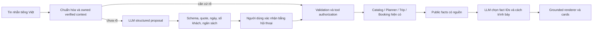

# TRAVELGO — AI AGENT CORE MASTER REPORT

Cập nhật **13/11/2026, Asia/Ho_Chi_Minh**. **TRAVELGO_AI_AGENT_CORE_PARTIAL**.

**21.13 — QWEN V5.1 REAL REASONING: QWEN_V51_REAL_REASONING_BLOCKED.** Resource snapshot17:03:15 ngày13/11/2026: RAM4562MiB <6144MiB, thiếu1582MiB; GPU1%, VRAM free2374MiB. Source/manifest348 hashes khớp; quota model20/20 và Agent liên quan10/20 giữ reserve10; đúng owner/local listener, không client cạnh tranh. Dừng trước API metadata/residency/digest/context runtime. Ollama GET/POST0, warm-load0/1, inference0/3; L1/L2/L3 và Full Browser Qwen E2E NOT RUN. Không suy khả năng Qwen4B từ guard FAIL hoặc offline quality; không LIVE READY.

**V5.1 ADVANCED ADVISORY — mục21.12:** **OFFLINE QUALITY PASS** trong bộ tiêu chí khóa19 hội thoại và11 targeted invariants; compatibility262/264 với N24 và một kỳ vọng URL/UUID trong reply giữ nguyên FAIL. Đã thêm advisory decision có provenance, so sánh có điều kiện, xử lý câu trả lời tiêu chí và composition theo loại câu hỏi. **STAGING ADVISORY PARTIAL:** real readonly HTTP/current-contract và Edge desktop/mobile PASS ở phạm vi catalog/thiếu review/giá; UI compact cuối kiểm bằng replay dữ liệu thật có nhãn, không gọi thêm chat sau reserve10.30/30 bảng staging khớp fingerprint,130 Place/20 Business nguyên vẹn. **QWEN REAL REASONING / FULL BROWSER QWEN E2E: NOT RUN / NOT RUN**; Ollama GET/POST0, không LIVE READY.

**QWEN V5 SEMANTIC ARCHITECTURE OFFLINE FIX — mục21.11: TARGETED PASS / COMPATIBILITY PARTIAL.** Đã siết schema operation/updates/change, kiểm selected referent và ý nghĩa quote, tách goal/evidence/missing/permitted actions/confirmation, giảm fuzzy alias nhiễu và đưa controlled request + verified session + fresh allowed memory + review provenance vào grounded payload. Targeted49/49; compatibility214/215: giữ1 FAIL N24 lịch sử vì kỳ vọng đề xuất đổi khách sạn từ lời chê giá khác contract mới yêu cầu hỏi lại. Backend/frontend typecheck và Vite build PASS. Không đổi historical expected, không model/DB calls, warm-load/inference0; historical Qwen V5 L1 FAIL giữ nguyên. Chưa có Qwen LIVE PASS sau sửa.

**QWEN V5 — lần phê duyệt mới, mục21.10.4–21.10.7: REAL SEMANTIC FAIL, đã chạy Qwen thật.** Preflight13:49:53 ngày13/11/2026 PASS: RAM8371MiB, GPU0%, model đã resident đúng digest/context16384, VRAM free1781MiB đủ reserve512, quota20/20 và đúng owner/local listener. Không cần warm-load. Đã khóa manifest mới; inference L1 thật HTTP200/JSON Schema PASS nhưng Qwen trả chat + thay khách sạn rẻ hơn không có căn cứ, thiếu destination Đà Lạt; production semantic validator chặn `AGENT_UNVERIFIED_TOOL_INPUT`. Dừng ngay sau L1: **1/3 inference,0/1 warm-load,1 native POST,6 GET; L2/L3 NOT RUN**, quota cuối19/20, reserve10 giữ nguyên. Không sửa prompt/source/expected hoặc retry. Browser→Qwen→Tools NOT RUN; không LIVE READY. Lần BLOCKED13:46 và historical FAIL/PASS bên dưới giữ nguyên.

**QWEN V5 REAL SEMANTIC ACCEPTANCE — mục21.10: NOT RUN — BLOCKED_RESOURCES.** Fresh preflight13:46:52 ngày13/11/2026: RAM5558MiB <6144MiB, thiếu586MiB; GPU1%, VRAM free1344MiB. Quota20/20, reserve10 và capacity cho tối đa1 operator +3 inference đạt; source seal/ownership/loopback listener đạt. Dừng trước metadata/tag/digest/resident checks; không suy readiness từ command line. Native GET0/POST0, warm-load0/1, inference0/3; L1/L2/L3 và Browser→Qwen→Tools đều NOT RUN. Không retry, thay source/expected, truy cập DB hoặc bật model website; các PASS code/staging và FAIL model lịch sử giữ nguyên.

**REVIEW INTELLIGENCE + LONG-TERM CUSTOMER MEMORY — mục21.9: CODE/STAGING PASS.** Tái sử dụng Review/Booking provenance/owner/moderation; thêm aspect insights có evidence, queue PostgreSQL cập nhật/idempotent và memory có consent dài hạn riêng. Targeted18/18, compatibility197/197, real HTTP13 groups +4 ownership/retention groups, PostgreSQL consistency/revocation và Edge desktop/mobile PASS; build PASS. Migration14 chỉ áp dụng staging15452. Cohort DEMO đã cleanup,130 Place/20 Business khớp baseline; DB gốc/27 Trip không truy cập. **Phân tích quy tắc có giới hạn, không phải Qwen tự học hoặc REAL MODEL PASS. Native GET/POST0, warm-load0, inference0.** Các verdict lịch sử giữ nguyên.

**SMART TRAVEL CONSULTANT V5 — mục21: CODE/STAGING PASS VỚI GIỚI HẠN DỮ LIỆU.** Trên Agent Core hiện có đã bổ sung tư vấn nhu cầu, tham chiếu danh sách bằng ID server, hỏi giá/so sánh/tìm giá catalog thấp hơn, giữ lựa chọn cho bản dự tính và giải thích có nguồn. Nút Gửi có hướng dẫn consent; browser Edge desktop/mobile, API5057 và PostgreSQL staging thật PASS với Qwen OFF. Targeted21/21, compatibility176/176, HTTP/PG14/14 groups, backend/frontend build PASS.130 Place/20 Business giữ checksum, DB gốc không truy cập; không sửa Planner/Recommendation/Trip/Booking/geography34. **Native GET/POST0, warm-load0, inference0; Qwen LIVE semantic và Browser→Qwen→Tools NOT RUN, cần approval riêng.** Planner vẫn chỉ hỗ trợ nhịp độ cân bằng; không bảo đảm yên tĩnh/khí hậu/chính sách trẻ em khi thiếu nguồn. Không cấp LIVE READY.

**POST-FIX CUSTOMER EXPERIENCE — mục20.10: Browser chat send PASS desktop/mobile; Qwen real semantic NOT RUN — BLOCKED_RESOURCES.** Đã khởi động lại staging5177/5057 với model tắt, DB chỉ đọc, kiểm tra bằng Edge thật: trước consent không gửi; sau đăng nhập/consent/nhập tin hợp lệ gửi POST thật, backend200 và hiện phản hồi cùng nhà hàng staging. Không cần sửa React hoặc bỏ guard. Fresh preflight10:34:02 ngày13/11/2026: RAM2288MiB <6144, VRAM free856MiB không đủ cold-load4865,94+reserve512; GPU5% đạt, quota20/20/reserve10 đạt. **Native GET/POST0, warm-load0, inference0; Full Browser→Qwen→Tools NOT RUN.** Dừng phần LIVE, không lặp preflight hoặc đóng tiến trình khác; lịch sử FAIL và staging130/20 giữ nguyên.

**QWEN V4 SEMANTIC FIX — mục20.9: QWEN_V4_FIX_OFFLINE_PASS.** Đã sửa geographic typo evidence dùng geography hiện có, typed schema/quote validation cho các cập nhật và renderer ghép đủ tên, giá nguồn, lý do, cảnh báo đơn vị/availability. Targeted **40 unit +2 HTTP =42/42**, compatibility **28+42+22+42**, backend/frontend typecheck và Vite build PASS. **Native GET/POST0, warm-load0, inference0, PostgreSQL0** trong task sửa. Ba FAIL LIVE ở20.8 giữ nguyên; chất lượng Qwen sau sửa và full Browser→Qwen→tools vẫn chưa được nghiệm thu. Manifest LIVE mới chỉ là đề xuất, chưa thực thi.

**QWEN V4 REAL MODEL ACCEPTANCE — mục20.8: SEMANTIC FAIL, đã chạy model thật.** Preflight12:35:51 ngày12/11/2026 PASS: RAM6770MiB, GPU5%, VRAM6483MiB, quota20/20, đúng local owner/tag/digest. Warm-load **1/1 PASS**,11,444s; resident đúng context16384. Ba inference thật dùng đủ **3/3**, latency1,923s/1,537s/2,122s: **L1 FAIL, L2 FAIL, L3 FAIL theo expected đã khóa**. L1/L2 sai cấu trúc/nghĩa và bị server chặn; L3 schema/grounding PASS nhưng chỉ liệt kê tên, thiếu cặp tên/giá theo tiêu chí đã khóa. Không đổi prompt/source/expected hoặc retry. Native POST4 gồm1 load+3 inference; website model vẫn tắt, staging130 Place/20 Business giữ checksum. **Không đạt QWEN_V4_SEMANTIC_ACCEPTANCE_PASS; Full Browser Agent E2E chưa chạy.**

**QWEN V4 — fresh acceptance gate,11:40:20 ngày12/11/2026, mục20.7: BLOCKED_RESOURCES.** Theo approval mới tối đa1 warm-load/3 inference, đã dùng lại quota/resource helpers hiện có, không tạo harness. RAM free4208MiB <6144MiB; GPU17% >cold-load guard10%. VRAM free5978MiB đủ reserve bộ nhớ dự kiến; quota20/20, scan105 historical attempts cả `at`/`createdAt`, không future entries. **Warm-load0/1, inference0/3, native GET/POST0, PostgreSQL connections0.** Dừng trước runtime tag/digest/context/readiness, không tạo manifest mới hoặc đọc staging khi resource gate đã FAIL. Chỉ cập nhật Master; Agent LIVE READY chưa được nghiệm thu.

**VIETNAMESE NATURAL AGENT V4 — mục20: CODE/STAGING PASS, QWEN LIVE NOT RUN.** Nâng cấp normalizer, hiểu địa điểm từ geography hiện có, ngân sách có phạm vi, câu hỏi đang chờ, câu nhiều ý và validation đề xuất model. V4 semantic/context42/42, compatibility42+22+28, actual HTTP/PostgreSQL5/5 groups, browser6/6 desktop/mobile và targeted presentation2/2 PASS; build PASS. Preflight Qwen11:14:51 ngày12/11/2026 dừng vì tài nguyên: RAM trống4182MiB dưới guard6144MiB; VRAM4772MiB thấp hơn allocation lịch sử khoảng4866MiB, GPU33%. Quota20/20, listener đúng owner, không client cạnh tranh; **warm-load0/1, inference0/3, native POST0**. Chưa xác minh tag/digest/readiness qua API ở đợt này vì dừng trước metadata GET. Không dùng offline/browser model-off để tính REAL MODEL PASS.

**LOCATION SEARCH + EXPLORE LISTING DISPLAY FIX — mục19: PASS trên staging hiện có.** Combobox dùng chung có34 tỉnh/thành theo mã chính thức, tách địa danh du lịch và nhận khu vực mới từ catalog được duyệt. Explore hiển thị lưới dịch vụ ngay sau bộ lọc; Hotels/Restaurants/Planner/home/Tours/Tickets/Agent dùng cùng mapping. Actual API/PostgreSQL7/7 groups, browser22/22 desktop/mobile và thêm vòng duyệt Bảo Lộc trên browser thật PASS; build PASS.130 Place/20 Business giữ nguyên checksum, DB gốc25/25 unchanged và27 Trip. Không Qwen/Ollama/Maps/paid API hoặc deploy; chưa thay đổi verdict REAL MODEL của các mục trước.

**CATALOG EXPANSION + LIVE PARTNER SYNC — mục18:** staging local độc lập đã có **50 lưu trú +50 nhà hàng +30 điểm tham quan DEMO /10 điểm đến**,20 Business DEMO. Website/Agent dùng catalog mới nhất; real PostgreSQL/HTTP kiểm vòng đời duyệt, đổi giá, khóa Business/Place; Planner10 điểm đến và browser20/20 desktop/mobile PASS. Database gốc **25/25 unchanged, Trip27**. Giao diện DEMO tại **http://127.0.0.1:5177**, API riêng5057, PostgreSQL riêng15452. Không thêm đối tác thật, không model inference mới, không deploy. Các mục1–17 giữ bối cảnh và verdict lịch sử; thiếu sightseeing của baseline gốc không còn là blocker cho **staging DEMO mới**, nhưng real-model acceptance vẫn chưa chạy.

**Đợt nghiệm thu Qwen thật mới — mục17:** owner đã duyệt tối đa3 inference local. Preflight lúc **06:46 ngày12/11/2026** xác minh quota20/20, tag/digest đúng và listener Ollama local, nhưng `/api/ps` trả `models: []`: **BLOCKED_MODEL_NOT_RESIDENT**. Không auto load/reload; **inference0/3, native POST0, load0, PostgreSQL connections0**. Ba tình huống semantic đều NOT RUN, chưa có REAL MODEL PASS/FAIL mới. Website/config mặc định giữ nguyên; approval mới không được dùng để bỏ readiness guard.

**Hội thoại tự nhiên và chat thống nhất:** CUSTOMER `/assistant` hiện dùng một chat có lời chào từ authenticated profile, một ô nhắn và nút gửi; G1/G2/Core controls chuyển sang debug development. Đã thêm NLU tiếng Việt có kiểm chứng, ngữ cảnh đa lượt, xác nhận năm/tuổi trẻ em, structured LLM proposals có trích dẫn nguồn và grounded response composition. Backend/NLU/HTTP **28/28 PASS**, Core42 và v2 **42/42 +22/22 PASS**; browser **28/28 PASS**, kèm targeted check sau sửa lỗi riêng tư. **Qwen hiện chưa bật; native0**, nên chưa nghiệm thu chất lượng hội thoại model LIVE. Chi tiết và acceptance hiện tại ở **mục16**; mục1–15 giữ các kết quả trước đó.

**Final functional closure:** đã thêm intent contract v2 trên chính service/UI Core, bỏ bước LLM chọn lại thao tác rõ ràng, sửa lỗi “Tư vấn” bị hiểu thành nơi xuất phát và sửa hotel output bị frontend từ chối. Core42 nguyên bản vẫn **42/42 PASS**; v2 **20 unit +2 integration PASS**, đề xuất current-contract cho legacy **6/6 PASS**, browser Core hiện tại **20 API-mock +12 real HTTP/Core/Planner với in-memory catalog PASS**. Real catalog mới vẫn `CATALOG_DATA_BLOCKED`; **không inference hoặc DB mutation mới**. P1 raw/Full LIVE chưa đóng. Chi tiết và bảng exit gate hiện tại ở **mục15**.

Các mục1–14 dưới đây giữ kết quả Master M1 trước closure để không sửa historical verdict. [Snapshot báo cáo trước closure](evidence/travelgo-ai-agent-core/closure-20261111/master-report-before.md) khớp report hash trong seal cũ. Evidence mới chỉ bổ sung trong [closure-20261111](evidence/travelgo-ai-agent-core/closure-20261111/); các artifact cũ không bị ghi đè.

Đã hoàn thiện code Core, tích hợp vào `/assistant`, xác minh catalog PostgreSQL READ ONLY, 42/42 unit/mock Core và 94/94 browser cases. Backend/frontend build PASS. **Chưa đạt LIVE acceptance**: raw Qwen chọn sai operation; catalog được phép chưa có sightseeing phù hợp; chưa có isolated staging được duyệt cho mutation; 6 suite Agent lịch sử vẫn FAIL. Không dùng mocks để đóng P1/P2 hoặc tuyên bố full E2E PASS.

Evidence duy nhất của task: [travelgo-ai-agent-core](evidence/travelgo-ai-agent-core/). [Yêu cầu gốc](evidence/travelgo-ai-agent-core/owner-task.txt), [audit trước](evidence/travelgo-ai-agent-core/audit-before.json), [77 báo cáo đã đọc](evidence/travelgo-ai-agent-core/reports-reviewed.json), [audit sau](evidence/travelgo-ai-agent-core/audit-after.json).

## 1. Chức năng đã có và baseline

| Thành phần trước task | Trạng thái khi audit | Xử lý |
|---|---|---|
| Auth/RBAC, Customer `/assistant`, G1/G2, owned verified history | WORKING trong acceptance hiện hành; một số test cũ chưa theo hợp đồng mới | Tái sử dụng, không nới guard |
| Catalog Place/Business, Recommendation, Planner | WORKING services; PARTIAL integration với Agent cho hotel/restaurant | Bổ sung Core adapter |
| Trip Save/Update/Reopen, transaction owner checks | WORKING services; MISSING Agent confirmation | Tái sử dụng service, thêm token xác nhận |
| Booking server pricing, modal/confirmation | WORKING | Tích hợp preview/navigation |
| Hotel/restaurant comparison, structured constraints, selection cards | MISSING/PARTIAL | Hoàn thiện trong AssistantPage |
| P1 natural NLU | BUG/OPEN | Parser có kiểm chứng + raw bounded probe; vẫn OPEN |
| P2 runtime | PARTIAL/OPEN | Deadline/concurrency/abort tests, không tự đóng observation cũ |
| Maps/GPS/Gemini/VPS | Ngoài scope | Giữ các thay đổi trước task, không triển khai thêm |

Không reset/checkout/clean working tree. Không commit/push/deploy. Không thay historical verdict, original benchmark, oracle hoặc fixture IDs. Audit 11.950 file baseline: chỉ 6 existing source integrations thay đổi có chủ đích; 11.530 file docs/evidence baseline giữ nguyên, không mất file. Các source Agent legacy liên quan 6 lỗi regression giữ đúng hash đầu task.

## 2. Chức năng đã sửa

- Đổi phương tiện/ngân sách/thêm ngày giữ các slots SET khác; từ chối phủ định, câu điều kiện, câu ghép không đủ bằng chứng và client history.
- Đổi destination cập nhật khu vực catalog; đổi bộ lọc hủy bản Planner cũ trước khi cho lưu.
- Hard price/amenity/exclusion filters áp dụng vào catalog truyền cho Planner; lựa chọn hết hợp lệ trả lỗi thay vì bỏ qua ràng buộc.
- READ ONLY phát hiện các `Phase35`/`Integration landmark` test records cũ lọt qua bộ lọc marker ban đầu. Đã loại rõ các marker này khỏi cohort mặc định. Không sửa hoặc xóa dữ liệu.
- Yêu cầu thay nhà hàng ban đầu chỉ đổi mandatory ID, nên Planner vẫn có thể đưa nhà hàng cũ vào ngày khác. [Test trước sửa FAIL](evidence/travelgo-ai-agent-core/restaurant-replacement-before.json); sửa tập ứng viên loại ID đã thay, giữ khách sạn. Test mới và toàn bộ Core [40/40 PASS](evidence/travelgo-ai-agent-core/core-final-40.json). Chọn lại ID bằng hành động rõ ràng có thể gỡ loại trừ đó.
- Nạp slots Trip cần đồng ý riêng, xóa bản plan/selection cũ, không đưa notes/profile vào input model.
- Trip update kiểm optimistic snapshot hash ngay trong transaction khóa owner row hiện có; xử lý chỉnh sửa đồng thời bằng 409.
- Snapshot confirmation kiểm cả public listing/location/duration/opening-hours drift; Planner không được bỏ qua hard area filter. Hai guard bổ sung có regression cases41–42.

## 3. Tools đã hoàn thiện

| Capability | Triển khai và giới hạn |
|---|---|
| `search_registered_hotels` | Approved catalog, Business ACTIVE, hard city/price/amenities, soft preferences, tối đa 5 |
| `search_registered_restaurants` | Cùng guard; keyword exclusion có dữ liệu, không suy diễn menu/allergy safety |
| `get_listing_details` | Requery ID, public projection, không owner/email/contact private |
| `compare_travel_options` | 2–5 UUID thật, không candidates/score do LLM dựng |
| `search_places` | Dùng repository và ranking hiện có qua public eligibility projection |
| `plan_trip` | `TourPlannerService` thật, provenance gate độc lập, filtered server catalog |
| `get_trip` | `TripSessionService.getTripById`, owner check, explicit context consent |
| `save_or_update_trip` | Preview trước, POST confirm riêng, one-use ticket, isolated staging guard |
| Booking integration | Hàm giá Booking server, mở Booking modal hiện có; không auto create/payment |

Backend Core ở `/api/agent/core/{privacy,chat,confirm,sessions}`; auth + CUSTOMER + `Cache-Control: no-store`. Client không được gửi SQL, plan thay thế, proof/history, catalog hoặc payload mutation tùy ý. Confirmation chỉ nhận conversation/revision/ticket/hash và `confirmed: true`.

## 4. Mapping hotel/restaurant/Business và dữ liệu thật

Đã đọc models/repositories, 12 migrations và schema PostgreSQL hiện tại. Hotel/restaurant là `places.category`, liên kết `business_id → businesses.id`. Không có bảng riêng rooms, menu, room/table inventory hoặc capacity đáng tin cậy cho Place. Place phải APPROVED; có Business thì Business phải ACTIVE; platform-owned Place không có Business được giữ theo convention cũ. Không có Business hợp lệ thì không mở preview bookable.

Public projection gồm UUID, tên, category, city/province/address, mô tả, ảnh HTTPS/same-origin hợp lệ, amenities, rating/reviewCount có thật, nullable `priceFrom`, nguồn catalog và link dịch vụ. Không biến thiếu giá thành 0. Unit/capacity/availability được đánh dấu chưa xác minh. Yêu cầu availability đã xác minh là hard constraint thì trả no_results.

[Final READ ONLY result](evidence/travelgo-ai-agent-core/final-db-read-result.json): target duy nhất `127.0.0.1:5432/travelgo_ai_m0_test`, sentinel `hugotravel-isolated-test-database-v1`, schema SHA `7805ddb1eb77028bfef96923c8adb8f0224bd54296dac39910546035154c544f`, migration checksum 12/12. Startup/per-connection read-only + SELECT/SHOW fence, 73 queries, 5 cumulative connections, forbidden SQL 0. Role lịch sử là postgres superuser: đây không phải least-privilege public runtime.

[Catalog hợp lệ cuối](evidence/travelgo-ai-agent-core/final-db-catalog.json) chỉ có:

| UUID thật | Dịch vụ | City | price_from |
|---|---|---|---|
| `39a5483f-e3d0-4cf8-a9b9-65e6b0a33593` | HuGo Riverside Hotel | Đà Nẵng | 1.200.000 VND, unit chưa xác minh |
| `b2f9a5cb-5258-421e-8050-1b3d55997fa7` | HuGo Seafood | Đà Nẵng | 350.000 VND, unit chưa xác minh |

[Hai tool search thật](evidence/travelgo-ai-agent-core/final-db-tools.json) trả đúng hai records này, không tạo thêm candidates. Không có eligible sightseeing sau loại test records. Full Planner trên catalog được phép **BLOCKED_NO_ELIGIBLE_SIGHTSEEING**.

Lần đọc đầu chạy production Planner trên một Phase35 landmark trước khi phát hiện marker test bị lọt. Giữ nguyên [output đầu](evidence/travelgo-ai-agent-core/db-real-planner.json) và [đính chính](evidence/travelgo-ai-agent-core/db-initial-finding.json); **không tính lần đó là REAL PLANNER acceptance PASS**.

## 5. Recommendation logic

Tái sử dụng `RecommendationService.recommendPlaces`, trọng số hiện có quality 0,35, preference 0,25, budget 0,25, distance 0,15 và tie-break deterministic hiện có. Không thêm scoring do LLM. City/province match, max catalog price, amenities, exclusions là hard filters trước ranking; preference là soft. Price cap so trực tiếp trường `price_from`, không gọi đó là giá phòng/đêm đã xác nhận. Unknown price không được thỏa price cap.

Reasons chỉ từ area/price/amenity/preference match thực tế. Không fallback sang thành phố khác khi search không có kết quả. Không ép đủ 3–5 candidates nếu catalog chỉ có một. Test kiểm deterministic ordering, budget, amenity và evidence của lời giải thích.

## 6. Planner và cost validation

Thuật toán/ranking/formula Planner giữ nguyên. Chỉ thêm internal optional catalog seam; các caller cũ vẫn load repository như trước. HTTP client không được cung cấp catalog này. Core truyền danh sách server đã lọc, UUID đã revalidate là mandatory selections.

Giữ GROUP_VND_V1: N ngày/N−1 đêm, adult-equivalent có child factor 0,7, lodging tách khỏi hotel activity 0đ, giá từng khoản làm tròn VND, không cắt giá để vừa ngân sách. Một ngày/0 đêm không có lodging charge. Thiếu đơn vị/giá hoặc inventory phải giữ nhãn estimated/unknown và assumptions T11-B. Không công bố total là provider quote, không tính chặng xuất phát/airfare thành chi phí đã xác nhận. ETA vẫn Haversine với transport assumption hiện có.

[Independent oracle v2](evidence/travelgo-ai-agent-core/independent-cost-oracle-v2.json) không import production cost helper: đối chiếu từng activity từ fixed in-memory fixture prices, 2 người lớn, 2 ngày/1 đêm, tổng **2.800.000 VND**, budget **6.400.000 VND**, remaining **3.600.000 VND**. Hotel thiếu giá dùng assumption 400.000 VND/nhóm/đêm, có nhãn. Oracle đầu mới viết thiếu entry hotel unknown-price nên expected thành undefined; giữ [script gốc](evidence/travelgo-ai-agent-core/independent-cost-oracle.cjs) và [failure](evidence/travelgo-ai-agent-core/oracle-initial-failure.json), bản v2 bổ sung mapping thiếu. Không sửa bất kỳ historical independent oracle/expected nào.

## 7. Verified History và P1

Core dùng cohort consent riêng `TRAVELGO_CORE_SLOTS_V1`, metadata `CORE_VERIFIED`, cùng LocalVerifiedHistoryStore lease/ownership/revision/replay/TTL và provenance assessor độc lập. Không nới G1/G2 grammar hoặc tin client history. RAM bounded 128 sessions, plan tối đa 128 KiB, absolute TTL 15 phút, tickets tối đa 5 phút. Không lưu chat/profile/Booking vào session store. Revoke/expiry và stale request làm mất authority.

Parser kiểm toàn mệnh đề cho 7 natural corrections được yêu cầu. Optional LLM chỉ chọn operation; không được sửa args/cost/SQL. Model name phải khớp operation được server xác minh mới dispatch tool. Khi model chưa bật, các thao tác rõ ràng chạy deterministic và response báo `model.invoked: false`, `rawNlu: NOT_EVALUATED`.

**P1 OPEN.** Đã khóa [manifest model](evidence/travelgo-ai-agent-core/model-two-locked-manifest.json) và [hash lock](evidence/travelgo-ai-agent-core/model-two-lock.json), giữ expected `{kind: core, name: plan_trip}` cho câu “Đổi sang xe máy, giữ thông tin còn lại.”. Cùng principal approved SHA `6b982d095bc6bc30c87955cd38c78afa9ef31d3447ef30f62e8684bbe8bce600`; full historical scan cả at/createdAt, initial 20/20, reserve 10. Tổng đúng **1 conditional load-only + 1 inference**, native cap 2, không retry, không V2. Quota cuối **18/20**.

Qwen `qwen3:4b-instruct-2507-q4_K_M`, digest `0edcdef34593eac1aa2be9c7d06c432dcf81945adca5eca2f27662c18f168ba0`; local loopback, stream false, JSON, temperature 0, ctx 16384, predict 2048, inference deadline 15s. Raw quyết định là **`compare_travel_options`**, nên **REAL MODEL RAW FAIL**; không sửa expected/prompt rồi thử tiếp. [Native response](evidence/travelgo-ai-agent-core/model-two-native-response.json), [result](evidence/travelgo-ai-agent-core/model-two-result.json). Inference khoảng 378ms, prompt 218/output 12 tokens, done_reason stop. Đây là raw probe với controlled verified context, không phải browser/DB E2E. Gate mismatch behavior được kiểm riêng bằng unit; raw probe không thực thi tool.

Preflight đầu chỉ GET thấy model chưa resident. Sau đối chiếu approval load-only cũ, preflight load đầu bị harness nhận nhầm own metadata keep-alive sockets là competing clients. Giữ [failure](evidence/travelgo-ai-agent-core/model-one-result.json); sửa phân loại đúng client-side remote11434 và exact current Node PID, unknown PID vẫn STOP. [Đính chính](evidence/travelgo-ai-agent-core/model-preflight-classification-fix.json). Trước sửa có 0 POST; sau sửa vẫn chỉ 1 inference. Không bỏ qua unknown connection hoặc sửa lịch sử PostgreSQL ownership.

## 8. Runtime và P2

Giữ shared Agent limiter 20 turns/principal/hour và provider concurrency 1 giữa các cohort, không tạo thêm allowance Core. Server deadline provider 15s; UI deadline 25s; readonly readiness version/tags/ps xác minh digest/context/residency trước native inference. Không auto load/reload/retry trong provider.

Tests xác minh unavailable/aborted provider tạo 0 POST, mismatch không dispatch tool, timeout kể cả provider bỏ qua abort, slot vẫn occupied đến underlying promise settle, revoke ngăn late result và replay. UI pending latch chống double submit, token/owner fence, trusted bound error metadata mới advance revision; không có metadata an toàn thì yêu cầu end/new session, không retry ngầm.

**P2 vẫn OPEN**: một raw inference trả nhanh không chứng minh runtime ổn định lâu dài, các observation watchdog/free-memory lịch sử không bị đóng. Không thử cold-load/inference lần hai. Không chạy Google/Gemini API.

## 9. Trip và Booking

Trip preview giữ server-owned snapshot + SHA256 payload + exact revision/owner/expiry. Confirmation one-use, consume trước await để ngăn replay; requery catalog price/status, recheck Trip version và lock owner row qua repository hiện có. Không tạo Trip persistence thứ hai. Cập nhật giữ consistency days/dates/budget/metadata/checkins qua prepareTripUpdate hiện có. Stale catalog/Trip trả 409; UI hướng dẫn kiểm My Trips trước khi lập preview mới nếu kết quả ghi chưa chắc chắn.

**Actual Trip mutation BLOCKED/NOT RUN**: chưa có isolated staging được duyệt. `assertPublicStagingWrite` giữ disabled mặc định, reject trước DB query nếu chưa opt-in, không chấp nhận travelgo_dev/travelgo_ai_m0_test hoặc postgres. Tests inject riêng Trip/write-guard doubles; không được coi là DB write PASS. Original 27 Trips chưa bị chỉnh sửa.

Booking preview dùng `calculateBookingPrice` thật. Test 2 adults +1 child, unit 350.000: discount 105.000, total **945.000 VND**. Booking MVP tính theo guest, không tự biến thành room-night pricing. Click mới mở BookingContext/modal hiện có; chưa submit Booking/payment, chưa xác nhận phòng/bàn trống. Header/confirmation bug cũ đã có fix: sau confirmation lấy server unitPrice/quantity/discount/total; trước confirmation ghi ước tính. Không viết lại phần đang đúng.

## 10. Desktop/mobile và cách dùng

Đăng nhập CUSTOMER, vào `/assistant`, chọn **Catalog và Trip · Core**, đọc notice và đồng ý giữ slots tạm. Có chat, bộ lọc city/price/amenities/preferences, hotel/restaurant cards, nullable price, UUID selection, comparison table, existing itinerary/cost card, Trip reopen link, preview/confirm và Booking navigation. Đây là một mode trong AssistantPage hiện có, không thêm chatbot route mới.

Ví dụ input rõ ràng: “Tìm khách sạn ở Đà Nẵng”, “Tìm nhà hàng ở Đà Nẵng ngân sách 400000 VND”; Planner có thể nhập các mệnh đề nơi xuất phát/đích/ngày/số người/ngân sách/phương tiện như G1. Chỉ hỏi required slots chưa SET. Unknown request fail closed, không giả vờ hiểu natural language tùy ý.

Model default tắt theo [env example](../backend/.env.agent-core.example); UI thông báo rõ đang chạy deterministic Core. Production loader là repository thật, không có mock catalog fallback trong LIVE UI. Không bật Qwen mặc định sau raw FAIL. G1/G2 navigation và behavior giữ nguyên.

## 11. Actual tests và acceptance matrix

Full offline regression chạy **một milestone**, [35 commands/suites: 29 PASS, 6 FAIL](evidence/travelgo-ai-agent-core/regression-final/summary.json), gồm backend/frontend build, types, Planner/Trip/Booking/Recommendation/RBAC/telemetry và Agent/frontend units. Sau đó chỉ targeted rerun Core + backend build khi sửa restaurant defect và bổ sung area/location consistency guards; [42/42 PASS](evidence/travelgo-ai-agent-core/core-final-42.json). Không chạy lại full regression để tìm một bộ xanh. Raw model probe diễn ra trước hai guard tool bổ sung cuối, cùng provider/prompt/options; không rerun model hoặc suy diễn full journey trên revision cuối.

Browser [94/94 PASS](evidence/travelgo-ai-agent-core/browser-final-01/results.json): desktop 47 + mobile 47; Core 20, G1/G2 74. Edge + actual React/Auth/Axios/controller, API fixtures được chặn/intercept; đây là **BROWSER MOCK API PASS**, không phải Browser→Ollama→Real Planner→DB LIVE PASS. Artifacts/screenshots ở cùng evidence dir. Network ngoài bị chặn; không Google/Gemini/GPS API.

| Acceptance bắt buộc | Evidence/tier hiện tại |
|---|---|
| 1. Registered hotels | UNIT/MOCK PASS; REAL DATABASE READ PASS, 1 hotel |
| 2. Registered restaurants | UNIT/MOCK PASS; REAL DATABASE READ PASS, 1 restaurant |
| 3. Exclude unapproved/inactive/test | UNIT/MOCK PASS; Phase35 exclusion kiểm qua final real query |
| 4. No hotel | UNIT/MOCK PASS, không region fallback |
| 5. No restaurant | UNIT/MOCK PASS |
| 6. Budget recommendation | UNIT/MOCK PASS; hard cap không dùng unknown price |
| 7. Preference recommendation | UNIT/MOCK PASS, deterministic reasons |
| 8. Compare two hotels | UNIT/MOCK + BROWSER MOCK PASS; real DB chỉ có 1 hotel |
| 9. Full itinerary | Production Planner + in-memory catalog PASS; approved real catalog BLOCKED |
| 10. Budget correction | UNIT/MOCK PASS |
| 11. Natural transport correction | UNIT/MOCK + BROWSER MOCK PASS; REAL MODEL RAW FAIL |
| 12. Keep hotel/change restaurant | UNIT/MOCK PASS, regression case40; BROWSER controls PASS |
| 13. Cheaper hotel/reprice | UNIT/MOCK PASS |
| 14. Save after confirm | UNIT/MOCK + BROWSER MOCK PASS; actual mutation BLOCKED |
| 15. Reopen Trip | UNIT/MOCK PASS, owner service reused; real reopen NOT RUN |
| 16. Foreign Trip denied | UNIT/MOCK/HTTP ownership gate PASS |
| 17. No auto Booking | UNIT/MOCK + BROWSER MOCK PASS |
| 18. Booking server total | Real price function UNIT PASS; actual Booking mutation NOT RUN |
| 19. Provider timeout/error | UNIT/MOCK PASS; real raw response observed, stress NOT RUN |
| 20. Desktop/mobile | BROWSER MOCK API PASS; full LIVE E2E NOT RUN |

Tier tổng: **UNIT PASS**, **MOCK PASS**, **REAL DATABASE READ PASS**, **REAL PLANNER (approved complete catalog) BLOCKED**, **REAL MODEL RAW FAIL**, **REAL BROWSER FULL E2E NOT RUN**. Không đánh đồng production Planner chạy với in-memory rows thành real-data LIVE acceptance.

[Final before fingerprint](evidence/travelgo-ai-agent-core/final-db-fingerprint-before.json) và [after](evidence/travelgo-ai-agent-core/final-db-fingerprint-after.json): **25/25 unchanged; Trip27; writes0; fixtures0**. Không INSERT/DELETE cleanup vì task không tạo fixture. Offline preloads chặn actual PostgreSQL/model/network; auditable process files ở `offline-audit/`.

## 12. Remaining bugs, failures và blockers

1. **P1 raw Core classifier sai operation**, như raw response đã ghi. Không bật model mặc định hoặc tuyên bố FIXED; cần một task bounded follow-up được duyệt, giữ failed case/expected hiện tại.
2. Catalog approved không có sightseeing; không thể hoàn tất full real Planner journey mà không có thêm dữ liệu hợp lệ. Không nhập fixture vào shared DB hoặc thay expected.
3. Chưa có isolated staging/least-privilege principal được duyệt cho actual Trip Save/Update acceptance.
4. **6 legacy suites FAIL**: agentReadinessAbort 32/1 (clarify expected chỉ destination nhưng current completeness còn daily budget); agentG1SafeContract và agentTransport mock transport không mô phỏng readiness GET mới; agentFoundation/agentMissingSlotRecovery còn giả định provider được gọi trước current completeness; agentDecisionFormatSafety còn kỳ vọng error path cũ. Không nới production gates hoặc đổi historical assertions. [Counterfactual diagnosis](evidence/travelgo-ai-agent-core/legacy-regression-diagnosis.json): tất cả 6 tái hiện khi Core route bị bỏ **trong bộ nhớ**, runtime/test hashes liên quan giữ nguyên từ đầu task. Đây không phải full regression GREEN. Một số incompatibilities đã được ghi trong báo cáo G2 lịch sử; giữ nguyên verdict cũ.
5. Chưa có inventory rooms/menu/capacity/price units cho Place; keyword exclusion không xác nhận thực đơn hay allergy safety. Chưa có chứng cứ real Browser→model→catalog→Planner→saved Trip trong cùng journey.

## 13. Files changed và bảo toàn

Existing integrations đổi trong task: `backend/src/routes/agentRoutes.ts`, `backend/src/services/tourPlannerService.ts` (internal catalog seam), `backend/src/services/tripSessionService.ts` (optional optimistic version), `frontend/src/pages/AssistantPage.tsx`, `frontend/src/services/api.ts`. `registeredCatalogService.ts` được tạo ngay đầu task trước baseline snapshot rồi tiếp tục hoàn thiện, là existing-hash delta thứ sáu trong audit.

Core files mới/hoàn thiện: `backend/src/agent/coreInput.ts`, `coreProvider.ts`; `backend/src/services/registeredCatalogService.ts`, `agentCoreService.ts`; `backend/src/routes/agentCoreRoutes.ts`; `backend/src/tests/agentCore.test.ts`; `backend/.env.agent-core.example`; `frontend/src/services/agentCoreClient.ts`; `frontend/src/components/agent/AgentCorePanel.tsx`; `frontend/playwright.agent-core.config.ts`; `frontend/e2e/agent-core.spec.ts`; report này và evidence dir duy nhất.

Không sửa Maps/GPS/Gemini/Public provider/VPS code của task trước, không chạy paid API. Không thay migration/schema/container config, không ghi DB, không thay original27 Trips. Không coi PID9686 đã xác định hoặc hồi tố sửa maintenance/concurrency conclusions. [Final integrity](evidence/travelgo-ai-agent-core/audit-after.json) ghi tất cả intentional deltas và missing/unexpected đều rỗng.

## 14. Next implementation priorities và điểm dừng

Ưu tiên tiếp theo là xử lý raw classifier failure trên đúng bounded case, bảo trì test harness legacy theo current contract trong task riêng có expected mới được review và vẫn giữ historical artifacts, bổ sung catalog sightseeing hợp lệ qua quy trình business có sẵn, rồi cấp isolated staging để nghiệm thu Save/Update thực. Sau đó mới chạy một full real user journey với quota/manifest đã khóa và xác nhận persistence/reopen.

M1 hiện **PARTIAL**, chưa READY. Dừng tại kết quả/báo cáo này. Không chuyển sang M2 Maps/GPS, M3 public provider/VPS; không commit, push hoặc deploy.

## 15. Final functional closure — kết quả hiện tại

### 15.1. Baseline và phạm vi

[Task closure](evidence/travelgo-ai-agent-core/closure-20261111/owner-task.txt), [baseline](evidence/travelgo-ai-agent-core/closure-20261111/baseline.json). Đã xác minh335 sealed artifacts cũ, snapshot12.290 file trước chỉnh sửa, giữ dirty tree. Original Core42 source/assertions, Browser94 evidence, historical raw Qwen FAIL và PostgreSQL fingerprints được bảo toàn. Seal cũ mô tả revision trước closure; không sửa seal để giả vờ nó xác nhận source/report mới.

Không tạo Agent/Trip/Planner/Booking khác. Vẫn cùng routes, consent/owned session/TTL, catalog repositories, Planner, existing Trip/Booking services. Không sửa thuật toán, trọng số recommendation, migration hoặc data để làm PASS.

### 15.2. P1: nguyên nhân và authority của intent

Luồng cũ được truy lại từ [locked request](evidence/travelgo-ai-agent-core/model-two-locked-manifest.json) và [raw response](evidence/travelgo-ai-agent-core/model-two-native-response.json): message → `coreInterpretation` xác định đúng `plan_trip` → merge server-verified slots → provider vẫn được gọi để chọn lại operation → raw chọn `compare_travel_options` → mismatch gate từ chối. Lỗi tích hợp xác nhận được là **LLM có quyền phủ quyết thao tác server đã biết rõ**. Prompt cũ chỉ đưa enum tên operation, không mô tả rõ trách nhiệm edit-versus-compare. Đây là điểm yếu thiết kế prompt; không đủ bằng chứng để khẳng định chính xác cơ chế nội tại làm Qwen chọn sai.

`CORE_INTENT_V2` là version của wire contract trên cùng Core service. Frontend hiện tại luôn gửi version này, gắn cố định suốt owned session; không cho upgrade/downgrade giữa các revision. Client cũ không gửi version vẫn dùng v1 fail-closed để giữ tương thích, được original42 kiểm lại. Version không bỏ qua provenance hoặc tăng quyền mutation.

- **Yêu cầu rõ ràng:** parser xác minh toàn mệnh đề; thao tác được thực hiện deterministic, model không được gọi. Giữ slot không được sửa và vẫn qua required-slot/provenance/catalog/owner guards trước tool.
- **Yêu cầu phức tạp/chưa rõ:** LLM chỉ đề xuất một operation enum. Registry mới mô tả đủ9 operation, phân biệt compare chỉ đọc selected UUIDs với plan/replan thay travel slots. Backend từ chối unknown tool, SQL, extra arguments, array hoặc schema sai; không lấy args/giá/UUID từ model.
- Đề xuất chỉ trả `needs_input` và `requiresExplicitRequest: true`; không query catalog, đổi slots hoặc chạy tool. UI chỉ hiện nút tác vụ có canonical command cố định. Người dùng click mới gửi một request/revision mới được server parse lại; lưu Trip vẫn cần preview và confirmation riêng.

Các family deterministic được kiểm: đổi/chuyển phương tiện xe máy/ô tô; tăng/giảm/đổi ngân sách tuyệt đối và tương đối từ ngân sách đã xác minh; thêm/bớt số ngày với min/max/date checks; thay hotel/restaurant, cheaper hotel, giữ thông tin còn lại. Phủ định/điều kiện không dispatch hoặc gọi model. Mơ hồ không được tự biến thành thay đổi.

Hai lỗi bổ sung đã được chứng minh và sửa:

1. Legacy pending-role reader bỏ dấu “Tư vấn…” thành `tu van...`, rồi đọc như “Từ [nơi xuất phát]”. V2 phân biệt advisory speech với patch travel-role trước khi kế thừa proof reader. [Hai lần unit FAIL ban đầu](evidence/travelgo-ai-agent-core/closure-20261111/unit-01.json) được giữ; [unit cuối](evidence/travelgo-ai-agent-core/closure-20261111/unit-final.json) chứng minh không ghi nhầm departure và không chạy tool từ lời tư vấn.
2. Internal catalog fixture hợp lệ không có boolean `catalogPriceAvailable` làm hotelSuggestion bị frontend contract từ chối. Đã dùng public price projection xác minh để luôn trả boolean và nullable price; unknown giá giữ assumption/label, không đổi phép tính Planner. [Browser lần đầu](evidence/travelgo-ai-agent-core/closure-20261111/browser-01/results.json):22 PASS/10 FAIL; giữ nguyên assertions, sửa adapter rồi [12 affected cases PASS](evidence/travelgo-ai-agent-core/closure-20261111/browser-03/results.json).

**Phân biệt verdict:** functional deterministic corrections PASS ở unit/service/HTTP/browser với test catalog; historical raw LLM semantic **FAIL vẫn giữ nguyên**; raw semantics revision mới **NOT RUN**, full Agent LIVE E2E **BLOCKED/NOT RUN**. Không tuyên bố P1 global FIXED bằng mocks. Task closure yêu cầu fresh owner approval cho E; approval cũ không được dùng để inference lại. Closure thực tế **Ollama GET0/native POST0/load0/retry0**.

### 15.3. Catalog và quy trình bổ sung hợp lệ

[READ ONLY mới](evidence/travelgo-ai-agent-core/closure-20261111/catalog-result.json) xác nhận đúng target/sentinel,12 migration checksums và schema cũ;74 queries,5 cumulative connections, forbidden SQL0. [Raw inventory](evidence/travelgo-ai-agent-core/closure-20261111/catalog-inventory.json):22 Place gồm8 attraction SUSPENDED ở Hội An,8 APPROVED Phase35 test landmarks,4 APPROVED hotels có Business không ACTIVE,1 eligible hotel và1 eligible restaurant tại Đà Nẵng. Không có approved non-test sightseeing tại Đà Nẵng. Nguyên nhân là data/status/cohort, không phải lỗi ranking hoặc city normalization. **CATALOG_DATA_BLOCKED**; không chạy Planner trên Phase35 và không tự tạo điểm tham quan.

[Tools thật](evidence/travelgo-ai-agent-core/closure-20261111/catalog-tools.json) trả hotel/restaurant thật; không bịa candidates. [Before](evidence/travelgo-ai-agent-core/closure-20261111/db-fingerprint-before.json)/[after](evidence/travelgo-ai-agent-core/closure-20261111/db-fingerprint-after.json) khớp nhau và baseline Master: **25/25 unchanged, Trip27, writes0, fixtures0**. Quota scanner cùng principal đọc105 historical attempts, cả at/createdAt, còn18/20 tại lần kiểm; không phát sinh attempt mới.

Quy trình đang có, đã kiểm source:

1. `PartnerApplicationService.decide(APPROVED)` tạo Business, membership/quyền PARTNER; Business model mặc định ACTIVE. Không tự duyệt application trong closure.
2. Partner có quyền `MANAGE_BUSINESS` dùng `POST /api/partner/places`, chọn category `attraction` hoặc `tour`, city/province/coordinates và nội dung có thật. `PlaceService.createForPartner` tạo DRAFT.
3. `POST /api/partner/places/:id/submit` chuyển DRAFT/REJECTED → PENDING; `PATCH /api/admin/places/:id/status` do SUPER_ADMIN chuyển APPROVED trong transaction và ghi AuditLog.
4. Core requery APPROVED + Business ACTIVE + cohort eligibility rồi rank. SUPER_ADMIN cũng có route tạo platform-owned Place hiện có; không cần một import/fixture API mới cho Agent.

Closure chỉ đọc/kiểm source quy trình này. Không tạo application/Business/Place, sửa trạng thái, bỏ test marker hoặc dùng suspended attractions làm data demo. Để nghiệm thu toàn bộ compare/replacement bằng data thật, ngoài sightseeing còn cần ít nhất hai hotel và hai restaurant hợp lệ cùng khu vực; cheaper-hotel case cần giá catalog khác nhau. Có thể dùng dữ liệu business thực qua quy trình trên, hoặc cohort staging riêng được duyệt rõ nguồn/IDs. Không seed shared DB. Room-night/person units và availability/capacity vẫn chưa được schema Place xác minh.

### 15.4. Planner, Trip, Booking và runtime

Planner/recommendation/formulas không đổi. V2 giữ hard area/price/amenity/exclusion filters, mandatory IDs và source snapshots, estimated/unknown labels, day/night/group costs và over-budget warnings. Data tier mỗi evidence được ghi rõ. Không có **REAL DATABASE PLANNER PASS** mới vì sightseeing thiếu.

Trip read/preview/confirm/update/reopen vẫn qua owner service và optimistic version dưới row lock hiện có. Unit/HTTP integration dùng Trip doubles riêng có nhãn; browser qua **real staging guard** xác minh confirmation trả `AGENT_STAGING_WRITE_BLOCKED`, zero query/write shared DB. Booking preview đi actual price function, sau click mở existing modal, không gọi create Booking/payment. Original42 tiếp tục kiểm forged confirmation, replay, stale price/location/version, TTL, owner và P2 deadline/concurrency.

Để chạy mutation LIVE tối thiểu cần owner duyệt **một target staging riêng** khớp `PUBLIC_STAGING_DB_NAME`/ENV DB_NAME, ngoài travelgo_dev/travelgo_ai_m0_test, role khác postgres và không superuser, sentinel riêng dạng `travelgo-public-staging:...`, schema đúng, dữ liệu Customer/Business/Place đủ FK và hai customer identities cho ownership negative. Phải duyệt rõ create/update/read/reopen và cleanup của các Trip mới của cohort; không chạm Trip nền. Guard `PUBLIC_STAGING_WRITES_APPROVED` mặc định false; chỉ khi authorization và identity thực khớp mới bật. Không dùng A/B maintenance handoff, không tạo Docker/staging resources trong task này.

P2 vẫn OPEN ngoài phạm vi offline đã kiểm. API provider deadline15s, UI25s, absolute TTL15m, shared20 turns/hour và concurrency1 giữ nguyên. Model suggestion pending sau revoke không thành authority; untrusted output không tạo tool call. Không suy diễn stable runtime từ một raw response cũ.

### 15.5. Sáu legacy failures — phân loại riêng, không đổi verdict

[Reviewed diagnosis](evidence/travelgo-ai-agent-core/closure-20261111/legacy-diagnosis-reviewed.json) đối chiếu từng source, baseline M1 và [historical execution ngày10/11 trước M1](evidence/t-ai-04-g2-live-multi-turn-validation/final-verified/execution.json). Các test và runtime legacy liên quan không đổi trong closure; không có production bug legacy mới được chứng minh nên không sửa guard cũ.

| Original suite | Phân loại và bằng chứng | Current-contract v2 probe |
|---|---|---|
| agentReadinessAbort | Historical32/1; expected thiếu dailyBudgetPerPerson khi completeness yêu cầu cả destination/budget | Kiểm đủ missing fields trước readiness, provider0 |
| agentG1SafeContract | Raw transport fixture không mô phỏng GET metadata; historical26/26 là **có readiness compatibility shim**, không phải original raw PASS | GET version/tags/ps rồi1 POST, valid pinned envelope |
| agentFoundation | Shared fixture chứa hai intent; current single-intent policy chặn trước tool. Historical17/5 đã có trước M1 | Complete single-intent input, consent/opt-out đúng |
| agentDecisionFormatSafety | Raw fake transport lỗi trước intended malformed-output assertion; historical17/17 có shim. Không quy shim PASS thành raw PASS | Complete current input + GET-aware/token-count-bearing envelope rồi reject malformed decision |
| agentMissingSlotRecovery | Historical13/20; các expected provider-before-completeness không còn đúng với policy hiện tại | Missing transport được hỏi trước model/tool |
| agentTransport | Raw fixture predates readiness; historical readiness-compatible18/1 vẫn còn một incompatibility | Invalid readiness trả503, inference0 |

[Versioned probes6/6 PASS](evidence/travelgo-ai-agent-core/closure-20261111/legacy-v2-contracts-02.json) là đề xuất test hợp đồng hiện tại riêng, **không thay thế hoặc nâng original six FAIL thành GREEN**. Probe đầu5/1 do fake success envelope mới thiếu token counters đã giữ trong evidence; sửa fixture riêng theo runtime envelope contract, không sửa production/old assertions. Không xóa/skip original cases.

### 15.6. Thứ tự kiểm thử và bảng nghiệm thu

A → B → C → D đã chạy. A: [Core42 nguyên bản42/42](evidence/travelgo-ai-agent-core/closure-20261111/core42-final.json), [v2 unit20/20](evidence/travelgo-ai-agent-core/closure-20261111/unit-final.json), legacy v2 probes6/6. B: [integration2/2](evidence/travelgo-ai-agent-core/closure-20261111/integration-final.json). C:20 API-mock Core browser cases PASS trong lần đầu; sau adapter fix12 real HTTP/Core/Planner cases PASS desktop/mobile. Đây là32 current impacted cases, không cộng các lần rerun thành thêm coverage. Browser94 lịch sử giữ nguyên, không tuyên bố đã rerun94 trong closure. D: PostgreSQL READ PASS, Planner data-blocked. E/F **NOT RUN**: thiếu fresh approval/preconditions. Backend build sau sửa PASS; frontend types/bundle [PASS](evidence/travelgo-ai-agent-core/closure-20261111/build-result.json), không đổi frontend sau build. Không rerun full35-suite regression vì lỗi nhỏ.

Trong bảng, “browser offline HTTP” nghĩa là browser thật chạy Core/Planner thật với in-memory catalog, injected model/Trip doubles. Nó không đồng nghĩa với browser dùng real DB/model.

| Feature | Code status | Unit/mock | Real DB | Real model | Real browser | PASS/FAIL/BLOCKED | Exact blocker |
|---|---|---|---|---|---|---|---|
| Deterministic edits, preserve slots | DONE v2 | PASS | Full plan BLOCKED | Không gọi model theo thiết kế | PASS offline HTTP | Functional PASS; LIVE BLOCKED | Sightseeing data + full journey chưa có |
| Complex-language suggestions | DONE, explicit action required | PASS | Không auto query | NOT RUN mới | PASS với model double | PARTIAL | Fresh owner approval E, quota/manifest/native cap; semantic quality chưa đo |
| Historical raw Qwen correction | Evidence immutable | Không dùng mocks để chấm lại | N/A | **FAIL cũ** | Không có full LIVE | FAIL/OPEN | Raw compare khác expected plan; không retry |
| Hotel/restaurant catalog | DONE | PASS | **READ PASS 1+1** | N/A | PASS in-memory cards/Booking | READ PASS | Real DB browser journey chưa chạy; alternatives thật chưa đủ |
| Sightseeing and full Planner | Adapter DONE, algorithm unchanged | PASS in-memory | **CATALOG_DATA_BLOCKED** | NOT RUN | PASS offline HTTP | BLOCKED real acceptance | Eligible sightseeing0; không dùng Phase35/suspended records |
| Hard filters/recommendation/costs | DONE | PASS, original oracle preserved | Source prices read; full plan blocked | Không tính bằng LLM | PASS offline HTTP | PARTIAL | Units/inventory chưa xác minh, thiếu catalog để E2E thật |
| Trip get/save/update/reopen/owner/replay | DONE, existing services | PASS | Mutation NOT RUN | N/A | Preview/staging-block guard PASS | LIVE BLOCKED | Isolated approved staging/role/sentinel/users/cohort absent |
| Booking price preview/navigation | DONE, existing price function/modal | PASS | Catalog read only | Không tự booking | PASS offline HTTP, create0 | Functional PASS | Actual Booking mutation không nằm trong authorization |
| Runtime/abort/concurrency | Guard DONE | PASS targeted + Core42 | No writes | NOT RUN mới | Safe error/no retry PASS | P2 OPEN | Chưa có controlled real-runtime acceptance |
| Legacy contract maintenance | Diagnosis DONE, v2 proposal | New6/6 PASS; old FAIL preserved | N/A | N/A | G1/G2 old evidence preserved | Original suites FAIL | Old assertions/harness need separately reviewed versioned adoption |
| Full Agent production-like E2E | Implementation PARTIAL | Không thay thế LIVE | Catalog/staging blocked | Fresh approval absent | Full LIVE NOT RUN | **BLOCKED** | CATALOG_DATA_BLOCKED + E approval/manifest + F approved staging |

### 15.7. Files, integrity và điểm dừng

Existing source chỉnh trong closure: `backend/src/agent/coreInput.ts`, `backend/src/services/agentCoreService.ts`, `frontend/src/services/agentCoreClient.ts`, `frontend/src/components/agent/AgentCorePanel.tsx`. Files mới: `backend/src/agent/coreIntent.ts`, `backend/src/tests/agentCoreIntentV2.test.ts`, `backend/src/tests/agentLegacyCurrentContractV2.test.ts`, `frontend/e2e/agent-core-intent-v2.spec.ts`, `frontend/playwright.agent-core-closure.config.ts`. Chỉ cập nhật báo cáo Master này; artifact mới nằm trong một functional closure group. Planner/Trip/Booking/catalog repositories, original tests và old evidence không sửa.

**TRAVELGO_AI_AGENT_CORE_PARTIAL.** Phần code độc lập với data/credentials đã được hoàn thiện và kiểm tra targeted. Không ghi DB, không tạo fixture, không inference hoặc paid API mới, không sử dụng rejected maintenance handoff, không Google Maps/GPS/Gemini/VPS, không commit/push/deploy. Dừng trước E/F; không tự chạy LIVE để tìm PASS hoặc tạo chuỗi NEXT TASK.

## 16. Hội thoại tiếng Việt và giao diện thống nhất — 12/11/2026

### 16.1. Trải nghiệm CUSTOMER

[Yêu cầu hiện tại](evidence/travelgo-ai-agent-core/natural-chat-20261112/owner-task.txt), [baseline trước thay đổi](evidence/travelgo-ai-agent-core/natural-chat-20261112/baseline.json), [snapshot Master trước thay đổi](evidence/travelgo-ai-agent-core/natural-chat-20261112/master-report-before.md). Đã kiểm hai seal trước task và bảo toàn artifact cũ. Không reset working tree hoặc đổi verdict raw Qwen lịch sử.

`AssistantPage` vẫn là trang duy nhất. CUSTOMER vào `/assistant` thấy **Trợ lý du lịch TravelGo**, một log hội thoại, một textarea, một nút Gửi và nút Cuộc trò chuyện mới. Card hotel/restaurant, comparison, itinerary/cost, lựa chọn UUID, preview/confirm và Booking vẫn dùng components/services hiện có ngay trong trải nghiệm này. Bộ lọc phụ nằm trong details, không bắt khách điền form hoặc chọn mode kỹ thuật.

Code G1/G2 và Core v2 giữ lại. Chỉ khi **development build**, `VITE_AGENT_DEBUG_CONTROLS=true` và URL có `?debug=legacy` mới hiện controls cũ. Production không mở debug bằng query này. Không thêm chatbot page hoặc endpoint song song, không xóa chức năng cũ. Browser94/closure32 lịch sử giữ nguyên; không dùng chúng để khẳng định default UI mới đã chạy lại các assertion giao diện cũ.

Lời chào được render một lần cho mỗi cuộc trò chuyện từ **AuthContext đã nhận auth/me/login**, không lấy cached display name hoặc nội dung chat. Ví dụ Huy chỉ nằm trong test; tên production không hard-code. Account/profile tên thiếu, email/phone hoặc nội dung không phù hợp có fallback “Xin chào!”. Backend privacy endpoint cũng nhận AuthUser đã xác thực để tạo greeting. Không POST chat, tạo model request hoặc tạo context server chỉ để chào.

“Cuộc trò chuyện mới” abort/fence pending request, revoke owned server context và xóa message/slots UI, draft, filters, selected IDs, Trip ID, pending preview/confirmation. Giữ một greeting cho conversation mới, consent được hỏi lại. Token/account key và current-token fence ngăn response cũ vào phiên/tài khoản mới. Không lưu chat vào localStorage; server tiếp tục chỉ giữ slots, câu hỏi/proposal có cấu trúc và plan trong RAM có TTL.

### 16.2. Luồng NLU, LLM và tool authority

Hợp đồng `NATURAL_CHAT_V3` đi qua chính `AgentCoreService`, cùng ownership/revision/replay/TTL/quota và existing tool gate. Client tự pin version; không đổi version giữa phiên. V1/v2 vẫn tương thích, original tests không sửa expected.



Deterministic normalizer xử lý các biểu đạt rõ, không được gọi đó là toàn bộ trí thông minh của Agent. Với câu ngoài grammar/typo, LLM nhận current message + travel slots đã xác minh, không nhận auth token, account name/email, profile hoặc Trip notes. Output `natural` có operation, typed updates kèm **quote là substring nguyên văn của current message**, optional change frame cho hotel/dining đang chọn. Backend kiểm allowlist/schema, số khách, ngân sách, enum preferences/transport, ngày tồn tại/không quá khứ và giới hạn Planner. Unknown SQL/tool/UUID/profile fields không được nhận.

Proposal chưa được SET hoặc chạy tool. Server diễn đạt rõ cách hiểu, khách trả lời “đúng rồi”/xác nhận ở lượt kế mới áp dụng các giá trị đã kiểm. Tham chiếu “chỗ ở này quá mắc” có thể thành đề xuất đổi **selected hotel** rẻ hơn; sau xác nhận vẫn tìm bằng catalog và UUID server đang giữ, không để model tạo khách sạn. Phủ định/điều kiện không bị hiểu thành xác nhận; đặc biệt đã tách **đúng** và **đừng** dù chúng trùng khi bỏ dấu. Proposal stale/replayed/expired không thành authority. Social/chat act không có thay đổi được trả lời/hỏi tiếp trực tiếp, không bắt xác nhận xã giao vô ích.

Với intent đã rõ, model không được chọn lại hoặc phủ quyết operation. Sau tool execution, khi được cấu hình, LLM có thể chọn và sắp xếp tối đa3 **fact IDs từ kết quả thực** để dựng phần giải thích. Model không được viết giá/availability/Booking claims tùy ý; renderer chỉ dùng facts server cung cấp. Invalid fact IDs hoặc provider failure không thay thế kết quả tool: trả đúng dữ liệu gốc và thông báo phần AI diễn giải chưa sẵn sàng. Đây là cách diễn giải có ràng buộc, **chưa phải bằng chứng rằng model hội thoại tự nhiên tổng quát đã đạt**.

Mỗi lượt không quá một model call: unknown request dừng ở proposal; known request chỉ có thể gọi phần grounded response sau tool. Auto greeting/social greeting không gọi model. Model/options/readiness/deadline/concurrency giữ policy cũ; không retry để tìm PASS. Không đưa `responseSchema` từ client vào provider: schema được chọn nội bộ, body API vẫn allowlist.

### 16.3. Tiếng Việt, thời gian và nhớ ngữ cảnh

| Biểu đạt đã kiểm | Kết quả/guard |
|---|---|
| `hcm đi đà nẵng`, `sg ra dn` | Alias TP. Hồ Chí Minh (proof lưu tên đầy đủ **Thành phố Hồ Chí Minh**) và Đà Nẵng trong ngữ cảnh route rõ |
| `dn` đứng riêng | Không thay mù quáng; chỉ nhận khi đang hỏi destination hoặc cần xác nhận |
| `hcm ... 13/11-15/11 2 lớn 1 bé 12tr` | Giữ departure/destination, adults2, children1, group budget12.000.000; **chưa SET ngày khi thiếu năm** |
| `đúng rồi` sau câu hỏi năm2026 | Chỉ xác nhận năm đã hỏi; sau đó hỏi tuổi trẻ em còn thiếu |
| `2026` sau câu hỏi năm | Xác nhận năm rõ ràng, vẫn kiểm ngày tồn tại/không quá khứ |
| `đi đà nẵng 3n2đ` | Duration3 ngày/2 đêm, không tự bịa ngày bắt đầu; tối đa10 ngày như Planner |
| `2ng lon 1 tre em`, `HCM, 2 lớn 1 bé` | Party và departure bổ sung trong cùng phiên, không hỏi lại destination/budget đã SET |
| `ngan sach 12tr`, `tăng thêm 3tr` | Chuyển VND; tương đối cần ngân sách đã xác minh,12tr→15tr khi cộng3tr |
| `xe máy`, `đổi xe máy`, `thôi đổi ô tô` | Chỉ sửa transportation, giữ các travel slots khác |
| `ks nào rẻ hơn`, `khách sạn kia mắc quá, đổi rẻ hơn` | Dùng selected hotel + giá catalog để chọn alternative hợp lệ |
| `đổi chỗ ăn`, `giữ ks đổi nhà hàng` | Giữ hotel, đổi restaurant và loại ID cũ khỏi replan candidates |
| `tìm quán ăn ngon` | Gọi registered restaurant search; không khẳng định khẩu vị/đánh giá do model bịa |
| `tìm nhà hàng ngon gần ks` | Cần selected hotel có tọa độ server; dùng centerCoords của ranking hiện có và khoảng cách đường chim bay, không GPS/road route |
| `tư vấn giúp tôi`, câu tự do/typo | Structured LLM path nếu được bật; nếu tắt/unavailable thì thông báo đúng, không mock fallback |
| `xin chào`, `hello` | Social reply tự nhiên, có thể nhắc destination đã SET, model0 |

Ngày hiện tại được tính bằng **Intl timezone Asia/Ho_Chi_Minh**, date-only arithmetic dùng UTC để không lệch ngày theo host. “Ngày mai” được tính từ ngày Việt Nam; ngày thiếu năm hỏi xác nhận, ngày năm nay đã qua thì yêu cầu năm rõ thay vì tự chuyển sang năm sau. Ngày vô hiệu, quá khứ, duration/night không khớp bị chặn. Tuổi từng trẻ được hỏi trước khi dùng party cho dự toán/Booking có children; tuổi được kiểm tính nhất quán, **không suy diễn chính sách giá theo tuổi của nhà cung cấp**. MVP vẫn dùng công thức nhóm/guest hiện có với nhãn assumption, không tự có inventory hoặc room-night units.

Giá tối đa listing không bị biến thành group budget: direct hotel/restaurant search giữ maxPriceFrom filter; câu giá mơ hồ như `ks rẻ hơn400k` hỏi lại vai trò số tiền. Typed proposal chỉ thành input khi khách xác nhận. Server summary/output chỉ công bố fields trạng thái SET, không gọi dữ liệu UNPROVEN là verified.

### 16.4. TravelGo data và guard được giữ

Planner/Trip/Booking không viết lại, không đổi recommendation weights hoặc cost oracle. Catalog chỉ bổ sung internal `nearListingId` option: lookup hotel trong eligible server catalog rồi đưa actual coordinates vào existing ranking. Không nhận tọa độ tùy ý từ client, không Google/GPS/Routes hoặc khẳng định “gần nhất”. PriceFrom/rating/amenity/result IDs vẫn từ repository; thiếu sightseeing trả `CATALOG_DATA_BLOCKED`, không fake itinerary.

[Fresh READ ONLY](evidence/travelgo-ai-agent-core/natural-chat-20261112/catalog-result.json), lúc **12/11/2026 01:17 Asia/Ho_Chi_Minh**: target/sentinel/schema/migrations giữ baseline,74 queries/5 cumulative connections/forbidden0,22 Place/14 APPROVED nhưng eligible chỉ **1 hotel +1 restaurant, sightseeing0**. [Before](evidence/travelgo-ai-agent-core/natural-chat-20261112/db-fingerprint-before.json)/[after](evidence/travelgo-ai-agent-core/natural-chat-20261112/db-fingerprint-after.json) khớp Master baseline: **25/25 unchanged, Trip27, writes0, fixtures0**. Full real-data Planner journey vẫn data-blocked. Role READ ONLY cũ là superuser, không dùng nó để tuyên bố least-privilege public runtime.

Save/Update chỉ preview rồi confirm ticket/hash/revision/owner riêng; natural-language “đồng ý” với proposal **không phải Trip mutation confirmation**. UI vẫn bắt xem plan/cost và bấm xác nhận riêng. Existing staging guard chặn trước query khi chưa được duyệt. Booking chỉ price preview/navigation, không auto create hoặc payment. Đổi Trip context xóa natural clarification/age/proposal cũ để không áp dụng nhầm vào Trip mới.

Consent, bounded RAM, absolute15m TTL, replay/stale revision/owner guards, shared20 turns/principal/hour và provider concurrency1 giữ nguyên. Câu chat chỉ ở UI trong phiên, không ghi vào DB hoặc localStorage. Không sử dụng lại rejected A/B maintenance handoff.

### 16.5. Cấu hình model và bằng chứng kiểm thử

[Config inspection](evidence/travelgo-ai-agent-core/natural-chat-20261112/provider-config.json): `AGENT_CORE_LLM_ENABLED`, `LLM_LIVE_ENABLED`, `LLM_USAGE_APPROVED`, `OLLAMA_LOCAL_ONLY_CONFIRMED` hiện đều false, provider unset, **configured=false**. Tag/digest/options Qwen được khóa như trước; không thay model. Không gọi version/tags/ps, load hay inference để kiểm readiness vì chưa có fresh approval. UI báo AI ngôn ngữ chưa bật; không gọi deterministic mode là model LIVE PASS.

**Native GET0/POST0/load0/retry0 trong task này.** Quota scan READ ONLY cùng principal còn20/20, nhưng quota không thay thế fresh owner approval. Historical raw Qwen `compare_travel_options` FAIL giữ nguyên, P1 raw và P2 real runtime vẫn OPEN.

- [Backend/NLU/HTTP28/28 PASS cuối](evidence/travelgo-ai-agent-core/natural-chat-20261112/unit-final-accepted.json):27 targeted behavioral/transport-contract cases và1 actual HTTP auth/greeting case, sau build backend cuối. Production Core/Planner chạy với in-memory catalog, model/Trip doubles. First run21/2 FAIL được [giữ](evidence/travelgo-ai-agent-core/natural-chat-20261112/unit-01.json): async explanation làm try/finally finish lease sớm; đã sửa `return await` để giữ authority đến lúc response hoàn tất. Không sửa expected để lấy PASS.
- Original [Core42/42](evidence/travelgo-ai-agent-core/natural-chat-20261112/core42.json) và [v2 compatibility22/22](evidence/travelgo-ai-agent-core/natural-chat-20261112/v2-compat.json) PASS, old assertions không đổi. Sáu legacy FAIL và versioned probes trước đó bảo toàn, không chạy full regression lặp lại.
- [Browser28/28](evidence/travelgo-ai-agent-core/natural-chat-20261112/browser-01/results.json):14 user journeys × desktop/mobile, actual React/Auth/Axios → HTTP Core → Planner; catalog/model/Trip persistence là doubles. Bao phủ14 tình huống bắt buộc, gồm no-sightseeing và provider unavailable. Không ghi thành Browser→real model→real DB PASS.
- Visual inspection phát hiện thông báo riêng tư giả do request bị StrictMode cleanup abort; đã lọc abort thay vì hiện lỗi, thêm assertion không có alert. [Targeted browser follow-up8/8 PASS](evidence/travelgo-ai-agent-core/natural-chat-20261112/browser-02/results.json) kiểm greeting/privacy, catalog replacement, unavailable provider và structured typo confirmation. Không cộng rerun thành coverage mới hoặc sửa screenshot cũ.
- [Final backend/types/frontend bundle build](evidence/travelgo-ai-agent-core/natural-chat-20261112/final-build-result.json) PASS. Screenshots, request/result traces và offline deny audits ở cùng evidence group; không paid API hay shared-DB fixture.

### 16.6. Acceptance và giới hạn hiện tại

| Capability | Code / offline evidence | Real status | Blocker/giới hạn |
|---|---|---|---|
| Chat greeting | PASS, authenticated-profile origin/fallback, no LLM call | Browser với authenticated test account PASS | Không khẳng định đã login một tài khoản Huy thật trong staging |
| Unified CUSTOMER chat | PASS desktop/mobile, debug view riêng development | Actual browser PASS | G1/G2 old UI assertions chỉ áp dụng debug/historical version |
| Vietnamese shorthand extraction | PASS các family đã kiểm, year/age safeguards | Semantic LLM LIVE NOT RUN | Không bảo đảm mọi lỗi chính tả/viết tắt đều hiểu đúng |
| Multi-turn context | PASS giữ slots/relative edits/confirm/revoke/replay | Browser/HTTP PASS với test data | Model understanding tổng quát chưa đo |
| Real tool implementation | PASS production catalog/Planner/service code | Real DB catalog READ PASS; full Planner BLOCKED | Eligible sightseeing0, alternatives real chưa đủ |
| LLM structured NLU + response composition | Code/validation/grounding + model doubles PASS | **REAL MODEL NATURAL-LANGUAGE NOT RUN** | Provider disabled, fresh approval/readiness/manifest/native cap thiếu |
| Trip save/update/reopen | Preview/owner/version/confirm guards giữ nguyên, offline PASS | Mutation LIVE BLOCKED | Chưa có approved isolated staging và cohort |
| Booking | Existing server pricing + navigation, no auto create | Catalog read only | Units/availability/inventory chưa được xác minh |
| Full Agent E2E | Partial | **NOT RUN/BLOCKED** | Catalog data + model approval + approved staging |

**Không tuyên bố trợ lý hội thoại tự nhiên đã hoàn thiện chỉ vì parser/fixtures PASS.** Đã hoàn thiện phần code có thể triển khai an toàn, nhưng real model natural-language acceptance và full Agent E2E chưa có. Exit vẫn **TRAVELGO_AI_AGENT_CORE_PARTIAL**.

### 16.7. Source và điểm dừng

Existing integrations đổi: `backend/src/agent/provider.ts`, `coreProvider.ts`, `backend/src/services/agentCoreService.ts`, `registeredCatalogService.ts`, `backend/src/routes/agentCoreRoutes.ts`, `frontend/src/pages/AssistantPage.tsx`, `frontend/src/components/agent/AgentCorePanel.tsx`, `frontend/src/services/agentCoreClient.ts`. Helpers/tests mới: `vietnameseConversation.ts`, `naturalGrounding.ts`, `agentNaturalChat.test.ts`, `naturalChatPresentation.ts`, `natural-chat.spec.ts`, `playwright.natural-chat.config.ts`. Không đổi Planner/Trip/Booking implementation, migration/schema hoặc original tests. Chỉ cập nhật báo cáo Master; evidence bổ sung trong [natural-chat-20261112](evidence/travelgo-ai-agent-core/natural-chat-20261112/).

[Acceptance cuối](evidence/travelgo-ai-agent-core/natural-chat-20261112/acceptance-final.json) đối chiếu baseline12.487 files, hai seal lịch sử335 và192 artifacts, snapshot báo cáo trước task, build/tests, offline deny audits và READ ONLY fingerprint. [Seal hiện tại](evidence/travelgo-ai-agent-core/natural-chat-20261112/artifact-checksums.json) khóa SHA256 source, báo cáo và evidence group mới; không thay seal lịch sử. Attachment gửi lại cuối có cùng nội dung yêu cầu đã triển khai.

Dừng sau kết quả/báo cáo này. Không bật model hoặc native probes khi chưa fresh approval, không ghi DB, không tạo fixture, không Google Maps/GPS/VPS/Gemini paid API, không commit/push/deploy. Các điều kiện tối thiểu model/staging ở mục15 vẫn áp dụng; không tự chuyển sang một chuỗi task nghiên cứu.

## 17. Nghiệm thu hội thoại Qwen local thật — preflight ngày12/11/2026

### 17.1. Phạm vi approval và điều kiện dừng

Owner duyệt riêng **tối đa3 inference Qwen local**, chỉ khi preflight an toàn và quota hiện hành cho phép; không retry để tìm PASS, không paid/external provider, không PostgreSQL mutation, không đổi production/default website. Đây là approval mới cho semantic acceptance của mục16; không sửa historical Qwen raw FAIL hoặc tính mock PASS thành LIVE.

Giữ model `qwen3:4b-instruct-2507-q4_K_M`, digest `0edcdef34593eac1aa2be9c7d06c432dcf81945adca5eca2f27662c18f168ba0`, temperature0, num_ctx16384, num_predict2048, inference deadline15s, concurrency1, no retry. Provider hiện có yêu cầu model đã resident đúng digest/context trước POST, không auto load. Không kế thừa load-only approval của task lịch sử sang đợt này. Nếu guard không đạt thì dừng; không cold inference để load ngầm hoặc đổi context/expected.

### 17.2. Preflight thực tế

[Lần kiểm tra đầu](evidence/travelgo-ai-agent-core/qwen-natural-live-20261112/preflight.json) dừng ở thao tác đọc CIM bị Windows sandbox từ chối, chưa có metadata GET hoặc native POST. Đã hoàn tất chính kiểm tra read-only đó bằng quyền OS cần thiết trong [preflight readiness](evidence/travelgo-ai-agent-core/qwen-natural-live-20261112/preflight-readiness.json); đây không phải retry inference hoặc bỏ kiểm tra tiến trình. Không có auto-review rejection. Kết quả lúc **12/11/2026 06:46:30 Asia/Ho_Chi_Minh**:

| Guard | Quan sát thực | Kết quả |
|---|---|---|
| Quota/principal | Cùng approved principal SHA `6b982d095bc6bc30c87955cd38c78afa9ef31d3447ef30f62e8684bbe8bce600`; scan105 historical attempts, cả `at` và `createdAt`, dùng timestamp muộn hơn; recent0, future0 | PASS, còn20/20; giữ conservative reserve10 |
| Website configuration | Bốn flags model vẫn false, provider website configured=false; `.env` chỉ đọc | PASS, chưa bật isolated override hoặc đổi mặc định |
| Local endpoint/process | `127.0.0.1:11434`, listener PID24432 là `ollama.exe`, parent `ollama app.exe`; không listener public hoặc client lạ | PASS tại thời điểm kiểm tra |
| Proxy/redirect | Không proxy env, redirect error, loopback local | PASS trong phạm vi URL/env/process/metadata, không khẳng định OS packet capture |
| Ollama metadata |3 GET version/tags/ps đều HTTP200; version0.40.16 | READ PASS |
| Installed model | Đúng tag/digest đã khóa, không remote model | PASS |
| Resident readiness | `/api/ps` trả **`{"models":[]}`**, không có runner/model resident; context resident chưa thể xác minh | **FAIL GUARD — STOP** |
| Resources | RTX4060, free GPU5895MiB, free RAM2327MiB | Chỉ là số đo; không suy thành load/runtime PASS |

Các socket ESTABLISHED sau metadata đều thuộc đúng Node PID24644 của preflight; không nhầm own keep-alive socket với competing client. Không terminate process, không đổi Ollama service, không gửi load/unload hoặc chat POST. GPU đang sử dụng một phần không được coi là bằng chứng model đang resident.

Nguyên nhân dừng là **MODEL_NOT_RESIDENT_STOP_NO_LOAD_APPROVAL**. Đây là blocker vận hành trước inference, không phải bằng chứng Qwen hiểu sai tiếng Việt hoặc production code mới có bug. Không sửa Planner/Trip/Booking hoặc các chức năng đã PASS.

### 17.3. Kết quả semantic và điểm dừng

| Tình huống được yêu cầu | REAL MODEL status | Input/output/latency/operation/validation |
|---|---|---|
| Yêu cầu viết tắt, thiếu dấu và diễn đạt tự nhiên | **NOT RUN — readiness blocked** | Chưa gửi input; không có raw model output, latency inference hoặc operation để chấm |
| Yêu cầu nhiều nghĩa/cần xác nhận, không bịa dữ liệu | **NOT RUN — readiness blocked** | Không tạo proposal hoặc gọi tool để thay thế model acceptance |
| Hội thoại/diễn giải từ facts đã xác minh | **NOT RUN — readiness blocked** | Không đưa catalog doubles vào để lấy LIVE PASS; không có model prose để đánh giá tính tự nhiên |

**REAL MODEL PASS0, REAL MODEL FAIL0, NOT RUN3; inference0/3; native GET3/POST0; load0/reload0/retry0.** Các GET là kiểm tra metadata, không phải inference. Không khóa expected/manifest cho POST hoặc bắt đầu ba tình huống sau khi readiness đã FAIL. Các số unit/mock/browser PASS ở mục16 giữ nguyên phạm vi; không được dùng để lấp khoảng trống semantic này.

Không truy cập PostgreSQL trong đợt này: connections0, queries0, writes0, fixtures0; không chạy lại fingerprint để tránh tạo thêm DB access không cần thiết. Số25/25 và Trip27 gần nhất vẫn thuộc lần READ ONLY ở mục16, **không ghi thành một phép đo DB mới**. Không bật model trong tiến trình kiểm thử vì preflight chưa đạt, không sửa source/config production, không commit/push/deploy, không Google Maps/Gemini/VPS.

[Acceptance/integrity cuối](evidence/travelgo-ai-agent-core/qwen-natural-live-20261112/acceptance-final.json), [seal evidence mới](evidence/travelgo-ai-agent-core/qwen-natural-live-20261112/artifact-checksums.json), [snapshot Master trước đợt này](evidence/travelgo-ai-agent-core/qwen-natural-live-20261112/master-report-before.md). Các seal335/192/131 artifacts và source đã PASS trước đợt này được kiểm nguyên vẹn. **TRAVELGO_AI_AGENT_CORE_PARTIAL / REAL_MODEL_ACCEPTANCE_BLOCKED**. Dừng tại đây; điều kiện để tiếp tục là readiness đúng digest/context đã duyệt hoặc một approval riêng rõ ràng cho operator load, cùng preflight/quota/manifest mới trước inference. Không tự thực hiện bước đó trong đợt này.

## 18. CATALOG EXPANSION + LIVE PARTNER SYNC — 12/11/2026

### 18.1. Catalog và môi trường đã triển khai

[Yêu cầu](evidence/travelgo-ai-agent-core/catalog-expansion-20261112/owner-task.txt), [snapshot Master trước task](evidence/travelgo-ai-agent-core/catalog-expansion-20261112/master-report-before.md), [baseline source/evidence](evidence/travelgo-ai-agent-core/catalog-expansion-20261112/baseline.json). Task này phê duyệt tạo staging local riêng và dữ liệu DEMO; không dùng lại authorization native Qwen để inference.

| Điểm đến | Lưu trú | Nhà hàng | Tham quan DEMO |
|---|---:|---:|---:|
| Đà Nẵng |5|5|3|
| Đà Lạt |5|5|3|
| Nha Trang |5|5|3|
| Hội An |5|5|3|
| Huế |5|5|3|
| Hà Nội |5|5|3|
| TP. Hồ Chí Minh |5|5|3|
| Phú Quốc |5|5|3|
| Hạ Long |5|5|3|
| Sa Pa |5|5|3|
| **Tổng** |**50**|**50**|**30**|

**130 Place,20 Business,0 đối tác thật mới.** Tên các cơ sở đều bắt đầu DEMO; địa chỉ và tọa độ là kịch bản mô phỏng, không phải vị trí đã xác minh. Không dùng làm chỉ đường; Explore không vẽ các tọa độ DEMO lên bản đồ thật. Giá có mặt là **giả định VND**, không gắn đơn vị phòng/đêm hoặc món/phần đã xác minh;30 Place giữ `price_from=NULL`. Rating130/130 `NULL`, review_count0, giờ hoạt động/inventory chưa biết. Bayesian4.2 chỉ là prior nội bộ khi chưa có review, UI hiển thị “Chưa có đánh giá xác minh”. Ảnh là [SVG minh họa tự tạo](../frontend/public/images/catalog-demo.svg), không ảnh cơ sở thật hoặc ảnh lấy từ Google.

[Dataset](../database/fixtures/catalog-10.cjs) có namespace `travelgo-catalog-10-v1`, UUID xác định và metadata nguồn, phân loại, giả định giá/vị trí, bản quyền ảnh. [Nguồn tham khảo](evidence/travelgo-ai-agent-core/catalog-expansion-20261112/sources.json) gồm trang điểm đến của Vietnam Tourism và [UNESCO Hội An](https://whc.unesco.org/en/list/948/); chỉ dùng làm cảm hứng cho chủ đề tham quan, **không xác minh giá, tọa độ mô phỏng hoặc đối tác**. Không sao chép mô tả/ảnh của nguồn.

[Docker riêng](../docker-compose.catalog-staging.yml): container `travelgo_catalog_staging_20261112_db`, volume mới `travelgo_catalog_staging_20261112_data`, network riêng, image local có sẵn,512MiB RAM limit và128 PID limit. Port chỉ **127.0.0.1:15452**; DB `travelgo_staging_catalog_20261112`, sentinel `travelgo-public-staging:catalog-20261112`, runtime role `catalog_runtime` **NOSUPERUSER/NOCREATEDB/NOCREATEROLE**. Bootstrap admin chỉ dùng trong container mới để tạo extension/role/database. [Bằng chứng cấu hình và tài nguyên](evidence/travelgo-ai-agent-core/catalog-expansion-20261112/docker-isolation.json) không chứa mật khẩu. Không thay Docker volumes/container cũ hoặc cấu hình `.env` mặc định.

Staging dùng13 migrations; chỉ thêm [catalog_metadata và approved_at](../database/migrations/20261112_13_catalog_metadata.sql), không tạo bảng Hotel/Restaurant. Metadata cần để phân biệt DEMO/provenance và loại hình/ẩm thực có cấu trúc; highlights/contact_info không được dùng thay dữ liệu có kiểu. Có [rollback](../database/rollback/20261112_13_catalog_metadata.down.sql), đã chạy thử trong transaction rồi ROLLBACK, dữ liệu còn nguyên. Không apply migration13 vào `travelgo_dev`, `travelgo_ai_m0_test` hoặc DB chứa27 Trip. Model mapping các cột mới chỉ bật khi `CATALOG_METADATA_ENABLED=true`, mặc định tắt để tương thích DB12 migrations cũ.

### 18.2. Seed, cleanup và integrity

[Migrator staging](../backend/scripts/catalog-staging-migrate.cjs), [seed/inspect/cleanup](../backend/scripts/catalog-staging-seed.cjs) đều khóa host/port/name/role, đọc actual sentinel/privileges trước thao tác; có advisory lock và transaction. Collision UUID/slug/cohort khác làm STOP. Seed `ON CONFLICT DO NOTHING`, không ghi đè giá/nội dung đã có.

[Idempotence và cleanup thật](evidence/travelgo-ai-agent-core/catalog-expansion-20261112/cleanup-check.json): seed lại thêm0; cleanup chỉ130 Place và20 Business theo exact ID/cohort; từ chối unknown cohort, Booking/foreign Place references hoặc Trip tồn tại. Đã cleanup/reseed trên staging, giữ nguyên tài khoản CUSTOMER DEMO; cuối cùng **130 Place/20 Business, Trip0, Booking0**. UUID giữ nguyên; seed sau restore thêm0 và fingerprint bằng nhau. Fixture dynamic acceptance có [committed ledger và cleanup riêng](evidence/travelgo-ai-agent-core/catalog-expansion-20261112/committed-ledger-03.json), chỉ xóa IDs do lượt đó tạo; không xóa130 seed listings.

Database gốc được đọc bằng startup/per-connection read-only và SELECT/SHOW fence: [before](evidence/travelgo-ai-agent-core/catalog-expansion-20261112/original-before.json)/[after](evidence/travelgo-ai-agent-core/catalog-expansion-20261112/original-after.json), mỗi lần41 queries, forbidden0. Identity/sentinel/schema và12 migration checksum giữ baseline; **25/25 bảng không đổi, Trip27 →27**. Không INSERT/UPDATE/DELETE vào DB gốc. Các source Planner/Trip/Booking và artifacts lịch sử giữ hash đầu task; audit cuối ở mục18.6.

### 18.3. Search, phân loại và website

Mở rộng **GET `/api/places` hiện có**, không thêm API catalog trùng chức năng. Destination/search kết hợp bằng AND, không để search thay điều kiện city. Public list/details bắt buộc Place APPROVED và Business ACTIVE (hoặc platform-owned không Business); query status không thể vượt public scope. DEMO bị loại khỏi public/default catalog; chỉ bật trong tiến trình staging đúng environment, và mỗi kết nối phải khớp actual DB sentinel/role. Production không bật DEMO.

Bộ lọc backend hỗ trợ category, city, search, khoảng `price_from`, amenities, accommodationType, cuisine, minRating có review, thời điểm duyệt, sorting và pagination. Validation từ chối NaN/negative/range ngược, enum lạ, query shape sai. Giá NULL không thỏa price cap; sorting đặt NULL sau. `relevance` tái sử dụng RecommendationService và trọng số cũ, lọc cứng trước khi xếp hạng; không tính điểm bằng model. Sorting `approvedDesc` chỉ dùng approved_at có thật trong hợp đồng mới, không thay bằng created_at/updated_at.

Giữ layout/card/banner hiện tại, bổ sung bộ lọc thật và trạng thái rỗng/lỗi/phân trang tại **`/explore`, `/hotels`, `/restaurants`**. Hỗ trợ hotel/resort/homestay/villa/apartment/guesthouse và8 loại ẩm thực. Partner form gửi classification có allowlist; không được sửa source/cohort/approvedAt hoặc tự xác nhận giá/availability. Không diễn giải đánh giá khách hàng thành phân hạng sao hoặc suy ra thực đơn/dị ứng.

Cards và chi tiết có tên DEMO, giá chưa xác minh đơn vị, unknown price/rating, link chi tiết và **Tư vấn bằng AI**. Booking CTA của DEMO bị vô hiệu hóa; Agent booking preview đánh dấu không bookable. `/assistant?listing=UUID` vẫn vào chính AssistantPage; không auto chat/mutation, phải consent và bấm xem. UI lấy tên từ GET detail thật, Agent requery ID khi dùng; không nhận candidates hoặc tên/giá từ query URL làm authority. Lời chào, reset/owner/replay/TTL và shared20 turns/hour giữ nguyên.

### 18.4. Agent tự cập nhật và Planner thật

Không danh sách đối tác/UUID trong prompt, không training hoặc restart để nhận listing mới. Mỗi lượt gọi RegisteredCatalogService → RecommendationRepository → PlaceRepository, đọc đủ pagination từ DB. Không cache catalog cần invalidation. Search/details/selection/replan dùng trạng thái hiện tại; snapshot confirmation requery và so source proof.

[Actual PostgreSQL + HTTP acceptance](evidence/travelgo-ai-agent-core/catalog-expansion-20261112/acceptance-03.json), [HTTP traces](evidence/travelgo-ai-agent-core/catalog-expansion-20261112/http-traces-03.json): đăng ký CUSTOMER test → submit partner application → SUPER_ADMIN test duyệt → login lấy PARTNER role mới → tạo Place DRAFT → PENDING → APPROVED. DRAFT/PENDING không xuất hiện; APPROVED/ACTIVE xuất hiện trên website và Agent; approvedAt chỉ ghi khi duyệt. Sửa giá250.000→180.000 đi qua workflow trả nháp/sửa/gửi/duyệt lại hiện có, Agent đọc180.000 ngay. Place SUSPENDED hoặc Business SUSPENDED biến mất ở query mới và detail404. Không auto approve đối tác thật. Business suspend được thao tác ORM trên đúng Business test vì chưa có HTTP endpoint chỉnh Business status; không trình bày bước đó là một endpoint đã triển khai.

Câu “Có khách sạn nào mới đăng ký ở Đà Nẵng không?” trả những bản ghi có thời điểm **được duyệt**, đồng thời cảnh báo không phải thời điểm đăng ký; legacy approvedAt NULL không được gọi là mới. Đổi giá không giả làm đăng ký mới. Không cần sửa prompt hoặc restart API giữa các bước kiểm tra này.

Planner production đã chạy trên PostgreSQL staging cho **10/10 điểm đến**, đúng3 ngày/2 đêm; mọi selected UUID tồn tại tại đúng điểm đến. [Filtered Planner và cheaper replacement](evidence/travelgo-ai-agent-core/catalog-expansion-20261112/filtered-planner.json): hotel dưới800k, restaurant có cuisine local, chỉ dùng catalog hợp lệ; câu “Khách sạn này mắc quá, đổi rẻ hơn” dùng selected hotel và query mới,1.100.000→750.000 giả định. Ví dụ compound Đà Lạt3N2Đ/2 người/hotel800k/đặc sản trả hotel +restaurant, không biến hotel cap thành group budget. Các thông tin còn thiếu về ngày/năm vẫn cần xác nhận, không gọi Planner tự động khi chỉ tìm dịch vụ.

[Freshness guards trên DB thật](evidence/travelgo-ai-agent-core/catalog-expansion-20261112/freshness.json): giá thay sau preview → `AGENT_CATALOG_CHANGED`; Business bị khóa → detail `AGENT_LISTING_NOT_FOUND` và Booking `BUSINESS_NOT_ACTIVE`. Trip confirmation kiểm actual staging sentinel bằng guard hiện có trong tiến trình riêng; SQL fence chặn mọi Trip/Booking write nếu code lọt qua. Kết quả **không có attempt ghi đến fence, Trip0/Booking0**; giá/trạng thái seed được khôi phục. Flag Trip-write tạm chỉ dùng kiểm stale rejection trên staging, được trả false; không nghiệm thu actual Trip/Booking creation, không thay nghiệp vụ hoặc cost oracle.

### 18.5. Kiểm thử và lỗi đã sửa

| Tầng kiểm chứng | Kết quả | Phạm vi |
|---|---|---|
| PostgreSQL + actual HTTP/services |8/8 groups PASS | Identity/counts/FK/idempotence/exclusion/16 API checks/10 Planner/compound/dynamic partner/rollback |
| Freshness before confirm/Booking |4/4 checks PASS | DB thật, production Core/Planner/Booking, không mock persistence để lấy PASS |
| Filtered Planner + selected hotel replacement |PASS | DB staging thật, giả định DEMO được giữ nhãn |
| Vietnamese destination normalization |[10/10 PASS](evidence/travelgo-ai-agent-core/catalog-expansion-20261112/destination-language.json) | Pure NLU, không DB/model;10 điểm đến, date không tự SET |
| Browser desktop/mobile |**20/20 PASS** | [16 Explore/detail/Assistant](evidence/travelgo-ai-agent-core/catalog-expansion-20261112/browser-04/results.json) +[4 Hotels/Restaurants](evidence/travelgo-ai-agent-core/catalog-expansion-20261112/browser-06/results.json); actual React/Auth/HTTP/PostgreSQL, không API/model doubles |
| Original Core/v2/natural compatibility |[42/42](evidence/travelgo-ai-agent-core/catalog-expansion-20261112/core42.json), [22/22](evidence/travelgo-ai-agent-core/catalog-expansion-20261112/v2-compat.json), [28/28](evidence/travelgo-ai-agent-core/catalog-expansion-20261112/natural-destinations-compat.json) PASS | Offline tests với in-memory/model/Trip doubles; không gọi là LIVE model |
| Recommendation regression |PASS2 commands | Existing correctness8 checks +repository pagination; không đổi trọng số/expected |
| Build |[Backend/frontend types/bundle PASS](evidence/travelgo-ai-agent-core/catalog-expansion-20261112/build-result.json) | Backend build lại sau mở rộng normalization10 điểm đến; frontend không đổi sau bundle |
| REAL MODEL natural dialogue |**NOT RUN** | Task này không cấp inference; GET/POST/load/retry0; không dùng3 lượt chưa chạy của task trước |

Giữ failures ban đầu: [HTTP run01](evidence/travelgo-ai-agent-core/catalog-expansion-20261112/acceptance-01.json) phát hiện Sequelize dùng text-path `@>` array sai kiểu cho cuisine; đã sửa JSONB containment tại root. [HTTP run02](evidence/travelgo-ai-agent-core/catalog-expansion-20261112/acceptance-02.json) bị guard per-owner session capacity vì harness mở nhiều cuộc trò chuyện độc lập mà không revoke; sửa lifecycle harness, giữ nguyên capacity/quota. Run03 PASS, không sửa business expected để che lỗi.

Browser run01 dừng sau phát hiện UI crash `rating=NULL`; run02 còn lỗi tương tự trong “dịch vụ tương tự”; đã sửa renderer giữ unknown thay vì bịa rating. Run03 lỗi selector consent của harness không khớp nhãn hiện có; chỉ sửa selector, không đổi consent behavior. Traces/screenshots cũ giữ lại; run04 clean16/16 và run06 clean4/4 cho hai trang dịch vụ. Không cộng rerun thành coverage mới. Visual inspection desktop/mobile và assertion không tràn ngang đã thực hiện; consent notice cũ vẫn được giữ.

### 18.6. Xem kết quả, giới hạn và điểm dừng

Giao diện staging riêng: **http://127.0.0.1:5177/explore?category=hotel&city=Đà%20Nẵng**, các trang `/hotels`, `/restaurants`, `/assistant` cùng API riêng `http://127.0.0.1:5057`. Một CUSTOMER DEMO được giữ để review; thông tin đăng nhập trong `.local/catalog-staging/accounts.json` (ignored, không đưa mật khẩu/JWT vào báo cáo). PID/log của hai tiến trình nền ẩn được giữ trong `.local/catalog-staging/`; launcher [catalog-staging-start.cjs](../backend/scripts/catalog-staging-start.cjs) không tái sử dụng hoặc stop listener không thuộc task. Database DEMO/volume được giữ cho localhost review, không phải deploy.

Các entrypoint cấu hình/migrate/seed/server đều nằm trong `backend/scripts/catalog-staging-*.cjs`; env/credentials chỉ sinh vào `.local/catalog-staging/`. Không sửa `.env` website. Nếu chạy lại từ môi trường mới: generate local config, kiểm collision/tài nguyên, `docker compose --env-file .local/catalog-staging/compose.env -f docker-compose.catalog-staging.yml up -d --pull never`, chạy migrator →seed →account →isolated launcher. Không chạy các entrypoint này với database gốc. Dừng Docker staging bằng đúng compose file/project này; không reset/remove volumes cũ.

**CATALOG_EXPANSION_LOCAL_DEMO_PASS.** Dữ liệu đủ cho so sánh/Planner trong staging; luồng đối tác động và revalidation đã kiểm bằng DB/services/HTTP thật. **Chưa có100 đối tác thật, tariff/coordinates/rating/inventory được nhà cung cấp xác minh, hoặc REAL MODEL natural-language PASS**. Giá và tọa độ mô phỏng chỉ phục vụ QA; chưa nghiệm thu actual Trip/Booking mutations hoặc production readiness. Trạng thái Agent tổng thể vẫn **TRAVELGO_AI_AGENT_CORE_PARTIAL**.

[Acceptance/integrity cuối](evidence/travelgo-ai-agent-core/catalog-expansion-20261112/acceptance-final.json), [seed committed ledger](evidence/travelgo-ai-agent-core/catalog-expansion-20261112/seed-committed.json), [seal SHA256](evidence/travelgo-ai-agent-core/catalog-expansion-20261112/artifact-checksums.json). Chỉ cập nhật Master này, không sửa historical raw Qwen FAIL, oracle hoặc legacy expected. Không model/paid API/Google Maps/GPS/VPS, không commit/push/deploy. Dừng sau kết quả và báo cáo.

## 19. LOCATION SEARCH + EXPLORE LISTING DISPLAY FIX

**LOCATION_SEARCH_EXPLORE_LOCAL_STAGING_PASS — 12/11/2026.** Phạm vi theo [owner task](evidence/travelgo-ai-agent-core/location-search-20261112/owner-task.txt): bộ lọc địa lý dùng chung và hiển thị danh sách dịch vụ. Tiếp tục đúng frontend5177 → API5057 → PostgreSQL staging15452 của mục18. Không tạo lại container/volume/database, không chạy migrate hoặc seed/reseed130 bản ghi. [Snapshot báo cáo trước task](evidence/travelgo-ai-agent-core/location-search-20261112/master-report-before.md) khớp SHA256 của seal mục18; nội dung lịch sử được giữ nguyên.

### 19.1. Danh mục34 tỉnh/thành và địa danh du lịch

Nguồn hành chính: [Quyết định19/2025/QĐ-TTg, bản ký chính thức](https://datafiles.chinhphu.vn/cpp/files/vbpq/2025/7/19ttg.signed.pdf), [bảng34 mã do Cổng Chính phủ công bố](https://baochinhphu.vn/bang-danh-muc-va-ma-so-cua-34-tinh-thanh-moi-3321-don-vi-hanh-chinh-cap-xa-moi-102250704153652947.htm), đối chiếu [danh mục của Cục Thống kê](https://danhmuchanhchinh.nso.gov.vn/TongHop.aspx) ngày12/11/2026. Dùng **mã2 chữ số giữ số0 đầu** làm identity; UI ghi chung “Tỉnh/thành”, không suy luận lại loại đơn vị từ dữ liệu địa chỉ cũ.

| Mã | Tỉnh/thành | Mã | Tỉnh/thành |
|---|---|---|---|
|01|Hà Nội|04|Cao Bằng|
|08|Tuyên Quang|11|Điện Biên|
|12|Lai Châu|14|Sơn La|
|15|Lào Cai|19|Thái Nguyên|
|20|Lạng Sơn|22|Quảng Ninh|
|24|Bắc Ninh|25|Phú Thọ|
|31|Hải Phòng|33|Hưng Yên|
|37|Ninh Bình|38|Thanh Hóa|
|40|Nghệ An|42|Hà Tĩnh|
|44|Quảng Trị|46|Huế|
|48|Đà Nẵng|51|Quảng Ngãi|
|52|Gia Lai|56|Khánh Hòa|
|66|Đắk Lắk|68|Lâm Đồng|
|75|Đồng Nai|79|Hồ Chí Minh|
|80|Tây Ninh|82|Đồng Tháp|
|86|Vĩnh Long|91|An Giang|
|92|Cần Thơ|96|Cà Mau|

[Backend geography](../backend/src/geography/vietnam.ts) là nguồn duy nhất cho ID/name/alias/parent và normalization, version `VN_ADMIN34_2025_CODES_REVIEWED_20261112`. Frontend không có mảng34 tỉnh hoặc bảng mapping riêng. **GET `/api/places/locations`** trả34 tỉnh dù kho dịch vụ rỗng, các địa danh du lịch có kind riêng, selected value và kết quả search; không cache danh mục động.10 địa danh du lịch có sẵn là lựa chọn tiện dụng, không phải giới hạn các tỉnh hoặc listing được tìm kiếm.

`destination:da-lat` thuộc68 Lâm Đồng, `destination:sa-pa` thuộc15 Lào Cai, `destination:phu-quoc` thuộc91 An Giang, `destination:hoi-an` thuộc48 Đà Nẵng. Tên tỉnh trước sáp nhập được dùng làm alias đọc, ví dụ Quảng Nam→48, Kiên Giang→91; **không UPDATE địa chỉ lịch sử**. Chọn mã tỉnh mở rộng theo province/legacy region/các địa danh liên quan; chọn địa danh chỉ khớp city đã chuẩn hóa. Vì thế **Đà Nẵng — địa danh** trả5 hotel hoặc5 restaurant DEMO; **Đà Nẵng — tỉnh/thành48** trả10 mỗi loại, gồm cả Hội An. Đây là hai phạm vi riêng có nhãn rõ ràng, không đổi expected5 của khu vực Đà Nẵng.

Khu vực mới từ Place APPROVED/Business ACTIVE có city và parent xác định được sẽ tự xuất hiện, ID dạng `area:<mã tỉnh>:<slug chuẩn hóa>`. Acceptance dùng **Bảo Lộc/68**, ngoài10 địa danh có sẵn: trước duyệt không có option, sau duyệt có `area:68:bao-loc`; sau khóa Business option biến mất. Không suy đoán parent cho chuỗi địa chỉ không nhận diện được. Static34 tỉnh vẫn luôn tồn tại. Mapping này không phải bộ danh mục đầy đủ mọi xã/phường.

Search xử lý NFD/NFC, đ/Đ, chữ hoa/thường và khoảng trắng thừa. `H`, `Ho`, `Da`, `Ha` lọc theo phần tên chuẩn hóa; alias chỉ khớp có kiểm soát như HCM/SG, DN, ĐL. Query dữ liệu dùng [normalized SQL](../backend/src/geography/query.ts) và cùng keys với Agent; không dựa vào wildcard không dấu trên chuỗi có dấu, không thêm extension hoặc sửa schema. Bộ lọc địa lý được AND với search/category/price/rating/classification; giá NULL không thỏa price cap; không tự chuyển sang nơi khác khi rỗng.

### 19.2. Component/API đã sửa và nguyên nhân Explore khó thấy danh sách

[LocationCombobox](../frontend/src/components/common/LocationCombobox.tsx) dùng chung cho Explore, Hotels, Restaurants, home search, Planner departure/destination, Tours, Tickets from/to và **Khu vực Agent**. Click mở ô tìm kiếm; chọn bằng chuột hoặc Arrow/Home/End/Enter, Escape/Tab đóng, nút xóa từ khóa và danh sách cuộn riêng trong popup. Popup portal tránh bị cắt bởi container, giới hạn theo viewport mobile. Các trang dịch vụ dùng [CatalogPageFilters](../frontend/src/components/explore/CatalogPageFilters.tsx), truyền geographic ID về backend và reset pagination khi đổi điều kiện.

API thay đổi nằm ở [placeRoutes](../backend/src/routes/placeRoutes.ts), [catalogQuery](../backend/src/services/catalogQuery.ts), PlaceController/PlaceRepository/PlaceService; thêm readonly geography projection, không ghi lại city/province gốc. TourRepository/TicketRepository dùng cùng mapping cho filter; TourPlannerService chỉ sửa đối chiếu địa lý và tên hiển thị từ ID. **Không đổi thuật toán lập lịch, cost oracle hoặc weights RecommendationService**, không sửa Trip/Booking. [AgentCoreService](../backend/src/services/agentCoreService.ts), catalogLanguage và RegisteredCatalogService sử dụng cùng locationId; mỗi lượt đọc lại catalog eligible, giữ nguyên APPROVED/ACTIVE, DEMO isolation, consent, owner/replay/TTL và quota20 turns/hour.

Ảnh [Explore trước sửa, desktop](evidence/travelgo-ai-agent-core/location-search-20261112/before-desktop-explore.png) và [mobile](evidence/travelgo-ai-agent-core/location-search-20261112/before-mobile-explore.png) cho thấy **dữ liệu đã về**, nhưng layout cũ đặt filter và danh sách vào cột hẹp, còn panel “Khám phá catalog DEMO” chiếm phần nội dung lớn. Hai vùng filter dài đẩy card xuống dưới viewport; sidebar lại có max-height/scroll riêng. Không phải DB thiếu50 hotel, API/auth/Axios làm mất toàn bộ kết quả hoặc panel giới thiệu chính là listing.

[ExplorePage](../frontend/src/pages/ExplorePage.tsx) nay hiển thị tab loại dịch vụ → bộ lọc gọn → tổng số thật → lưới card toàn vùng nội dung. Thông báo DEMO thu nhỏ thành dòng chữ; bộ lọc nâng cao và sở thích/ngân sách one-shot vào vùng mở rộng, vẫn dùng ranking cũ, không ghi profile. [PlaceSidebar grid](../frontend/src/components/explore/PlaceSidebar.tsx) có1/2/3 cột theo viewport, không nested scroll của danh sách. Card có ảnh, tên, địa danh/tỉnh, loại lưu trú/ẩm thực, giá VND và cảnh báo đơn vị chưa xác minh, rating unknown đúng dữ liệu, Chi tiết và Tư vấn bằng AI. Phân trang nằm dưới danh sách; “Tất cả” trả50 hotel với20 card/trang và3 trang, toàn catalog130 bản ghi.

Hotels/Restaurants giữ card riêng nhưng dùng cùng combobox, điều kiện lọc, loading/empty/error/retry/total/pagination. Empty đúng loại “Chưa có khách sạn/nhà hàng tại địa điểm này”; không ẩn Hà Tĩnh42 chỉ vì chưa có dịch vụ. Browser kiểm cả vị trí và toàn bộ tiêu đề card đầu trong viewport ban đầu, không chỉ kiểm tồn tại trong DOM; desktop/mobile không tràn ngang.

| Đối chiếu ảnh thật | Desktop | Mobile |
|---|---|---|
|Explore trước sửa|[Before](evidence/travelgo-ai-agent-core/location-search-20261112/before-desktop-explore.png)|[Before](evidence/travelgo-ai-agent-core/location-search-20261112/before-mobile-explore.png)|
|Explore sau sửa|[Full page](evidence/travelgo-ai-agent-core/location-search-20261112/browser-05/desktop-G07.png)|[Full page](evidence/travelgo-ai-agent-core/location-search-20261112/browser-05/mobile-G07.png)|
|Card thực trong viewport|[Viewport](evidence/travelgo-ai-agent-core/location-search-20261112/browser-05/desktop-G07-viewport.png)|[Viewport](evidence/travelgo-ai-agent-core/location-search-20261112/browser-05/mobile-G07-viewport.png)|
|Province48 gồm Đà Nẵng và Hội An|[Restaurant10](evidence/travelgo-ai-agent-core/location-search-20261112/browser-05/desktop-G03.png)|[Restaurant10](evidence/travelgo-ai-agent-core/location-search-20261112/browser-05/mobile-G03.png)|

### 19.3. Kiểm thử thực và regression

| Tầng | Kết quả | Bằng chứng/phạm vi |
|---|---|---|
|Actual API5057 + PostgreSQL staging|**7/7 groups PASS**|[Acceptance04](evidence/travelgo-ai-agent-core/location-search-20261112/acceptance-04.json), [traces](evidence/travelgo-ai-agent-core/location-search-20261112/http-traces-04.json):34 codes, aliases, province/area, empty/all/paging, combined filters/invalid IDs, Agent parity, Planner, dynamic approval|
|Browser Edge desktop/mobile|**22/22 PASS**, retry0/flaky0/skipped0|[Browser05](evidence/travelgo-ai-agent-core/location-search-20261112/browser-05/results.json), [test source](../frontend/e2e/location-search.spec.ts):11 cases×2 viewports; actual React/Auth/API/DB, no successful response doubles|
|New partner/new area on real browser|**PASS**, thêm1 lifecycle scenario, không cộng vào22|[Bảo Lộc sau duyệt](evidence/travelgo-ai-agent-core/location-search-20261112/new-approved-area-04.png): newly-approved option/card và Agent hiện ngay, không reload/restart server giữa các bước|
|Core/v2/natural compatibility|**42/42 +22/22 +28/28 PASS**|[Core](evidence/travelgo-ai-agent-core/location-search-20261112/core42.json), [v2](evidence/travelgo-ai-agent-core/location-search-20261112/v2-compat.json), [natural](evidence/travelgo-ai-agent-core/location-search-20261112/natural-compat.json): offline in-memory/model/Trip doubles, không tính REAL MODEL PASS|
|Planner/recommendation regression|**50 +9 +8 checks PASS**|[Planner validation/costs](evidence/travelgo-ai-agent-core/location-search-20261112/planner-validation.log), [mandatory places](evidence/travelgo-ai-agent-core/location-search-20261112/planner-mandatory.log), [recommendation correctness](evidence/travelgo-ai-agent-core/location-search-20261112/recommendation-correctness.log); offline SQL/network fence, không thay expected|
|Backend/frontend types/bundle|**3/3 PASS**|[Build final](evidence/travelgo-ai-agent-core/location-search-20261112/build-result.json)|
|REAL MODEL natural conversation|**NOT RUN**|Ollama/Qwen/Gemini/native GET/POST/load/inference0 trong task này; không đổi verdict mục17|

Browser G10 chủ động **abort request mạng**, xác minh error/retry rồi cho request đi tiếp tới API/DB thật; không dùng mocked successful response để lấy PASS. Những case còn lại đều dùng actual HTTP. Browser G11 gửi tỉnh68→Agent5 kết quả, tỉnh42→no_results và0 items, `model.invoked=false`. Direct Planner mã01→68 trả Hà Nội→Lâm Đồng,3 ngày/2 đêm, selected IDs thuộc đúng vùng; dùng Planner/cost code thật với dữ liệu DEMO giả định.

Luồng partner: đăng ký3 tài khoản task → SUPER_ADMIN test duyệt application → PARTNER tạo listing Đà Lạt NFD/uppercase/double-space và listing Bảo Lộc với province68. DRAFT/PENDING ẩn; APPROVED/ACTIVE hiện trong website và Agent. Chọn tỉnh68 thấy cả hai; chọn Đà Lạt chỉ thấy listing Đà Lạt; chọn Bảo Lộc chỉ thấy listing Bảo Lộc. Khóa đúng Business test bằng ORM (chưa có HTTP endpoint Business status) làm cả hai biến mất. [Committed ledger04](evidence/travelgo-ai-agent-core/location-search-20261112/committed-ledger-04.json) ghi exact IDs và cleanup PASS. Không tự duyệt đối tác thật; không hard-code UUID vào ứng dụng hoặc prompt.

Giữ lại các lần phát hiện lỗi, không đổi expected để PASS: [API01](evidence/travelgo-ai-agent-core/location-search-20261112/acceptance-01.json) lộ Sequelize escape `\s` thành regex không đúng khiến Sa Pa không khớp; [SQL diagnosis](evidence/travelgo-ai-agent-core/location-search-20261112/sql-normalization-diagnosis.json) xác nhận, đã sửa POSIX whitespace. API02 đạt7/7 cho baseline. [API03](evidence/travelgo-ai-agent-core/location-search-20261112/acceptance-03.json) bổ sung Bảo Lộc và phát hiện nhánh parent-code query chưa nhận province68; sửa mapping, API04 PASS. Tất cả lượt đều cleanup đúng fixture task. Browser01 lỗi selector option của harness lẫn native select, đã scope custom option; Browser02 đạt18/18 ban đầu. Browser03 tăng coverage và kiểm viewport chặt hơn phát hiện mobile card còn thấp; sửa header/tab/advanced-filter layout, Browser04 và Browser05 đạt22/22. Không cộng rerun thành coverage mới; artifacts FAIL vẫn giữ nguyên.

### 19.4. Integrity, giới hạn và điểm dừng

[Staging before](evidence/travelgo-ai-agent-core/location-search-20261112/staging-before.json)/[after](evidence/travelgo-ai-agent-core/location-search-20261112/staging-after.json): **130 Place và20 Business**, toàn bộ row hashes giống nhau. Place checksum `e5f7779de16530dec6455ccdf5101174595b06a9f8ca56c5f9f7196bb034dc08`; Business checksum `7083e8b01b05e03ba9739c33cabb8c974f26956b77eeea69e5384b5737568640`. Không cập nhật hàng loạt địa chỉ, sửa seed, migration hoặc tạo lại staging. Các tài khoản/listing/Business acceptance chỉ là fixture task và đã cleanup, giữ CUSTOMER DEMO để review như mục18.

Database gốc [before](evidence/travelgo-ai-agent-core/location-search-20261112/original-before.json)/[after](evidence/travelgo-ai-agent-core/location-search-20261112/original-after.json): identity/sentinel/schema/migrations đúng baseline; **25/25 bảng unchanged, Trip27→27**. Mỗi lần41 SELECT/SHOW được kiểm read-only, forbidden0; writes0. Không dùng database gốc cho API/browser của task này.

Mở **http://127.0.0.1:5177/explore?category=hotel&locationId=destination%3Ada-nang**, `/hotels`, `/restaurants` hoặc `/assistant` để review staging. API5057/DB15452 vẫn tách khỏi website mặc định. Chỉ reload PID API staging đã đối chiếu command line/ownership trong local running ledger; không stop tiến trình không thuộc task. `.env` website và production defaults giữ hash cũ. Không model/Google Maps/paid API/VPS, không commit/push/deploy.

Không còn lỗi tái hiện trong phạm vi34 tỉnh, combobox, filter và Explore đã kiểm. **Catalog vẫn là DEMO10 điểm đến, không phải dịch vụ thật phủ34 tỉnh**; tỉnh chưa có dữ liệu hiển thị rỗng. Vị trí/giá/đơn vị/rating/inventory chưa xác minh giữ nguyên nhãn và booking guard. Khu vực mới cần province có thể mapping, không tự đoán từ địa chỉ bất kỳ. Chưa nghiệm thu mọi xã/phường hoặc chất lượng hội thoại model thật; Agent tổng thể vẫn **TRAVELGO_AI_AGENT_CORE_PARTIAL**.

[Acceptance/integrity cuối](evidence/travelgo-ai-agent-core/location-search-20261112/acceptance-final.json) và [SHA256 seal](evidence/travelgo-ai-agent-core/location-search-20261112/artifact-checksums.json) bảo vệ source/evidence task, snapshot báo cáo trước và5 nhóm artifacts lịch sử. Dừng sau kết quả và báo cáo.

## 20. VIETNAMESE NATURAL AGENT V4

**V4_CODE_AND_STAGING_PASS_LIVE_BLOCKED_RESOURCES.** Phạm vi theo [owner task](evidence/travelgo-ai-agent-core/natural-v4-20261112/owner-task.txt), tiếp tục chính Agent Core/NATURAL_CHAT_V3 và staging5177→5057→15452. Không tạo hợp đồng chat song song, mapping34 tỉnh mới hoặc catalog mới. [Snapshot Master trước task](evidence/travelgo-ai-agent-core/natural-v4-20261112/master-report-before.md) giữ nguyên toàn bộ mục1–19 và các verdict model lịch sử.

### 20.1. Lỗi hiểu tiếng Việt và ngữ cảnh đã sửa

[VietnameseNormalizer](../backend/src/agent/vietnameseNormalizer.ts) tách raw message khỏi dạng chuẩn hóa, giữ nguyên raw để kiểm quote của model; không lưu raw vào RAM hội thoại. Chuẩn hóa dấu/chữ hoa/khoảng trắng, từ viết tắt thông dụng và từ ghép rõ; sửa một ký tự thừa khi chỉ có một cách khớp trong từ vựng nghiệp vụ. Không fuzzy-rewrite số, ngày hoặc tự sửa địa danh mơ hồ. Cách viết mới ngoài grammar đi tới nhánh LLM proposal khi provider được cấu hình, thay vì thêm câu test nguyên văn vào parser.

Geographic spans lấy trực tiếp tên/alias từ **geography hiện có**. Vai trò nơi đi/đến dựa trên từ chỉ quan hệ và câu hỏi đang chờ; hỗ trợ sg/hcm/tphcm, dn/dl/hn/pq/nt khi có ngữ cảnh. Initialism bổ sung được suy ra từ tên địa danh trong cùng nguồn, không có bảng tên→ID thứ hai. Viết tắt đứng riêng chưa có ngữ cảnh không tự thành điểm đến. Địa điểm ngoài10 DEMO như **Hà Tĩnh42** được hiểu, nhưng dịch vụ trả rỗng đúng dữ liệu. Source geography,34 IDs/component bộ lọc không đổi hash trong task này.

[VietnameseConversation](../backend/src/agent/vietnameseConversation.ts) sử dụng typed money mentions với amount/role/scope, không đồng nhất giá listing và ngân sách chuyến đi. `5tr`, `5000k`, `2tr5`, `2.5tr`, `2,5 triệu` có cùng nghĩa số tiền tương ứng; “thêm2 củ”, “giảm500k” chỉ tính trên ngân sách nhóm đã xác minh. `ks dưới800k` là giới hạn nơi ở; `500k/người/ngày` hỏi lại ngân sách cả nhóm/toàn chuyến, giữ ngân sách cũ. Hai giới hạn riêng cho hotel/restaurant chưa được tự gộp thành một price cap; Agent hỏi chọn dịch vụ cần tìm trước.

Sửa lỗi câu nhiều ý trả catalog quá sớm và làm mất party/budget/trip updates. Câu có yêu cầu chuyến đi/thời lượng và điều kiện nơi ở/chỗ ăn nay giữ các thông tin rõ, hỏi phần còn bắt buộc rồi dùng Planner với constraints. `2ng`, `2 ng`, `2 lớn`, `2ng lớn1 bé` được tách; “gia đình4 người” hỏi thành phần người lớn/trẻ em, không mặc định cả4 là người lớn. Tổng thành phần mâu thuẫn không ghi đè số khách đã xác minh.

Thời lượng3n2d/3n2đ/3 ngày2 đêm, thêm/rút ngày giữ được trước khi biết ngày cụ thể. “Mai”, “ngày kia” dùng ngày hiện tại Asia/Ho_Chi_Minh; ngày thiếu năm vẫn yêu cầu xác nhận. “Cuối tuần này” đưa ra ngày cụ thể để **xác nhận trước khi SET**, “tuần sau” hỏi ngày khởi hành, `t7` hỏi nghĩa. Ngày quá khứ/không tồn tại và duration ngoài giới hạn Planner bị từ chối; không sửa Planner để nhận dữ liệu sai.

Ngữ cảnh giữ verified travel fields, duration/child ages, câu hỏi đang chờ và loại tìm kiếm catalog gần nhất; không giữ transcript ở backend. Nhánh LLM trước đây nhận `awaiting` đã bị xóa ở đầu lượt; nay nhận đúng câu hỏi trước lượt hiện tại, cùng các trường đã xác minh và trạng thái lựa chọn có giới hạn. “Cho mình vài lựa chọn” có thể tiếp nối loại tìm kiếm gần nhất; không tự sinh UUID tham chiếu. Phiên mới/revoke không dùng lại câu hỏi hoặc câu trả lời số từ phiên cũ. Phủ định/đổi ý/điều kiện được phân biệt với xác nhận; yêu cầu bỏ nơi đã nói chưa tự xóa hoặc thay bằng một nơi đoán được.

Sửa xung đột khi locationId cũ có thể che bộ lọc city gửi rõ ở lượt sau. Bộ lọc hiện tại được tôn trọng; destination mới xóa lựa chọn hotel/restaurant cũ theo cơ chế sẵn có. Không đổi quota20/hour, ownership/replay/TTL, Trip confirmation hoặc quyền truy cập.

### 20.2. LLM proposal, grounded response và giao diện

[AgentCoreService](../backend/src/services/agentCoreService.ts) giữ cùng hợp đồng **NATURAL_CHAT_V3**, explicit intent đi qua server validation; model không được chọn lại để veto thao tác đã xác minh. Prompt cho câu chưa rõ có verified context, geographic catalog dùng chung, phân biệt ngân sách, tham chiếu, câu mơ hồ và các operation hiện có. Mọi LLM update cần quote nguyên văn tin nhắn hiện tại. Ngoài kiểm schema/type/range, ngân sách đề xuất phải khớp số tiền/phép cộng trừ có căn cứ; ngày phải khớp ngày và năm được trích; không được dùng quote bất kỳ để bịa số tiền hoặc ngày. Proposal còn cần xác nhận trong lượt riêng trước khi dùng; confirmation không thay thế Trip/Booking authorization.

Qwen vẫn đi qua **CoreOllamaProvider** đã khóa tag/digest, context16384, temperature0, num_predict2048, readiness và timeout15s; source provider không đổi. Nhánh diễn giải chỉ chọn/order fact IDs từ kết quả công cụ và render facts đã xác minh, không nhận prose chứa listing/giá/availability mới làm authority. Điều này bảo vệ grounding nhưng **chưa chứng minh khả năng viết hội thoại tự do của Qwen**. Không output model thực nào được tạo trong task này vì preflight dừng; không lấy model doubles làm bằng chứng LIVE.

Lời chào vẫn lấy authenticated profile. Reply xác nhận các thông tin đã nhận và chỉ hỏi một điều cần thiết ở lượt hiện tại, không hỏi lại destination/party đã biết, không lặp lời chào ở mỗi tin nhắn. [AgentCorePanel](../frontend/src/components/agent/AgentCorePanel.tsx) bỏ từ “slots” khỏi phần thông tin chuyến đi cho khách. [AgentResultCard](../frontend/src/components/agent/AgentResultCard.tsx) có customer presentation cho cost basis/priceFrom/activity/T11-B và mô tả khoảng cách; **mọi số tiền, giả định và cảnh báo chưa xác minh được giữ nguyên**, debug renderer vẫn giữ nhãn cũ. Không sửa công thức hoặc output Planner. Reply rõ hiện vẫn dùng câu xác nhận có cấu trúc; chưa khẳng định đạt mức linh hoạt của nhân viên tư vấn thật với cách diễn đạt bất kỳ.

### 20.3. Hội thoại thực qua API và PostgreSQL staging

[HTTP final](evidence/travelgo-ai-agent-core/natural-v4-20261112/http-final.json), [raw HTTP traces](evidence/travelgo-ai-agent-core/natural-v4-20261112/http-traces-final.json) dùng API5057 và các services/catalog PostgreSQL thật.16 lượt chat trong một run dưới cap20, provider tắt; JWT CUSTOMER/role fixture chỉ trong harness staging, không tạo tài khoản/bản ghi DB. Browser dùng login CUSTOMER DEMO thật như mục18, không dùng fixture JWT của HTTP harness.

| Input thực, cùng conversation | Nghĩa đã xác minh/kết quả |
|---|---|
|`t muon di dl 3n2d`|Đà Lạt,3 ngày2 đêm; hỏi nơi xuất phát, chưa gọi Planner|
|`2ng 5tr`|2 người lớn, ngân sách cả nhóm5.000.000 VND; giữ Đà Lạt/thời lượng|
|`tu sg`|Nơi đi Thành phố Hồ Chí Minh; giữ party/budget/destination|
|`xe may nha` → `thoi doi oto`|Chỉ đổi phương tiện motorbike→car, các thông tin còn lại giữ nguyên|
|`them 2 cu`|Từ5.000.000→7.000.000 VND bằng ngân sách đã xác minh, hỏi ngày còn thiếu|
|`20/12/2026`|Planner thật trả20–22/12/2026,3 ngày2 đêm, selected IDs đều thuộc catalog Đà Lạt; dự toán DEMO cả nhóm3.760.000 VND, không lưu Trip/Booking|
|`di da lat 3n2d 2ng 7tr, ks duoi 800k, an dac san`|Giữ7 triệu ngân sách nhóm,800k hotel cap và local cuisine; hỏi nơi đi trước. Sau bổ sung nơi đi/ngày/ô tô, Planner dùng đúng hotel≤800k và restaurant có classification local|
|`tim khachh san o da lat re re xiu`|Search hotel, sort giá thấp trước;5 listing thật từ staging, không tự đặt một giá tối đa|
|`tim khach san o ha tinh`|locationId42; no_results,0 items, không bịa dịch vụ|
|`500k/nguoi/ngay` sau ngân sách nhóm5tr|Hỏi phạm vi/ngân sách nhóm, giữ nguyên5tr|

Những số tiền trên là **giả định DEMO trong catalog/Planner**, không báo giá thật hoặc đơn vị phòng/đêm đã xác minh. Không gắn claimed rating/room availability, không tạo Booking/thanh toán hoặc tự lưu Trip. So sánh cần ít nhất hai lựa chọn có ID đã chọn; thay khách sạn rẻ hơn vẫn cần khách sạn đã chọn và chỉ nhận alternative eligible có giá thấp hơn. Các path thay khách sạn/giữ hotel đổi dining vẫn nằm trong compatibility tests với in-memory catalog; đợt V4 này không gọi chúng là thử thay dịch vụ trên DB thật mới.

### 20.4. Kiểm thử phân tầng

| Tầng nghiệm thu | Kết quả | Bằng chứng và giới hạn |
|---|---|---|
|Vietnamese NLU offline|**PASS42/42**|[V4 semantic tests](evidence/travelgo-ai-agent-core/natural-v4-20261112/v4-unit-final.json), [source](../backend/src/tests/agentNaturalV4.test.ts); so structured values/context/tool, không chấm keyword; model/catalog doubles được ghi nhãn|
|Multi-turn context|**PASS trong targeted coverage**|Chuỗi nhiều lượt, chỉ đổi một trường, numeric pending answer, revoke/new session, phủ định, family ambiguity và budget scope; unit +actual HTTP +browser|
|Tool selection|**PASS trong targeted coverage**|Explicit search/plan/compare guards, unknown phrase đi proposal/confirmation trong offline provider-double tests; không tính là model chọn tool thật đúng|
|Real catalog/Planner|**PASS5/5 groups**|[Actual HTTP final](evidence/travelgo-ai-agent-core/natural-v4-20261112/http-final.json);16 turns, production RegisteredCatalog/Recommendation/TourPlanner, DB15452; no seed/mock persistence|
|Core/v2/natural compatibility|**42/42 +22/22 +28/28 PASS**|[Core](evidence/travelgo-ai-agent-core/natural-v4-20261112/core42-02.json), [v2](evidence/travelgo-ai-agent-core/natural-v4-20261112/v2-compat.json), [natural](evidence/travelgo-ai-agent-core/natural-v4-20261112/natural-compat-final.json); offline/in-memory/model doubles, expected cũ không đổi|
|Browser Agent E2E, model OFF|**PASS6/6 desktop/mobile**|[Browser02](evidence/travelgo-ai-agent-core/natural-v4-20261112/browser-02/results.json), [source](../frontend/e2e/natural-v4.spec.ts); real React/Auth/API5057/DB15452, không successful-response doubles|
|Customer Planner wording sau kiểm ảnh|**PASS2/2 targeted**, không cộng thành8 unique|[Browser03](evidence/travelgo-ai-agent-core/natural-v4-20261112/browser-03/results.json) kiểm lại B02 desktop/mobile sau presentation fix, không còn priceFrom/T11-B/GROUP_VND_V1/activity trên log|
|Build backend/frontend types/bundle|**PASS3/3**|[Build cuối](evidence/travelgo-ai-agent-core/natural-v4-20261112/build-02/build-result.json)|
|Qwen LIVE semantic|**NOT RUN**|Resource guard dừng trước warm-load/metadata/inference;0/3|
|Browser full Agent E2E với Qwen thật|**NOT RUN**|Không được suy từ browser model-off hoặc offline doubles|

Screenshots thật: [desktop conversation](evidence/travelgo-ai-agent-core/natural-v4-20261112/browser-02/desktop-conversation.png), [mobile conversation](evidence/travelgo-ai-agent-core/natural-v4-20261112/browser-02/mobile-conversation.png), [desktop Planner sau presentation fix](evidence/travelgo-ai-agent-core/natural-v4-20261112/browser-03/desktop-planner.png), [mobile Planner sau presentation fix](evidence/travelgo-ai-agent-core/natural-v4-20261112/browser-03/mobile-planner.png). Chat log có scroll riêng theo thiết kế hội thoại; ảnh full-page giữ vị trí log cuối, không đại diện toàn bộ transcript đã cuộn ra ngoài vùng xem.

Giữ evidence phát hiện lỗi: natural-compat01 có27/28 do “nhà hàng gần khách sạn” bị nhận nhầm hotel intent; đã tách đối tượng cần tìm khỏi mốc tham chiếu “gần”. Core run đầu41/42 phát hiện city filter rõ bị locationId cũ che; đã sửa precedence. V4 unit01 có37/38, phát hiện “du lịch Hà Tĩnh” chưa gán destination role; sửa role span dùng geography. Browser01 dừng sau một turn vì harness đòi nút Gửi enabled khi ô chat đã được xóa; nút disabled lúc rỗng là đúng. Sửa wait theo ô trống/hết busy, giữ browser01 FAIL. Run02 dùng18 turns +1 turn lỗi harness trước đó=19 trong cap20 của process lúc đó; không nới quota. Injection coverage ở unit/actual HTTP; browser B03 tập trung empty province. Không cộng rerun thành coverage mới.

### 20.5. Fresh quota/resource gate và điểm dừng Qwen

[LIVE manifest](evidence/travelgo-ai-agent-core/natural-v4-20261112/live-manifest.json) và [SHA256 lock](evidence/travelgo-ai-agent-core/natural-v4-20261112/live-manifest.sha256) khóa3 input/expected trước native POST: L1 cách nói không dấu/typo ngoài mẫu, L2 tham chiếu ngân sách mơ hồ trong context, L3 diễn giải facts nhà hàng từ staging. Không đổi expected sau khi thấy model output; thực tế **không có model output**. Sau preflight blocked, chỉ bổ sung guard/presentation và kiểm model-off; manifest cũ không được dùng để chạy inference trên source mới.

[Preflight](evidence/travelgo-ai-agent-core/natural-v4-20261112/preflight-live.json) lúc **11:14:51–11:14:54 Asia/Ho_Chi_Minh ngày12/11/2026**:

- Cùng approved principal lịch sử, scan105 attempts toàn evidence, đọc cả `at` và `createdAt` theo timestamp muộn hơn; không future entry. **Remaining20/20**, reserve10 conservative slots đủ. [Quota cuối](evidence/travelgo-ai-agent-core/natural-v4-20261112/quota-final.json) vẫn20/20, không dùng principal HTTP/browser test để lấy quota LIVE.
- Listener đúng127.0.0.1:11434, ollama.exe PID24432 thuộc user **Danh**, current user Danh; không client ESTABLISHED/SYN_SENT cạnh tranh. Đúng executable local; không proxy/cloud/provider ngoài.
- RAM total16202MiB, free**4182MiB**. Guard an toàn của đợt này yêu cầu free≥**6144MiB** trước cold-load; dừng `INSUFFICIENT_FREE_RAM`. Đây là ngưỡng vận hành bảo thủ của harness, không phải tuyên bố yêu cầu RAM tối thiểu của nhà cung cấp.
- RTX4060 total8188MiB, free**4772MiB**, GPU utilization**33%**. Allocation lịch sử cho model/context đã khóa là5102307901 bytes≈4866MiB; headroom dự kiến âm khoảng94MiB, chưa đạt reserve512MiB của cold-load. Không suy từ metadata này rằng model chắc chắn sẽ load được bằng CPU spill/offload.
- Dừng trước GET `/api/version`, `/api/tags`, `/api/ps`: **metadata GET0**. Tag `qwen3:4b-instruct-2507-q4_K_M`, digest `0edcdef34593eac1aa2be9c7d06c432dcf81945adca5eca2f27662c18f168ba0` và context16384 đã khóa trong source/manifest nhưng **chưa được đối chiếu với installed/resident model trong lần preflight này**.
- **Operator warm-load0/1; inference0/3; native POST0; retry0; preflight PostgreSQL connections0.** Không kill app/runner khác, không auto giải phóng RAM, đổi model/context, tăng timeout hoặc bật model mặc định. Không lặp preflight để tìm PASS.

[LIVE result status](evidence/travelgo-ai-agent-core/natural-v4-20261112/live-results.json) ghi cả3 case NOT RUN, raw output/latency/operation null và validation NOT_EVALUATED; không có raw output giả hoặc semantic PASS do doubles. Phần còn thiếu để nghiệm thu V4 là tài nguyên an toàn, fresh preflight/tag/digest/readiness và nghiệm thu3 model outputs cùng full Browser→Qwen→tools. Những cách nói mới, lỗi chính tả nặng, slang ngoài từ vựng và tham chiếu sâu vẫn cần bằng chứng model thật; parser42/42 không chứng minh hiểu mọi tiếng Việt tự do.

### 20.6. Integrity và kết quả cuối

Database gốc [before](evidence/travelgo-ai-agent-core/natural-v4-20261112/original-before.json)/[after](evidence/travelgo-ai-agent-core/natural-v4-20261112/original-after.json): **25/25 unchanged,27 Trip**, identity/sentinel/schema/migrations giữ baseline;41 SELECT/SHOW mỗi snapshot, forbidden0/writes0. Staging [before](evidence/travelgo-ai-agent-core/natural-v4-20261112/staging-before.json)/[after](evidence/travelgo-ai-agent-core/natural-v4-20261112/staging-after.json): **130 Place/20 Business**, toàn bộ row checksums giống nhau. Không thêm fixture Place/Business, seed/reseed/migration hoặc recreate staging. Trip/Booking staging vẫn0; không phát sinh mutation do hội thoại.

Hash source Planner/cost oracle/RecommendationService/Trip/Booking, geographic34/filter components và quy trình partner giữ baseline. Chỉ backend Agent/normalizer, các Agent presentation components, targeted tests/harness và Master được thay đổi. Six nhóm artifacts lịch sử được kiểm SHA256; raw Qwen FAIL và các verdict cũ giữ nguyên. `.env`, package/dependencies và cấu hình website mặc định không đổi; API5057 chỉ reload đúng owned staging PID để nạp code, model vẫn tắt. Có thể review tại **http://127.0.0.1:5177/assistant**; không phải production deployment.

**Code/staging V4 PASS trong phạm vi đã kiểm; Qwen LIVE NOT RUN; tổng thể TRAVELGO_AI_AGENT_CORE_PARTIAL.** [Acceptance/integrity cuối](evidence/travelgo-ai-agent-core/natural-v4-20261112/acceptance-final.json), [seal SHA256](evidence/travelgo-ai-agent-core/natural-v4-20261112/artifact-checksums.json). Không Google Maps/GPS/Gemini/paid API/VPS, không reset/clean/commit/push/deploy. Dừng sau kết quả và báo cáo; không tự dùng tiếp approval inference khi môi trường chưa đạt guard.

### 20.7. Fresh Qwen-only acceptance gate — 12/11/2026,11:40:20

Owner cấp approval mới tối đa **1 warm-load local và3 inference**, yêu cầu giữ guards, không viết lại Agent hoặc tạo harness mới. Đã đọc lại mục20, dùng trực tiếp `rate()` và `resources()` của [common helper hiện có](evidence/t-ai-04-g2-live-multi-turn-validation/common.cjs), áp dụng ngưỡng của [preflight hiện có](evidence/travelgo-ai-agent-core/natural-v4-20261112/preflight-live.cjs). Không chạy lại entrypoint cũ có side effect ghi đè evidence hoặc sử dụng manifest đã lệch source.

Kết quả cuối được đo lúc **2026-11-12T04:40:20.599Z =11:40:20.599 Asia/Ho_Chi_Minh**:

| Guard | Đo thực tế | Điều kiện giữ nguyên | Kết quả |
|---|---|---|---|
|RAM|Total16202MiB, free**4208MiB**|Free≥6144MiB|**FAIL**, thiếu1936MiB|
|VRAM, RTX4060|Total8188MiB, free**5978MiB**, used1980MiB|Allocation lịch sử4865,94MiB +reserve512MiB|PASS phần headroom bộ nhớ dự kiến:1112,06MiB≥512MiB; không phải bằng chứng load thành công|
|GPU utilization|**17%**|Cold-load≤10%|**FAIL** nếu đi tới cold-load; không hạ ngưỡng|
|Quota LIVE|**20/20 remaining**, recent0, known105|Reserve10 conservative slots, cap20/hour|PASS; scan toàn bộ historical attempts cả `at` và `createdAt`, dùng timestamp muộn hơn; future0|
|Current V4 source/evidence|9 source hashes và136 artifacts từ seal V4|Khớp SHA256 trước cập nhật Master|PASS; không sửa Agent, prompt/schema, parser, provider hoặc tests|
|Runtime tag/digest/context/readiness|**NOT CHECKED trong lượt này**|Chỉ tiếp tục khi resource gate đạt|Dừng trước metadata GET; không suy từ cấu hình source hoặc dữ liệu lịch sử|

Quota dùng đúng approved principal lịch sử, hash `6b982d095bc6bc30c87955cd38c78afa9ef31d3447ef30f62e8684bbe8bce600`, source `docs/evidence/t-ai-04-e-final/run-20261109T041645807Z-ae626a88/attempt-E04-B.json`. Không dùng principal HTTP/browser test thay thế để có quota. Lần đọc OS đầu lúc11:39:35 cũng cho RAM dưới guard; số trong bảng là kết quả helper hiện có tại lần kiểm xác nhận, không chọn mẫu có lợi để tiếp tục.

**BLOCKED_RESOURCES → STOP.** Warm-load **0/1**, inference **0/3**, native GET **0**, native POST **0**, retry **0**, PostgreSQL connections **0**. Không đóng tiến trình khác, không thay model/context16384, timeout hoặc resource guards, không bật Qwen cho website. Không chạy regression/browser/build, không đọc catalog staging hoặc database gốc trong đợt chỉ ưu tiên LIVE này. Không phát sinh model output để chấm PASS/FAIL.

Manifest mới theo source hiện hành và ba semantic cases **NOT RUN** vì resource gate đã FAIL; manifest cũ vẫn giữ nguyên và không được dùng để inference. L1 viết tắt ngoài mẫu, L2 context mơ hồ, L3 grounded hotel/restaurant facts đều **NOT RUN / validation NOT_EVALUATED**. Không tạo raw output giả hoặc tuyên bố Agent LIVE READY. Điều kiện còn thiếu là free RAM đạt guard và GPU đủ nhàn; sau đó vẫn phải fresh-check quyền sử dụng/ownership/no competing clients, actual tag/digest/resident context16384/readiness, khóa manifest mới trước inference và chấm raw outputs thật.

Chỉ Master thay đổi trong đợt này; không thêm harness, manifest hay artifact mới, không sửa seal/evidence lịch sử hoặc runtime configuration. Seal V4 vẫn mô tả báo cáo tại thời điểm kết thúc đợt V4 trước; phần bổ sung20.7 này không tự ghi đè report hash của seal cũ. Đồng thời sửa lỗi quy đổi giờ trong phần tóm tắt/20.5: raw timestamp04:14 UTC tương ứng **11:14 giờ Việt Nam**, không phải13:14 như ghi trước; raw preflight JSON và verdict cũ giữ nguyên. Không Google Maps/GPS/Gemini/paid API/VPS, không reset/clean/commit/push/deploy. **Đã dừng sau guard và cập nhật báo cáo.**

### 20.8. QWEN V4 REAL MODEL ACCEPTANCE — 12/11/2026

**QWEN_V4_SEMANTIC_ACCEPTANCE_FAIL.** Đã thực hiện nghiệm thu thật theo approval mới tối đa1 warm-load và3 inference local. Không dùng model doubles. Kết quả này thay thế trạng thái NOT RUN của **đợt nghiệm thu hiện tại**; các mục20.5/20.7 vẫn giữ kết quả lịch sử bị chặn. Chỉ sửa báo cáo Master; raw/manifest/ledger mới bổ sung trong [evidence đợt này](evidence/travelgo-ai-agent-core/qwen-v4-real-20261112-1236/final-scoring.json), không tạo báo cáo riêng hoặc thêm harness/testsuite/source mới. Dùng lại lock/preflight helpers hiện có qua orchestration trong RAM, production AgentCoreService/CoreOllamaProvider, validators và renderer hiện hành.

#### 20.8.1. Preflight, manifest và warm-load

[Manifest mới](evidence/travelgo-ai-agent-core/qwen-v4-real-20261112-1236/live-manifest.json) và [SHA256 lock](evidence/travelgo-ai-agent-core/qwen-v4-real-20261112-1236/live-manifest.sha256) ghi đúng hash source V4 hiện hành,3 input/expected và facts5 nhà hàng Đà Lạt từ API staging trước inference. Giữ nguyên expected từ lúc khóa; không sửa để phù hợp với output. Manifest lịch sử của mục20 không được tái sử dụng để chạy source lệch hash.

[Preflight thực](evidence/travelgo-ai-agent-core/qwen-v4-real-20261112-1236/preflight-live.json) lúc **05:35:51–05:36:04 UTC =12:35:51–12:36:04 giờ Việt Nam** đạt:

| Guard | Thực tế ngay trước load | Kết quả |
|---|---|---|
|RAM khả dụng|**6770MiB ≥6144MiB**|PASS|
|GPU utilization|**5% ≤10%**|PASS|
|VRAM|Free6483MiB; allocation lịch sử4865,94MiB; headroom1617,06MiB ≥reserve512MiB|PASS|
|Ollama localhost|127.0.0.1:11434, PID24432, đúng executable ollama.exe, owner/current user Danh|PASS|
|Client cạnh tranh|Không ESTABLISHED/SYN_SENT từ PID khác tiến trình nghiệm thu|PASS|
|Quota|Scan105 historical attempts, cả `at`/`createdAt`; future0, recent0, remaining**20/20**, reserve10|PASS|
|Tag/digest|`qwen3:4b-instruct-2507-q4_K_M`, digest `0edcdef34593eac1aa2be9c7d06c432dcf81945adca5eca2f27662c18f168ba0`, local/non-remote|PASS qua actual `/api/tags`|
|Context sau load|**16384**, đúng tag/digest, chưa hết residency, không model khác|PASS qua actual `/api/ps`|

[Warm-load raw](evidence/travelgo-ai-agent-core/qwen-v4-real-20261112-1236/warm-load-response.json): **1 lần POST `/api/generate`**, prompt rỗng, keep_alive10m, context16384/temperature0/num_predict2048; HTTP200, `done:true`, `done_reason:"load"`, response rỗng, không eval tokens. Latency **11444,018ms**, trong deadline15s. [Operator ledger](evidence/travelgo-ai-agent-core/qwen-v4-real-20261112-1236/attempt-v4-operator.json) được reserve trước POST. Không đổi cấu hình source để load; timeout warm-load được giữ trong giới hạn15s của approval mới thay vì60s của entrypoint lịch sử.

Mỗi inference dùng **CoreOllamaProvider thật**, metadata readiness trước POST, digest/context khóa, options temperature0/num_ctx16384/num_predict2048, deadline15s và concurrency1. Không gửi Gemini/provider ngoài/proxy. Model chỉ được inject vào tiến trình nghiệm thu; `.env` và default website flags không bật. Các raw envelope đều `done:true`, `done_reason:"stop"`.

#### 20.8.2. Ba inference thật và kết quả độc lập

| Case | Input thật/verified context | Raw operation và validation | Latency native POST | Verdict |
|---|---|---|---:|---|
|L1 — viết tắt/typo ngoài grammar|`tui tinh len xu suong mu, da latt ay; ban hieu cho minh muon toi dau hem`|Model trả operation **chat**, cập nhật preferences bằng chuỗi toàn bộ câu; không nhận destination Đà Lạt. Strict schema FAIL; Core từ chối `AGENT_UNVERIFIED_TOOL_INPUT`.|**1923,152ms**|**FAIL**|
|L2 — tham chiếu mơ hồ|Setup thật qua Core: `di da lat 3n2d` →`2ng 5tr` →`tu sg`; giữ verified destination Đà Lạt,2 người lớn, budget5.000.000, departure TP.HCM, chưa có transport. Input model: `cai muc tien vua noi ay, nhich no len chut nhe, con di xe nao thi de minh tinh`|Operation **chat** nhưng đề xuất totalBudget chuỗi `"5000000"` và transportation `"xe"`; expected là chat với updates rỗng vì chưa có mức tăng/phương tiện rõ. Strict schema FAIL; server chặn ngân sách không có căn cứ từ quote.|**1537,021ms**|**FAIL**|
|L3 — grounded nhà hàng staging|`tim nha hang o da lat`; facts từ5 listing APPROVED/Business ACTIVE hiện tại tại Đà Lạt|Model chọn `option.0`, `option.1`, `option.2`, lead suggestion. Schema PASS, các IDs/facts đều hợp lệ; không bịa giá/rating/availability. Nhưng không có cặp option/price, không đáp ứng tiêu chí giải thích tên +giá đã khóa.|**2121,805ms**|**FAIL về semantic acceptance**; grounding safety PASS|

Raw evidence bất biến: [L1 native envelope/request/output](evidence/travelgo-ai-agent-core/qwen-v4-real-20261112-1236/native-L1.json), [L2 native](evidence/travelgo-ai-agent-core/qwen-v4-real-20261112-1236/native-L2.json), [L3 native](evidence/travelgo-ai-agent-core/qwen-v4-real-20261112-1236/native-L3.json). Mỗi file giữ actual messages/options/raw content/envelope, ordinal, timestamp và latency. [Final scoring](evidence/travelgo-ai-agent-core/qwen-v4-real-20261112-1236/final-scoring.json) ghi rõ schema validation, semantic validation, proposed operation, digest và số inference sử dụng1/2/3; không chấm bằng keyword match hoặc phản hồi fallback.

L3 dùng contract `grounded`, không có operation field: tool `search_registered_restaurants` đã được server chọn từ yêu cầu rõ trước khi model diễn giải. Nhãn `grounded_fact_selection` ở artifact điều phối ban đầu chỉ mô tả vai trò model, không phải một Core operation do Qwen đề xuất; final scoring ghi proposedOperation null và serverSelectedTool riêng. Không dùng case này làm bằng chứng model chọn tool đúng.

Raw L1:

```json
{"kind":"natural","operation":"chat","updates":[{"field":"preferences","value":"tui tinh len xu suong mu, da latt ay; ban hieu cho minh muon toi dau hem","quote":"tui tinh len xu suong mu, da latt ay; ban hieu cho minh muon toi dau hem"}],"change":null,"changeQuote":null}
```

Raw L2:

```json
{"kind":"natural","operation":"chat","updates":[{"field":"totalBudget","value":"5000000","quote":"cai muc tien vua noi ay, nhich no len chut nhe"},{"field":"transportation","value":"xe","quote":"con di xe nao thi de minh tinh"}],"change":null,"changeQuote":""}
```

L3 raw chọn ba tên địa điểm, renderer hiện hành cho ra: “Mình gợi ý bạn cân nhắc các thông tin sau. DEMO Đà Lạt — Đồ chay ở Đà Lạt. DEMO Đà Lạt — Hải sản ở Đà Lạt. DEMO Đà Lạt — BBQ và lẩu ở Đà Lạt.” Các tên là facts thật trong staging, **không phải ba cơ sở thật đã được xác minh ngoài đời**. Đây là phản hồi an toàn về grounding nhưng chỉ liệt kê, chưa có phần giá/diễn giải đủ hữu ích theo expected đã khóa. Không đổi expected để gọi case này là semantic PASS.

#### 20.8.3. Nguyên nhân có bằng chứng và sự cố execution L3

L1 không khớp loại thao tác/địa danh cần đề xuất, đồng thời đưa preferences sai kiểu. L2 có verified context đúng trong actual provider request nhưng vẫn đề xuất hai cập nhật khi chưa đủ căn cứ; số tiền là chuỗi và phương tiện không thuộc car/motorbike. Cả hai trả `change:null`; L1 còn `changeQuote:null`, L2 `changeQuote:""`, không hợp schema yêu cầu bỏ field optional khi không dùng. Payload transport hiện dùng `format:"json"`, còn schema được mô tả trong system prompt; JSON hợp cú pháp không đồng nghĩa hợp contract. Core validator chặn các đề xuất, chưa có tool/mutation dựa trên chúng. Đây là **model/schema/context-following FAIL**, không phải timeout hay quota failure.

L3 schema hợp lệ và mọi factId nằm trong facts. Production grounded prompt/schema hiện chỉ yêu cầu chọn/order facts, không bắt buộc một cặp tên/giá; model chọn ba tên nên không đạt điều kiện chất lượng của manifest. Phân biệt rõ **không hallucinate** với **đủ ích lợi để semantic acceptance PASS**. Các hướng cần xem xét trong một đợt sửa riêng là ràng buộc typed updates/optional fields, nhận địa danh typo và không cập nhật khi mơ hồ, cùng yêu cầu nội dung grounded nhất quán với tiêu chí chất lượng. **Không triển khai các sửa này, không thay prompt/schema/model/expected hoặc chạy inference bổ sung trong task hiện tại.**

Lần điều phối L3 đầu tiên dừng **trước native inference**: SQL fence tạm của tiến trình chỉ cho câu bắt đầu SELECT/SHOW/SET, trong khi Sequelize `_refreshDynamicOIDs` dùng câu **`WITH ranges AS (... SELECT ...) SELECT ... FROM pg_type`** để đọc metadata. Source thư viện xác nhận đường khởi tạo này; đây là read-query không hợp allowlist, không phải SQL mutation. Preliminary [result-L3](evidence/travelgo-ai-agent-core/qwen-v4-real-20261112-1236/result-L3.json) và [aggregate ban đầu](evidence/travelgo-ai-agent-core/qwen-v4-real-20261112-1236/acceptance.json) được giữ nguyên để audit; `writeAttempts:1` trong audit tạm đếm query bị reject, **không phải một DML đã gửi vào PostgreSQL**.

Không nới/bỏ SQL fence. Hoàn thành **lần model L3 đầu tiên** qua [API Core staging hiện có](evidence/travelgo-ai-agent-core/qwen-v4-real-20261112-1236/L3-actual-core-catalog.json), xác nhận provider website đang tắt, tool search đúng locationId và eligible IDs trong manifest; sau đó dùng đúng [production grounded system/schema/facts](evidence/travelgo-ai-agent-core/qwen-v4-real-20261112-1236/L3-grounded-input.json), CoreOllamaProvider thật và renderer hiện hành. Tiến trình hoàn thành L3 cấm kết nối DB trực tiếp; chỉ cho loopback5057/11434. [L3 result thật](evidence/travelgo-ai-agent-core/qwen-v4-real-20261112-1236/result-L3-native.json) là kết quả inference ordinal3. Không retry output model nào, không đổi tiêu chí hoặc prompt; điều chỉnh execution path lấy facts không biến L3 thành full Browser/Core integration PASS.

Final scoring độc lập sửa nhãn sơ bộ `schemaValidation:NOT_EVALUATED` của L1/L2 thành **FAIL** bằng chính schema đã khóa và validator strict, không sửa raw output/expected. L3 preliminary không có model output được phân biệt với L3 native thật; không cộng thành bốn inference hoặc một semantic model FAIL bổ sung. **Số inference thực tế là3, không phải số lần điều phối Core.**

#### 20.8.4. Giới hạn, integrity và điểm dừng

| Hạng mục | Kết quả cuối |
|---|---|
|Warm-load|**PASS,1/1**,11,444s|
|Inference1/2/3|**FAIL /FAIL /FAIL**, raw output thật và schema/meaning scores riêng|
|Semantic model acceptance|**FAIL0/3 PASS**, không cấp `QWEN_V4_SEMANTIC_ACCEPTANCE_PASS`|
|Grounding safety L3|PASS trong facts đã cung cấp; chưa đạt nội dung tên/giá theo manifest|
|Full Browser →Qwen →TravelGo tools E2E|**NOT RUN** trong task này|
|Native usage|**1 warm-load +3 inference =4 POST**,13 metadata GET, retry0, concurrency tối đa1, deadline15s|
|Quota cuối|**11/20 remaining**, cùng principal lịch sử;9 ledger entries mới =1 conservative operator +8 normal turns/preparation, không đổi cap20/hour|
|Staging|**130 Place/20 Business giữ nguyên toàn bộ checksum**, Trip0/Booking0|
|Database gốc|**Không kết nối hoặc gửi SQL**, không ghi dữ liệu; baseline25/25 bảng và27 Trip được giữ, không trình bày là fingerprint DB gốc mới trong task này|
|Source/config|Agent/provider/prompt, Planner/Recommendation/Trip/Booking/geography34 và `.env` giữ hash; default website không bật model|

[Staging before](evidence/travelgo-ai-agent-core/qwen-v4-real-20261112-1236/staging-before.json), [after phase đầu](evidence/travelgo-ai-agent-core/qwen-v4-real-20261112-1236/staging-after.json) và [final sau đủ3 inference](evidence/travelgo-ai-agent-core/qwen-v4-real-20261112-1236/staging-final.json) cùng Place SHA256 `e5f7779de16530dec6455ccdf5101174595b06a9f8ca56c5f9f7196bb034dc08`, Business SHA256 `7083e8b01b05e03ba9739c33cabb8c974f26956b77eeea69e5384b5737568640`. Kết nối trực tiếp staging dùng role catalog_runtime, actual sentinel đúng và startup `default_transaction_read_only=on`; network fence không cho port DB gốc5432/15432 hoặc mạng ngoài. Không seed/fixture/migrate/recreate hoặc Trip/Booking write. Các raw artifacts lịch sử không bị ghi đè.

**Đã dừng sau đúng1 warm-load và3 inference.** Không sửa code/prompt sau FAIL, không test lại để lấy PASS, không gọi model thêm. Chỉ khép evidence/integrity và cập nhật Master. Hướng tiếp theo, sau một đợt sửa/approval riêng, là nghiệm thu lại semantic rồi mới Browser→Qwen→tools với authenticated session, facts và proposed-operation validation; không tự chạy bước đó trong task này. **Agent chưa LIVE READY; tổng thể vẫn TRAVELGO_AI_AGENT_CORE_PARTIAL.** Không Google Maps/GPS/Gemini/paid API/VPS, không commit/push/deploy. [Final scoring](evidence/travelgo-ai-agent-core/qwen-v4-real-20261112-1236/final-scoring.json), [integrity/seal](evidence/travelgo-ai-agent-core/qwen-v4-real-20261112-1236/artifact-checksums.json).

### 20.9. QWEN V4 SEMANTIC FAILURES — OFFLINE FIX — 13/11/2026

**QWEN_V4_FIX_OFFLINE_PASS.** Đây là đợt sửa code và kiểm thử offline được phê duyệt riêng sau20.8. Không có inference, warm-load hoặc native metadata request mới. **Kết quả Qwen LIVE vẫn FAIL0/3 PASS theo manifest lịch sử; chưa nghiệm thu model sau sửa, chưa LIVE READY.** [Evidence offline](evidence/travelgo-ai-agent-core/qwen-v4-fix-offline-20261112/integrity-final.json) tách biệt với39 artifacts LIVE đã khóa. Đã đọc nguyên bản manifest, native L1/L2/L3, final scoring cùng production prompt/schema/validator; không sửa những artifacts hoặc expected lịch sử đó.

#### 20.9.1. Nguyên nhân và bản sửa

| Nhóm | Nguyên nhân có bằng chứng | Thay đổi hiện hành |
|---|---|---|
|L1 — địa danh/typo|Raw model chọn chat, nhét toàn câu vào preferences; request trước sửa không cung cấp candidate typo gắn với quote/vai trò. Parser đang chờ địa điểm còn có thể giữ cách viết sai như một city tự do.|Sinh candidate từ chính `DESTINATIONS/PROVINCES` và aliases/legacyNames của geography hiện có; không thêm bảng địa danh hoặc nickname riêng. Chỉ fuzzy tối đa một thao tác ký tự với tên đủ dài, có travel cue hoặc pending question; giữ quote nguyên văn và phân biệt departure/destination. Một ứng viên đủ rõ chỉ thành **đề xuất cần xác nhận**; nhiều ứng viên hỏi lại, phủ định/câu điều kiện không cập nhật. Bỏ đường tự SET typo khi đang hỏi city, giữ các slots rõ ràng khác. NLU nhận candidate evidence; whole-message preferences và city sai vai trò bị từ chối. Không hard-code câu L1 trong production.|
|L2 — suy diễn cập nhật|Raw model chép budget cũ thành chuỗi và chọn `xe` khi khách chưa cho mức tăng hay loại phương tiện; `chat` vẫn mang updates. Optional fields trả null/rỗng, schema trước sửa chưa ràng buộc kiểu theo field tại transport.|Typed schema, chat không được mang updates; quote phải nằm trong tin nhắn hiện tại và đủ chứng minh đúng field. Budget phân biệt group/listing/person/day, tiền cũ với tiền mới và mức thay đổi tương đối có số cụ thể; không coi verified context là bằng chứng mới. Transport cần ô tô/xe máy rõ ràng trong cả quote và tin nhắn, không chọn khi khách còn phân vân/phủ định. Câu tăng ngân sách chưa có số hỏi **tổng ngân sách cả nhóm mới**, giữ budget5 triệu và transport UNSET của setup. Các verified slots khác được giữ.|
|L3 — chỉ liệt kê tên|Contract model chỉ chọn/order fact IDs, renderer trước sửa chỉ nối đúng những IDs được chọn. Raw `option.0/1/2` hợp lệ, nhưng không có server-side bundle bảo đảm đủ nội dung, nên expected tên+giá không đạt.|Model tiếp tục chỉ chọn facts; renderer gắn mỗi option với tên/địa điểm, giá nguồn hoặc thông báo chưa có giá, lý do từ catalog hoặc category/city đang có và DEMO notice nếu phù hợp. Giá có nguồn vẫn ghi rõ **đơn vị giá và tình trạng còn chỗ chưa được xác minh**; không gọi là giá/món hoặc giá/người. Giá0 được giữ đúng, null không biến thành0. Không sinh rating/review, không yêu cầu model viết giá. Server renderer dùng cả khi model tắt hoặc output lỗi; không sửa RecommendationService hay ranking/catalog prices.|

Các kiểm tra schema và semantic chạy trước khi nhận proposal. Proposal của model vẫn cần xác nhận; xác nhận proposal không thay thế quyền truy cập tool, ownership, proof, preview/confirmation hoặc các guard lưu Trip/Booking hiện có. Không thêm đường tự gọi tool hoặc mutation.

#### 20.9.2. Structured outputs và hỗ trợ runtime

Đã chuyển **NATURAL/GROUNDED** sang gửi JSON Schema object qua `format`, đồng thời giữ schema trong prompt và Ajv validation phía backend. Contract operation là enum; từng biến thể update có kiểu riêng: budget/party là integer, transportation là car/motorbike, city là string có giới hạn và tiếp tục qua semantic geography validation, preferences là mảng ID hợp lệ. `additionalProperties:false`; optional change/changeQuote phải đi cùng nhau khi có và bỏ hẳn khi không dùng. Không ép chuỗi thành số, không thêm defaults, không xóa field lạ để hợp thức hóa output. CORE decision v1/v2 giữ transport `format:"json"` để giới hạn phạm vi thay đổi; raw backend validation vẫn được giữ.

[Ollama chat API](https://docs.ollama.com/api/chat) và [structured outputs](https://docs.ollama.com/capabilities/structured-outputs) mô tả `format` nhận JSON Schema object. Đã đối chiếu actual version **0.40.16** trong metadata lịch sử20.8 với [API types đúng tag runtime](https://raw.githubusercontent.com/ollama/ollama/v0.40.16/api/types.go), [runner/server source](https://raw.githubusercontent.com/ollama/ollama/v0.40.16/llm/server.go) và version embedded trong executable local; không thực thi executable. [Static runtime support evidence](evidence/travelgo-ai-agent-core/qwen-v4-fix-offline-20261112/runtime-schema-support.json) ghi binary SHA256 và giới hạn kết luận. Offline adapter test chứng minh request gửi schema object/giữ options và từ chối raw sai kiểu, không repair/retry. **Chưa gọi server để nghiệm thu grammar của schema cụ thể hoặc chất lượng inference sau sửa.** JSON hợp schema vẫn có thể sai ý khách, nên quote/role/semantics và quyền thực thi tiếp tục là guard độc lập.

#### 20.9.3. Những file thay đổi

| File | Vai trò |
|---|---|
|`backend/src/agent/geographicEvidence.ts` — mới|Candidate từ shared geography, fuzzy/context/role, uncertainty và transport evidence, câu hỏi budget mơ hồ|
|`backend/src/agent/naturalContract.ts` — mới|Typed natural response schema, optional contract và no-extra-fields|
|`backend/src/agent/structuredOutput.ts` — mới|Ajv validator dùng chung, không coercion/defaults/removal|
|`backend/src/agent/vietnameseConversation.ts`|Prompt, typed/quote/semantic proof và tránh tự SET city typo|
|`backend/src/agent/coreProvider.ts`|Schema-object transport cho natural/grounded và strict raw validation|
|`backend/src/agent/naturalGrounding.ts`|Facts có source price/reason/caveats và renderer ghép đầy đủ theo option|
|`backend/src/services/agentCoreService.ts`|Truyền evidence/pending context, proposal/clarification, dùng renderer đầy đủ cho tool reply|
|`backend/src/tests/agentQwenV4Fix.test.ts` — mới|Replay negative raw fixtures, paraphrases/negation/context/schema/renderer và HTTP isolation/authorization|

Chỉ Master là báo cáo được cập nhật. Evidence/scripts kiểm chứng offline mới nằm trong `qwen-v4-fix-offline-20261112`; không thêm LIVE harness, không thay tests/expected cũ, dependencies, frontend source, website flags hoặc `.env`.

#### 20.9.4. Kiểm thử thực tế trong task

| Kiểm chứng | Kết quả | Phạm vi |
|---|---:|---|
|[Targeted regression cuối](evidence/travelgo-ai-agent-core/qwen-v4-fix-offline-20261112/agentQwenV4Fix-verified.json)|**42/42 =40 unit +2 HTTP**|Raw L1/L2 bị reject nguyên trạng; L3 vẫn âm tính theo old paired-price criterion, renderer mới bổ sung đầy đủ. Có typo/paraphrase ngoài L1, ambiguity, phủ định, nhiều lượt, quote role, relative budget, zero/null prices, malicious facts, auth403 và fresh-session isolation|
|Natural chat compatibility|**28/28**|Original suite/expected, gồm HTTP profile/ownership; catalog/provider/trip dùng doubles|
|V4 semantics/context compatibility|**42/42**|Original suite/expected, shared geography/abbreviations/date/budget/context|
|Core Intent V2 compatibility|**22/22**|Original suite/expected; production Planner với in-memory catalog/Trip double|
|Core compatibility|**42/42**|Original suite/expected; production Core/Planner với in-memory catalog|
|[Build cuối](evidence/travelgo-ai-agent-core/qwen-v4-fix-offline-20261112/build-verified.json)|**PASS**|Backend TypeScript, frontend TypeScript, Vite production bundle; không start/reload website|
|Network/DB fence audits|**11 processes,0 PostgreSQL,0 Ollama,0 external-network attempts**|Tests chặn pg.connect và các port DB/Ollama/staging; HTTP integration chỉ dùng server loopback ephemeral trong bộ nhớ|

[Compatibility results](evidence/travelgo-ai-agent-core/qwen-v4-fix-offline-20261112/compatibility-final.json) giữ kết quả từng case. Đây là **offline/unit/HTTP integration với doubles và snapshot**, không phải model thật hoặc PostgreSQL integration PASS mới. Tests không tiêu quota LIVE. Không chạy browser E2E trong task này.

Giữ nguyên cả lỗi phát triển ban đầu: [targeted-01](evidence/travelgo-ai-agent-core/qwen-v4-fix-offline-20261112/targeted-01.json) có38 unit PASS/2 HTTP FAIL401 do JWT test owner mới thiếu email bắt buộc. Đã sửa fixture của test mới để có email hợp lệ; không sửa auth hoặc expected để vượt guard. [Targeted-02](evidence/travelgo-ai-agent-core/qwen-v4-fix-offline-20261112/targeted-02.json) đạt41/41, sau đó thêm kiểm tra departure/destination quote role và đạt42/42. Vite lần đầu bị sandbox từ chối đọc config; [log lỗi giữ nguyên](evidence/travelgo-ai-agent-core/qwen-v4-fix-offline-20261112/frontend-bundle.log), chạy cùng build ngoài sandbox thành công trong [log cuối](evidence/travelgo-ai-agent-core/qwen-v4-fix-offline-20261112/frontend-bundle-verified.log). Không có model retry.

#### 20.9.5. Integrity, giới hạn và manifest đề xuất

Baseline **14.019 file** được khóa trước sửa. Kiểm tra cuối chỉ có4 existing source files trong bảng trên và Master thay đổi;4 source/test files mới được thêm đúng phạm vi. Toàn bộ historical evidence/expected/config/geography/Planner/Recommendation/Trip/Booking được kiểm hash, bao gồm39 artifacts LIVE20.8; không sửa/ghi đè các FAIL. [Seal đợt offline](evidence/travelgo-ai-agent-core/qwen-v4-fix-offline-20261112/artifact-checksums.json) giữ source hashes và snapshot Master sau cập nhật.

**Native GET0, POST0, warm-load0, inference0, retry0; PostgreSQL connections0.** Không query staging hoặc database gốc, không tạo fixture hoặc ghi dữ liệu.130 Place/20 Business và baseline gốc25/25 bảng/27 Trip không bị task này tác động; không trình bày như đã fresh-read fingerprint DB. Không scan lại quota hoặc tạo ledger attempt mới: số11/20 và reserve10 ở20.8 chỉ là số lịch sử, không phải quota hiện tại. Không bật model mặc định, không reload tiến trình staging đang chạy, không Google Maps/Gemini/paid API/VPS, không commit/push/deploy.

[Manifest LIVE mới được đề xuất](evidence/travelgo-ai-agent-core/qwen-v4-fix-offline-20261112/proposed-live-manifest.json) có trạng thái **PROPOSED_NOT_EXECUTABLE_NOT_APPROVED_NOT_RUN**, source hashes sau sửa và3 inputs/expected mới: typo Nha Trang ngoài câu L1; budget/transport mơ hồ với verified setup; restaurant facts từ staging cần fresh-lock. Giữ model/digest đã duyệt, context16384, temperature0, num_predict2048, deadline15s, concurrency1, tối đa1 warm-load/3 inference, retry0. Đây không phải cấp quyền dùng quota hoặc khởi chạy LIVE.

Một đợt LIVE riêng cần approval, fresh resource/ownership/quota gate cùng principal/cap20/hour/reserve10, xác minh runtime/tag/digest/context và khóa manifest/facts trước inference. L1/L2 phải chấm **raw Qwen schema + nghĩa**, không dùng fallback parser để cấp model PASS. L3 tách selection/grounding safety khỏi presentation: model chỉ chọn valid facts, server phải render đầy đủ giá nguồn/lý do/caveats. Tiêu chí mới này không regrade L3 lịch sử. Nếu exact schema runtime không được hỗ trợ hoặc raw model còn sai thì dừng, giữ evidence, không giảm context/đổi prompt/retry để lấy PASS. Full Browser→Qwen→TravelGo tools cần scope và nghiệm thu tiếp theo; chưa chạy hoặc cấp PASS trong task sửa này.

Vấn đề còn lại là **chưa có bằng chứng Qwen thật hiểu tốt hơn sau sửa**, exact-schema native grammar chưa được chạy, fuzzy chỉ giải quyết typo ngắn có context và phải hỏi lại khi thiếu bằng chứng. Grounded reasons chỉ được dùng dữ liệu catalog đang có; không biến DEMO thành review/availability thật. **Đã dừng với QWEN_V4_FIX_OFFLINE_PASS; tổng thể TRAVELGO_AI_AGENT_CORE_PARTIAL, không LIVE PASS.**

### 20.10. POST-FIX CUSTOMER CHAT SEND AND QWEN ACCEPTANCE — 13/11/2026

**Browser chat send PASS trên desktop/mobile thật. Qwen real semantic NOT RUN do resource gate FAIL. Full Browser→Qwen→TravelGo tools E2E NOT RUN.** [Final acceptance](evidence/travelgo-ai-agent-core/v4-experience-20261113/acceptance-final.json) phân biệt ba kết quả; không dùng browser model-off hoặc kết quả offline20.9 để cấp Qwen LIVE PASS.

#### 20.10.1. Nút Gửi trên /assistant

Đầu task, kiểm tra listener OS cho thấy frontend5177 và API5057 đều không chạy; PostgreSQL staging15452 còn hoạt động. Đã khởi động lại đúng localhost staging bằng source sau20.9, build backend TypeScript PASS. API dùng production app/Core/catalog với **model flags false**, network boundary chặn DB gốc/Ollama, startup PostgreSQL `default_transaction_read_only=on` được assert trên mỗi kết nối. Frontend proxy `/api` tới5057; không đổi `.env` hoặc website configuration mặc định. [Process record](evidence/travelgo-ai-agent-core/v4-experience-20261113/running.json) ghi API/frontend PID và phạm vi isolated staging. Không phát hiện lỗi React/auth/consent/pending cần sửa; không thay source để ép nút hoạt động.

Kiểm tra bằng **installed Edge headless thật**, viewport desktop1440×1000 và mobile390×844 có touch/mobile emulation, đăng nhập tài khoản CUSTOMER DEMO có sẵn qua API thật; không mock API, privacy, auth, catalog hoặc model response. Browser chỉ được truy cập localhost5177/5057, các tài nguyên ngoài bị chặn. [Browser results cuối](evidence/travelgo-ai-agent-core/v4-experience-20261113/run-02/browser-send-results.json): **2/2 viewport PASS**, mỗi viewport xác minh:

- Chưa đồng ý: Gửi bị khóa cả khi đã nhập tin hợp lệ, không phát sinh chat request.
- Đã đăng nhập + tích consent + có tin hợp lệ: Gửi hoạt động, actual POST `/api/agent/core/chat` mang authorization và `TRAVELGO_CORE_SLOTS_V1`.
- `xin chao` trả HTTP200; đúng reply backend hiện trong chat, draft được xóa, pending kết thúc. Draft trống/chỉ khoảng trắng tiếp tục khóa Gửi đúng chức năng.
- `tim nha hang o da lat` trả HTTP200, actual tool `search_registered_restaurants`, dùng catalog staging thật; tên/giá nguồn và cảnh báo đơn vị giá được render. Mọi response ghi `model.invoked:false`.
- Thu hồi consent khóa gửi và xóa phiên/nháp; chờ DELETE session hoàn tất, tích lại consent và nhập tin mới thì gửi `cam on` thành công trong phiên mới.
- Không page/React error, không overflow ngang. [Desktop screenshot](evidence/travelgo-ai-agent-core/v4-experience-20261113/run-02/desktop-backend-response.png), [mobile screenshot](evidence/travelgo-ai-agent-core/v4-experience-20261113/run-02/mobile-backend-response.png); có ảnh trạng thái chưa consent trong cùng thư mục.

Lần kiểm tra đầu cũng gửi greeting/catalog thật thành công trên cả hai viewport nhưng assertion cuối FAIL vì script mong nút bật ngay sau thu hồi/tích lại consent, trong khi `end()` chủ động xóa draft và đang kết thúc phiên. [Kết quả đầu giữ nguyên](evidence/travelgo-ai-agent-core/v4-experience-20261113/browser-send-results.json). Đã sửa **bước kiểm thử**, chờ session deletion và nhập lại tin hợp lệ trước assertion; không sửa app hoặc bỏ điều kiện consent/draft/pending. Tổng10 normal browser chat attempts gồm4 lượt ở vòng đầu và6 lượt ở vòng cuối đều được ghi ledger theo đúng tài khoản CUSTOMER DEMO. Đây là model-off browser traffic, không phải inference Qwen hay đổi principal LIVE để lấy quota.

#### 20.10.2. Fresh LIVE gate và điểm dừng

Chỉ sau Browser PASS mới thực hiện **một fresh preflight**, resource snapshot **03:34:02 UTC =10:34:02 giờ Việt Nam ngày13/11/2026**. [Raw preflight](evidence/travelgo-ai-agent-core/v4-experience-20261113/preflight-live.json) và [assessment cuối](evidence/travelgo-ai-agent-core/v4-experience-20261113/acceptance-final.json) giữ số đo thực:

| Guard | Thực tế | Kết quả |
|---|---|---|
|RAM khả dụng|**2288MiB**, minimum6144MiB; thiếu3856MiB|**FAIL**, đủ để dừng LIVE độc lập|
|GPU utilization|**5%**, maximum10%|PASS|
|VRAM RTX4060|Total8188MiB, used7102MiB, free**856MiB**; cold-load dự kiến4865,94MiB +reserve512MiB =5377,94MiB|Cold-load headroom **FAIL**; chưa dùng metadata để xác định model resident hoặc allocation thực tại thời điểm này|
|Quota approved principal|Scan toàn bộ historical attempts cả `at`/`createdAt`, lấy timestamp muộn hơn; known114, recent0, future0; remaining**20/20**, reserve10|PASS; giữ cap20/hour và principal hash `6b982d095bc6bc30c87955cd38c78afa9ef31d3447ef30f62e8684bbe8bce600`|
|Listener/ownership|127.0.0.1:11434, PID19272 `ollama.exe`, executable local đã biết, owner/current user Danh; không active client connection|PASS phần OS ownership; không đồng nghĩa tag/digest/readiness PASS|
|Native readiness, tag/digest, resident context16384|**NOT CHECKED FRESH** vì resource gate đã thất bại|Không suy từ cấu hình source hoặc command line của runner|

Preflight helper ban đầu gắn nhãn `Competing model runtime` cho mọi `llama-server.exe`. Đối chiếu **chính process snapshot đã có**, PID13132 là child của owned Ollama PID19272, executable trong thư mục Ollama; không có bằng chứng đây là runtime đối thủ độc lập. Assessment cuối sửa cách diễn giải nhãn này, giữ nguyên raw preflight; **không chạy lại preflight, không đọc metadata hoặc bỏ resource guard để tiếp tục**. RAM vẫn FAIL rõ ràng; khả năng resident/VRAM đủ reserve cho model đang chạy chưa được xác minh. Không đóng/unload bất kỳ tiến trình nào.

**BLOCKED_RESOURCES → STOP phần LIVE.** Native GET0, POST0, warm-load**0/1**, inference**0/3**, retry0. L1_NEW/L2_NEW/L3_NEW đều **NOT RUN**, không có raw Qwen output mới hoặc latency inference để chấm. [Manifest đề xuất20.9](evidence/travelgo-ai-agent-core/qwen-v4-fix-offline-20261112/proposed-live-manifest.json) đã được đọc và source hashes kiểm khớp; input/expected không đổi. Không tạo manifest LIVE lock giả hoặc dùng lại old lock để chạy; việc khóa manifest/fresh staging facts trước inference chưa tới phase thực hiện vì guard FAIL. Approval tối đa1 warm-load/3 inference không được dùng để hạ RAM/VRAM threshold, đổi model/context hoặc bật Qwen mặc định cho website.

#### 20.10.3. Dữ liệu, integrity và trạng thái nghiệm thu

[Staging before](evidence/travelgo-ai-agent-core/v4-experience-20261113/staging-before.json) / [after](evidence/travelgo-ai-agent-core/v4-experience-20261113/staging-after.json) đọc bằng role catalog_runtime, startup read-only và verified sentinel `travelgo-public-staging:catalog-20261112`. Cùng **130 Place**, SHA256 `e5f7779de16530dec6455ccdf5101174595b06a9f8ca56c5f9f7196bb034dc08`, **20 Business**, SHA256 `7083e8b01b05e03ba9739c33cabb8c974f26956b77eeea69e5384b5737568640`, khớp20.8 và không mutation. Database gốc không kết nối/SQL; baseline25/25 bảng/27 Trip không bị task tác động, không tuyên bố có fingerprint mới. Không create/save Trip, Booking, fixture, account hoặc catalog record.

| Hạng mục | Verdict đợt này |
|---|---|
|Browser chat send — desktop/mobile thật, auth/consent/backend/render|**PASS / PASS**|
|Browser→TravelGo restaurant tool với model tắt|**PASS**, không phải Qwen LIVE evidence|
|Qwen real semantic acceptance sau sửa|**NOT RUN — BLOCKED_RESOURCES**|
|Warm-load, inference1/2/3|**NOT RUN / NOT RUN / NOT RUN / NOT RUN**|
|Full Browser→Qwen→TravelGo tools E2E|**NOT RUN**|
|Historical L1/L2/L3 LIVE20.8|**FAIL / FAIL / FAIL giữ nguyên**|
|Bản sửa20.9 offline|**QWEN_V4_FIX_OFFLINE_PASS giữ nguyên**, chưa suy thành model PASS|

Baseline mới14.072 files được khóa trước task; chỉ Master thay đổi, không sửa backend/frontend source, auth/consent/authorization, Planner/Recommendation/Trip/Booking/geographic34, `.env`, package hoặc evidence lịch sử. [Integrity/seal](evidence/travelgo-ai-agent-core/v4-experience-20261113/artifact-checksums.json) giữ hashes và Master snapshot. Các scripts/evidence mới chỉ dùng cho nghiệm thu phạm vi này. Staging localhost5177/5057 đang chạy với model tắt, API chỉ đọc; khách có thể sử dụng chat rõ ràng và tra cứu catalog. **Khả năng hiểu tiếng Việt của Qwen thật sau sửa vẫn chưa được nghiệm thu.** Bước còn lại là một phiên LIVE được chỉ định sau khi tài nguyên đạt guard và vẫn phải fresh-check quota/ownership/tag/digest/context, khóa manifest trước inference. Không tự thực hiện bước đó trong task này.

**Đã dừng sau báo cáo.** Không Google Maps/Gemini/paid API/VPS, không commit/push/deploy; không mở rộng nhiệm vụ hoặc thử lại resource gate. Tổng thể **TRAVELGO_AI_AGENT_CORE_PARTIAL**, không LIVE READY.

## 21. SMART TRAVEL CONSULTANT V5 — 13/11/2026

**SMART_TRAVEL_CONSULTANT_V5_CODE_STAGING_PASS_WITH_LIMITS.** Đã triển khai trên một Agent Core và trang `/assistant` hiện có, hoàn thành các kiểm chứng A/B/C được phép. [Final acceptance](evidence/travelgo-ai-agent-core/smart-v5-20261113/acceptance-final.json) phân biệt code/offline, real HTTP/PostgreSQL và browser thật. **Qwen semantic LIVE D và Browser→Qwen→Tools E đều NOT RUN**: task này không cấp quyền chạy D/E và không tái sử dụng approval cũ. Không suy chất lượng hiểu ngôn ngữ của Qwen từ deterministic dispatch, provider double hoặc số lượng tests.

### 21.1. Chat cơ bản và trải nghiệm CUSTOMER

Phase0 chạy trước nâng cấp tư vấn: [desktop/mobile browser thật](evidence/travelgo-ai-agent-core/smart-v5-20261113/phase0/browser-send-results.json) PASS. Gửi luôn khóa khi chưa consent hoặc draft trống; thêm lời hướng dẫn ngay cạnh ô nhắn/nút Gửi và liên kết accessibility tới hướng dẫn consent. Không tự tích checkbox. Khi CUSTOMER đã đăng nhập, đồng ý và nhập tin hợp lệ, actual POST tới backend200 và reply hiện trong chat; pending kết thúc, draft xóa đúng lúc. Thu hồi consent kết thúc phiên/nháp; khách có thể đồng ý lại và nhập tin mới. Privacy chưa tải xong có trạng thái rõ, không bỏ guard notice.

Giữ authenticated greeting và một khung chat, không đưa G1/G2/Core trở lại giao diện CUSTOMER. Thẻ dịch vụ có thứ tự, tên, khu vực, địa chỉ khi có, loại dịch vụ, giá/caveat DEMO, tiện ích, review thực sự có, lý do và link chi tiết. Thứ tự giúp khách tham chiếu “cái thứ2” mà không nhập mã. Phản hồi giữ xuống dòng; so sánh mobile dùng bảng đủ rộng và cuộn **bên trong**, giá không vỡ dòng. [Mobile presentation check](evidence/travelgo-ai-agent-core/smart-v5-20261113/mobile-comparison-result.json) PASS sau khi ảnh đầu cho thấy cột bị ép. Không sửa auth hoặc consent để ép gửi.

### 21.2. Hiểu nhu cầu và nhớ ngữ cảnh

`travelConsultant.ts` là một bước phân tích/tư vấn trong `AgentCoreService`, dùng Vietnamese normalizer, shared geography và V4 proof hiện có. Không có chatbot/trang Agent/provider thứ hai. Từ vựng được ghép theo vai trò yêu cầu, đối tượng dịch vụ, thuộc tính, quan hệ gần/chọn/so sánh và ngữ cảnh đang có; không hard-code toàn bộ các câu ví dụ hoặc danh sách cơ sở vào prompt.

Đã phân biệt nhu cầu nghỉ ngơi/thư giãn, gia đình, nhóm bạn, công tác, tiết kiệm, thiên nhiên, văn hóa/lịch sử, ẩm thực và mong muốn nhịp độ. Sở thích được ánh xạ sang ID hợp lệ và kiểm tra bằng validator hiện có, dùng làm ưu tiên mềm. Tiện ích cụ thể, loại dịch vụ và giới hạn giá catalog được giữ như hard filters khi tra cứu; mong muốn “yên tĩnh”, “phù hợp trẻ nhỏ” không tự biến thành chứng nhận của cơ sở. Những câu cần hiểu sâu hơn vẫn đi qua Qwen proposal/typed schema/quote validation/confirmation khi có provider được cấp quyền; model OFF trả lời trung thực về giới hạn.

Bộ nhớ tư vấn chỉ trong phiên owner/TTL hiện có: needs có giới hạn, mong muốn nhịp độ, bộ lọc từng loại dịch vụ, danh sách vừa hiển thị gồm ID/category và một listing đang tham chiếu. Không lưu raw lời khách thành preferences hoặc hồ sơ lâu dài. Budget/party/dates/transport tiếp tục dùng verified proof; ambiguity/phủ định không đổi các giá trị đã biết. Mở phiên mới/revoke không tái sử dụng authority của danh sách cũ. Không hỏi lại các trường đã xác nhận khi hỏi bước còn thiếu.

Đã sửa hai lỗi nối luồng có bằng chứng từ tests: `2 đứa` không được nhận như số khách rõ trong cách nói thông dụng; alias `nhe→nha` làm sai “nhẹ nhàng”. Bước đọc nhu cầu đối chiếu cả raw accent-folded text để không dùng kết quả lexical fuzzy làm mất nghĩa của từ hợp lệ. Sở thích typed được gắn vào optional verified proof thay vì gửi chuỗi `Sở thích: [...]` qua parser hẹp vốn không đọc được field đó. Không mở rộng quyền của model hoặc bỏ semantic validation.

### 21.3. Retrieval và nguồn dữ liệu thực sự đọc

Luồng giữ nguyên: user → Vietnamese NLU/verified context → read-only intent/tool → `RegisteredCatalogService` → `RecommendationRepository.getApprovedPlaces` → `PlaceRepository.list(publicOnly)` → catalog facts → server renderer → UI. Repository phân trang đọc dữ liệu mới mỗi lần, không có cache listing hội thoại để thay thế database. Chỉ Place được hiển thị, APPROVED và Business ACTIVE hoặc platform-owned đúng policy mới đủ điều kiện. Không bỏ Business/Place approval.

Nguồn đã kiểm chứng trong task là **130 Place/20 Business DEMO của PostgreSQL staging**, gồm giá tham khảo, classification lưu trú/cuisine, tiện ích, địa chỉ, giờ mở cửa nếu có, rating/review count nếu có và approvedAt hiện có. Public listing bổ sung `openingHours` để trả đúng thông tin đang được lưu, không suy giờ mở cửa từ loại hình dịch vụ. Sửa `search_places` vốn trả lẫn hotel/restaurant: tìm tham quan hiện chỉ trả attraction/tour đủ điều kiện. Không sửa RecommendationRepository, RecommendationService hoặc geography34.

Mỗi tool reply có nguồn TravelGo và `retrievedAt`; listing có link chi tiết nội bộ. **approvedAt là thời điểm duyệt listing, không được gán thành verifiedAt của mọi thông tin dịch vụ.** Không có kho nội dung điểm đến được quản trị viên duyệt/source URL bên ngoài đủ căn cứ để dùng cho khí hậu, lượng khách hoặc độ yên tĩnh; chưa tích hợp nguồn du lịch chính thức. Hướng hợp lệ là nội dung được duyệt có source URL/retrievedAt/verifiedAt và version, đưa qua cùng grounding; task này không dựng scraper, không gọi Google Maps hoặc giả vờ có dữ liệu thời gian thực.

Ví dụ “muốn đi chơi chỗ nào mát mát, ít đông, tầm5tr”: Agent nhận nhu cầu và budget rõ, đọc những khu vực thực sự có catalog, nói rõ chưa xác minh khí hậu/đông đúc rồi hỏi nơi xuất phát. Những khu vực được nêu không phải khuyến nghị đã được chứng minh về thời tiết hoặc yên tĩnh.

### 21.4. Chọn công cụ, xếp hạng và giải thích

- Các yêu cầu rõ được dispatch read-only: tìm nơi ở/chỗ ăn/tham quan, xem chi tiết, so sánh. Catalog thực thi giá/tiện ích/loại dịch vụ trước xếp hạng bằng **RecommendationService và trọng số cũ**. Bộ lọc từng nhóm giúp yêu cầu bãi đỗ xe của khách sạn không tự thành điều kiện của nhà hàng ở lần tìm tiếp theo.
- Danh sách vừa trả được server giữ bằng ID. “Cái thứ2 giá sao” lấy ID thứ2 và **requery** listing hiện tại; listing bị loại/khóa không còn được trả như fact cũ. Không nhận ID do Qwen tự viết. Không có danh sách hoặc có ambiguity thì hỏi lại. Nếu khách yêu cầu so sánh3 nhưng chỉ có2, hỏi lại thay vì âm thầm so sánh2 hoặc tạo thêm một nơi.
- So sánh dùng listing hiện tại và các tiện ích/giá có nguồn. Chỉ nhận định “giá tham khảo catalog thấp nhất” khi có cùng loại dịch vụ, currency/trường đơn vị và đủ giá; không suy thành chất lượng tốt nhất, mức hài lòng hoặc tổng chi phí thực tế. Giá chưa xác minh đơn vị vẫn có caveat rõ.
- Tìm “rẻ hơn” dùng giá tham khảo của listing đã requery và hard cap thấp hơn, giữ những điều kiện cùng nhóm. Nếu không có giá/lựa chọn hợp lệ thì nói rõ. Luồng khám phá này không tự thay lựa chọn đã chọn; khách cần nói rõ để ghi nhận listing cho bản dự tính. Luồng thay thế Planner đã PASS trước đây vẫn giữ hành vi/guards cũ.
- “Giữ phòng đó nhưng đổi chỗ ăn” được hiểu là tra cứu chỗ ăn, giữ lựa chọn nơi ở; nhà hàng gần khách sạn đang chọn dùng ID/coordinates server và cảnh báo khoảng cách đường chim bay, không gọi đường đi thực. Không biến từ “khách sạn” trong mệnh đề “gần khách sạn” thành mục tiêu tìm khách sạn.
- Grounded renderer ghép tên/khu vực, địa chỉ, loại dịch vụ, giá hoặc thông báo thiếu giá, tiện ích, review chỉ khi thực sự có, lý do và nguồn chi tiết. Model vẫn chỉ chọn fact IDs, không tự viết giá/review. Phản hồi có bước tiếp theo phù hợp; câu hỏi đơn giản không bị buộc tạo một bài tư vấn dài. Chọn thẻ hoặc chọn theo thứ tự chỉ ghi nhận cho bản dự tính, không giữ phòng/đặt bàn.

**Giới hạn Planner có kiểm chứng:** `validatePlannerInput` và tool contract hiện chỉ nhận balanced, tối đa2 điểm tham quan/ngày. Không sửa Planner để giả hỗ trợ relaxed/packed. Agent nhớ khách mong “nhẹ nhàng”/“khám phá nhiều” nhưng bản dự tính từ Planner vẫn balanced và có cảnh báo chưa bảo đảm nhịp độ mong muốn. Những sở thích hợp lệ khác đi vào Planner qua verified optional proof; không thay thuật toán/cost oracle hoặc nới validation.

### 21.5. Hội thoại đã chạy thực tế

[Actual HTTP turns](evidence/travelgo-ai-agent-core/smart-v5-20261113/http-complete/http-staging-results.json) lưu input, status, reply, facts/tool và latency; [browser journey](evidence/travelgo-ai-agent-core/smart-v5-20261113/browser-complete/results.json) lưu các lượt thực trên UI. Ví dụ hành trình Edge desktop/mobile, mỗi viewport8 lượt:

| Khách gửi | Hành vi thực đã kiểm chứng |
|---|---|
|`di da lat 3n2d 2ng 6tr tu sg`|Giữ Đà Lạt,3 ngày2 đêm,2 người lớn,6 triệu,TP.HCM; hỏi thông tin còn thiếu|
|`thich thien nhien, lich trinh nhe nhang`|Giữ các dữ liệu trên, ghi nhận sở thích và mong muốn nhịp độ; không tự đổi budget/transport|
|`tim khach san o da lat`|Đọc catalog staging mới, hiển thị5 nơi ở DEMO có cards và caveats|
|`cai thu 2 gia sao`|Tra lại đúng ID thứ2 và trả đúng giá nguồn hiện có|
|`so sanh 3 lua chon nay`|So sánh đúng3 IDs đầu của danh sách vừa hiển thị, có giải thích và giới hạn giá|
|`thoi chon cai dau`|Ghi nhận nơi ở cho bản dự tính, nói rõ chưa đặt dịch vụ|
|`kiem nha hang dac san`|Tra cứu restaurant cuisine local, giữ lựa chọn khách sạn và context|
|`20/12/2026 oto, len lich trinh giup minh`|Gọi Planner thật,3 ngày2 đêm, budget6 triệu và khách sạn đã chọn được giữ; render lịch trình/cảnh báo nhịp độ|

Luồng HTTP thật còn kiểm: hotel dưới900k có bãi đỗ xe → kết quả đều thỏa hard filters; đổi ngân sách thêm1 triệu →7 triệu; hỏi trẻ em → không bịa chính sách; tìm lựa chọn rẻ hơn hoặc báo không có; “Đà Lạt có gì chơi” → chỉ attraction/tour. Tất cả là **model OFF**, không phải bằng chứng Qwen đã hiểu độc lập những câu đó.

### 21.6. Kết quả kiểm thử và build

| Tier | Kết quả cuối | Evidence/phạm vi |
|---|---:|---|
|A — targeted backend V5|**21/21 PASS**|[Results](evidence/travelgo-ai-agent-core/smart-v5-20261113/targeted-complete.json); production Core/Planner, in-memory catalog/provider doubles được ghi nhãn offline; nhu cầu, hard filters, quotes/verified context kế thừa, references, freshness, ambiguity và không mutation|
|Compatibility nguyên bản|**176/176 PASS**|[Results](evidence/travelgo-ai-agent-core/smart-v5-20261113/compatibility-complete.json): Natural28, V442, IntentV222, Core42, offline Qwen-fix42. Không sửa tests/expected lịch sử|
|B — real HTTP + PostgreSQL staging|**14/14 groups PASS**|Production router/auth/Core/repository/Recommendation/Planner thật qua HTTP loopback ephemeral;16 normal turns trong accepted run, giữ production cap20/hour. Không API/catalog successful response mocks|
|C — phase0 chat send|**desktop/mobile PASS**|Actual API5057 và PostgreSQL staging, Qwen OFF; consent/auth/send/render/pending|
|C — hành trình V5|**desktop/mobile PASS**,8 lượt mỗi viewport|Edge thật, frontend5177 → API5057 → PostgreSQL; greeting chỉ1, source prices, so sánh3, Planner, no horizontal page overflow|
|Mobile comparison sau sửa trình bày|**PASS**,2 lượt thực|Bảng cuộn trong vùng riêng,3 giá không vỡ dòng, không tràn trang|
|Build|**PASS**|[Build summary](evidence/travelgo-ai-agent-core/smart-v5-20261113/build-complete.json): backend TypeScript, frontend TypeScript và Vite bundle cuối|
|D — Qwen LIVE semantic|**NOT RUN**|Không current approval cho D; không preflight/model metadata/warm-load/inference|
|E — Browser→Qwen→Tools|**NOT RUN**|Chỉ được chạy sau D đạt và scope riêng; không dùng browser model-off thay thế|

HTTP approval freshness được kiểm trên **Place DEMO hiện có**, không đăng ký hay approve đối tác thật: transaction chuyển APPROVED→PENDING, HTTP details404; chuyển về APPROVED trong cùng transaction, HTTP kế tiếp thấy listing; cuối cùng **ROLLBACK** cả transaction.2 temporary status updates trong accepted run, **0 committed writes**, Place130/Business20/Trip0/Booking0. Điều này chứng minh repository không giữ cache stale; không trình bày như đã kiểm đủ vòng đời đăng ký một đối tác thật mới. Targeted offline còn kiểm listing mới được thêm rồi duyệt xuất hiện ở truy vấn kế tiếp, không huấn luyện model.

Giữ các lỗi phát triển để audit, không cộng những lần chạy lại thành nhiều test PASS độc lập: targeted ban đầu13/17 rồi hoàn thiện21/21; compatibility đã bắt lỗi điều phối nhầm nhà hàng gần khách sạn và câu “giá mềm”, được sửa ở source, không đổi expected cũ. HTTP setup đầu dùng sai shape của Sequelize SHOW response, dừng trước chat; đổi check sang SELECT current_setting, không sửa DB/config để vượt. Browser run ngay sau restart có ECONNREFUSED khi API chưa listen, không gửi chat; xác minh health200 rồi chạy hành trình cuối PASS. Vite sandbox từ chối đọc config; giữ log lỗi và chạy cùng build ngoài sandbox thành công. Các lần này **không có inference hoặc model retry**. Ledger của normal model-off test attempts được giữ trong evidence; không tính số lần chạy phát triển thành số semantic cases mới.

### 21.7. File thay đổi, dữ liệu bảo vệ và integrity

| File | Thay đổi |
|---|---|
|`backend/src/agent/travelConsultant.ts` — mới|Đọc nhu cầu/goal, references, per-category filters, câu trả lời về thuộc tính và lý do so sánh|
|`backend/src/services/agentCoreService.ts`|Tích hợp tư vấn vào Core hiện có, giữ danh sách server, requery/clarification, typed preferences, grounded explanations và Planner limitation|
|`backend/src/agent/vietnameseConversation.ts`|Hiểu số khách “đứa”, làm rõ prompt/current-message evidence và mục tiêu tư vấn; giữ V4 schema/validator|
|`backend/src/agent/vietnameseNormalizer.ts`|Bỏ alias làm mất nghĩa “nhẹ”|
|`backend/src/agent/naturalGrounding.ts`|Facts địa chỉ/loại dịch vụ/tiện ích/reviews/nguồn và renderer bundle đầy đủ|
|`backend/src/services/registeredCatalogService.ts`|Public openingHours; tìm tham quan loại hotel/restaurant khỏi candidates|
|`frontend/src/components/agent/AgentCorePanel.tsx`|Hướng dẫn consent, cards có thứ tự/địa chỉ/loại dịch vụ, xuống dòng và bảng so sánh mobile dễ đọc|
|`backend/src/tests/agentConsultantV5.test.ts` — mới|21 targeted regressions theo các luồng khách dùng thật|

Baseline **14.117 files**,6 existing source files và2 source/test files mới đúng bảng; chỉ Master là báo cáo cập nhật. Không thay typed contract/provider/options/strict validator của20.9, Planner, Recommendation weights, Trip, Booking, geography34, `.env` hoặc dependencies. [Source hashes](evidence/travelgo-ai-agent-core/smart-v5-20261113/source-hashes.json), [seal](evidence/travelgo-ai-agent-core/smart-v5-20261113/artifact-checksums.json) và snapshot Master giữ provenance. Các HTTP tests dùng role catalog_runtime/verified staging sentinel và network fence; normal API staging chạy startup DB read-only, model tắt.29 offline audited processes có0 PostgreSQL/0 Ollama/0 external attempts; đây là fence của tests, không phải OS-wide packet capture.

[Staging before](evidence/travelgo-ai-agent-core/smart-v5-20261113/staging-before.json), [after](evidence/travelgo-ai-agent-core/smart-v5-20261113/staging-after.json), [final](evidence/travelgo-ai-agent-core/smart-v5-20261113/staging-final.json) khớp toàn bộ checksum20.8: **130 Place**, SHA256 `e5f7779de16530dec6455ccdf5101174595b06a9f8ca56c5f9f7196bb034dc08`; **20 Business**, SHA256 `7083e8b01b05e03ba9739c33cabb8c974f26956b77eeea69e5384b5737568640`. Không tạo lại fixtures/accounts/catalog. Database gốc không kết nối hoặc gửi SQL; baseline25/25 bảng/27 Trip không bị task tác động, không tuyên bố fresh fingerprint DB gốc.

Launcher staging kế thừa ban đầu còn ghi API/HMR log vào evidence20.10. Đã dừng đúng các tiến trình phiên quản lý, giữ toàn bộ phần log mới ở V5 và khôi phục byte-identical prefix theo SHA256 của baseline; [log preservation record](evidence/travelgo-ai-agent-core/smart-v5-20261113/historical-log-preservation.json). Không đổi raw native/manifest/scoring/expected hay verdict FAIL lịch sử. Runtime sau cùng ghi vào `.local/catalog-staging/v5-*.log`, tách khỏi immutable evidence. [Runtime record](evidence/travelgo-ai-agent-core/smart-v5-20261113/running-persistent.json) và [health cuối](evidence/travelgo-ai-agent-core/smart-v5-20261113/runtime-final-readiness.json) cho biết5177/5057 đang phục vụ source V5, model OFF, DB chỉ đọc. Không thay website mặc định hoặc production.

### 21.8. Giới hạn còn lại và điều kiện LIVE

Chưa có bằng chứng Qwen thật hiểu tốt hơn sau V5. Khả năng hiểu hiện đã kiểm chứng là các ngữ nghĩa rõ/compositional, quote/proof và orchestration; những yêu cầu mới phức tạp vẫn có thể cần model hoặc clarification. Không gán nhãn LIVE PASS cho fallback an toàn. Thiếu dữ liệu thời tiết/đông đúc/yên tĩnh, child policy, capacity, inventory/còn chỗ và đơn vị giá; các dòng DEMO không phải cơ sở/báo giá thật. Không tạo review hay khẳng định “ngon”, “phù hợp trẻ em” từ tên/loại listing. Nguồn điểm đến chính thức/admin-verified knowledge chưa được tích hợp. Nhịp độ relaxed/packed là mong muốn được nhớ, chưa được Planner hiện có thực thi.

Để nghiệm thu D cần approval mới với giới hạn rõ, manifest/source V5 hiện hành và expected khóa trước output, fresh resource/ownership/quota scan cùng principal/cap/reserve, đúng model digest và context16384, temperature0/num_predict2048/deadline15s/concurrency1. Manifest V4 đề xuất20.9 đã lệch source sau V5, **không được dùng như LIVE lock hiện hành**. Chỉ sau raw Qwen semantic D đạt và có scope riêng mới chạy E Browser→Qwen→TravelGo tools, giữ consent/owner/TTL/replay/authorization và mọi guard mutation. Không tự tiến hành D/E hoặc tạo chuỗi NEXT TASK riêng.

**Đã dừng với code/staging V5 PASS có giới hạn; tổng thể TRAVELGO_AI_AGENT_CORE_PARTIAL. Native GET0/POST0, warm-load0, inference0.** Không dùng Google Maps/Places/Routes, Gemini/paid API/VPS; không training, commit, push hoặc deploy. Historical Qwen LIVE FAIL giữ nguyên.

### 21.9. REVIEW INTELLIGENCE + LONG-TERM CUSTOMER MEMORY — 13/11/2026

**REVIEW_INTELLIGENCE_LONG_TERM_MEMORY_CODE_STAGING_PASS.** Mục21 đã có Smart Travel Consultant21.1–21.8, nên bổ sung phần này trong cùng mục21, không tạo số mục trùng hoặc sửa verdict cũ. [Final acceptance](evidence/travelgo-ai-agent-core/review-memory-v5-20261113/acceptance-final.json) tách offline/rules, real HTTP/PostgreSQL và real browser. **Qwen LIVE semantic / Full Browser→Qwen→Tools: NOT RUN / NOT RUN.** Không gọi Ollama, warm-load, inference, fine-tuning hoặc sử dụng approval/quota cũ. Không dùng model doubles để nói AI đã học từ review thật.

#### 21.9.1. Review system hiện có và phần bổ sung

[Physical schema audit](evidence/travelgo-ai-agent-core/review-memory-v5-20261113/schema-before.json) và source xác nhận đã có Review/rating/comment, quan hệ Customer/Place/Booking, owner PATCH/DELETE, Booking verification và admin moderation. Staging đầu task có0 review,1 user, Trip0/Booking0. Tái sử dụng hệ thống đó, không tạo Review/Comment API hoặc bảng đánh giá thứ hai.

Giữ rating integer1–5, comment10–2000 ký tự và provenance: chỉ Booking **COMPLETED**, đúng owner/dịch vụ mới VERIFIED; không có Booking hợp lệ vẫn UNVERIFIED. Client không được tự gửi userId/verificationStatus/provenance. Bổ sung:

- Thành viên Business không được tự đánh giá dịch vụ của Business mình; HTTP403 đã kiểm chứng.
- Một review thông thường CUSTOMER_SUBMISSION/user/Place; sửa review cũ thay vì tạo trùng. Place row lock serialize kiểm tra, unique Booking rule cũ giữ nguyên.
- Consent `REVIEW_INSIGHTS_V1` cho phân tích bình luận công khai, có thể DECLINED khi tạo/sửa; không tự nâng quyền AI của LEGACY review. Consent lịch sử vẫn tương thích.
- Report SPAM/ABUSE/PRIVACY/MISLEADING, idempotent theo reporter/review; SUPER_ADMIN có queue và nút ẩn/republish. Report không tự ẩn review theo số lượt để tránh brigading.
- Trang chi tiết có ngày, sao, Booking verification label, owner edit/delete, report, consent phân tích, aspect/ưu/nhược điểm và liên kết review gốc. Review DEMO được ghi rõ. Profile có “Đánh giá của tôi” để chủ sở hữu sửa/xóa cả review PENDING/HIDDEN; sửa review bị ẩn không tự công khai lại.

#### 21.9.2. Schema và quyền sở hữu

[Migration14](../database/migrations/20261113_14_review_insights_customer_memory.sql) chỉ áp dụng staging15452 sau verified identity/sentinel, giữ checksum13 migration cũ. [Execution log](evidence/travelgo-ai-agent-core/review-memory-v5-20261113/migration.log). Launcher kiểm số lượng và checksum từng migration thay vì cố định13. Có5 bảng mới:

| Bảng | Contract |
|---|---|
|`review_insight_jobs`|Một job/Place, revision/processed_revision, attempts/error/update time; FK Place cascade|
|`review_insights`|Một insight/Place, source revision, method/version, READY/INSUFFICIENT, aggregate JSONB và computed_at; không sao chép identity/raw comments|
|`review_reports`|Review/reporter/reason/time, unique pair, FK cascade; queue chỉ admin|
|`customer_memory_settings`|Customer PK/FK, enabled/allow_new, policy/consented_at; mặc định false, CHECK consent khi bật|
|`customer_travel_preferences`|Server UUID, Customer FK, whitelisted typed JSONB, source DECLARED/CONFIRMED, ACTIVE/INACTIVE, TRAVEL_ADVICE scope và timestamps; unique owner/type/value, cascade khi xóa user|

Memory API lấy owner từ authenticated CUSTOMER, không nhận userId client. GET chỉ trả owner; PATCH/DELETE có owner predicate. Không có preference cache hoặc profile/transcript copy thứ hai. Insights phải kiểm Place/Business vẫn public/eligible trước khi trả cache.

`REVIEW_INSIGHTS_ENABLED` và `AI_LONG_TERM_MEMORY_ENABLED` mặc định tắt, chỉ bật trong launcher staging. [Feature-off guard tests](evidence/travelgo-ai-agent-core/review-memory-v5-20261113/default-disabled-results.json) trả503 trước DB access. Không thay `.env`, packages, production hoặc model defaults. Staging launcher có network/identity/SQL fence: chỉ review/insight/memory/report/audit/consent và Place rating aggregates; chặn DB gốc/Ollama và Trip/Booking/Business writes. Fixture helper riêng chỉ thao tác cohort đã khóa.

#### 21.9.3. Pipeline, evidence và tự động cập nhật

Pipeline: validation/visibility/consent → preprocessing → bounded Vietnamese aspect rules → evidence verification/counts → PostgreSQL insights → Agent renderer. Method cuối **BOUNDED_VI_ASPECT_RULES_V3**, chưa phải trained/model-validated sentiment analysis.

Aspects lưu trú: vệ sinh, giá, vị trí theo nhận xét, nhân viên, tiện ích, phòng, tiếng ồn/cách âm, tổng thể. Ăn uống: món ăn, giá, phục vụ, không gian, vệ sinh, chờ, tổng thể. Sentiments gồm POSITIVE/NEGATIVE/NEUTRAL/MIXED/UNKNOWN; không nhắc thì không tự gán tích cực. Có accentless/viết tắt/phủ định, phân biệt “ngân sách/đọc sách” với vệ sinh và “không yên tĩnh/không ổn” với nhận xét tích cực về tiếng ồn. Ambiguity ngoài phạm vi giữ UNKNOWN.

Persisted data gồm số review công khai, số được phép/phân tích được, public-review rating, Booking-verified count, aspect counts/review IDs, method/version/revision/status/time. Không có reviewer name/avatar/email/phone hoặc raw comment/transcript trong insights/model facts. Raw text chỉ xử lý tạm trên server; review chứa chỉ dẫn tấn công giữ UNKNOWN, không được điều khiển tool/SQL/model. Không gửi nguyên văn bình luận vào prompt.

Mọi aspect là **ý kiến khách**, không phải vendor-verified amenity/vị trí/availability. Một review không được gọi là nhiều khách hay xu hướng;2–4 vẫn là mẫu ít; từ5 chỉ gọi nhận xét lặp trong mẫu, không khẳng định đại diện. MIXED giữ counts/evidence trái chiều. Evidence basis là explicit lexical rules, không phải confidence probability được hiệu chuẩn.

Trigger INSERT/UPDATE/DELETE review tăng revision cùng transaction, bao gồm sửa/ẩn/xóa/thu hồi AI-use consent/anonymization. Worker mỗi10s, tối đa20 jobs/lượt, không chồng; chỉ lấy eligible listing và nhận lại khi được duyệt/active. On-read refresh bắt buộc nếu revision hoặc method lệch. Row lock giữ consistency; lỗi ghi attempts/error code, không trả stale cache. Retry là application job retry, **không phải retry model**. [Storage fault/idempotence](evidence/travelgo-ai-agent-core/review-memory-v5-20261113/job-consistency-final.json) PASS; computedAt dùng actual PostgreSQL INSERT RETURNING. [Visibility test](evidence/travelgo-ai-agent-core/review-memory-v5-20261113/visibility-consistency-results.json) chặn cached insight khi Business suspended/Place pending trong rollback transaction. Review changes trong HTTP/browser tests có hiệu lực không cần restart/fine-tune; các restart chỉ để nạp source code mới.

#### 21.9.4. Long-term memory và thu hồi

Policy **TRAVELGO_MEMORY_V1** tách khỏi ngữ cảnh15 phút và analytics. GET khi chưa bật không tạo settings/preference. Câu “tôi thường thích...” chỉ đề xuất candidates; chỉ ghi khi authenticated Customer bật consent riêng và bấm xác nhận. Không tự lưu dù session đã consent; không lưu toàn bộ chat, budget, dates, party, listing đang so sánh hoặc dữ liệu nhạy cảm.

Whitelist: quality quiet/clean/value; interest nature/culture/food/relax; transportation car/motorbike; pace relaxed/balanced/packed. Mỗi preference có type/value/source/scope/status/timestamps, max20; backend đặt source CONFIRMED, không tin owner/source client. UI Profile/assistant dùng cùng phần quản lý: bật/tắt, xem, thêm/sửa/xóa, xóa tất cả và ngăn ghi mới. Không tự cập nhật từ suy đoán hoặc từ một câu nói mơ hồ.

Tắt thì giữ bản ghi để owner quản lý nhưng ngừng sử dụng; allow_new=false chặn ghi mới. Xóa tất cả xóa settings/preferences và đưa về disabled; save/delete-all khóa cùng settings row để không sót dữ liệu do race. Mỗi lượt đọc lại quyền/preference, không chép vào verified trip proof. Ngay trước tool reply kiểm tra lại snapshot: nếu bị sửa/xóa/tắt trong lúc retrieval, chặn kết quả cũ bằng `AGENT_MEMORY_CHANGED`, UI yêu cầu gửi lại, không tự retry. [In-flight revocation](evidence/travelgo-ai-agent-core/review-memory-v5-20261113/inflight-revocation-results.json) PASS với Core/repository/PostgreSQL thật, toàn bộ test rows rollback.

“Đừng dùng sở thích cũ cho chuyến này” chỉ tắt sử dụng trong phiên; DB memory vẫn nguyên. Yêu cầu hiện tại thắng sở thích cũ. Không suy một budget cố định hoặc tự chọn phương tiện/Planner pacing từ memory. Nội dung đã gửi trước đó là lịch sử phiên, không được tái sử dụng như preference còn hiệu lực.

#### 21.9.5. Tư vấn kết hợp catalog + reviews + memory

Trên Core hiện có: authenticated owner → allowed preferences → verified session → catalog hard filters/RecommendationService cũ → fresh public insights → grounded explanation. Travel interests tương thích dùng soft-preference signals đang có; **không thêm trọng số/numeric review-quality reranking**. Quiet/clean/value được giải thích theo review evidence và giới hạn mẫu, không bảo đảm cơ sở đáp ứng. Bayesian aggregation/weights vẫn nguyên; không khẳng định một review5 sao chắc chắn tốt hơn100 review tốt.

Model vẫn chỉ chọn/order fact IDs. Context facts không có raw review instructions/identity; phần cấp model giới hạn7500 bytes, giữ provider guard12288 bytes, digest/context/options cũ. Chỉ chấp nhận IDs thực sự được cung cấp; server vẫn trình bày bundle nguồn đầy đủ. Byte-budget/grounding được kiểm offline, không có inference mới. Model không được ghi memory, SQL, Trip hoặc Booking; confirmation/owner/TTL/replay guards cũ giữ nguyên.

Ví dụ từ dữ liệu DEMO thực trong staging trước cleanup:

| Input/thay đổi | Hành vi có evidence |
|---|---|
|A: `ks sach se, nv ok, gia mem, gan bien nhung hoi on`|Hygiene/staff/price tích cực; location là nhận xét trung tính; noise tiêu cực, review ID hỗ trợ từng aspect|
|B: `khong sach, nhan vien khong than thien, gia cao`|Hygiene MIXED với2 evidence khi kết hợp A, không kết luận sạch chắc chắn|
|Ẩn B, sửa B, republish|Loại evidence khi ẩn, lấy nội dung mới khi công khai lại|
|A lưu quiet/clean/nature, đăng nhập mới|Đọc đúng memory PostgreSQL của A; B không đọc/sửa/xóa được dữ liệu A|
|Tìm khách sạn Nha Trang, xem dịch vụ, hỏi nhận xét|Catalog hiện hành + allowed memory + insights có source; review opinions không biến thành amenities/availability verified|
|`toi thuong thich khach san sach se va thien nhien`|Không tăng số preference cho đến khi bấm xác nhận lưu|
|`dung dung so thich cu cho chuyen nay`|Phiên ngừng dùng memory, bản ghi dài hạn không bị xóa ngoài ý muốn|
|Review injection hoặc DECLINED|Không phát sinh aspect claim/chỉ dẫn từ nội dung không được phép; không tool/SQL/model execution|

#### 21.9.6. Kiểm thử và build

| Tier | Kết quả | Evidence/phạm vi |
|---|---:|---|
|Targeted extraction/privacy/typed memory/budget|**18/18 PASS**|[Results](evidence/travelgo-ai-agent-core/review-memory-v5-20261113/reviewMemoryV5-targeted-acceptance.json), offline rules, không native model/DB|
|Compatibility nguyên bản|**197/197 PASS**|[Results](evidence/travelgo-ai-agent-core/review-memory-v5-20261113/compatibility-final.json): Natural28,V442,IntentV222,Qwen-fix42,ConsultantV521,Core42; không sửa historical tests/expected|
|HTTP5057 + PostgreSQL15452 thật|**13 groups PASS**|[Evidence](evidence/travelgo-ai-agent-core/review-memory-v5-20261113/http-01/results.json): CRUD/owner/duplicate/self-business, report/moderation, evidence/consent/unknown, memory/Agent/mutation guard; không successful API mocks|
|Ownership/retention/races bổ sung|**4/4 PASS**|[Results](evidence/travelgo-ai-agent-core/review-memory-v5-20261113/owner-retention-results.json): B đã consent vẫn không sửa A; xóa/tắt có hiệu lực trong phiên; concurrent save/delete-all không sót bản ghi|
|PostgreSQL consistency/revocation|**PASS**|Real persisted jobs/retry/idempotence, visibility và in-flight tests; các tình huống visibility/revocation rollback-only|
|CUSTOMER Edge thật|**desktop/mobile PASS**|[Results](evidence/travelgo-ai-agent-core/review-memory-v5-20261113/browser-03/results.json): login mới, memory consent/store, review edit/evidence, separate session consent/send, candidate confirmation, trip-only opt-out|
|UI management/moderation|**2/2 PASS**|[Results](evidence/travelgo-ai-agent-core/review-memory-v5-20261113/browser-management-results.json): mobile sửa/xóa/ngăn ghi mới/xóa tất cả; admin hide/republish invalidates evidence|
|Feature-off storage guards|**3 routes PASS**|Offline production routers/auth,503 trước DB; không gọi tier này là real PostgreSQL PASS|
|Owner review HIDDEN trên mobile|**1/1 PASS** — sửa/xóa đúng owner, không tự publish hoặc đưa vào Agent evidence|[Real browser](evidence/travelgo-ai-agent-core/review-memory-v5-20261113/own-hidden-browser-results.json)|
|Build|**backend/frontend TypeScript + Vite PASS**|[Build complete](evidence/travelgo-ai-agent-core/review-memory-v5-20261113/build-delivery.json)|
|Qwen LIVE / Browser→Qwen→Tools|**NOT RUN / NOT RUN**|Native GET0/POST0, warm-load0, inference0; không model doubles để cấp LIVE PASS|

Ảnh memory/reviews/Agent desktop/mobile nằm trong `browser-03/`; ảnh mobile management/admin nằm cùng evidence. Booking COMPLETED mới không được tạo trong task để tránh Booking mutation: giữ provenance contract cũ và kiểm đúng nhãn UNVERIFIED của cohort không có Booking.

Giữ các lỗi phát triển: test đầu phát hiện nhầm “sách” trong ngân sách; bổ sung negative cases và giới hạn phủ định/UNKNOWN. Browser đầu dùng check() trong khi checkbox đợi server; đổi test sang click rồi đợi xác nhận. Mobile bị analytics banner che thao tác; chọn **Từ chối analytics** thật và cho phép đúng bảng consent cũ trong launcher fence, không force-click/bỏ consent. Worker test bắt computedAt lệch cached timestamp, đã dùng DB RETURNING. Không tính các lần chạy lại thành nhiều test PASS hoặc model retry.

#### 21.9.7. Cleanup, file thay đổi và integrity

[Fixture ledger](evidence/travelgo-ai-agent-core/review-memory-v5-20261113/fixture-ledger.json) khóa4 user DEMO,1 membership partner-test và các review/memory/report/audit liên quan. Passwords chỉ trong `.local`. Kiểm thử bổ sung owner UI tạo riêng1 Customer/1 HIDDEN review, đã xóa cả hai và khôi phục timestamp/aggregate chính xác; tổng5 test users đã được dọn. [Cleanup](evidence/travelgo-ai-agent-core/review-memory-v5-20261113/cleanup.json) xóa đúng cohort, không approve partner thật hoặc tạo lại130 Place/20 Business. Review aggregate fields được cập nhật trong kiểm thử có kiểm soát rồi khôi phục chính xác.

Cleanup guard đầu FAIL vì JavaScript Date làm mất **480 microgiây** của original updated_at. Giữ failure; thử1000 ứng viên timestamp **chỉ đọc**, chỉ khôi phục ứng viên duy nhất khớp checksum khóa của toàn bộ130 Place. Không đổi expected hoặc giá/listing. [Proof](evidence/travelgo-ai-agent-core/review-memory-v5-20261113/timestamp-precision-restoration.json); fixture helper đã sửa snapshot sang timestamp text chính xác.

[Before](evidence/travelgo-ai-agent-core/review-memory-v5-20261113/staging-before.json) / [delivery](evidence/travelgo-ai-agent-core/review-memory-v5-20261113/staging-delivery.json): Place130 SHA256 `e5f7779de16530dec6455ccdf5101174595b06a9f8ca56c5f9f7196bb034dc08`, Business20 SHA256 `7083e8b01b05e03ba9739c33cabb8c974f26956b77eeea69e5384b5737568640`, khớp baseline. [Final DB audit](evidence/travelgo-ai-agent-core/review-memory-v5-20261113/final-database-closure.json): user về1; review/report/settings/preferences đều0; Trip0/Booking0.5 insight cache records còn lại đều rỗng, không review IDs/aspect opinions, method V3 và revisions khớp. Không để lại review giả hoặc preference test như dữ liệu khách thật.

Baseline14.368 files;14 existing source/script files thay đổi,11 source/UI/test/migration mới. Các nhóm chính: reviewAspects/customerPersonalization; reviewInsightService/customerMemoryService và memory routes; review service/routes và Core/grounding; Memory/ReviewInsights/Moderation/OwnReviews UI, Profile/PlaceDetail/Assistant/error presentation; migration14 và targeted test. [Source hashes](evidence/travelgo-ai-agent-core/review-memory-v5-20261113/source-hashes.json), [seal](evidence/travelgo-ai-agent-core/review-memory-v5-20261113/artifact-checksums.json). Không sửa provider/schema/digest/context, Planner, Recommendation weights, Trip, Booking, geographic34, `.env` hoặc packages. Chỉ Master là báo cáo cập nhật; historical evidence/FAIL/expected giữ nguyên.

27 offline audited processes có0 PG/0 Ollama/0 external attempts; real staging tests có scope/network/identity riêng. DB gốc không kết nối/SQL/migrate,27 Trip và baseline25/25 không bị task tác động; không tuyên bố fresh fingerprint DB gốc. [Runtime delivery](evidence/travelgo-ai-agent-core/review-memory-v5-20261113/running-delivery.json) giữ5177/5057, features chỉ bật staging, Qwen OFF, logs trong `.local` ngoài immutable evidence.

#### 21.9.8. Giới hạn và điểm dừng

Quy tắc chưa được hiệu chuẩn trên corpus đại diện, chưa chứng minh sarcasm/mọi tiếng lóng/câu ghép; ambiguity giữ UNKNOWN. Review là ý kiến và có thể ít/trái chiều; không xác minh sạch/yên tĩnh/vị trí/giá/availability/child safety thay cơ sở. Quiet/clean/value chưa có numeric reranking được đánh giá. Memory transport/pace không tự thành lệnh Planner; nhịp độ balanced của Planner cũ giữ nguyên.

Cần nhiệm vụ LIVE có fresh approval, manifest/source hiện hành, resource/ownership/quota/reserve/tag/digest/context guards và expected khóa trước inference để nghiệm thu Qwen dùng facts/giải thích tự nhiên. Full Browser→Qwen→Tools chỉ chạy sau semantic gate và scope riêng. Không mở chuỗi NEXT TASK hoặc gọi model thêm trong task hiện tại.

**Đã dừng sau triển khai, unit/compatibility, real HTTP/PostgreSQL/browser, cleanup và báo cáo. REVIEW_INTELLIGENCE_LONG_TERM_MEMORY_CODE_STAGING_PASS; tổng thể TRAVELGO_AI_AGENT_CORE_PARTIAL, chưa LIVE READY.** Không Google Maps/Places/Routes, VPS, paid API, training, commit, push hoặc deploy.

### 21.10. QWEN V5 REAL SEMANTIC ACCEPTANCE — 13/11/2026

**NOT RUN — BLOCKED_RESOURCES.** Task mới cấp tối đa1 conditional operator warm-load và3 inference local, không retry. Đã thực hiện một fresh preflight bằng resource/quota/local metadata helpers hiện có, không chỉ viết kế hoạch. [Raw preflight](evidence/travelgo-ai-agent-core/qwen-v5-semantic-20261113/preflight-live.json) ghi snapshot06:46:52 UTC =13:46:52 giờ Việt Nam. RAM FAIL nên dừng trước mọi native request; không lặp snapshot, đóng tiến trình khác hoặc giảm ngưỡng/context để tiếp tục.

#### 21.10.1. Guard và bằng chứng điểm dừng

| Guard | Số đo/kiểm chứng lần này | Kết quả |
|---|---|---|
|Source hiện hành sau21.9|Seal180 artifacts và25 source hashes khớp; baseline14.560 files được khóa trước preflight|**PASS**; không dùng manifest V4 lệch source|
|RAM khả dụng|**5558MiB**, tổng16202MiB; minimum6144MiB, thiếu**586MiB**|**FAIL — đủ để STOP**|
|GPU utilization|RTX4060, **1%**, cold-load maximum10%|PASS giá trị đo; chưa quyết định cần cold-load hay không|
|VRAM|Total8188MiB, used6614MiB, free**1344MiB**; cold allocation lịch sử4865,94MiB +reserve512MiB =5377,94MiB, thiếu4033,94MiB nếu cold-load|Cold-load headroom không đạt; **resident state NOT CHECKED**, không kết luận VRAM cho model resident từ command line|
|Quota cùng approved principal|Scan114 historical attempts, cả `at`/`createdAt`, lấy timestamp muộn hơn; recent0/future0, remaining**20/20**|**PASS**; reserve10; yêu cầu đủ14 để tối đa4 conservative entries vẫn còn≥10|
|Listener/owner|Chỉ127.0.0.1:11434, PID19272 ollama.exe, executable trong thư mục Ollama đã biết, owner/current user Danh|**PASS OS ownership/locality**, không đồng nghĩa API readiness|
|Cạnh tranh|Không Established/SynSent clients; app11900/server19272/runner13132 đều cùng owner/path; runner là child của owned server|Không thấy client/runtime cạnh tranh trong snapshot; không phải OS-wide packet capture|
|Ollama API readiness/tag/digest/resident context|Không GET version/tags/ps vì RAM đã FAIL|**NOT CHECKED FRESH**|

Quota principal hash giữ `6b982d095bc6bc30c87955cd38c78afa9ef31d3447ef30f62e8684bbe8bce600`, cap20/hour; operator load cũng được tính bảo thủ. Không có attempt mới, không sử dụng principal khác hoặc quota còn lại. Model bắt buộc vẫn `qwen3:4b-instruct-2507-q4_K_M`, digest `0edcdef34593eac1aa2be9c7d06c432dcf81945adca5eca2f27662c18f168ba0`, context16384, temperature0, num_predict2048, inference deadline15s, concurrency1. Đây là **cấu hình bắt buộc chưa được xác minh runtime đợt này**; runner command line `-c16384` không thay thế `/api/ps`.

#### 21.10.2. Kết quả nghiệm thu theo từng lớp

| Hạng mục | Verdict | Evidence/giới hạn |
|---|---|---|
|Preflight|**BLOCKED_RESOURCES**|RAM FAIL; không bỏ guard để tiếp tục|
|Warm-load|**NOT RUN —0/1**|Native POST0; không load/unload/reload|
|L1 — tiếng Việt tự nhiên/địa danh|**NOT RUN**|Raw model output, JSON Schema, semantic và grounding chưa được chấm|
|L2 — verified context/ambiguity|**NOT RUN**|Không tạo phiên/verified context mới hoặc đưa proposal tới tool/mutation|
|L3 — insights + allowed memory facts|**NOT RUN**|Không dựng fixture SYNTHETIC hoặc truy vấn review thật sau guard FAIL; không có real-review integration PASS mới|
|Raw output/renderer/latency/token usage/digest/context thực tế|**N/A — không inference**|Không thay parser fallback, mock hoặc offline PASS thành bằng chứng Qwen|
|Qwen V5 semantic acceptance|**NOT RUN — BLOCKED_RESOURCES**|Không cấp `QWEN_V5_SEMANTIC_ACCEPTANCE_PASS`; không gọi các case chưa chạy là model FAIL|
|Browser→Qwen→TravelGo tools|**NOT RUN**|Không mở Full Browser E2E trong task này|

Native GET**0**, POST**0**, warm-load**0**, inference**0**, retry**0**. Không tạo manifest LIVE/expected lock như thể đã đến phase inference. Chỉ sau fresh task được phép và guard đạt mới khóa manifest mới từ source hiện hành, rồi mới POST. Phạm vi L3 nếu dùng synthetic facts phải gắn SYNTHETIC và chỉ kết luận semantic-on-fixture; không suy thành real review integration. Lỗi lần này là thiếu RAM ở resource gate, **không có output mới để quy lỗi prompt/model/validator/renderer**. Historical20.8 L1/L2/L3 FAIL và20.9/21/21.9 code/staging PASS giữ nguyên.

#### 21.10.3. Integrity và bảo vệ dữ liệu

Không kết nối PostgreSQL, không fixture/account/review/preference/Trip/Booking/payment writes; không đọc hoặc sửa DB gốc.130 Place/20 Business được giữ theo boundary không DB access; không tuyên bố có fresh database fingerprint hoặc kiểm lại27 Trip. Không chạy regression/build để tăng số tests; không thay Agent, provider, prompt/schema, Planner, RecommendationService, geography34, migration14, insights/memory implementation, `.env` hoặc cấu hình website mặc định.

Chỉ Master là báo cáo thay đổi; evidence/helper mới nằm trong [qwen-v5-semantic-20261113](evidence/travelgo-ai-agent-core/qwen-v5-semantic-20261113/). [Integrity](evidence/travelgo-ai-agent-core/qwen-v5-semantic-20261113/integrity-final.json) và [seal](evidence/travelgo-ai-agent-core/qwen-v5-semantic-20261113/artifact-checksums.json) kiểm source/baseline/historical evidence và giữ snapshot Master. Không Google Maps/GPS/Gemini/paid API/VPS, commit, push hoặc deploy.

**Đã dừng sau một preflight và báo cáo. TRAVELGO_AI_AGENT_CORE_PARTIAL; Qwen V5 semantic NOT RUN — BLOCKED_RESOURCES; Browser Agent LIVE READY chưa được nghiệm thu.**

#### 21.10.4. Lần phê duyệt mới — fresh preflight PASS

Người dùng gửi lại task với approval mới tối đa1 warm-load nếu cần và3 inference; thực hiện đúng **một preflight mới cho lần này**, không lặp trong cùng lần bị chặn13:46. Evidence cũ ở21.10.1–21.10.3 giữ nguyên byte/hash. [Fresh raw preflight](evidence/travelgo-ai-agent-core/qwen-v5-semantic-20261113-r2/preflight-live.json), thời điểm06:49:53 UTC =13:49:53 giờ Việt Nam ngày13/11/2026:

| Guard | Thực tế lần mới | Verdict |
|---|---|---|
|RAM|**8371MiB ≥6144MiB**|PASS|
|GPU/VRAM|RTX4060, GPU**0%**, free**1781MiB**, used6177/total8188MiB|PASS cho model resident với reserve512; **không đủ cold-load**, không thực hiện cold-load|
|Ollama local/ownership|127.0.0.1:11434, owned ollama.exe19272; app/server/child runner cùng Danh và executable trong thư mục Ollama; không client Established/SynSent|PASS OS snapshot; listener được kiểm lại bằng netstat trước POST|
|Quota|Cùng principal hash `6b982d095bc6bc30c87955cd38c78afa9ef31d3447ef30f62e8684bbe8bce600`;114 historical attempts, scan cả at/createdAt, recent0/future0, remaining**20/20**|PASS; cần14 trước đợt để tối đa4 conservative entries vẫn giữ reserve10|
|Readiness/tag/digest|API version/tags/ps HTTP200; version0.40.16, tag `qwen3:4b-instruct-2507-q4_K_M`, digest `0edcdef34593eac1aa2be9c7d06c432dcf81945adca5eca2f27662c18f168ba0`; không remote model/host|PASS|
|Resident context|`/api/ps`: đúng một approved model, **context_length16384**, size_vram5102307901 bytes, expiry chưa hết hạn|PASS; readiness được production provider kiểm lại ngay trước inference|
|Source|Seal8 artifacts của lần BLOCKED trước và25 source hashes khớp; baseline**14.569 files**; manifest mới khóa344 source/schema/dependency files|PASS; không tái sử dụng manifest V4|

**Warm-load NOT RUN — model đã resident**, không cần operator POST. Giữ temperature0, num_ctx16384, num_predict2048, deadline15s, concurrency1; không đổi website/model defaults hoặc unload model của phiên có sẵn.

#### 21.10.5. Manifest mới và phạm vi semantic

[Manifest mới](evidence/travelgo-ai-agent-core/qwen-v5-semantic-20261113-r2/live-manifest.json), [SHA256 lock](evidence/travelgo-ai-agent-core/qwen-v5-semantic-20261113-r2/live-manifest.sha256): `d14f326f1cc34f1879bd046b2d4e8b5b2fa3f4ed2e65f7bfce5e001cd615c59e`. Khóa cả ba inputs/expected, production prompts/JSON Schemas/options và source hashes **trước native POST**. Runner kiểm hash, exact native request body, quota/reserve và listener trước POST; ghi ledger trước gửi. Chạy source TypeScript hiện hành qua production `CoreOllamaProvider`, không lấy dist cũ hoặc parser fallback để chấm model PASS. Đây là provider/validator semantic seam, không phải Browser/Core/tools E2E.

| Case khóa | Input/context | Expected trước inference |
|---|---|---|
|L1|`tui muon den da latt ma chua ro nen bat dau sao, giup tui voi`; verified slots rỗng|plan_trip, duy nhất destinationCity=`Đà Lạt`, quote lấy từ lời khách; không change/preferences hoặc tool; chờ xác nhận. Shared geography cung cấp duy nhất ứng viên destination:da-lat từ `da latt`, fuzzy distance1|
|L2|`muc tien ca nhom ban vua ghi ay, nhich len chut cho de tho nha; xe nao thi tui chua chot`|chat + updates rỗng, không change; giữ Đà Lạt/Hồ Chí Minh/2 người lớn/5.000.000VND, transportation chưa SET, hỏi rõ ngân sách. Context được tạo bằng current proof parser/merge từ hai setup messages đã khóa; không DB/session website|
|L3|Hai hotel A/B **SYNTHETIC**, A sạch nhưng bị chê tiếng ồn; B có nhận xét tích cực về sạch/yên tĩnh nhưng thiếu giá; mỗi aspect chỉ1 evidence; allowed memory clean/quiet có synthetic explicit consent|Chọn listing B trước A bằng offered fact IDs; renderer phải trình bày cả hai, review-opinion/sample caveats và thiếu giá B. Không bịa rating/giá/review; chỉ semantic-on-fixture nếu chạy đạt, không real-review integration|

L3 dùng production grounded schema/prompt/bounded facts/renderer, với hai fact keys test-only `customer.preference` và `customer.request` được khóa rõ. **Giới hạn tích hợp đã thấy từ source:** current Core toolReply gửi catalog/review facts cho model nhưng chưa tự đưa quality memory/current request vào payload này; allowed preferences được server nối vào text sau model. Vì thế fixture adapter không chứng minh production Qwen đã tự nhận memory ở bước diễn giải; cần đánh giá riêng trước một claim personalized LIVE integration. L3 chưa chạy nên không có PASS cho adapter hoặc renderer lần này.

[Preparation observations](evidence/travelgo-ai-agent-core/qwen-v5-semantic-20261113-r2/preparation-observations.json) giữ các bước trước lock: source loader trong sandbox lỗi uv_os_get_passwd ENOMEM, chạy cùng bước offline ngoài sandbox tiến tới fixture checks, không đo lại RAM. Câu L1 dự kiến đầu bị loại **trước lock/inference** vì current fuzzy rules còn nhận `chuyen` thành Đắk Lắk qua alias, làm evidence ambiguous; câu L1 cuối có đúng một địa danh. Đây là giới hạn false-positive của helper đã ghi nhận, không sửa geography/prompt hay expected sau output, không phải retry Qwen. Source loader dùng tsx có IPC client; boundary logs ghi4 blocked connect attempts trước khi mở socket, không gán counter này thành0 external attempts. Chỉ native URL localhost11434 được phép kết nối, mọi DB connect bị chặn.

#### 21.10.6. Raw Qwen thật và final scoring

[Native L1](evidence/travelgo-ai-agent-core/qwen-v5-semantic-20261113-r2/native-L1.json) giữ exact request và nguyên văn HTTP200 envelope/content. Raw output, không normalize/sửa:

```json
{"kind":"natural","operation":"chat","updates":[],"change":"hotel_cheaper","changeQuote":"tui muon den da latt ma chua ro nen bat dau sao, giup tui voi"}
```

| Lớp chấm | L1 | L2 | L3 |
|---|---|---|---|
|Inference thật|**RUN —1 POST**|NOT RUN|NOT RUN|
|Envelope/JSON Schema|**PASS / PASS**|NOT RUN|NOT RUN|
|Semantic|**FAIL**|NOT RUN|NOT RUN|
|Grounding/quote authority|**FAIL**|NOT RUN|NOT RUN|
|Renderer output|**NOT RUN**, null: proposal bị chặn trước presentation|NOT RUN|NOT RUN|
|Overall|**FAIL**|NOT RUN — STOP sau L1|NOT RUN — STOP sau L1|

L1 runtime digest/context từ fresh provider `/api/ps` đúng model khóa/16384; options thực gửi temp0/context16384/predict2048. Latency native HTTP **2618,755ms**, provider+readiness/guards **3269,102ms**, dưới15s. Token usage Ollama: **prompt2315/completion46**, cached prompt4; eval_duration1.179.009.000ns, prompt_eval_duration986.381.000ns, total_duration2.614.609.300ns. Envelope load_duration35.040.500ns là timing runtime, **không phải operator warm-load POST**.

Nguyên nhân có bằng chứng: model không đề xuất destination dù có một địa danh rõ trong current evidence; quan trọng hơn, tự tạo `hotel_cheaper` khi khách chưa nhắc khách sạn/giá hoặc có selected hotel. `changeQuote` khớp nguyên văn **không đồng nghĩa nội dung chứng minh thao tác**. JSON Schema typed/enum/additionalProperties chấp nhận shape này; contract hiện không encode quan hệ `change` chỉ hợp lệ với plan_trip. Production `naturalProposal` chặn tại check này bằng **AGENT_UNVERIFIED_TOOL_INPUT**. Không có proposal tới tool/Planner/mutation, không có parser fallback được tính PASS. Một lần này chưa đủ chứng minh nguyên nhân nội bộ model hoặc mọi lỗi do structured-output runtime; không suy rằng Ollama chắc chắn ép optional fields.

[Per-case result](evidence/travelgo-ai-agent-core/qwen-v5-semantic-20261113-r2/result-L1.json), [independent final scoring](evidence/travelgo-ai-agent-core/qwen-v5-semantic-20261113-r2/final-scoring.json), [acceptance/ledger summary](evidence/travelgo-ai-agent-core/qwen-v5-semantic-20261113-r2/acceptance-live.json). **Dừng ngay sau L1 FAIL**, không gửi L2/L3 hoặc request thay thế, không sửa prompt/model/manifest/expected. Tổng **native GET6** (3 preflight +3 provider readiness), **POST1**, inference**1/3**, warm-load**0/1**, retry**0**. Quota cuối scan115 known/recent1/future0, remaining**19/20**, reserve10 giữ nguyên. Không sử dụng2 lượt còn lại để tìm PASS.

#### 21.10.7. Kết luận, giới hạn và integrity lần mới

**QWEN_V5_SEMANTIC_ACCEPTANCE_FAIL** trong đợt có giới hạn này; không đạt QWEN_V5_SEMANTIC_ACCEPTANCE_PASS. Preflight PASS; warm-load NOT RUN/already resident; L1 FAIL, L2/L3 NOT RUN. **Browser→Qwen→Tools: NOT RUN; real review + persisted memory model integration: NOT RUN.** Không dùng offline/staging PASS hoặc synthetic fixture chưa chạy để suy thành Qwen hiểu tốt hay Agent LIVE READY.

Các hướng sửa có căn cứ để review sau, **chưa triển khai trong task nghiệm thu**: biểu diễn rõ quan hệ operation/change trong schema và semantic evidence cho thay khách sạn; tách lời khách chưa biết bắt đầu từ đâu khỏi ambiguity về địa danh đã nêu rõ; đánh giá nhiễu fuzzy alias trên câu thông thường; đưa allowed memory/current request vào grounded context theo privacy/budget guards trước claim personalized model integration. Cần manifest/approval riêng cho lần chạy mới; không tự dùng quota còn lại hoặc mở Full Browser E2E.

Không kết nối PostgreSQL hoặc thay130 Place/20 Business/27 Trip; không có fresh DB fingerprint claim. No Trip/Booking/payment writes, no website default activation; Agent/Planner/RecommendationService/geography34/migration14/insights/memory source và lịch sử FAIL giữ nguyên. Không regression/build không cần thiết, Google Maps/GPS/VPS/paid AI, commit/push/deploy. Chỉ Master là báo cáo cập nhật, các artifact mới nằm trong r2. [Integrity](evidence/travelgo-ai-agent-core/qwen-v5-semantic-20261113-r2/integrity-final.json), [seal](evidence/travelgo-ai-agent-core/qwen-v5-semantic-20261113-r2/artifact-checksums.json) kiểm baseline/source/evidence và giữ snapshot báo cáo.

**Đã dừng sau1 inference thật, scoring và báo cáo. TRAVELGO_AI_AGENT_CORE_PARTIAL; chưa LIVE READY.**

### 21.11. QWEN V5 SEMANTIC ARCHITECTURE OFFLINE FIX — 13/11/2026

**OFFLINE_TARGETED_PASS_COMPATIBILITY_PARTIAL.** Đã sửa code trên Agent Core hiện tại và kiểm thử offline. Không native Ollama GET/POST, warm-load, inference hoặc paid AI trong task này. [Targeted49/49](evidence/travelgo-ai-agent-core/qwen-v5-fix-offline-20261113/targeted-verified.json), [compatibility214/215](evidence/travelgo-ai-agent-core/qwen-v5-fix-offline-20261113/compatibility-verified.json), [build](evidence/travelgo-ai-agent-core/qwen-v5-fix-offline-20261113/build-closure.json). Một legacy expectation khác contract mới được ghi rõ bên dưới; không gọi compatibility toàn bộ PASS hoặc suy offline thành Qwen semantic PASS.

#### 21.11.1. Nguyên nhân L1 có bằng chứng

Đã đọc exact [manifest khóa21.10](evidence/travelgo-ai-agent-core/qwen-v5-semantic-20261113-r2/live-manifest.json), [native request/envelope/raw L1](evidence/travelgo-ai-agent-core/qwen-v5-semantic-20261113-r2/native-L1.json), [result](evidence/travelgo-ai-agent-core/qwen-v5-semantic-20261113-r2/result-L1.json) và [final scoring](evidence/travelgo-ai-agent-core/qwen-v5-semantic-20261113-r2/final-scoring.json), đối chiếu production provider/prompt/schema/validator/Core. Những điểm xác minh được:

- L1 gửi selected.hotel=false, verified slots rỗng, duy nhất geographic candidate Đà Lạt từ `da latt`. Raw Qwen bỏ địa danh và tự tạo hotel_cheaper; không có hotel reference hoặc yêu cầu rẻ hơn.
- Schema cũ typed/enum/extra-field strict nhưng không ràng buộc operation với change. Do đó raw chat+change đã Schema PASS theo contract cũ; production semantic guard đã chặn đúng trước tool. Kết quả lịch sử **không bị regrade**.
- Prompt/descriptions cũ liệt kê plan_trip cho nhiều kiểu thay đổi và chưa cung cấp một ranh giới permitted actions theo context. Đây là khoảng trống thiết kế có thể gây nhầm; không đủ bằng chứng kết luận nguyên nhân nội tại model hoặc Ollama ép optional fields.
- Quote là nguyên văn cả câu vẫn không chứng minh khách yêu cầu đổi khách sạn. Guard cũ kiểm operation/change nhưng chưa kiểm đủ referent và ý nghĩa hành động của quote trong trường hợp plan_trip+change.
- Fuzzy helper từng ghép token `chuyen` với multiword legacy alias tạo Đắk Lắk giả. Native L1 cuối đã không có nhiễu này; đây là lỗi độc lập từ bước chuẩn bị fixture, không phải nguyên nhân candidate của native L1 cuối.

Raw output, old schema/expected, native envelope, scoring, ledger và verdict FAIL21.10 giữ byte-identical. New negative regression nạp nguyên raw này rồi kiểm **contract hiện hành** từ chối; đồng thời assert record lịch sử vẫn schema PASS/overall FAIL.

#### 21.11.2. Ranh giới hiểu ý định và contract mới

`naturalIntent.ts` là helper dùng chung trong Core/validator, không Agent/provider khác. NLUpayload giữ raw lời khách hiện tại để trích quote, shared geographic evidence và current money/transport evidence; bổ sung `intentEvidence`:

| Ranh giới | Biểu diễn và trách nhiệm |
|---|---|
|A — khách muốn làm gì|goal: travel advice, tìm hotel/restaurant, hotel rẻ hơn, details, compare hoặc clarify|
|B — khách đã cung cấp gì|current evidence/quote có vai trò, typed updates; verifiedSlots riêng, không coi lịch sử là bằng chứng cập nhật|
|C — còn thiếu gì|missing từ verified slots; “chưa biết bắt đầu” không tự phủ định điểm đến đã nêu|
|D — được đề xuất gì|permittedOperations và allowedChanges từ lời khách + selected referent đã xác minh; không nhận UUID/SQL/price claims từ model|
|E — cần xác nhận gì|proposal/confirmation trong verified session hiện có; backend xác minh trước tool hoặc mutation, không thay owner/TTL/replay guards|

Schema giữ wire shape/enum/typed fields, không coerce hoặc bỏ extra fields. Root oneOf tách:

- chat: updates rỗng, không change/changeQuote.
- plan_trip: typed slot updates và optional change có contract riêng.
- search hotel/restaurant/place: chỉ có thể đề xuất destinationCity, không tự thay budget/transport.
- details/compare/getTrip/save preview/Booking preview: không slot updates hoặc change; semantic boundary còn kiểm yêu cầu và verified reference.

`naturalProposal` kiểm operation được phép, change có đủ selected hotel/restaurant và hành động tương ứng trong **cả message và quote**. Hotel_cheaper cần lời yêu cầu rẻ hơn, không nhận lời chê “giá cao” hoặc quote không liên quan. Phủ định/điều kiện/lựa chọn chưa chốt không tạo authority; preferences bị phủ định không thành positive updates. Chat bỏ mất một destination rõ trong travel-advice request bị từ chối, không tự sửa output hoặc lấy parser fallback làm model PASS.

Prompt làm rõ việc đề xuất destination khi khách muốn đi nhưng chưa biết chuẩn bị gì, và bỏ change fields khi allowedChanges rỗng. Missing departure/party/dates/budget tiếp tục hỏi qua naturalQuestion sau confirmation; không bịa slots còn thiếu. Parser-proven exact destination vẫn theo verified proof cũ, fuzzy destination vẫn cần xác nhận.

#### 21.11.3. Tiếng Việt và geographic evidence

Fuzzy matching vẫn dùng duy nhất shared geography/normalizer hiện có. Canonical names còn hỗ trợ typo có ngữ cảnh. Legacy alias fuzzy chỉ so multiword cùng số từ; không so một token thông thường với alias nhiều từ đã nối lại. Exact aliases vẫn hoạt động, ambiguity như `a giang` vẫn giữ nhiều khả năng để hỏi lại. Không tạo city map thứ hai hoặc thay geography34.

Accent folding làm “thấy” trùng “thay” là một bẫy khác được test phát hiện khi xử lý lời chê giá. Action evidence giữ phân biệt observation “thấy” với replace “thay”; raw quotes không thay đổi. Câu “mình thấy chỗ ở này quá mắc” nay hỏi khách muốn tìm nơi rẻ hơn hay xem lại giá, chưa tạo change proposal, giữ hotel đã chọn. Câu yêu cầu rõ “đổi khách sạn rẻ hơn” có reference và quote đúng nghĩa vẫn qua semantic validation. Đây là compositional vocabulary/evidence, không hard-code riêng câu native L1.

#### 21.11.4. Grounded Qwen nhận context cá nhân hóa có kiểm soát

Luồng mới trong toolReply: existing catalog/Recommendation hard filters → fresh eligible review insights → kiểm lại allowed memory của đúng authenticated owner → `personalizedGroundingContext` + bounded facts → model chọn fact IDs → kiểm offered IDs + full server renderer → revocation fence trước publish.

Payload grounded hiện có `context` và `facts`, với:

- Current request **có cấu trúc**: goal, requested aspects, V5 needs và quality ưu tiên/deprioritized trong chuyến. Tái sử dụng vocabulary consultant; không chuyển thêm nguyên văn câu chat tự do hoặc toàn bộ history/profile vào grounded stage. Bước NLU riêng vẫn chỉ dùng tin hiện tại theo consent hiện hành để chứng minh quotes.
- Verified session whitelist: departure/destination, dates, party, budget, transport và valid preference IDs; typed projection không ép chuỗi budget/adults, không nhận notes/email/UUID/unknown fields.
- Fresh authorized preferences chỉ type/value whitelist, ACTIVE, tối đa8; bỏ owner IDs, preference UUIDs, labels tự do, source profile và transcript. Current-trip quality override thắng saved quality; không ghi lại DB. Trip opt-out giữ DB memory nhưng không gửi preference cũ.
- Catalog facts của các listing server đã truy xuất đủ điều kiện; reviewSummary giữ aspect counts/positive/negative/mixed/sample caveats. ReviewEvidence thêm method/revision/scope và tối đa3 valid review UUID/aspect, tối đa4 aspects/listing. Không reviewer identity/raw comment hoặc chỉ dẫn từ review; IDs phục vụ provenance, không hiển thị JSON/UUID cho CUSTOMER.
- Context budget2400 bytes, facts7500 bytes, giữ provider guard12288 bytes/context16384. Cắt bớt needs/preferences phụ khi cần và đánh dấu wasTruncated; server vẫn giữ full facts để render. Không đổi model/options/deadline/concurrency hoặc Recommendation weights.

Model prompt yêu cầu cân nhắc noise/cleanliness phù hợp sở thích, giữ ý kiến trái chiều/mẫu ít và giá/đơn vị/availability chưa rõ. Model vẫn chỉ chọn/order **offered fact IDs**, không tự viết giá/review hoặc trả Booking/Trip commands. `reviewEvidence.N` chọn từ model vẫn bind full listing bundle; metadata UUID không bị render thành nội dung kỹ thuật. Invalid model explanation còn fallback có languageWarning, không tính fallback thành model PASS.

Memory được đọc lại ngay trước dispatch và khi publish. Thay đổi quyền/preference lúc retrieval chặn stale model request; thu hồi trong model work chặn output bằng AGENT_MEMORY_CHANGED. Không thể thu hồi dữ liệu đã gửi vào một request đang chạy; không tự retry, không tái dùng memory đã tắt/xóa ở turn tiếp theo. Storage API/authorization/consent/persistence logic của Review/Memory, migration14 và insight extraction đã PASS không thay đổi.

#### 21.11.5. Files thay đổi

| File | Phạm vi |
|---|---|
|`backend/src/agent/naturalIntent.ts` — mới|Goal/missing/permitted operations, selected reference + action/quote evidence, phân biệt thấy/thay|
|`backend/src/agent/personalizedGrounding.ts` — mới|Current-trip quality, structured request/session/allowed memory, privacy projection và context cap|
|`backend/src/agent/naturalContract.ts`|Root operation/update/change alternatives, không nới typed validation|
|`backend/src/agent/vietnameseConversation.ts`|Prompt/semantic boundary, current evidence, destination retention và negated preference guard|
|`backend/src/agent/geographicEvidence.ts`|Giảm fuzzy legacy alias false-positive, giữ ambiguity|
|`backend/src/agent/travelConsultant.ts`|Dùng lại concept vocabulary, hỏi rõ lời chê giá, transient quality override type|
|`backend/src/agent/naturalGrounding.ts`|Review provenance fact, giữ full renderer và byte-budget priorities|
|`backend/src/services/agentCoreService.ts`|Intent/context payload, fresh memory trước dispatch, ưu tiên chuyến hiện tại và notes tương ứng|
|`backend/src/tests/agentQwenV5Fix.test.ts` — mới|49 targeted offline regressions và Core journeys, ghi rõ provider/review/memory doubles|

6 existing source files +3 files mới; không sửa tests/expected lịch sử hoặc dependencies. Chỉ Master là báo cáo cập nhật. [Source hashes](evidence/travelgo-ai-agent-core/qwen-v5-fix-offline-20261113/source-hashes.json).

#### 21.11.6. Kiểm thử và compatibility difference

| Suite/lớp | Kết quả | Phạm vi |
|---|---|---|
|Targeted V5 fix|**49/49 PASS**|Schema, raw L1 negative, independent paraphrases/typos, ambiguous money/transport, quotes/negation, selected hotel/complaint, structured request/needs, fresh memory/override/opt-out/revocation, mixed reviews/injection/PII, renderer và byte budgets|
|Natural V3 nguyên bản|**27/28; N24 FAIL**|Legacy contract khác yêu cầu mới, không sửa test để lấy PASS|
|Natural V4|**42/42 PASS**|Geography/typed context/role compatibility|
|Intent V2|**22/22 PASS**|Không đổi legacy intent execution/authorization|
|Qwen V4 offline fix|**42/42 PASS**|Raw old FAIL replay, strict types/quotes/grounding và2 HTTP cases với doubles|
|Consultant V5|**21/21 PASS**|V5 nhu cầu/references/catalog filters|
|Core nguyên bản|**42/42 PASS**|Planner/Trip/Booking adapter guards hiện có, test doubles đúng nhãn|
|Review/Memory offline|**18/18 PASS**|Extraction/consent/privacy/typed values/large evidence|
|Backend final typecheck/build|**PASS**|[Compiler](evidence/travelgo-ai-agent-core/qwen-v5-fix-offline-20261113/backend-build-verified.log)|
|Frontend TypeScript/Vite|**PASS / PASS**|[Build closure](evidence/travelgo-ai-agent-core/qwen-v5-fix-offline-20261113/build-closure.json); frontend source không đổi sau build|
|Qwen LIVE / Browser→Qwen→Tools|**NOT RUN / NOT RUN**|Native GET0/POST0, warm-load0, inference0; không model doubles cấp LIVE PASS|

N24 cũ dùng raw proposal hotel_cheaper cho câu “mình thấy chỗ ở này quá mắc”, rồi mong “đúng rồi” đổi selected hotel sang nơi rẻ hơn. Yêu cầu mới đòi actual request trước change proposal; hiện Core hỏi rõ hai lựa chọn và không có pending hotel change để generic “đúng rồi” thực thi. Test lịch sử thất bại ở kỳ vọng selected.hotelId; **không phải đã đổi nhầm hotel hoặc mutation**. New targeted selected-reference test chứng minh hotel cũ giữ nguyên qua complaint và truy vấn details kế tiếp. Tổng compatibility **214 PASS/1 FAIL**, không gọi215/215 hoặc đánh dấu N24 PASS bằng wrapper/expected mới.

Giữ development failures trong evidence: targeted đầu36/43 phát hiện travel phrasing, ambiguity và synthetic fixture bị production eligibility guard loại; fixture loader dùng existing explicit test-ID allowlist, không mở production eligibility. Bước compatibility đầu chạy sai cwd, sau đó chạy đúng backend cwd. Test lời chê giá bắt vấn đề thấy/thay, đã sửa action evidence. Không cộng các vòng phát triển thành nhiều cases PASS, không có model retries.

#### 21.11.7. Integrity và giới hạn

Baseline**14.599 files**, previous real semantic seal29 artifacts được kiểm trước sửa. [Integrity](evidence/travelgo-ai-agent-core/qwen-v5-fix-offline-20261113/integrity-final.json) kiểm chỉ6 source integrations + Master thay đổi và3 source/test files mới; [seal](evidence/travelgo-ai-agent-core/qwen-v5-fix-offline-20261113/artifact-checksums.json) giữ source/report/evidence hashes. Historical Master body đến21.10.7, Qwen FAIL, manifests/native/scoring/ledger và old expected giữ nguyên.

Các test processes có network/PG fence: **0 PostgreSQL,0 Ollama,0 external attempts**; ephemeral HTTP offline compatibility là production router với provider/catalog doubles được gắn nhãn, không localhost5057/staging DB/browser LIVE. Không truy cập DB gốc/27 Trip hoặc staging130 Place/20 Business; không fresh DB checksum claim, fixture data chỉ in-memory. Không sửa Planner, Trip, Booking, RecommendationService/weights, geography34, migration14, Review/Memory persistence services, model/provider/options, `.env` hoặc default website. Không Google Maps/GPS/VPS/paid API, commit/push/deploy.

Hiểu tiếng Việt hiện vẫn có lexical/evidence boundaries, chưa chứng minh mọi tiếng lóng, sarcasm, implicit request hoặc scope phủ định. Ambiguity ưu tiên hỏi lại. Structured grounded request giữ nội dung đã hiểu có cấu trúc, có thể mất nuance ngoài vocabulary; không gán khả năng hiểu sâu cho Qwen từ doubles. New root schema đã kiểm AJV và transport offline; **chưa kiểm Qwen/Ollama native với contract mới**. Review là opinions/mẫu ít, không thành vendor guarantees. Compatibility N24 còn contract difference công khai; chưa có toàn bộ legacy suite xanh theo expected cũ.

#### 21.11.8. Điều kiện nghiệm thu LIVE tiếp theo

Cần fresh approval riêng, manifest mới từ source sau21.11 và input/expected khóa trước POST. Kiểm một lần RAM≥6144MiB; ownership/client/local endpoint; đúng tag/digest/context16384; GPU≤10% và VRAM lịch sử4866MiB+reserve512 nếu cold-load; same principal quota20/hour và reserve10. Giữ temp0/predict2048/deadline15s/concurrency1, bounded warm-load/inference theo approval mới, không retry.

Ba nhóm cần raw evidence: L1 travel advice có typo ngoài mẫu; L2 ambiguity giữ verified slots; L3 dùng **production controlled-context builder** với allowed preferences/current request/review provenance. Nếu fixture SYNTHETIC, ghi đúng semantic-on-fixture; không dùng adapter test-only cũ để suy real integration. Chấm riêng raw schema/semantic/grounding/renderer, dừng khi FAIL. Không tự làm những bước này hoặc Full Browser E2E trong task offline.

**Đã dừng sau sửa code, targeted/compatibility/typecheck/build và báo cáo. OFFLINE_TARGETED_PASS_COMPATIBILITY_PARTIAL; Qwen LIVE sau sửa NOT RUN, historical QWEN_V5_SEMANTIC_ACCEPTANCE_FAIL giữ nguyên; TRAVELGO_AI_AGENT_CORE_PARTIAL, chưa LIVE READY.**

### 21.12. ADVANCED ADVISORY REASONING & NATURAL RESPONSE — 13/11/2026

| Hạng mục đợt này | Verdict |
|---|---|
|OFFLINE QUALITY|**PASS trong phạm vi19 hội thoại khóa +11 invariants**, không phải đánh giá model thật|
|STAGING ADVISORY|**PARTIAL** — real HTTP/Edge/readonly PG có evidence; phần UI cuối và dữ liệu review/memory có giới hạn nêu rõ|
|QWEN REAL REASONING|**NOT RUN**|
|FULL BROWSER QWEN E2E|**NOT RUN**|

Không tạo Agent thứ hai hoặc gọi model. Dùng chính Core/consultant/catalog/Recommendation/verified session/reviews/memory hiện có. [Acceptance](evidence/travelgo-ai-agent-core/advisory-v51-20261113/acceptance-final.json) tách các tầng và giới hạn; không cộng doubles/replay thành LIVE PASS.

#### 21.12.1. Những điểm yếu đã xác định

Renderer cũ ghép full listing bundle kể cả câu hỏi giá ngắn, thiếu tách câu hỏi thông tin với mục tiêu tư vấn. Price comparison có dữ liệu nhưng chưa nối rõ giá/review/mẫu nhận xét với ưu tiên của khách. Lời chê giá có hai lựa chọn cần giữ pending clarification; generic “đúng rồi” không được thành quyền đổi hotel. Bản readonly staging còn thiếu một đường đọc review mới mà không ghi job/cache.

Quan sát thực tế bổ sung: API bắt lỗi thứ tự từ **“mắc quá”** so với “quá mắc”; giữ [HTTP failure](evidence/travelgo-ai-agent-core/advisory-v51-20261113/http-failure.json), sửa cách nhận xét giá theo ngữ cảnh, không đổi guard để tự thay hotel. Ảnh mobile thật cho thấy reply giá ngắn nhưng UI chèn full card/reviews và cuộn tới đáy card, làm câu trả lời khuất. Đã sửa riêng presentation/scroll, không bỏ consent/auth.

#### 21.12.2. Advisory decision và response planning trên Core hiện tại

`advisoryReasoning.ts` tạo một **advisory decision phục vụ trình bày**, mutationAuthority=false. Input là speech goal, verified result, allowed preferences và current-trip override; catalog vẫn được server hard-filter/kiểm eligibility theo service hiện hành. Không thêm numeric scoring model hoặc thay Recommendation weights/ranking.

Goal tách bắt đầu chuyến đi, gợi ý điểm đến, tìm dịch vụ, suitability, compare/value, why/why-not, replace, comment, itinerary và review/indecision. Đây là lớp nhận biết yêu cầu có giới hạn dùng lại normalizer/consultant; reasoning tiếp theo dựa trên typed facts/evidence relations, không dựa riêng một câu mẫu.

Mỗi option có source identity, giá nguồn, các claims loại MATCH/STRENGTH/LIMIT/UNKNOWN/CONDITION, fact IDs và review references. Conditions chỉ nhận khi có dữ liệu tương ứng, ví dụ tiện ích đã ghi nhận. Fit là quan hệ qualitative SUPPORTED/CONFLICTING/MIXED/UNKNOWN, **không số điểm mới**. Chỉ gợi ý có điều kiện khi có một lựa chọn được evidence hỗ trợ cho ưu tiên đang có; không suy chất lượng từ tên, giá cao hoặc một rating5 sao. Mixed/unknown/thiếu giá giữ giới hạn tương ứng.

Price tradeoff chỉ dùng giá cùng loại dịch vụ/tiền tệ từ nguồn, không đổi thành kết luận “đáng tiền hơn” khi đơn vị chưa xác minh. Khác loại/tiền tệ giữ UNKNOWN. Review counts không đầy đủ được nêu rõ; unknown không thành winner cá nhân hóa. Advisory giới hạn tối đa3 options/lượt như bounded fact context hiện có, không tuyên bố tối ưu toàn catalog.

Sentence planning theo goal:

- Giá: trả trực tiếp đúng listing/giá hoặc missing-price, caveat đơn vị/availability; không hỏi Planner fields.
- Tư vấn/so sánh: lý do theo ưu tiên, tín hiệu phù hợp, hạn chế, tradeoff giá/mẫu review và một câu hỏi phân biệt khi còn cần.
- Why/why-not: chỉ giải thích điều có source; nếu không có căn cứ loại một lựa chọn thì thừa nhận, không tạo lý do loại giả.
- Review/suitability: dùng aspect evidence, trái chiều/mẫu ít/thiếu review; policy trẻ em/giờ mở cửa/tiện ích chưa có vẫn giữ câu trả lời trung thực của consultant.
- Bắt đầu chuyến đi: giữ destination/party/budget/duration đã có, xác nhận typo rồi hỏi trường quan trọng còn thiếu. Tra cứu hotel không ép điền toàn bộ Planner.

Giữ tối đa một câu hỏi thông thường. Khi đã biết ưu tiên từ context, không hỏi lại cùng ưu tiên chỉ vì vừa so sánh. Khi hỏi tiêu chí còn thiếu, session giữ pending state: “yên tĩnh” hoặc “giá thấp hơn” tiếp tục **compare read-only** trên options đã hiển thị, không chuyển sang Planner; “đúng rồi” hỏi rõ tiêu chí. Không tự chọn dịch vụ, ghi Trip/Booking hoặc suy UUID từ câu trả lời.

#### 21.12.3. Reviews + memory + catalog và grounding

Tiếp tục dùng controlled grounded context21.11: typed verified session, current request/needs/aspects, allowed memory của đúng owner và current-trip priority. Style sôi động của chuyến này có thể tạm ngừng dùng saved preferences xung đột trong phiên; không xóa hoặc cập nhật long-term memory. Revocation fence trước model dispatch và trước publish giữ nguyên, không phát hành output dựa trên memory bị thu hồi.

Review strengths/limits có aspect counts, sample size, fact IDs/review IDs; raw comments/PII không đi vào model hay prose. Khi dữ liệu bị ẩn/xóa/thu hồi AI-use, fresh reader không tái dùng aspect evidence cũ. Không có review thì nói thiếu bình luận được phép, không tự tạo lời khen/chê. Review opinions không thành vendor guarantee.

Qwen, nếu sau này được cấp quyền, vẫn chỉ select/order offered fact IDs. Server quyết định sentence plan và các nhận định; không phát hành prose tự do chưa kiểm chứng, không chain-of-thought. Invalid model explanations còn languageWarning/fallback riêng, không tính fallback là model reasoning PASS. Không tăng model calls/turn, byte/context/deadline/concurrency/quota guards.

Readonly staging dùng `ADVISORY_STAGING_READ_ONLY` **chỉ trong isolated launcher**: ReviewInsightService đọc fresh PUBLISHED rows, phân tích đúng AI-use permission và đọc revision bằng SELECT; không ghi insights/jobs/cache. Worker không chạy ở mode này. Default persisted pipeline/migration14/Review CRUD/Memory storage vẫn giữ nguyên. Mọi connection bị kiểm host15452/DB/role/sentinel và PostgreSQL default_transaction_read_only=on; SQL fence chặn DML. Bước startup đầu chặn nhầm CTE SELECT metadata của Sequelize; giữ diagnostic, cho đúng read CTE, vẫn chặn DML và giữ DB read-only.

#### 21.12.4. Ví dụ trước/sau và UI

[Before/after cùng source](evidence/travelgo-ai-agent-core/advisory-v51-20261113/before-after.json) dùng function bundle cũ còn nguyên, không giả làm một lần rerun whole website cũ:

| Tình huống/source | Trước | Sau |
|---|---|---|
|Hỏi giá thứ2, SYNTHETIC fixture|Bundle899 ký tự, có thông tin dài không trực tiếp được hỏi|**117 ký tự**: đúng tên/giá nguồn và caveat; link nguồn ở UI thay full card|
|SYNTHETIC A400.000VND,6 review sạch/tín hiệu tiếng ồn tiêu cực; B700.000VND,2 review yên tĩnh, vệ sinh mixed; allowed quiet memory|Liệt kê bundle/source chung,1740 ký tự|1446 ký tự trong witness: gợi ý B **có điều kiện** theo yên tĩnh, A có giá tham khảo thấp hơn, mẫu6/2 khác nhau, B mixed vệ sinh và không là cam kết; không kết luận B tốt nhất tuyệt đối|
|Lời chê giá/ambiguous affirmative|Có thể trả fallback không hữu ích hoặc generic negation|Hỏi khách chọn tìm giá thấp hơn hay xem lại giá; “đúng rồi” vẫn hỏi rõ và không tool|
|Real DEMO Nha Trang Resort|Full card làm reply giá chìm trong log|Nội dung thực: giá giả định **550.000VND**, đơn vị/còn chỗ chưa xác minh; bản UI cuối hiển thị reply + link nguồn và cuộn tới đầu lượt mới|

UI mới không bỏ Send/consent/pending/authorization guards, không lặp greeting. Bản giá compact không render lại full review/Booking card. Auto-scroll ưu tiên đầu lượt vừa nhận; chủ động gửi lượt mới sẽ theo dõi reply mới, người đọc vẫn có thể cuộn lịch sử. [Ảnh mobile compact](evidence/travelgo-ai-agent-core/advisory-v51-20261113/mobile-compact-price-layout.png) và [desktop](evidence/travelgo-ai-agent-core/advisory-v51-20261113/desktop-compact-price-layout.png) là **layout replay có nhãn**, không ảnh current full backend E2E mới.

#### 21.12.5. Đánh giá chất lượng và targeted

[Criteria19 cases](evidence/travelgo-ai-agent-core/advisory-v51-20261113/quality-criteria.json) và SHA256 được khóa **trước sửa/chạy evaluation**; không thay inputs/expected sau output. Nhóm gồm destination, getting started, typo, multi-turn/short price, positive/negative/mixed review, allowed/disabled memory, override, compare/value, why/why-not, N24-current, missing reviews, injection/PII, indecision và explicit cheaper request.

[Kết quả/transcripts cuối](evidence/travelgo-ai-agent-core/advisory-v51-20261113/quality-closure.json): **19/19 PASS** theo criteria đã khóa. Tách correctness/grounding/reasoning/personalization/helpfulness/naturalness/safety; trục không áp dụng được ghi NOT_APPLICABLE, không tính như chứng minh mọi loại reasoning. Naturalness là question/length/repetition bounds và kiểm nội dung transcript/ảnh, **không panel người dùng hoặc bằng chứng Qwen fluent**. Dữ liệu review/memory/catalog trong tầng này gắn SYNTHETIC và chỉ in-memory.

[Targeted invariants](evidence/travelgo-ai-agent-core/advisory-v51-20261113/invariants-closure.json): **11/11 PASS**, gồm provenance links, cross-category/currency, unknown/mixed evidence, thiếu review, zero-price, readonly fresh reader sau source thay đổi, eligibility, injection/PII và3 kiểu follow-up ngắn. Storage substitutes trong readonly-reader tests được ghi rõ offline doubles; actual PG tách ở phần dưới.

#### 21.12.6. Compatibility, N24 và build

[Compatibility](evidence/travelgo-ai-agent-core/advisory-v51-20261113/compatibility-closure.json): **262/264**, không sửa old tests/expected:

| Suite | PASS/total |
|---|---:|
|Natural V3|27/28 — N24 historical FAIL|
|Natural V4|42/42|
|Intent V2|22/22|
|Qwen V4 fix offline|42/42|
|Consultant V5|20/21 — old raw source-URL expectation FAIL|
|Core|42/42|
|Review/Memory|18/18|
|Qwen V5 offline fix|49/49|

N24 nguyên bản vẫn mong lời chê giá + “đúng rồi” đổi hotel. Contract mới không làm vậy. Case **D12 — N24_CURRENT_V51**, actual [HTTP current-contract](evidence/travelgo-ai-agent-core/advisory-v51-20261113/http-current-contract.json) và các follow-up invariants chứng minh hỏi rõ, giữ selection, không mutation. Không regrade N24 thành PASS.

Consultant V5 còn một assert đòi `/places/UUID` nằm ngay trong reply text. V5.1 giữ sourceHref/links có nhãn trong UI, bỏ URL/UUID khỏi phần lời chat như task yêu cầu; nguồn không bị xóa khỏi result/advisory. Current compact-price link được browser layout kiểm thực sự visible. Giữ old FAIL công khai, không thêm URI giả hoặc sửa expected để làm xanh suite.

[Build closure](evidence/travelgo-ai-agent-core/advisory-v51-20261113/build-closure.json): backend TypeScript/build cuối, frontend TypeScript và Vite **PASS**. Development failures được giữ: evaluation đầu18/19 ở complaint không dấu; real API bắt “mắc quá”; compatibility bắt thiếu address, goal compare và caveat phrasing, đã giữ lại source fields/đúng view. Không cộng các vòng sửa thành nhiều PASS hoặc gọi đó là model retry.

#### 21.12.7. HTTP/PostgreSQL READ ONLY và browser thực

Staging dùng5177→5057→15452. Tài khoản CUSTOMER staging hiện có, không tạo account/cohort/review/memory. Login/auth/consent/session/API thật, không successful API mocks trong tầng real browser. SQL sessions cưỡng chế read-only và schema14 checksums được kiểm lúc startup.

- Real HTTP: 3 normal turns đầu gồm catalog/selection và1 content FAIL đã giữ. Sau sửa,3 turns current-contract kiểm selected source còn đủ điều kiện, lời chê giá và generic affirmative không gọi tool; model.invoked=false. Không trình bày lượt FAIL đầu như đã PASS.
- [Real Edge browser](evidence/travelgo-ai-agent-core/advisory-v51-20261113/browser-results.json): desktop1440×1000 và mobile390×844 touch **2/2 PASS** trước compact-UI patch;4 normal turns, mỗi viewport search + price thứ2. Kiểm Send trước/sau consent, reply backend trong chat, exact listing/price, DEMO/thiếu review/đơn vị caveats, không Planner form/overflow/page errors. Không phải mobile physical device hoặc Browser→Qwen.
- Sau đọc ảnh, đã sửa compact UI/scroll. [Browser layout cuối](evidence/travelgo-ai-agent-core/advisory-v51-20261113/browser-layout-results.json): **2/2 PASS REPLAY ONLY**, nội dung từ actual immutable API responses, metadata lease SYNTHETIC cho layout,0 backend chat calls. Reply + source link nằm trong chat viewport, không full card. Không gọi đây là current full real backend E2E PASS.
- [Final source scope](evidence/travelgo-ai-agent-core/advisory-v51-20261113/staging-final-source-scope-v2.json) kiểm price output khớp final backend trên cùng actual source. Search address/unknown/cross-category hardening và follow-up state cuối kiểm offline; không gửi thêm chat sau reserve. Bởi vậy verdict tổng **STAGING ADVISORY PARTIAL**.

Tổng **10 normal Agent turns** cùng staging principal, có ledger trước gửi; gồm3 đầu +3 current-contract +4 browser, giữ cap20/hour và reserve10, không đổi principal. Replay requests không tới backend chat, không dùng thêm quota. **Ollama native GET0/POST0, warm-load0/inference0**, không dùng lại approval/quota LIVE cũ.

[Before](evidence/travelgo-ai-agent-core/advisory-v51-20261113/staging-before.json) / [delivery](evidence/travelgo-ai-agent-core/advisory-v51-20261113/staging-delivery.json): **30/30 bảng staging fingerprint không đổi**. Place130 SHA `e5f7779de16530dec6455ccdf5101174595b06a9f8ca56c5f9f7196bb034dc08`, Business20 SHA `7083e8b01b05e03ba9739c33cabb8c974f26956b77eeea69e5384b5737568640`. Actual reviews/memory còn rỗng, nên không claim real review/persisted-memory recommendation integration PASS. Không cleanup cohort vì không tạo dữ liệu; không DB gốc/27 Trip access hoặc fresh original fingerprint claim. [Runtime cuối](evidence/travelgo-ai-agent-core/advisory-v51-20261113/runtime-delivery-audit.json): health/frontend200, read-only connections verified,0 DML attempts ở runtime hoạt động; launcher fail do CTE là read query bị chặn trước thực thi. Logs/auth secrets trong `.local`, ngoài seal.

#### 21.12.8. Files, integrity và giới hạn

5 existing files thay đổi: `personalizedGrounding.ts`, `travelConsultant.ts`, `agentCoreService.ts`, `reviewInsightService.ts`, `AgentCorePanel.tsx`.3 files mới: `advisoryReasoning.ts`, `agentAdvisoryV51.test.ts`, `advisoryReasoningV51.test.ts`. Chỉ Master là report cập nhật. [Source hashes](evidence/travelgo-ai-agent-core/advisory-v51-20261113/source-hashes.json), [integrity](evidence/travelgo-ai-agent-core/advisory-v51-20261113/integrity-final.json), [seal](evidence/travelgo-ai-agent-core/advisory-v51-20261113/artifact-checksums.json) bảo vệ baseline14.751 files và148 artifacts task trước; historical Master đến21.11/FAIL/expected giữ nguyên.

Không sửa Planner/Trip/Booking/Recommendation weights, geography34, migration14, data130 Place/20 Business hoặc Review/Memory persisted data. Không đổi Qwen model/context/deadline/concurrency/default website config. Runtime restart chỉ đúng API staging có ownership đã xác minh, flags chỉ trong launcher. Không Maps/GPS/VPS/paid API, commit/push/deploy.

Giới hạn: sentence plans vẫn có cấu trúc và có thể dài ở compare nhiều aspect; lexical speech reader chưa bao phủ mọi lời nói ngầm/tiếng lóng/scope phủ định. Structured request có thể mất nuance. Advisory chỉ xét tối đa3 options, không tối ưu toàn inventory. Unknown/mixed/sample-size safeguards và chỉ dẫn có nguồn đã kiểm; chất lượng Qwen hiểu/chọn/thứ tự/diễn đạt thật **chưa kiểm**. Latest compact UI chỉ replay sau khi chạm reserve; chưa current full fresh HTTP browser rerun. Hai legacy expectations vẫn FAIL công khai.

#### 21.12.9. Manifest Qwen đề xuất, chưa chạy

[Proposed manifest v2](evidence/travelgo-ai-agent-core/advisory-v51-20261113/proposed-live-manifest-v2.json) và [SHA256](evidence/travelgo-ai-agent-core/advisory-v51-20261113/proposed-live-manifest-v2.sha256) được capture **offline từ Core source cuối bằng provider double**, không native call. V1 giữ lại như proposal đã lệch source, không dùng để chạy. V2 có348 source hashes, exact inputs/schema/native bodies, ba nhóm L1 typo/advice, L2 ambiguity trên server-verified synthetic context, L3 SYNTHETIC reviews+allowed memory qua controlled payload thực. Expected raw semantic tách khỏi server recommendation/renderer; không lấy server bù output model sai làm model PASS.

Cần approval LIVE mới và fresh resources/ownership/locality/quota/reserve/tag/digest/context trước mọi POST; kiểm source hash còn khớp, khóa expected trước output. Giữ Qwen3:4b tag/digest đã duyệt,ctx16384,temp0,predict2048,deadline15s,concurrency1; số warm-load/inference chỉ theo approval mới, không retry, dừng khi FAIL. Real review/memory integration và Full Browser→Qwen→Tools cần scope/evidence riêng. Không tự thực hiện các bước này.

**Đã dừng sau code, offline quality/regressions, readonly staging/browser có giới hạn, build và báo cáo. OFFLINE QUALITY PASS trong locked scope; STAGING ADVISORY PARTIAL; QWEN REAL REASONING NOT RUN; FULL BROWSER QWEN E2E NOT RUN. TRAVELGO_AI_AGENT_CORE_PARTIAL, chưa LIVE READY.**

### 21.13. QWEN V5.1 REAL REASONING ACCEPTANCE — 13/11/2026

**QWEN_V51_REAL_REASONING_BLOCKED — RAM guard FAIL.** Approval của task tối đa1 conditional operator warm-load và3 inference local, không retry. Đã kiểm proposed manifest v2/source/evidence và thực hiện một lần đo tài nguyên/ownership, dừng trước mọi native Ollama request. [Fresh preflight](evidence/travelgo-ai-agent-core/qwen-v51-real-20261113/preflight-final.json) ghi resource snapshot10:03:15 UTC =17:03:15 giờ Việt Nam.

#### 21.13.1. Preflight, quota và manifest

| Guard | Bằng chứng thực tế | Verdict |
|---|---|---|
|Source/proposed manifest|188 sealed artifacts task21.12 giữ nguyên; **348 source hashes** trong proposed-live-manifest-v2 khớp source hiện tại; baseline task mới14.943 files|PASS; không dùng stale V4/V5 manifest|
|RAM|Total16202MiB, available**4562MiB**, minimum6144MiB, thiếu**1582MiB**|**FAIL — STOP**|
|GPU|RTX4060, utilization**1%**, cold-load maximum10%|PASS giá trị đo; chưa quyết định cần cold-load hay không|
|VRAM|Free**2374MiB**, used5584/total8188MiB; cold-load historical4865,94+reserve512 ≈5378MiB|Cold-load headroom không đủ; **actual resident state chưa kiểm** vì RAM FAIL, không suy từ runner process|
|Ollama OS ownership|Chỉ127.0.0.1:11434, owned ollama.exe PID19272, cùng current user Danh, executable trong thư mục Ollama; app11900/server19272/child runner13132 cùng owner/path; không Established/SynSent clients|PASS OS snapshot; không thay thế API readiness/tag/digest/context|
|Quota model|Cùng approved principal hash `6b982d095bc6bc30c87955cd38c78afa9ef31d3447ef30f62e8684bbe8bce600`;115 known attempts, recent0/future0, remaining**20/20**|PASS; giữ cap20/hour, reserve10; conservative budget tối đa4 entries yêu cầu≥14|
|Quota Agent liên quan|Giữ principal staging của21.12, hash `856f41c9ad2ffc1e3f467eeb45f0069a943196101062d0e3ab3927bec64b95c5`;124 known, recent10/future0, remaining**10/20**|PASS reserve10 với **planned new Agent turns0**; không dùng quota này cho thêm chat|
|Runtime model/residency|Không GET version/tags/ps, không POST|NOT CHECKED FRESH|

Cả hai quota scan toàn bộ attempts, đọc cả at và createdAt, lấy timestamp muộn hơn theo rolling hour thực tế. Native principal vẫn là principal LIVE đã duyệt từ lịch sử; Agent principal chỉ được kiểm thêm, không đổi sang principal khác để lấy slot. Direct provider semantic seam không cần normal Agent/browser turns. Không xóa/loại ledger entries hoặc hạ reserve; không có attempt mới trong task.

Scanner quota Agent lúc nối vào helper đầu thiếu binding `root`, dừng **trước** resources/ownership/native calls. Giữ [record đầu](evidence/travelgo-ai-agent-core/qwen-v51-real-20261113/preflight-live.json); sửa binding ở helper mới, dùng lại native quota scan10:02:22 và tiếp tục đo tài nguyên đúng một lần. Đây là lỗi nối helper, không phải bỏ qua hoặc chạy lại một resource guard đã FAIL. Sau RAM FAIL10:03:15 không polling/preflight lại hoặc đóng tiến trình.

Manifest proposal đã đối chiếu đúng source: SHA256 `f78567767e917be5e3f5c84baf232ccad1fb621b8fd408b6d1eef2e25072b2b5`. Chưa tới phase tạo LIVE lock trước POST vì preflight bị chặn; không coi proposal cũ là một lần LIVE đã chạy. Tag/digest **bắt buộc** vẫn `qwen3:4b-instruct-2507-q4_K_M` / `0edcdef34593eac1aa2be9c7d06c432dcf81945adca5eca2f27662c18f168ba0`, num_ctx16384,temp0,num_predict2048,deadline15s,concurrency1. Đây là contract cần giữ, **chưa phải runtime verification của đợt này**.

#### 21.13.2. Kết quả từng năng lực và từng lớp validation

| Hạng mục | Verdict đợt này |
|---|---|
|Warm-load|**NOT RUN —0/1**|
|L1 — typo/địa danh/advisory intent|**NOT RUN**|
|L2 — ambiguity trên verified context|**NOT RUN**|
|L3 — reviews + allowed memory|**NOT RUN**; nếu sau này chạy fixture đã khóa thì chỉ REAL QWEN SEMANTIC ON SYNTHETIC GROUNDED FACTS, không real review DB integration|
|Raw JSON/envelope/schema|**NOT RUN**, không raw model output mới|
|Semantic/grounding/reasoning selection|**NOT RUN**, không lấy parser hoặc server compensation chấm PASS|
|Operation/updates đề xuất|N/A — không inference|
|Rendered response/final helpfulness|**NOT RUN** ở tầng model acceptance, không tái dùng offline witness làm real-model response|
|Latency/prompt/eval tokens|N/A — không runtime inference, không giả lập số liệu|
|Actual digest/context/native POST ordinal|Runtime NOT CHECKED / NOT CHECKED / không có POST ordinal|
|Full Browser→Qwen→Tools|**NOT RUN**|

Ollama native **GET0/POST0**, warm-load**0**, inference**0**, retry**0**. Normal Agent attempts**0**, PostgreSQL connections**0**, Browser runs**0**. Không gọi model chỉ để thử xem có chạy được sau resource FAIL.

#### 21.13.3. Qwen4B có phù hợp TravelGo không?

Đợt này **không có bằng chứng model mới để đánh giá lại** khả năng hiểu ý định, giữ slots, ưu tiên review/memory facts hoặc chất lượng tư vấn. RAM guard chỉ cho thấy môi trường lúc kiểm chưa đủ điều kiện, không chứng minh Qwen4B semantic FAIL hoặc không phù hợp vĩnh viễn.

Evidence thật trước đây ở20.8 và21.10 đã có semantic FAIL; chúng giữ nguyên. Các bản sửa21.11/V5.1 và quality19/19 là evidence code/offline, chưa chứng minh Qwen4B thực sự chọn đúng facts sau sửa. Vì vậy chưa nghiệm thu được Qwen4B cho trải nghiệm TravelGo LIVE; không đổi model/prompt hoặc chạy thêm để lấy PASS. Các điểm hiểu sai cũ chưa được kiểm lại trong task này.

#### 21.13.4. Integrity và điểm dừng

Chỉ Master là report cập nhật. [Integrity](evidence/travelgo-ai-agent-core/qwen-v51-real-20261113/integrity-final.json) và [seal](evidence/travelgo-ai-agent-core/qwen-v51-real-20261113/artifact-checksums.json) giữ source/evidence/report snapshot. Agent/Review/Memory/Planner/Trip/Booking/Recommendation weights, migration14/geography34, default Qwen config và historical FAIL/expected không sửa. Không truy cập DB gốc/27 Trip hoặc staging, không reseed130 Place/20 Business, không fresh database fingerprint claim. Không regression/build/browser hoặc normal chat bổ sung.

Bước còn lại được đề xuất, **không thực hiện**: khi tài nguyên đạt và có lần nghiệm thu được phép, kiểm fresh guards/model+Agent quotas cùng principal/cap/reserve; kiểm source/manifest còn khớp, khóa inputs/expected/schema/facts trước native POST rồi chạy L1→L2→L3, dừng ở FAIL đầu. Tách raw model semantic khỏi renderer và helpfulness; L3 synthetic không thành real review integration. Không tự chuyển sang Full Browser E2E.

**Đã dừng sau kết quả guard và báo cáo. QWEN_V51_REAL_REASONING_BLOCKED; L1/L2/L3 NOT RUN; FULL LIVE READY chưa được nghiệm thu.** Không Maps/VPS/paid AI, commit/push/deploy hoặc thay đổi điều kiện tài nguyên để tiếp tục.

#### 21.13.5. TASK 21.13A — Resident readiness verification — 13/11/2026

**BLOCKED_RESOURCES.** Fresh resource snapshot duy nhất lúc **10:22:23 UTC =17:22:23 giờ Việt Nam**, dùng `resources()` trong helper hiện có `docs/evidence/t-ai-04-g2-live-multi-turn-validation/common.cjs`, chỉ đọc OS/NVIDIA, không chạy lại acceptance21.13.

| Hạng mục | Kết quả đợt21.13A |
|---|---|
|RAM|Total16202MiB; available **5298MiB**, minimum6144MiB; thiếu **846MiB — FAIL, STOP**|
|GPU/VRAM|RTX4060 utilization **45%**; used4816/free **3142**/total8188MiB. Free VRAM vượt reserve512MiB, nhưng chưa đủ chứng minh resident readiness khi RAM FAIL. Utilization vượt ngưỡng cold-load10%; không cold-load|
|Đối chiếu diagnosis17:13:38|Snapshot trước available6567MiB, GPU0%, free VRAM3447MiB; các giá trị đó không được dùng thay fresh guard|
|Resident tag/digest/context/expiry|**NOT CHECKED FRESH**; không gọi GET version/tags/ps sau RAM FAIL, không suy model/context từ PID13132 hoặc snapshot cũ|
|Ownership/competing clients|**NOT CHECKED FRESH** trong đợt này; không dùng kết quả ownership cũ để kết luận READY|
|Model/Agent quota, reserve, số inference có thể tiêu thụ|**NOT SCANNED FRESH — dừng tại resource gate**. Không tái dùng remaining20/20 hoặc10/20 lịch sử; cap20/hour và reserve10 giữ nguyên. Task chỉ đọc cho phép inference **0**; số slot có thể dùng sau reserve chưa xác minh|

Native **GET0/POST0**, warm-load**0**, inference**0**, retry**0**, PostgreSQL connections**0**. Không đóng/stop/restart/unload process, không thay resource guards/model/context16384/deadline/concurrency hoặc cấu hình website; không ảnh hưởng frontend/backend staging. Chỉ bổ sung Master; source/prompt/schema/manifest/expected và toàn bộ historical FAIL/BLOCKED/evidence giữ nguyên. **Không kết luận READY_FOR_APPROVED_INFERENCE; L1/L2/L3 và Browser→Qwen→Tools không chạy.** Đã dừng, không lặp preflight trong task này.

### 21.14. VERIFIED TRAVEL KNOWLEDGE & CONTEXTUAL INTELLIGENCE V5.2 — 13/11/2026

**CODE/OFFLINE triển khai trên cùng Agent Core và `/assistant`; STAGING INTEGRATION PARTIAL.** Không tiếp tục resource diagnosis/21.13A: **RAM/GPU/quota scans0; Ollama metadata GET0/POST0, warm-load0, inference0**. Không Qwen semantic PASS hoặc LIVE READY. Evidence mới: [knowledge-v52-20261113](evidence/travelgo-ai-agent-core/knowledge-v52-20261113/).

| Trạng thái | Kết quả và phạm vi |
|---|---|
|KNOWLEDGE PIPELINE|**PARTIAL**: code/storage/moderation/retrieval/freshness hoạt động trong kiểm thử; nguồn dùng được ngay là catalog nội bộ công khai. Bảng knowledge mới **0 bản ghi**, chưa có knowledge du lịch ngoài catalog được quản trị viên duyệt|
|OFFLINE ADVISORY QUALITY|**PASS trong phạm vi deterministic/SYNTHETIC**:20/20 quality,3/3 provider-payload/fence,12/12 client contract; không đánh giá thay Qwen hoặc người dùng thật|
|STAGING INTEGRATION|**PARTIAL**: repository PostgreSQL7/7, HTTP đọc/auth/RBAC PASS, Edge desktop/mobile **2/2 REPLAY ONLY**. Backend chat thật không chạy trong task này|
|QWEN REAL REASONING|**NOT RUN**|
|FULL BROWSER QWEN E2E|**NOT RUN**|

#### 21.14.1. Nguồn thực sự có và schema quản trị

Đã đối chiếu BlogPost/catalog/review/memory: blog có author/moderation nhưng không có hợp đồng nguồn kiến thức, quyền công khai, hiệu lực và revision riêng; không tự coi bài viết người dùng là kiến thức đã xác minh. Thêm duy nhất [migration15](../database/migrations/20261113_15_verified_travel_knowledge.sql) và [rollback](../database/rollbacks/20261113_15_verified_travel_knowledge.sql), không sửa migration14.

`verified_travel_knowledge` chứa location ID từ shared geography, optional Place FK, topic, title/content có giới hạn, source type/url/internal ID, provenance method/retrievedAt/evidenceHash, reviewedAt/reviewedBy, validFrom/expiresAt, DRAFT/APPROVED/REVOKED, publicUse và version. Chỉnh nội dung luôn về DRAFT, bỏ approval cũ; approve/revoke dùng version check/row lock và audit log cùng transaction. API `/api/admin/travel-knowledge` tái sử dụng authenticate + SUPER_ADMIN; backend kiểm quyền độc lập, strict input, không cho client tự gán approval/reviewer/version. Mặc định kho persistent tắt; chỉ bật bằng `TRAVEL_KNOWLEDGE_ENABLED` trong launcher staging riêng. API staging cưỡng chế READ ONLY nên không dùng để duyệt nội dung thật trong task này; chưa thêm màn hình quản trị knowledge riêng.

Nguồn hiện dùng được: tên/loại hình/tiện ích của attraction/tour đủ điều kiện từ catalog hiện hành, có liên kết Place và thời điểm truy xuất. Không nâng description, URL tham khảo trong metadata DEMO hoặc lời model thành kiến thức chính thức. Ví dụ Nha Trang hiện có **3 attraction DEMO** trong HTTP snapshot: chỉ trình bày như DEMO, không xác nhận địa chỉ/giá vé/giờ hoạt động/độ an toàn. Không có nguồn mới về khí hậu, văn hóa, chính sách gia đình hoặc quy định thực tế được nhập. Official/partner knowledge chỉ là hợp đồng và fixtures SYNTHETIC được gắn nhãn trong kiểm thử; không scraper, embedding model, vector DB, paid API hoặc external fetch.

#### 21.14.2. Retrieval và kết hợp nhiều nguồn

`travelKnowledge.ts` dùng VietnameseNormalizer, travelLocations/geographicEvidence và shared location IDs; không tạo danh sách địa danh thứ hai. Topic analysis + nhóm từ đồng nghĩa + fuzzy lexical một lỗi trong cụm từ giúp tìm các diễn đạt liên quan; loại chủ đề bị phủ định, lọc đúng location/approval/public permission/validity/attached Place eligibility trước xếp hạng, tối đa3 knowledge items. Đọc tối đa100 approved candidates của một destination; không đưa toàn bộ kho vào prompt. Thiếu địa danh hoặc fuzzy/ambiguous thì hỏi xác nhận, không tự đổi verified destination.

Thông tin điểm đến đi qua nhánh đọc, server renderer trả kiến thức hợp lệ hoặc nói rõ chưa có nguồn, kèm attraction/tour catalog khi có. Không tự gọi Planner để trả lời câu hỏi kiến thức. Lời yêu cầu tìm hotel/restaurant vẫn đi qua catalog/review/advisory cũ, tránh family advice bị đổi thành tìm attraction.

Ở toolReply, knowledge phù hợp được retrieve **trước** bước grounded provider, thành fact IDs `travelKnowledge.N`, cùng catalog/review summaries và controlled context/memory hiện có. Giữ ngân sách facts **7500 byte**, tối đa3 knowledge items; không gửi provenance private, raw reviews hoặc full memory profile. Model chỉ chọn fact IDs được cấp, không viết fact/giá/review tự do; renderer V5.1 tiếp tục giải thích dịch vụ, nối phần kiến thức điểm đến và nguồn riêng, không coi thông tin điểm đến là chính sách riêng của khách sạn. [Payload/fence3/3](evidence/travelgo-ai-agent-core/knowledge-v52-20261113/sealed-source-tests.json) dùng **provider double**, không chứng minh Qwen hiểu các facts này.

#### 21.14.3. Ngữ cảnh, freshness và những lỗi cụ thể đã sửa

- `Chỗ nào yên tĩnh hơn?` trên danh sách đã hiển thị trở thành so sánh đúng các IDs, không hỏi điểm đến hoặc ép form Planner. Thêm ưu tiên tiết kiệm giữ tiêu chí yên tĩnh đã xác nhận; phủ định rõ mới loại tiêu chí tương ứng. Saved preferences không trở thành ngân sách/phương tiện hay quyền mutation.
- `Cái thứ hai…` giữ thứ tự nguồn đã hiển thị; details lấy lại listing hiện hành. Listing stale trả một câu hỏi tìm lại, không tự thay thế. `Giữ nó để cân nhắc` chỉ giữ focus trong phiên, không gán hotel cho bản dự tính/Booking.
- Knowledge query có destination tạm để tiếp tục `ở đó…`; không ghi đè verified trip destination. Đổi destination chuyến đi theo luồng cũ sẽ xóa referent knowledge cũ. Giữ ownership/consent/revision/replay/TTL15 phút và memory revocation fence hiện có.
- Bắt lỗi cụ thể ở `catalogLanguage`: “khách sạn cho gia đình” trước đây gắn nhầm `cuisine=family`, khiến hotel bị loại hết. Cuisine giờ chỉ áp dụng khi có yêu cầu restaurant; không sửa RecommendationService hoặc weights.
- Repository không cache knowledge. Mỗi lượt đọc approval/expiry/visibility hiện hành; kiểm lại nguồn trước trả lời, thay đổi/revoke trong lúc provider xử lý bị409. Source instructions không trở thành thao tác; text/URL được lọc, renderer chỉ dùng typed fields/facts đã cấp. Không tuyên bố regex phát hiện được mọi PII hoặc mọi prompt injection; quyền công khai và duyệt nội dung vẫn cần quản trị viên thực hiện đúng.

Ví dụ trước/sau đã kiểm offline: hỏi hoạt động Nha Trang trước đây chỉ đi vào listing/advice chung, nay có danh sách tham quan có link, nhãn DEMO và nói rõ thiếu knowledge/chưa phải lịch trình tính toán; chuỗi tìm hotel → hỏi yên tĩnh hơn → muốn tiết kiệm hơn giữ đúng context; câu tư vấn gia đình kết hợp approved SYNTHETIC knowledge với catalog, review summaries và memory được phép dùng. Các ví dụ SYNTHETIC không trở thành review/knowledge thật trong DB.

#### 21.14.4. Quality, compatibility và build

[Criteria khóa trước kiểm thử](evidence/travelgo-ai-agent-core/knowledge-v52-20261113/quality-criteria.json), [kết quả20/20](evidence/travelgo-ai-agent-core/knowledge-v52-20261113/quality-sealed-source.json), [chấm theo từng trục](evidence/travelgo-ai-agent-core/knowledge-v52-20261113/quality-scoring.json): correctness, grounding, contextual consistency, relevance, helpfulness, naturalness, authorization; trục không được case kiểm là NOT_APPLICABLE. Naturalness chỉ kiểm giới hạn câu hỏi/cách trình bày trực tiếp/không lộ kỹ thuật, **không phải chấm fluency của Qwen hay khảo sát người dùng**.3 provider-double invariants kiểm payload phối hợp các nguồn, unoffered ID và revocation;12 frontend contract checks kiểm result/source URL/typed fields/không mutation, giữ strict metadata validation.

| Suite liên quan | Kết quả |
|---|---:|
|V5.1 conversation quality|19/19|
|V5.1 advisory reasoning|11/11|
|Qwen V5 offline semantic guards|49/49|
|Review/Memory|18/18|
|Core|42/42|
|Consultant V5 legacy|**19/21**, không gọi full compatibility PASS|
|Build|Backend TypeScript, frontend TypeScript/Vite PASS|

[Compatibility](evidence/travelgo-ai-agent-core/knowledge-v52-20261113/compatibility-closure.json), [final targeted/legacy](evidence/travelgo-ai-agent-core/knowledge-v52-20261113/final-targeted-compatibility.json). Hai assert legacy giữ nguyên FAIL: URI `/places/` phải nằm trong reply text (UI hiện có link nguồn riêng), và stale listing phải throw404 (task mới yêu cầu hỏi lại đúng trọng tâm; current quality kiểm clarification, không thay ID). Historical N24/REAL MODEL FAIL và expected cũ không đổi.

Giữ evidence các lỗi phát triển: quality đầu18/20 gồm case-sensitive assertions và fixture từ đơn “ồn” ngoài vocabulary review hiện có; sửa test để đo đúng tiêu chí, dùng bằng chứng “rất ồn”, không nới review rules/expected lịch sử. Compatibility bắt nhầm getting-started thành knowledge và quality follow-up rơi vào NLU; các lỗi routing đã sửa. Combined-source test bắt cuisine-family bug và comparative follow-up bug nêu trên. PostgreSQL fixture đầu thiếu UUID/text casts, transaction rollback; sau sửa đạt7/7. Browser đầu bắt client chưa whitelist `knowledge_options`; thêm contract typed, không bỏ validator. Replay lease cũng được giữ expiry cố định qua các lượt. Không cộng các vòng sửa thành nhiều case PASS hoặc model retries. [Offline boundary](evidence/travelgo-ai-agent-core/knowledge-v52-20261113/offline-boundary-summary.json):36 audited processes,0 PG/0 Ollama/0 external connection attempts.

#### 21.14.5. PostgreSQL/HTTP staging và browser

[Before](evidence/travelgo-ai-agent-core/knowledge-v52-20261113/staging-before.json) khớp đủ30 bảng của delivery21.12, identity/sentinel15452 và checksum14 migrations PASS trước DDL. Migration15 thêm một bảng, ledger migration thêm đúng một entry. [PostgreSQL integration7/7](evidence/travelgo-ai-agent-core/knowledge-v52-20261113/postgres-integration.json) chạy repository thật với fixture SYNTHETIC **chỉ trong transaction không commit**: DRAFT, APPROVED, expiry, REVOKED, future validity và cleanup; SQL rollback migration đã thử trong transaction rồi rollback lần thử, schema15 vẫn còn. Không sửa Place/Business/review/memory/Trip để tạo kịch bản; không có fixture phải cleanup ngoài DB transaction.

[Final fingerprint](evidence/travelgo-ai-agent-core/knowledge-v52-20261113/staging-final.json): **29/30 bảng nền byte-value fingerprint không đổi**; bảng nền còn lại `schema_migrations` có thay đổi hợp lệ thêm migration15. Tổng31 bảng, knowledge0 rows. Place130/Business20 khớp baseline và delivery21.12; không nói31/31 là baseline schema không đổi. Không truy cập DB gốc, không fresh25/25 hoặc27 Trip fingerprint claim.

[HTTP thực](evidence/travelgo-ai-agent-core/knowledge-v52-20261113/http-readonly.json): health, login Customer hiện có, privacy Qwen OFF, catalog attraction theo destination, Customer403/anonymous401 với knowledge admin. **Normal backend chat turns0**. Task cấm quota scan nhưng normal chat cần kiểm ledger để giữ reserve10; đã hỏi làm rõ, chưa có phản hồi nên giữ nguyên lệnh cấm, không dùng quota cũ hoặc bỏ reserve để gửi chat. Đây là giới hạn nghiệm thu, không kết luận nút Gửi hay backend chat đã FAIL.

[Edge desktop/mobile](evidence/travelgo-ai-agent-core/knowledge-v52-20261113/browser-results-v2.json): **2/2 PASS REPLAY ONLY** trên viewport1440×1000 và390×844 touch. Catalog source từ HTTP staging thật, response từ production Core offline trên snapshot đó và một case knowledge SYNTHETIC; chat responses được intercept, lease SYNTHETIC. Kiểm consent→Send, nội dung/links/ngày kiểm tra/DEMO/SYNTHETIC, không booking controls, JSON/UUID lộ trong lời chat, overflow hoặc React errors. **Không real backend chat E2E, không mobile physical-device test**. [Desktop](evidence/travelgo-ai-agent-core/knowledge-v52-20261113/desktop-knowledge-chat.png), [mobile](evidence/travelgo-ai-agent-core/knowledge-v52-20261113/mobile-knowledge-chat.png).

Runtime cuối giữ5177→5057→15452; chỉ API staging đúng PID/owner/launcher được restart để nạp build, frontend/Docker/Ollama không dừng. [Runtime audit](evidence/travelgo-ai-agent-core/knowledge-v52-20261113/runtime-final-audit.json): health/frontend200, modelConfigured=false, các connection API được xác minh read-only,0 blocked writes/0 native calls. Secrets/logs trong `.local`, không đưa vào evidence công khai.

#### 21.14.6. Files, integrity và giới hạn còn lại

Existing files thay đổi: `agentCoreService.ts`, `travelConsultant.ts`, `catalogLanguage.ts`, `personalizedGrounding.ts`, `advisoryReasoning.ts`, `naturalGrounding.ts`, `routes/api.ts`, frontend `agentCoreClient.ts`, `AgentCorePanel.tsx`. Files mới: `travelKnowledge.ts`, `travelKnowledgeService.ts`, `travelKnowledgeRoutes.ts`, `knowledgeV52.test.ts`, `knowledgePayloadV52.test.ts`, frontend `knowledgeContractV52.test.ts`, migration15 và rollback. [Integrity](evidence/travelgo-ai-agent-core/knowledge-v52-20261113/integrity-final.json) giữ baseline14.813 files, Master trước task và toàn bộ old raw outputs/manifests/expected/evidence. Chỉ Master là report cập nhật; không reset/clean working tree, packages/.env/default flags không sửa.

Retrieval còn là lexical/synonym/fuzzy có giới hạn, chưa được hiệu chuẩn trên corpus đại diện hoặc embedding search. Chỉ tối đa3 knowledge items/3 attractions; chưa tối ưu toàn bộ inventory hoặc truy vấn nhiều destination cùng lúc. Chưa có official destination knowledge được nhập/duyệt thật, chưa real review/memory data integration mới (staging hiện đã cleanup review/memory), chưa kiểm persisted admin CRUD bằng browser. Knowledge server renderer chủ động trả lời câu hỏi thông tin; Qwen chỉ được cung cấp knowledge fact IDs ở nhánh grounded tư vấn dịch vụ khi bật riêng và đủ guards.

Cần Qwen LIVE tương lai kiểm hiểu tiếng Việt ngoài vocabulary, context/referent/phủ định, lựa chọn knowledge/catalog/review facts và chất lượng tư vấn kết hợp memory. Manifest21.12 đã lệch source sau V5.2; phải approval mới, fresh guards và manifest source/input/expected mới trước mọi inference. Task này không tạo LIVE lock, không mở rộng Browser→Qwen→Tools. Planner/cost oracle/balanced pace, Recommendation weights, Trip/Booking/payment, geography34, migration14 và historical FAIL/BLOCKED giữ nguyên; không Google Maps/GPS/VPS/paid API, commit/push/deploy.

**Đã dừng sau code, offline, staging đọc/transaction rollback, browser replay và báo cáo. TRAVELGO_AI_AGENT_CORE_PARTIAL; QWEN REAL REASONING NOT RUN; chưa LIVE READY.**

#### 21.14.7. Bổ sung 14/11/2026 — Chat staging thật sau phê duyệt Agent quota

Người dùng đã trả lời rõ **“Cho phép kiểm Agent quota, chạy chat staging thật”**. Thực hiện phần nghiệm thu còn thiếu trên cùng source V5.2; **không sửa production source, prompt/schema/expected cũ hoặc restart runtime**. Giữ nguyên các kết quả PARTIAL/replay/FAIL lịch sử ở trên. Evidence riêng: [knowledge-v52-real-chat-20261114](evidence/travelgo-ai-agent-core/knowledge-v52-real-chat-20261114/).

Fresh Agent quota lúc **10:06:56 giờ Việt Nam**: cùng principal staging hash `856f41c9ad2ffc1e3f467eeb45f0069a943196101062d0e3ab3927bec64b95c5`,124 known/recent0/future0, remaining**20/20**; khóa tối đa10 normal turns + reserve10. Scanner hiện có đọc toàn bộ historical attempts, cả `at`/`createdAt`, lấy timestamp muộn hơn; reserve/ledger ghi **trước mỗi request**. Không đọc model quota hoặc đổi principal. [Criteria/source lock](evidence/travelgo-ai-agent-core/knowledge-v52-real-chat-20261114/criteria.json) và SHA khóa trước chat;365 source hashes và127 sealed artifacts của lần trước khớp. Ownership xác minh đúng frontend12256/5177 và API12768/5057, cùng owner Danh, localhost và launcher READ ONLY/Qwen OFF đã phê duyệt. Không đo lại RAM/GPU hay mở Ollama API.

| Phần nghiệm thu mới | Kết quả |
|---|---|
|HTTP chat thật → API5057 → PostgreSQL15452|**6/6 PASS**: tìm khách sạn cho gia đình không bị cuisine-filter nhầm; so sánh đúng danh sách theo yên tĩnh; thêm tiết kiệm giữ quiet/value và verified slots; “cái thứ hai” đúng listing; giữ để cân nhắc chỉ trong phiên; hỏi hoạt động lấy đúng attraction catalog và nói rõ thiếu knowledge/chưa phải lịch trình tính toán|
|Edge desktop1440×1000|**2 lượt chat thật PASS**, không successful chat mocks/replay|
|Edge mobile390×844 touch|**2 lượt chat thật PASS**, không successful chat mocks/replay; chưa phải thiết bị vật lý|
|Gửi/consent/auth/UI|PASS: chưa consent thì disabled, có consent/tin hợp lệ thì enabled; request thật có auth và reply backend hiện trong chat; links khớp IDs/tên catalog, DEMO/thiếu knowledge rõ, giữ destination ở lượt “ở đó…”, không JSON/UUID trong lời chat, horizontal overflow hoặc React errors|
|PostgreSQL cuối|**31/31 bảng fingerprint không đổi** so với đầu đợt và snapshot sau migration15 của lần trước; Place130/Business20/knowledge0, checksum15 migrations khớp|

[HTTP raw/results](evidence/travelgo-ai-agent-core/knowledge-v52-real-chat-20261114/http-resumed-results.json), [browser raw/results](evidence/travelgo-ai-agent-core/knowledge-v52-real-chat-20261114/browser-results.json), [desktop](evidence/travelgo-ai-agent-core/knowledge-v52-real-chat-20261114/desktop-real-chat.png), [mobile](evidence/travelgo-ai-agent-core/knowledge-v52-real-chat-20261114/mobile-real-chat.png), [DB before](evidence/travelgo-ai-agent-core/knowledge-v52-real-chat-20261114/staging-before.json)/[after](evidence/travelgo-ai-agent-core/knowledge-v52-real-chat-20261114/staging-after.json).

Giữ [harness FAIL đầu](evidence/travelgo-ai-agent-core/knowledge-v52-real-chat-20261114/http-failure.json): request đầu HTTP200 trả giá căn hộ `null`, đúng catalog; oracle lại dùng `Number(null)` thành0 nên assert FAIL. [Diagnosis](evidence/travelgo-ai-agent-core/knowledge-v52-real-chat-20261114/oracle-diagnosis.json) sửa kiểu nullable của oracle, không đổi expected/source hoặc backend output. Lượt đầu **không gửi lại**: revalidate raw response đã nhận, tiếp tục5 lượt còn lại với cùng conversation metadata còn hiệu lực. Không ghi đè FAIL hoặc tính lần gửi trùng thành PASS; tổng thực tế vẫn6 HTTP +4 browser =**10 normal chat POST**.

[Quota cuối](evidence/travelgo-ai-agent-core/knowledge-v52-real-chat-20261114/agent-quota-final.json):134 known/recent10/future0, remaining**10/20**, reserve10 giữ nguyên. **Dừng gửi chat ngay tại reserve**. [Runtime audit](evidence/travelgo-ai-agent-core/knowledge-v52-real-chat-20261114/runtime-final-audit.json):15 connection verifications read-only,0 blocked writes/0 native/0 DB gốc; không tạo fixture hoặc mutation PostgreSQL. Không chạy build/regression lại vì không đổi source. [Integrity](evidence/travelgo-ai-agent-core/knowledge-v52-real-chat-20261114/integrity-final.json) giữ toàn bộ source/old artifacts và phần Master trước đợt này nguyên byte.

**Chat staging customer Qwen OFF: PASS trong scope catalog hiện có + honest empty-knowledge/review behavior.** Trạng thái STAGING đã có bằng chứng backend chat thật, thay cho giới hạn chỉ replay của lần trước; không suy thành PASS real approved knowledge/review/memory data integration vì các nguồn này vẫn rỗng. KNOWLEDGE PIPELINE tổng thể vẫn **PARTIAL** về dữ liệu đã duyệt; offline quality cũ giữ nguyên. **QWEN REAL REASONING NOT RUN; FULL BROWSER→QWEN→TOOLS NOT RUN; chưa LIVE READY.** Ollama GET0/POST0, warm-load0/inference0, model-quota scans0; không thay cấu hình mặc định, data nền, DB gốc/27 Trip, Maps/GPS/VPS/paid API, commit/push/deploy. Đã dừng sau kết quả và bổ sung báo cáo.

### 21.15. ADAPTIVE VIETNAMESE LANGUAGE LEARNING & CONTINUAL INTELLIGENCE V5.3 — 14/11/2026

**Đã triển khai và chứng minh học động ở tầng ứng dụng trên cùng Agent Core/`/assistant`, có persistence PostgreSQL và customer HTTP/browser thật, Qwen OFF. Không huấn luyện trọng số model.** Evidence: [language-v53-20261114](evidence/travelgo-ai-agent-core/language-v53-20261114/).

| Verdict | Phạm vi có bằng chứng |
|---|---|
|DYNAMIC LANGUAGE LEARNING|**PASS**: biểu đạt chưa có trong production source → hỏi rõ → nghĩa được xác nhận → consent lưu riêng → PostgreSQL → phiên/đăng nhập mới dùng lại; không sửa source/restart giữa học và reuse|
|PERSONAL LANGUAGE MEMORY|**PASS** trong các luồng owner/consent/CAS/expiry/delete/replay đã kiểm; không phải bảo đảm nhận diện mọi PII hoặc mọi cách nói|
|SHARED LEXICON GOVERNANCE|**PASS** trong cohort: consent đóng góp riêng, dedup/count, conflict review, SUPER_ADMIN/version/history/approve/revoke/restore, không có personal memory trong màn hình admin|
|CONTEXTUAL SEMANTIC RESOLUTION|**PARTIAL**: typed read-only catalog concepts, spans/domain/current evidence và clarification khi chưa đủ; chưa học grammar/intent tùy ý hoặc hiểu mọi câu đa ý|
|BEFORE/AFTER LANGUAGE QUALITY|**PASS trong locked SYNTHETIC reuse holdout12 case**; chưa phải benchmark người dùng thực hoặc độ chính xác Qwen|
|STAGING PERSISTENCE|**PASS**, fixture đã cleanup; không để nghĩa thử nghiệm như dữ liệu khách thật|
|REAL CUSTOMER CHAT, QWEN OFF|**PASS trên build đã khóa trước10 chat requests**:4 HTTP +6 browser thật. Hai guard context bổ sung cuối chỉ kiểm offline, không gửi thêm chat khi chạm reserve|
|QWEN REAL SEMANTIC LEARNING|**NOT RUN**|
|MODEL WEIGHT TRAINING|**NOT PERFORMED**|
|FULL BROWSER QWEN E2E|**NOT RUN**|

#### 21.15.1. Audit và kiến trúc ba tầng

Đã đọc các module normalizer/conversation/geographic evidence/contract/Ajv, consultant/catalog language, travel knowledge/advisory/grounding/Core/provider, customer memory, verified history và client/UI. Base normalizer hiện có các aliases như `ks/ko/hong/hok/dc/oto`, vocabulary/fuzzy giới hạn; shared geography có aliases/initials và fuzzy evidence có điều kiện. Base rules, proof/quote semantics, schema strict không coercion, owner/revision/TTL/replay và Qwen provider guards được giữ. Không có dictionary địa danh/normalizer cạnh tranh mới.

Thêm `adaptiveLanguage.ts`: **Base Language** vẫn là nguồn server-owned; **PERSONAL** chỉ dùng khi đúng owner và consent; **SHARED** chỉ dùng khi APPROVED, còn hạn, đúng domain và vẫn có evidence được phép đóng góp. Canonical registry lấy accommodation/cuisine enums và geography IDs hiện có; không lưu arbitrary tool command, executable code, SQL hoặc regex. Runtime chỉ tạo các read-only search interpretations có kiểu; language mapping không cung cấp Budget/Trip/Booking/payment authority.

Luồng mới: current raw text → base normalization/token spans → fresh allowed mapping lookup → contextual resolution → existing Core interpretation/proof validation → catalog/knowledge/reviews/memory → grounded renderer. Raw message không bị bulk `string.replace`; spans có start/end/quote, canonical meaning và provenance riêng. Mapping ở controlled context có `executionAuthority:false`; xác nhận cho pending request cũ được gắn origin riêng, không giả quote đó là current-turn slot evidence.

#### 21.15.2. Discovery, xác nhận và sửa cách hiểu

Discovery phát hiện cụm từ chưa biết trong các cấu trúc tìm dịch vụ có destination cue; phân biệt observation abbreviation/elongation/unknown phrase nhưng **không tự suy ra nghĩa**. Có thể nhập biểu đạt hợp lệ qua quản lý memory mà không sửa source. Khi chưa đủ căn cứ, trả một câu hỏi tập trung và canonical choices; generic “đúng rồi” không đồng thời xác nhận nghĩa, lưu memory hoặc thực hiện mutation.

Pending candidate gắn owner qua session, conversation/revision, candidate ID, mục đích và TTL tối đa5 phút, nằm trong TTL phiên15 phút hiện có. Meaning confirmation dùng câu correction có canonical concept rõ hoặc action typed với quote/nghĩa nhất quán; sai candidate, stale revision, hết hạn và account switch bị chặn. Phiên chỉ giữ tối đa8 session mappings. Xác nhận nghĩa trước hết chỉ tạo **SESSION** mapping; không ghi DB tự động.

Consent **TRAVELGO_LANGUAGE_MEMORY_V1** tách khỏi CORE_SLOTS và MEMORY_V1 của sở thích. Nút lưu dùng ticket purpose `SAVE_PERSONAL`, đúng owner/conversation/revision/TTL, single-use. Thiếu consent bị428 trước khi consume ticket; sau khi bật consent vẫn có thể lưu ticket còn hạn. Transaction row lock + version CAS + in-flight guard chống stale/replay và correction đồng thời. Correction của nghĩa đã nhớ chỉ đổi session trước; cập nhật personal persistence cần xác nhận riêng với version cũ. Generic dislike không tạo mapping.

#### 21.15.3. Persistence, privacy, retention và shared governance

Source/migration history đầu đợt có15 migrations, nên thêm [migration16](../database/migrations/20261114_16_adaptive_language.sql), không sửa14/15; [rollback16](../database/rollbacks/20261114_16_adaptive_language.sql) đã chạy SQL thật trong transaction rồi rollback lần thử để giữ schema mới. Sáu bảng:

| Bảng | Dữ liệu và guard |
|---|---|
|`language_learning_settings`|Owner FK, enabled/allow_new, consent đóng góp riêng, policy versions, revision|
|`personal_language_mappings`|Expression/normalized expression, typed concept/domain, PERSONAL/USER_CONFIRMED, ACTIVE/REVOKED, version/timestamps/expiry; unique owner+expression+domain; tối đa50/customer|
|`shared_language_lexicon`|Candidate/approved/rejected/revoked, concept/domain/version/reviewer/expiry; unique expression+domain+concept|
|`language_contributions`|Private owner association để dedup/withdraw consent; admin chỉ nhận aggregate count, không nhận danh tính hoặc hội thoại|
|`language_lexicon_versions`|Sanitized immutable moderation snapshots/version/reason/actor; restore chỉ từ version đã duyệt qua review mới|
|`language_feedback_events`|Typed kind/outcome, event UUID idempotent, owner/time/expiry; không có raw text, transcript, profile, SQL hoặc prompt|

Personal expiry90 ngày, candidate chưa duyệt30 ngày, shared sau review90 ngày, feedback90 ngày. Reads loại expired ngay. Owner có prune expired riêng; admin chỉ xóa candidate hết hạn theo exact ID/version, cascade evidence/history của candidate đó. [Retention3/3](evidence/travelgo-ai-agent-core/language-v53-20261114/retention-results.json) kiểm xóa đúng expired rows và giữ mapping còn hạn. **Chưa có background retention scheduler**; physical pruning hiện qua thao tác owner/admin, còn expiry fence có hiệu lực tự động khi đọc.

Consent đóng góp **TRAVELGO_LANGUAGE_CONTRIBUTION_V1** riêng, không bật theo consent personal. Contribution lấy từ meaning đã xác nhận, sanitize lại, dedup mỗi contributor/candidate; giới hạn50/customer. Nhiều lượt không tự approve. Conflicting meanings yêu cầu admin xem/acknowledge đúng version; nếu nhiều approved meanings không phân giải được thì hỏi lại. Thu hồi consent đóng góp xóa association; candidate không còn allowed evidence bị loại khỏi runtime dù status vẫn APPROVED.

SUPER_ADMIN có trang `/admin/language-lexicon` xem sanitized candidates, domain, counts/conflicts/history, approve/reject/revoke/restore; không có API đọc personal memory của khách. Account thường không tự cấp quyền. Personal API `/agent/language` chỉ lấy owner từ auth, không nhận client owner ID. Expression bị giới hạn48 ký tự,1–3 từ, không số/identifier/regex/markup; chặn PII formats, control vocabulary và một số proper-name patterns. Đây là **bộ lọc bảo thủ, chưa phải bộ nhận dạng mọi tên riêng/PII**; không auto-persist raw unknown text, không auto-contribute và bắt buộc manual governance vẫn là ranh giới quan trọng.

#### 21.15.4. Ngữ cảnh, authority và model context

Resolution dùng vị trí trước/sau expression, explicit search/destination cues, domain, selected catalog location và current pending context. SESSION meaning mới được xác nhận ưu tiên hơn personal, personal ưu tiên shared trong cùng domain. Numeric slang/functional words không trở thành canonical amount/transport/party updates. Phủ định/điều kiện hoặc conflict thiếu căn cứ trả clarification; `chill`/trải nghiệm không là bằng chứng khách sạn yên tĩnh. Verified budget/transport/destination không bị tự ghi đè từ mapping; current-trip constraints vẫn thắng soft preferences.

Holdout bắt lỗi cụ thể cũ: `cho 2 người` bị consultant hiểu thành `chỗ thứ2`; đã phân biệt suffix người/khách/ngày/đêm với ordinal, không sửa geography/Planner/RecommendationService. Sau khi đủ10 chat và chạm reserve, code inspection thêm guard cho mapping địa danh xung đột base aliases và câu compound không phân giải được: **hỏi lại thay vì fallback âm thầm bỏ mapping**. [Guard criteria](evidence/travelgo-ai-agent-core/language-v53-20261114/context-guard-criteria.json) và targeted15/15 kiểm các trường hợp đó offline; không sửa chat manifest hoặc dùng thêm quota để gọi lại browser. Auto-application geography-only và câu không có domain cue còn giới hạn, không gọi contextual intelligence toàn diện PASS.

Khi provider được bật hợp lệ sau này, chỉ tối đa4 relevant mapping meanings/spans vào controlled context, không có owner ID/private row ID/toàn dictionary/raw history. Giữ provider input cap12288 bytes, bounded facts7500 bytes, schema/quote semantics và model config cũ. [Provider-double contract3/3](evidence/travelgo-ai-agent-core/language-v53-20261114/adaptive-provider-payload.json) kiểm production Core đưa mapping đúng vào payload, không PII, revoke trong lúc provider xử lý và unoffered fact rejection; chỉ **1 provider-double call/turn**, payload đo2195 bytes, không tăng inference count. Không phải Qwen output hoặc LIVE semantic PASS.

#### 21.15.5. Feedback và đo lường theo thời gian

Feedback nằm trong phần tùy chọn “Góp ý cách hiểu”: hiểu đúng/chưa đúng, sáu loại LANGUAGE/INTENT/REFERENT/CRITERIA/HELPFULNESS/DATA_GAP và correction rõ khi có referent. Save expression là action riêng; gửi feedback không tự lưu nghĩa hoặc thay trọng số Recommendation/Planner/model. Feedback ticket owner/revision/TTL, DB event UUID idempotent, tối đa100/day; feedback và save có trạng thái UI riêng.

`languageMeasurement.ts` cung cấp split leakage guard và phép đo từ **annotated ground truth**: unknown/clarification/correction/ambiguity rates, correct/incorrect reuse, cross-account leaks, wrong operations, unauthorized mutation, precision/recall, latency/query overhead. Trường chưa có nhãn trả **null/NOT MEASURED**, không giả0 hoặc suy accuracy từ like/count. Feedback API có counts và by-day summaries, ghi rõ chỉ là user declarations. Chưa có production-quality longitudinal study hay tự động chuyển phản hồi thành nhãn đúng.

[Criteria gốc](evidence/travelgo-ai-agent-core/language-v53-20261114/quality-criteria.json) ban đầu bị PowerShell pipe làm mất dấu thành `?`; giữ artifact và initial4/14 FAIL. [UTF-8 lock v2](evidence/travelgo-ai-agent-core/language-v53-20261114/quality-criteria-v2.json) sửa **input encoding**, xác minh mọi expected/type/location giữ nguyên. Không chỉnh expected holdout sau output. Training chỉ cung cấp expression/concept và câu xác nhận;12 holdout dùng câu khác, destination/context/negation khác; split IDs không trùng. Final results: [offline15/15](evidence/travelgo-ai-agent-core/language-v53-20261114/offline-final.json).

| Phép đo trong SYNTHETIC holdout12 | Không có mapping | Sau mapping được xác nhận |
|---|---:|---:|
|Correct intent/clarification theo nhãn khóa|7/12|12/12|
|Clarification|12/12|7/12 —7 câu cần hỏi lại theo expected|
|Typed service + location đúng trên5 positive cases|0/5|5/5|
|Labeled correct/incorrect reuse|Không reuse|5 đúng/0 sai|
|False-positive read operation trên7 negative/ambiguous cases|0/7|0/7|

Precision/recall1,0 chỉ trong5 positive +7 negative đã khóa; không có ý nghĩa “hiểu tiếng Việt100%”. Đây là **new sentences reusing a learned expression**, không generalization sang mọi từ chưa từng học. Cross-account read probe sau real persistence kiểm3 expressions của primary trên B đều0 matches; không gửi chat bằng B để né quota. Rates correction/ambiguity và production leakage chưa có denominator đại diện thì không báo số tổng quát. HTTP real learning đo31/9/118/63ms và query deltas2/2/18/20 gồm application queries quan sát, không phải benchmark thuần database/model.

#### 21.15.6. Targeted, compatibility và actual staging acceptance

| Tier | Kết quả và phạm vi |
|---|---|
|Adaptive unit/Core + locked holdout|**15/15 PASS**, storage double SYNTHETIC; dynamic session/reuse/consent/owner/delete/revocation/TTL/replay/correction/ambiguity/privacy/feedback/context guards|
|Actual provider payload contract|**3/3 PASS**, provider double only, native0|
|Frontend/measurement contract|**14/14 PASS**, strict metadata/purpose/authority và split/metric semantics|
|PostgreSQL services thật|**13/13 PASS**: real persistence/fresh reload, owner isolation, idempotence/CAS concurrent correction, consent, shared conflict/approval/revoke/restore/withdraw, expiry/delete, feedback dedup|
|HTTP management thật|**6 groups PASS**, auth/RBAC/owner/consent/version/contribution/PII, không normal chat|
|Retention HTTP/PostgreSQL|**3 checks PASS**, exact expired rows, không normal chat|
|Browser management thật|**3 groups PASS**: mobile personal consent/save/edit/contribute/delete và desktop admin approve/revoke/history/restore, không normal chat|
|Normal HTTP learning thật|**4/4 PASS**, cùng approved principal, Qwen OFF|
|Browser customer chat thật|**desktop3 + mobile3 PASS**, không replay/successful chat mocks; mobile là390×844 emulation, không physical device|
|Build|Backend TypeScript, frontend TypeScript/Vite PASS|

[PG13](evidence/travelgo-ai-agent-core/language-v53-20261114/postgres-results-v2.json), [HTTP management](evidence/travelgo-ai-agent-core/language-v53-20261114/http-management-results.json), [management browser](evidence/travelgo-ai-agent-core/language-v53-20261114/browser-management-results-v2.json), [client contract](evidence/travelgo-ai-agent-core/language-v53-20261114/frontend-contract.json). Giữ lỗi phát triển: feedback SELECT nhầm `customer_id` trên `users`, đã sửa thành ID/owner lock, dọn đúng language fixture IDs rồi kiểm lại; checkbox server-controlled dùng click + đợi HTTP state, không force/bỏ consent; build bắt state feedback/save chưa tách hết, đã sửa và build cuối PASS. Các lần lỗi không cộng thành nhiều case PASS, không liên quan model retry.

[Metadata corrections](evidence/travelgo-ai-agent-core/language-v53-20261114/preparation-corrections.json) giữ raw output: helper `reset-language` in nhầm `usersRemoved:3`, thực tế nhánh SQL đó chỉ dọn language rows và giữ accounts để kiểm tiếp;3 users chỉ bị xóa ở cleanup cuối. Audit53 DML là số statements trong allowlist, gồm cả stale/zero-row/rollback attempts, không phải53 committed rows.

[Relevant compatibility](evidence/travelgo-ai-agent-core/language-v53-20261114/compatibility.json): V5.1 quality19/19, V5.2 knowledge20/20 + payload3/3, Qwen V5 offline49/49, Review/Memory18/18, Core42/42. Consultant legacy **19/21**, giữ hai FAIL cũ về URI trong reply và throw404 thay vì stale clarification. N24 current-contract nằm trong suite V5.1; old raw/expected/REAL MODEL FAIL không sửa hoặc regrade. Không chạy toàn bộ regression lặp vô hạn.

#### 21.15.7. Dynamic persistence thật và quota

Fresh Agent quota [before](evidence/travelgo-ai-agent-core/language-v53-20261114/agent-quota-before.json) lúc **11:14:12 giờ Việt Nam**: cùng approved principal hash `856f41c9ad2ffc1e3f467eeb45f0069a943196101062d0e3ab3927bec64b95c5`,134 known/recent0/future0, remaining20/20. Không lấy snapshot10/20 của21.14.7 làm quota mới. [Chat manifest](evidence/travelgo-ai-agent-core/language-v53-20261114/chat-manifest.json) khóa inputs/expected và377 source hashes trước request; ledger reserve trước từng normal chat, cap20/hour/reserve10, tối đa10 task turns, không đổi principal. API restart chỉ để nạp source và scoped flags; không tạo thêm ledger slots.

**HTTP thật:** `Tìm qelanu ở Đà Lạt` → hỏi nghĩa; `đúng rồi` → vẫn hỏi, không mapping; `Ý mình là homestay` → tìm homestay catalog thật của staging, chưa persist. Save trước consent bị428, không consume ticket; bật consent ngôn ngữ riêng → save đúng ticket/purpose thành một row; replay409. Kết thúc phiên, login lại cùng account, `Kiếm qelanu ở Nha Trang giúp mình` → đúng homestay/location từ DB mapping. Không sửa source/restart giữa các bước. [Raw HTTP4](evidence/travelgo-ai-agent-core/language-v53-20261114/http-learning-results.json).

**Browser thật:** desktop học `velora`, mobile học `xelumi`, mỗi viewport3 chat: unknown → explicit typed meaning → save API riêng → kết thúc phiên → consent phiên mới → reuse ở Nha Trang. Feedback trước save không tự tạo mapping và không khóa quyền save riêng; DATA_GAP không trở thành correction. Kiểm actual authenticated requests/replies, DEMO/giá/nguồn hiện hành, không tự mutation, technical leakage/overflow/React errors. [Raw browser6](evidence/travelgo-ai-agent-core/language-v53-20261114/browser-learning-results.json), [desktop](evidence/travelgo-ai-agent-core/language-v53-20261114/desktop-dynamic-learning.png), [mobile](evidence/travelgo-ai-agent-core/language-v53-20261114/mobile-dynamic-learning.png). Các expression này không có trong production dictionary/source, không hard-code đặc biệt để PASS.

[Post-learning owner proof](evidence/travelgo-ai-agent-core/language-v53-20261114/post-learning-owner-proof.json) đọc DB READ ONLY sau real learning: primary có3 personal mappings, B không có matches cho cả3. Đây là service/DB probe, không giả thành chat bằng B. Tổng **4 HTTP +6 browser =10 normal chat POST**; [quota cuối](evidence/travelgo-ai-agent-core/language-v53-20261114/agent-quota-final.json) lúc11:24:02 còn **10/20**,144 known/recent10/future0. **Dừng chat tại reserve**, không gọi thêm để kiểm các context guards cuối; raw acceptance gắn đúng build/source hash trong manifest. Final guard delta và offline tests được ghi riêng trong integrity, không tuyên bố đã browser-revalidate toàn source cuối.

#### 21.15.8. Isolation, schema delta, cleanup và runtime bàn giao

Fresh identity/role/sentinel/checksum15 migrations và **31/31 fingerprints** khớp snapshot21.14.7 trước ghi. Chỉ áp dụng migration16 và tạo3 fixture accounts/cohort đã khóa; không sửa130 Place/20 Business. Scoped launcher tạm ở5057 giữ Qwen OFF, chặn DB gốc/Ollama/external sockets; DML chỉ cho sáu bảng language với đúng owner/expression/actor trong cohort. Trip/Booking/payment/catalog/review/preference/knowledge writes bị chặn. Hai API incarnations ghi53 language SQL statements vào đúng6 tables, blocked/out-of-scope writes0, native0; đây là **scoped-write**, không gán nhầm mọi connection là READ ONLY.14 audited offline processes có0 PG/Ollama/external attempts.

[Cleanup plan/commit](evidence/travelgo-ai-agent-core/language-v53-20261114/cleanup-committed.json) xóa exact mapping/feedback/candidate IDs, evidence/version cascade của các candidates đó, settings task tạo và3 fixture users/roles; không TRUNCATE/reseed. Primary account có sẵn giữ nguyên; task-created language settings/mappings của primary đã xóa, không để fake lexicon hoạt động. Ba file credential/token task trong `.local` đã xóa; file accounts gốc giữ lại.

[Before](evidence/travelgo-ai-agent-core/language-v53-20261114/staging-before.json)/[after](evidence/travelgo-ai-agent-core/language-v53-20261114/staging-after.json): **30 bảng nền fingerprint không đổi**, bảng nền `schema_migrations` thêm một row hợp lệ16; **6 bảng language mới đều0 rows**, tổng37 bảng. Không gọi37/37 là schema baseline không đổi. Không kết nối DB gốc/27 Trip hoặc fresh original fingerprint claim.

Sau cleanup, khôi phục API5057 với launcher **READ ONLY**, adaptive language **OFF ngoài phiên nghiệm thu**, Qwen OFF; frontend5177 không dừng. [Restored runtime](evidence/travelgo-ai-agent-core/language-v53-20261114/restored-runtime-audit.json): health/frontend/privacy200, modelConfigured=false, language endpoint503 trước DB vì feature off, read-only connections verified. Feature không được tự bật cho toàn website/production.

#### 21.15.9. Files, giới hạn và điểm dừng

Files mới: `adaptiveLanguage.ts`, `languageMeasurement.ts`, `languageMemoryService.ts`, language memory/shared lexicon routes, adaptive Core/payload tests, migration16/rollback, `LanguageMemoryPanel`, `LanguageTurnActions`, admin `LanguageLexiconPage`, client contract test. Existing files sửa có phạm vi: Core service/router, API mounts, consultant ordinal guard, Agent panel/client, existing Memory panel, admin navigation/router. [Integrity](evidence/travelgo-ai-agent-core/language-v53-20261114/integrity-final.json) kiểm baseline15.093 files và giữ old artifacts/Master prefix nguyên byte. Geography34, base normalizer, natural/structured schemas, CoreOllamaProvider/model/resource guards, Planner/cost oracle/Recommendation weights, Trip/Booking/payment, migration14/15, packages/.env và dirty work có sẵn không đổi.

Giới hạn: discovery còn dựa vào bounded search/domain cues, không hiểu tự động mọi tiếng địa phương/teencode/compound sentence hoặc functional grammar mới; unknown/conflict hỏi lại, không có Qwen đề xuất meaning tự do trong task. Canonical scope hiện giới hạn travel service/category/cuisine/location registry; không học arbitrary intent, numeric units hoặc executable policy. Personal multiword/proper-name heuristics có false rejects và chưa phát hiện mọi dạng sensitive entity; không dùng làm bảo đảm anonymization chung. Shared contributions còn cần human review thực sự, frequency không phải truth. Physical retention pruning chưa có scheduler. Metrics là nhỏ/SYNTHETIC hoặc user-declared, chưa có real longitudinal corpus/đánh giá người dùng. Review/knowledge/memory travel integration vẫn kế thừa source hiện hành, không tạo fake review hoặc official knowledge để lấp dữ liệu rỗng.

Cần Qwen thật và corpus được phép để kiểm multilingual slang reasoning, robustness ngoài registry/cues, quality/naturalness và mapping-context selection; cần approval/manifest/source locks và fresh guards riêng trước mọi model call. **Task này resource scans0, Qwen-quota scans0, Ollama metadata GET0/native POST0, warm-load0/inference0; không fine-tuning/download model/paid AI/Maps/GPS/VPS/commit/push/deploy.**

**Đã dừng sau triển khai, offline, persistence/HTTP/browser thật trong scope, cleanup, khôi phục READ ONLY và báo cáo. DYNAMIC APPLICATION LANGUAGE LEARNING đã có bằng chứng; TRAVELGO_AI_AGENT_CORE_PARTIAL, chưa Qwen semantic PASS hoặc LIVE READY.**

### 21.16. ADVANCED CONVERSATIONAL INTELLIGENCE, SEMANTIC REASONING & SELF-CORRECTION V5.4 — 14/11/2026

**OFFLINE_IMPROVED_STAGING_CHAT_BLOCKED_QUOTA; TRAVELGO_AI_AGENT_CORE_PARTIAL.** Đã triển khai trong chính Core, không tạo chatbot, NLU executor hoặc session store thứ hai. Benchmark SYNTHETIC khóa trước sửa tăng **31/60 →59/60**; development35/35, first locked holdout24/25. Một geographic-role FAIL còn nguyên. Không gọi model, không tuyên bố hiểu toàn bộ hội thoại hoặc LIVE READY. [Comparison](evidence/travelgo-ai-agent-core/conversation-v54-20261114/benchmark-comparison.json), [acceptance](evidence/travelgo-ai-agent-core/conversation-v54-20261114/acceptance-final.json).

| Phạm vi | Verdict |
|---|---|
|COMPOSITIONAL UNDERSTANDING|OFFLINE PASS trong typed/scoped cases; PARTIAL về độ bao phủ ngôn ngữ|
|MULTI-INTENT REASONING|OFFLINE PASS cho bounded sequential read goals, không multi-tool execution tự do|
|DIALOGUE STATE INTELLIGENCE|PARTIAL — state/referents/duration có evidence; H13 còn sai role|
|SELF-CORRECTION|OFFLINE PASS trong cases có nhãn, generic rejection hỏi lại|
|CONTEXTUAL LANGUAGE LEARNING|OFFLINE PASS trong registry/cues đã kiểm; chưa staging final-source PASS|
|RESPONSE QUALITY|PARTIAL — giữ grounded contracts; chưa human/Qwen quality acceptance|
|LANGUAGE BENCHMARK V2|IMPROVED/PARTIAL:59/60, không production accuracy|
|REAL STAGING CHAT QWEN OFF|NOT RUN — BLOCKED_QUOTA;0 normal attempts mới|
|QWEN REAL REASONING|NOT RUN|
|MODEL WEIGHT TRAINING|NOT PERFORMED|
|FULL BROWSER QWEN E2E|NOT RUN|

#### 21.16.1. Audit V5.3 và kiến trúc

Đã đối chiếu21.11–21.15.9 cùng normalizer/geography, natural contracts/proof, consultant, language memory/measurement, provider payload và Core. V5.3 giữ đúng consent/owner/TTL/replay/CAS/fresh-revocation, nhưng discovery dựa vào search cues; nhiều service có thể bị trộn; consultant chỉ nhớ danh sách vừa hiển thị nên ordinal nhà hàng có thể trỏ vào hotel; thiếu deferred goals và category-scoped constraints. Hai guards cuối21.15 mới kiểm offline.

`conversationSemantics.ts` là semantic projection không có provider/DB/tool dispatch. Dùng cùng VietnameseNormalizer, travelLocations/resolveLocation, canonical mappings và existing operations. Không có geography/normalizer cạnh tranh hoặc expression test hard-coded. Feature mới `CONVERSATIONAL_INTELLIGENCE_ENABLED` mặc định OFF, chỉ process-local; không sửa `.env`/website default. Code có lexical cues giới hạn và composition/state có kiểu; không gọi đây là semantic parser tổng quát hoặc thay regex bằng tên mới để tuyên bố hiểu toàn ngôn ngữ.

#### 21.16.2. Frames, scope, polarity và modality

Lexical tokens giữ raw offsets qua normalization, kể cả `ks` mở rộng và `800k` viết liền. Service anchors cùng scope attachment tạo tối đa24 frames: evidence span/quote, canonical meaning/value, trip/service scope, polarity, modality, referent, provenance, verification và ambiguity. Không tách theo dấu phẩy một cách máy móc.

Trip-budget cue rõ gắn tiền vào trip; cap rõ gắn vào category có evidence gần đó. D04 giữ totalBudget6.000.000, adults2, duration3 và hotel cap800.000 riêng. Hotel/restaurant caps, amenities và soft preferences không dùng chung. Giá vẫn là trường tham khảo catalog; yêu cầu rõ theo phòng/đêm/người/món hỏi lại vì đơn vị chưa xác minh. Sạch/yên tĩnh/ban công/central là tiêu chí khách CANDIDATE, không provider facts. Trung tâm chưa rõ hỏi một câu có trọng tâm.

Modality REQUEST/QUESTION/HYPOTHETICAL/COMMENT/PREFERENCE và local polarity giúp giữ verified data khi khách cân nhắc hoặc phủ định. Câu có điều kiện không tự patch budget/transport hoặc chạy tool. Grammar/negation phức tạp, sarcasm và implicit intents ngoài vocabulary/cues còn giới hạn, phải báo PARTIAL.

#### 21.16.3. Multi-intent tuần tự, bounds và response

Giữ current goal và tối đa3 deferred goals với constraints riêng hotel/restaurant/places. D01 tìm hotel Nha Trang trước, restaurant chờ; D31 yêu cầu rõ “tiếp phần nhà hàng” mới dispatch restaurant. Generic yes không tự chạy nhu cầu sau. Tham quan gần nơi ở chưa chọn giữ dependency, không lấy khách sạn đầu tiên làm referent.

Core dispatch một primary operation;60 benchmark runs quan sát tối đa1 catalog.search và1 details-validation call/lượt, catalog tối đa5 items. Nhánh legacy tự thêm dining query sau hotel tắt trong V5.4; nhu cầu dining giữ để tiếp tục ở lượt sau. Không auto-save Trip/Booking/payment hoặc fan-out model/Planner. PostgreSQL query overhead customer chat V5.4 NOT MEASURED vì bị quota chặn.

Response nói rõ nhu cầu đang chờ, giữ cảnh báo tiêu chí chưa có nguồn, tái sử dụng current catalog/review insights/allowed memory/knowledge và grounded renderer. Không tạo review/price/availability hoặc biến DEMO thành dữ liệu thực tế. Human response relevance/naturalness chưa có nhãn mới, không suy từ số test hoặc template.

#### 21.16.4. Dialogue state và referents

State nằm trong `State.consultant.dialogue` của phiên verified hiện có, TTL15 phút/revision/owner/consent/replay unchanged. Verified facts vẫn trong proof cũ. Dialogue giữ bounded current/deferred goals, constraints/preferences theo category, lists, active referent, rejected-option IDs, pending question, proposed changes và duration; không transcript store. Lists tối đa3 categories×5 IDs, SESSION mappings vẫn tối đa8.

D28/H24 dùng đúng restaurant list khi người dùng nói nhà hàng thứ2 sau hotel list; details được existing catalog revalidate. Không có list/ordinal rõ thì hỏi lại. Đổi location xóa dependent lists/focus/selections/comparison IDs, filters/goals và bản dự tính; budget/party độc lập được giữ. Duration delta cần base, trong1–10 ngày; không bịa ngày khởi hành. Explicit selection cập nhật referent trong phiên, không đặt dịch vụ.

**H13 còn FAIL:** sau “Đi Đà Lạt,3 người,tổng7tr”, câu “Lần này chuyển điểm đến sang Hội An” đi vào legacy awaiting-departure fallback: destination vẫn Đà Lạt và departure bị ghi Hội An. Cue `sang` trong cấu trúc này chưa được gắn destination nên semantic projection không tạo destination patch, pending-question fallback thắng. Budget/party giữ nguyên, không tool/mutation; nhưng đây là **unrequested slot change và sai geographic role**, không phải hiểu đúng toàn câu. V5.3 baseline sai y hệt. Không đổ lỗi DB/model, không tinh chỉnh source theo heldout H13 để lấy PASS.

#### 21.16.5. Self-correction và language learning

Generic “không phải ý mình” xóa proposal chưa xác nhận, hỏi một câu xác định phần cần sửa; không nói đã sửa khi thiếu evidence. Category correction đổi current read goal, không sửa hotel/Trip/Booking đã lưu. Correction số tiền so với số người bỏ alternative bị phủ định và giữ independent slots. Rejection giữ trong phiên không thành lệnh hủy.

Meaning correction vẫn qua V5.3 candidate/owner/revision/TTL/purpose guards. Confirmation nghĩa và SAVE_PERSONAL tách biệt; dislike/DATA_GAP không tạo shared candidate. Mapping dùng được với context, amenities, đổi loại nhưng giữ tiền và “loại đó”; so sánh chưa có listings hỏi referents. Geographic base-alias conflict và learned compound ambiguity vẫn hỏi; không bỏ ambiguity guards hoặc cấp executable intent từ mapping.

Save thành công bỏ SESSION copy tương ứng để lượt sau đọc persisted version mới, không để stale copy thắng DB correction/revocation. Storage service/retention/consent/CAS không đổi. Existing adaptive integration khi V5.4 ON phát hiện regression: semantic composition không nhận location của pending request dù nghĩa vừa xác nhận. Đã sửa đúng đường truyền typed adaptiveRead location; [final15/15](evidence/travelgo-ai-agent-core/conversation-v54-20261114/adaptive-final-v54-enabled-v2.json). Không thêm city/expression đặc biệt hoặc sửa expected cũ.

#### 21.16.6. Controlled model context và feedback metrics

Controlled dialogue chỉ có canonical goals/meanings, scope/polarity/modality/verification; không raw spans/history/private owner IDs. Projection giới hạn1200 bytes, executionAuthority=false. Không tăng inference/turn hoặc đổi provider guard12288 bytes/context16384/runtime/resource guards.

[Provider-context final3/3](evidence/travelgo-ai-agent-core/conversation-v54-20261114/provider-context-final.log) là **provider-double only**,1 fake generate/turn,2644 request bytes; offered-ID validation và inflight revocation giữ nguyên. Native0, không Qwen semantic PASS.

Sáu feedback kinds cũ giữ nguyên. `measureConversationQuality` bổ sung labeled compound/constraints/referent/recovery/hypothetical/unrequested-change/clarification/reuse/grounding/relevance dimensions. Chỉ boolean ground-truth labels có denominator, chưa đo trả null; reject transcripts/extra fields/duplicate IDs. Không lấy like/mapping volume làm accuracy, tự sửa ranking/model/business weights hoặc lưu private chat vào analytics.

#### 21.16.7. Benchmark V2 và before/after

[Lock](evidence/travelgo-ai-agent-core/conversation-v54-20261114/benchmark-lock.json):60 context-sensitive scenarios, **35 DEVELOPMENT/25 LOCKED_HOLDOUT**, hash trước implementation. Cùng SYNTHETIC catalog hash, feature conditions và expected hash cho hai builds. Bao phủ compound/caps, single-slot correction, negation/hypothetical, cross-list references, learned/unknown/conflicting/revoked mappings, recovery, thiếu criteria/source và injection. Mixed reviews/grounding/privacy còn được kiểm trong relevant compatibility; không gọi60 cases là60 real reviews/native calls.

| Phép đo có nhãn | V5.3 | V5.4 final |
|---|---:|---:|
|All-case composite acceptance|31/60|59/60|
|Development composite|19/35|35/35|
|First independent holdout composite|12/25|24/25|
|Operation/expected-clarification intent|46/60|60/60|
|Explicit location output|3/10|10/10|
|Learned accommodation type output|0/6|6/6|
|Category-qualified details|0/2|2/2|
|Explicit constraint/slot bundles preserved|10/17|16/17|
|Expected clarification appropriate|38/39|39/39|
|Wrong tool dispatch|1|0|
|Unauthorized mutation|0|0|

[Dimensional metrics](evidence/travelgo-ai-agent-core/conversation-v54-20261114/benchmark-dimensional-metrics.json) tách actual fields khỏi composite `checks.entities` (gồm deferred/duration metadata). Không gọi baseline0/23 composite là “không hiểu entity nào”. Baseline duration response capture không exposed →unobservable2; V5.4 duration labels2/2. H13 là role FAIL nên operation60/60 **không đồng nghĩa semantic60/60**. Có ít nhất1 unrequested departure update kiểm chứng ở cả hai builds; không tuyên bố unrequested changes0.

Mean synthetic Core latency baseline3,74ms/final4,18ms, không production benchmark. DB query overhead/grounding completeness/human relevance chưa đo →null. Correct reuse chỉ là learned expression trong câu/context mới, không generalization sang mọi expression chưa học hoặc mọi tiếng Việt.

First holdout mở sau source lock,24/25. Sau đó independent existing regression khi V5.4 ON phát hiện pending-location bug21.16.5; sửa một đường context, giữ raw FAIL, [revalidate cùng60](evidence/travelgo-ai-agent-core/conversation-v54-20261114/benchmark-revalidation.json) vẫn59/60/H13 FAIL. **Revalidation không phải holdout độc lập mới**. Không đổi expected/denominator hoặc tune H13. [Source lock v2](evidence/travelgo-ai-agent-core/conversation-v54-20261114/final-source-lock-v2.json) ghi delta sau first holdout.

#### 21.16.8. Offline/compatibility/build

[Targeted10/10](evidence/travelgo-ai-agent-core/conversation-v54-20261114/targeted-closure.json): spans/compact money/scopes, hypothetical safety, recovery, numeric correction, duration bounds, referents/location invalidation, controlled context, unit/injection guards và labeled-only metrics. Adaptive15/15 với V5.4 ON kiểm production Core/storage-double: dynamic consent/save/new-session reuse, owner switch, TTL/replay/purpose, deletion/revocation/fence và two old guards; không giả thành PostgreSQL/staging.

[Compatibility](evidence/travelgo-ai-agent-core/conversation-v54-20261114/compatibility.json), feature mới OFF: adaptive15+payload3, V5.1 quality19, V5.2 knowledge20+payload3, QwenV5offline49, ReviewMemory18, Core42 đều PASS. Consultant19/21 giữ **hai FAIL cũ**: reply URI và stale404 expectation. Không sửa raw/test/expected. V5.4 ON có targeted10, benchmark60, adaptive15, payload3; không suy toàn suite compatibility từng chạy ON.

Backend TypeScript build cuối **PASS** sau pending-location fix. Frontend source không đổi nên không chạy lại frontend build/toàn regression chỉ tăng số test. Giữ development failures; không cộng số vòng làm thêm PASS. Không model doubles cấp LIVE PASS.

#### 21.16.9. Actual staging/quota và các hành trình NOT RUN

Fresh READ ONLY identity/sentinel/role,16 migration checksums và37 fingerprints khớp21.15 after. DB `travelgo_staging_catalog_20261112`,127.0.0.1:15452; role catalog_runtime nonsuper/nocreatedb/nocreaterole, sentinel đúng. Không migration17/bảng mới. [Before](evidence/travelgo-ai-agent-core/conversation-v54-20261114/staging-before.json)/[after](evidence/travelgo-ai-agent-core/conversation-v54-20261114/staging-after.json): **37/37 fingerprints không đổi**,130 Place/20 Business nguyên trạng. Không DB gốc/27 Trip.

Fresh Agent quota **12:04:11 ngày14/11/2026 giờ Việt Nam**: same approved principal hash `856f41c9ad2ffc1e3f467eeb45f0069a943196101062d0e3ab3927bec64b95c5`,144 known/recent10/future0, remaining**10/20**, mandatory reserve10 →**0 slot tiêu thụ**. Scanner xét historical attempts cả at/createdAt theo conservative latest policy. [Quota](evidence/travelgo-ai-agent-core/conversation-v54-20261114/agent-quota-before.json), [BLOCKED](evidence/travelgo-ai-agent-core/conversation-v54-20261114/acceptance-blocked.json).

Ledger tại snapshot đó cho earliest một slot có thể kiểm lại **12:15:19**, đủ10 slots ngoài reserve sớm nhất **12:17:47**; vẫn cần fresh-scan tại thời điểm thực hiện, không tự động có quyền tiêu thụ từ dự kiến. Task không đợi/poll/restart/đổi principal để chạy tiếp sau BLOCKED.

[Chat manifest](evidence/travelgo-ai-agent-core/conversation-v54-20261114/chat-manifest.json) khóa380 source hashes và10 prospective inputs/expected: old two guards, compound→correction→reuse desktop, reuse+hypothetical mobile, HTTP unknown→meaning→session-only pronoun reuse. **Effective cap0**, toàn bộ NOT RUN. QA scripts là preparation, không actual chat evidence. Two old guards chưa HTTP/browser-revalidate; không dùng browser21.15/replay/doubles làm final-source PASS. Real persistence/CAS/HTTP management/browser mutation cycle mới cũng NOT RUN; không tạo fixture khi chat gate đã chặn.

#### 21.16.10. Runtime, cleanup, files và integrity

Không bật scoped launcher, không restart/stop frontend/API/PostgreSQL, không tạo fixture accounts/settings/mappings/review/knowledge và không DML staging. Không DB fixture cần cleanup. Token tạm của task đã xóa đúng absolute path; accounts/token/evidence cũ không sửa.

[Runtime unchanged](evidence/travelgo-ai-agent-core/conversation-v54-20261114/runtime-unchanged.json): frontend5177 HTTP200, authenticated privacy200/modelConfigured=false, language503 vì feature OFF; existing READ ONLY launcher có connections verified, blockedWrites/native/originalDB0. PID API11724/frontend12256 owner Danh/exact launcher được kiểm read-only. Process vẫn từ trước task, **không tuyên bố final source đã reload/enabled cho khách**. RAM/GPU/model-quota/Ollama metadata/native/warm-load/inference đều không chạy.

[Integrity](evidence/travelgo-ai-agent-core/conversation-v54-20261114/integrity-final.json) kiểm baseline15.218 files, Master prefix, old evidence/expected/FAIL. Existing source sửa4: adaptiveLanguage.ts (optional contextual domain), languageMeasurement.ts (metrics), travelConsultant.ts (typed dialogue attachment), agentCoreService.ts (composition/state/guards/context). Mới: conversationSemantics.ts và conversationV54.test.ts. Chỉ Master là report cập nhật; QA/locks/raw outputs ở evidence mới. Shared geography/base normalizer/natural schemas/CoreOllamaProvider/resource guards/Planner/Recommendation weights/TripBookingpayment/review-memory-knowledge persistence/migration14–16/packages/.env và dirty work cũ giữ nguyên.

#### 21.16.11. Giới hạn và điểm dừng

Ưu tiên còn lại: geographic role vs pending-question fallback bằng development cases riêng và holdout mới độc lập; actual final-source HTTP/browser two guards +compound/correction/reuse khi fresh quota cho phép. Chưa có corpus thực/longitudinal labels cho general Vietnamese intelligence, human relevance hoặc Qwen reasoning. Contextual registry/cues, privacy heuristics và retention scheduler limitations21.15 vẫn còn; không infer arbitrary executable intent/numeric units hoặc bảo đảm anonymization hoàn hảo.

**Đã dừng sau code, offline/compatibility/build, fresh READ ONLY staging/quota gate và báo cáo. V5.4 cải thiện đo được nhưng PARTIAL; real chat NOT RUN/BLOCKED_QUOTA, Qwen NOT RUN, chưa LIVE READY.** Không Maps/GPS/VPS/paid API, commit/push/deploy hoặc mở task khác.
