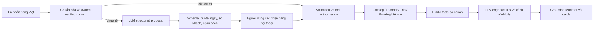

# TRAVELGO — AI AGENT CORE MASTER REPORT

Cập nhật **12/11/2026, Asia/Ho_Chi_Minh**. **TRAVELGO_AI_AGENT_CORE_PARTIAL**.

**Hội thoại tự nhiên và chat thống nhất:** CUSTOMER `/assistant` hiện dùng một chat có lời chào từ authenticated profile, một ô nhắn và nút gửi; G1/G2/Core controls chuyển sang debug development. Đã thêm NLU tiếng Việt có kiểm chứng, ngữ cảnh đa lượt, xác nhận năm/tuổi trẻ em, structured LLM proposals có trích dẫn nguồn và grounded response composition. Backend/NLU/HTTP **28/28 PASS**, Core42 và v2 **42/42 +22/22 PASS**; browser **28/28 PASS**, kèm targeted check sau sửa lỗi riêng tư. **Qwen hiện chưa bật; native0**, nên chưa nghiệm thu chất lượng hội thoại model LIVE. Chi tiết và acceptance hiện tại ở **mục16**; mục1–15 giữ các kết quả trước đó.

**Final functional closure:** đã thêm intent contract v2 trên chính service/UI Core, bỏ bước LLM chọn lại thao tác rõ ràng, sửa lỗi “Tư vấn” bị hiểu thành nơi xuất phát và sửa hotel output bị frontend từ chối. Core42 nguyên bản vẫn **42/42 PASS**; v2 **20 unit +2 integration PASS**, đề xuất current-contract cho legacy **6/6 PASS**, browser Core hiện tại **20 API-mock +12 real HTTP/Core/Planner với in-memory catalog PASS**. Real catalog mới vẫn `CATALOG_DATA_BLOCKED`; **không inference hoặc DB mutation mới**. P1 raw/Full LIVE chưa đóng. Chi tiết và bảng exit gate hiện tại ở **mục15**.

Các mục1–14 dưới đây giữ kết quả Master M1 trước closure để không sửa historical verdict. [Snapshot báo cáo trước closure](evidence/travelgo-ai-agent-core/closure-20261111/master-report-before.md) khớp report hash trong seal cũ. Evidence mới chỉ bổ sung trong [closure-20261111](evidence/travelgo-ai-agent-core/closure-20261111/); các artifact cũ không bị ghi đè.

Đã hoàn thiện code Core, tích hợp vào `/assistant`, xác minh catalog PostgreSQL READ ONLY, 42/42 unit/mock Core và 94/94 browser cases. Backend/frontend build PASS. **Chưa đạt LIVE acceptance**: raw Qwen chọn sai operation; catalog được phép chưa có sightseeing phù hợp; chưa có isolated staging được duyệt cho mutation; 6 suite Agent lịch sử vẫn FAIL. Không dùng mocks để đóng P1/P2 hoặc tuyên bố full E2E PASS.

Evidence duy nhất của task: [travelgo-ai-agent-core](evidence/travelgo-ai-agent-core/). [Yêu cầu gốc](evidence/travelgo-ai-agent-core/owner-task.txt), [audit trước](evidence/travelgo-ai-agent-core/audit-before.json), [77 báo cáo đã đọc](evidence/travelgo-ai-agent-core/reports-reviewed.json), [audit sau](evidence/travelgo-ai-agent-core/audit-after.json).

## 1. Chức năng đã có và baseline

| Thành phần trước task | Trạng thái khi audit | Xử lý |
|---|---|---|
| Auth/RBAC, Customer `/assistant`, G1/G2, owned verified history | WORKING trong acceptance hiện hành; một số test cũ chưa theo hợp đồng mới | Tái sử dụng, không nới guard |
| Catalog Place/Business, Recommendation, Planner | WORKING services; PARTIAL integration với Agent cho hotel/restaurant | Bổ sung Core adapter |
| Trip Save/Update/Reopen, transaction owner checks | WORKING services; MISSING Agent confirmation | Tái sử dụng service, thêm token xác nhận |
| Booking server pricing, modal/confirmation | WORKING | Tích hợp preview/navigation |
| Hotel/restaurant comparison, structured constraints, selection cards | MISSING/PARTIAL | Hoàn thiện trong AssistantPage |
| P1 natural NLU | BUG/OPEN | Parser có kiểm chứng + raw bounded probe; vẫn OPEN |
| P2 runtime | PARTIAL/OPEN | Deadline/concurrency/abort tests, không tự đóng observation cũ |
| Maps/GPS/Gemini/VPS | Ngoài scope | Giữ các thay đổi trước task, không triển khai thêm |

Không reset/checkout/clean working tree. Không commit/push/deploy. Không thay historical verdict, original benchmark, oracle hoặc fixture IDs. Audit 11.950 file baseline: chỉ 6 existing source integrations thay đổi có chủ đích; 11.530 file docs/evidence baseline giữ nguyên, không mất file. Các source Agent legacy liên quan 6 lỗi regression giữ đúng hash đầu task.

## 2. Chức năng đã sửa

- Đổi phương tiện/ngân sách/thêm ngày giữ các slots SET khác; từ chối phủ định, câu điều kiện, câu ghép không đủ bằng chứng và client history.
- Đổi destination cập nhật khu vực catalog; đổi bộ lọc hủy bản Planner cũ trước khi cho lưu.
- Hard price/amenity/exclusion filters áp dụng vào catalog truyền cho Planner; lựa chọn hết hợp lệ trả lỗi thay vì bỏ qua ràng buộc.
- READ ONLY phát hiện các `Phase35`/`Integration landmark` test records cũ lọt qua bộ lọc marker ban đầu. Đã loại rõ các marker này khỏi cohort mặc định. Không sửa hoặc xóa dữ liệu.
- Yêu cầu thay nhà hàng ban đầu chỉ đổi mandatory ID, nên Planner vẫn có thể đưa nhà hàng cũ vào ngày khác. [Test trước sửa FAIL](evidence/travelgo-ai-agent-core/restaurant-replacement-before.json); sửa tập ứng viên loại ID đã thay, giữ khách sạn. Test mới và toàn bộ Core [40/40 PASS](evidence/travelgo-ai-agent-core/core-final-40.json). Chọn lại ID bằng hành động rõ ràng có thể gỡ loại trừ đó.
- Nạp slots Trip cần đồng ý riêng, xóa bản plan/selection cũ, không đưa notes/profile vào input model.
- Trip update kiểm optimistic snapshot hash ngay trong transaction khóa owner row hiện có; xử lý chỉnh sửa đồng thời bằng 409.
- Snapshot confirmation kiểm cả public listing/location/duration/opening-hours drift; Planner không được bỏ qua hard area filter. Hai guard bổ sung có regression cases41–42.

## 3. Tools đã hoàn thiện

| Capability | Triển khai và giới hạn |
|---|---|
| `search_registered_hotels` | Approved catalog, Business ACTIVE, hard city/price/amenities, soft preferences, tối đa 5 |
| `search_registered_restaurants` | Cùng guard; keyword exclusion có dữ liệu, không suy diễn menu/allergy safety |
| `get_listing_details` | Requery ID, public projection, không owner/email/contact private |
| `compare_travel_options` | 2–5 UUID thật, không candidates/score do LLM dựng |
| `search_places` | Dùng repository và ranking hiện có qua public eligibility projection |
| `plan_trip` | `TourPlannerService` thật, provenance gate độc lập, filtered server catalog |
| `get_trip` | `TripSessionService.getTripById`, owner check, explicit context consent |
| `save_or_update_trip` | Preview trước, POST confirm riêng, one-use ticket, isolated staging guard |
| Booking integration | Hàm giá Booking server, mở Booking modal hiện có; không auto create/payment |

Backend Core ở `/api/agent/core/{privacy,chat,confirm,sessions}`; auth + CUSTOMER + `Cache-Control: no-store`. Client không được gửi SQL, plan thay thế, proof/history, catalog hoặc payload mutation tùy ý. Confirmation chỉ nhận conversation/revision/ticket/hash và `confirmed: true`.

## 4. Mapping hotel/restaurant/Business và dữ liệu thật

Đã đọc models/repositories, 12 migrations và schema PostgreSQL hiện tại. Hotel/restaurant là `places.category`, liên kết `business_id → businesses.id`. Không có bảng riêng rooms, menu, room/table inventory hoặc capacity đáng tin cậy cho Place. Place phải APPROVED; có Business thì Business phải ACTIVE; platform-owned Place không có Business được giữ theo convention cũ. Không có Business hợp lệ thì không mở preview bookable.

Public projection gồm UUID, tên, category, city/province/address, mô tả, ảnh HTTPS/same-origin hợp lệ, amenities, rating/reviewCount có thật, nullable `priceFrom`, nguồn catalog và link dịch vụ. Không biến thiếu giá thành 0. Unit/capacity/availability được đánh dấu chưa xác minh. Yêu cầu availability đã xác minh là hard constraint thì trả no_results.

[Final READ ONLY result](evidence/travelgo-ai-agent-core/final-db-read-result.json): target duy nhất `127.0.0.1:5432/travelgo_ai_m0_test`, sentinel `hugotravel-isolated-test-database-v1`, schema SHA `7805ddb1eb77028bfef96923c8adb8f0224bd54296dac39910546035154c544f`, migration checksum 12/12. Startup/per-connection read-only + SELECT/SHOW fence, 73 queries, 5 cumulative connections, forbidden SQL 0. Role lịch sử là postgres superuser: đây không phải least-privilege public runtime.

[Catalog hợp lệ cuối](evidence/travelgo-ai-agent-core/final-db-catalog.json) chỉ có:

| UUID thật | Dịch vụ | City | price_from |
|---|---|---|---|
| `39a5483f-e3d0-4cf8-a9b9-65e6b0a33593` | HuGo Riverside Hotel | Đà Nẵng | 1.200.000 VND, unit chưa xác minh |
| `b2f9a5cb-5258-421e-8050-1b3d55997fa7` | HuGo Seafood | Đà Nẵng | 350.000 VND, unit chưa xác minh |

[Hai tool search thật](evidence/travelgo-ai-agent-core/final-db-tools.json) trả đúng hai records này, không tạo thêm candidates. Không có eligible sightseeing sau loại test records. Full Planner trên catalog được phép **BLOCKED_NO_ELIGIBLE_SIGHTSEEING**.

Lần đọc đầu chạy production Planner trên một Phase35 landmark trước khi phát hiện marker test bị lọt. Giữ nguyên [output đầu](evidence/travelgo-ai-agent-core/db-real-planner.json) và [đính chính](evidence/travelgo-ai-agent-core/db-initial-finding.json); **không tính lần đó là REAL PLANNER acceptance PASS**.

## 5. Recommendation logic

Tái sử dụng `RecommendationService.recommendPlaces`, trọng số hiện có quality 0,35, preference 0,25, budget 0,25, distance 0,15 và tie-break deterministic hiện có. Không thêm scoring do LLM. City/province match, max catalog price, amenities, exclusions là hard filters trước ranking; preference là soft. Price cap so trực tiếp trường `price_from`, không gọi đó là giá phòng/đêm đã xác nhận. Unknown price không được thỏa price cap.

Reasons chỉ từ area/price/amenity/preference match thực tế. Không fallback sang thành phố khác khi search không có kết quả. Không ép đủ 3–5 candidates nếu catalog chỉ có một. Test kiểm deterministic ordering, budget, amenity và evidence của lời giải thích.

## 6. Planner và cost validation

Thuật toán/ranking/formula Planner giữ nguyên. Chỉ thêm internal optional catalog seam; các caller cũ vẫn load repository như trước. HTTP client không được cung cấp catalog này. Core truyền danh sách server đã lọc, UUID đã revalidate là mandatory selections.

Giữ GROUP_VND_V1: N ngày/N−1 đêm, adult-equivalent có child factor 0,7, lodging tách khỏi hotel activity 0đ, giá từng khoản làm tròn VND, không cắt giá để vừa ngân sách. Một ngày/0 đêm không có lodging charge. Thiếu đơn vị/giá hoặc inventory phải giữ nhãn estimated/unknown và assumptions T11-B. Không công bố total là provider quote, không tính chặng xuất phát/airfare thành chi phí đã xác nhận. ETA vẫn Haversine với transport assumption hiện có.

[Independent oracle v2](evidence/travelgo-ai-agent-core/independent-cost-oracle-v2.json) không import production cost helper: đối chiếu từng activity từ fixed in-memory fixture prices, 2 người lớn, 2 ngày/1 đêm, tổng **2.800.000 VND**, budget **6.400.000 VND**, remaining **3.600.000 VND**. Hotel thiếu giá dùng assumption 400.000 VND/nhóm/đêm, có nhãn. Oracle đầu mới viết thiếu entry hotel unknown-price nên expected thành undefined; giữ [script gốc](evidence/travelgo-ai-agent-core/independent-cost-oracle.cjs) và [failure](evidence/travelgo-ai-agent-core/oracle-initial-failure.json), bản v2 bổ sung mapping thiếu. Không sửa bất kỳ historical independent oracle/expected nào.

## 7. Verified History và P1

Core dùng cohort consent riêng `TRAVELGO_CORE_SLOTS_V1`, metadata `CORE_VERIFIED`, cùng LocalVerifiedHistoryStore lease/ownership/revision/replay/TTL và provenance assessor độc lập. Không nới G1/G2 grammar hoặc tin client history. RAM bounded 128 sessions, plan tối đa 128 KiB, absolute TTL 15 phút, tickets tối đa 5 phút. Không lưu chat/profile/Booking vào session store. Revoke/expiry và stale request làm mất authority.

Parser kiểm toàn mệnh đề cho 7 natural corrections được yêu cầu. Optional LLM chỉ chọn operation; không được sửa args/cost/SQL. Model name phải khớp operation được server xác minh mới dispatch tool. Khi model chưa bật, các thao tác rõ ràng chạy deterministic và response báo `model.invoked: false`, `rawNlu: NOT_EVALUATED`.

**P1 OPEN.** Đã khóa [manifest model](evidence/travelgo-ai-agent-core/model-two-locked-manifest.json) và [hash lock](evidence/travelgo-ai-agent-core/model-two-lock.json), giữ expected `{kind: core, name: plan_trip}` cho câu “Đổi sang xe máy, giữ thông tin còn lại.”. Cùng principal approved SHA `6b982d095bc6bc30c87955cd38c78afa9ef31d3447ef30f62e8684bbe8bce600`; full historical scan cả at/createdAt, initial 20/20, reserve 10. Tổng đúng **1 conditional load-only + 1 inference**, native cap 2, không retry, không V2. Quota cuối **18/20**.

Qwen `qwen3:4b-instruct-2507-q4_K_M`, digest `0edcdef34593eac1aa2be9c7d06c432dcf81945adca5eca2f27662c18f168ba0`; local loopback, stream false, JSON, temperature 0, ctx 16384, predict 2048, inference deadline 15s. Raw quyết định là **`compare_travel_options`**, nên **REAL MODEL RAW FAIL**; không sửa expected/prompt rồi thử tiếp. [Native response](evidence/travelgo-ai-agent-core/model-two-native-response.json), [result](evidence/travelgo-ai-agent-core/model-two-result.json). Inference khoảng 378ms, prompt 218/output 12 tokens, done_reason stop. Đây là raw probe với controlled verified context, không phải browser/DB E2E. Gate mismatch behavior được kiểm riêng bằng unit; raw probe không thực thi tool.

Preflight đầu chỉ GET thấy model chưa resident. Sau đối chiếu approval load-only cũ, preflight load đầu bị harness nhận nhầm own metadata keep-alive sockets là competing clients. Giữ [failure](evidence/travelgo-ai-agent-core/model-one-result.json); sửa phân loại đúng client-side remote11434 và exact current Node PID, unknown PID vẫn STOP. [Đính chính](evidence/travelgo-ai-agent-core/model-preflight-classification-fix.json). Trước sửa có 0 POST; sau sửa vẫn chỉ 1 inference. Không bỏ qua unknown connection hoặc sửa lịch sử PostgreSQL ownership.

## 8. Runtime và P2

Giữ shared Agent limiter 20 turns/principal/hour và provider concurrency 1 giữa các cohort, không tạo thêm allowance Core. Server deadline provider 15s; UI deadline 25s; readonly readiness version/tags/ps xác minh digest/context/residency trước native inference. Không auto load/reload/retry trong provider.

Tests xác minh unavailable/aborted provider tạo 0 POST, mismatch không dispatch tool, timeout kể cả provider bỏ qua abort, slot vẫn occupied đến underlying promise settle, revoke ngăn late result và replay. UI pending latch chống double submit, token/owner fence, trusted bound error metadata mới advance revision; không có metadata an toàn thì yêu cầu end/new session, không retry ngầm.

**P2 vẫn OPEN**: một raw inference trả nhanh không chứng minh runtime ổn định lâu dài, các observation watchdog/free-memory lịch sử không bị đóng. Không thử cold-load/inference lần hai. Không chạy Google/Gemini API.

## 9. Trip và Booking

Trip preview giữ server-owned snapshot + SHA256 payload + exact revision/owner/expiry. Confirmation one-use, consume trước await để ngăn replay; requery catalog price/status, recheck Trip version và lock owner row qua repository hiện có. Không tạo Trip persistence thứ hai. Cập nhật giữ consistency days/dates/budget/metadata/checkins qua prepareTripUpdate hiện có. Stale catalog/Trip trả 409; UI hướng dẫn kiểm My Trips trước khi lập preview mới nếu kết quả ghi chưa chắc chắn.

**Actual Trip mutation BLOCKED/NOT RUN**: chưa có isolated staging được duyệt. `assertPublicStagingWrite` giữ disabled mặc định, reject trước DB query nếu chưa opt-in, không chấp nhận travelgo_dev/travelgo_ai_m0_test hoặc postgres. Tests inject riêng Trip/write-guard doubles; không được coi là DB write PASS. Original 27 Trips chưa bị chỉnh sửa.

Booking preview dùng `calculateBookingPrice` thật. Test 2 adults +1 child, unit 350.000: discount 105.000, total **945.000 VND**. Booking MVP tính theo guest, không tự biến thành room-night pricing. Click mới mở BookingContext/modal hiện có; chưa submit Booking/payment, chưa xác nhận phòng/bàn trống. Header/confirmation bug cũ đã có fix: sau confirmation lấy server unitPrice/quantity/discount/total; trước confirmation ghi ước tính. Không viết lại phần đang đúng.

## 10. Desktop/mobile và cách dùng

Đăng nhập CUSTOMER, vào `/assistant`, chọn **Catalog và Trip · Core**, đọc notice và đồng ý giữ slots tạm. Có chat, bộ lọc city/price/amenities/preferences, hotel/restaurant cards, nullable price, UUID selection, comparison table, existing itinerary/cost card, Trip reopen link, preview/confirm và Booking navigation. Đây là một mode trong AssistantPage hiện có, không thêm chatbot route mới.

Ví dụ input rõ ràng: “Tìm khách sạn ở Đà Nẵng”, “Tìm nhà hàng ở Đà Nẵng ngân sách 400000 VND”; Planner có thể nhập các mệnh đề nơi xuất phát/đích/ngày/số người/ngân sách/phương tiện như G1. Chỉ hỏi required slots chưa SET. Unknown request fail closed, không giả vờ hiểu natural language tùy ý.

Model default tắt theo [env example](../backend/.env.agent-core.example); UI thông báo rõ đang chạy deterministic Core. Production loader là repository thật, không có mock catalog fallback trong LIVE UI. Không bật Qwen mặc định sau raw FAIL. G1/G2 navigation và behavior giữ nguyên.

## 11. Actual tests và acceptance matrix

Full offline regression chạy **một milestone**, [35 commands/suites: 29 PASS, 6 FAIL](evidence/travelgo-ai-agent-core/regression-final/summary.json), gồm backend/frontend build, types, Planner/Trip/Booking/Recommendation/RBAC/telemetry và Agent/frontend units. Sau đó chỉ targeted rerun Core + backend build khi sửa restaurant defect và bổ sung area/location consistency guards; [42/42 PASS](evidence/travelgo-ai-agent-core/core-final-42.json). Không chạy lại full regression để tìm một bộ xanh. Raw model probe diễn ra trước hai guard tool bổ sung cuối, cùng provider/prompt/options; không rerun model hoặc suy diễn full journey trên revision cuối.

Browser [94/94 PASS](evidence/travelgo-ai-agent-core/browser-final-01/results.json): desktop 47 + mobile 47; Core 20, G1/G2 74. Edge + actual React/Auth/Axios/controller, API fixtures được chặn/intercept; đây là **BROWSER MOCK API PASS**, không phải Browser→Ollama→Real Planner→DB LIVE PASS. Artifacts/screenshots ở cùng evidence dir. Network ngoài bị chặn; không Google/Gemini/GPS API.

| Acceptance bắt buộc | Evidence/tier hiện tại |
|---|---|
| 1. Registered hotels | UNIT/MOCK PASS; REAL DATABASE READ PASS, 1 hotel |
| 2. Registered restaurants | UNIT/MOCK PASS; REAL DATABASE READ PASS, 1 restaurant |
| 3. Exclude unapproved/inactive/test | UNIT/MOCK PASS; Phase35 exclusion kiểm qua final real query |
| 4. No hotel | UNIT/MOCK PASS, không region fallback |
| 5. No restaurant | UNIT/MOCK PASS |
| 6. Budget recommendation | UNIT/MOCK PASS; hard cap không dùng unknown price |
| 7. Preference recommendation | UNIT/MOCK PASS, deterministic reasons |
| 8. Compare two hotels | UNIT/MOCK + BROWSER MOCK PASS; real DB chỉ có 1 hotel |
| 9. Full itinerary | Production Planner + in-memory catalog PASS; approved real catalog BLOCKED |
| 10. Budget correction | UNIT/MOCK PASS |
| 11. Natural transport correction | UNIT/MOCK + BROWSER MOCK PASS; REAL MODEL RAW FAIL |
| 12. Keep hotel/change restaurant | UNIT/MOCK PASS, regression case40; BROWSER controls PASS |
| 13. Cheaper hotel/reprice | UNIT/MOCK PASS |
| 14. Save after confirm | UNIT/MOCK + BROWSER MOCK PASS; actual mutation BLOCKED |
| 15. Reopen Trip | UNIT/MOCK PASS, owner service reused; real reopen NOT RUN |
| 16. Foreign Trip denied | UNIT/MOCK/HTTP ownership gate PASS |
| 17. No auto Booking | UNIT/MOCK + BROWSER MOCK PASS |
| 18. Booking server total | Real price function UNIT PASS; actual Booking mutation NOT RUN |
| 19. Provider timeout/error | UNIT/MOCK PASS; real raw response observed, stress NOT RUN |
| 20. Desktop/mobile | BROWSER MOCK API PASS; full LIVE E2E NOT RUN |

Tier tổng: **UNIT PASS**, **MOCK PASS**, **REAL DATABASE READ PASS**, **REAL PLANNER (approved complete catalog) BLOCKED**, **REAL MODEL RAW FAIL**, **REAL BROWSER FULL E2E NOT RUN**. Không đánh đồng production Planner chạy với in-memory rows thành real-data LIVE acceptance.

[Final before fingerprint](evidence/travelgo-ai-agent-core/final-db-fingerprint-before.json) và [after](evidence/travelgo-ai-agent-core/final-db-fingerprint-after.json): **25/25 unchanged; Trip27; writes0; fixtures0**. Không INSERT/DELETE cleanup vì task không tạo fixture. Offline preloads chặn actual PostgreSQL/model/network; auditable process files ở `offline-audit/`.

## 12. Remaining bugs, failures và blockers

1. **P1 raw Core classifier sai operation**, như raw response đã ghi. Không bật model mặc định hoặc tuyên bố FIXED; cần một task bounded follow-up được duyệt, giữ failed case/expected hiện tại.
2. Catalog approved không có sightseeing; không thể hoàn tất full real Planner journey mà không có thêm dữ liệu hợp lệ. Không nhập fixture vào shared DB hoặc thay expected.
3. Chưa có isolated staging/least-privilege principal được duyệt cho actual Trip Save/Update acceptance.
4. **6 legacy suites FAIL**: agentReadinessAbort 32/1 (clarify expected chỉ destination nhưng current completeness còn daily budget); agentG1SafeContract và agentTransport mock transport không mô phỏng readiness GET mới; agentFoundation/agentMissingSlotRecovery còn giả định provider được gọi trước current completeness; agentDecisionFormatSafety còn kỳ vọng error path cũ. Không nới production gates hoặc đổi historical assertions. [Counterfactual diagnosis](evidence/travelgo-ai-agent-core/legacy-regression-diagnosis.json): tất cả 6 tái hiện khi Core route bị bỏ **trong bộ nhớ**, runtime/test hashes liên quan giữ nguyên từ đầu task. Đây không phải full regression GREEN. Một số incompatibilities đã được ghi trong báo cáo G2 lịch sử; giữ nguyên verdict cũ.
5. Chưa có inventory rooms/menu/capacity/price units cho Place; keyword exclusion không xác nhận thực đơn hay allergy safety. Chưa có chứng cứ real Browser→model→catalog→Planner→saved Trip trong cùng journey.

## 13. Files changed và bảo toàn

Existing integrations đổi trong task: `backend/src/routes/agentRoutes.ts`, `backend/src/services/tourPlannerService.ts` (internal catalog seam), `backend/src/services/tripSessionService.ts` (optional optimistic version), `frontend/src/pages/AssistantPage.tsx`, `frontend/src/services/api.ts`. `registeredCatalogService.ts` được tạo ngay đầu task trước baseline snapshot rồi tiếp tục hoàn thiện, là existing-hash delta thứ sáu trong audit.

Core files mới/hoàn thiện: `backend/src/agent/coreInput.ts`, `coreProvider.ts`; `backend/src/services/registeredCatalogService.ts`, `agentCoreService.ts`; `backend/src/routes/agentCoreRoutes.ts`; `backend/src/tests/agentCore.test.ts`; `backend/.env.agent-core.example`; `frontend/src/services/agentCoreClient.ts`; `frontend/src/components/agent/AgentCorePanel.tsx`; `frontend/playwright.agent-core.config.ts`; `frontend/e2e/agent-core.spec.ts`; report này và evidence dir duy nhất.

Không sửa Maps/GPS/Gemini/Public provider/VPS code của task trước, không chạy paid API. Không thay migration/schema/container config, không ghi DB, không thay original27 Trips. Không coi PID9686 đã xác định hoặc hồi tố sửa maintenance/concurrency conclusions. [Final integrity](evidence/travelgo-ai-agent-core/audit-after.json) ghi tất cả intentional deltas và missing/unexpected đều rỗng.

## 14. Next implementation priorities và điểm dừng

Ưu tiên tiếp theo là xử lý raw classifier failure trên đúng bounded case, bảo trì test harness legacy theo current contract trong task riêng có expected mới được review và vẫn giữ historical artifacts, bổ sung catalog sightseeing hợp lệ qua quy trình business có sẵn, rồi cấp isolated staging để nghiệm thu Save/Update thực. Sau đó mới chạy một full real user journey với quota/manifest đã khóa và xác nhận persistence/reopen.

M1 hiện **PARTIAL**, chưa READY. Dừng tại kết quả/báo cáo này. Không chuyển sang M2 Maps/GPS, M3 public provider/VPS; không commit, push hoặc deploy.

## 15. Final functional closure — kết quả hiện tại

### 15.1. Baseline và phạm vi

[Task closure](evidence/travelgo-ai-agent-core/closure-20261111/owner-task.txt), [baseline](evidence/travelgo-ai-agent-core/closure-20261111/baseline.json). Đã xác minh335 sealed artifacts cũ, snapshot12.290 file trước chỉnh sửa, giữ dirty tree. Original Core42 source/assertions, Browser94 evidence, historical raw Qwen FAIL và PostgreSQL fingerprints được bảo toàn. Seal cũ mô tả revision trước closure; không sửa seal để giả vờ nó xác nhận source/report mới.

Không tạo Agent/Trip/Planner/Booking khác. Vẫn cùng routes, consent/owned session/TTL, catalog repositories, Planner, existing Trip/Booking services. Không sửa thuật toán, trọng số recommendation, migration hoặc data để làm PASS.

### 15.2. P1: nguyên nhân và authority của intent

Luồng cũ được truy lại từ [locked request](evidence/travelgo-ai-agent-core/model-two-locked-manifest.json) và [raw response](evidence/travelgo-ai-agent-core/model-two-native-response.json): message → `coreInterpretation` xác định đúng `plan_trip` → merge server-verified slots → provider vẫn được gọi để chọn lại operation → raw chọn `compare_travel_options` → mismatch gate từ chối. Lỗi tích hợp xác nhận được là **LLM có quyền phủ quyết thao tác server đã biết rõ**. Prompt cũ chỉ đưa enum tên operation, không mô tả rõ trách nhiệm edit-versus-compare. Đây là điểm yếu thiết kế prompt; không đủ bằng chứng để khẳng định chính xác cơ chế nội tại làm Qwen chọn sai.

`CORE_INTENT_V2` là version của wire contract trên cùng Core service. Frontend hiện tại luôn gửi version này, gắn cố định suốt owned session; không cho upgrade/downgrade giữa các revision. Client cũ không gửi version vẫn dùng v1 fail-closed để giữ tương thích, được original42 kiểm lại. Version không bỏ qua provenance hoặc tăng quyền mutation.

- **Yêu cầu rõ ràng:** parser xác minh toàn mệnh đề; thao tác được thực hiện deterministic, model không được gọi. Giữ slot không được sửa và vẫn qua required-slot/provenance/catalog/owner guards trước tool.
- **Yêu cầu phức tạp/chưa rõ:** LLM chỉ đề xuất một operation enum. Registry mới mô tả đủ9 operation, phân biệt compare chỉ đọc selected UUIDs với plan/replan thay travel slots. Backend từ chối unknown tool, SQL, extra arguments, array hoặc schema sai; không lấy args/giá/UUID từ model.
- Đề xuất chỉ trả `needs_input` và `requiresExplicitRequest: true`; không query catalog, đổi slots hoặc chạy tool. UI chỉ hiện nút tác vụ có canonical command cố định. Người dùng click mới gửi một request/revision mới được server parse lại; lưu Trip vẫn cần preview và confirmation riêng.

Các family deterministic được kiểm: đổi/chuyển phương tiện xe máy/ô tô; tăng/giảm/đổi ngân sách tuyệt đối và tương đối từ ngân sách đã xác minh; thêm/bớt số ngày với min/max/date checks; thay hotel/restaurant, cheaper hotel, giữ thông tin còn lại. Phủ định/điều kiện không dispatch hoặc gọi model. Mơ hồ không được tự biến thành thay đổi.

Hai lỗi bổ sung đã được chứng minh và sửa:

1. Legacy pending-role reader bỏ dấu “Tư vấn…” thành `tu van...`, rồi đọc như “Từ [nơi xuất phát]”. V2 phân biệt advisory speech với patch travel-role trước khi kế thừa proof reader. [Hai lần unit FAIL ban đầu](evidence/travelgo-ai-agent-core/closure-20261111/unit-01.json) được giữ; [unit cuối](evidence/travelgo-ai-agent-core/closure-20261111/unit-final.json) chứng minh không ghi nhầm departure và không chạy tool từ lời tư vấn.
2. Internal catalog fixture hợp lệ không có boolean `catalogPriceAvailable` làm hotelSuggestion bị frontend contract từ chối. Đã dùng public price projection xác minh để luôn trả boolean và nullable price; unknown giá giữ assumption/label, không đổi phép tính Planner. [Browser lần đầu](evidence/travelgo-ai-agent-core/closure-20261111/browser-01/results.json):22 PASS/10 FAIL; giữ nguyên assertions, sửa adapter rồi [12 affected cases PASS](evidence/travelgo-ai-agent-core/closure-20261111/browser-03/results.json).

**Phân biệt verdict:** functional deterministic corrections PASS ở unit/service/HTTP/browser với test catalog; historical raw LLM semantic **FAIL vẫn giữ nguyên**; raw semantics revision mới **NOT RUN**, full Agent LIVE E2E **BLOCKED/NOT RUN**. Không tuyên bố P1 global FIXED bằng mocks. Task closure yêu cầu fresh owner approval cho E; approval cũ không được dùng để inference lại. Closure thực tế **Ollama GET0/native POST0/load0/retry0**.

### 15.3. Catalog và quy trình bổ sung hợp lệ

[READ ONLY mới](evidence/travelgo-ai-agent-core/closure-20261111/catalog-result.json) xác nhận đúng target/sentinel,12 migration checksums và schema cũ;74 queries,5 cumulative connections, forbidden SQL0. [Raw inventory](evidence/travelgo-ai-agent-core/closure-20261111/catalog-inventory.json):22 Place gồm8 attraction SUSPENDED ở Hội An,8 APPROVED Phase35 test landmarks,4 APPROVED hotels có Business không ACTIVE,1 eligible hotel và1 eligible restaurant tại Đà Nẵng. Không có approved non-test sightseeing tại Đà Nẵng. Nguyên nhân là data/status/cohort, không phải lỗi ranking hoặc city normalization. **CATALOG_DATA_BLOCKED**; không chạy Planner trên Phase35 và không tự tạo điểm tham quan.

[Tools thật](evidence/travelgo-ai-agent-core/closure-20261111/catalog-tools.json) trả hotel/restaurant thật; không bịa candidates. [Before](evidence/travelgo-ai-agent-core/closure-20261111/db-fingerprint-before.json)/[after](evidence/travelgo-ai-agent-core/closure-20261111/db-fingerprint-after.json) khớp nhau và baseline Master: **25/25 unchanged, Trip27, writes0, fixtures0**. Quota scanner cùng principal đọc105 historical attempts, cả at/createdAt, còn18/20 tại lần kiểm; không phát sinh attempt mới.

Quy trình đang có, đã kiểm source:

1. `PartnerApplicationService.decide(APPROVED)` tạo Business, membership/quyền PARTNER; Business model mặc định ACTIVE. Không tự duyệt application trong closure.
2. Partner có quyền `MANAGE_BUSINESS` dùng `POST /api/partner/places`, chọn category `attraction` hoặc `tour`, city/province/coordinates và nội dung có thật. `PlaceService.createForPartner` tạo DRAFT.
3. `POST /api/partner/places/:id/submit` chuyển DRAFT/REJECTED → PENDING; `PATCH /api/admin/places/:id/status` do SUPER_ADMIN chuyển APPROVED trong transaction và ghi AuditLog.
4. Core requery APPROVED + Business ACTIVE + cohort eligibility rồi rank. SUPER_ADMIN cũng có route tạo platform-owned Place hiện có; không cần một import/fixture API mới cho Agent.

Closure chỉ đọc/kiểm source quy trình này. Không tạo application/Business/Place, sửa trạng thái, bỏ test marker hoặc dùng suspended attractions làm data demo. Để nghiệm thu toàn bộ compare/replacement bằng data thật, ngoài sightseeing còn cần ít nhất hai hotel và hai restaurant hợp lệ cùng khu vực; cheaper-hotel case cần giá catalog khác nhau. Có thể dùng dữ liệu business thực qua quy trình trên, hoặc cohort staging riêng được duyệt rõ nguồn/IDs. Không seed shared DB. Room-night/person units và availability/capacity vẫn chưa được schema Place xác minh.

### 15.4. Planner, Trip, Booking và runtime

Planner/recommendation/formulas không đổi. V2 giữ hard area/price/amenity/exclusion filters, mandatory IDs và source snapshots, estimated/unknown labels, day/night/group costs và over-budget warnings. Data tier mỗi evidence được ghi rõ. Không có **REAL DATABASE PLANNER PASS** mới vì sightseeing thiếu.

Trip read/preview/confirm/update/reopen vẫn qua owner service và optimistic version dưới row lock hiện có. Unit/HTTP integration dùng Trip doubles riêng có nhãn; browser qua **real staging guard** xác minh confirmation trả `AGENT_STAGING_WRITE_BLOCKED`, zero query/write shared DB. Booking preview đi actual price function, sau click mở existing modal, không gọi create Booking/payment. Original42 tiếp tục kiểm forged confirmation, replay, stale price/location/version, TTL, owner và P2 deadline/concurrency.

Để chạy mutation LIVE tối thiểu cần owner duyệt **một target staging riêng** khớp `PUBLIC_STAGING_DB_NAME`/ENV DB_NAME, ngoài travelgo_dev/travelgo_ai_m0_test, role khác postgres và không superuser, sentinel riêng dạng `travelgo-public-staging:...`, schema đúng, dữ liệu Customer/Business/Place đủ FK và hai customer identities cho ownership negative. Phải duyệt rõ create/update/read/reopen và cleanup của các Trip mới của cohort; không chạm Trip nền. Guard `PUBLIC_STAGING_WRITES_APPROVED` mặc định false; chỉ khi authorization và identity thực khớp mới bật. Không dùng A/B maintenance handoff, không tạo Docker/staging resources trong task này.

P2 vẫn OPEN ngoài phạm vi offline đã kiểm. API provider deadline15s, UI25s, absolute TTL15m, shared20 turns/hour và concurrency1 giữ nguyên. Model suggestion pending sau revoke không thành authority; untrusted output không tạo tool call. Không suy diễn stable runtime từ một raw response cũ.

### 15.5. Sáu legacy failures — phân loại riêng, không đổi verdict

[Reviewed diagnosis](evidence/travelgo-ai-agent-core/closure-20261111/legacy-diagnosis-reviewed.json) đối chiếu từng source, baseline M1 và [historical execution ngày10/11 trước M1](evidence/t-ai-04-g2-live-multi-turn-validation/final-verified/execution.json). Các test và runtime legacy liên quan không đổi trong closure; không có production bug legacy mới được chứng minh nên không sửa guard cũ.

| Original suite | Phân loại và bằng chứng | Current-contract v2 probe |
|---|---|---|
| agentReadinessAbort | Historical32/1; expected thiếu dailyBudgetPerPerson khi completeness yêu cầu cả destination/budget | Kiểm đủ missing fields trước readiness, provider0 |
| agentG1SafeContract | Raw transport fixture không mô phỏng GET metadata; historical26/26 là **có readiness compatibility shim**, không phải original raw PASS | GET version/tags/ps rồi1 POST, valid pinned envelope |
| agentFoundation | Shared fixture chứa hai intent; current single-intent policy chặn trước tool. Historical17/5 đã có trước M1 | Complete single-intent input, consent/opt-out đúng |
| agentDecisionFormatSafety | Raw fake transport lỗi trước intended malformed-output assertion; historical17/17 có shim. Không quy shim PASS thành raw PASS | Complete current input + GET-aware/token-count-bearing envelope rồi reject malformed decision |
| agentMissingSlotRecovery | Historical13/20; các expected provider-before-completeness không còn đúng với policy hiện tại | Missing transport được hỏi trước model/tool |
| agentTransport | Raw fixture predates readiness; historical readiness-compatible18/1 vẫn còn một incompatibility | Invalid readiness trả503, inference0 |

[Versioned probes6/6 PASS](evidence/travelgo-ai-agent-core/closure-20261111/legacy-v2-contracts-02.json) là đề xuất test hợp đồng hiện tại riêng, **không thay thế hoặc nâng original six FAIL thành GREEN**. Probe đầu5/1 do fake success envelope mới thiếu token counters đã giữ trong evidence; sửa fixture riêng theo runtime envelope contract, không sửa production/old assertions. Không xóa/skip original cases.

### 15.6. Thứ tự kiểm thử và bảng nghiệm thu

A → B → C → D đã chạy. A: [Core42 nguyên bản42/42](evidence/travelgo-ai-agent-core/closure-20261111/core42-final.json), [v2 unit20/20](evidence/travelgo-ai-agent-core/closure-20261111/unit-final.json), legacy v2 probes6/6. B: [integration2/2](evidence/travelgo-ai-agent-core/closure-20261111/integration-final.json). C:20 API-mock Core browser cases PASS trong lần đầu; sau adapter fix12 real HTTP/Core/Planner cases PASS desktop/mobile. Đây là32 current impacted cases, không cộng các lần rerun thành thêm coverage. Browser94 lịch sử giữ nguyên, không tuyên bố đã rerun94 trong closure. D: PostgreSQL READ PASS, Planner data-blocked. E/F **NOT RUN**: thiếu fresh approval/preconditions. Backend build sau sửa PASS; frontend types/bundle [PASS](evidence/travelgo-ai-agent-core/closure-20261111/build-result.json), không đổi frontend sau build. Không rerun full35-suite regression vì lỗi nhỏ.

Trong bảng, “browser offline HTTP” nghĩa là browser thật chạy Core/Planner thật với in-memory catalog, injected model/Trip doubles. Nó không đồng nghĩa với browser dùng real DB/model.

| Feature | Code status | Unit/mock | Real DB | Real model | Real browser | PASS/FAIL/BLOCKED | Exact blocker |
|---|---|---|---|---|---|---|---|
| Deterministic edits, preserve slots | DONE v2 | PASS | Full plan BLOCKED | Không gọi model theo thiết kế | PASS offline HTTP | Functional PASS; LIVE BLOCKED | Sightseeing data + full journey chưa có |
| Complex-language suggestions | DONE, explicit action required | PASS | Không auto query | NOT RUN mới | PASS với model double | PARTIAL | Fresh owner approval E, quota/manifest/native cap; semantic quality chưa đo |
| Historical raw Qwen correction | Evidence immutable | Không dùng mocks để chấm lại | N/A | **FAIL cũ** | Không có full LIVE | FAIL/OPEN | Raw compare khác expected plan; không retry |
| Hotel/restaurant catalog | DONE | PASS | **READ PASS 1+1** | N/A | PASS in-memory cards/Booking | READ PASS | Real DB browser journey chưa chạy; alternatives thật chưa đủ |
| Sightseeing and full Planner | Adapter DONE, algorithm unchanged | PASS in-memory | **CATALOG_DATA_BLOCKED** | NOT RUN | PASS offline HTTP | BLOCKED real acceptance | Eligible sightseeing0; không dùng Phase35/suspended records |
| Hard filters/recommendation/costs | DONE | PASS, original oracle preserved | Source prices read; full plan blocked | Không tính bằng LLM | PASS offline HTTP | PARTIAL | Units/inventory chưa xác minh, thiếu catalog để E2E thật |
| Trip get/save/update/reopen/owner/replay | DONE, existing services | PASS | Mutation NOT RUN | N/A | Preview/staging-block guard PASS | LIVE BLOCKED | Isolated approved staging/role/sentinel/users/cohort absent |
| Booking price preview/navigation | DONE, existing price function/modal | PASS | Catalog read only | Không tự booking | PASS offline HTTP, create0 | Functional PASS | Actual Booking mutation không nằm trong authorization |
| Runtime/abort/concurrency | Guard DONE | PASS targeted + Core42 | No writes | NOT RUN mới | Safe error/no retry PASS | P2 OPEN | Chưa có controlled real-runtime acceptance |
| Legacy contract maintenance | Diagnosis DONE, v2 proposal | New6/6 PASS; old FAIL preserved | N/A | N/A | G1/G2 old evidence preserved | Original suites FAIL | Old assertions/harness need separately reviewed versioned adoption |
| Full Agent production-like E2E | Implementation PARTIAL | Không thay thế LIVE | Catalog/staging blocked | Fresh approval absent | Full LIVE NOT RUN | **BLOCKED** | CATALOG_DATA_BLOCKED + E approval/manifest + F approved staging |

### 15.7. Files, integrity và điểm dừng

Existing source chỉnh trong closure: `backend/src/agent/coreInput.ts`, `backend/src/services/agentCoreService.ts`, `frontend/src/services/agentCoreClient.ts`, `frontend/src/components/agent/AgentCorePanel.tsx`. Files mới: `backend/src/agent/coreIntent.ts`, `backend/src/tests/agentCoreIntentV2.test.ts`, `backend/src/tests/agentLegacyCurrentContractV2.test.ts`, `frontend/e2e/agent-core-intent-v2.spec.ts`, `frontend/playwright.agent-core-closure.config.ts`. Chỉ cập nhật báo cáo Master này; artifact mới nằm trong một functional closure group. Planner/Trip/Booking/catalog repositories, original tests và old evidence không sửa.

**TRAVELGO_AI_AGENT_CORE_PARTIAL.** Phần code độc lập với data/credentials đã được hoàn thiện và kiểm tra targeted. Không ghi DB, không tạo fixture, không inference hoặc paid API mới, không sử dụng rejected maintenance handoff, không Google Maps/GPS/Gemini/VPS, không commit/push/deploy. Dừng trước E/F; không tự chạy LIVE để tìm PASS hoặc tạo chuỗi NEXT TASK.

## 16. Hội thoại tiếng Việt và giao diện thống nhất — 12/11/2026

### 16.1. Trải nghiệm CUSTOMER

[Yêu cầu hiện tại](evidence/travelgo-ai-agent-core/natural-chat-20261112/owner-task.txt), [baseline trước thay đổi](evidence/travelgo-ai-agent-core/natural-chat-20261112/baseline.json), [snapshot Master trước thay đổi](evidence/travelgo-ai-agent-core/natural-chat-20261112/master-report-before.md). Đã kiểm hai seal trước task và bảo toàn artifact cũ. Không reset working tree hoặc đổi verdict raw Qwen lịch sử.

`AssistantPage` vẫn là trang duy nhất. CUSTOMER vào `/assistant` thấy **Trợ lý du lịch TravelGo**, một log hội thoại, một textarea, một nút Gửi và nút Cuộc trò chuyện mới. Card hotel/restaurant, comparison, itinerary/cost, lựa chọn UUID, preview/confirm và Booking vẫn dùng components/services hiện có ngay trong trải nghiệm này. Bộ lọc phụ nằm trong details, không bắt khách điền form hoặc chọn mode kỹ thuật.

Code G1/G2 và Core v2 giữ lại. Chỉ khi **development build**, `VITE_AGENT_DEBUG_CONTROLS=true` và URL có `?debug=legacy` mới hiện controls cũ. Production không mở debug bằng query này. Không thêm chatbot page hoặc endpoint song song, không xóa chức năng cũ. Browser94/closure32 lịch sử giữ nguyên; không dùng chúng để khẳng định default UI mới đã chạy lại các assertion giao diện cũ.

Lời chào được render một lần cho mỗi cuộc trò chuyện từ **AuthContext đã nhận auth/me/login**, không lấy cached display name hoặc nội dung chat. Ví dụ Huy chỉ nằm trong test; tên production không hard-code. Account/profile tên thiếu, email/phone hoặc nội dung không phù hợp có fallback “Xin chào!”. Backend privacy endpoint cũng nhận AuthUser đã xác thực để tạo greeting. Không POST chat, tạo model request hoặc tạo context server chỉ để chào.

“Cuộc trò chuyện mới” abort/fence pending request, revoke owned server context và xóa message/slots UI, draft, filters, selected IDs, Trip ID, pending preview/confirmation. Giữ một greeting cho conversation mới, consent được hỏi lại. Token/account key và current-token fence ngăn response cũ vào phiên/tài khoản mới. Không lưu chat vào localStorage; server tiếp tục chỉ giữ slots, câu hỏi/proposal có cấu trúc và plan trong RAM có TTL.

### 16.2. Luồng NLU, LLM và tool authority

Hợp đồng `NATURAL_CHAT_V3` đi qua chính `AgentCoreService`, cùng ownership/revision/replay/TTL/quota và existing tool gate. Client tự pin version; không đổi version giữa phiên. V1/v2 vẫn tương thích, original tests không sửa expected.

Deterministic normalizer xử lý các biểu đạt rõ, không được gọi đó là toàn bộ trí thông minh của Agent. Với câu ngoài grammar/typo, LLM nhận current message + travel slots đã xác minh, không nhận auth token, account name/email, profile hoặc Trip notes. Output `natural` có operation, typed updates kèm **quote là substring nguyên văn của current message**, optional change frame cho hotel/dining đang chọn. Backend kiểm allowlist/schema, số khách, ngân sách, enum preferences/transport, ngày tồn tại/không quá khứ và giới hạn Planner. Unknown SQL/tool/UUID/profile fields không được nhận.

Proposal chưa được SET hoặc chạy tool. Server diễn đạt rõ cách hiểu, khách trả lời “đúng rồi”/xác nhận ở lượt kế mới áp dụng các giá trị đã kiểm. Tham chiếu “chỗ ở này quá mắc” có thể thành đề xuất đổi **selected hotel** rẻ hơn; sau xác nhận vẫn tìm bằng catalog và UUID server đang giữ, không để model tạo khách sạn. Phủ định/điều kiện không bị hiểu thành xác nhận; đặc biệt đã tách **đúng** và **đừng** dù chúng trùng khi bỏ dấu. Proposal stale/replayed/expired không thành authority. Social/chat act không có thay đổi được trả lời/hỏi tiếp trực tiếp, không bắt xác nhận xã giao vô ích.

Với intent đã rõ, model không được chọn lại hoặc phủ quyết operation. Sau tool execution, khi được cấu hình, LLM có thể chọn và sắp xếp tối đa3 **fact IDs từ kết quả thực** để dựng phần giải thích. Model không được viết giá/availability/Booking claims tùy ý; renderer chỉ dùng facts server cung cấp. Invalid fact IDs hoặc provider failure không thay thế kết quả tool: trả đúng dữ liệu gốc và thông báo phần AI diễn giải chưa sẵn sàng. Đây là cách diễn giải có ràng buộc, **chưa phải bằng chứng rằng model hội thoại tự nhiên tổng quát đã đạt**.

Mỗi lượt không quá một model call: unknown request dừng ở proposal; known request chỉ có thể gọi phần grounded response sau tool. Auto greeting/social greeting không gọi model. Model/options/readiness/deadline/concurrency giữ policy cũ; không retry để tìm PASS. Không đưa `responseSchema` từ client vào provider: schema được chọn nội bộ, body API vẫn allowlist.

### 16.3. Tiếng Việt, thời gian và nhớ ngữ cảnh

| Biểu đạt đã kiểm | Kết quả/guard |
|---|---|
| `hcm đi đà nẵng`, `sg ra dn` | Alias TP. Hồ Chí Minh (proof lưu tên đầy đủ **Thành phố Hồ Chí Minh**) và Đà Nẵng trong ngữ cảnh route rõ |
| `dn` đứng riêng | Không thay mù quáng; chỉ nhận khi đang hỏi destination hoặc cần xác nhận |
| `hcm ... 13/11-15/11 2 lớn 1 bé 12tr` | Giữ departure/destination, adults2, children1, group budget12.000.000; **chưa SET ngày khi thiếu năm** |
| `đúng rồi` sau câu hỏi năm2026 | Chỉ xác nhận năm đã hỏi; sau đó hỏi tuổi trẻ em còn thiếu |
| `2026` sau câu hỏi năm | Xác nhận năm rõ ràng, vẫn kiểm ngày tồn tại/không quá khứ |
| `đi đà nẵng 3n2đ` | Duration3 ngày/2 đêm, không tự bịa ngày bắt đầu; tối đa10 ngày như Planner |
| `2ng lon 1 tre em`, `HCM, 2 lớn 1 bé` | Party và departure bổ sung trong cùng phiên, không hỏi lại destination/budget đã SET |
| `ngan sach 12tr`, `tăng thêm 3tr` | Chuyển VND; tương đối cần ngân sách đã xác minh,12tr→15tr khi cộng3tr |
| `xe máy`, `đổi xe máy`, `thôi đổi ô tô` | Chỉ sửa transportation, giữ các travel slots khác |
| `ks nào rẻ hơn`, `khách sạn kia mắc quá, đổi rẻ hơn` | Dùng selected hotel + giá catalog để chọn alternative hợp lệ |
| `đổi chỗ ăn`, `giữ ks đổi nhà hàng` | Giữ hotel, đổi restaurant và loại ID cũ khỏi replan candidates |
| `tìm quán ăn ngon` | Gọi registered restaurant search; không khẳng định khẩu vị/đánh giá do model bịa |
| `tìm nhà hàng ngon gần ks` | Cần selected hotel có tọa độ server; dùng centerCoords của ranking hiện có và khoảng cách đường chim bay, không GPS/road route |
| `tư vấn giúp tôi`, câu tự do/typo | Structured LLM path nếu được bật; nếu tắt/unavailable thì thông báo đúng, không mock fallback |
| `xin chào`, `hello` | Social reply tự nhiên, có thể nhắc destination đã SET, model0 |

Ngày hiện tại được tính bằng **Intl timezone Asia/Ho_Chi_Minh**, date-only arithmetic dùng UTC để không lệch ngày theo host. “Ngày mai” được tính từ ngày Việt Nam; ngày thiếu năm hỏi xác nhận, ngày năm nay đã qua thì yêu cầu năm rõ thay vì tự chuyển sang năm sau. Ngày vô hiệu, quá khứ, duration/night không khớp bị chặn. Tuổi từng trẻ được hỏi trước khi dùng party cho dự toán/Booking có children; tuổi được kiểm tính nhất quán, **không suy diễn chính sách giá theo tuổi của nhà cung cấp**. MVP vẫn dùng công thức nhóm/guest hiện có với nhãn assumption, không tự có inventory hoặc room-night units.

Giá tối đa listing không bị biến thành group budget: direct hotel/restaurant search giữ maxPriceFrom filter; câu giá mơ hồ như `ks rẻ hơn400k` hỏi lại vai trò số tiền. Typed proposal chỉ thành input khi khách xác nhận. Server summary/output chỉ công bố fields trạng thái SET, không gọi dữ liệu UNPROVEN là verified.

### 16.4. TravelGo data và guard được giữ

Planner/Trip/Booking không viết lại, không đổi recommendation weights hoặc cost oracle. Catalog chỉ bổ sung internal `nearListingId` option: lookup hotel trong eligible server catalog rồi đưa actual coordinates vào existing ranking. Không nhận tọa độ tùy ý từ client, không Google/GPS/Routes hoặc khẳng định “gần nhất”. PriceFrom/rating/amenity/result IDs vẫn từ repository; thiếu sightseeing trả `CATALOG_DATA_BLOCKED`, không fake itinerary.

[Fresh READ ONLY](evidence/travelgo-ai-agent-core/natural-chat-20261112/catalog-result.json), lúc **12/11/2026 01:17 Asia/Ho_Chi_Minh**: target/sentinel/schema/migrations giữ baseline,74 queries/5 cumulative connections/forbidden0,22 Place/14 APPROVED nhưng eligible chỉ **1 hotel +1 restaurant, sightseeing0**. [Before](evidence/travelgo-ai-agent-core/natural-chat-20261112/db-fingerprint-before.json)/[after](evidence/travelgo-ai-agent-core/natural-chat-20261112/db-fingerprint-after.json) khớp Master baseline: **25/25 unchanged, Trip27, writes0, fixtures0**. Full real-data Planner journey vẫn data-blocked. Role READ ONLY cũ là superuser, không dùng nó để tuyên bố least-privilege public runtime.

Save/Update chỉ preview rồi confirm ticket/hash/revision/owner riêng; natural-language “đồng ý” với proposal **không phải Trip mutation confirmation**. UI vẫn bắt xem plan/cost và bấm xác nhận riêng. Existing staging guard chặn trước query khi chưa được duyệt. Booking chỉ price preview/navigation, không auto create hoặc payment. Đổi Trip context xóa natural clarification/age/proposal cũ để không áp dụng nhầm vào Trip mới.

Consent, bounded RAM, absolute15m TTL, replay/stale revision/owner guards, shared20 turns/principal/hour và provider concurrency1 giữ nguyên. Câu chat chỉ ở UI trong phiên, không ghi vào DB hoặc localStorage. Không sử dụng lại rejected A/B maintenance handoff.

### 16.5. Cấu hình model và bằng chứng kiểm thử

[Config inspection](evidence/travelgo-ai-agent-core/natural-chat-20261112/provider-config.json): `AGENT_CORE_LLM_ENABLED`, `LLM_LIVE_ENABLED`, `LLM_USAGE_APPROVED`, `OLLAMA_LOCAL_ONLY_CONFIRMED` hiện đều false, provider unset, **configured=false**. Tag/digest/options Qwen được khóa như trước; không thay model. Không gọi version/tags/ps, load hay inference để kiểm readiness vì chưa có fresh approval. UI báo AI ngôn ngữ chưa bật; không gọi deterministic mode là model LIVE PASS.

**Native GET0/POST0/load0/retry0 trong task này.** Quota scan READ ONLY cùng principal còn20/20, nhưng quota không thay thế fresh owner approval. Historical raw Qwen `compare_travel_options` FAIL giữ nguyên, P1 raw và P2 real runtime vẫn OPEN.

- [Backend/NLU/HTTP28/28 PASS cuối](evidence/travelgo-ai-agent-core/natural-chat-20261112/unit-final-accepted.json):27 targeted behavioral/transport-contract cases và1 actual HTTP auth/greeting case, sau build backend cuối. Production Core/Planner chạy với in-memory catalog, model/Trip doubles. First run21/2 FAIL được [giữ](evidence/travelgo-ai-agent-core/natural-chat-20261112/unit-01.json): async explanation làm try/finally finish lease sớm; đã sửa `return await` để giữ authority đến lúc response hoàn tất. Không sửa expected để lấy PASS.
- Original [Core42/42](evidence/travelgo-ai-agent-core/natural-chat-20261112/core42.json) và [v2 compatibility22/22](evidence/travelgo-ai-agent-core/natural-chat-20261112/v2-compat.json) PASS, old assertions không đổi. Sáu legacy FAIL và versioned probes trước đó bảo toàn, không chạy full regression lặp lại.
- [Browser28/28](evidence/travelgo-ai-agent-core/natural-chat-20261112/browser-01/results.json):14 user journeys × desktop/mobile, actual React/Auth/Axios → HTTP Core → Planner; catalog/model/Trip persistence là doubles. Bao phủ14 tình huống bắt buộc, gồm no-sightseeing và provider unavailable. Không ghi thành Browser→real model→real DB PASS.
- Visual inspection phát hiện thông báo riêng tư giả do request bị StrictMode cleanup abort; đã lọc abort thay vì hiện lỗi, thêm assertion không có alert. [Targeted browser follow-up8/8 PASS](evidence/travelgo-ai-agent-core/natural-chat-20261112/browser-02/results.json) kiểm greeting/privacy, catalog replacement, unavailable provider và structured typo confirmation. Không cộng rerun thành coverage mới hoặc sửa screenshot cũ.
- [Final backend/types/frontend bundle build](evidence/travelgo-ai-agent-core/natural-chat-20261112/final-build-result.json) PASS. Screenshots, request/result traces và offline deny audits ở cùng evidence group; không paid API hay shared-DB fixture.

### 16.6. Acceptance và giới hạn hiện tại

| Capability | Code / offline evidence | Real status | Blocker/giới hạn |
|---|---|---|---|
| Chat greeting | PASS, authenticated-profile origin/fallback, no LLM call | Browser với authenticated test account PASS | Không khẳng định đã login một tài khoản Huy thật trong staging |
| Unified CUSTOMER chat | PASS desktop/mobile, debug view riêng development | Actual browser PASS | G1/G2 old UI assertions chỉ áp dụng debug/historical version |
| Vietnamese shorthand extraction | PASS các family đã kiểm, year/age safeguards | Semantic LLM LIVE NOT RUN | Không bảo đảm mọi lỗi chính tả/viết tắt đều hiểu đúng |
| Multi-turn context | PASS giữ slots/relative edits/confirm/revoke/replay | Browser/HTTP PASS với test data | Model understanding tổng quát chưa đo |
| Real tool implementation | PASS production catalog/Planner/service code | Real DB catalog READ PASS; full Planner BLOCKED | Eligible sightseeing0, alternatives real chưa đủ |
| LLM structured NLU + response composition | Code/validation/grounding + model doubles PASS | **REAL MODEL NATURAL-LANGUAGE NOT RUN** | Provider disabled, fresh approval/readiness/manifest/native cap thiếu |
| Trip save/update/reopen | Preview/owner/version/confirm guards giữ nguyên, offline PASS | Mutation LIVE BLOCKED | Chưa có approved isolated staging và cohort |
| Booking | Existing server pricing + navigation, no auto create | Catalog read only | Units/availability/inventory chưa được xác minh |
| Full Agent E2E | Partial | **NOT RUN/BLOCKED** | Catalog data + model approval + approved staging |

**Không tuyên bố trợ lý hội thoại tự nhiên đã hoàn thiện chỉ vì parser/fixtures PASS.** Đã hoàn thiện phần code có thể triển khai an toàn, nhưng real model natural-language acceptance và full Agent E2E chưa có. Exit vẫn **TRAVELGO_AI_AGENT_CORE_PARTIAL**.

### 16.7. Source và điểm dừng

Existing integrations đổi: `backend/src/agent/provider.ts`, `coreProvider.ts`, `backend/src/services/agentCoreService.ts`, `registeredCatalogService.ts`, `backend/src/routes/agentCoreRoutes.ts`, `frontend/src/pages/AssistantPage.tsx`, `frontend/src/components/agent/AgentCorePanel.tsx`, `frontend/src/services/agentCoreClient.ts`. Helpers/tests mới: `vietnameseConversation.ts`, `naturalGrounding.ts`, `agentNaturalChat.test.ts`, `naturalChatPresentation.ts`, `natural-chat.spec.ts`, `playwright.natural-chat.config.ts`. Không đổi Planner/Trip/Booking implementation, migration/schema hoặc original tests. Chỉ cập nhật báo cáo Master; evidence bổ sung trong [natural-chat-20261112](evidence/travelgo-ai-agent-core/natural-chat-20261112/).

[Acceptance cuối](evidence/travelgo-ai-agent-core/natural-chat-20261112/acceptance-final.json) đối chiếu baseline12.487 files, hai seal lịch sử335 và192 artifacts, snapshot báo cáo trước task, build/tests, offline deny audits và READ ONLY fingerprint. [Seal hiện tại](evidence/travelgo-ai-agent-core/natural-chat-20261112/artifact-checksums.json) khóa SHA256 source, báo cáo và evidence group mới; không thay seal lịch sử. Attachment gửi lại cuối có cùng nội dung yêu cầu đã triển khai.

Dừng sau kết quả/báo cáo này. Không bật model hoặc native probes khi chưa fresh approval, không ghi DB, không tạo fixture, không Google Maps/GPS/VPS/Gemini paid API, không commit/push/deploy. Các điều kiện tối thiểu model/staging ở mục15 vẫn áp dụng; không tự chuyển sang một chuỗi task nghiên cứu.
