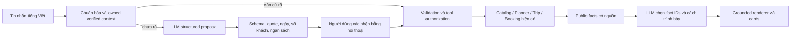

# TRAVELGO — AI AGENT CORE MASTER REPORT

Cập nhật **12/11/2026, Asia/Ho_Chi_Minh**. **TRAVELGO_AI_AGENT_CORE_PARTIAL**.

**QWEN V4 REAL MODEL ACCEPTANCE — mục20.8: SEMANTIC FAIL, đã chạy model thật.** Preflight12:35:51 ngày12/11/2026 PASS: RAM6770MiB, GPU5%, VRAM6483MiB, quota20/20, đúng local owner/tag/digest. Warm-load **1/1 PASS**,11,444s; resident đúng context16384. Ba inference thật dùng đủ **3/3**, latency1,923s/1,537s/2,122s: **L1 FAIL, L2 FAIL, L3 FAIL theo expected đã khóa**. L1/L2 sai cấu trúc/nghĩa và bị server chặn; L3 schema/grounding PASS nhưng chỉ liệt kê tên, thiếu cặp tên/giá theo tiêu chí đã khóa. Không đổi prompt/source/expected hoặc retry. Native POST4 gồm1 load+3 inference; website model vẫn tắt, staging130 Place/20 Business giữ checksum. **Không đạt QWEN_V4_SEMANTIC_ACCEPTANCE_PASS; Full Browser Agent E2E chưa chạy.**

**QWEN V4 — fresh acceptance gate,11:40:20 ngày12/11/2026, mục20.7: BLOCKED_RESOURCES.** Theo approval mới tối đa1 warm-load/3 inference, đã dùng lại quota/resource helpers hiện có, không tạo harness. RAM free4208MiB <6144MiB; GPU17% >cold-load guard10%. VRAM free5978MiB đủ reserve bộ nhớ dự kiến; quota20/20, scan105 historical attempts cả `at`/`createdAt`, không future entries. **Warm-load0/1, inference0/3, native GET/POST0, PostgreSQL connections0.** Dừng trước runtime tag/digest/context/readiness, không tạo manifest mới hoặc đọc staging khi resource gate đã FAIL. Chỉ cập nhật Master; Agent LIVE READY chưa được nghiệm thu.

**VIETNAMESE NATURAL AGENT V4 — mục20: CODE/STAGING PASS, QWEN LIVE NOT RUN.** Nâng cấp normalizer, hiểu địa điểm từ geography hiện có, ngân sách có phạm vi, câu hỏi đang chờ, câu nhiều ý và validation đề xuất model. V4 semantic/context42/42, compatibility42+22+28, actual HTTP/PostgreSQL5/5 groups, browser6/6 desktop/mobile và targeted presentation2/2 PASS; build PASS. Preflight Qwen11:14:51 ngày12/11/2026 dừng vì tài nguyên: RAM trống4182MiB dưới guard6144MiB; VRAM4772MiB thấp hơn allocation lịch sử khoảng4866MiB, GPU33%. Quota20/20, listener đúng owner, không client cạnh tranh; **warm-load0/1, inference0/3, native POST0**. Chưa xác minh tag/digest/readiness qua API ở đợt này vì dừng trước metadata GET. Không dùng offline/browser model-off để tính REAL MODEL PASS.

**LOCATION SEARCH + EXPLORE LISTING DISPLAY FIX — mục19: PASS trên staging hiện có.** Combobox dùng chung có34 tỉnh/thành theo mã chính thức, tách địa danh du lịch và nhận khu vực mới từ catalog được duyệt. Explore hiển thị lưới dịch vụ ngay sau bộ lọc; Hotels/Restaurants/Planner/home/Tours/Tickets/Agent dùng cùng mapping. Actual API/PostgreSQL7/7 groups, browser22/22 desktop/mobile và thêm vòng duyệt Bảo Lộc trên browser thật PASS; build PASS.130 Place/20 Business giữ nguyên checksum, DB gốc25/25 unchanged và27 Trip. Không Qwen/Ollama/Maps/paid API hoặc deploy; chưa thay đổi verdict REAL MODEL của các mục trước.

**CATALOG EXPANSION + LIVE PARTNER SYNC — mục18:** staging local độc lập đã có **50 lưu trú +50 nhà hàng +30 điểm tham quan DEMO /10 điểm đến**,20 Business DEMO. Website/Agent dùng catalog mới nhất; real PostgreSQL/HTTP kiểm vòng đời duyệt, đổi giá, khóa Business/Place; Planner10 điểm đến và browser20/20 desktop/mobile PASS. Database gốc **25/25 unchanged, Trip27**. Giao diện DEMO tại **http://127.0.0.1:5177**, API riêng5057, PostgreSQL riêng15452. Không thêm đối tác thật, không model inference mới, không deploy. Các mục1–17 giữ bối cảnh và verdict lịch sử; thiếu sightseeing của baseline gốc không còn là blocker cho **staging DEMO mới**, nhưng real-model acceptance vẫn chưa chạy.

**Đợt nghiệm thu Qwen thật mới — mục17:** owner đã duyệt tối đa3 inference local. Preflight lúc **06:46 ngày12/11/2026** xác minh quota20/20, tag/digest đúng và listener Ollama local, nhưng `/api/ps` trả `models: []`: **BLOCKED_MODEL_NOT_RESIDENT**. Không auto load/reload; **inference0/3, native POST0, load0, PostgreSQL connections0**. Ba tình huống semantic đều NOT RUN, chưa có REAL MODEL PASS/FAIL mới. Website/config mặc định giữ nguyên; approval mới không được dùng để bỏ readiness guard.

**Hội thoại tự nhiên và chat thống nhất:** CUSTOMER `/assistant` hiện dùng một chat có lời chào từ authenticated profile, một ô nhắn và nút gửi; G1/G2/Core controls chuyển sang debug development. Đã thêm NLU tiếng Việt có kiểm chứng, ngữ cảnh đa lượt, xác nhận năm/tuổi trẻ em, structured LLM proposals có trích dẫn nguồn và grounded response composition. Backend/NLU/HTTP **28/28 PASS**, Core42 và v2 **42/42 +22/22 PASS**; browser **28/28 PASS**, kèm targeted check sau sửa lỗi riêng tư. **Qwen hiện chưa bật; native0**, nên chưa nghiệm thu chất lượng hội thoại model LIVE. Chi tiết và acceptance hiện tại ở **mục16**; mục1–15 giữ các kết quả trước đó.

**Final functional closure:** đã thêm intent contract v2 trên chính service/UI Core, bỏ bước LLM chọn lại thao tác rõ ràng, sửa lỗi “Tư vấn” bị hiểu thành nơi xuất phát và sửa hotel output bị frontend từ chối. Core42 nguyên bản vẫn **42/42 PASS**; v2 **20 unit +2 integration PASS**, đề xuất current-contract cho legacy **6/6 PASS**, browser Core hiện tại **20 API-mock +12 real HTTP/Core/Planner với in-memory catalog PASS**. Real catalog mới vẫn `CATALOG_DATA_BLOCKED`; **không inference hoặc DB mutation mới**. P1 raw/Full LIVE chưa đóng. Chi tiết và bảng exit gate hiện tại ở **mục15**.

Các mục1–14 dưới đây giữ kết quả Master M1 trước closure để không sửa historical verdict. [Snapshot báo cáo trước closure](evidence/travelgo-ai-agent-core/closure-20261111/master-report-before.md) khớp report hash trong seal cũ. Evidence mới chỉ bổ sung trong [closure-20261111](evidence/travelgo-ai-agent-core/closure-20261111/); các artifact cũ không bị ghi đè.

Đã hoàn thiện code Core, tích hợp vào `/assistant`, xác minh catalog PostgreSQL READ ONLY, 42/42 unit/mock Core và 94/94 browser cases. Backend/frontend build PASS. **Chưa đạt LIVE acceptance**: raw Qwen chọn sai operation; catalog được phép chưa có sightseeing phù hợp; chưa có isolated staging được duyệt cho mutation; 6 suite Agent lịch sử vẫn FAIL. Không dùng mocks để đóng P1/P2 hoặc tuyên bố full E2E PASS.

Evidence duy nhất của task: [travelgo-ai-agent-core](evidence/travelgo-ai-agent-core/). [Yêu cầu gốc](evidence/travelgo-ai-agent-core/owner-task.txt), [audit trước](evidence/travelgo-ai-agent-core/audit-before.json), [77 báo cáo đã đọc](evidence/travelgo-ai-agent-core/reports-reviewed.json), [audit sau](evidence/travelgo-ai-agent-core/audit-after.json).

## 1. Chức năng đã có và baseline

| Thành phần trước task | Trạng thái khi audit | Xử lý |
|---|---|---|
| Auth/RBAC, Customer `/assistant`, G1/G2, owned verified history | WORKING trong acceptance hiện hành; một số test cũ chưa theo hợp đồng mới | Tái sử dụng, không nới guard |
| Catalog Place/Business, Recommendation, Planner | WORKING services; PARTIAL integration với Agent cho hotel/restaurant | Bổ sung Core adapter |
| Trip Save/Update/Reopen, transaction owner checks | WORKING services; MISSING Agent confirmation | Tái sử dụng service, thêm token xác nhận |
| Booking server pricing, modal/confirmation | WORKING | Tích hợp preview/navigation |
| Hotel/restaurant comparison, structured constraints, selection cards | MISSING/PARTIAL | Hoàn thiện trong AssistantPage |
| P1 natural NLU | BUG/OPEN | Parser có kiểm chứng + raw bounded probe; vẫn OPEN |
| P2 runtime | PARTIAL/OPEN | Deadline/concurrency/abort tests, không tự đóng observation cũ |
| Maps/GPS/Gemini/VPS | Ngoài scope | Giữ các thay đổi trước task, không triển khai thêm |

Không reset/checkout/clean working tree. Không commit/push/deploy. Không thay historical verdict, original benchmark, oracle hoặc fixture IDs. Audit 11.950 file baseline: chỉ 6 existing source integrations thay đổi có chủ đích; 11.530 file docs/evidence baseline giữ nguyên, không mất file. Các source Agent legacy liên quan 6 lỗi regression giữ đúng hash đầu task.

## 2. Chức năng đã sửa

- Đổi phương tiện/ngân sách/thêm ngày giữ các slots SET khác; từ chối phủ định, câu điều kiện, câu ghép không đủ bằng chứng và client history.
- Đổi destination cập nhật khu vực catalog; đổi bộ lọc hủy bản Planner cũ trước khi cho lưu.
- Hard price/amenity/exclusion filters áp dụng vào catalog truyền cho Planner; lựa chọn hết hợp lệ trả lỗi thay vì bỏ qua ràng buộc.
- READ ONLY phát hiện các `Phase35`/`Integration landmark` test records cũ lọt qua bộ lọc marker ban đầu. Đã loại rõ các marker này khỏi cohort mặc định. Không sửa hoặc xóa dữ liệu.
- Yêu cầu thay nhà hàng ban đầu chỉ đổi mandatory ID, nên Planner vẫn có thể đưa nhà hàng cũ vào ngày khác. [Test trước sửa FAIL](evidence/travelgo-ai-agent-core/restaurant-replacement-before.json); sửa tập ứng viên loại ID đã thay, giữ khách sạn. Test mới và toàn bộ Core [40/40 PASS](evidence/travelgo-ai-agent-core/core-final-40.json). Chọn lại ID bằng hành động rõ ràng có thể gỡ loại trừ đó.
- Nạp slots Trip cần đồng ý riêng, xóa bản plan/selection cũ, không đưa notes/profile vào input model.
- Trip update kiểm optimistic snapshot hash ngay trong transaction khóa owner row hiện có; xử lý chỉnh sửa đồng thời bằng 409.
- Snapshot confirmation kiểm cả public listing/location/duration/opening-hours drift; Planner không được bỏ qua hard area filter. Hai guard bổ sung có regression cases41–42.

## 3. Tools đã hoàn thiện

| Capability | Triển khai và giới hạn |
|---|---|
| `search_registered_hotels` | Approved catalog, Business ACTIVE, hard city/price/amenities, soft preferences, tối đa 5 |
| `search_registered_restaurants` | Cùng guard; keyword exclusion có dữ liệu, không suy diễn menu/allergy safety |
| `get_listing_details` | Requery ID, public projection, không owner/email/contact private |
| `compare_travel_options` | 2–5 UUID thật, không candidates/score do LLM dựng |
| `search_places` | Dùng repository và ranking hiện có qua public eligibility projection |
| `plan_trip` | `TourPlannerService` thật, provenance gate độc lập, filtered server catalog |
| `get_trip` | `TripSessionService.getTripById`, owner check, explicit context consent |
| `save_or_update_trip` | Preview trước, POST confirm riêng, one-use ticket, isolated staging guard |
| Booking integration | Hàm giá Booking server, mở Booking modal hiện có; không auto create/payment |

Backend Core ở `/api/agent/core/{privacy,chat,confirm,sessions}`; auth + CUSTOMER + `Cache-Control: no-store`. Client không được gửi SQL, plan thay thế, proof/history, catalog hoặc payload mutation tùy ý. Confirmation chỉ nhận conversation/revision/ticket/hash và `confirmed: true`.

## 4. Mapping hotel/restaurant/Business và dữ liệu thật

Đã đọc models/repositories, 12 migrations và schema PostgreSQL hiện tại. Hotel/restaurant là `places.category`, liên kết `business_id → businesses.id`. Không có bảng riêng rooms, menu, room/table inventory hoặc capacity đáng tin cậy cho Place. Place phải APPROVED; có Business thì Business phải ACTIVE; platform-owned Place không có Business được giữ theo convention cũ. Không có Business hợp lệ thì không mở preview bookable.

Public projection gồm UUID, tên, category, city/province/address, mô tả, ảnh HTTPS/same-origin hợp lệ, amenities, rating/reviewCount có thật, nullable `priceFrom`, nguồn catalog và link dịch vụ. Không biến thiếu giá thành 0. Unit/capacity/availability được đánh dấu chưa xác minh. Yêu cầu availability đã xác minh là hard constraint thì trả no_results.

[Final READ ONLY result](evidence/travelgo-ai-agent-core/final-db-read-result.json): target duy nhất `127.0.0.1:5432/travelgo_ai_m0_test`, sentinel `hugotravel-isolated-test-database-v1`, schema SHA `7805ddb1eb77028bfef96923c8adb8f0224bd54296dac39910546035154c544f`, migration checksum 12/12. Startup/per-connection read-only + SELECT/SHOW fence, 73 queries, 5 cumulative connections, forbidden SQL 0. Role lịch sử là postgres superuser: đây không phải least-privilege public runtime.

[Catalog hợp lệ cuối](evidence/travelgo-ai-agent-core/final-db-catalog.json) chỉ có:

| UUID thật | Dịch vụ | City | price_from |
|---|---|---|---|
| `39a5483f-e3d0-4cf8-a9b9-65e6b0a33593` | HuGo Riverside Hotel | Đà Nẵng | 1.200.000 VND, unit chưa xác minh |
| `b2f9a5cb-5258-421e-8050-1b3d55997fa7` | HuGo Seafood | Đà Nẵng | 350.000 VND, unit chưa xác minh |

[Hai tool search thật](evidence/travelgo-ai-agent-core/final-db-tools.json) trả đúng hai records này, không tạo thêm candidates. Không có eligible sightseeing sau loại test records. Full Planner trên catalog được phép **BLOCKED_NO_ELIGIBLE_SIGHTSEEING**.

Lần đọc đầu chạy production Planner trên một Phase35 landmark trước khi phát hiện marker test bị lọt. Giữ nguyên [output đầu](evidence/travelgo-ai-agent-core/db-real-planner.json) và [đính chính](evidence/travelgo-ai-agent-core/db-initial-finding.json); **không tính lần đó là REAL PLANNER acceptance PASS**.

## 5. Recommendation logic

Tái sử dụng `RecommendationService.recommendPlaces`, trọng số hiện có quality 0,35, preference 0,25, budget 0,25, distance 0,15 và tie-break deterministic hiện có. Không thêm scoring do LLM. City/province match, max catalog price, amenities, exclusions là hard filters trước ranking; preference là soft. Price cap so trực tiếp trường `price_from`, không gọi đó là giá phòng/đêm đã xác nhận. Unknown price không được thỏa price cap.

Reasons chỉ từ area/price/amenity/preference match thực tế. Không fallback sang thành phố khác khi search không có kết quả. Không ép đủ 3–5 candidates nếu catalog chỉ có một. Test kiểm deterministic ordering, budget, amenity và evidence của lời giải thích.

## 6. Planner và cost validation

Thuật toán/ranking/formula Planner giữ nguyên. Chỉ thêm internal optional catalog seam; các caller cũ vẫn load repository như trước. HTTP client không được cung cấp catalog này. Core truyền danh sách server đã lọc, UUID đã revalidate là mandatory selections.

Giữ GROUP_VND_V1: N ngày/N−1 đêm, adult-equivalent có child factor 0,7, lodging tách khỏi hotel activity 0đ, giá từng khoản làm tròn VND, không cắt giá để vừa ngân sách. Một ngày/0 đêm không có lodging charge. Thiếu đơn vị/giá hoặc inventory phải giữ nhãn estimated/unknown và assumptions T11-B. Không công bố total là provider quote, không tính chặng xuất phát/airfare thành chi phí đã xác nhận. ETA vẫn Haversine với transport assumption hiện có.

[Independent oracle v2](evidence/travelgo-ai-agent-core/independent-cost-oracle-v2.json) không import production cost helper: đối chiếu từng activity từ fixed in-memory fixture prices, 2 người lớn, 2 ngày/1 đêm, tổng **2.800.000 VND**, budget **6.400.000 VND**, remaining **3.600.000 VND**. Hotel thiếu giá dùng assumption 400.000 VND/nhóm/đêm, có nhãn. Oracle đầu mới viết thiếu entry hotel unknown-price nên expected thành undefined; giữ [script gốc](evidence/travelgo-ai-agent-core/independent-cost-oracle.cjs) và [failure](evidence/travelgo-ai-agent-core/oracle-initial-failure.json), bản v2 bổ sung mapping thiếu. Không sửa bất kỳ historical independent oracle/expected nào.

## 7. Verified History và P1

Core dùng cohort consent riêng `TRAVELGO_CORE_SLOTS_V1`, metadata `CORE_VERIFIED`, cùng LocalVerifiedHistoryStore lease/ownership/revision/replay/TTL và provenance assessor độc lập. Không nới G1/G2 grammar hoặc tin client history. RAM bounded 128 sessions, plan tối đa 128 KiB, absolute TTL 15 phút, tickets tối đa 5 phút. Không lưu chat/profile/Booking vào session store. Revoke/expiry và stale request làm mất authority.

Parser kiểm toàn mệnh đề cho 7 natural corrections được yêu cầu. Optional LLM chỉ chọn operation; không được sửa args/cost/SQL. Model name phải khớp operation được server xác minh mới dispatch tool. Khi model chưa bật, các thao tác rõ ràng chạy deterministic và response báo `model.invoked: false`, `rawNlu: NOT_EVALUATED`.

**P1 OPEN.** Đã khóa [manifest model](evidence/travelgo-ai-agent-core/model-two-locked-manifest.json) và [hash lock](evidence/travelgo-ai-agent-core/model-two-lock.json), giữ expected `{kind: core, name: plan_trip}` cho câu “Đổi sang xe máy, giữ thông tin còn lại.”. Cùng principal approved SHA `6b982d095bc6bc30c87955cd38c78afa9ef31d3447ef30f62e8684bbe8bce600`; full historical scan cả at/createdAt, initial 20/20, reserve 10. Tổng đúng **1 conditional load-only + 1 inference**, native cap 2, không retry, không V2. Quota cuối **18/20**.

Qwen `qwen3:4b-instruct-2507-q4_K_M`, digest `0edcdef34593eac1aa2be9c7d06c432dcf81945adca5eca2f27662c18f168ba0`; local loopback, stream false, JSON, temperature 0, ctx 16384, predict 2048, inference deadline 15s. Raw quyết định là **`compare_travel_options`**, nên **REAL MODEL RAW FAIL**; không sửa expected/prompt rồi thử tiếp. [Native response](evidence/travelgo-ai-agent-core/model-two-native-response.json), [result](evidence/travelgo-ai-agent-core/model-two-result.json). Inference khoảng 378ms, prompt 218/output 12 tokens, done_reason stop. Đây là raw probe với controlled verified context, không phải browser/DB E2E. Gate mismatch behavior được kiểm riêng bằng unit; raw probe không thực thi tool.

Preflight đầu chỉ GET thấy model chưa resident. Sau đối chiếu approval load-only cũ, preflight load đầu bị harness nhận nhầm own metadata keep-alive sockets là competing clients. Giữ [failure](evidence/travelgo-ai-agent-core/model-one-result.json); sửa phân loại đúng client-side remote11434 và exact current Node PID, unknown PID vẫn STOP. [Đính chính](evidence/travelgo-ai-agent-core/model-preflight-classification-fix.json). Trước sửa có 0 POST; sau sửa vẫn chỉ 1 inference. Không bỏ qua unknown connection hoặc sửa lịch sử PostgreSQL ownership.

## 8. Runtime và P2

Giữ shared Agent limiter 20 turns/principal/hour và provider concurrency 1 giữa các cohort, không tạo thêm allowance Core. Server deadline provider 15s; UI deadline 25s; readonly readiness version/tags/ps xác minh digest/context/residency trước native inference. Không auto load/reload/retry trong provider.

Tests xác minh unavailable/aborted provider tạo 0 POST, mismatch không dispatch tool, timeout kể cả provider bỏ qua abort, slot vẫn occupied đến underlying promise settle, revoke ngăn late result và replay. UI pending latch chống double submit, token/owner fence, trusted bound error metadata mới advance revision; không có metadata an toàn thì yêu cầu end/new session, không retry ngầm.

**P2 vẫn OPEN**: một raw inference trả nhanh không chứng minh runtime ổn định lâu dài, các observation watchdog/free-memory lịch sử không bị đóng. Không thử cold-load/inference lần hai. Không chạy Google/Gemini API.

## 9. Trip và Booking

Trip preview giữ server-owned snapshot + SHA256 payload + exact revision/owner/expiry. Confirmation one-use, consume trước await để ngăn replay; requery catalog price/status, recheck Trip version và lock owner row qua repository hiện có. Không tạo Trip persistence thứ hai. Cập nhật giữ consistency days/dates/budget/metadata/checkins qua prepareTripUpdate hiện có. Stale catalog/Trip trả 409; UI hướng dẫn kiểm My Trips trước khi lập preview mới nếu kết quả ghi chưa chắc chắn.

**Actual Trip mutation BLOCKED/NOT RUN**: chưa có isolated staging được duyệt. `assertPublicStagingWrite` giữ disabled mặc định, reject trước DB query nếu chưa opt-in, không chấp nhận travelgo_dev/travelgo_ai_m0_test hoặc postgres. Tests inject riêng Trip/write-guard doubles; không được coi là DB write PASS. Original 27 Trips chưa bị chỉnh sửa.

Booking preview dùng `calculateBookingPrice` thật. Test 2 adults +1 child, unit 350.000: discount 105.000, total **945.000 VND**. Booking MVP tính theo guest, không tự biến thành room-night pricing. Click mới mở BookingContext/modal hiện có; chưa submit Booking/payment, chưa xác nhận phòng/bàn trống. Header/confirmation bug cũ đã có fix: sau confirmation lấy server unitPrice/quantity/discount/total; trước confirmation ghi ước tính. Không viết lại phần đang đúng.

## 10. Desktop/mobile và cách dùng

Đăng nhập CUSTOMER, vào `/assistant`, chọn **Catalog và Trip · Core**, đọc notice và đồng ý giữ slots tạm. Có chat, bộ lọc city/price/amenities/preferences, hotel/restaurant cards, nullable price, UUID selection, comparison table, existing itinerary/cost card, Trip reopen link, preview/confirm và Booking navigation. Đây là một mode trong AssistantPage hiện có, không thêm chatbot route mới.

Ví dụ input rõ ràng: “Tìm khách sạn ở Đà Nẵng”, “Tìm nhà hàng ở Đà Nẵng ngân sách 400000 VND”; Planner có thể nhập các mệnh đề nơi xuất phát/đích/ngày/số người/ngân sách/phương tiện như G1. Chỉ hỏi required slots chưa SET. Unknown request fail closed, không giả vờ hiểu natural language tùy ý.

Model default tắt theo [env example](../backend/.env.agent-core.example); UI thông báo rõ đang chạy deterministic Core. Production loader là repository thật, không có mock catalog fallback trong LIVE UI. Không bật Qwen mặc định sau raw FAIL. G1/G2 navigation và behavior giữ nguyên.

## 11. Actual tests và acceptance matrix

Full offline regression chạy **một milestone**, [35 commands/suites: 29 PASS, 6 FAIL](evidence/travelgo-ai-agent-core/regression-final/summary.json), gồm backend/frontend build, types, Planner/Trip/Booking/Recommendation/RBAC/telemetry và Agent/frontend units. Sau đó chỉ targeted rerun Core + backend build khi sửa restaurant defect và bổ sung area/location consistency guards; [42/42 PASS](evidence/travelgo-ai-agent-core/core-final-42.json). Không chạy lại full regression để tìm một bộ xanh. Raw model probe diễn ra trước hai guard tool bổ sung cuối, cùng provider/prompt/options; không rerun model hoặc suy diễn full journey trên revision cuối.

Browser [94/94 PASS](evidence/travelgo-ai-agent-core/browser-final-01/results.json): desktop 47 + mobile 47; Core 20, G1/G2 74. Edge + actual React/Auth/Axios/controller, API fixtures được chặn/intercept; đây là **BROWSER MOCK API PASS**, không phải Browser→Ollama→Real Planner→DB LIVE PASS. Artifacts/screenshots ở cùng evidence dir. Network ngoài bị chặn; không Google/Gemini/GPS API.

| Acceptance bắt buộc | Evidence/tier hiện tại |
|---|---|
| 1. Registered hotels | UNIT/MOCK PASS; REAL DATABASE READ PASS, 1 hotel |
| 2. Registered restaurants | UNIT/MOCK PASS; REAL DATABASE READ PASS, 1 restaurant |
| 3. Exclude unapproved/inactive/test | UNIT/MOCK PASS; Phase35 exclusion kiểm qua final real query |
| 4. No hotel | UNIT/MOCK PASS, không region fallback |
| 5. No restaurant | UNIT/MOCK PASS |
| 6. Budget recommendation | UNIT/MOCK PASS; hard cap không dùng unknown price |
| 7. Preference recommendation | UNIT/MOCK PASS, deterministic reasons |
| 8. Compare two hotels | UNIT/MOCK + BROWSER MOCK PASS; real DB chỉ có 1 hotel |
| 9. Full itinerary | Production Planner + in-memory catalog PASS; approved real catalog BLOCKED |
| 10. Budget correction | UNIT/MOCK PASS |
| 11. Natural transport correction | UNIT/MOCK + BROWSER MOCK PASS; REAL MODEL RAW FAIL |
| 12. Keep hotel/change restaurant | UNIT/MOCK PASS, regression case40; BROWSER controls PASS |
| 13. Cheaper hotel/reprice | UNIT/MOCK PASS |
| 14. Save after confirm | UNIT/MOCK + BROWSER MOCK PASS; actual mutation BLOCKED |
| 15. Reopen Trip | UNIT/MOCK PASS, owner service reused; real reopen NOT RUN |
| 16. Foreign Trip denied | UNIT/MOCK/HTTP ownership gate PASS |
| 17. No auto Booking | UNIT/MOCK + BROWSER MOCK PASS |
| 18. Booking server total | Real price function UNIT PASS; actual Booking mutation NOT RUN |
| 19. Provider timeout/error | UNIT/MOCK PASS; real raw response observed, stress NOT RUN |
| 20. Desktop/mobile | BROWSER MOCK API PASS; full LIVE E2E NOT RUN |

Tier tổng: **UNIT PASS**, **MOCK PASS**, **REAL DATABASE READ PASS**, **REAL PLANNER (approved complete catalog) BLOCKED**, **REAL MODEL RAW FAIL**, **REAL BROWSER FULL E2E NOT RUN**. Không đánh đồng production Planner chạy với in-memory rows thành real-data LIVE acceptance.

[Final before fingerprint](evidence/travelgo-ai-agent-core/final-db-fingerprint-before.json) và [after](evidence/travelgo-ai-agent-core/final-db-fingerprint-after.json): **25/25 unchanged; Trip27; writes0; fixtures0**. Không INSERT/DELETE cleanup vì task không tạo fixture. Offline preloads chặn actual PostgreSQL/model/network; auditable process files ở `offline-audit/`.

## 12. Remaining bugs, failures và blockers

1. **P1 raw Core classifier sai operation**, như raw response đã ghi. Không bật model mặc định hoặc tuyên bố FIXED; cần một task bounded follow-up được duyệt, giữ failed case/expected hiện tại.
2. Catalog approved không có sightseeing; không thể hoàn tất full real Planner journey mà không có thêm dữ liệu hợp lệ. Không nhập fixture vào shared DB hoặc thay expected.
3. Chưa có isolated staging/least-privilege principal được duyệt cho actual Trip Save/Update acceptance.
4. **6 legacy suites FAIL**: agentReadinessAbort 32/1 (clarify expected chỉ destination nhưng current completeness còn daily budget); agentG1SafeContract và agentTransport mock transport không mô phỏng readiness GET mới; agentFoundation/agentMissingSlotRecovery còn giả định provider được gọi trước current completeness; agentDecisionFormatSafety còn kỳ vọng error path cũ. Không nới production gates hoặc đổi historical assertions. [Counterfactual diagnosis](evidence/travelgo-ai-agent-core/legacy-regression-diagnosis.json): tất cả 6 tái hiện khi Core route bị bỏ **trong bộ nhớ**, runtime/test hashes liên quan giữ nguyên từ đầu task. Đây không phải full regression GREEN. Một số incompatibilities đã được ghi trong báo cáo G2 lịch sử; giữ nguyên verdict cũ.
5. Chưa có inventory rooms/menu/capacity/price units cho Place; keyword exclusion không xác nhận thực đơn hay allergy safety. Chưa có chứng cứ real Browser→model→catalog→Planner→saved Trip trong cùng journey.

## 13. Files changed và bảo toàn

Existing integrations đổi trong task: `backend/src/routes/agentRoutes.ts`, `backend/src/services/tourPlannerService.ts` (internal catalog seam), `backend/src/services/tripSessionService.ts` (optional optimistic version), `frontend/src/pages/AssistantPage.tsx`, `frontend/src/services/api.ts`. `registeredCatalogService.ts` được tạo ngay đầu task trước baseline snapshot rồi tiếp tục hoàn thiện, là existing-hash delta thứ sáu trong audit.

Core files mới/hoàn thiện: `backend/src/agent/coreInput.ts`, `coreProvider.ts`; `backend/src/services/registeredCatalogService.ts`, `agentCoreService.ts`; `backend/src/routes/agentCoreRoutes.ts`; `backend/src/tests/agentCore.test.ts`; `backend/.env.agent-core.example`; `frontend/src/services/agentCoreClient.ts`; `frontend/src/components/agent/AgentCorePanel.tsx`; `frontend/playwright.agent-core.config.ts`; `frontend/e2e/agent-core.spec.ts`; report này và evidence dir duy nhất.

Không sửa Maps/GPS/Gemini/Public provider/VPS code của task trước, không chạy paid API. Không thay migration/schema/container config, không ghi DB, không thay original27 Trips. Không coi PID9686 đã xác định hoặc hồi tố sửa maintenance/concurrency conclusions. [Final integrity](evidence/travelgo-ai-agent-core/audit-after.json) ghi tất cả intentional deltas và missing/unexpected đều rỗng.

## 14. Next implementation priorities và điểm dừng

Ưu tiên tiếp theo là xử lý raw classifier failure trên đúng bounded case, bảo trì test harness legacy theo current contract trong task riêng có expected mới được review và vẫn giữ historical artifacts, bổ sung catalog sightseeing hợp lệ qua quy trình business có sẵn, rồi cấp isolated staging để nghiệm thu Save/Update thực. Sau đó mới chạy một full real user journey với quota/manifest đã khóa và xác nhận persistence/reopen.

M1 hiện **PARTIAL**, chưa READY. Dừng tại kết quả/báo cáo này. Không chuyển sang M2 Maps/GPS, M3 public provider/VPS; không commit, push hoặc deploy.

## 15. Final functional closure — kết quả hiện tại

### 15.1. Baseline và phạm vi

[Task closure](evidence/travelgo-ai-agent-core/closure-20261111/owner-task.txt), [baseline](evidence/travelgo-ai-agent-core/closure-20261111/baseline.json). Đã xác minh335 sealed artifacts cũ, snapshot12.290 file trước chỉnh sửa, giữ dirty tree. Original Core42 source/assertions, Browser94 evidence, historical raw Qwen FAIL và PostgreSQL fingerprints được bảo toàn. Seal cũ mô tả revision trước closure; không sửa seal để giả vờ nó xác nhận source/report mới.

Không tạo Agent/Trip/Planner/Booking khác. Vẫn cùng routes, consent/owned session/TTL, catalog repositories, Planner, existing Trip/Booking services. Không sửa thuật toán, trọng số recommendation, migration hoặc data để làm PASS.

### 15.2. P1: nguyên nhân và authority của intent

Luồng cũ được truy lại từ [locked request](evidence/travelgo-ai-agent-core/model-two-locked-manifest.json) và [raw response](evidence/travelgo-ai-agent-core/model-two-native-response.json): message → `coreInterpretation` xác định đúng `plan_trip` → merge server-verified slots → provider vẫn được gọi để chọn lại operation → raw chọn `compare_travel_options` → mismatch gate từ chối. Lỗi tích hợp xác nhận được là **LLM có quyền phủ quyết thao tác server đã biết rõ**. Prompt cũ chỉ đưa enum tên operation, không mô tả rõ trách nhiệm edit-versus-compare. Đây là điểm yếu thiết kế prompt; không đủ bằng chứng để khẳng định chính xác cơ chế nội tại làm Qwen chọn sai.

`CORE_INTENT_V2` là version của wire contract trên cùng Core service. Frontend hiện tại luôn gửi version này, gắn cố định suốt owned session; không cho upgrade/downgrade giữa các revision. Client cũ không gửi version vẫn dùng v1 fail-closed để giữ tương thích, được original42 kiểm lại. Version không bỏ qua provenance hoặc tăng quyền mutation.

- **Yêu cầu rõ ràng:** parser xác minh toàn mệnh đề; thao tác được thực hiện deterministic, model không được gọi. Giữ slot không được sửa và vẫn qua required-slot/provenance/catalog/owner guards trước tool.
- **Yêu cầu phức tạp/chưa rõ:** LLM chỉ đề xuất một operation enum. Registry mới mô tả đủ9 operation, phân biệt compare chỉ đọc selected UUIDs với plan/replan thay travel slots. Backend từ chối unknown tool, SQL, extra arguments, array hoặc schema sai; không lấy args/giá/UUID từ model.
- Đề xuất chỉ trả `needs_input` và `requiresExplicitRequest: true`; không query catalog, đổi slots hoặc chạy tool. UI chỉ hiện nút tác vụ có canonical command cố định. Người dùng click mới gửi một request/revision mới được server parse lại; lưu Trip vẫn cần preview và confirmation riêng.

Các family deterministic được kiểm: đổi/chuyển phương tiện xe máy/ô tô; tăng/giảm/đổi ngân sách tuyệt đối và tương đối từ ngân sách đã xác minh; thêm/bớt số ngày với min/max/date checks; thay hotel/restaurant, cheaper hotel, giữ thông tin còn lại. Phủ định/điều kiện không dispatch hoặc gọi model. Mơ hồ không được tự biến thành thay đổi.

Hai lỗi bổ sung đã được chứng minh và sửa:

1. Legacy pending-role reader bỏ dấu “Tư vấn…” thành `tu van...`, rồi đọc như “Từ [nơi xuất phát]”. V2 phân biệt advisory speech với patch travel-role trước khi kế thừa proof reader. [Hai lần unit FAIL ban đầu](evidence/travelgo-ai-agent-core/closure-20261111/unit-01.json) được giữ; [unit cuối](evidence/travelgo-ai-agent-core/closure-20261111/unit-final.json) chứng minh không ghi nhầm departure và không chạy tool từ lời tư vấn.
2. Internal catalog fixture hợp lệ không có boolean `catalogPriceAvailable` làm hotelSuggestion bị frontend contract từ chối. Đã dùng public price projection xác minh để luôn trả boolean và nullable price; unknown giá giữ assumption/label, không đổi phép tính Planner. [Browser lần đầu](evidence/travelgo-ai-agent-core/closure-20261111/browser-01/results.json):22 PASS/10 FAIL; giữ nguyên assertions, sửa adapter rồi [12 affected cases PASS](evidence/travelgo-ai-agent-core/closure-20261111/browser-03/results.json).

**Phân biệt verdict:** functional deterministic corrections PASS ở unit/service/HTTP/browser với test catalog; historical raw LLM semantic **FAIL vẫn giữ nguyên**; raw semantics revision mới **NOT RUN**, full Agent LIVE E2E **BLOCKED/NOT RUN**. Không tuyên bố P1 global FIXED bằng mocks. Task closure yêu cầu fresh owner approval cho E; approval cũ không được dùng để inference lại. Closure thực tế **Ollama GET0/native POST0/load0/retry0**.

### 15.3. Catalog và quy trình bổ sung hợp lệ

[READ ONLY mới](evidence/travelgo-ai-agent-core/closure-20261111/catalog-result.json) xác nhận đúng target/sentinel,12 migration checksums và schema cũ;74 queries,5 cumulative connections, forbidden SQL0. [Raw inventory](evidence/travelgo-ai-agent-core/closure-20261111/catalog-inventory.json):22 Place gồm8 attraction SUSPENDED ở Hội An,8 APPROVED Phase35 test landmarks,4 APPROVED hotels có Business không ACTIVE,1 eligible hotel và1 eligible restaurant tại Đà Nẵng. Không có approved non-test sightseeing tại Đà Nẵng. Nguyên nhân là data/status/cohort, không phải lỗi ranking hoặc city normalization. **CATALOG_DATA_BLOCKED**; không chạy Planner trên Phase35 và không tự tạo điểm tham quan.

[Tools thật](evidence/travelgo-ai-agent-core/closure-20261111/catalog-tools.json) trả hotel/restaurant thật; không bịa candidates. [Before](evidence/travelgo-ai-agent-core/closure-20261111/db-fingerprint-before.json)/[after](evidence/travelgo-ai-agent-core/closure-20261111/db-fingerprint-after.json) khớp nhau và baseline Master: **25/25 unchanged, Trip27, writes0, fixtures0**. Quota scanner cùng principal đọc105 historical attempts, cả at/createdAt, còn18/20 tại lần kiểm; không phát sinh attempt mới.

Quy trình đang có, đã kiểm source:

1. `PartnerApplicationService.decide(APPROVED)` tạo Business, membership/quyền PARTNER; Business model mặc định ACTIVE. Không tự duyệt application trong closure.
2. Partner có quyền `MANAGE_BUSINESS` dùng `POST /api/partner/places`, chọn category `attraction` hoặc `tour`, city/province/coordinates và nội dung có thật. `PlaceService.createForPartner` tạo DRAFT.
3. `POST /api/partner/places/:id/submit` chuyển DRAFT/REJECTED → PENDING; `PATCH /api/admin/places/:id/status` do SUPER_ADMIN chuyển APPROVED trong transaction và ghi AuditLog.
4. Core requery APPROVED + Business ACTIVE + cohort eligibility rồi rank. SUPER_ADMIN cũng có route tạo platform-owned Place hiện có; không cần một import/fixture API mới cho Agent.

Closure chỉ đọc/kiểm source quy trình này. Không tạo application/Business/Place, sửa trạng thái, bỏ test marker hoặc dùng suspended attractions làm data demo. Để nghiệm thu toàn bộ compare/replacement bằng data thật, ngoài sightseeing còn cần ít nhất hai hotel và hai restaurant hợp lệ cùng khu vực; cheaper-hotel case cần giá catalog khác nhau. Có thể dùng dữ liệu business thực qua quy trình trên, hoặc cohort staging riêng được duyệt rõ nguồn/IDs. Không seed shared DB. Room-night/person units và availability/capacity vẫn chưa được schema Place xác minh.

### 15.4. Planner, Trip, Booking và runtime

Planner/recommendation/formulas không đổi. V2 giữ hard area/price/amenity/exclusion filters, mandatory IDs và source snapshots, estimated/unknown labels, day/night/group costs và over-budget warnings. Data tier mỗi evidence được ghi rõ. Không có **REAL DATABASE PLANNER PASS** mới vì sightseeing thiếu.

Trip read/preview/confirm/update/reopen vẫn qua owner service và optimistic version dưới row lock hiện có. Unit/HTTP integration dùng Trip doubles riêng có nhãn; browser qua **real staging guard** xác minh confirmation trả `AGENT_STAGING_WRITE_BLOCKED`, zero query/write shared DB. Booking preview đi actual price function, sau click mở existing modal, không gọi create Booking/payment. Original42 tiếp tục kiểm forged confirmation, replay, stale price/location/version, TTL, owner và P2 deadline/concurrency.

Để chạy mutation LIVE tối thiểu cần owner duyệt **một target staging riêng** khớp `PUBLIC_STAGING_DB_NAME`/ENV DB_NAME, ngoài travelgo_dev/travelgo_ai_m0_test, role khác postgres và không superuser, sentinel riêng dạng `travelgo-public-staging:...`, schema đúng, dữ liệu Customer/Business/Place đủ FK và hai customer identities cho ownership negative. Phải duyệt rõ create/update/read/reopen và cleanup của các Trip mới của cohort; không chạm Trip nền. Guard `PUBLIC_STAGING_WRITES_APPROVED` mặc định false; chỉ khi authorization và identity thực khớp mới bật. Không dùng A/B maintenance handoff, không tạo Docker/staging resources trong task này.

P2 vẫn OPEN ngoài phạm vi offline đã kiểm. API provider deadline15s, UI25s, absolute TTL15m, shared20 turns/hour và concurrency1 giữ nguyên. Model suggestion pending sau revoke không thành authority; untrusted output không tạo tool call. Không suy diễn stable runtime từ một raw response cũ.

### 15.5. Sáu legacy failures — phân loại riêng, không đổi verdict

[Reviewed diagnosis](evidence/travelgo-ai-agent-core/closure-20261111/legacy-diagnosis-reviewed.json) đối chiếu từng source, baseline M1 và [historical execution ngày10/11 trước M1](evidence/t-ai-04-g2-live-multi-turn-validation/final-verified/execution.json). Các test và runtime legacy liên quan không đổi trong closure; không có production bug legacy mới được chứng minh nên không sửa guard cũ.

| Original suite | Phân loại và bằng chứng | Current-contract v2 probe |
|---|---|---|
| agentReadinessAbort | Historical32/1; expected thiếu dailyBudgetPerPerson khi completeness yêu cầu cả destination/budget | Kiểm đủ missing fields trước readiness, provider0 |
| agentG1SafeContract | Raw transport fixture không mô phỏng GET metadata; historical26/26 là **có readiness compatibility shim**, không phải original raw PASS | GET version/tags/ps rồi1 POST, valid pinned envelope |
| agentFoundation | Shared fixture chứa hai intent; current single-intent policy chặn trước tool. Historical17/5 đã có trước M1 | Complete single-intent input, consent/opt-out đúng |
| agentDecisionFormatSafety | Raw fake transport lỗi trước intended malformed-output assertion; historical17/17 có shim. Không quy shim PASS thành raw PASS | Complete current input + GET-aware/token-count-bearing envelope rồi reject malformed decision |
| agentMissingSlotRecovery | Historical13/20; các expected provider-before-completeness không còn đúng với policy hiện tại | Missing transport được hỏi trước model/tool |
| agentTransport | Raw fixture predates readiness; historical readiness-compatible18/1 vẫn còn một incompatibility | Invalid readiness trả503, inference0 |

[Versioned probes6/6 PASS](evidence/travelgo-ai-agent-core/closure-20261111/legacy-v2-contracts-02.json) là đề xuất test hợp đồng hiện tại riêng, **không thay thế hoặc nâng original six FAIL thành GREEN**. Probe đầu5/1 do fake success envelope mới thiếu token counters đã giữ trong evidence; sửa fixture riêng theo runtime envelope contract, không sửa production/old assertions. Không xóa/skip original cases.

### 15.6. Thứ tự kiểm thử và bảng nghiệm thu

A → B → C → D đã chạy. A: [Core42 nguyên bản42/42](evidence/travelgo-ai-agent-core/closure-20261111/core42-final.json), [v2 unit20/20](evidence/travelgo-ai-agent-core/closure-20261111/unit-final.json), legacy v2 probes6/6. B: [integration2/2](evidence/travelgo-ai-agent-core/closure-20261111/integration-final.json). C:20 API-mock Core browser cases PASS trong lần đầu; sau adapter fix12 real HTTP/Core/Planner cases PASS desktop/mobile. Đây là32 current impacted cases, không cộng các lần rerun thành thêm coverage. Browser94 lịch sử giữ nguyên, không tuyên bố đã rerun94 trong closure. D: PostgreSQL READ PASS, Planner data-blocked. E/F **NOT RUN**: thiếu fresh approval/preconditions. Backend build sau sửa PASS; frontend types/bundle [PASS](evidence/travelgo-ai-agent-core/closure-20261111/build-result.json), không đổi frontend sau build. Không rerun full35-suite regression vì lỗi nhỏ.

Trong bảng, “browser offline HTTP” nghĩa là browser thật chạy Core/Planner thật với in-memory catalog, injected model/Trip doubles. Nó không đồng nghĩa với browser dùng real DB/model.

| Feature | Code status | Unit/mock | Real DB | Real model | Real browser | PASS/FAIL/BLOCKED | Exact blocker |
|---|---|---|---|---|---|---|---|
| Deterministic edits, preserve slots | DONE v2 | PASS | Full plan BLOCKED | Không gọi model theo thiết kế | PASS offline HTTP | Functional PASS; LIVE BLOCKED | Sightseeing data + full journey chưa có |
| Complex-language suggestions | DONE, explicit action required | PASS | Không auto query | NOT RUN mới | PASS với model double | PARTIAL | Fresh owner approval E, quota/manifest/native cap; semantic quality chưa đo |
| Historical raw Qwen correction | Evidence immutable | Không dùng mocks để chấm lại | N/A | **FAIL cũ** | Không có full LIVE | FAIL/OPEN | Raw compare khác expected plan; không retry |
| Hotel/restaurant catalog | DONE | PASS | **READ PASS 1+1** | N/A | PASS in-memory cards/Booking | READ PASS | Real DB browser journey chưa chạy; alternatives thật chưa đủ |
| Sightseeing and full Planner | Adapter DONE, algorithm unchanged | PASS in-memory | **CATALOG_DATA_BLOCKED** | NOT RUN | PASS offline HTTP | BLOCKED real acceptance | Eligible sightseeing0; không dùng Phase35/suspended records |
| Hard filters/recommendation/costs | DONE | PASS, original oracle preserved | Source prices read; full plan blocked | Không tính bằng LLM | PASS offline HTTP | PARTIAL | Units/inventory chưa xác minh, thiếu catalog để E2E thật |
| Trip get/save/update/reopen/owner/replay | DONE, existing services | PASS | Mutation NOT RUN | N/A | Preview/staging-block guard PASS | LIVE BLOCKED | Isolated approved staging/role/sentinel/users/cohort absent |
| Booking price preview/navigation | DONE, existing price function/modal | PASS | Catalog read only | Không tự booking | PASS offline HTTP, create0 | Functional PASS | Actual Booking mutation không nằm trong authorization |
| Runtime/abort/concurrency | Guard DONE | PASS targeted + Core42 | No writes | NOT RUN mới | Safe error/no retry PASS | P2 OPEN | Chưa có controlled real-runtime acceptance |
| Legacy contract maintenance | Diagnosis DONE, v2 proposal | New6/6 PASS; old FAIL preserved | N/A | N/A | G1/G2 old evidence preserved | Original suites FAIL | Old assertions/harness need separately reviewed versioned adoption |
| Full Agent production-like E2E | Implementation PARTIAL | Không thay thế LIVE | Catalog/staging blocked | Fresh approval absent | Full LIVE NOT RUN | **BLOCKED** | CATALOG_DATA_BLOCKED + E approval/manifest + F approved staging |

### 15.7. Files, integrity và điểm dừng

Existing source chỉnh trong closure: `backend/src/agent/coreInput.ts`, `backend/src/services/agentCoreService.ts`, `frontend/src/services/agentCoreClient.ts`, `frontend/src/components/agent/AgentCorePanel.tsx`. Files mới: `backend/src/agent/coreIntent.ts`, `backend/src/tests/agentCoreIntentV2.test.ts`, `backend/src/tests/agentLegacyCurrentContractV2.test.ts`, `frontend/e2e/agent-core-intent-v2.spec.ts`, `frontend/playwright.agent-core-closure.config.ts`. Chỉ cập nhật báo cáo Master này; artifact mới nằm trong một functional closure group. Planner/Trip/Booking/catalog repositories, original tests và old evidence không sửa.

**TRAVELGO_AI_AGENT_CORE_PARTIAL.** Phần code độc lập với data/credentials đã được hoàn thiện và kiểm tra targeted. Không ghi DB, không tạo fixture, không inference hoặc paid API mới, không sử dụng rejected maintenance handoff, không Google Maps/GPS/Gemini/VPS, không commit/push/deploy. Dừng trước E/F; không tự chạy LIVE để tìm PASS hoặc tạo chuỗi NEXT TASK.

## 16. Hội thoại tiếng Việt và giao diện thống nhất — 12/11/2026

### 16.1. Trải nghiệm CUSTOMER

[Yêu cầu hiện tại](evidence/travelgo-ai-agent-core/natural-chat-20261112/owner-task.txt), [baseline trước thay đổi](evidence/travelgo-ai-agent-core/natural-chat-20261112/baseline.json), [snapshot Master trước thay đổi](evidence/travelgo-ai-agent-core/natural-chat-20261112/master-report-before.md). Đã kiểm hai seal trước task và bảo toàn artifact cũ. Không reset working tree hoặc đổi verdict raw Qwen lịch sử.

`AssistantPage` vẫn là trang duy nhất. CUSTOMER vào `/assistant` thấy **Trợ lý du lịch TravelGo**, một log hội thoại, một textarea, một nút Gửi và nút Cuộc trò chuyện mới. Card hotel/restaurant, comparison, itinerary/cost, lựa chọn UUID, preview/confirm và Booking vẫn dùng components/services hiện có ngay trong trải nghiệm này. Bộ lọc phụ nằm trong details, không bắt khách điền form hoặc chọn mode kỹ thuật.

Code G1/G2 và Core v2 giữ lại. Chỉ khi **development build**, `VITE_AGENT_DEBUG_CONTROLS=true` và URL có `?debug=legacy` mới hiện controls cũ. Production không mở debug bằng query này. Không thêm chatbot page hoặc endpoint song song, không xóa chức năng cũ. Browser94/closure32 lịch sử giữ nguyên; không dùng chúng để khẳng định default UI mới đã chạy lại các assertion giao diện cũ.

Lời chào được render một lần cho mỗi cuộc trò chuyện từ **AuthContext đã nhận auth/me/login**, không lấy cached display name hoặc nội dung chat. Ví dụ Huy chỉ nằm trong test; tên production không hard-code. Account/profile tên thiếu, email/phone hoặc nội dung không phù hợp có fallback “Xin chào!”. Backend privacy endpoint cũng nhận AuthUser đã xác thực để tạo greeting. Không POST chat, tạo model request hoặc tạo context server chỉ để chào.

“Cuộc trò chuyện mới” abort/fence pending request, revoke owned server context và xóa message/slots UI, draft, filters, selected IDs, Trip ID, pending preview/confirmation. Giữ một greeting cho conversation mới, consent được hỏi lại. Token/account key và current-token fence ngăn response cũ vào phiên/tài khoản mới. Không lưu chat vào localStorage; server tiếp tục chỉ giữ slots, câu hỏi/proposal có cấu trúc và plan trong RAM có TTL.

### 16.2. Luồng NLU, LLM và tool authority

Hợp đồng `NATURAL_CHAT_V3` đi qua chính `AgentCoreService`, cùng ownership/revision/replay/TTL/quota và existing tool gate. Client tự pin version; không đổi version giữa phiên. V1/v2 vẫn tương thích, original tests không sửa expected.



Deterministic normalizer xử lý các biểu đạt rõ, không được gọi đó là toàn bộ trí thông minh của Agent. Với câu ngoài grammar/typo, LLM nhận current message + travel slots đã xác minh, không nhận auth token, account name/email, profile hoặc Trip notes. Output `natural` có operation, typed updates kèm **quote là substring nguyên văn của current message**, optional change frame cho hotel/dining đang chọn. Backend kiểm allowlist/schema, số khách, ngân sách, enum preferences/transport, ngày tồn tại/không quá khứ và giới hạn Planner. Unknown SQL/tool/UUID/profile fields không được nhận.

Proposal chưa được SET hoặc chạy tool. Server diễn đạt rõ cách hiểu, khách trả lời “đúng rồi”/xác nhận ở lượt kế mới áp dụng các giá trị đã kiểm. Tham chiếu “chỗ ở này quá mắc” có thể thành đề xuất đổi **selected hotel** rẻ hơn; sau xác nhận vẫn tìm bằng catalog và UUID server đang giữ, không để model tạo khách sạn. Phủ định/điều kiện không bị hiểu thành xác nhận; đặc biệt đã tách **đúng** và **đừng** dù chúng trùng khi bỏ dấu. Proposal stale/replayed/expired không thành authority. Social/chat act không có thay đổi được trả lời/hỏi tiếp trực tiếp, không bắt xác nhận xã giao vô ích.

Với intent đã rõ, model không được chọn lại hoặc phủ quyết operation. Sau tool execution, khi được cấu hình, LLM có thể chọn và sắp xếp tối đa3 **fact IDs từ kết quả thực** để dựng phần giải thích. Model không được viết giá/availability/Booking claims tùy ý; renderer chỉ dùng facts server cung cấp. Invalid fact IDs hoặc provider failure không thay thế kết quả tool: trả đúng dữ liệu gốc và thông báo phần AI diễn giải chưa sẵn sàng. Đây là cách diễn giải có ràng buộc, **chưa phải bằng chứng rằng model hội thoại tự nhiên tổng quát đã đạt**.

Mỗi lượt không quá một model call: unknown request dừng ở proposal; known request chỉ có thể gọi phần grounded response sau tool. Auto greeting/social greeting không gọi model. Model/options/readiness/deadline/concurrency giữ policy cũ; không retry để tìm PASS. Không đưa `responseSchema` từ client vào provider: schema được chọn nội bộ, body API vẫn allowlist.

### 16.3. Tiếng Việt, thời gian và nhớ ngữ cảnh

| Biểu đạt đã kiểm | Kết quả/guard |
|---|---|
| `hcm đi đà nẵng`, `sg ra dn` | Alias TP. Hồ Chí Minh (proof lưu tên đầy đủ **Thành phố Hồ Chí Minh**) và Đà Nẵng trong ngữ cảnh route rõ |
| `dn` đứng riêng | Không thay mù quáng; chỉ nhận khi đang hỏi destination hoặc cần xác nhận |
| `hcm ... 13/11-15/11 2 lớn 1 bé 12tr` | Giữ departure/destination, adults2, children1, group budget12.000.000; **chưa SET ngày khi thiếu năm** |
| `đúng rồi` sau câu hỏi năm2026 | Chỉ xác nhận năm đã hỏi; sau đó hỏi tuổi trẻ em còn thiếu |
| `2026` sau câu hỏi năm | Xác nhận năm rõ ràng, vẫn kiểm ngày tồn tại/không quá khứ |
| `đi đà nẵng 3n2đ` | Duration3 ngày/2 đêm, không tự bịa ngày bắt đầu; tối đa10 ngày như Planner |
| `2ng lon 1 tre em`, `HCM, 2 lớn 1 bé` | Party và departure bổ sung trong cùng phiên, không hỏi lại destination/budget đã SET |
| `ngan sach 12tr`, `tăng thêm 3tr` | Chuyển VND; tương đối cần ngân sách đã xác minh,12tr→15tr khi cộng3tr |
| `xe máy`, `đổi xe máy`, `thôi đổi ô tô` | Chỉ sửa transportation, giữ các travel slots khác |
| `ks nào rẻ hơn`, `khách sạn kia mắc quá, đổi rẻ hơn` | Dùng selected hotel + giá catalog để chọn alternative hợp lệ |
| `đổi chỗ ăn`, `giữ ks đổi nhà hàng` | Giữ hotel, đổi restaurant và loại ID cũ khỏi replan candidates |
| `tìm quán ăn ngon` | Gọi registered restaurant search; không khẳng định khẩu vị/đánh giá do model bịa |
| `tìm nhà hàng ngon gần ks` | Cần selected hotel có tọa độ server; dùng centerCoords của ranking hiện có và khoảng cách đường chim bay, không GPS/road route |
| `tư vấn giúp tôi`, câu tự do/typo | Structured LLM path nếu được bật; nếu tắt/unavailable thì thông báo đúng, không mock fallback |
| `xin chào`, `hello` | Social reply tự nhiên, có thể nhắc destination đã SET, model0 |

Ngày hiện tại được tính bằng **Intl timezone Asia/Ho_Chi_Minh**, date-only arithmetic dùng UTC để không lệch ngày theo host. “Ngày mai” được tính từ ngày Việt Nam; ngày thiếu năm hỏi xác nhận, ngày năm nay đã qua thì yêu cầu năm rõ thay vì tự chuyển sang năm sau. Ngày vô hiệu, quá khứ, duration/night không khớp bị chặn. Tuổi từng trẻ được hỏi trước khi dùng party cho dự toán/Booking có children; tuổi được kiểm tính nhất quán, **không suy diễn chính sách giá theo tuổi của nhà cung cấp**. MVP vẫn dùng công thức nhóm/guest hiện có với nhãn assumption, không tự có inventory hoặc room-night units.

Giá tối đa listing không bị biến thành group budget: direct hotel/restaurant search giữ maxPriceFrom filter; câu giá mơ hồ như `ks rẻ hơn400k` hỏi lại vai trò số tiền. Typed proposal chỉ thành input khi khách xác nhận. Server summary/output chỉ công bố fields trạng thái SET, không gọi dữ liệu UNPROVEN là verified.

### 16.4. TravelGo data và guard được giữ

Planner/Trip/Booking không viết lại, không đổi recommendation weights hoặc cost oracle. Catalog chỉ bổ sung internal `nearListingId` option: lookup hotel trong eligible server catalog rồi đưa actual coordinates vào existing ranking. Không nhận tọa độ tùy ý từ client, không Google/GPS/Routes hoặc khẳng định “gần nhất”. PriceFrom/rating/amenity/result IDs vẫn từ repository; thiếu sightseeing trả `CATALOG_DATA_BLOCKED`, không fake itinerary.

[Fresh READ ONLY](evidence/travelgo-ai-agent-core/natural-chat-20261112/catalog-result.json), lúc **12/11/2026 01:17 Asia/Ho_Chi_Minh**: target/sentinel/schema/migrations giữ baseline,74 queries/5 cumulative connections/forbidden0,22 Place/14 APPROVED nhưng eligible chỉ **1 hotel +1 restaurant, sightseeing0**. [Before](evidence/travelgo-ai-agent-core/natural-chat-20261112/db-fingerprint-before.json)/[after](evidence/travelgo-ai-agent-core/natural-chat-20261112/db-fingerprint-after.json) khớp Master baseline: **25/25 unchanged, Trip27, writes0, fixtures0**. Full real-data Planner journey vẫn data-blocked. Role READ ONLY cũ là superuser, không dùng nó để tuyên bố least-privilege public runtime.

Save/Update chỉ preview rồi confirm ticket/hash/revision/owner riêng; natural-language “đồng ý” với proposal **không phải Trip mutation confirmation**. UI vẫn bắt xem plan/cost và bấm xác nhận riêng. Existing staging guard chặn trước query khi chưa được duyệt. Booking chỉ price preview/navigation, không auto create hoặc payment. Đổi Trip context xóa natural clarification/age/proposal cũ để không áp dụng nhầm vào Trip mới.

Consent, bounded RAM, absolute15m TTL, replay/stale revision/owner guards, shared20 turns/principal/hour và provider concurrency1 giữ nguyên. Câu chat chỉ ở UI trong phiên, không ghi vào DB hoặc localStorage. Không sử dụng lại rejected A/B maintenance handoff.

### 16.5. Cấu hình model và bằng chứng kiểm thử

[Config inspection](evidence/travelgo-ai-agent-core/natural-chat-20261112/provider-config.json): `AGENT_CORE_LLM_ENABLED`, `LLM_LIVE_ENABLED`, `LLM_USAGE_APPROVED`, `OLLAMA_LOCAL_ONLY_CONFIRMED` hiện đều false, provider unset, **configured=false**. Tag/digest/options Qwen được khóa như trước; không thay model. Không gọi version/tags/ps, load hay inference để kiểm readiness vì chưa có fresh approval. UI báo AI ngôn ngữ chưa bật; không gọi deterministic mode là model LIVE PASS.

**Native GET0/POST0/load0/retry0 trong task này.** Quota scan READ ONLY cùng principal còn20/20, nhưng quota không thay thế fresh owner approval. Historical raw Qwen `compare_travel_options` FAIL giữ nguyên, P1 raw và P2 real runtime vẫn OPEN.

- [Backend/NLU/HTTP28/28 PASS cuối](evidence/travelgo-ai-agent-core/natural-chat-20261112/unit-final-accepted.json):27 targeted behavioral/transport-contract cases và1 actual HTTP auth/greeting case, sau build backend cuối. Production Core/Planner chạy với in-memory catalog, model/Trip doubles. First run21/2 FAIL được [giữ](evidence/travelgo-ai-agent-core/natural-chat-20261112/unit-01.json): async explanation làm try/finally finish lease sớm; đã sửa `return await` để giữ authority đến lúc response hoàn tất. Không sửa expected để lấy PASS.
- Original [Core42/42](evidence/travelgo-ai-agent-core/natural-chat-20261112/core42.json) và [v2 compatibility22/22](evidence/travelgo-ai-agent-core/natural-chat-20261112/v2-compat.json) PASS, old assertions không đổi. Sáu legacy FAIL và versioned probes trước đó bảo toàn, không chạy full regression lặp lại.
- [Browser28/28](evidence/travelgo-ai-agent-core/natural-chat-20261112/browser-01/results.json):14 user journeys × desktop/mobile, actual React/Auth/Axios → HTTP Core → Planner; catalog/model/Trip persistence là doubles. Bao phủ14 tình huống bắt buộc, gồm no-sightseeing và provider unavailable. Không ghi thành Browser→real model→real DB PASS.
- Visual inspection phát hiện thông báo riêng tư giả do request bị StrictMode cleanup abort; đã lọc abort thay vì hiện lỗi, thêm assertion không có alert. [Targeted browser follow-up8/8 PASS](evidence/travelgo-ai-agent-core/natural-chat-20261112/browser-02/results.json) kiểm greeting/privacy, catalog replacement, unavailable provider và structured typo confirmation. Không cộng rerun thành coverage mới hoặc sửa screenshot cũ.
- [Final backend/types/frontend bundle build](evidence/travelgo-ai-agent-core/natural-chat-20261112/final-build-result.json) PASS. Screenshots, request/result traces và offline deny audits ở cùng evidence group; không paid API hay shared-DB fixture.

### 16.6. Acceptance và giới hạn hiện tại

| Capability | Code / offline evidence | Real status | Blocker/giới hạn |
|---|---|---|---|
| Chat greeting | PASS, authenticated-profile origin/fallback, no LLM call | Browser với authenticated test account PASS | Không khẳng định đã login một tài khoản Huy thật trong staging |
| Unified CUSTOMER chat | PASS desktop/mobile, debug view riêng development | Actual browser PASS | G1/G2 old UI assertions chỉ áp dụng debug/historical version |
| Vietnamese shorthand extraction | PASS các family đã kiểm, year/age safeguards | Semantic LLM LIVE NOT RUN | Không bảo đảm mọi lỗi chính tả/viết tắt đều hiểu đúng |
| Multi-turn context | PASS giữ slots/relative edits/confirm/revoke/replay | Browser/HTTP PASS với test data | Model understanding tổng quát chưa đo |
| Real tool implementation | PASS production catalog/Planner/service code | Real DB catalog READ PASS; full Planner BLOCKED | Eligible sightseeing0, alternatives real chưa đủ |
| LLM structured NLU + response composition | Code/validation/grounding + model doubles PASS | **REAL MODEL NATURAL-LANGUAGE NOT RUN** | Provider disabled, fresh approval/readiness/manifest/native cap thiếu |
| Trip save/update/reopen | Preview/owner/version/confirm guards giữ nguyên, offline PASS | Mutation LIVE BLOCKED | Chưa có approved isolated staging và cohort |
| Booking | Existing server pricing + navigation, no auto create | Catalog read only | Units/availability/inventory chưa được xác minh |
| Full Agent E2E | Partial | **NOT RUN/BLOCKED** | Catalog data + model approval + approved staging |

**Không tuyên bố trợ lý hội thoại tự nhiên đã hoàn thiện chỉ vì parser/fixtures PASS.** Đã hoàn thiện phần code có thể triển khai an toàn, nhưng real model natural-language acceptance và full Agent E2E chưa có. Exit vẫn **TRAVELGO_AI_AGENT_CORE_PARTIAL**.

### 16.7. Source và điểm dừng

Existing integrations đổi: `backend/src/agent/provider.ts`, `coreProvider.ts`, `backend/src/services/agentCoreService.ts`, `registeredCatalogService.ts`, `backend/src/routes/agentCoreRoutes.ts`, `frontend/src/pages/AssistantPage.tsx`, `frontend/src/components/agent/AgentCorePanel.tsx`, `frontend/src/services/agentCoreClient.ts`. Helpers/tests mới: `vietnameseConversation.ts`, `naturalGrounding.ts`, `agentNaturalChat.test.ts`, `naturalChatPresentation.ts`, `natural-chat.spec.ts`, `playwright.natural-chat.config.ts`. Không đổi Planner/Trip/Booking implementation, migration/schema hoặc original tests. Chỉ cập nhật báo cáo Master; evidence bổ sung trong [natural-chat-20261112](evidence/travelgo-ai-agent-core/natural-chat-20261112/).

[Acceptance cuối](evidence/travelgo-ai-agent-core/natural-chat-20261112/acceptance-final.json) đối chiếu baseline12.487 files, hai seal lịch sử335 và192 artifacts, snapshot báo cáo trước task, build/tests, offline deny audits và READ ONLY fingerprint. [Seal hiện tại](evidence/travelgo-ai-agent-core/natural-chat-20261112/artifact-checksums.json) khóa SHA256 source, báo cáo và evidence group mới; không thay seal lịch sử. Attachment gửi lại cuối có cùng nội dung yêu cầu đã triển khai.

Dừng sau kết quả/báo cáo này. Không bật model hoặc native probes khi chưa fresh approval, không ghi DB, không tạo fixture, không Google Maps/GPS/VPS/Gemini paid API, không commit/push/deploy. Các điều kiện tối thiểu model/staging ở mục15 vẫn áp dụng; không tự chuyển sang một chuỗi task nghiên cứu.

## 17. Nghiệm thu hội thoại Qwen local thật — preflight ngày12/11/2026

### 17.1. Phạm vi approval và điều kiện dừng

Owner duyệt riêng **tối đa3 inference Qwen local**, chỉ khi preflight an toàn và quota hiện hành cho phép; không retry để tìm PASS, không paid/external provider, không PostgreSQL mutation, không đổi production/default website. Đây là approval mới cho semantic acceptance của mục16; không sửa historical Qwen raw FAIL hoặc tính mock PASS thành LIVE.

Giữ model `qwen3:4b-instruct-2507-q4_K_M`, digest `0edcdef34593eac1aa2be9c7d06c432dcf81945adca5eca2f27662c18f168ba0`, temperature0, num_ctx16384, num_predict2048, inference deadline15s, concurrency1, no retry. Provider hiện có yêu cầu model đã resident đúng digest/context trước POST, không auto load. Không kế thừa load-only approval của task lịch sử sang đợt này. Nếu guard không đạt thì dừng; không cold inference để load ngầm hoặc đổi context/expected.

### 17.2. Preflight thực tế

[Lần kiểm tra đầu](evidence/travelgo-ai-agent-core/qwen-natural-live-20261112/preflight.json) dừng ở thao tác đọc CIM bị Windows sandbox từ chối, chưa có metadata GET hoặc native POST. Đã hoàn tất chính kiểm tra read-only đó bằng quyền OS cần thiết trong [preflight readiness](evidence/travelgo-ai-agent-core/qwen-natural-live-20261112/preflight-readiness.json); đây không phải retry inference hoặc bỏ kiểm tra tiến trình. Không có auto-review rejection. Kết quả lúc **12/11/2026 06:46:30 Asia/Ho_Chi_Minh**:

| Guard | Quan sát thực | Kết quả |
|---|---|---|
| Quota/principal | Cùng approved principal SHA `6b982d095bc6bc30c87955cd38c78afa9ef31d3447ef30f62e8684bbe8bce600`; scan105 historical attempts, cả `at` và `createdAt`, dùng timestamp muộn hơn; recent0, future0 | PASS, còn20/20; giữ conservative reserve10 |
| Website configuration | Bốn flags model vẫn false, provider website configured=false; `.env` chỉ đọc | PASS, chưa bật isolated override hoặc đổi mặc định |
| Local endpoint/process | `127.0.0.1:11434`, listener PID24432 là `ollama.exe`, parent `ollama app.exe`; không listener public hoặc client lạ | PASS tại thời điểm kiểm tra |
| Proxy/redirect | Không proxy env, redirect error, loopback local | PASS trong phạm vi URL/env/process/metadata, không khẳng định OS packet capture |
| Ollama metadata |3 GET version/tags/ps đều HTTP200; version0.40.16 | READ PASS |
| Installed model | Đúng tag/digest đã khóa, không remote model | PASS |
| Resident readiness | `/api/ps` trả **`{"models":[]}`**, không có runner/model resident; context resident chưa thể xác minh | **FAIL GUARD — STOP** |
| Resources | RTX4060, free GPU5895MiB, free RAM2327MiB | Chỉ là số đo; không suy thành load/runtime PASS |

Các socket ESTABLISHED sau metadata đều thuộc đúng Node PID24644 của preflight; không nhầm own keep-alive socket với competing client. Không terminate process, không đổi Ollama service, không gửi load/unload hoặc chat POST. GPU đang sử dụng một phần không được coi là bằng chứng model đang resident.

Nguyên nhân dừng là **MODEL_NOT_RESIDENT_STOP_NO_LOAD_APPROVAL**. Đây là blocker vận hành trước inference, không phải bằng chứng Qwen hiểu sai tiếng Việt hoặc production code mới có bug. Không sửa Planner/Trip/Booking hoặc các chức năng đã PASS.

### 17.3. Kết quả semantic và điểm dừng

| Tình huống được yêu cầu | REAL MODEL status | Input/output/latency/operation/validation |
|---|---|---|
| Yêu cầu viết tắt, thiếu dấu và diễn đạt tự nhiên | **NOT RUN — readiness blocked** | Chưa gửi input; không có raw model output, latency inference hoặc operation để chấm |
| Yêu cầu nhiều nghĩa/cần xác nhận, không bịa dữ liệu | **NOT RUN — readiness blocked** | Không tạo proposal hoặc gọi tool để thay thế model acceptance |
| Hội thoại/diễn giải từ facts đã xác minh | **NOT RUN — readiness blocked** | Không đưa catalog doubles vào để lấy LIVE PASS; không có model prose để đánh giá tính tự nhiên |

**REAL MODEL PASS0, REAL MODEL FAIL0, NOT RUN3; inference0/3; native GET3/POST0; load0/reload0/retry0.** Các GET là kiểm tra metadata, không phải inference. Không khóa expected/manifest cho POST hoặc bắt đầu ba tình huống sau khi readiness đã FAIL. Các số unit/mock/browser PASS ở mục16 giữ nguyên phạm vi; không được dùng để lấp khoảng trống semantic này.

Không truy cập PostgreSQL trong đợt này: connections0, queries0, writes0, fixtures0; không chạy lại fingerprint để tránh tạo thêm DB access không cần thiết. Số25/25 và Trip27 gần nhất vẫn thuộc lần READ ONLY ở mục16, **không ghi thành một phép đo DB mới**. Không bật model trong tiến trình kiểm thử vì preflight chưa đạt, không sửa source/config production, không commit/push/deploy, không Google Maps/Gemini/VPS.

[Acceptance/integrity cuối](evidence/travelgo-ai-agent-core/qwen-natural-live-20261112/acceptance-final.json), [seal evidence mới](evidence/travelgo-ai-agent-core/qwen-natural-live-20261112/artifact-checksums.json), [snapshot Master trước đợt này](evidence/travelgo-ai-agent-core/qwen-natural-live-20261112/master-report-before.md). Các seal335/192/131 artifacts và source đã PASS trước đợt này được kiểm nguyên vẹn. **TRAVELGO_AI_AGENT_CORE_PARTIAL / REAL_MODEL_ACCEPTANCE_BLOCKED**. Dừng tại đây; điều kiện để tiếp tục là readiness đúng digest/context đã duyệt hoặc một approval riêng rõ ràng cho operator load, cùng preflight/quota/manifest mới trước inference. Không tự thực hiện bước đó trong đợt này.

## 18. CATALOG EXPANSION + LIVE PARTNER SYNC — 12/11/2026

### 18.1. Catalog và môi trường đã triển khai

[Yêu cầu](evidence/travelgo-ai-agent-core/catalog-expansion-20261112/owner-task.txt), [snapshot Master trước task](evidence/travelgo-ai-agent-core/catalog-expansion-20261112/master-report-before.md), [baseline source/evidence](evidence/travelgo-ai-agent-core/catalog-expansion-20261112/baseline.json). Task này phê duyệt tạo staging local riêng và dữ liệu DEMO; không dùng lại authorization native Qwen để inference.

| Điểm đến | Lưu trú | Nhà hàng | Tham quan DEMO |
|---|---:|---:|---:|
| Đà Nẵng |5|5|3|
| Đà Lạt |5|5|3|
| Nha Trang |5|5|3|
| Hội An |5|5|3|
| Huế |5|5|3|
| Hà Nội |5|5|3|
| TP. Hồ Chí Minh |5|5|3|
| Phú Quốc |5|5|3|
| Hạ Long |5|5|3|
| Sa Pa |5|5|3|
| **Tổng** |**50**|**50**|**30**|

**130 Place,20 Business,0 đối tác thật mới.** Tên các cơ sở đều bắt đầu DEMO; địa chỉ và tọa độ là kịch bản mô phỏng, không phải vị trí đã xác minh. Không dùng làm chỉ đường; Explore không vẽ các tọa độ DEMO lên bản đồ thật. Giá có mặt là **giả định VND**, không gắn đơn vị phòng/đêm hoặc món/phần đã xác minh;30 Place giữ `price_from=NULL`. Rating130/130 `NULL`, review_count0, giờ hoạt động/inventory chưa biết. Bayesian4.2 chỉ là prior nội bộ khi chưa có review, UI hiển thị “Chưa có đánh giá xác minh”. Ảnh là [SVG minh họa tự tạo](../frontend/public/images/catalog-demo.svg), không ảnh cơ sở thật hoặc ảnh lấy từ Google.

[Dataset](../database/fixtures/catalog-10.cjs) có namespace `travelgo-catalog-10-v1`, UUID xác định và metadata nguồn, phân loại, giả định giá/vị trí, bản quyền ảnh. [Nguồn tham khảo](evidence/travelgo-ai-agent-core/catalog-expansion-20261112/sources.json) gồm trang điểm đến của Vietnam Tourism và [UNESCO Hội An](https://whc.unesco.org/en/list/948/); chỉ dùng làm cảm hứng cho chủ đề tham quan, **không xác minh giá, tọa độ mô phỏng hoặc đối tác**. Không sao chép mô tả/ảnh của nguồn.

[Docker riêng](../docker-compose.catalog-staging.yml): container `travelgo_catalog_staging_20261112_db`, volume mới `travelgo_catalog_staging_20261112_data`, network riêng, image local có sẵn,512MiB RAM limit và128 PID limit. Port chỉ **127.0.0.1:15452**; DB `travelgo_staging_catalog_20261112`, sentinel `travelgo-public-staging:catalog-20261112`, runtime role `catalog_runtime` **NOSUPERUSER/NOCREATEDB/NOCREATEROLE**. Bootstrap admin chỉ dùng trong container mới để tạo extension/role/database. [Bằng chứng cấu hình và tài nguyên](evidence/travelgo-ai-agent-core/catalog-expansion-20261112/docker-isolation.json) không chứa mật khẩu. Không thay Docker volumes/container cũ hoặc cấu hình `.env` mặc định.

Staging dùng13 migrations; chỉ thêm [catalog_metadata và approved_at](../database/migrations/20261112_13_catalog_metadata.sql), không tạo bảng Hotel/Restaurant. Metadata cần để phân biệt DEMO/provenance và loại hình/ẩm thực có cấu trúc; highlights/contact_info không được dùng thay dữ liệu có kiểu. Có [rollback](../database/rollback/20261112_13_catalog_metadata.down.sql), đã chạy thử trong transaction rồi ROLLBACK, dữ liệu còn nguyên. Không apply migration13 vào `travelgo_dev`, `travelgo_ai_m0_test` hoặc DB chứa27 Trip. Model mapping các cột mới chỉ bật khi `CATALOG_METADATA_ENABLED=true`, mặc định tắt để tương thích DB12 migrations cũ.

### 18.2. Seed, cleanup và integrity

[Migrator staging](../backend/scripts/catalog-staging-migrate.cjs), [seed/inspect/cleanup](../backend/scripts/catalog-staging-seed.cjs) đều khóa host/port/name/role, đọc actual sentinel/privileges trước thao tác; có advisory lock và transaction. Collision UUID/slug/cohort khác làm STOP. Seed `ON CONFLICT DO NOTHING`, không ghi đè giá/nội dung đã có.

[Idempotence và cleanup thật](evidence/travelgo-ai-agent-core/catalog-expansion-20261112/cleanup-check.json): seed lại thêm0; cleanup chỉ130 Place và20 Business theo exact ID/cohort; từ chối unknown cohort, Booking/foreign Place references hoặc Trip tồn tại. Đã cleanup/reseed trên staging, giữ nguyên tài khoản CUSTOMER DEMO; cuối cùng **130 Place/20 Business, Trip0, Booking0**. UUID giữ nguyên; seed sau restore thêm0 và fingerprint bằng nhau. Fixture dynamic acceptance có [committed ledger và cleanup riêng](evidence/travelgo-ai-agent-core/catalog-expansion-20261112/committed-ledger-03.json), chỉ xóa IDs do lượt đó tạo; không xóa130 seed listings.

Database gốc được đọc bằng startup/per-connection read-only và SELECT/SHOW fence: [before](evidence/travelgo-ai-agent-core/catalog-expansion-20261112/original-before.json)/[after](evidence/travelgo-ai-agent-core/catalog-expansion-20261112/original-after.json), mỗi lần41 queries, forbidden0. Identity/sentinel/schema và12 migration checksum giữ baseline; **25/25 bảng không đổi, Trip27 →27**. Không INSERT/UPDATE/DELETE vào DB gốc. Các source Planner/Trip/Booking và artifacts lịch sử giữ hash đầu task; audit cuối ở mục18.6.

### 18.3. Search, phân loại và website

Mở rộng **GET `/api/places` hiện có**, không thêm API catalog trùng chức năng. Destination/search kết hợp bằng AND, không để search thay điều kiện city. Public list/details bắt buộc Place APPROVED và Business ACTIVE (hoặc platform-owned không Business); query status không thể vượt public scope. DEMO bị loại khỏi public/default catalog; chỉ bật trong tiến trình staging đúng environment, và mỗi kết nối phải khớp actual DB sentinel/role. Production không bật DEMO.

Bộ lọc backend hỗ trợ category, city, search, khoảng `price_from`, amenities, accommodationType, cuisine, minRating có review, thời điểm duyệt, sorting và pagination. Validation từ chối NaN/negative/range ngược, enum lạ, query shape sai. Giá NULL không thỏa price cap; sorting đặt NULL sau. `relevance` tái sử dụng RecommendationService và trọng số cũ, lọc cứng trước khi xếp hạng; không tính điểm bằng model. Sorting `approvedDesc` chỉ dùng approved_at có thật trong hợp đồng mới, không thay bằng created_at/updated_at.

Giữ layout/card/banner hiện tại, bổ sung bộ lọc thật và trạng thái rỗng/lỗi/phân trang tại **`/explore`, `/hotels`, `/restaurants`**. Hỗ trợ hotel/resort/homestay/villa/apartment/guesthouse và8 loại ẩm thực. Partner form gửi classification có allowlist; không được sửa source/cohort/approvedAt hoặc tự xác nhận giá/availability. Không diễn giải đánh giá khách hàng thành phân hạng sao hoặc suy ra thực đơn/dị ứng.

Cards và chi tiết có tên DEMO, giá chưa xác minh đơn vị, unknown price/rating, link chi tiết và **Tư vấn bằng AI**. Booking CTA của DEMO bị vô hiệu hóa; Agent booking preview đánh dấu không bookable. `/assistant?listing=UUID` vẫn vào chính AssistantPage; không auto chat/mutation, phải consent và bấm xem. UI lấy tên từ GET detail thật, Agent requery ID khi dùng; không nhận candidates hoặc tên/giá từ query URL làm authority. Lời chào, reset/owner/replay/TTL và shared20 turns/hour giữ nguyên.

### 18.4. Agent tự cập nhật và Planner thật

Không danh sách đối tác/UUID trong prompt, không training hoặc restart để nhận listing mới. Mỗi lượt gọi RegisteredCatalogService → RecommendationRepository → PlaceRepository, đọc đủ pagination từ DB. Không cache catalog cần invalidation. Search/details/selection/replan dùng trạng thái hiện tại; snapshot confirmation requery và so source proof.

[Actual PostgreSQL + HTTP acceptance](evidence/travelgo-ai-agent-core/catalog-expansion-20261112/acceptance-03.json), [HTTP traces](evidence/travelgo-ai-agent-core/catalog-expansion-20261112/http-traces-03.json): đăng ký CUSTOMER test → submit partner application → SUPER_ADMIN test duyệt → login lấy PARTNER role mới → tạo Place DRAFT → PENDING → APPROVED. DRAFT/PENDING không xuất hiện; APPROVED/ACTIVE xuất hiện trên website và Agent; approvedAt chỉ ghi khi duyệt. Sửa giá250.000→180.000 đi qua workflow trả nháp/sửa/gửi/duyệt lại hiện có, Agent đọc180.000 ngay. Place SUSPENDED hoặc Business SUSPENDED biến mất ở query mới và detail404. Không auto approve đối tác thật. Business suspend được thao tác ORM trên đúng Business test vì chưa có HTTP endpoint chỉnh Business status; không trình bày bước đó là một endpoint đã triển khai.

Câu “Có khách sạn nào mới đăng ký ở Đà Nẵng không?” trả những bản ghi có thời điểm **được duyệt**, đồng thời cảnh báo không phải thời điểm đăng ký; legacy approvedAt NULL không được gọi là mới. Đổi giá không giả làm đăng ký mới. Không cần sửa prompt hoặc restart API giữa các bước kiểm tra này.

Planner production đã chạy trên PostgreSQL staging cho **10/10 điểm đến**, đúng3 ngày/2 đêm; mọi selected UUID tồn tại tại đúng điểm đến. [Filtered Planner và cheaper replacement](evidence/travelgo-ai-agent-core/catalog-expansion-20261112/filtered-planner.json): hotel dưới800k, restaurant có cuisine local, chỉ dùng catalog hợp lệ; câu “Khách sạn này mắc quá, đổi rẻ hơn” dùng selected hotel và query mới,1.100.000→750.000 giả định. Ví dụ compound Đà Lạt3N2Đ/2 người/hotel800k/đặc sản trả hotel +restaurant, không biến hotel cap thành group budget. Các thông tin còn thiếu về ngày/năm vẫn cần xác nhận, không gọi Planner tự động khi chỉ tìm dịch vụ.

[Freshness guards trên DB thật](evidence/travelgo-ai-agent-core/catalog-expansion-20261112/freshness.json): giá thay sau preview → `AGENT_CATALOG_CHANGED`; Business bị khóa → detail `AGENT_LISTING_NOT_FOUND` và Booking `BUSINESS_NOT_ACTIVE`. Trip confirmation kiểm actual staging sentinel bằng guard hiện có trong tiến trình riêng; SQL fence chặn mọi Trip/Booking write nếu code lọt qua. Kết quả **không có attempt ghi đến fence, Trip0/Booking0**; giá/trạng thái seed được khôi phục. Flag Trip-write tạm chỉ dùng kiểm stale rejection trên staging, được trả false; không nghiệm thu actual Trip/Booking creation, không thay nghiệp vụ hoặc cost oracle.

### 18.5. Kiểm thử và lỗi đã sửa

| Tầng kiểm chứng | Kết quả | Phạm vi |
|---|---|---|
| PostgreSQL + actual HTTP/services |8/8 groups PASS | Identity/counts/FK/idempotence/exclusion/16 API checks/10 Planner/compound/dynamic partner/rollback |
| Freshness before confirm/Booking |4/4 checks PASS | DB thật, production Core/Planner/Booking, không mock persistence để lấy PASS |
| Filtered Planner + selected hotel replacement |PASS | DB staging thật, giả định DEMO được giữ nhãn |
| Vietnamese destination normalization |[10/10 PASS](evidence/travelgo-ai-agent-core/catalog-expansion-20261112/destination-language.json) | Pure NLU, không DB/model;10 điểm đến, date không tự SET |
| Browser desktop/mobile |**20/20 PASS** | [16 Explore/detail/Assistant](evidence/travelgo-ai-agent-core/catalog-expansion-20261112/browser-04/results.json) +[4 Hotels/Restaurants](evidence/travelgo-ai-agent-core/catalog-expansion-20261112/browser-06/results.json); actual React/Auth/HTTP/PostgreSQL, không API/model doubles |
| Original Core/v2/natural compatibility |[42/42](evidence/travelgo-ai-agent-core/catalog-expansion-20261112/core42.json), [22/22](evidence/travelgo-ai-agent-core/catalog-expansion-20261112/v2-compat.json), [28/28](evidence/travelgo-ai-agent-core/catalog-expansion-20261112/natural-destinations-compat.json) PASS | Offline tests với in-memory/model/Trip doubles; không gọi là LIVE model |
| Recommendation regression |PASS2 commands | Existing correctness8 checks +repository pagination; không đổi trọng số/expected |
| Build |[Backend/frontend types/bundle PASS](evidence/travelgo-ai-agent-core/catalog-expansion-20261112/build-result.json) | Backend build lại sau mở rộng normalization10 điểm đến; frontend không đổi sau bundle |
| REAL MODEL natural dialogue |**NOT RUN** | Task này không cấp inference; GET/POST/load/retry0; không dùng3 lượt chưa chạy của task trước |

Giữ failures ban đầu: [HTTP run01](evidence/travelgo-ai-agent-core/catalog-expansion-20261112/acceptance-01.json) phát hiện Sequelize dùng text-path `@>` array sai kiểu cho cuisine; đã sửa JSONB containment tại root. [HTTP run02](evidence/travelgo-ai-agent-core/catalog-expansion-20261112/acceptance-02.json) bị guard per-owner session capacity vì harness mở nhiều cuộc trò chuyện độc lập mà không revoke; sửa lifecycle harness, giữ nguyên capacity/quota. Run03 PASS, không sửa business expected để che lỗi.

Browser run01 dừng sau phát hiện UI crash `rating=NULL`; run02 còn lỗi tương tự trong “dịch vụ tương tự”; đã sửa renderer giữ unknown thay vì bịa rating. Run03 lỗi selector consent của harness không khớp nhãn hiện có; chỉ sửa selector, không đổi consent behavior. Traces/screenshots cũ giữ lại; run04 clean16/16 và run06 clean4/4 cho hai trang dịch vụ. Không cộng rerun thành coverage mới. Visual inspection desktop/mobile và assertion không tràn ngang đã thực hiện; consent notice cũ vẫn được giữ.

### 18.6. Xem kết quả, giới hạn và điểm dừng

Giao diện staging riêng: **http://127.0.0.1:5177/explore?category=hotel&city=Đà%20Nẵng**, các trang `/hotels`, `/restaurants`, `/assistant` cùng API riêng `http://127.0.0.1:5057`. Một CUSTOMER DEMO được giữ để review; thông tin đăng nhập trong `.local/catalog-staging/accounts.json` (ignored, không đưa mật khẩu/JWT vào báo cáo). PID/log của hai tiến trình nền ẩn được giữ trong `.local/catalog-staging/`; launcher [catalog-staging-start.cjs](../backend/scripts/catalog-staging-start.cjs) không tái sử dụng hoặc stop listener không thuộc task. Database DEMO/volume được giữ cho localhost review, không phải deploy.

Các entrypoint cấu hình/migrate/seed/server đều nằm trong `backend/scripts/catalog-staging-*.cjs`; env/credentials chỉ sinh vào `.local/catalog-staging/`. Không sửa `.env` website. Nếu chạy lại từ môi trường mới: generate local config, kiểm collision/tài nguyên, `docker compose --env-file .local/catalog-staging/compose.env -f docker-compose.catalog-staging.yml up -d --pull never`, chạy migrator →seed →account →isolated launcher. Không chạy các entrypoint này với database gốc. Dừng Docker staging bằng đúng compose file/project này; không reset/remove volumes cũ.

**CATALOG_EXPANSION_LOCAL_DEMO_PASS.** Dữ liệu đủ cho so sánh/Planner trong staging; luồng đối tác động và revalidation đã kiểm bằng DB/services/HTTP thật. **Chưa có100 đối tác thật, tariff/coordinates/rating/inventory được nhà cung cấp xác minh, hoặc REAL MODEL natural-language PASS**. Giá và tọa độ mô phỏng chỉ phục vụ QA; chưa nghiệm thu actual Trip/Booking mutations hoặc production readiness. Trạng thái Agent tổng thể vẫn **TRAVELGO_AI_AGENT_CORE_PARTIAL**.

[Acceptance/integrity cuối](evidence/travelgo-ai-agent-core/catalog-expansion-20261112/acceptance-final.json), [seed committed ledger](evidence/travelgo-ai-agent-core/catalog-expansion-20261112/seed-committed.json), [seal SHA256](evidence/travelgo-ai-agent-core/catalog-expansion-20261112/artifact-checksums.json). Chỉ cập nhật Master này, không sửa historical raw Qwen FAIL, oracle hoặc legacy expected. Không model/paid API/Google Maps/GPS/VPS, không commit/push/deploy. Dừng sau kết quả và báo cáo.

## 19. LOCATION SEARCH + EXPLORE LISTING DISPLAY FIX

**LOCATION_SEARCH_EXPLORE_LOCAL_STAGING_PASS — 12/11/2026.** Phạm vi theo [owner task](evidence/travelgo-ai-agent-core/location-search-20261112/owner-task.txt): bộ lọc địa lý dùng chung và hiển thị danh sách dịch vụ. Tiếp tục đúng frontend5177 → API5057 → PostgreSQL staging15452 của mục18. Không tạo lại container/volume/database, không chạy migrate hoặc seed/reseed130 bản ghi. [Snapshot báo cáo trước task](evidence/travelgo-ai-agent-core/location-search-20261112/master-report-before.md) khớp SHA256 của seal mục18; nội dung lịch sử được giữ nguyên.

### 19.1. Danh mục34 tỉnh/thành và địa danh du lịch

Nguồn hành chính: [Quyết định19/2025/QĐ-TTg, bản ký chính thức](https://datafiles.chinhphu.vn/cpp/files/vbpq/2025/7/19ttg.signed.pdf), [bảng34 mã do Cổng Chính phủ công bố](https://baochinhphu.vn/bang-danh-muc-va-ma-so-cua-34-tinh-thanh-moi-3321-don-vi-hanh-chinh-cap-xa-moi-102250704153652947.htm), đối chiếu [danh mục của Cục Thống kê](https://danhmuchanhchinh.nso.gov.vn/TongHop.aspx) ngày12/11/2026. Dùng **mã2 chữ số giữ số0 đầu** làm identity; UI ghi chung “Tỉnh/thành”, không suy luận lại loại đơn vị từ dữ liệu địa chỉ cũ.

| Mã | Tỉnh/thành | Mã | Tỉnh/thành |
|---|---|---|---|
|01|Hà Nội|04|Cao Bằng|
|08|Tuyên Quang|11|Điện Biên|
|12|Lai Châu|14|Sơn La|
|15|Lào Cai|19|Thái Nguyên|
|20|Lạng Sơn|22|Quảng Ninh|
|24|Bắc Ninh|25|Phú Thọ|
|31|Hải Phòng|33|Hưng Yên|
|37|Ninh Bình|38|Thanh Hóa|
|40|Nghệ An|42|Hà Tĩnh|
|44|Quảng Trị|46|Huế|
|48|Đà Nẵng|51|Quảng Ngãi|
|52|Gia Lai|56|Khánh Hòa|
|66|Đắk Lắk|68|Lâm Đồng|
|75|Đồng Nai|79|Hồ Chí Minh|
|80|Tây Ninh|82|Đồng Tháp|
|86|Vĩnh Long|91|An Giang|
|92|Cần Thơ|96|Cà Mau|

[Backend geography](../backend/src/geography/vietnam.ts) là nguồn duy nhất cho ID/name/alias/parent và normalization, version `VN_ADMIN34_2025_CODES_REVIEWED_20261112`. Frontend không có mảng34 tỉnh hoặc bảng mapping riêng. **GET `/api/places/locations`** trả34 tỉnh dù kho dịch vụ rỗng, các địa danh du lịch có kind riêng, selected value và kết quả search; không cache danh mục động.10 địa danh du lịch có sẵn là lựa chọn tiện dụng, không phải giới hạn các tỉnh hoặc listing được tìm kiếm.

`destination:da-lat` thuộc68 Lâm Đồng, `destination:sa-pa` thuộc15 Lào Cai, `destination:phu-quoc` thuộc91 An Giang, `destination:hoi-an` thuộc48 Đà Nẵng. Tên tỉnh trước sáp nhập được dùng làm alias đọc, ví dụ Quảng Nam→48, Kiên Giang→91; **không UPDATE địa chỉ lịch sử**. Chọn mã tỉnh mở rộng theo province/legacy region/các địa danh liên quan; chọn địa danh chỉ khớp city đã chuẩn hóa. Vì thế **Đà Nẵng — địa danh** trả5 hotel hoặc5 restaurant DEMO; **Đà Nẵng — tỉnh/thành48** trả10 mỗi loại, gồm cả Hội An. Đây là hai phạm vi riêng có nhãn rõ ràng, không đổi expected5 của khu vực Đà Nẵng.

Khu vực mới từ Place APPROVED/Business ACTIVE có city và parent xác định được sẽ tự xuất hiện, ID dạng `area:<mã tỉnh>:<slug chuẩn hóa>`. Acceptance dùng **Bảo Lộc/68**, ngoài10 địa danh có sẵn: trước duyệt không có option, sau duyệt có `area:68:bao-loc`; sau khóa Business option biến mất. Không suy đoán parent cho chuỗi địa chỉ không nhận diện được. Static34 tỉnh vẫn luôn tồn tại. Mapping này không phải bộ danh mục đầy đủ mọi xã/phường.

Search xử lý NFD/NFC, đ/Đ, chữ hoa/thường và khoảng trắng thừa. `H`, `Ho`, `Da`, `Ha` lọc theo phần tên chuẩn hóa; alias chỉ khớp có kiểm soát như HCM/SG, DN, ĐL. Query dữ liệu dùng [normalized SQL](../backend/src/geography/query.ts) và cùng keys với Agent; không dựa vào wildcard không dấu trên chuỗi có dấu, không thêm extension hoặc sửa schema. Bộ lọc địa lý được AND với search/category/price/rating/classification; giá NULL không thỏa price cap; không tự chuyển sang nơi khác khi rỗng.

### 19.2. Component/API đã sửa và nguyên nhân Explore khó thấy danh sách

[LocationCombobox](../frontend/src/components/common/LocationCombobox.tsx) dùng chung cho Explore, Hotels, Restaurants, home search, Planner departure/destination, Tours, Tickets from/to và **Khu vực Agent**. Click mở ô tìm kiếm; chọn bằng chuột hoặc Arrow/Home/End/Enter, Escape/Tab đóng, nút xóa từ khóa và danh sách cuộn riêng trong popup. Popup portal tránh bị cắt bởi container, giới hạn theo viewport mobile. Các trang dịch vụ dùng [CatalogPageFilters](../frontend/src/components/explore/CatalogPageFilters.tsx), truyền geographic ID về backend và reset pagination khi đổi điều kiện.

API thay đổi nằm ở [placeRoutes](../backend/src/routes/placeRoutes.ts), [catalogQuery](../backend/src/services/catalogQuery.ts), PlaceController/PlaceRepository/PlaceService; thêm readonly geography projection, không ghi lại city/province gốc. TourRepository/TicketRepository dùng cùng mapping cho filter; TourPlannerService chỉ sửa đối chiếu địa lý và tên hiển thị từ ID. **Không đổi thuật toán lập lịch, cost oracle hoặc weights RecommendationService**, không sửa Trip/Booking. [AgentCoreService](../backend/src/services/agentCoreService.ts), catalogLanguage và RegisteredCatalogService sử dụng cùng locationId; mỗi lượt đọc lại catalog eligible, giữ nguyên APPROVED/ACTIVE, DEMO isolation, consent, owner/replay/TTL và quota20 turns/hour.

Ảnh [Explore trước sửa, desktop](evidence/travelgo-ai-agent-core/location-search-20261112/before-desktop-explore.png) và [mobile](evidence/travelgo-ai-agent-core/location-search-20261112/before-mobile-explore.png) cho thấy **dữ liệu đã về**, nhưng layout cũ đặt filter và danh sách vào cột hẹp, còn panel “Khám phá catalog DEMO” chiếm phần nội dung lớn. Hai vùng filter dài đẩy card xuống dưới viewport; sidebar lại có max-height/scroll riêng. Không phải DB thiếu50 hotel, API/auth/Axios làm mất toàn bộ kết quả hoặc panel giới thiệu chính là listing.

[ExplorePage](../frontend/src/pages/ExplorePage.tsx) nay hiển thị tab loại dịch vụ → bộ lọc gọn → tổng số thật → lưới card toàn vùng nội dung. Thông báo DEMO thu nhỏ thành dòng chữ; bộ lọc nâng cao và sở thích/ngân sách one-shot vào vùng mở rộng, vẫn dùng ranking cũ, không ghi profile. [PlaceSidebar grid](../frontend/src/components/explore/PlaceSidebar.tsx) có1/2/3 cột theo viewport, không nested scroll của danh sách. Card có ảnh, tên, địa danh/tỉnh, loại lưu trú/ẩm thực, giá VND và cảnh báo đơn vị chưa xác minh, rating unknown đúng dữ liệu, Chi tiết và Tư vấn bằng AI. Phân trang nằm dưới danh sách; “Tất cả” trả50 hotel với20 card/trang và3 trang, toàn catalog130 bản ghi.

Hotels/Restaurants giữ card riêng nhưng dùng cùng combobox, điều kiện lọc, loading/empty/error/retry/total/pagination. Empty đúng loại “Chưa có khách sạn/nhà hàng tại địa điểm này”; không ẩn Hà Tĩnh42 chỉ vì chưa có dịch vụ. Browser kiểm cả vị trí và toàn bộ tiêu đề card đầu trong viewport ban đầu, không chỉ kiểm tồn tại trong DOM; desktop/mobile không tràn ngang.

| Đối chiếu ảnh thật | Desktop | Mobile |
|---|---|---|
|Explore trước sửa|[Before](evidence/travelgo-ai-agent-core/location-search-20261112/before-desktop-explore.png)|[Before](evidence/travelgo-ai-agent-core/location-search-20261112/before-mobile-explore.png)|
|Explore sau sửa|[Full page](evidence/travelgo-ai-agent-core/location-search-20261112/browser-05/desktop-G07.png)|[Full page](evidence/travelgo-ai-agent-core/location-search-20261112/browser-05/mobile-G07.png)|
|Card thực trong viewport|[Viewport](evidence/travelgo-ai-agent-core/location-search-20261112/browser-05/desktop-G07-viewport.png)|[Viewport](evidence/travelgo-ai-agent-core/location-search-20261112/browser-05/mobile-G07-viewport.png)|
|Province48 gồm Đà Nẵng và Hội An|[Restaurant10](evidence/travelgo-ai-agent-core/location-search-20261112/browser-05/desktop-G03.png)|[Restaurant10](evidence/travelgo-ai-agent-core/location-search-20261112/browser-05/mobile-G03.png)|

### 19.3. Kiểm thử thực và regression

| Tầng | Kết quả | Bằng chứng/phạm vi |
|---|---|---|
|Actual API5057 + PostgreSQL staging|**7/7 groups PASS**|[Acceptance04](evidence/travelgo-ai-agent-core/location-search-20261112/acceptance-04.json), [traces](evidence/travelgo-ai-agent-core/location-search-20261112/http-traces-04.json):34 codes, aliases, province/area, empty/all/paging, combined filters/invalid IDs, Agent parity, Planner, dynamic approval|
|Browser Edge desktop/mobile|**22/22 PASS**, retry0/flaky0/skipped0|[Browser05](evidence/travelgo-ai-agent-core/location-search-20261112/browser-05/results.json), [test source](../frontend/e2e/location-search.spec.ts):11 cases×2 viewports; actual React/Auth/API/DB, no successful response doubles|
|New partner/new area on real browser|**PASS**, thêm1 lifecycle scenario, không cộng vào22|[Bảo Lộc sau duyệt](evidence/travelgo-ai-agent-core/location-search-20261112/new-approved-area-04.png): newly-approved option/card và Agent hiện ngay, không reload/restart server giữa các bước|
|Core/v2/natural compatibility|**42/42 +22/22 +28/28 PASS**|[Core](evidence/travelgo-ai-agent-core/location-search-20261112/core42.json), [v2](evidence/travelgo-ai-agent-core/location-search-20261112/v2-compat.json), [natural](evidence/travelgo-ai-agent-core/location-search-20261112/natural-compat.json): offline in-memory/model/Trip doubles, không tính REAL MODEL PASS|
|Planner/recommendation regression|**50 +9 +8 checks PASS**|[Planner validation/costs](evidence/travelgo-ai-agent-core/location-search-20261112/planner-validation.log), [mandatory places](evidence/travelgo-ai-agent-core/location-search-20261112/planner-mandatory.log), [recommendation correctness](evidence/travelgo-ai-agent-core/location-search-20261112/recommendation-correctness.log); offline SQL/network fence, không thay expected|
|Backend/frontend types/bundle|**3/3 PASS**|[Build final](evidence/travelgo-ai-agent-core/location-search-20261112/build-result.json)|
|REAL MODEL natural conversation|**NOT RUN**|Ollama/Qwen/Gemini/native GET/POST/load/inference0 trong task này; không đổi verdict mục17|

Browser G10 chủ động **abort request mạng**, xác minh error/retry rồi cho request đi tiếp tới API/DB thật; không dùng mocked successful response để lấy PASS. Những case còn lại đều dùng actual HTTP. Browser G11 gửi tỉnh68→Agent5 kết quả, tỉnh42→no_results và0 items, `model.invoked=false`. Direct Planner mã01→68 trả Hà Nội→Lâm Đồng,3 ngày/2 đêm, selected IDs thuộc đúng vùng; dùng Planner/cost code thật với dữ liệu DEMO giả định.

Luồng partner: đăng ký3 tài khoản task → SUPER_ADMIN test duyệt application → PARTNER tạo listing Đà Lạt NFD/uppercase/double-space và listing Bảo Lộc với province68. DRAFT/PENDING ẩn; APPROVED/ACTIVE hiện trong website và Agent. Chọn tỉnh68 thấy cả hai; chọn Đà Lạt chỉ thấy listing Đà Lạt; chọn Bảo Lộc chỉ thấy listing Bảo Lộc. Khóa đúng Business test bằng ORM (chưa có HTTP endpoint Business status) làm cả hai biến mất. [Committed ledger04](evidence/travelgo-ai-agent-core/location-search-20261112/committed-ledger-04.json) ghi exact IDs và cleanup PASS. Không tự duyệt đối tác thật; không hard-code UUID vào ứng dụng hoặc prompt.

Giữ lại các lần phát hiện lỗi, không đổi expected để PASS: [API01](evidence/travelgo-ai-agent-core/location-search-20261112/acceptance-01.json) lộ Sequelize escape `\s` thành regex không đúng khiến Sa Pa không khớp; [SQL diagnosis](evidence/travelgo-ai-agent-core/location-search-20261112/sql-normalization-diagnosis.json) xác nhận, đã sửa POSIX whitespace. API02 đạt7/7 cho baseline. [API03](evidence/travelgo-ai-agent-core/location-search-20261112/acceptance-03.json) bổ sung Bảo Lộc và phát hiện nhánh parent-code query chưa nhận province68; sửa mapping, API04 PASS. Tất cả lượt đều cleanup đúng fixture task. Browser01 lỗi selector option của harness lẫn native select, đã scope custom option; Browser02 đạt18/18 ban đầu. Browser03 tăng coverage và kiểm viewport chặt hơn phát hiện mobile card còn thấp; sửa header/tab/advanced-filter layout, Browser04 và Browser05 đạt22/22. Không cộng rerun thành coverage mới; artifacts FAIL vẫn giữ nguyên.

### 19.4. Integrity, giới hạn và điểm dừng

[Staging before](evidence/travelgo-ai-agent-core/location-search-20261112/staging-before.json)/[after](evidence/travelgo-ai-agent-core/location-search-20261112/staging-after.json): **130 Place và20 Business**, toàn bộ row hashes giống nhau. Place checksum `e5f7779de16530dec6455ccdf5101174595b06a9f8ca56c5f9f7196bb034dc08`; Business checksum `7083e8b01b05e03ba9739c33cabb8c974f26956b77eeea69e5384b5737568640`. Không cập nhật hàng loạt địa chỉ, sửa seed, migration hoặc tạo lại staging. Các tài khoản/listing/Business acceptance chỉ là fixture task và đã cleanup, giữ CUSTOMER DEMO để review như mục18.

Database gốc [before](evidence/travelgo-ai-agent-core/location-search-20261112/original-before.json)/[after](evidence/travelgo-ai-agent-core/location-search-20261112/original-after.json): identity/sentinel/schema/migrations đúng baseline; **25/25 bảng unchanged, Trip27→27**. Mỗi lần41 SELECT/SHOW được kiểm read-only, forbidden0; writes0. Không dùng database gốc cho API/browser của task này.

Mở **http://127.0.0.1:5177/explore?category=hotel&locationId=destination%3Ada-nang**, `/hotels`, `/restaurants` hoặc `/assistant` để review staging. API5057/DB15452 vẫn tách khỏi website mặc định. Chỉ reload PID API staging đã đối chiếu command line/ownership trong local running ledger; không stop tiến trình không thuộc task. `.env` website và production defaults giữ hash cũ. Không model/Google Maps/paid API/VPS, không commit/push/deploy.

Không còn lỗi tái hiện trong phạm vi34 tỉnh, combobox, filter và Explore đã kiểm. **Catalog vẫn là DEMO10 điểm đến, không phải dịch vụ thật phủ34 tỉnh**; tỉnh chưa có dữ liệu hiển thị rỗng. Vị trí/giá/đơn vị/rating/inventory chưa xác minh giữ nguyên nhãn và booking guard. Khu vực mới cần province có thể mapping, không tự đoán từ địa chỉ bất kỳ. Chưa nghiệm thu mọi xã/phường hoặc chất lượng hội thoại model thật; Agent tổng thể vẫn **TRAVELGO_AI_AGENT_CORE_PARTIAL**.

[Acceptance/integrity cuối](evidence/travelgo-ai-agent-core/location-search-20261112/acceptance-final.json) và [SHA256 seal](evidence/travelgo-ai-agent-core/location-search-20261112/artifact-checksums.json) bảo vệ source/evidence task, snapshot báo cáo trước và5 nhóm artifacts lịch sử. Dừng sau kết quả và báo cáo.

## 20. VIETNAMESE NATURAL AGENT V4

**V4_CODE_AND_STAGING_PASS_LIVE_BLOCKED_RESOURCES.** Phạm vi theo [owner task](evidence/travelgo-ai-agent-core/natural-v4-20261112/owner-task.txt), tiếp tục chính Agent Core/NATURAL_CHAT_V3 và staging5177→5057→15452. Không tạo hợp đồng chat song song, mapping34 tỉnh mới hoặc catalog mới. [Snapshot Master trước task](evidence/travelgo-ai-agent-core/natural-v4-20261112/master-report-before.md) giữ nguyên toàn bộ mục1–19 và các verdict model lịch sử.

### 20.1. Lỗi hiểu tiếng Việt và ngữ cảnh đã sửa

[VietnameseNormalizer](../backend/src/agent/vietnameseNormalizer.ts) tách raw message khỏi dạng chuẩn hóa, giữ nguyên raw để kiểm quote của model; không lưu raw vào RAM hội thoại. Chuẩn hóa dấu/chữ hoa/khoảng trắng, từ viết tắt thông dụng và từ ghép rõ; sửa một ký tự thừa khi chỉ có một cách khớp trong từ vựng nghiệp vụ. Không fuzzy-rewrite số, ngày hoặc tự sửa địa danh mơ hồ. Cách viết mới ngoài grammar đi tới nhánh LLM proposal khi provider được cấu hình, thay vì thêm câu test nguyên văn vào parser.

Geographic spans lấy trực tiếp tên/alias từ **geography hiện có**. Vai trò nơi đi/đến dựa trên từ chỉ quan hệ và câu hỏi đang chờ; hỗ trợ sg/hcm/tphcm, dn/dl/hn/pq/nt khi có ngữ cảnh. Initialism bổ sung được suy ra từ tên địa danh trong cùng nguồn, không có bảng tên→ID thứ hai. Viết tắt đứng riêng chưa có ngữ cảnh không tự thành điểm đến. Địa điểm ngoài10 DEMO như **Hà Tĩnh42** được hiểu, nhưng dịch vụ trả rỗng đúng dữ liệu. Source geography,34 IDs/component bộ lọc không đổi hash trong task này.

[VietnameseConversation](../backend/src/agent/vietnameseConversation.ts) sử dụng typed money mentions với amount/role/scope, không đồng nhất giá listing và ngân sách chuyến đi. `5tr`, `5000k`, `2tr5`, `2.5tr`, `2,5 triệu` có cùng nghĩa số tiền tương ứng; “thêm2 củ”, “giảm500k” chỉ tính trên ngân sách nhóm đã xác minh. `ks dưới800k` là giới hạn nơi ở; `500k/người/ngày` hỏi lại ngân sách cả nhóm/toàn chuyến, giữ ngân sách cũ. Hai giới hạn riêng cho hotel/restaurant chưa được tự gộp thành một price cap; Agent hỏi chọn dịch vụ cần tìm trước.

Sửa lỗi câu nhiều ý trả catalog quá sớm và làm mất party/budget/trip updates. Câu có yêu cầu chuyến đi/thời lượng và điều kiện nơi ở/chỗ ăn nay giữ các thông tin rõ, hỏi phần còn bắt buộc rồi dùng Planner với constraints. `2ng`, `2 ng`, `2 lớn`, `2ng lớn1 bé` được tách; “gia đình4 người” hỏi thành phần người lớn/trẻ em, không mặc định cả4 là người lớn. Tổng thành phần mâu thuẫn không ghi đè số khách đã xác minh.

Thời lượng3n2d/3n2đ/3 ngày2 đêm, thêm/rút ngày giữ được trước khi biết ngày cụ thể. “Mai”, “ngày kia” dùng ngày hiện tại Asia/Ho_Chi_Minh; ngày thiếu năm vẫn yêu cầu xác nhận. “Cuối tuần này” đưa ra ngày cụ thể để **xác nhận trước khi SET**, “tuần sau” hỏi ngày khởi hành, `t7` hỏi nghĩa. Ngày quá khứ/không tồn tại và duration ngoài giới hạn Planner bị từ chối; không sửa Planner để nhận dữ liệu sai.

Ngữ cảnh giữ verified travel fields, duration/child ages, câu hỏi đang chờ và loại tìm kiếm catalog gần nhất; không giữ transcript ở backend. Nhánh LLM trước đây nhận `awaiting` đã bị xóa ở đầu lượt; nay nhận đúng câu hỏi trước lượt hiện tại, cùng các trường đã xác minh và trạng thái lựa chọn có giới hạn. “Cho mình vài lựa chọn” có thể tiếp nối loại tìm kiếm gần nhất; không tự sinh UUID tham chiếu. Phiên mới/revoke không dùng lại câu hỏi hoặc câu trả lời số từ phiên cũ. Phủ định/đổi ý/điều kiện được phân biệt với xác nhận; yêu cầu bỏ nơi đã nói chưa tự xóa hoặc thay bằng một nơi đoán được.

Sửa xung đột khi locationId cũ có thể che bộ lọc city gửi rõ ở lượt sau. Bộ lọc hiện tại được tôn trọng; destination mới xóa lựa chọn hotel/restaurant cũ theo cơ chế sẵn có. Không đổi quota20/hour, ownership/replay/TTL, Trip confirmation hoặc quyền truy cập.

### 20.2. LLM proposal, grounded response và giao diện

[AgentCoreService](../backend/src/services/agentCoreService.ts) giữ cùng hợp đồng **NATURAL_CHAT_V3**, explicit intent đi qua server validation; model không được chọn lại để veto thao tác đã xác minh. Prompt cho câu chưa rõ có verified context, geographic catalog dùng chung, phân biệt ngân sách, tham chiếu, câu mơ hồ và các operation hiện có. Mọi LLM update cần quote nguyên văn tin nhắn hiện tại. Ngoài kiểm schema/type/range, ngân sách đề xuất phải khớp số tiền/phép cộng trừ có căn cứ; ngày phải khớp ngày và năm được trích; không được dùng quote bất kỳ để bịa số tiền hoặc ngày. Proposal còn cần xác nhận trong lượt riêng trước khi dùng; confirmation không thay thế Trip/Booking authorization.

Qwen vẫn đi qua **CoreOllamaProvider** đã khóa tag/digest, context16384, temperature0, num_predict2048, readiness và timeout15s; source provider không đổi. Nhánh diễn giải chỉ chọn/order fact IDs từ kết quả công cụ và render facts đã xác minh, không nhận prose chứa listing/giá/availability mới làm authority. Điều này bảo vệ grounding nhưng **chưa chứng minh khả năng viết hội thoại tự do của Qwen**. Không output model thực nào được tạo trong task này vì preflight dừng; không lấy model doubles làm bằng chứng LIVE.

Lời chào vẫn lấy authenticated profile. Reply xác nhận các thông tin đã nhận và chỉ hỏi một điều cần thiết ở lượt hiện tại, không hỏi lại destination/party đã biết, không lặp lời chào ở mỗi tin nhắn. [AgentCorePanel](../frontend/src/components/agent/AgentCorePanel.tsx) bỏ từ “slots” khỏi phần thông tin chuyến đi cho khách. [AgentResultCard](../frontend/src/components/agent/AgentResultCard.tsx) có customer presentation cho cost basis/priceFrom/activity/T11-B và mô tả khoảng cách; **mọi số tiền, giả định và cảnh báo chưa xác minh được giữ nguyên**, debug renderer vẫn giữ nhãn cũ. Không sửa công thức hoặc output Planner. Reply rõ hiện vẫn dùng câu xác nhận có cấu trúc; chưa khẳng định đạt mức linh hoạt của nhân viên tư vấn thật với cách diễn đạt bất kỳ.

### 20.3. Hội thoại thực qua API và PostgreSQL staging

[HTTP final](evidence/travelgo-ai-agent-core/natural-v4-20261112/http-final.json), [raw HTTP traces](evidence/travelgo-ai-agent-core/natural-v4-20261112/http-traces-final.json) dùng API5057 và các services/catalog PostgreSQL thật.16 lượt chat trong một run dưới cap20, provider tắt; JWT CUSTOMER/role fixture chỉ trong harness staging, không tạo tài khoản/bản ghi DB. Browser dùng login CUSTOMER DEMO thật như mục18, không dùng fixture JWT của HTTP harness.

| Input thực, cùng conversation | Nghĩa đã xác minh/kết quả |
|---|---|
|`t muon di dl 3n2d`|Đà Lạt,3 ngày2 đêm; hỏi nơi xuất phát, chưa gọi Planner|
|`2ng 5tr`|2 người lớn, ngân sách cả nhóm5.000.000 VND; giữ Đà Lạt/thời lượng|
|`tu sg`|Nơi đi Thành phố Hồ Chí Minh; giữ party/budget/destination|
|`xe may nha` → `thoi doi oto`|Chỉ đổi phương tiện motorbike→car, các thông tin còn lại giữ nguyên|
|`them 2 cu`|Từ5.000.000→7.000.000 VND bằng ngân sách đã xác minh, hỏi ngày còn thiếu|
|`20/12/2026`|Planner thật trả20–22/12/2026,3 ngày2 đêm, selected IDs đều thuộc catalog Đà Lạt; dự toán DEMO cả nhóm3.760.000 VND, không lưu Trip/Booking|
|`di da lat 3n2d 2ng 7tr, ks duoi 800k, an dac san`|Giữ7 triệu ngân sách nhóm,800k hotel cap và local cuisine; hỏi nơi đi trước. Sau bổ sung nơi đi/ngày/ô tô, Planner dùng đúng hotel≤800k và restaurant có classification local|
|`tim khachh san o da lat re re xiu`|Search hotel, sort giá thấp trước;5 listing thật từ staging, không tự đặt một giá tối đa|
|`tim khach san o ha tinh`|locationId42; no_results,0 items, không bịa dịch vụ|
|`500k/nguoi/ngay` sau ngân sách nhóm5tr|Hỏi phạm vi/ngân sách nhóm, giữ nguyên5tr|

Những số tiền trên là **giả định DEMO trong catalog/Planner**, không báo giá thật hoặc đơn vị phòng/đêm đã xác minh. Không gắn claimed rating/room availability, không tạo Booking/thanh toán hoặc tự lưu Trip. So sánh cần ít nhất hai lựa chọn có ID đã chọn; thay khách sạn rẻ hơn vẫn cần khách sạn đã chọn và chỉ nhận alternative eligible có giá thấp hơn. Các path thay khách sạn/giữ hotel đổi dining vẫn nằm trong compatibility tests với in-memory catalog; đợt V4 này không gọi chúng là thử thay dịch vụ trên DB thật mới.

### 20.4. Kiểm thử phân tầng

| Tầng nghiệm thu | Kết quả | Bằng chứng và giới hạn |
|---|---|---|
|Vietnamese NLU offline|**PASS42/42**|[V4 semantic tests](evidence/travelgo-ai-agent-core/natural-v4-20261112/v4-unit-final.json), [source](../backend/src/tests/agentNaturalV4.test.ts); so structured values/context/tool, không chấm keyword; model/catalog doubles được ghi nhãn|
|Multi-turn context|**PASS trong targeted coverage**|Chuỗi nhiều lượt, chỉ đổi một trường, numeric pending answer, revoke/new session, phủ định, family ambiguity và budget scope; unit +actual HTTP +browser|
|Tool selection|**PASS trong targeted coverage**|Explicit search/plan/compare guards, unknown phrase đi proposal/confirmation trong offline provider-double tests; không tính là model chọn tool thật đúng|
|Real catalog/Planner|**PASS5/5 groups**|[Actual HTTP final](evidence/travelgo-ai-agent-core/natural-v4-20261112/http-final.json);16 turns, production RegisteredCatalog/Recommendation/TourPlanner, DB15452; no seed/mock persistence|
|Core/v2/natural compatibility|**42/42 +22/22 +28/28 PASS**|[Core](evidence/travelgo-ai-agent-core/natural-v4-20261112/core42-02.json), [v2](evidence/travelgo-ai-agent-core/natural-v4-20261112/v2-compat.json), [natural](evidence/travelgo-ai-agent-core/natural-v4-20261112/natural-compat-final.json); offline/in-memory/model doubles, expected cũ không đổi|
|Browser Agent E2E, model OFF|**PASS6/6 desktop/mobile**|[Browser02](evidence/travelgo-ai-agent-core/natural-v4-20261112/browser-02/results.json), [source](../frontend/e2e/natural-v4.spec.ts); real React/Auth/API5057/DB15452, không successful-response doubles|
|Customer Planner wording sau kiểm ảnh|**PASS2/2 targeted**, không cộng thành8 unique|[Browser03](evidence/travelgo-ai-agent-core/natural-v4-20261112/browser-03/results.json) kiểm lại B02 desktop/mobile sau presentation fix, không còn priceFrom/T11-B/GROUP_VND_V1/activity trên log|
|Build backend/frontend types/bundle|**PASS3/3**|[Build cuối](evidence/travelgo-ai-agent-core/natural-v4-20261112/build-02/build-result.json)|
|Qwen LIVE semantic|**NOT RUN**|Resource guard dừng trước warm-load/metadata/inference;0/3|
|Browser full Agent E2E với Qwen thật|**NOT RUN**|Không được suy từ browser model-off hoặc offline doubles|

Screenshots thật: [desktop conversation](evidence/travelgo-ai-agent-core/natural-v4-20261112/browser-02/desktop-conversation.png), [mobile conversation](evidence/travelgo-ai-agent-core/natural-v4-20261112/browser-02/mobile-conversation.png), [desktop Planner sau presentation fix](evidence/travelgo-ai-agent-core/natural-v4-20261112/browser-03/desktop-planner.png), [mobile Planner sau presentation fix](evidence/travelgo-ai-agent-core/natural-v4-20261112/browser-03/mobile-planner.png). Chat log có scroll riêng theo thiết kế hội thoại; ảnh full-page giữ vị trí log cuối, không đại diện toàn bộ transcript đã cuộn ra ngoài vùng xem.

Giữ evidence phát hiện lỗi: natural-compat01 có27/28 do “nhà hàng gần khách sạn” bị nhận nhầm hotel intent; đã tách đối tượng cần tìm khỏi mốc tham chiếu “gần”. Core run đầu41/42 phát hiện city filter rõ bị locationId cũ che; đã sửa precedence. V4 unit01 có37/38, phát hiện “du lịch Hà Tĩnh” chưa gán destination role; sửa role span dùng geography. Browser01 dừng sau một turn vì harness đòi nút Gửi enabled khi ô chat đã được xóa; nút disabled lúc rỗng là đúng. Sửa wait theo ô trống/hết busy, giữ browser01 FAIL. Run02 dùng18 turns +1 turn lỗi harness trước đó=19 trong cap20 của process lúc đó; không nới quota. Injection coverage ở unit/actual HTTP; browser B03 tập trung empty province. Không cộng rerun thành coverage mới.

### 20.5. Fresh quota/resource gate và điểm dừng Qwen

[LIVE manifest](evidence/travelgo-ai-agent-core/natural-v4-20261112/live-manifest.json) và [SHA256 lock](evidence/travelgo-ai-agent-core/natural-v4-20261112/live-manifest.sha256) khóa3 input/expected trước native POST: L1 cách nói không dấu/typo ngoài mẫu, L2 tham chiếu ngân sách mơ hồ trong context, L3 diễn giải facts nhà hàng từ staging. Không đổi expected sau khi thấy model output; thực tế **không có model output**. Sau preflight blocked, chỉ bổ sung guard/presentation và kiểm model-off; manifest cũ không được dùng để chạy inference trên source mới.

[Preflight](evidence/travelgo-ai-agent-core/natural-v4-20261112/preflight-live.json) lúc **11:14:51–11:14:54 Asia/Ho_Chi_Minh ngày12/11/2026**:

- Cùng approved principal lịch sử, scan105 attempts toàn evidence, đọc cả `at` và `createdAt` theo timestamp muộn hơn; không future entry. **Remaining20/20**, reserve10 conservative slots đủ. [Quota cuối](evidence/travelgo-ai-agent-core/natural-v4-20261112/quota-final.json) vẫn20/20, không dùng principal HTTP/browser test để lấy quota LIVE.
- Listener đúng127.0.0.1:11434, ollama.exe PID24432 thuộc user **Danh**, current user Danh; không client ESTABLISHED/SYN_SENT cạnh tranh. Đúng executable local; không proxy/cloud/provider ngoài.
- RAM total16202MiB, free**4182MiB**. Guard an toàn của đợt này yêu cầu free≥**6144MiB** trước cold-load; dừng `INSUFFICIENT_FREE_RAM`. Đây là ngưỡng vận hành bảo thủ của harness, không phải tuyên bố yêu cầu RAM tối thiểu của nhà cung cấp.
- RTX4060 total8188MiB, free**4772MiB**, GPU utilization**33%**. Allocation lịch sử cho model/context đã khóa là5102307901 bytes≈4866MiB; headroom dự kiến âm khoảng94MiB, chưa đạt reserve512MiB của cold-load. Không suy từ metadata này rằng model chắc chắn sẽ load được bằng CPU spill/offload.
- Dừng trước GET `/api/version`, `/api/tags`, `/api/ps`: **metadata GET0**. Tag `qwen3:4b-instruct-2507-q4_K_M`, digest `0edcdef34593eac1aa2be9c7d06c432dcf81945adca5eca2f27662c18f168ba0` và context16384 đã khóa trong source/manifest nhưng **chưa được đối chiếu với installed/resident model trong lần preflight này**.
- **Operator warm-load0/1; inference0/3; native POST0; retry0; preflight PostgreSQL connections0.** Không kill app/runner khác, không auto giải phóng RAM, đổi model/context, tăng timeout hoặc bật model mặc định. Không lặp preflight để tìm PASS.

[LIVE result status](evidence/travelgo-ai-agent-core/natural-v4-20261112/live-results.json) ghi cả3 case NOT RUN, raw output/latency/operation null và validation NOT_EVALUATED; không có raw output giả hoặc semantic PASS do doubles. Phần còn thiếu để nghiệm thu V4 là tài nguyên an toàn, fresh preflight/tag/digest/readiness và nghiệm thu3 model outputs cùng full Browser→Qwen→tools. Những cách nói mới, lỗi chính tả nặng, slang ngoài từ vựng và tham chiếu sâu vẫn cần bằng chứng model thật; parser42/42 không chứng minh hiểu mọi tiếng Việt tự do.

### 20.6. Integrity và kết quả cuối

Database gốc [before](evidence/travelgo-ai-agent-core/natural-v4-20261112/original-before.json)/[after](evidence/travelgo-ai-agent-core/natural-v4-20261112/original-after.json): **25/25 unchanged,27 Trip**, identity/sentinel/schema/migrations giữ baseline;41 SELECT/SHOW mỗi snapshot, forbidden0/writes0. Staging [before](evidence/travelgo-ai-agent-core/natural-v4-20261112/staging-before.json)/[after](evidence/travelgo-ai-agent-core/natural-v4-20261112/staging-after.json): **130 Place/20 Business**, toàn bộ row checksums giống nhau. Không thêm fixture Place/Business, seed/reseed/migration hoặc recreate staging. Trip/Booking staging vẫn0; không phát sinh mutation do hội thoại.

Hash source Planner/cost oracle/RecommendationService/Trip/Booking, geographic34/filter components và quy trình partner giữ baseline. Chỉ backend Agent/normalizer, các Agent presentation components, targeted tests/harness và Master được thay đổi. Six nhóm artifacts lịch sử được kiểm SHA256; raw Qwen FAIL và các verdict cũ giữ nguyên. `.env`, package/dependencies và cấu hình website mặc định không đổi; API5057 chỉ reload đúng owned staging PID để nạp code, model vẫn tắt. Có thể review tại **http://127.0.0.1:5177/assistant**; không phải production deployment.

**Code/staging V4 PASS trong phạm vi đã kiểm; Qwen LIVE NOT RUN; tổng thể TRAVELGO_AI_AGENT_CORE_PARTIAL.** [Acceptance/integrity cuối](evidence/travelgo-ai-agent-core/natural-v4-20261112/acceptance-final.json), [seal SHA256](evidence/travelgo-ai-agent-core/natural-v4-20261112/artifact-checksums.json). Không Google Maps/GPS/Gemini/paid API/VPS, không reset/clean/commit/push/deploy. Dừng sau kết quả và báo cáo; không tự dùng tiếp approval inference khi môi trường chưa đạt guard.

### 20.7. Fresh Qwen-only acceptance gate — 12/11/2026,11:40:20

Owner cấp approval mới tối đa **1 warm-load local và3 inference**, yêu cầu giữ guards, không viết lại Agent hoặc tạo harness mới. Đã đọc lại mục20, dùng trực tiếp `rate()` và `resources()` của [common helper hiện có](evidence/t-ai-04-g2-live-multi-turn-validation/common.cjs), áp dụng ngưỡng của [preflight hiện có](evidence/travelgo-ai-agent-core/natural-v4-20261112/preflight-live.cjs). Không chạy lại entrypoint cũ có side effect ghi đè evidence hoặc sử dụng manifest đã lệch source.

Kết quả cuối được đo lúc **2026-11-12T04:40:20.599Z =11:40:20.599 Asia/Ho_Chi_Minh**:

| Guard | Đo thực tế | Điều kiện giữ nguyên | Kết quả |
|---|---|---|---|
|RAM|Total16202MiB, free**4208MiB**|Free≥6144MiB|**FAIL**, thiếu1936MiB|
|VRAM, RTX4060|Total8188MiB, free**5978MiB**, used1980MiB|Allocation lịch sử4865,94MiB +reserve512MiB|PASS phần headroom bộ nhớ dự kiến:1112,06MiB≥512MiB; không phải bằng chứng load thành công|
|GPU utilization|**17%**|Cold-load≤10%|**FAIL** nếu đi tới cold-load; không hạ ngưỡng|
|Quota LIVE|**20/20 remaining**, recent0, known105|Reserve10 conservative slots, cap20/hour|PASS; scan toàn bộ historical attempts cả `at` và `createdAt`, dùng timestamp muộn hơn; future0|
|Current V4 source/evidence|9 source hashes và136 artifacts từ seal V4|Khớp SHA256 trước cập nhật Master|PASS; không sửa Agent, prompt/schema, parser, provider hoặc tests|
|Runtime tag/digest/context/readiness|**NOT CHECKED trong lượt này**|Chỉ tiếp tục khi resource gate đạt|Dừng trước metadata GET; không suy từ cấu hình source hoặc dữ liệu lịch sử|

Quota dùng đúng approved principal lịch sử, hash `6b982d095bc6bc30c87955cd38c78afa9ef31d3447ef30f62e8684bbe8bce600`, source `docs/evidence/t-ai-04-e-final/run-20261109T041645807Z-ae626a88/attempt-E04-B.json`. Không dùng principal HTTP/browser test thay thế để có quota. Lần đọc OS đầu lúc11:39:35 cũng cho RAM dưới guard; số trong bảng là kết quả helper hiện có tại lần kiểm xác nhận, không chọn mẫu có lợi để tiếp tục.

**BLOCKED_RESOURCES → STOP.** Warm-load **0/1**, inference **0/3**, native GET **0**, native POST **0**, retry **0**, PostgreSQL connections **0**. Không đóng tiến trình khác, không thay model/context16384, timeout hoặc resource guards, không bật Qwen cho website. Không chạy regression/browser/build, không đọc catalog staging hoặc database gốc trong đợt chỉ ưu tiên LIVE này. Không phát sinh model output để chấm PASS/FAIL.

Manifest mới theo source hiện hành và ba semantic cases **NOT RUN** vì resource gate đã FAIL; manifest cũ vẫn giữ nguyên và không được dùng để inference. L1 viết tắt ngoài mẫu, L2 context mơ hồ, L3 grounded hotel/restaurant facts đều **NOT RUN / validation NOT_EVALUATED**. Không tạo raw output giả hoặc tuyên bố Agent LIVE READY. Điều kiện còn thiếu là free RAM đạt guard và GPU đủ nhàn; sau đó vẫn phải fresh-check quyền sử dụng/ownership/no competing clients, actual tag/digest/resident context16384/readiness, khóa manifest mới trước inference và chấm raw outputs thật.

Chỉ Master thay đổi trong đợt này; không thêm harness, manifest hay artifact mới, không sửa seal/evidence lịch sử hoặc runtime configuration. Seal V4 vẫn mô tả báo cáo tại thời điểm kết thúc đợt V4 trước; phần bổ sung20.7 này không tự ghi đè report hash của seal cũ. Đồng thời sửa lỗi quy đổi giờ trong phần tóm tắt/20.5: raw timestamp04:14 UTC tương ứng **11:14 giờ Việt Nam**, không phải13:14 như ghi trước; raw preflight JSON và verdict cũ giữ nguyên. Không Google Maps/GPS/Gemini/paid API/VPS, không reset/clean/commit/push/deploy. **Đã dừng sau guard và cập nhật báo cáo.**

### 20.8. QWEN V4 REAL MODEL ACCEPTANCE — 12/11/2026

**QWEN_V4_SEMANTIC_ACCEPTANCE_FAIL.** Đã thực hiện nghiệm thu thật theo approval mới tối đa1 warm-load và3 inference local. Không dùng model doubles. Kết quả này thay thế trạng thái NOT RUN của **đợt nghiệm thu hiện tại**; các mục20.5/20.7 vẫn giữ kết quả lịch sử bị chặn. Chỉ sửa báo cáo Master; raw/manifest/ledger mới bổ sung trong [evidence đợt này](evidence/travelgo-ai-agent-core/qwen-v4-real-20261112-1236/final-scoring.json), không tạo báo cáo riêng hoặc thêm harness/testsuite/source mới. Dùng lại lock/preflight helpers hiện có qua orchestration trong RAM, production AgentCoreService/CoreOllamaProvider, validators và renderer hiện hành.

#### 20.8.1. Preflight, manifest và warm-load

[Manifest mới](evidence/travelgo-ai-agent-core/qwen-v4-real-20261112-1236/live-manifest.json) và [SHA256 lock](evidence/travelgo-ai-agent-core/qwen-v4-real-20261112-1236/live-manifest.sha256) ghi đúng hash source V4 hiện hành,3 input/expected và facts5 nhà hàng Đà Lạt từ API staging trước inference. Giữ nguyên expected từ lúc khóa; không sửa để phù hợp với output. Manifest lịch sử của mục20 không được tái sử dụng để chạy source lệch hash.

[Preflight thực](evidence/travelgo-ai-agent-core/qwen-v4-real-20261112-1236/preflight-live.json) lúc **05:35:51–05:36:04 UTC =12:35:51–12:36:04 giờ Việt Nam** đạt:

| Guard | Thực tế ngay trước load | Kết quả |
|---|---|---|
|RAM khả dụng|**6770MiB ≥6144MiB**|PASS|
|GPU utilization|**5% ≤10%**|PASS|
|VRAM|Free6483MiB; allocation lịch sử4865,94MiB; headroom1617,06MiB ≥reserve512MiB|PASS|
|Ollama localhost|127.0.0.1:11434, PID24432, đúng executable ollama.exe, owner/current user Danh|PASS|
|Client cạnh tranh|Không ESTABLISHED/SYN_SENT từ PID khác tiến trình nghiệm thu|PASS|
|Quota|Scan105 historical attempts, cả `at`/`createdAt`; future0, recent0, remaining**20/20**, reserve10|PASS|
|Tag/digest|`qwen3:4b-instruct-2507-q4_K_M`, digest `0edcdef34593eac1aa2be9c7d06c432dcf81945adca5eca2f27662c18f168ba0`, local/non-remote|PASS qua actual `/api/tags`|
|Context sau load|**16384**, đúng tag/digest, chưa hết residency, không model khác|PASS qua actual `/api/ps`|

[Warm-load raw](evidence/travelgo-ai-agent-core/qwen-v4-real-20261112-1236/warm-load-response.json): **1 lần POST `/api/generate`**, prompt rỗng, keep_alive10m, context16384/temperature0/num_predict2048; HTTP200, `done:true`, `done_reason:"load"`, response rỗng, không eval tokens. Latency **11444,018ms**, trong deadline15s. [Operator ledger](evidence/travelgo-ai-agent-core/qwen-v4-real-20261112-1236/attempt-v4-operator.json) được reserve trước POST. Không đổi cấu hình source để load; timeout warm-load được giữ trong giới hạn15s của approval mới thay vì60s của entrypoint lịch sử.

Mỗi inference dùng **CoreOllamaProvider thật**, metadata readiness trước POST, digest/context khóa, options temperature0/num_ctx16384/num_predict2048, deadline15s và concurrency1. Không gửi Gemini/provider ngoài/proxy. Model chỉ được inject vào tiến trình nghiệm thu; `.env` và default website flags không bật. Các raw envelope đều `done:true`, `done_reason:"stop"`.

#### 20.8.2. Ba inference thật và kết quả độc lập

| Case | Input thật/verified context | Raw operation và validation | Latency native POST | Verdict |
|---|---|---|---:|---|
|L1 — viết tắt/typo ngoài grammar|`tui tinh len xu suong mu, da latt ay; ban hieu cho minh muon toi dau hem`|Model trả operation **chat**, cập nhật preferences bằng chuỗi toàn bộ câu; không nhận destination Đà Lạt. Strict schema FAIL; Core từ chối `AGENT_UNVERIFIED_TOOL_INPUT`.|**1923,152ms**|**FAIL**|
|L2 — tham chiếu mơ hồ|Setup thật qua Core: `di da lat 3n2d` →`2ng 5tr` →`tu sg`; giữ verified destination Đà Lạt,2 người lớn, budget5.000.000, departure TP.HCM, chưa có transport. Input model: `cai muc tien vua noi ay, nhich no len chut nhe, con di xe nao thi de minh tinh`|Operation **chat** nhưng đề xuất totalBudget chuỗi `"5000000"` và transportation `"xe"`; expected là chat với updates rỗng vì chưa có mức tăng/phương tiện rõ. Strict schema FAIL; server chặn ngân sách không có căn cứ từ quote.|**1537,021ms**|**FAIL**|
|L3 — grounded nhà hàng staging|`tim nha hang o da lat`; facts từ5 listing APPROVED/Business ACTIVE hiện tại tại Đà Lạt|Model chọn `option.0`, `option.1`, `option.2`, lead suggestion. Schema PASS, các IDs/facts đều hợp lệ; không bịa giá/rating/availability. Nhưng không có cặp option/price, không đáp ứng tiêu chí giải thích tên +giá đã khóa.|**2121,805ms**|**FAIL về semantic acceptance**; grounding safety PASS|

Raw evidence bất biến: [L1 native envelope/request/output](evidence/travelgo-ai-agent-core/qwen-v4-real-20261112-1236/native-L1.json), [L2 native](evidence/travelgo-ai-agent-core/qwen-v4-real-20261112-1236/native-L2.json), [L3 native](evidence/travelgo-ai-agent-core/qwen-v4-real-20261112-1236/native-L3.json). Mỗi file giữ actual messages/options/raw content/envelope, ordinal, timestamp và latency. [Final scoring](evidence/travelgo-ai-agent-core/qwen-v4-real-20261112-1236/final-scoring.json) ghi rõ schema validation, semantic validation, proposed operation, digest và số inference sử dụng1/2/3; không chấm bằng keyword match hoặc phản hồi fallback.

L3 dùng contract `grounded`, không có operation field: tool `search_registered_restaurants` đã được server chọn từ yêu cầu rõ trước khi model diễn giải. Nhãn `grounded_fact_selection` ở artifact điều phối ban đầu chỉ mô tả vai trò model, không phải một Core operation do Qwen đề xuất; final scoring ghi proposedOperation null và serverSelectedTool riêng. Không dùng case này làm bằng chứng model chọn tool đúng.

Raw L1:

```json
{"kind":"natural","operation":"chat","updates":[{"field":"preferences","value":"tui tinh len xu suong mu, da latt ay; ban hieu cho minh muon toi dau hem","quote":"tui tinh len xu suong mu, da latt ay; ban hieu cho minh muon toi dau hem"}],"change":null,"changeQuote":null}
```

Raw L2:

```json
{"kind":"natural","operation":"chat","updates":[{"field":"totalBudget","value":"5000000","quote":"cai muc tien vua noi ay, nhich no len chut nhe"},{"field":"transportation","value":"xe","quote":"con di xe nao thi de minh tinh"}],"change":null,"changeQuote":""}
```

L3 raw chọn ba tên địa điểm, renderer hiện hành cho ra: “Mình gợi ý bạn cân nhắc các thông tin sau. DEMO Đà Lạt — Đồ chay ở Đà Lạt. DEMO Đà Lạt — Hải sản ở Đà Lạt. DEMO Đà Lạt — BBQ và lẩu ở Đà Lạt.” Các tên là facts thật trong staging, **không phải ba cơ sở thật đã được xác minh ngoài đời**. Đây là phản hồi an toàn về grounding nhưng chỉ liệt kê, chưa có phần giá/diễn giải đủ hữu ích theo expected đã khóa. Không đổi expected để gọi case này là semantic PASS.

#### 20.8.3. Nguyên nhân có bằng chứng và sự cố execution L3

L1 không khớp loại thao tác/địa danh cần đề xuất, đồng thời đưa preferences sai kiểu. L2 có verified context đúng trong actual provider request nhưng vẫn đề xuất hai cập nhật khi chưa đủ căn cứ; số tiền là chuỗi và phương tiện không thuộc car/motorbike. Cả hai trả `change:null`; L1 còn `changeQuote:null`, L2 `changeQuote:""`, không hợp schema yêu cầu bỏ field optional khi không dùng. Payload transport hiện dùng `format:"json"`, còn schema được mô tả trong system prompt; JSON hợp cú pháp không đồng nghĩa hợp contract. Core validator chặn các đề xuất, chưa có tool/mutation dựa trên chúng. Đây là **model/schema/context-following FAIL**, không phải timeout hay quota failure.

L3 schema hợp lệ và mọi factId nằm trong facts. Production grounded prompt/schema hiện chỉ yêu cầu chọn/order facts, không bắt buộc một cặp tên/giá; model chọn ba tên nên không đạt điều kiện chất lượng của manifest. Phân biệt rõ **không hallucinate** với **đủ ích lợi để semantic acceptance PASS**. Các hướng cần xem xét trong một đợt sửa riêng là ràng buộc typed updates/optional fields, nhận địa danh typo và không cập nhật khi mơ hồ, cùng yêu cầu nội dung grounded nhất quán với tiêu chí chất lượng. **Không triển khai các sửa này, không thay prompt/schema/model/expected hoặc chạy inference bổ sung trong task hiện tại.**

Lần điều phối L3 đầu tiên dừng **trước native inference**: SQL fence tạm của tiến trình chỉ cho câu bắt đầu SELECT/SHOW/SET, trong khi Sequelize `_refreshDynamicOIDs` dùng câu **`WITH ranges AS (... SELECT ...) SELECT ... FROM pg_type`** để đọc metadata. Source thư viện xác nhận đường khởi tạo này; đây là read-query không hợp allowlist, không phải SQL mutation. Preliminary [result-L3](evidence/travelgo-ai-agent-core/qwen-v4-real-20261112-1236/result-L3.json) và [aggregate ban đầu](evidence/travelgo-ai-agent-core/qwen-v4-real-20261112-1236/acceptance.json) được giữ nguyên để audit; `writeAttempts:1` trong audit tạm đếm query bị reject, **không phải một DML đã gửi vào PostgreSQL**.

Không nới/bỏ SQL fence. Hoàn thành **lần model L3 đầu tiên** qua [API Core staging hiện có](evidence/travelgo-ai-agent-core/qwen-v4-real-20261112-1236/L3-actual-core-catalog.json), xác nhận provider website đang tắt, tool search đúng locationId và eligible IDs trong manifest; sau đó dùng đúng [production grounded system/schema/facts](evidence/travelgo-ai-agent-core/qwen-v4-real-20261112-1236/L3-grounded-input.json), CoreOllamaProvider thật và renderer hiện hành. Tiến trình hoàn thành L3 cấm kết nối DB trực tiếp; chỉ cho loopback5057/11434. [L3 result thật](evidence/travelgo-ai-agent-core/qwen-v4-real-20261112-1236/result-L3-native.json) là kết quả inference ordinal3. Không retry output model nào, không đổi tiêu chí hoặc prompt; điều chỉnh execution path lấy facts không biến L3 thành full Browser/Core integration PASS.

Final scoring độc lập sửa nhãn sơ bộ `schemaValidation:NOT_EVALUATED` của L1/L2 thành **FAIL** bằng chính schema đã khóa và validator strict, không sửa raw output/expected. L3 preliminary không có model output được phân biệt với L3 native thật; không cộng thành bốn inference hoặc một semantic model FAIL bổ sung. **Số inference thực tế là3, không phải số lần điều phối Core.**

#### 20.8.4. Giới hạn, integrity và điểm dừng

| Hạng mục | Kết quả cuối |
|---|---|
|Warm-load|**PASS,1/1**,11,444s|
|Inference1/2/3|**FAIL /FAIL /FAIL**, raw output thật và schema/meaning scores riêng|
|Semantic model acceptance|**FAIL0/3 PASS**, không cấp `QWEN_V4_SEMANTIC_ACCEPTANCE_PASS`|
|Grounding safety L3|PASS trong facts đã cung cấp; chưa đạt nội dung tên/giá theo manifest|
|Full Browser →Qwen →TravelGo tools E2E|**NOT RUN** trong task này|
|Native usage|**1 warm-load +3 inference =4 POST**,13 metadata GET, retry0, concurrency tối đa1, deadline15s|
|Quota cuối|**11/20 remaining**, cùng principal lịch sử;9 ledger entries mới =1 conservative operator +8 normal turns/preparation, không đổi cap20/hour|
|Staging|**130 Place/20 Business giữ nguyên toàn bộ checksum**, Trip0/Booking0|
|Database gốc|**Không kết nối hoặc gửi SQL**, không ghi dữ liệu; baseline25/25 bảng và27 Trip được giữ, không trình bày là fingerprint DB gốc mới trong task này|
|Source/config|Agent/provider/prompt, Planner/Recommendation/Trip/Booking/geography34 và `.env` giữ hash; default website không bật model|

[Staging before](evidence/travelgo-ai-agent-core/qwen-v4-real-20261112-1236/staging-before.json), [after phase đầu](evidence/travelgo-ai-agent-core/qwen-v4-real-20261112-1236/staging-after.json) và [final sau đủ3 inference](evidence/travelgo-ai-agent-core/qwen-v4-real-20261112-1236/staging-final.json) cùng Place SHA256 `e5f7779de16530dec6455ccdf5101174595b06a9f8ca56c5f9f7196bb034dc08`, Business SHA256 `7083e8b01b05e03ba9739c33cabb8c974f26956b77eeea69e5384b5737568640`. Kết nối trực tiếp staging dùng role catalog_runtime, actual sentinel đúng và startup `default_transaction_read_only=on`; network fence không cho port DB gốc5432/15432 hoặc mạng ngoài. Không seed/fixture/migrate/recreate hoặc Trip/Booking write. Các raw artifacts lịch sử không bị ghi đè.

**Đã dừng sau đúng1 warm-load và3 inference.** Không sửa code/prompt sau FAIL, không test lại để lấy PASS, không gọi model thêm. Chỉ khép evidence/integrity và cập nhật Master. Hướng tiếp theo, sau một đợt sửa/approval riêng, là nghiệm thu lại semantic rồi mới Browser→Qwen→tools với authenticated session, facts và proposed-operation validation; không tự chạy bước đó trong task này. **Agent chưa LIVE READY; tổng thể vẫn TRAVELGO_AI_AGENT_CORE_PARTIAL.** Không Google Maps/GPS/Gemini/paid API/VPS, không commit/push/deploy. [Final scoring](evidence/travelgo-ai-agent-core/qwen-v4-real-20261112-1236/final-scoring.json), [integrity/seal](evidence/travelgo-ai-agent-core/qwen-v4-real-20261112-1236/artifact-checksums.json).
